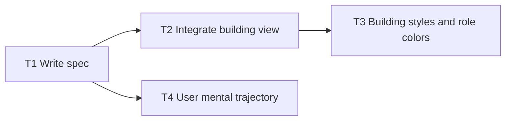

# 0034 · Frontend Agent Company Building View and User Mental Trace

<!-- This file is maintained by the spec tool: the frontmatter contains structured source data (including the tasks DAG), and the body is the group-level nine-section rust-RFC overview. -->

## Summary

This group reconnects the historically available “Agent Company building on the left” observation experience, which was overwritten by later frontend refactors, using the current API/types, rather than restoring the old town or old building commits wholesale. The default entry point remains the current column-based board; a new `view=building` mode enables entry into the 2.5D company building view through the top “Board / Building” switch. The building displays layers by requirement-facing role: User, Triage, Divergence, Design, Admission, and the delivery-facing layer aligned with spec-0032 (OpenAgents/PR/main progression). The right side continues to reuse the existing SidePanel, including the Issues/Main and delivery-facing PR panels.

At the same time, this group adds a concise “User Mental Trace” to user session details: it reads the backend’s existing `sim_trace`, showing one summary line per turn by default, and expanding to display the user’s internal judgment, original intent, action convergence, and private verification process in three sections: Judge / Intent / Act. This change adds no backend API and does not change the session storage structure.

## Motivation

The current remote frontend is a column-based board with high information density, but it lacks the spatial metaphor of a “company/floor.” Historically, there were two directions: a town map (`37b8960`) and a company building (`aca2569`/`b4e72b`). The user explicitly wants “a building on the left / Agent Company,” not a Stanford town map. Directly reverting old commits is inappropriate: the old implementation supports only `user/developer` or the old role set, and would overwrite the capabilities for current three-plane issues, Owner, divergent, the delivery surface, commit/detail, and related functionality.

Meanwhile, the current user details show only the transcript, making it difficult to explain why the user gave a low score, why they opened an issue, or what they actually want while waiting. Starting from spec-0024, the backend has already persisted `sim_trace`, including `perceive/verdict/action/message/patience/trust/persona_trace` for each round, so the frontend can display it without a new interface. Treating the mental trace as an explanatory layer in the details can help assess whether user simulation is realistic and whether it collapses under prompt guidance; it can also help subsequent designers or human reviewers determine whether a harness problem comes from user misunderstanding, insufficient harness capability, or interaction latency.

## Guide-level explanation

Users still open the column-based board by default:

```text
http://localhost:5173/
```

New building view:

```text
http://localhost:5173/?view=building
```

The page header adds a “Board / Building” switch. The left side of the building view is a 2.5D building, with floors displayed from top to bottom by role. Clicking a floor displays that role’s current live agents or archived workstations in the floor workspace on the right; clicking a workstation continues to reuse the existing SidePanel to show complete details. When no agent is running, the building automatically displays the most recently archived round, so users do not see an empty building; under the “+ Completed” aggregate of all rounds, the floor also displays the most recently archived clickable workstation.

The user session detail structure becomes:

```text
Persona
Scenario
User experience evaluation
Complete dialogue
User mental trajectory
```

“User Mental Trace” displays only one summary line per round by default; expanding a round displays:

```text
① Judge: perceive / verdict or waiting judgment
② Intent: original desire
③ Act: action / message / gap
Private verification process (if any): tool / tool_result / tool_error
```

## Reference-level explanation

### Building view data model

`App.tsx` adds `getConfig()` to the existing polling, reading the roster; it retains the `getDelivery()` delivery-facing data and passes it to `SidePanel`. A new `ViewMode = "dashboard" | "building"` writes `view=building` and `floor=<role>` to the URL query, so refreshing does not lose state.

The building view is composed by `BuildingView`:

```text
BuildingView
  ├─ BuildingTower       # SVG 2.5D building, displaying capacity/on-duty/archived counts by role floor
  └─ FloorWorkspace      # Current-floor workstations, archived workstations, recent activity
buildingModel.ts         # mode/floor models/log summary/historical archive selection
```

`resolveBuildingMode()` determines the live state using `agent.running` rather than `agents.length`. This resolves the case where the backend’s `/api/agents` may retain a completed `running=false` slot, causing the building to incorrectly treat it as live mode and making the user’s archived workstation unclickable.

### Role and delivery-surface semantics

The building retains `developer` role as a compatibility field, but the UI wording changes to “Delivery”:

- Floor name: Delivery.
- subtitle: OpenAgents PR / main progression.
- Workspace label: DELIVERY / OpenAgents / PR flow.

The reason is that spec-0032 has shifted the developer-side track to OpenAgents vigil. Current execution progress should therefore center on PR/needs-human/main merge, rather than an in-process developer agent.

### User mental trace

The frontend adds these types:

```ts
PersonaCallTrace
SimTurn
SimTrace
SessionDetail.sim_trace?: SimTrace | null
```

The `MindTrace` component of `SessionDetailView` searches by `SimTurn.persona_trace[].role`:

- main phase: `main_judge` / `main_intent` / `main_act`
- waiting phase: `waiting_judge` / `waiting_intent` / `waiting_act`

The summary displays only stable fields: turn, phase, verdict/judgment, truncated intent, and action. When expanded, it displays parsed content in three sections; if parsed content is missing, it falls back to `turn.perceive` / `turn.action` / `turn.message`. Private verification steps come from `persona_trace[].steps` and are rendered using the existing `ProcessStream`, avoiding the creation of a new process-stream component.

### DAG / file allocation



| Task | Responsibility | files |
|------|------|-------|
| T1 | Write the 0034 active snapshot | `docs/specs/0034-frontend-agent-company-building.md` |
| T2 | Integrate BuildingView, TopBar switch, App URL state, and current role/delivery-surface semantics | `App.tsx`, `TopBar.tsx`, `BuildingView.tsx`, `components/building/*`, `types.ts` |
| T3 | Building CSS, divergent/owner colors, and floor-text legibility | `styles.css` |
| T4 | SessionDetail mental trace | `SessionDetail.tsx` |

Note: According to the spec conventions, task files within the group remain mutually exclusive. The `SimTrace` DTO in `types.ts` belongs to T2, while the building and mental-trace styles in `styles.css` belong to T3; T4 only consumes these contracts and composes the display in `SessionDetail.tsx`.

### Verification path

```bash
cd frontend
npm run build
```

Manual acceptance:

- `http://localhost:5173/` The default column-based board remains unchanged.
- `http://localhost:5173/?view=building` displays the Agent HQ building.
- The top allows switching between “Board / Building.”
- The divergent floor color is clear and does not overlap the text.
- When no agent is running, the most recently archived round is displayed automatically, and the archived workstation is clickable.
- User session details first display the complete conversation, followed by a collapsible user mental trace.
- When `sim_trace` is present, Judge / Intent / Act can be expanded; when `sim_trace` is absent, the block is not displayed and no error is raised.

## Drawbacks

- Supporting both the building view and the column-based board increases the frontend maintenance surface.
- The current mental trace is still a concise version, primarily displaying parsed fields and the number of private steps; advanced filtering, search, and timeline alignment have not yet been implemented.
- The building styles were migrated from a historical version, so there is substantial CSS that remains in the global `styles.css`; it can be extracted into a namespaced file later.
- `developer` remains named role at the type level, while its UI semantics have changed to Delivery, creating a minor naming inconsistency.

## Rationale and alternatives

### Why not restore the town

The user wants an Agent Company building on the left, not the town map in `37b8960`. The town implementation also depends on the old `user/developer` two-role model; restoring it directly would damage the current three-plane/Owner/OpenAgents delivery-surface capabilities.

### Why not replace the default board

The column-based board remains the most information-dense and stable view for debugging. The building view is better suited to demonstrations and spatial understanding, so it should be an optional view under `view=building` rather than replace the default entry point.

### Why not change the backend API

The backend already provides the data required by the building: `/api/agents`, `/api/history`, `/api/config`, `/api/overview`, `/api/delivery`, and `/api/sessions/{id}`. The user mental trace is already present in session `sim_trace`, so no new interface is needed.

## Prior art

- 0011: AgentBoard cartoon page, which established that agent activity needs more intuitive identity and state expression.
- 0026: Frontend observation-board refactor, which established design tokens, light/dark themes, role rooms, and persona displays.
- 0029: Three-plane issue flow and Owner room.
- 0032: Developer-side shift to OpenAgents, with frontend delivery-surface PR observation added; this group synchronizes the building’s developer-floor semantics to Delivery.
- Historical commits `aca2569` / `b4e72b`: company building view prototypes.

## Unresolved questions

- Whether to extract the building CSS from `styles.css` into a separate namespaced file.
- Whether to rename `developer` role to `delivery` at the frontend type level, or continue supporting the backend’s historical field.
- Whether the user mental trace needs advanced interaction: filtering by phase, search, or showing only gap / stuck / private tools.
- Whether to also display a partial mind trace in live user details, rather than only in archived session details.

## Future possibilities

- Embed PR/needs-human status directly into the Delivery floor in the building, rather than relying only on the SidePanel.
- Link the user mental trace and the complete conversation bidirectionally: clicking a transcript turn automatically expands the corresponding mind turn.
- Display the latest intent/action summary on the workstation card in the user floor.
- Humanize waiting history and distinguish “waiting for a decision” from “main loop decision” in the mental trace.
