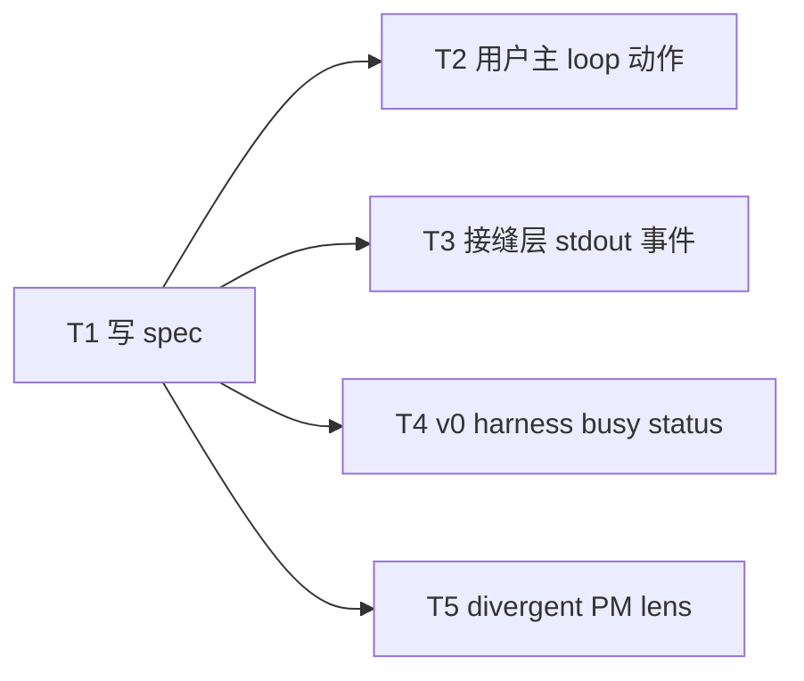

# 0035 · stdout 可见 harness 状态与主 loop 等待/打断动作

<!-- 本文件由 spec 工具维护：frontmatter 为结构化源数据（含 tasks DAG），正文为组级 rust-RFC 9 段总览。 -->

## Summary

本组解决用户模拟对 harness 回复轮次滞后的弱感知问题。现行心跳允许用户在 harness 忙碌时继续 `send_message`，但 v0 harness 会把这条消息排到后续处理；当上一条主回复先返回时，用户容易把会话误判为空闲并继续发新消息，后续回复又可能来自之前排队的输入。用户和设计师因此只能看到「证据不够 / 回答含糊」，难以捕捉真实体验问题：harness 当前正在处理什么、用户输入是否静默排队、输出顺序是否让人困惑。

本组不让接缝层做 request/reply 配对，也不固化当前 v0 harness 的 FIFO 队列模型。原则是：stdout 是 harness 的用户可见界面；接缝层只按观察顺序收集并展示 harness stdout 上真实出现的 reply/progress/status/ack/error 等可见事件；用户 agent 根据这些事件自行判断是继续等待、打断、追问还是验收。为使用户在主 loop 中也能表达真实 CLI 行为，ACTIVE 动作空间常驻 `keep_waiting` 与 `interrupt`。v0 harness 则补最小 busy 输入可见性：busy 时收到新 message 不再静默排队，而是输出 queued/status 事件，如实说明收到、排队、正在处理或正在运行什么。

## Motivation

### 与诊断观测的目标边界

本组的用户侧状态反馈服务于使用当下的判断：用户在何时需要知道什么，才能决定继续等待、
补充要求、打断或接受结果。0061 的设计开发侧诊断观测服务于维护者还原经过、区分原因和
验证改动。分类依据是信息服务谁、支持什么判断；发现者的角色和底层事件来源不决定类别。

用户反馈不足沿用普通 report → Triage proposal 或独立 PM proposal 路线，可以凭用户实际
收到的内容和时序成立，不以先查清内部根因为前置条件。维护者缺少证据则按 0061 提交诊断
观测补强；用户体验正常时也可以独立成立。同一问题同时涉及两者时，可以关联提案或共享
一次实现，但交接和验收分别保留目标，不自动建立依赖或要求拆票。

用户反馈验收检查真实界面在决策时刻是否给出准确、及时、足以支持所需判断的信息；后台
存在日志、维护者事后能够解释经过，不能代替此项验收。反过来，进度提示也不能证明诊断
记录足够。沿用工程行为验证，用户体感继续作为观测，不恢复体感发版门禁。

### 回复轮次滞后的机制问题

现行 0022 明确承认：in-flight `emit_message` 在 v0 entry 上可能排入下一轮请求队列，且「是否要协调主线 reply 与排队 mid-flight message 以免抢 reply」仍是未决问题。实际链路如下：

```text
用户发 #1：处理 A
harness 忙碌中
用户 waiting 发 #2：核实 A
harness 先回 #1：得到 B
用户看到 B 后发 #3：核实 B
harness 后续输出可能仍来自 #2
```

如果用户模拟只把 latest final reply 作为感知输入，就会错过真实 CLI 中可见的持续状态：busy 输入是否收到、是否排队、当前是否正在处理 queued work、是否正在跑测试或执行过时命令。用户会把旧回复当作当前状态的一部分，设计师也难以把低分或追问归因到「轮次滞后 / 状态不可知」。

### 不让接缝层配对

一个直接方案是让接缝层给每条用户消息和 harness reply 做 `answers #N` 配对。但这会把当前 v0 harness 的串行 FIFO 模型固化进平台。一旦 harness 未来进化出 `/btw`、ack/status/reply 分层、并发处理、乱序完成、一条回复覆盖多个用户消息等产品语义，接缝层推断就可能误导用户。

因此本组选择暴露可见事实而非推断语义：harness 如实通过 stdout 表达自己正在做什么；接缝层原样收集；用户和设计师从事件流中判断体验。

## Guide-level explanation

用户会话上下文从「只看上一条 harness_output」扩展为「看自上次决策以来的 harness 可见事件」。事件来自 harness stdout，按客户端观察顺序排列，例如：

```text
[+90s] harness status: [queued] I am still working on your previous request; this message has been queued.
[+130s] harness reply: Feature A is complete. The result is B.
[+131s] harness progress: Running: pytest tests/test_validation.py -q
```

接缝层不写：

```text
harness reply answers #2
#3 is still pending
```

除非这些语义是 harness 自己在 stdout 中说出来的。否则用户只看到真实事件，并自行判断。

主 loop 中，用户除了继续 `send_message`、验收或终止，也可以：

- `keep_waiting`：不发新消息，等下一条 harness 输出。适用于 stdout 显示 harness 正在做用户想要的工作，例如正在跑验证测试。
- `interrupt`：立即停止当前或 ongoing harness 工作，不等待 harness 读到一条新的聊天消息。适用于 stdout 显示 harness 正在做过时、跑偏或用户不再想要的工作，例如已撤回的 formatting rewrite。

例如，history 中用户已撤回 formatting，stdout 如实显示：

```text
[+131s] progress: Running: black .
[+132s] progress: Rewriting files for formatting...
```

用户可选择 `interrupt`。反之，若用户要求验证 B，stdout 如实显示：

```text
[+131s] progress: Running: pytest tests/test_validation.py -q
[+132s] progress: Collecting validation tests...
```

用户可选择 `keep_waiting`。

## Reference-level explanation

### 用户侧动作空间

`ACTIVE` 阶段动作空间常驻：

```text
send_message
keep_waiting
interrupt
accept
accept_with_reservations
file_issue
give_up
```

`OPENING` 仍只允许 `send_message`，避免还未发任务就验收或等待。

动作语义：

| action | 语义 |
|---|---|
| `send_message` | 向 harness 发送一条自然语言消息；若 harness 正忙，该消息可能稍后才被读到。 |
| `keep_waiting` | 不发送新消息，等待下一条 harness stdout 可见输出。 |
| `interrupt` | 立即停止当前或 ongoing harness 工作，不等待 harness 读到新消息；返回 interrupt ack 后回到主 loop。 |
| terminal actions | 会话收场，不驱动 harness。 |

`interrupt` 后 harness 返回的信息作为可见输出进入下一轮主 loop；它不是会话终止。

### 接缝层 stdout 事件

接缝层维护「可见事件流」，事件来源为 harness stdout。事件至少包括：

```text
reply
progress
status
ack
error
```

每个事件保留：

```text
type / text / observed_at / source=harness_stdout / raw payload
```

接缝层不新增 `answers_utterance_id`、`reply_to`、`pending_user_messages` 等配对推断字段。已有 TurnLog 的 utterance 观测字段可保留作历史兼容，但用户感知与 synthesizer 机制信号不依赖接缝层配对。

收到 terminal reply 后，接缝层可以短暂 drain 已经到达的旁路 stdout 事件，以捕捉紧邻的 status/progress，例如：

```text
reply: A complete
status: Now handling queued message...
```

该 drain 不等待下一条 terminal reply，不主动向 harness 查询，不改变 harness 编排。

### v0 harness busy 输入可见性

v0 harness 需要补最小用户可见性，而不是补复杂协议。busy 期间 `_stdin_reader` 收到新 message 时，harness 应通过 stdout 输出 queued/status 事件，例如：

```text
[queued] I am still working on the previous request; this message has been queued.
```

当前 reply 结束后，主 loop 开始处理 queued message 时，输出如实 status/progress：

```text
[status] Now handling queued message: <message preview>
```

或更低层的真实动作：

```text
Running: pytest tests/test_validation.py -q
Running: black .
```

v0 不需要实现 `/btw` 同轮旁路问答，也不需要输出 request/reply 配对；它只需要避免 busy 输入静默排队，让用户能看到 harness 当前正在做什么。

### Discovery-side consumption

stdout 可见事件与主 loop 等待/打断动作会改变 PM 可观察到的会话证据形态。divergent PM 因此补一层中性的发现 lens，但不直接喂 soft gap 结论：分析会话时先区分上下文、证据、解释与候选；上下文包括用户画像与目标、任务与环境约束，证据包括用户行为、harness 可见输出、harness 实际执行轨迹，解释阶段比较证据是否一致并识别跨会话稳定模式，候选阶段只在证据足够且指向可改进产品行为时形成提案。

用户可见契约仅作为组织观察的 lens，覆盖请求接收/排队、状态可见性、控制/steering、验证证据、恢复连续性、完成交接、可发现性与能力边界；该 lens 不预设这些方面一定存在问题，也不预设具体方案。候选应优先来自跨会话重复、跨 persona 重复，或单局影响强且证据清楚的模式，并描述可独立验证的产品行为变化，避免换名重复。

### DAG / file allocation



| Task | 职责 | files |
|---|---|---|
| T1 | 写活快照 | `docs/specs/0035-stdout-visible-harness-state.md` |
| T2 | 主 loop 常驻 `keep_waiting` / `interrupt`，动作语义与 route | `user/sim/actions.py`, `action_space.py`, `prompt.py`, `loop.py`, user sim tests |
| T3 | 接缝层收集 stdout 可见事件流，不做配对推断 | `harness/launcher.py`, `connector.py`, `models.py`, harness tests |
| T4 | v0 harness busy 输入 queued/status 可见性 | `harness_template/entry.py`, `RUNTIME.md`, `HELP.md`, smoke tests |
| T5 | divergent PM 分层发现 lens | `backend/agent_defs/divergent_pm/systemprompt.md` |

### 验证路径

```bash
.venv/bin/python -m pytest backend/tests/user/sim/test_action_space.py backend/tests/user/sim/test_heartbeat.py
.venv/bin/python -m pytest backend/tests/harness/test_launcher.py backend/tests/harness/test_connector.py
.venv/bin/python -m pytest backend/harness_template/tests/test_smoke.py
```

行为探针应覆盖：

- stdout 显示正在跑用户想要的验证测试 → 用户倾向 `keep_waiting`。
- history 显示用户已撤回 formatting，stdout 仍显示 `black .` → 用户可选择 `interrupt`。
- stdout 含糊或无状态 → 用户可继续 `send_message` 追问；这是有效体感信号。

## Drawbacks

- v0 harness 需要增加少量 stdout 状态输出，种子不再是完全沉默的串行队列。
- 用户可见事件流比单 `harness_output` 更长，prompt 与前端展示需要控制摘要长度。
- `keep_waiting` 常驻 ACTIVE 后，少数场景可能空等；route 必须把 idle wait 作为安全 no-op 或短等待处理。
- stdout status 的质量由 harness 决定；若 harness 不输出状态，用户仍只能从 reply 文本判断。这是保留进化空间的代价。
- divergent PM 的用户可见契约 lens 可能改变候选分布：更稳定地发现恢复/完成/交接类机会，但也可能弱化 focused verification 等执行策略类机会；需要多轮观察。

## Rationale and alternatives

### 为什么不在接缝层配对 reply

配对方案能短期提升用户感知，但会把平台绑定到当前 harness 的 FIFO 假设。auto-designer 的被进化对象是 harness 产品本身，未来它应能自由进化 busy 输入、旁路问答、并发、ack/status/final 分层等交互。接缝层若抢先解释「这条 reply 回答 #N」，会成为新的错误来源。

### 为什么选择 stdout 可见事件

stdout 是 harness 对用户的真实界面。真实 CLI 用户不是只看到 final reply，还会看到 progress、queued ack、status、正在运行的命令等流式状态。把这些事件提供给用户模拟，能让用户自然判断是等待、打断还是追问，也能让 synthesizer 从用户行为中看到状态可知性问题。

### 为什么主 loop 也需要 keep_waiting/interrupt

收到一个 terminal reply 不等于 harness 已经 idle。若紧随其后有 stdout status 表明 harness 正在处理 queued work，用户仍处于「等待下一条可见结果」状态。主 loop 若没有 `keep_waiting` / `interrupt`，用户只能继续 `send_message` 或终止，容易把队列越堆越乱。

### 为什么 v0 需要 busy status

理论上 harness 可自发进化出 busy 输入可见性，但如果种子静默排队，用户和设计师会长期只看到「证据不足 / 回答含糊」，不容易定位到状态不可知性。busy 输入可见性是最小 CLI 产品起点：用户在工具忙时继续输入，工具至少应告诉用户该输入已收到、排队或正在处理。

### 为什么给 divergent PM 加 lens 而不是喂 soft gap evidence

人工整理 soft gap evidence 能证明 PM 能理解这类证据，但会把注意力预先筛到某类行为。T5 只给 PM 一个中性的分层观察方法和用户可见契约 lens，不给具体结论、功能名或命令名；PM 仍需从体感曲线和 timeline 工具中自行下钻、比较证据并决定是否形成候选。

## Prior art

- 0012：心跳与等待决策。
- 0013：present/progress 与 interrupt 语义。
- 0022：用户↔harness 内外通道，明确 in-flight `emit_message` 可能排入 v0 下一轮，并把「协调主线 reply 与排队 mid-flight message」列为未决问题。
- 0024：TurnLog 中的 `utterance_id/queued_behind/answers_*` 观测字段；本组不废弃这些字段，但不把它们作为用户感知的配对真相。
- Claude Code / Codex 类 CLI：busy 时用户输入通常会有 queued/next-turn/ongoing work 的可见状态或行为反馈。

## Unresolved questions

- stdout 事件流在 session 存储中的长期字段名与截断策略：是否新增 `harness_events`，或先复用 `harness_steps/last_progress`。
- reply 后短 drain 的窗口多长合适，如何避免拖慢大量并发 session。
- v0 busy status 是纯文本 `[queued]` / `[status]`，还是结构化 JSON `type=status`；初始可先兼容两者。
- 前端/设计师侧是否需要专门突出 `keep_waiting` / `interrupt` 触发前后的 stdout 事件。

## Future possibilities

- harness 自行进化 `/btw` 旁路问答：仍通过 stdout 可见事件表达，不要求接缝层配对。
- harness 未来若自愿输出 `reply_to` / `relates_to`，接缝层可原样展示为 harness 声明的产品语义，但不作为平台推断。
- 设计师 timeline 可聚合「用户因 stdout 跑偏而 interrupt」「用户因 stdout 正在验证而 keep_waiting」等体验信号。
- 前端会话详情以事件流方式展示 harness stdout，帮助人类观察用户为什么等待、打断或追问。
- 接缝层统一写入口（去 begin/emit 二分）、以 `type=reply` 为软唤醒：见后续 spec「unify-harness-stdin-write」。
