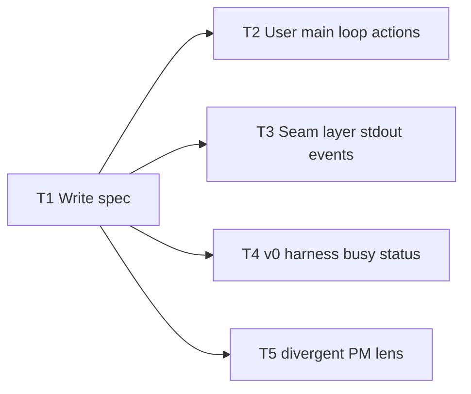

# 0035 · stdout-visible harness state and main loop wait/interrupt actions

<!-- This file is maintained by the spec tool: frontmatter is structured source data (including the tasks DAG), and the body is a nine-section group-level rust-RFC overview. -->

## Summary

This group addresses the limited visibility that the user simulation has into lagging harness reply turns. The current heartbeat allows the user to continue to `send_message` while the harness is busy, but the v0 harness queues that message for later processing; when the previous main reply arrives first, the user can easily mistake the session for idle and send another message, while subsequent replies may come from previously queued inputs. As a result, users and designers can see only 「insufficient evidence / ambiguous answers」 and have difficulty capturing the actual user experience: what the harness is currently processing, whether user input is silently queued, and whether the output order is confusing.

This group does not make the seam layer pair requests and replies, nor does it cement the current v0 harness FIFO queue model. The principle is: stdout is the harness's user-visible interface; the seam layer only collects and presents visible events such as reply/progress/status/ack/error that actually appear on harness stdout, in observation order; the user agent decides from these events whether to continue waiting, interrupt, ask a follow-up, or accept the result. To allow the user to express actual CLI behavior in the main loop as well, `keep_waiting` and `interrupt` are always available in the ACTIVE action space. The v0 harness adds minimal visibility into busy input: when a new message arrives while busy, it is no longer silently queued; instead, the harness emits queued/status events that accurately describe what was received, queued, being processed, or running.

## Motivation

### Boundary with diagnostic observability goals

This group's user-side state feedback supports decisions at the time of use: what users need to know and when, so they can decide whether to continue waiting,
add requirements, interrupt, or accept the result. The design and development diagnostic observability in 0061 helps maintainers reconstruct what happened, distinguish causes, and
verify changes. The classification depends on whom the information serves and what decisions it supports; the discoverer's role and the underlying event source do not determine the category.

Insufficient user feedback follows the ordinary report → Triage proposal or independent PM proposal route, and can be established from what the user actually
received and when, without first determining the internal root cause. When maintainers lack evidence, they submit diagnostic
observability improvements under 0061; these can also stand independently when the user experience is normal. When the same issue involves both, proposals may be linked or
an implementation shared, but handoff and acceptance retain separate goals, with no automatic dependency or requirement to split issues.

User feedback acceptance checks whether the actual interface provides accurate, timely information sufficient to support the required decision at the decision point; the existence of backend
logs and maintainers' ability to explain what happened afterward cannot substitute for this acceptance check. Conversely, progress indicators cannot prove that diagnostic
records are sufficient. Engineering behavior verification remains in use, and user experience continues to be observed without reinstating an experience-based release gate.

### The mechanism behind lagging reply turns

The current 0022 explicitly acknowledges that an in-flight `emit_message` may be queued for the next request round on the v0 entry, and that 「whether to coordinate the main reply with queued mid-flight messages to prevent them from racing for the reply」 remains unresolved. The actual flow is as follows:

```text
User sends #1: handle A
harness is busy
While waiting, user sends #2: verify A
harness first replies to #1: got B
After seeing B, user sends #3: verify B
Subsequent harness output may still come from #2
```

If the user simulation uses only the latest final reply as perceptual input, it will miss ongoing state visible in a real CLI: whether busy input was received, whether it was queued, whether queued work is currently being processed, and whether tests or obsolete commands are running. Users will treat an old reply as part of the current state, and designers will have difficulty attributing low scores or follow-up questions to 「turn lag / unknown state」.

### Do not pair at the seam layer

One straightforward approach is to have the seam layer perform `answers #N` pairing for each user message and harness reply. But this would cement the current v0 harness's serial FIFO model into the platform. If the harness later evolves product semantics such as `/btw`, ack/status/reply layering, concurrent processing, out-of-order completion, or one reply covering multiple user messages, seam-layer inference could mislead users.

This group therefore chooses to expose visible facts rather than infer semantics: the harness truthfully expresses what it is doing through stdout; the seam layer collects it as is; users and designers judge the experience from the event stream.

## Guide-level explanation

The user session context expands from 「seeing only the previous harness_output」 to 「seeing harness-visible events since the last decision」. Events come from harness stdout and are ordered by client observation, for example:

```text
[+90s] harness status: [queued] I am still working on your previous request; this message has been queued.
[+130s] harness reply: Feature A is complete. The result is B.
[+131s] harness progress: Running: pytest tests/test_validation.py -q
```

The seam layer does not write:

```text
harness reply answers #2
#3 is still pending
```

unless the harness itself expresses those semantics on stdout. Otherwise, the user sees only actual events and makes their own judgment.

In the main loop, in addition to continuing to `send_message`, accepting the result, or terminating, the user can:

- `keep_waiting`: Send no new message and wait for the next harness output. Appropriate when stdout shows the harness doing work the user wants, such as running verification tests.
- `interrupt`: Immediately stop current or ongoing harness work without waiting for the harness to read a new chat message. Appropriate when stdout shows the harness doing obsolete or off-track work, or work the user no longer wants, such as a formatting rewrite that has been withdrawn.

For example, the user has withdrawn formatting in history, and stdout truthfully shows:

```text
[+131s] progress: Running: black .
[+132s] progress: Rewriting files for formatting...
```

The user can choose `interrupt`. Conversely, if the user requested verification of B and stdout truthfully shows:

```text
[+131s] progress: Running: pytest tests/test_validation.py -q
[+132s] progress: Collecting validation tests...
```

The user can choose `keep_waiting`.

## Reference-level explanation

### User-side action space

The following are always available in the `ACTIVE` phase action space:

```text
send_message
keep_waiting
interrupt
accept
accept_with_reservations
file_issue
give_up
```

`OPENING` still allows only `send_message`, to avoid accepting a result or waiting before a task has been sent.

Action semantics:

| action | Semantics |
|---|---|
| `send_message` | Send a natural-language message to the harness; if the harness is busy, the message may not be read until later. |
| `keep_waiting` | Send no new message and wait for the next visible harness stdout output. |
| `interrupt` | Immediately stop current or ongoing harness work without waiting for the harness to read a new message; return to the main loop after the interrupt ack is returned. |
| terminal actions | Close the session without driving the harness. |

Information returned by the harness after `interrupt` enters the next main loop iteration as visible output; it does not terminate the session.

### Seam-layer stdout events

The seam layer maintains a 「visible event stream」 sourced from harness stdout. Events include at least:

```text
reply
progress
status
ack
error
```

Each event retains:

```text
type / text / observed_at / source=harness_stdout / raw payload
```

The seam layer does not add pairing inference fields such as `answers_utterance_id`, `reply_to`, or `pending_user_messages`. Existing TurnLog utterance observation fields may be retained for historical compatibility, but user perception and architect mechanism signals do not depend on seam-layer pairing.

After receiving a terminal reply, the seam layer may briefly drain side-channel stdout events that have already arrived to capture immediately adjacent status/progress, for example:

```text
reply: A complete
status: Now handling queued message...
```

This drain does not wait for the next terminal reply, actively query the harness, or change harness orchestration.

### v0 harness busy input visibility

The v0 harness needs minimal user-visible feedback, not a complex protocol. When `_stdin_reader` receives a new message while busy, the harness should emit a queued/status event through stdout, for example:

```text
[queued] I am still working on the previous request; this message has been queued.
```

After the current reply ends, when the main loop begins processing the queued message, emit truthful status/progress:

```text
[status] Now handling queued message: <message preview>
```

Or a lower-level actual action:

```text
Running: pytest tests/test_validation.py -q
Running: black .
```

v0 does not need to implement `/btw` same-turn side-channel Q&A or output request/reply pairing; it only needs to avoid silently queuing busy input and let users see what the harness is currently doing.

### Discovery-side consumption

stdout-visible events and main loop wait/interrupt actions change the form of session evidence observable by the PM. The divergent PM therefore adds a neutral discovery lens, but is not directly fed soft gap conclusions: when analyzing sessions, first distinguish context, evidence, interpretation, and candidates; context includes user personas and goals, and task and environment constraints; evidence includes user behavior, harness-visible output, and the harness's actual execution trace; the interpretation stage compares evidence for consistency and identifies stable cross-session patterns; the candidate stage forms proposals only when evidence is sufficient and points to improvable product behavior.

The user-visible contract is only a lens for organizing observations, covering request receipt/queuing, state visibility, control/steering, verification evidence, recovery continuity, completion handoff, discoverability, and capability boundaries; this lens does not assume that these areas necessarily have problems or prescribe specific solutions. Candidates should primarily come from patterns repeated across sessions or personas, or patterns with a strong impact in a single session and clear evidence, and should describe independently verifiable product behavior changes while avoiding duplicates under different names.

### DAG / file allocation



| Task | Responsibility | files |
|---|---|---|
| T1 | Write the live snapshot | `docs/specs/0035-stdout-visible-harness-state.md` |
| T2 | Always make `keep_waiting` / `interrupt` available in the main loop, including action semantics and routing | `user/sim/actions.py`, `action_space.py`, `prompt.py`, `loop.py`, user sim tests |
| T3 | Have the seam layer collect the stdout-visible event stream without pairing inference | `harness/launcher.py`, `connector.py`, `models.py`, harness tests |
| T4 | v0 harness busy input queued/status visibility | `harness_template/entry.py`, `RUNTIME.md`, `HELP.md`, smoke tests |
| T5 | divergent PM layered discovery lens | `backend/agent_defs/divergent_pm/systemprompt.md` |

### Verification path

```bash
.venv/bin/python -m pytest backend/tests/user/sim/test_action_space.py backend/tests/user/sim/test_heartbeat.py
.venv/bin/python -m pytest backend/tests/harness/test_launcher.py backend/tests/harness/test_connector.py
.venv/bin/python -m pytest backend/harness_template/tests/test_smoke.py
```

Behavioral probes should cover:

- stdout shows that the harness is running verification tests the user wants → the user tends to choose `keep_waiting`.
- history shows that the user has withdrawn formatting, but stdout still shows `black .` → the user can choose `interrupt`.
- stdout is ambiguous or has no state information → the user can continue to `send_message` to ask a follow-up; this is a valid user experience signal.

## Drawbacks

- The v0 harness needs to add a small amount of stdout status output; the seed is no longer a completely silent serial queue.
- The user-visible event stream is longer than a single `harness_output`, so prompt and frontend presentation need to control summary length.
- Once `keep_waiting` is always available in ACTIVE, a few scenarios may involve waiting idly; the route must handle idle wait as a safe no-op or a short wait.
- The quality of stdout status is determined by the harness; if the harness emits no status, the user can still judge only from reply text. This is the cost of preserving room for evolution.
- The divergent PM's user-visible contract lens may change the distribution of candidates: it may more consistently uncover recovery/completion/handoff opportunities, but may also weaken execution-strategy opportunities such as focused verification; observation over multiple rounds is needed.

## Rationale and alternatives

### Why not pair replies at the seam layer

Pairing can improve user perception in the short term, but it would bind the platform to the current harness's FIFO assumption. The object of evolution in ahe-beta is the harness product itself; in the future it should be free to evolve interactions such as busy input, side-channel Q&A, concurrency, and ack/status/final layering. If the seam layer preemptively interprets 「this reply answers #N」, it will become a new source of error.

### Why choose stdout-visible events

stdout is the harness's actual interface to the user. Real CLI users see not only final replies, but also streaming state such as progress, queued ack, status, and commands being run. Providing these events to the user simulation lets users naturally decide whether to wait, interrupt, or ask a follow-up, and lets the architect see state visibility problems in user behavior.

### Why the main loop also needs keep_waiting/interrupt

Receiving a terminal reply does not mean the harness is already idle. If a stdout status immediately afterward indicates that the harness is processing queued work, the user is still 「waiting for the next visible result」. Without `keep_waiting` / `interrupt` in the main loop, the user can only continue to `send_message` or terminate, making the queue increasingly chaotic.

### Why v0 needs busy status

In theory, the harness could spontaneously evolve busy input visibility, but if the seed silently queues inputs, users and designers will continue to see only 「insufficient evidence / ambiguous answers」 for a long time, making it difficult to identify the lack of state visibility. Busy input visibility is a minimal starting point for a CLI product: when a user continues typing while the tool is busy, the tool should at least tell the user that the input has been received, queued, or is being processed.

### Why add a lens for the divergent PM instead of feeding it soft gap evidence

Manually curated soft gap evidence can demonstrate that the PM can understand this kind of evidence, but it would pre-filter attention toward certain kinds of behavior. T5 gives the PM only a neutral layered observation method and a user-visible contract lens, not specific conclusions, feature names, or command names; the PM must still drill down using the experience score curve and timeline tools, compare evidence, and decide whether to form a candidate.

## Prior art

- 0012: Heartbeat and wait decisions.
- 0013: present/progress and interrupt semantics.
- 0022: User↔harness internal and external channels, explicitly acknowledging that in-flight `emit_message` may be queued for the next v0 turn and listing 「coordinating the main reply with queued mid-flight messages」 as an unresolved question.
- 0024: `utterance_id/queued_behind/answers_*` observation fields in TurnLog; this group does not deprecate these fields, but does not treat them as pairing ground truth for user perception.
- Claude Code / Codex-like CLIs: User input while busy usually has visible queued/next-turn/ongoing work status or behavioral feedback.

## Unresolved questions

- Long-term field name and truncation policy for the stdout event stream in session storage: whether to add `harness_events` or reuse `harness_steps/last_progress` initially.
- How long the short drain window after reply should be, and how to avoid slowing down large numbers of concurrent sessions.
- Whether v0 busy status should be plain text `[queued]` / `[status]` or structured JSON `type=status`; initially, both can be supported.
- Whether the frontend/architect side needs to specifically highlight stdout events before and after `keep_waiting` / `interrupt` is triggered.

## Future possibilities

- The harness independently evolves `/btw` side-channel Q&A: still expressed through stdout-visible events, without requiring pairing by the seam layer.
- If the harness voluntarily outputs `reply_to` / `relates_to` in the future, the seam layer can display them unchanged as product semantics declared by the harness, without treating them as platform inferences.
- The architect timeline can aggregate experience signals such as “the user interrupted because stdout went off track” and “the user chose keep_waiting because stdout showed verification in progress.”
- Frontend session details display harness stdout as an event stream, helping humans observe why users wait, interrupt, or ask follow-up questions.
- A unified write entry point in the seam layer (removing the begin/emit split), with `type=reply` as a soft wake-up: see the subsequent spec “unify-harness-stdin-write”.
