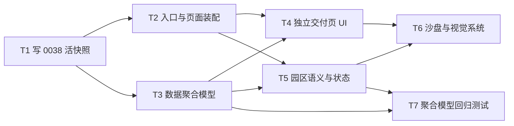

# 0038 · OpenAgents 交付面独立页面与园区入口

<!-- 本文件由 spec 工具维护：frontmatter 为结构化源数据（含 tasks DAG），正文为组级 rust-RFC 9 段总览。 -->

## Summary

本组为 auto-designer 增加一个只读 OpenAgents 交付观测面，并把原 Agent Company 大楼扩展为「需求面主楼 + OpenAgents 交付厂房」园区。独立页使用现有 Gitea-derived API 展示 `openagents → ready → PR → needs-human/conflict → main`，支持轮次过滤与 SidePanel 证据查看；园区以共享 2.5D 沙盘、可点击厂房、双停机坪、拱形航线和原生 SVG 运输机表达跨边界交接。它不新增后端 API，不读取 OpenAgents 内部运行态，不提供写操作，也不把视觉隐喻写成新的产品术语。

## Motivation

需求面由用户、分诊、发散、设计和 Owner 组成；Owner 准入后给 issue 加 `openagents` 交接令牌。进程外 OpenAgents vigil 发现该票，intake 后加 `ready`，随后创建分支和 PR，经 conflict、CI、review、needs-human 等工程闸推进，最终 merge 到 main。两面只通过 Gitea issue/PR 标签和 main SHA 交互，auto-designer 不拥有 vigil 的内部队列。

原前端把证据分散在 Issues、DeliveryPanel 和 Main commits：用户需要自行拼出「准入 → 接管 → PR → 卡点 → main」链路。原大楼又保留一个历史 `developer` 楼层，容易让人误以为交付仍是主楼内部角色。需要同时解决两个问题：用独立页面讲清真实交付状态；用园区空间关系说明 OpenAgents 是外部交付系统，而不是需求面中的另一个 agent。

独立页必须保持只读和低耦合，只使用 auto-designer 已有 API。园区视觉只能帮助理解边界：正式文案继续使用 `openagents`、`ready`、PR、needs-human、main、Owner、vigil 等真实术语，不用「入库、出货、红牌、航站台」替代产品语义。厂房不展开 OpenAgents 内部角色，沙盘首版也不增加树木、路灯等无证据环境装饰。

## Guide-level explanation

用户仍可打开原有看板和大楼：

```text
/
/?view=building
```

新增 OpenAgents 页面：

```text
/?view=openagents
/?view=openagents&round=3
```

顶部页签为：

```text
看板 | 大楼 | OpenAgents
```

进入 OpenAgents 页后，页面展示五段只读流程：

```text
openagents → ready → PR → needs-human / conflict → main
```

- `openagents`：Owner admit 后打上的交接令牌。
- `ready`：OpenAgents/vigil 可处理或已 intake 后的工作队列投影。
- `PR`：`/api/delivery` 返回的 open PR。
- `needs-human / conflict`：交付面需要人工处理或 mergeability 明确冲突的卡点。
- `main`：最近 main commits 与 round anchor。

轮次下拉在 OpenAgents 页同样可用。选择某一轮时：issue 按 `round-N` 标签过滤；PR 按 `closes_issues` 关联到该轮 issue 过滤；commit 按 `/api/state.round_shas[N-1]` 匹配 anchor 过滤。选择「全部轮次」时展示当前可观测全量。

点击 issue 或 commit 仍使用现有 SidePanel 详情；点击 PR 打开 Gitea 外链。页面没有任何写操作。

大楼页标题为 `Agent Campus`。左侧沙盘包含：

```text
需求面主楼 ── 拱形交接航线 ── OpenAgents 厂房
     H                              H
```

- 两栋建筑落在同一个带厚度、边界、网格和内部通路的 2.5D 地块上。
- 主楼继续按需求面角色展示楼层；历史 `developer` 楼层在 UI 中解释为「交付边界」。
- 厂房是一个整体入口，不展示 OpenAgents 内部 worker 或流程楼层。
- 厂房显示当前 handoff、ready、open PR 和 needs-human 状态；这些是 live Gitea 聚合，不随大楼复盘轮次变化。
- 点击或键盘激活厂房进入 `?view=openagents`，当前 `round` 查询参数保持不变。
- 两个屋顶都有与各自透视面一致的 H 停机坪；存在 `openagents` 且尚无 `ready` 的 open issue 时，SVG 运输机沿拱形航线运动。系统偏好 reduced motion 时停止动画。

## Reference-level explanation

### 组件与数据边界

```text
App
├─ TopBar
│  └─ dashboard / building / openagents + round URL state
├─ OpenAgentsView
│  └─ buildOpenAgentsSnapshot
├─ BuildingView
│  ├─ getOpenAgentsFactorySummary
│  ├─ BuildingTower
│  └─ FloorWorkspace
└─ SidePanel
```

本组只消费既有前端 API client 返回值：

- `/api/issues` → `IssuesResponse`
- `/api/delivery` → `DeliveryResponse`
- `/api/commits` → `CommitsResponse`
- `/api/state` → `RunState`
- `/api/overview` → 既有 funnel 摘要

没有新增后端 endpoint，也不读取 OpenAgents `.openagents`、SQLite queue、worker stream 或 timing 文件。PR 仍由 Gitea URL 外链；issue/commit 仍通过现有 `Selection` 打开 SidePanel。

### URL 与装配

`ViewMode` 为 `dashboard | building | openagents`。`parseView()` 识别 `view=openagents`；URL 同步规则如下：

- dashboard 不写 `view`；
- building 写 `view=building&floor=<role>`；
- OpenAgents 写 `view=openagents`；
- 非 `all` 轮次统一写 `round=N`；
- selection 统一写 `sel=<type:value>`；
- OpenAgents 页不展示需求面「运行中 / + 已完成」开关，只展示轮次下拉。

厂房入口调用 App 提供的 `onOpenAgents()`，只改变 view，不重置 round，因此从 `?view=building&round=3` 进入后得到 `?view=openagents&round=3`。

### OpenAgents snapshot

`openAgentsModel.ts` 是不含 React 的纯模型。输入为 issues、delivery、commits、state 与 `round: all | number`，输出：

- 四个原始数据源状态；
- PR/commit 两个经过轮次依赖检查的 station source；
- handoff/ready/needs-human issue cards；
- PR cards 与可重叠的 needs-human/conflict 子集；
- main commit cards 与 round anchor；
- handoff、PR、needs-human、commit KPI；
- 当前轮次文案与 round SHA。

状态语义严格区分：

```text
null             = 仍在读取
connected=false  = 数据源断连
connected=true
  + []           = 已连接且真实为空
缺轮次关联依据     = unavailable
```

issue 阶段判定遵循交接协议：

1. 有 `ready` → ready；即使同时保留 `openagents`，也表示 vigil 已 intake。
2. 否则有 `openagents` → handoff。
3. 否则 `planeOf(issue) === "ready"` → legacy ready-plane。

handoff KPI 只统计第 2 类，不包含 ready 或 ready-plane。PR 的 needs-human 与 conflict 是两个独立维度：同一 PR 同时带 `needs-human` 且 `mergeable=false` 时，必须同时进入两个 gate 子集，不能用单一状态优先级丢掉 conflict。

指定轮次时：

- issue 用 `roundOf(issue) === N`；
- PR 必须通过 `closes_issues` 命中该轮 issue number；
- commit 必须命中 `state.round_shas[N-1]`；
- issues 断连时 PR station 为空且 unavailable；
- 缺 round SHA 时 commit station 为空且 unavailable；
- 不允许因过滤依据缺失而退回全量 PR 或 commit；
- 数据源断连或 station unavailable 时 KPI 为 `null/—`，不能显示误导性的 0。

### 独立交付页

`OpenAgentsView` 展示 source chips、四个 KPI、轮次/round SHA，以及五个站点：

```text
openagents | ready | PR | needs-human / conflict | main
```

卡片都来自 snapshot。IssueCard 与 CommitCard 写入既有 SidePanel selection；PullCard 只打开 `pull.url`。Gate station 同时观察 issue 与经过轮次校验的 PR source，任一依赖不可用时显示真实原因。页面不造 mock，不提供按钮修改 Gitea 状态。

### 园区与厂房状态

`BuildingView` 将大楼标题改为 `Agent Campus`，并用当前 issues/delivery 计算厂房摘要：

- handoff：open issue，含 `openagents` 且不含 `ready`；
- ready：open issue，含 `ready`；
- pulls：当前 open PR 数；
- needsHuman：delivery 聚合值；
- moving：`handoff > 0`；
- status：任一输入为 null → loading；任一 `connected=false` → disconnected；`needs_human > 0` → blocked；否则 ready。

厂房摘要是当前 live 交付状态，不使用大楼 replay/summary 的 round 过滤。这保证入口始终报告实际交付面，但也意味着复盘某一轮时，厂房数字可能来自更新后的全局状态。

历史 `developer` role 继续作为 DTO 兼容字段，UI 文案改为：

```text
交付面
交付边界 · Owner 准入与 OpenAgents vigil 接管
DELIVERY BOUNDARY / openagents 交接令牌
```

交付面工区使用 `OA` 字标，不使用卡车或飞机 emoji；园区航线上的运输机由 T6 的 SVG path 单独表达。

### 沙盘与航线

`BuildingTower` 在一个 SVG scene 中按从后到前的顺序绘制：

1. campus shadow；
2. 带前/侧厚度的等距地块；
3. 低对比网格、边界和内部通路；
4. 拱形航线；
5. OpenAgents 厂房；
6. 需求面主楼与楼层；
7. 双 H 停机坪和 SVG 运输机。

主楼与厂房保持视觉净空，厂房整组是 `role=button`，支持 click、Enter 和 Space。厂房只显示 OpenAgents、handoff/ready/PR、连接或 needs-human 状态，不显示内部 worker/角色。

两个 H 都用贴合各自屋顶投影的四边形，不使用悬浮椭圆。航线使用三次贝塞尔曲线从主楼停机坪向上拱起，再平滑落到厂房停机坪。运输机由仓内 SVG path 绘制，不依赖平台 emoji；只有 `moving=true` 时播放 CSS keyframes，`prefers-reduced-motion: reduce` 下禁用。

### DAG / file allocation



| Task | 职责 | 独占文件 |
|------|------|----------|
| T1 | 活快照与验证契约 | `docs/specs/0038-openagents-frontend-delivery-view.md` |
| T2 | ViewMode、URL、TopBar、App 装配 | `types.ts`, `App.tsx`, `TopBar.tsx` |
| T3 | OpenAgents snapshot | `openAgentsModel.ts` |
| T4 | 独立交付页 UI 组件 | `OpenAgentsView.tsx` |
| T5 | 厂房 live 状态与交付边界文案 | `BuildingView.tsx`, `FloorWorkspace.tsx`, `buildingModel.ts` |
| T6 | BuildingTower SVG 与本组全部样式 | `BuildingTower.tsx`, `styles.css` |
| T7 | 聚合模型 hermetic 回归测试与测试入口 | `package.json`, `package-lock.json`, `openAgentsModel.test.ts` |

组内文件所有权互斥。`issueMeta.ts`、`SidePanel.tsx` 和 API client 只是既有依赖，不列入本组任务所有权。

### 实现基线

本活快照根据已落地提交回写，而非描述未实现方案：

- `ee4219d`：独立 OpenAgents 页；
- `1fa22b2`：ready 优先、断连 KPI 与轮次过滤真值修复；
- `91e079a`：园区厂房入口；
- `5356e74`：建筑净空与主楼停机坪；
- `a15fcba`：共享沙盘底座；
- `bb604b5`：双停机坪、拱形航线与原生 SVG 运输机。

### 验证路径

本组没有新增独立 `scripts/*.sh` E2E 脚本；可执行验证入口为：

```bash
tools/spec-driven-development/spec validate
npm --prefix frontend test
npm --prefix frontend run build
```

手动验收：

- `/` 默认列式看板不变；
- `/?view=building` 展示 Agent Campus、共享底座、主楼和独立厂房；
- 厂房支持鼠标、Enter、Space 进入 OpenAgents；
- `/?view=building&round=1` 点击厂房后保留 `round=1`；
- `/?view=openagents` 展示五段真实交付流；
- `/?view=openagents&round=1` 不因缺关联依据泄漏全量 PR/commit；
- 两栋楼轮廓不遮挡，双 H 与屋顶透视一致，航线拱起且连接两个停机坪；
- reduced-motion 下运输机不运动；
- 浅色/深色主题均可读。

## Drawbacks

- 首版是结果态/观测态，不显示 vigil worker、SQLite queue、stage dwell time、agent stream 或 timing p50/p90。
- `/api/delivery` 只返回 open PR，页面无法计算历史吞吐、完成率或阶段耗时。
- 指定轮次的 PR 归属依赖 closing keywords；PR body 未声明 closes/fixes/resolves 时无法可靠归轮。
- 园区厂房显示 live 全局交付状态，不随大楼 replay round 过滤，复盘上下文可能出现时间口径差异。
- SVG 几何使用固定 viewBox 坐标；响应式依赖整体缩放，后续改楼体尺寸需要同步调整底座、道路、停机坪和航线。
- 独立页与园区样式仍集中在全局 `styles.css`，增加了前端样式维护面。

## Rationale and alternatives

### 为什么是独立页 + 园区入口

独立页负责高信息密度的交付链路，园区只负责系统边界和入口。把完整 PR/main 流塞进楼层或 SidePanel 会受窄宽限制，也会把「外部交付系统」误画成「需求面角色」。二层结构既保留空间心智，又不牺牲证据密度。

### 为什么只读 Gitea-derived API

auto-designer 已拥有 issues、open PR、main commits 和 run state。复用这些接口可以稳定表达跨系统结果，不需要耦合 OpenAgents daemon、进程内 ring buffer 或私有数据库。代价是看不到 worker 与阶段耗时，但符合当前只读观测边界。

### 为什么厂房不是第二栋角色楼

OpenAgents 内部如何分工属于其自身实现，不是 auto-designer 的需求面 roster。厂房因此只显示系统名、连接/阻塞状态和少量真实聚合；点击后进入独立页，不在外立面枚举虚构角色或流程。

### 为什么使用沙盘与 SVG，而不是 emoji 拼贴

共同地块、建筑净空和统一投影能建立园区尺度。停机坪必须贴合屋顶平面，航线必须连接两个明确端点；原生 SVG 图形和 CSS motion 可以保持浅深主题一致并支持 reduced motion。平台 emoji 的字形、透视和颜色不可控，会破坏沙盘风格。

### 为什么暂不加环境装饰

树木、路灯和车辆不能增加交付证据，只会在空间关系尚未稳定时引入视觉噪声。首版只保留地块、边界、通路、建筑、停机坪和航线这些表达架构关系所必需的实体。

## Prior art

- 0032 的需求面/交付面协议：Owner 以 `openagents` 标签交接，vigil intake 后加 `ready`，PR/main 由外部交付面推进。
- 0034 的 Agent Company：建立 `view=building`、角色楼层、FloorWorkspace 与 SidePanel 组合，本组在其上扩展园区。
- 当前前端 `DeliveryPanel`、`SidePanel`、`issueMeta`、`/api/delivery`：提供真实 issue/PR/main 读模型。
- OpenAgents 自身的 board/desktop：面向内部执行态，可作为未来 worker/queue 可视化契约参考，但本组不依赖。
- 常见基础设施控制台的 overview/detail 分层：概览页表达系统边界，详情页承载状态链路；本组采用同样的信息层级，而不是把全部状态压进一个图标。

## Unresolved questions

1. 厂房聚合是否应跟随大楼 replay round，还是始终保持 live 状态。
2. PR 历史与吞吐指标是否需要 `/api/delivery?state=all` 或 PR detail API。
3. 轮次归属是否应由后端提供显式字段，避免前端用 labels 与 closing keywords 推断。
4. 如果需要 OpenAgents 内部执行态，应由 auto-designer 暴露新只读 API，还是复用 OpenAgents board 契约。
5. 是否补一个仓内 `scripts/*.sh` E2E 冒烟，自动验证 URL 保留、厂房键盘入口与 reduced-motion。

## Future possibilities

- 在不展开厂房内部角色的前提下，从主楼 Owner 层到厂房显示可追溯票据连线。
- 新增只读 delivery history API，支持 merged/closed PR、吞吐与阶段耗时。
- OpenAgents 若输出稳定结构化事件，可在独立页增加 worker/queue/stage/timing，而不是塞进厂房。
- 独立页增加 issue → PR → main commit 的端到端连线和证据定位。
- SVG 几何稳定后，可把园区 scene 抽成独立命名空间样式或可测试布局模型。

