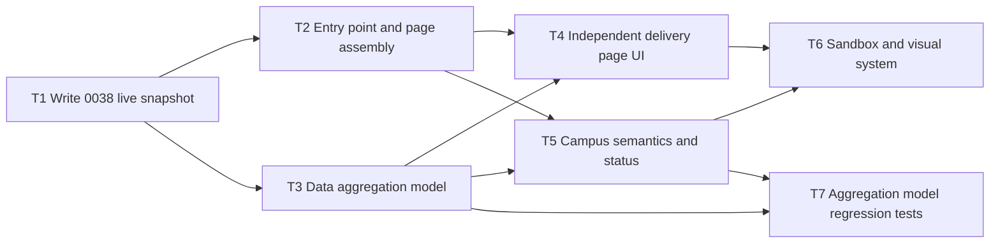

# 0038 · Standalone OpenAgents Delivery View and Campus Entry

<!-- This file is maintained by the spec tool: frontmatter is the structured source data (including the tasks DAG), and the body is a nine-section rust-RFC overview for the group. -->

## Summary

This group adds a read-only OpenAgents delivery observation view to AHE-Beta and expands the original Agent Company building into a campus with a “requirements-side main building + OpenAgents delivery factory.” The standalone page uses the existing Gitea-derived API to display `openagents → ready → PR → needs-human/conflict → main`, supporting round filtering and SidePanel evidence inspection; the campus represents cross-boundary handoffs through a shared 2.5D sandbox, a clickable factory, two helipads, an arched flight path, and a native SVG transport aircraft. It adds no backend API, does not read OpenAgents internal runtime state, provides no write operations, and does not turn visual metaphors into new product terminology.

## Motivation

The requirements side consists of users, triage, divergence, design, and the Owner; after admission, the Owner adds the `openagents` handoff token to the issue. The out-of-process OpenAgents vigil discovers the issue, adds `ready` after intake, then creates a branch and PR, progresses through engineering gates such as conflict, CI, review, and needs-human, and ultimately merges into main. The two sides interact only through Gitea issue/PR labels and the main SHA; ahe-beta does not own vigil's internal queue.

The original frontend scattered evidence across Issues, DeliveryPanel, and Main commits: users had to piece together the “admission → takeover → PR → blocker → main” chain themselves. The original building also retained a historical `developer` floor, which could misleadingly suggest that delivery was still an internal role in the main building. Two problems need to be addressed together: clearly communicate the actual delivery status through a standalone page, and use the campus spatial relationship to explain that OpenAgents is an external delivery system rather than another agent on the requirements side.

The standalone page must remain read-only and loosely coupled, using only AHE-Beta's existing APIs. Campus visuals may only help explain boundaries: official copy continues to use real terms such as `openagents`, `ready`, PR, needs-human, main, Owner, and vigil, without replacing product semantics with “warehousing, shipping, red cards, terminals.” The factory does not expose OpenAgents internal roles, and the initial sandbox version does not add environmental decorations without supporting evidence, such as trees or streetlights.

## Guide-level explanation

Users can still open the existing board and building:

```text
/
/?view=building
```

The new OpenAgents page:

```text
/?view=openagents
/?view=openagents&round=3
```

The top tabs are:

```text
Kanban | Building | OpenAgents
```

After entering the OpenAgents page, the page displays a five-stage read-only flow:

```text
openagents → ready → PR → needs-human / conflict → main
```

- `openagents`: The handoff token applied after Owner admit.
- `ready`: A projection of the work queue that OpenAgents/vigil can process or has already taken in.
- `PR`: Open PRs returned by `/api/delivery`.
- `needs-human / conflict`: Delivery-side blockers requiring human handling or with an explicit mergeability conflict.
- `main`: Recent main commits and the round anchor.

The round dropdown is also available on the OpenAgents page. When a specific round is selected: issues are filtered by the `round-N` label; PRs are filtered by their association with that round's issues through `closes_issues`; commits are filtered by matching the anchor through `/api/state.round_shas[N-1]`. Selecting “All rounds” displays all currently observable data.

Clicking an issue or commit still uses the existing SidePanel details; clicking a PR opens an external Gitea link. The page has no write operations.

The building page title is `Agent Campus`. The sandbox on the left contains:

```text
Demand-plane main building ── arched handoff route ── OpenAgents factory
            H                                               H
```

- Both buildings sit on the same 2.5D plot with thickness, boundaries, a grid, and internal pathways.
- The main building continues to display floors by requirements-side role; the historical `developer` floor is explained in the UI as the “delivery boundary.”
- The factory is a single entry point and does not display OpenAgents internal workers or process floors.
- The factory displays current handoff, ready, open PR, and needs-human status; these are live Gitea aggregates and do not change with the building's replay round.
- Clicking or activating the factory with the keyboard enters `?view=openagents`, preserving the current `round` query parameter.
- Both rooftops have H helipads aligned with their respective perspective planes; when an open issue has `openagents` but not yet `ready`, an SVG transport aircraft moves along the arched flight path. Animation stops when the system prefers reduced motion.

## Reference-level explanation

### Components and data boundaries

```text
App
├─ TopBar
│  └─ dashboard / building / openagents + round URL state
├─ OpenAgentsView
│  └─ buildOpenAgentsSnapshot
├─ BuildingView
│  ├─ getOpenAgentsFactorySummary
│  ├─ BuildingTower
│  └─ FloorWorkspace
└─ SidePanel
```

This group consumes only values returned by the existing frontend API client:

- `/api/issues` → `IssuesResponse`
- `/api/delivery` → `DeliveryResponse`
- `/api/commits` → `CommitsResponse`
- `/api/state` → `RunState`
- `/api/overview` → existing funnel summary

No backend endpoint is added, and OpenAgents `.openagents`, SQLite queue, worker stream, or timing files are not read. PRs still link externally through Gitea URLs; issues/commits still open the SidePanel through the existing `Selection`.

### URL and wiring

`ViewMode` is `dashboard | building | openagents`. `parseView()` recognizes `view=openagents`; URL synchronization rules are as follows:

- dashboard does not write `view`;
- building writes `view=building&floor=<role>`;
- OpenAgents writes `view=openagents`;
- rounds other than `all` consistently write `round=N`;
- selection consistently writes `sel=<type:value>`;
- the OpenAgents page does not display the requirements-side “Running / + Completed” toggle, only the round dropdown.

The factory entry calls `onOpenAgents()` provided by App, changing only view without resetting round, so entering from `?view=building&round=3` produces `?view=openagents&round=3`.

### OpenAgents snapshot

`openAgentsModel.ts` is a pure model without React. Its inputs are issues, delivery, commits, state, and `round: all | number`, and its outputs are:

- the status of the four raw data sources;
- two station sources for PR/commit that have passed round dependency checks;
- handoff/ready/needs-human issue cards;
- PR cards and potentially overlapping needs-human/conflict subsets;
- main commit cards and the round anchor;
- handoff, PR, needs-human, and commit KPIs;
- current round copy and round SHA.

State semantics are strictly distinguished:

```text
null                           = still reading
connected=false                = data source disconnected
connected=true
  + []                         = connected and genuinely empty
No round-association evidence  = unavailable
```

Issue stage classification follows the handoff protocol:

1. Has `ready` → ready; even if `openagents` is also retained, this indicates that vigil has completed intake.
2. Otherwise, has `openagents` → handoff.
3. Otherwise, `planeOf(issue) === "ready"` → legacy ready-plane.

The handoff KPI counts only category 2, excluding ready and ready-plane. PR needs-human and conflict are two independent dimensions: when the same PR has both `needs-human` and `mergeable=false`, it must appear in both gate subsets; conflict must not be dropped through a single state priority order.

When a specific round is selected:

- issues use `roundOf(issue) === N`;
- PRs must match an issue number from that round through `closes_issues`;
- commits must match `state.round_shas[N-1]`;
- when issues are disconnected, the PR station is empty and unavailable;
- when the round SHA is missing, the commit station is empty and unavailable;
- missing filtering criteria must not cause a fallback to all PRs or commits;
- when a data source is disconnected or a station is unavailable, its KPI is `null/—` and must not display a misleading 0.

### Standalone delivery page

`OpenAgentsView` displays source chips, four KPIs, the round/round SHA, and five stations:

```text
openagents | ready | PR | needs-human / conflict | main
```

All cards come from the snapshot. IssueCard and CommitCard write to the existing SidePanel selection; PullCard only opens `pull.url`. The Gate station observes both the issue source and the PR source validated for the round, displaying the actual reason when either dependency is unavailable. The page does not fabricate mocks or provide buttons to modify Gitea state.

### Campus and factory status

`BuildingView` changes the building title to `Agent Campus` and calculates the factory summary using current issues/delivery:

- handoff: open issues containing `openagents` and not containing `ready`;
- ready: open issues containing `ready`;
- pulls: the current number of open PRs;
- needsHuman: the delivery aggregate value;
- moving: `handoff > 0`;
- status: any input is null → loading; any `connected=false` → disconnected; `needs_human > 0` → blocked; otherwise ready.

The factory summary represents the current live delivery status and does not use the building replay/summary round filter. This ensures that the entry point always reports the actual delivery side, but also means that when replaying a particular round, factory numbers may come from a more recently updated global state.

The historical `developer` role remains as a DTO compatibility field, with UI copy changed to:

```text
Delivery plane
Delivery boundary · Owner admission and OpenAgents vigil takeover
DELIVERY BOUNDARY / openagents handoff token
```

The delivery-side work area uses the `OA` wordmark, without truck or airplane emoji; the transport aircraft on the campus flight path is represented separately by T6's SVG path.

### Sandbox and flight path

`BuildingTower` draws the following in a single SVG scene, from back to front:

1. campus shadow;
2. an isometric plot with front/side thickness;
3. a low-contrast grid, boundaries, and internal pathways;
4. the arched flight path;
5. the OpenAgents factory;
6. the requirements-side main building and floors;
7. two H helipads and the SVG transport aircraft.

The main building and factory maintain visual clearance. The entire factory group is `role=button`, supporting click, Enter, and Space. The factory displays only OpenAgents, handoff/ready/PR, and connection or needs-human status, without internal workers/roles.

Both H markers use quadrilaterals aligned with their respective roof projections, without floating ellipses. The flight path uses a cubic Bézier curve that arches upward from the main building helipad and then descends smoothly to the factory helipad. The transport aircraft is drawn using an SVG path in the repository and does not depend on platform emoji; CSS keyframes play only when `moving=true` and are disabled under `prefers-reduced-motion: reduce`.

### DAG / file allocation



| Task | Responsibility | Exclusively owned files |
|------|------|----------|
| T1 | Living snapshot and verification contract | `docs/specs/0038-openagents-frontend-delivery-view.md` |
| T2 | ViewMode, URL, TopBar, and App wiring | `types.ts`, `App.tsx`, `TopBar.tsx` |
| T3 | OpenAgents snapshot | `openAgentsModel.ts` |
| T4 | Standalone delivery page UI components | `OpenAgentsView.tsx` |
| T5 | Factory live status and delivery boundary copy | `BuildingView.tsx`, `FloorWorkspace.tsx`, `buildingModel.ts` |
| T6 | BuildingTower SVG and all styles for this group | `BuildingTower.tsx`, `styles.css` |
| T7 | Hermetic regression tests for the aggregation model and test entry point | `package.json`, `package-lock.json`, `openAgentsModel.test.ts` |

File ownership within the group is mutually exclusive. `issueMeta.ts`, `SidePanel.tsx`, and the API client are existing dependencies only and are not included in this group's task ownership.

### Implementation baseline

This living snapshot is updated from implemented commits rather than describing an unimplemented proposal:

- `ee4219d`: standalone OpenAgents page;
- `1fa22b2`: fixes for ready precedence, disconnected KPIs, and round filtering correctness;
- `91e079a`: campus factory entry;
- `5356e74`: building clearance and main building helipad;
- `a15fcba`: shared sandbox base;
- `bb604b5`: two helipads, arched flight path, and native SVG transport aircraft.

### Verification path

This group adds no standalone `scripts/*.sh` E2E script; the executable verification entry point is:

```bash
tools/spec-driven-development/spec validate
npm --prefix frontend test
npm --prefix frontend run build
```

Manual acceptance:

- `/` retains the default column-based board;
- `/?view=building` displays Agent Campus, the shared base, the main building, and the standalone factory;
- the factory supports entry into OpenAgents via mouse, Enter, and Space;
- `/?view=building&round=1` preserves `round=1` after clicking the factory;
- `/?view=openagents` displays the five-stage actual delivery flow;
- `/?view=openagents&round=1` does not expose all PRs/commits when association criteria are missing;
- the two building silhouettes do not obscure each other, both H markers align with the roof perspective, and the flight path arches upward and connects the two helipads;
- the transport aircraft does not move under reduced-motion;
- both light and dark themes are readable.

## Drawbacks

- The first version shows results and observed state; it does not display vigil workers, the SQLite queue, stage dwell time, agent streams, or timing p50/p90.
- `/api/delivery` returns only open PRs, so the page cannot calculate historical throughput, completion rates, or stage durations.
- Assigning PRs to a specific round depends on closing keywords; when the PR body does not declare closes/fixes/resolves, round attribution is unreliable.
- The campus factory displays the live global delivery state and is not filtered by the building's replay round, so the temporal scope may differ within a retrospective context.
- SVG geometry uses fixed viewBox coordinates; responsiveness relies on scaling the entire scene. Future changes to building dimensions require corresponding adjustments to the base, roads, helipad, and flight paths.
- Styles for the standalone page and campus remain concentrated in the global `styles.css`, increasing the frontend styling maintenance surface.

## Rationale and alternatives

### Why a standalone page + campus entry point

The standalone page presents the delivery workflow at high information density, while the campus presents only system boundaries and entry points. Fitting the full PR/main flow into a floor or SidePanel would be constrained by the narrow width and would misrepresent the “external delivery system” as a “demand-plane role.” The two-level structure preserves the spatial mental model without sacrificing evidence density.

### Why read only Gitea-derived APIs

AHE-Beta already has issues, open PRs, main commits, and run state. Reusing these APIs provides a stable representation of cross-system results without coupling to the OpenAgents daemon, an in-process ring buffer, or a private database. The tradeoff is that workers and stage durations are not visible, but this aligns with the current read-only observation boundary.

### Why the factory is not a second role building

How OpenAgents divides work internally is part of its own implementation, not AHE-Beta's demand-plane roster. The factory therefore displays only the system name, connection/blocking status, and a small set of real aggregates. Clicking it opens the standalone page; its facade does not enumerate fictional roles or workflows.

### Why use a scale model and SVG instead of an emoji collage

A shared plot, building clearance, and a consistent projection establish the campus scale. The helipad must align with the roof plane, and flight paths must connect two explicit endpoints. Native SVG graphics and CSS motion can remain consistent across light and dark themes and support reduced motion. Platform emoji have uncontrollable glyph shapes, perspectives, and colors that would disrupt the scale-model style.

### Why omit environmental decoration for now

Trees, streetlights, and vehicles add no delivery evidence and would only introduce visual noise before the spatial relationships stabilize. The first version retains only the entities needed to express architectural relationships: the plot, boundaries, pathways, buildings, helipad, and flight paths.

## Prior art

- The demand-plane/delivery-plane protocol in 0032: the Owner hands off using the `openagents` label, vigil adds `ready` after intake, and the external delivery plane advances PR/main.
- Agent Company in 0034: establishes `view=building`, role floors, and the FloorWorkspace and SidePanel combination; this group extends it with the campus.
- The current frontend `DeliveryPanel`, `SidePanel`, `issueMeta`, `/api/delivery`: provide real issue/PR/main read models.
- OpenAgents' own board/desktop: oriented toward internal execution state and usable as a reference for future worker/queue visualization contracts, but this group does not depend on it.
- The overview/detail hierarchy common in infrastructure consoles: the overview expresses system boundaries, while the detail page carries state workflows. This group adopts the same information hierarchy instead of compressing all state into a single icon.

## Unresolved questions

1. Whether factory aggregates should follow the building's replay round or always remain live.
2. Whether PR history and throughput metrics require `/api/delivery?state=all` or a PR detail API.
3. Whether the backend should provide an explicit round attribution field to avoid frontend inference using labels and closing keywords.
4. If OpenAgents internal execution state is needed, whether AHE-Beta should expose a new read-only API or reuse the OpenAgents board contract.
5. Whether to add an in-repository `scripts/*.sh` E2E smoke test to automatically verify URL preservation, keyboard access to the factory, and reduced-motion.

## Future possibilities

- Show traceable issue connections from the main building's Owner floor to the factory without exposing the factory's internal roles.
- Add a read-only delivery history API supporting merged/closed PRs, throughput, and stage durations.
- If OpenAgents emits stable structured events, add worker/queue/stage/timing to the standalone page instead of fitting them into the factory.
- Add end-to-end issue → PR → main commit connections and evidence navigation to the standalone page.
- Once SVG geometry stabilizes, extract the campus scene into independently namespaced styles or a testable layout model.

