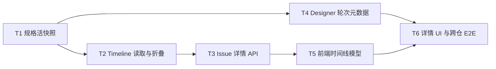

# 0039 · Issue 标签维度与状态演进时间线

<!-- 本文件由 spec 工具维护：frontmatter 为结构化源数据（含 tasks DAG），正文为组级 rust-RFC 9 段总览。 -->

## Summary

把 issue 的“当前标签集合”与“标签如何演进到这里”拆成两个观察面。后端读取 Gitea 原生 timeline，按时间顺序归一 label add/remove 事件并折叠成状态快照；前端在 issue 详情中按平面、来源、优先级、轮次、交付/阻塞、终态分维展示当前状态，再以可展开时间线呈现每次语义迁移和原始标签事件。系统对来源/轮次丢失、open issue 从有效平面坠为无平面、`needs-human` 同批清除业务元数据等异常显式告警，但不以历史值冒充当前真值、也不从看板写回 Gitea。同时让 Designer 结构综合票与既有 Divergent 票一样在创建时携带 `round-N`，补齐新数据的轮次来源。

## Motivation

auto-designer 以 Gitea issue 作为需求面与外接交付面的共享总线。当前标签同时承载多种正交语义：

- `report / proposal / ready` 表达需求平面；
- `from-triage / from-synthesize / from-divergent` 表达不可变来源；
- `P0..P3` 表达优先级；
- `round-N` 表达产生轮次；
- `openagents` 表达 Owner 向交付面的交接令牌；
- `needs-human` 表达交付阻塞；
- `merged / declined` 等表达终态。

列表 API 和前端目前只看**当前** labels，再用纯函数投影 `plane/provenance/priority/round`。这对调度是正确的，却不适合调试：所有维度平铺成一排 chip，用户看不出哪些互斥、哪些可共存、哪个标签由谁在何时添加；一旦当前标签被错误替换，投影只能得到 `null`，历史来源也随之从 UI 消失。

真实运行已经给出完整反例。某张由 Designer 综合、Owner 准入、Vigil 接管的票原先依次拥有 `proposal + from-synthesize`、`openagents + P1`、`ready`；交付 Agent 在请求人工介入时直接向 Gitea 发 `PUT /issues/{n}/labels`，把整组标签替换成单独的 `needs-human`。当前列表因而诚实显示 `plane=null / provenance=null / priority=null`，但用户无法从看板判断这是“从未分诊/从未准入”还是“历史元数据被破坏”。

Gitea 1.22.6 已在 `/api/v1/repos/{owner}/{repo}/issues/{index}/timeline` 保存每次标签增删：`type=label`、label 对象、时间、操作者，以及 add/remove 方向。上述破坏可被完整回放为同一批次的 `+needs-human` 与 `-openagents/-ready/-P1/-from-synthesize`。因此无需另建事件数据库；需要的是稳定的 Gitea 适配、语义折叠和清晰 UI。

另一个独立缺口是 Designer 结构综合票创建时只写 `proposal + from-synthesize`，没有 `round-N`。即使标签从未污染，这类票的轮次仍不可知；按轮过滤 OpenAgents 页面也无法可靠关联它们。Divergent 已通过 `round_provider` 写入轮次，Designer 应收敛到同一生产契约。

## Guide-level explanation

用户打开任意 issue 详情时，顶部首先看到分维后的当前状态，而不是未分类的标签堆：

| 维度 | 示例 |
|---|---|
| 当前平面 | Ready（可领） |
| 来源 | Designer 综合 |
| 优先级 | P1 |
| 产生轮次 | round-1 |
| 交付 | OpenAgents 已接管 |
| 阻塞 | needs-human |
| 终态 | — |

`needs-human` 是叠加在工作平面上的阻塞维度。正常状态可以同时是：

```text
plane=ready
provenance=from-synthesize
priority=P1
delivery=blocked(needs-human)
```

它不应被解释为一个取代 `ready` 和来源的“总状态”。原始 labels 仍可在“Debug · 原始标签”折叠区查看，保证平台事实不被美化或隐藏。

当前状态下方新增“状态演进”时间线。每个节点显示时间、Gitea 操作者、语义阶段、从/到状态和本批标签变化；展开后显示原始 timeline event。正常示例：

```text
17:45:18  创建提案
          +proposal +from-synthesize +round-1
          proposal / synthesize / round-1

17:45:50  Owner 准入（由标签组合与 admission 评论推断）
          -proposal +openagents +P1
          ready / synthesize / P1 / handoff

17:45:52  OpenAgents intake
          +ready
          ready / synthesize / P1 / active

18:23:14  交付阻塞
          +needs-human
          ready / synthesize / P1 / blocked
```

破坏性示例会保留真实结果并标红，而不是偷偷用历史值填充当前字段：

```text
18:23:14  ⚠ 标签完整性异常
          +needs-human
          -openagents -ready -P1 -from-synthesize
          ready → 无平面；来源与优先级丢失
```

异常卡给出“历史最后已知状态”和“当前 Gitea 状态”两栏，便于人工恢复，但页面保持只读，不提供自动修复/重试/改标签按钮。

Designer 从本组起创建结构综合票时写 `round-N`。旧票没有 round 时不按创建时间猜轮次；timeline 只能恢复曾经真实存在过的标签，不能发明从未落库的数据。

## Reference-level explanation

### 1. Gitea timeline 读取边界

`GiteaTracker.list_timeline(number)` 分页读取 issue timeline，不把该能力加入需求面写路径所依赖的最小 `IssueTracker` Protocol；web 观测层继续用 `getattr` 能力探测，使 FakeTracker 和无 Gitea 场景保持可降级。

只归一与本功能有关的字段：

```text
id
created_at
actor_login
type
label.name
label operation: add | remove | unknown
raw body
```

部署中的 Gitea 1.22.6 对 `type=label` 使用非空 body（实测 `"1"`）表示 add、空 body 表示 remove。适配器把未知形状保留为 `operation=unknown`，但未知事件不参与状态折叠；它必须 fail-visible，不能猜方向。

读取必须遍历所有页并保持服务端事件顺序；失败时 issue 正文和评论仍可展示，timeline 单独标为 unavailable，不把整个详情端点判断连。

### 2. 事件批次与状态折叠

新模块 `web/issue_timeline.py` 是无网络、无 React 的纯归一模型。输入为当前 issue DTO、归一 timeline events，输出：

```text
events[]             原始 label/comment 观测（供 Debug）
transitions[]        语义迁移批次
current              由当前 labels 直接投影的状态向量
historical           timeline 最后可重建的状态向量
last_known           各维度最后一次非空真值（只供诊断）
complete             是否从创建开始获得完整 label 历史
anomalies[]          确定性异常
```

状态向量字段为：

```text
labels
plane                report | proposal | ready | null
provenance           from-triage | from-synthesize | from-divergent | null
priority             P0..P3 | null
round                positive integer | null
handoff              bool（openagents 且未 ready）
delivery_active      bool（ready）
blocked              bool（needs-human）
terminal             merged | declined | ... | null
```

连续 label events 若 `created_at` 与 `actor_login` 相同且中间没有非 label event，则折叠为一个批次。Gitea 的一次 PUT 会生成同秒、连续的 add/remove 事件，这样可作为一个破坏性迁移观察；不存在 request id 时不得跨时间或跨事件类型强行合并。

折叠从空集合开始，仅当最早历史覆盖 issue 创建时的初始标签事件才标 `complete=true`。最终历史快照必须与当前 issue labels 比较；不一致时报告 `timeline-current-drift`，当前状态始终以 `get_issue()` 的 labels 为准。

### 3. 异常规则

异常是确定性规则，不由 LLM 判断：

1. `plane-drop-without-terminal`：open issue 从非空平面迁到 `null`，同批没有终态；
2. `provenance-lost`：既有来源被移除且未替换为另一来源；来源按业务契约不可变；
3. `round-lost`：既有 `round-N` 被移除且未替换；
4. `priority-lost`：已准入/执行中的优先级被清空且没有终态；同批 P1→P2 属替换，不告警；
5. `blocking-destroyed-metadata`：加入 `needs-human` 的同批导致 plane/provenance/round/priority 任一丢失；
6. `exclusive-dimension-conflict`：一个快照同时拥有多个来源、多个 round、多个 priority，或多个显式平面标签；
7. `timeline-current-drift/incomplete-history`：历史不完整或折叠终值与当前值不符，降低推断可信度。

规则只产生观测告警，不修改 Gitea。`last_known` 不回填 `/api/issues` 的 `plane/provenance/priority/round`，否则会掩盖真实损坏并可能误导调度。详情 DTO 可单列 `last_known` 帮助人工判断。

### 4. API 契约

`GET /api/issues/{number}` 保留既有 `connected/issue/comments`，新增：

```json
{
  "timeline": {
    "available": true,
    "complete": true,
    "transitions": [],
    "events": [],
    "current": {},
    "historical": {},
    "last_known": {},
    "anomalies": []
  }
}
```

兼容规则：tracker 不支持 timeline 或单独读取失败时返回 `timeline.available=false`，issue/comments 仍 `connected=true`；旧前端忽略新增字段。404 与当前详情端点一致。

### 5. 前端模型与展示

`issueTimelineModel.ts` 负责 DTO 到展示模型的纯转换：标签按 `plane/source/priority/round/delivery/terminal/other` 分组；transition 生成标题、from/to 摘要和 severity；原始事件保持可展开。组件不自行重放原始 Gitea 事件，避免后端和前端出现两套判定。

`IssueDetailView` 的顺序调整为：当前状态维度卡 → 异常告警 → 状态演进 → 正文 → 评论 → 折叠的原始标签/原始事件。时间线不可用时显示明确降级提示，绝不显示空时间线冒充“从未变化”。

列表页与 OpenAgents 总览仍使用当前 labels，不在本组引入历史回填。历史只在 issue 详情调试面出现。

### 6. Designer 轮次元数据

Designer 构造与 Divergent 相同的 `round_provider: Callable[[], int | None]`。run 编排层注入 live round provider；创建 `proposal + from-synthesize` 时，正整数轮次追加 `round-N`。无 provider、provider 返回空/非正数时保持兼容，不猜测轮次。既有 `from-synthesize` 继续保留，来源无需另建数据库。

### 7. 跨仓边界

本仓只做观测、生产元数据和异常暴露；它不应承担修复 OpenAgents 写路径。配套 OpenAgents 变更必须保证 `needs-human` 由 Vigil 经 forge 的 additive label API 落库，并对 Agent 动作期间的非预期标签删除做恢复/告警。两边可以独立实现和测试，但真实 Gitea E2E 只有在 OpenAgents 配套改动落地后，才能验收“阻塞后仍保留 plane/source/priority/round”。

### 8. DAG 与文件分配



| Task | 职责 | 独占文件 |
|---|---|---|
| T1 | 0039 规格、边界与验收 | `docs/specs/0039-issue-state-timeline.md` |
| T2 | Gitea timeline 分页、归一、状态折叠和异常规则 | `tracker/gitea.py`, `web/issue_timeline.py`, tracker/timeline tests |
| T3 | 详情 DTO 接线与降级兼容 | `web/api.py`, web API tests |
| T4 | Designer 创建票补 `round-N` | `designer/designer.py`, `run.py`, designer tests |
| T5 | TypeScript DTO 与纯展示模型 | `types.ts`, `issueMeta.ts`, `issueTimelineModel.ts` 及测试 |
| T6 | Issue 详情时间线、样式与真实 Gitea E2E | `IssueDetail.tsx`, `styles.css`, e2e script |

组内 files 互斥。T2 与 T5 的纯模型均用固定 fixture 测试，不依赖运行中的 Gitea 或浏览器。

### 9. 验证路径

确定性验证脚本：

```text
backend/scripts/e2e-spec-0039-issue-state-timeline.sh
```

脚本运行针对性 pytest、前端 Vitest/build、spec validate，并用固定 timeline fixture 断言正常迁移和 #7 型破坏迁移。真实联调另在本地 Gitea 建一张带 source/round/P1/ready 的票，经配套 OpenAgents `needs-human` 出口后断言：原标签仍在、timeline 只有 additive blocking 迁移、详情页显示 `ready + blocked` 且无 metadata-loss 告警。

## Drawbacks

- issue 详情每次多读一条分页 timeline；超长历史会增加 Gitea 请求和 DTO 体积。该读取只在用户打开详情时发生，不进入轮询列表端点。
- Gitea timeline 没有稳定 request id；同时间、同 actor、连续 label event 的批次折叠是适配层规则。原始 events 始终保留，推断可信度可检查。
- 所有自动化当前共用 `designer` Gitea 账号，timeline 的 actor_login 不能区分 `designer-0`、`owner-0` 与 Vigil。阶段名称只能依据标签组合和签名评论标为“推断”，不能冒充精确身份。
- 新 UI 增加详情信息密度；通过维度卡、折叠 Debug 区和移动端纵向布局控制复杂度。
- 本组故意不自动恢复历史标签；用户仍需在 Gitea 处理既有污染票。

## Rationale and alternatives

选择 Gitea timeline 作为历史事实源，因为标签本来就在 Gitea 上流转，timeline 与 issue 同生命周期、容器重启后仍在，且能追溯既有事故。另建本地 `label-events.jsonl` 会产生双真源：OpenAgents 或人从 Gitea 修改标签时，本地日志天然缺事件；运行目录清理还会丢历史。

选择“当前真值与历史最后已知值并列”而非历史回填当前字段。回填能让 #7 看起来重新有来源，却会隐藏当前 labels 已坏，甚至让调度/指标误以为票仍在 ready。调试系统的第一责任是暴露矛盾，不是让页面好看。

选择按维度分组而非立即重命名/合并全部标签。`openagents`、`ready` 等字面量已是跨仓协议和发现条件，大规模迁移会同时改变调度语义；先改变观察模型可在零协议迁移下消除“标签堆”认知负担。未来若数据证明某些标签冗余，再单独设计协议迁移。

选择后端折叠、前端渲染，而非浏览器直接解释 Gitea timeline。add/remove 方向、分页完整性、平面投影和异常规则属于平台/领域语义；放在前端会与 Python 的 `issue_schema` 漂移，也难供测试和其它消费者复用。

备选是只在 OpenAgents 日志里显示标签变化。它无法覆盖 Owner、人类或其它进程的 Gitea 写入，也无法追溯容器已销毁的运行，因此不采用。

## Prior art

- GitHub/Gitea issue timeline 都把 label/unlabel 作为审计事件展示，说明“当前标签 + 事件历史”是托管平台的既有模型。
- Kubernetes condition 与 event 分离：对象 status 表示当前真值，events 解释如何到达；本组沿用同一观察边界，不以事件替代当前状态。
- Redux/event-sourcing 的 reducer 方式适合对有序事件做确定性折叠；本组只借用回放方法，不把 Gitea 改造成自有 event store。

## Unresolved questions

本版没有阻塞实施的未决问题。操作者精确归因暂不通过新增 Gitea 账号解决：UI 展示真实 `actor_login`，语义阶段明确标为 inferred；若后续需要逐 Agent 审计，再评估独立身份/token 或隐藏签名事件。

## Future possibilities

- 在 OpenAgents 独立页按时间范围汇总异常迁移数量、阻塞持续时间和各阶段 dwell time。
- 提供只读的“建议恢复标签”命令预览，由人复制执行；写操作仍不放进 dashboard。
- Gitea 与 GitHub tracker 统一成 forge-neutral timeline DTO，使相同详情组件可观察远端 GitHub 项目。
- 为 Owner、Vigil、交付 Agent 使用可区分的机器身份，减少 inferred actor。
- 在 CI 中对固定 workflow labels 建互斥/不可变属性校验，提前阻止新的维度冲突。
