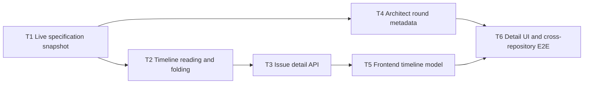

# 0039 · Issue Label Dimensions and State Evolution Timeline

<!-- This file is maintained by the spec tool: the frontmatter contains structured source data (including the tasks DAG), and the body is a nine-section group-level rust-RFC overview. -->

## Summary

Separate an issue’s “current label set” from “how the labels evolved to reach this state” as two observation surfaces. The backend reads the native Gitea timeline, normalizes label add/remove events in chronological order, and folds them into state snapshots; the frontend displays the current state in the issue details by plane, provenance, priority, round, delivery/blocking, and terminal state, then presents each semantic transition and raw label event in an expandable timeline. The system explicitly warns about anomalies such as missing provenance/round data, an open issue falling from a valid plane to no plane, and `needs-human` clearing business metadata in the same batch, but does not use historical values to impersonate current truth or write back to Gitea from the board. It also ensures that Architect structural-synthesis issues carry `round-N` at creation time, like existing Divergent issues, filling in round and provenance for new data.

## Motivation

AHE-Beta uses Gitea issues as a shared bus for the requirements surface and the external delivery surface. Labels currently carry several orthogonal semantics at the same time:

- `report / proposal / ready` expresses the requirements plane;
- `from-triage / from-architect / from-divergent` expresses immutable provenance;
- `P0..P3` expresses priority;
- `round-N` expresses the originating round;
- `openagents` expresses the Owner handoff token to the delivery surface;
- `needs-human` expresses delivery blocking;
- `merged / declined` and others express terminal states.

The list API and frontend currently look only at **current** labels and then use a pure-function projection `plane/provenance/priority/round`. This is correct for scheduling but unsuitable for debugging: all dimensions are flattened into a row of chips, so users cannot tell which are mutually exclusive, which can coexist, or who added which label and when; once current labels are incorrectly replaced, the projection can only produce `null`, and the historical provenance disappears from the UI along with them.

Actual operation has already provided a complete counterexample. An issue synthesized by Architect, admitted by Owner, and taken over by Vigil originally had `proposal + from-architect`, `openagents + P1`, and `ready` in sequence; when requesting human intervention, the delivery Agent directly sent `PUT /issues/{n}/labels` to Gitea, replacing the entire label group with only `needs-human`. The current list therefore honestly displays `plane=null / provenance=null / priority=null`, but users cannot determine from the board whether this means “never triaged/never admitted” or “historical metadata was corrupted.”

Gitea 1.22.6 already stores every label addition and removal in `/api/v1/repos/{owner}/{repo}/issues/{index}/timeline`: `type=label`, the label object, time, actor, and add/remove direction. The corruption above can therefore be fully replayed as `+needs-human` and `-openagents/-ready/-P1/-from-architect` from the same batch. No separate event database is needed; what is needed is a stable Gitea adapter, semantic folding, and a clear UI.

Another independent gap is that Architect structural-synthesis issues currently write only `proposal + from-architect` at creation time, without `round-N`. Even when labels have never been polluted, the round for these issues is still unknowable; filtering the OpenAgents page by round also cannot reliably associate them. Divergent already writes the round through `round_provider`, so Architect should converge on the same production contract.

## Guide-level explanation

When a user opens any issue’s details, the top first shows the current state split by dimension rather than an uncategorized pile of labels:

| Dimension | Example |
|---|---|
| Current plane | Ready (claimable) |
| Provenance | Architect synthesis |
| Priority | P1 |
| Originating round | round-1 |
| Delivery | OpenAgents has taken over |
| Blocking | needs-human |
| Terminal state | — |

`needs-human` is a blocking dimension layered on top of the work plane. A normal state can simultaneously be:

```text
plane=ready
provenance=from-architect
priority=P1
delivery=blocked(needs-human)
```

It must not be interpreted as an “overall state” that replaces `ready` and provenance. The original labels remain available in the “Debug · Raw labels” collapsible section, ensuring that platform facts are neither beautified nor hidden.

A “State evolution” timeline is added below the current state. Each node shows the time, Gitea actor, semantic stage, from/to states, and label changes in that batch; expanding it shows the raw timeline event. Normal example:

```text
17:45:18  Create proposal
          +proposal +from-architect +round-1
          proposal / architect / round-1

17:45:50  Owner admission (inferred from the label combination and admission comment)
          -proposal +openagents +P1
          ready / architect / P1 / handoff

17:45:52  OpenAgents intake
          +ready
          ready / architect / P1 / active

18:23:14  Delivery blocked
          +needs-human
          ready / architect / P1 / blocked
```

A destructive example preserves the actual result and marks it in red instead of silently filling current fields with historical values:

```text
18:23:14  ⚠ Label integrity anomaly
          +needs-human
          -openagents -ready -P1 -from-architect
          ready → no plane; provenance and priority lost
```

The anomaly card provides “last known historical state” and “current Gitea state” columns to support manual recovery, while the page remains read-only and provides no automatic repair/retry/edit-label buttons.

Starting with this group, Architect writes `round-N` when creating structural-synthesis issues. Existing issues without a round must not have one guessed from the creation time; the timeline can recover labels that once actually existed, but cannot invent data that was never persisted.

## Reference-level explanation

### 1. Gitea timeline read boundary

`GiteaTracker.list_timeline(number)` reads the issue timeline page by page and does not add this capability to the minimal `IssueTracker` Protocol on which the requirements-surface write path depends; the web observation layer continues to use `getattr` capability detection so that FakeTracker and environments without Gitea remain degradable.

Only fields relevant to this feature are normalized:

```text
id
created_at
actor_login
type
label.name
label operation: add | remove | unknown
raw body
```

In deployed Gitea 1.22.6, a non-empty body for `type=label` (observed as `"1"`) indicates add, while an empty body indicates remove. The adapter preserves unknown shapes as `operation=unknown`, but unknown events do not participate in state folding; they must fail visibly, and their direction must not be guessed.

Reading must traverse every page and preserve the server-side event order; on failure, the issue body and comments must still be displayable, while the timeline is independently marked unavailable, without bringing down the entire detail endpoint.

### 2. Event batches and state folding

The new module `web/issue_timeline.py` is a pure normalization model with no network and no React. Its input is the current issue DTO and normalized timeline events, and its output is:

```text
events[]             Raw label/comment observations (for Debug)
transitions[]        Semantic transition batches
current              State vector projected directly from current labels
historical           Last state vector reconstructable from the timeline
last_known           Last non-empty ground truth for each dimension (for diagnostics only)
complete             Whether complete label history is available from creation
anomalies[]          Deterministic anomalies
```

The state vector fields are:

```text
labels
plane                report | proposal | ready | null
provenance           from-triage | from-architect | from-divergent | null
priority             P0..P3 | null
round                positive integer | null
handoff              bool (openagents and not ready)
delivery_active      bool (ready)
blocked              bool (needs-human)
terminal             merged | declined | ... | null
```

Consecutive label events are folded into one batch when `created_at` and `actor_login` are identical and there is no non-label event between them. A single Gitea PUT generates consecutive add/remove events in the same second, which can therefore be observed as one destructive transition; when no request ID exists, events must not be forcibly merged across times or event types.

Folding starts from an empty set. `complete=true` is marked only when the earliest history covers the initial label events from issue creation. The final historical snapshot must be compared with the current issue labels; when they differ, report `timeline-current-drift`, and the current state must always use the labels from `get_issue()`.

### 3. Anomaly rules

Anomalies are deterministic rules and are not determined by an LLM:

1. `plane-drop-without-terminal`: an open issue moves from a non-empty plane to `null`, with no terminal state in the same batch;
2. `provenance-lost`: existing provenance is removed without being replaced by another provenance; provenance is immutable under the business contract;
3. `round-lost`: existing `round-N` is removed without replacement;
4. `priority-lost`: the priority of an admitted/in-progress issue is cleared without a terminal state; P1→P2 in the same batch is a replacement and does not trigger a warning;
5. `blocking-destroyed-metadata`: adding `needs-human` in the same batch causes any of plane/provenance/round/priority to be lost;
6. `exclusive-dimension-conflict`: a snapshot simultaneously has multiple provenances, multiple rounds, multiple priorities, or multiple explicit plane labels;
7. `timeline-current-drift/incomplete-history`: the history is incomplete or the folded final value does not match the current value, reducing inference confidence.

The rules produce observation warnings only and do not modify Gitea. `last_known` must not backfill `/api/issues`’s `plane/provenance/priority/round`, because doing so would conceal actual corruption and could mislead scheduling. The details DTO may list `last_known` separately to assist human judgment.

### 4. API contract

`GET /api/issues/{number}` retains the existing `connected/issue/comments` and adds:

```json
{
  "timeline": {
    "available": true,
    "complete": true,
    "transitions": [],
    "events": [],
    "current": {},
    "historical": {},
    "last_known": {},
    "anomalies": []
  }
}
```

Compatibility rules: when the tracker does not support the timeline or a separate read fails, return `timeline.available=false`; issue/comments remain `connected=true`. Older frontends ignore the new fields. 404 behavior remains consistent with the current details endpoint.

### 5. Frontend model and presentation

`issueTimelineModel.ts` is responsible for the pure conversion from DTO to presentation model: labels are grouped by `plane/source/priority/round/delivery/terminal/other`; transitions generate titles, from/to summaries, and severity; raw events remain expandable. Components must not replay raw Gitea events themselves, avoiding two separate sets of determinations between the backend and frontend.

The order of `IssueDetailView` is adjusted to: current-state dimension cards → anomaly warnings → state evolution → body → comments → collapsed raw labels/raw events. When the timeline is unavailable, show a clear degraded-mode notice and never display an empty timeline that falsely suggests “no changes ever occurred.”

The list page and OpenAgents overview continue to use current labels and do not introduce historical backfilling in this group. History appears only in the issue-details debugging surface.

### 6. Architect round metadata

Architect constructs the same `round_provider: Callable[[], int | None]` as Divergent. The run orchestration layer injects a live round provider; when creating `proposal + from-architect`, a positive-integer round appends `round-N`. With no provider, or when the provider returns an empty/non-positive value, preserve compatibility and do not guess the round. Existing `from-architect` remains preserved; no separate database is needed for provenance.

### 7. Cross-repository boundary

This repository handles observation, production metadata, and anomaly exposure only; it must not take responsibility for repairing the OpenAgents write path. The accompanying OpenAgents changes must ensure that `needs-human` is persisted by Vigil through forge’s additive label API, and must recover from or warn about unexpected label deletion during Agent actions. The two sides can be implemented and tested independently, but real Gitea E2E can verify that “plane/source/priority/round remain after blocking” only after the accompanying OpenAgents changes are delivered.

### 8. DAG and file allocation



| Task | Responsibility | Exclusive files |
|---|---|---|
| T1 | 0039 specification, boundaries, and acceptance | `docs/specs/0039-issue-state-timeline.md` |
| T2 | Gitea timeline pagination, normalization, state folding, and anomaly rules | `tracker/gitea.py`, `web/issue_timeline.py`, tracker/timeline tests |
| T3 | Details DTO wiring and degraded-mode compatibility | `web/api.py`, web API tests |
| T4 | Add `round-N` to Architect-created issues | `architect/architect.py`, `run.py`, architect tests |
| T5 | TypeScript DTO and pure presentation model | `types.ts`, `issueMeta.ts`, `issueTimelineModel.ts` and tests |
| T6 | Issue-details timeline, styling, and real Gitea E2E | `IssueDetail.tsx`, `styles.css`, e2e script |

Files within the group are mutually exclusive. The pure models in T2 and T5 use fixed-fixture tests and do not depend on a running Gitea or browser.

### 9. Verification path

Deterministic verification script:

```text
backend/scripts/e2e-spec-0039-issue-state-timeline.sh
```

The script runs targeted pytest, frontend Vitest/build, and spec validate, and uses fixed timeline fixtures to assert normal transitions and a #7-type destructive transition. Real integration testing separately creates an issue with source/round/P1/ready in local Gitea, uses the accompanying OpenAgents `needs-human` path, and asserts that: the original labels remain, the timeline contains only an additive blocking transition, the details page displays `ready + blocked`, and no metadata-loss warning appears.

## Drawbacks

- Issue details perform one additional paginated timeline read each time they are opened; long histories increase Gitea requests and DTO size. This read occurs only when the user opens details and does not enter the polling list endpoint.
- The Gitea timeline has no stable request ID; folding consecutive label events with the same time and actor is an adapter-layer rule. Raw events are always retained, and inference confidence can be inspected.
- All automation currently shares the `architect` Gitea account, so timeline actor_login cannot distinguish `architect-0`, `owner-0`, and Vigil. Stage names can only be marked as “inferred” based on label combinations and signed comments and cannot impersonate precise identities.
- The new UI increases the information density of details; dimension cards, a collapsed Debug section, and a vertical mobile layout control the complexity.
- This group deliberately does not automatically restore historical labels; users must still handle existing polluted issues in Gitea.

## Rationale and alternatives

Gitea’s timeline is selected as the source of historical facts because labels already flow through Gitea, the timeline shares the issue lifecycle, it persists across container restarts, and it can trace existing incidents. Creating a separate local `label-events.jsonl` would produce two sources of truth: when OpenAgents or a person modifies labels in Gitea, the local log would naturally miss the event; cleaning the runtime directory would also lose history.

The design places current truth and the last historically known value side by side rather than backfilling current fields from history. Backfilling could make #7 appear to have provenance again, but would hide that the current labels are broken and could even cause scheduling/metrics to treat the issue as still ready. The first responsibility of a debugging system is to expose contradictions, rather than make the page look better.

The design groups labels by dimension instead of immediately renaming or merging all labels. Literals such as `openagents` and `ready` are already cross-repository protocols and discovery conditions, and a large-scale migration would simultaneously change scheduling semantics; changing the observation model first can remove the cognitive burden of the “label pile” without any protocol migration. If future data shows that some labels are redundant, design a protocol migration separately.

Choose backend folding and frontend rendering rather than having the browser interpret the Gitea timeline directly. The add/remove direction, pagination completeness, flat projection, and anomaly rules are platform/domain semantics; placing them in the frontend would cause drift from Python's `issue_schema` and make reuse by tests and other consumers difficult.

An alternative is to show label changes only in OpenAgents logs. This cannot cover Gitea writes by the Owner, humans, or other processes, nor trace runs whose containers have already been destroyed, so it is not adopted.

## Prior art

- GitHub/Gitea issue timelines both display label/unlabel actions as audit events, showing that “current labels + event history” is an established model on hosting platforms.
- Kubernetes separates conditions from events: object status represents the current truth, while events explain how it was reached; this group follows the same observation boundary and does not replace current state with events.
- The Redux/event-sourcing reducer approach suits deterministic folding of ordered events; this group borrows only the replay method and does not turn Gitea into its own event store.

## Unresolved questions

This version has no unresolved questions blocking implementation. Precise actor attribution will not be addressed by adding Gitea accounts for now: the UI displays the actual `actor_login`, and semantic stages are explicitly marked as inferred; if per-Agent auditing is needed later, evaluate separate identities/tokens or hidden signed events.

## Future possibilities

- Aggregate anomalous transition counts, blocked durations, and dwell time for each stage by time range on a dedicated OpenAgents page.
- Provide a read-only preview of a “suggested label recovery” command for a human to copy and execute; write operations remain outside the dashboard.
- Unify Gitea and GitHub trackers into a forge-neutral timeline DTO so the same detail component can observe remote GitHub projects.
- Use distinguishable machine identities for the Owner, Vigil, and delivery Agents to reduce inferred actors.
- Add mutual-exclusion/immutability checks for fixed workflow labels in CI to prevent new dimension conflicts early.
