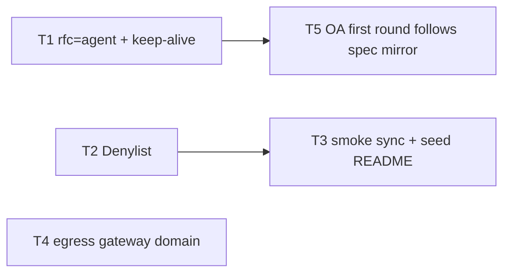

# 0040 · Enable RFC on the delivery plane: drafter writes docs/specs + change the commit boundary to a denylist

<!-- This file is maintained by the spec tool: frontmatter is the structured source data (including the tasks DAG), and the body is a group-level rust-RFC overview in 9 sections. -->

## Summary

Enable RFC on the delivery plane: change `stages.rfc` in the harness repository's `.openagents/openagents.yml`, written by `run.py`, from `skip` to `agent`. During solve, the drafter first writes the implementation specification (single-file group, Task DAG) to `docs/specs/` in the harness repository, then the implementer changes product code by Task. The `spec` CLI is provided by the vigil container image; it does not become a harness repository dependency or embed the orchestration repository's spec process into the object being evolved.

Enabling RFC requires reshaping the commit boundary first. Previously, the harness commit gate used a top-level allowlist (allowing only fixed names such as `entry.py` / `agents/` / `tests/`), rejecting `docs/` and all new directories. After rfc:agent writes `docs/specs`, Gitea smoke turns red within seconds, preventing the PR from merging. Now that containment has moved to a dedicated vigil container (zero host mounts, cloning for itself inside the container), overfitting channels (orchestration repository source code, `data/sessions`, benchmark task directories) are invisible to the vigil filesystem; the allowlist no longer needs to lock down the product's structure. Change the boundary to a denylist: reject only `.openagents/` (vigil runtime state) and real secrets (`.env` / `.env.*`, except `.env.example`). The pre-commit hook and the inline script in smoke.yml must stay synchronized; the hook can be bypassed with `--no-verify`, but server-side smoke cannot.

Container outbound traffic goes exclusively through the egress proxy. For any protocol gateway where `ANTHROPIC_BASE_URL` points to a nonofficial Anthropic domain, that domain must be included in `allowed_egress` in `egress-proxy.conf`, or both drafter and implementer will fail. The current deployment allows `.pjlab.org.cn`; the abstract requirement is “add custom gateway domains to the allowlist,” not to encode a particular gateway provider into the process.

OpenAgents-side contract (described by this repository's image, without vendoring its source): with rfc:agent, when the worktree already contains an `docs/specs` group for this issue, the initial implement context must require implementation by Task and references to `Spec-NNNN`, rather than relying solely on the issue body; without a spec, continue using the issue body. This repository remains pinned to image `ahe-beta-vigil:latest`. Enabling RFC lengthens solve, and the delivery plane is often still running when the demand plane finishes `TOTAL_ROUNDS`: `VIGIL_KEEP_ALIVE` keeps vigil running by default, and vigil is torn down at demand-plane completion only when this is explicitly disabled.

This group does not cover: specific product changes in the harness repository (heartbeat, stall wording, etc.—those belong to the object being evolved and are held-out); demand-plane configuration/timeout tuning; internal OpenAgents function implementations.

## Motivation

After the transition, the runtime is split into a demand plane and a delivery plane. The demand plane (the same nexau runtime, with different agent definitions) runs user simulations and produces user experience observations and issues; Owner is the sole admission point, and admit applies the `openagents` handoff token. The delivery plane is out-of-process OpenAgents vigil (an independent CLI, neither vendored nor imported). After discovering an issue bearing the token, it follows “apply `ready` → curator orders dependencies → worktree/branch → implementation → review loop → PR → conflict/CI/review gates → merge into main.” The two planes interact only through Gitea labels and the main SHA. CI/review are engineering quality gates (structural smoke checks of the harness repository, never benchmark runs); user experience is purely observational; the benchmark remains held-out throughout. The observation anchor is the merge commit.

The delivery-plane stages initially set `rfc` to `skip` for reasons that were valid at the time: harness is an independent repository being evolved, with no spec toolchain inside it; adding a process to the object being evolved would increase its burden, and drafter requires the `spec` CLI. The explicit tradeoff during the transition was “get the PR gates running first, then reassess RFC in phase two.”

The conditions for phase two are now in place, and the cost of `skip` has been demonstrated:

1. **The spec CLI does not need to enter the harness repository.** vigil runs in a dedicated container whose image already contains OpenAgents (including the `spec` CLI). drafter writes `docs/specs/` in the container working directory (its own clone of the harness repository); the toolchain stays in the image, and the object being evolved gains only a documentation directory.
2. **The allowlist and RFC are mutually exclusive.** The commit boundary originally used a top-level allowlist to prevent “embedding a particular benchmark task into harness.” After container containment, vigil has zero host mounts, and the orchestration repository and session data are absent from its filesystem, cutting off that overfitting channel. With the allowlist still in place, legitimate evolution (`docs/specs`, new package directories, `pyproject.toml`, README) gets blocked by smoke. Evidence: after enabling `rfc:agent`, drafter wrote `docs/`, smoke turned red in about 3 seconds, and the PR could not merge—the RFC stage was effectively running without producing results.
3. **If implement does not follow the spec, RFC has no delivery value.** OpenAgents defaults to an initial context centered on the issue body. After rfc:agent, the worktree already contains a Task breakdown; unless “implement by Task” becomes a first-class instruction, the implementer will ignore the drafter's specification and revert to “working directly from the issue.”
4. **solve becomes longer, so the demand plane must not tear down vigil.** The two beats of drafter + implement take noticeably longer than the single implementation beat with `rfc:skip`. The demand plane often finishes `TOTAL_ROUNDS=1` first; if `stop_vigil` still performs `docker rm`, unfinished RFCs/PRs are killed. Default keep-alive decouples the delivery-plane lifecycle from demand-plane rounds.

This group therefore changes four things together: enable RFC, switch to a denylist (synchronize hook + smoke), allow custom gateway domains through egress, and pin down the cross-repository contract requiring the initial implement context to follow the spec. Without any one of these, RFC cannot work in the closed loop.

Facts explicitly excluded from this group's Tasks (to avoid embedding operational actions and the object being evolved into the orchestration repository's design): product PRs in the harness repository (heartbeat, stall, `[unverified]` wording, etc.) are evolution results, and their implementation specifications should live in the harness repository's own `docs/specs/`; the demand-plane GLM overlay, user LLM timeout, `N_DIVERGENTS` default, and architect timeout are configuration/runtime tuning.

## Guide-level explanation

After an Owner admission, the delivery plane follows the path with RFC enabled:

1. vigil discovers an issue bearing `openagents`, applies `ready`, has curator order dependencies, and opens a worktree/branch.
2. **drafter** (`rfc:agent`) writes `NNNN-slug.md` (frontmatter Tasks + group-level overview) to `docs/specs/` in the worktree. It does not write the product implementation. The `spec` command comes from the container PATH; the harness repository's `docs/specs/README.md` only documents the destination.
3. The initial context read by **implementer** prioritizes these Tasks: when a corresponding spec exists, change code by Task and reference `Spec-NNNN`; use the issue body only when none exists (or for a temporary `rfc:skip` run).
4. At commit time, the pre-commit hook checks the denylist: allow `docs/specs/0001-….md`; reject `.env` and `.openagents/vigil-queue.db`. Even if someone uses `--no-verify`, Gitea Actions smoke checks the same denylist again.
5. Once smoke is green and the review/merge gates pass, merge into main. Demand-plane step c still reads only the `origin/main` SHA as its observation cursor.
6. Even if this demand-plane round has finished, the vigil container is not torn down (default keep-alive); the delivery plane continues completing issues.

Developers changing the commit boundary must update two locations together: `backend/ahe_beta/guards/harness_boundary.py` (hook generation source) and `backend/harness_template/.gitea/workflows/smoke.yml` (server-side inline script; the harness repository is independent and cannot import the orchestration package). Changing only one creates a divergence of “hook green, CI red” or “hook red, CI green.”

When connecting a nonofficial Anthropic protocol gateway: add the gateway domain to `allowed_egress` in `backend/deploy/gitea/egress-proxy.conf` and restart egress-proxy, while also setting `ANTHROPIC_BASE_URL` (and any model-name overrides required by the gateway). If the domain is omitted, enabling RFC manifests only as proxy 403 responses to in-container LLM calls; logs are in `data/vigil.log`.

## Reference-level explanation

### Interfaces and invariants (restated here)

- **The demand-plane / delivery-plane split remains unchanged.** Owner is the sole admission point, the handoff token is `openagents`, vigil applies `ready`, and the observation cursor follows `origin/main`; this group changes none of these.
- **held-out remains unchanged.** smoke remains a structural smoke check (`compileall` + required artifacts present + denylist), running no benchmarks and making no LLM calls. RFC documents are implementation plans, not test signals.
- **Zero code coupling remains unchanged.** This repository neither vendors nor imports OpenAgents. T5's `files` lists the `OpenAgents/...` path, with the same semantics as during the transition: implement separately in the OpenAgents repository under its spec process; pin down the contract here. This repository's pin = `ahe-beta-vigil:latest` (`backend/deploy/vigil/build.sh`).
- **Location of the spec CLI.** Inside the vigil image, not in harness `pyproject` / seed dependencies. The harness repository owns only the `docs/specs/` text artifacts.

### T1: `stages.rfc=agent` and vigil keep-alive

`_VIGIL_STAGES` in `backend/ahe_beta/experiment/controllers/ordinary.py` is the single source for writing `.openagents/openagents.yml` (generated for each run; do not hand-edit yml). Final form:

```text
triage: skip      # Admission already completed by Owner
rfc: agent        # This group: drafter writes to docs/specs, then implement
conflict: agent
ci: skip          # Still overridden via VIGIL_CI_STAGE; zero checks = wait forever for CI, do not enable before validating act_runner
e2e: skip
review: agent
merge: agent
```

The initial `rfc:skip` comment (harness has no spec toolchain, explicit warnings are acceptable) is obsolete; replace it with “the spec CLI is in the image.”

`VIGIL_KEEP_ALIVE`: keep running by default. Only when the environment variable is explicitly `0` / `false` / `no` / `off` does demand-plane `finally` perform `docker rm` / kill the subprocess. With keep-alive, `stop_vigil` tears down only the log follower (`docker logs -f`), not the vigil container; another `start_vigil` reuses the running instance without repeating `docker run`. `backend/ahe_beta/experiment/controllers/swebench.py` goes through the same `start_vigil` and therefore shares its behavior.

Unit tests: `backend/tests/test_run_vigil.py` asserts yml `stages.rfc == agent`, keep-alive default/disabled behavior, and container reuse.

### T2: Denylist

`harness_boundary.violations(staged_paths)` and the generated pre-commit hook share the same source:

- `DENIED_TOP = {".openagents"}` (exact match against the first path segment).
- Any path segment equal to `.env` or starting with `.env.` → reject; a segment equal to `.env.example` → skip checking that segment.
- `__pycache__` / `.pyc` can be ignored; they neither cross the boundary nor belong in the repository.
- Allow all other top-level paths, including but not limited to: `docs/`, `src/`, `pyproject.toml`, `README.md`, `.gitea/`, and any new package name.

Stop maintaining a set of “allowed top-level names.” The container filesystem boundary now carries the allowlist's former responsibility for preventing overfitting.

### T3: Synchronize smoke + seed destination

The “boundary check” step in `backend/harness_template/.gitea/workflows/smoke.yml` inlines the same denylist (the repository is independent and cannot `import ahe_beta`). Changes to T2 must also change T3, with identical literal rules. Other smoke steps remain unchanged: `python3 -m compileall`, and the presence of `entry.py` / `params.yaml` / `agents/`.

Add `backend/harness_template/docs/specs/README.md` to the seed: the drafter destination; the spec CLI is provided by the vigil image. When initializing the harness repository, this file enters Gitea with the template so drafter does not face an empty directory with no conventions.

### T4: Custom gateway domains for egress

In addition to the existing `.anthropic.com` / `.claude.ai`, `backend/deploy/gitea/egress-proxy.conf` adds `.pjlab.org.cn` for the current instance and retains a comment: a custom `ANTHROPIC_BASE_URL` requires adding the gateway domain to `allowed_egress` and then restarting the proxy. This group does not make “which gateway provider to use” an abstract requirement; switching gateways changes only conf and runtime env, not stages or boundary gates.

### T5: OpenAgents image contract

In the OpenAgents repository (not implemented in this repository):

- Initial implement context in `openagents/recipes/vigil.py`: if the worktree already contains a group under `docs/specs` corresponding to this issue, instruct implementation by Task with references to `Spec-NNNN`; otherwise follow the issue body and Acceptance. Do not call the Gitea API again to “find requirements.”
- The `openagents/agents/implementer.py` prompt follows the same rule: follow Tasks when a spec exists; with `rfc:skip` or no `docs/specs`, do not waste cycles looking for a spec.

Acceptance in this repository consists of the contract statement + absence of OpenAgents imports/vendoring. Tests within the OA repository follow its own spec process.

### DAG / File allocation



T1 / T2 / T4 have no mutual dependencies and can run in parallel. T3 depends on T2 (define the denylist first, then copy it into smoke). T5 depends on T1 (following the spec in the initial context has delivery value only after yml is set to `rfc:agent`). `files` within the same group do not overlap.

| Task | Files in this repository | Notes |
|---|---|---|
| T1 | `backend/ahe_beta/experiment/controllers/ordinary.py`、`backend/tests/test_run_vigil.py`、`backend/ahe_beta/experiment/controllers/swebench.py` | Single source for stages |
| T2 | `backend/ahe_beta/guards/harness_boundary.py`、`backend/tests/guards/test_harness_boundary.py` | Hook generation source |
| T3 | `backend/harness_template/.gitea/workflows/smoke.yml`、`backend/harness_template/docs/specs/README.md` | Keep text identical to T2 |
| T4 | `backend/deploy/gitea/egress-proxy.conf` | Deployment instance domain is replaceable |
| T5 | `OpenAgents/openagents/recipes/vigil.py`、`OpenAgents/openagents/agents/implementer.py` | Image; define separately in the OA repository |

### Verification paths

No new `scripts/*.sh` e2e. Acceptance:

```text
pytest backend/tests/test_run_vigil.py backend/tests/guards/test_harness_boundary.py
./tools/spec-driven-development/spec validate
./tools/spec-driven-development/spec render
./tools/spec-driven-development/spec graph --package-root backend/ahe_beta
```

Manual end-to-end verification: Owner admit → vigil drafter produces `docs/specs/` in the PR → implement modifies the product by Task → smoke passes (including `docs/`) → merge → `origin/main` advances in step c. The vigil container remains running after the demand side finishes. Custom gateway: the proxy returns 403 for domains outside the allowlist, and domains within the allowlist are reachable.

During implementation, annotate changes with this group's Task number (group number + `/T*`).

## Drawbacks

- **RFC increases delivery latency and token usage.** Each ready issue requires an additional drafter beat, increasing solve wall-clock time and LLM costs; unattended operation is more likely to hit the vigil watchdog. keep-alive mitigates “the demand side finishes first and kills the issue,” but does not reduce per-issue cost.
- **A denylist is less restrictive than an allowlist.** The container cannot see the orchestration repository, but the implementer can still add large directories unrelated to the current product inside the harness repository (for example, copying in a subset of a third-party benchmark). smoke does not run benchmarks and cannot prevent “repository bloat.” This is the explicit cost of trading overfitting protection for structural evolution; if evidence of hardwiring benchmarks appears again, add targeted denials (path prefixes) rather than restoring the full allowlist.
- **Duplicate lists in T2/T3.** The harness repository cannot import the orchestration package, so the deny rules must be copied into smoke. Divergence between the two copies can only be controlled through review and testing discipline; `--no-verify` may still allow bad keys into local history before the hook runs. The server can block PRs, but cannot block pre-force states that have already been pushed.
- **The egress instance domain is committed to the repository.** `.pjlab.org.cn` is the current deployment's gateway; changing gateways requires editing the conf and restarting the proxy. Keeping the instance domain in the conf is shorter than abstracting it into an env generator, but the conf becomes deployment-specific.
- **Cross-repository image Task.** T5 is not implemented in this repository, and this repository's CI cannot prove that OA prompts still follow the contract; verification relies on image pinning and manual comparison. This follows the same split as the forge/Gitea driver during the transition.

## Rationale and alternatives

**Enable RFC rather than continuing to skip it.** `rfc:skip` makes the implementer work directly from the issue body, leaving the delivery side limited to local fixes and making it difficult to retain the “construction plan” in the object being evolved. With RFC enabled, specifications enter main with the PR, giving the next implement round Tasks it can reference. The cost is latency; this group accepts it and uses keep-alive to prevent latency from turning into “the orchestration process killed the issue.”

**Use a denylist rather than expanding the allowlist.** Alternative A: add `docs/` (and every new top-level name in the future) to the allowlist. This would turn every legitimate expansion of the product's structure into a revision of the orchestration repository's boundary gate: RFC encourages structural improvements, only for the gate to register them as exceptions. Alternative B: remove the boundary gate and rely solely on container containment. Secrets and `.openagents/` runtime state still must not be committed; the server must at least block these two categories. A denylist is the smallest gate between these alternatives.

**Keep the spec CLI in the image rather than vendoring it into harness.** Alternative: seed the `spec` toolchain into the harness repository so RFC can also run in clones without vigil. This would hardwire the orchestration/OA process into the object being evolved, violating “harness is an independently runnable program.” The drafter only runs in the vigil container, so the CLI only needs to be in the image.

**Enable keep-alive by default rather than extending the demand side's wait.** Alternative: have the demand side poll `finally` until the vigil queue is empty before exiting. This would turn delivery-side failures (needs-human, repeated CI failures) into indefinite waits on the demand side, violating the principle that the two sides interact only through Gitea and have decoupled lifecycles. Remaining resident by default and tearing down only when explicitly disabled is consistent with “vigil is a resident night watchman.”

**Hardcode the current gateway domain in egress rather than generating the allowlist from `ANTHROPIC_BASE_URL` at runtime.** Dynamic generation would let the container add arbitrary domains to the proxy, weakening the egress allowlist. People edit the conf and restart the proxy, preserving the principle that “egress destinations are a deployment decision.”

**Have the first implement round follow the spec rather than relying on the prompt to voluntarily “read docs/specs first.”** If existing specs are not included in the first-round context, the implementer will repeat issue investigation and ignore the drafter's output. Encoding the priority in `_first_round_context_text` and the implementer prompt makes it a contract rather than an informal convention.

## Prior art

- The transition group marked `rfc:skip` as unresolved for phase two (harness had no spec toolchain at the time). This group resolves it: the toolchain resides in the vigil image, and the object being evolved receives only documents.
- The container containment group confined vigil to a dedicated container with no host mounts, with egress routed through an egress allowlist. This group enables RFC on top of that containment and explains that the filesystem boundary has replaced the allowlist's overfitting assumptions.
- OpenAgents itself uses `docs/specs/` + the `spec` CLI to drive RFC→implementation; the harness repository reuses the same document format without reusing the orchestration repository's group-number namespace.
- rust-lang/rfcs and this repository's spec-driven-development skill: construction specifications precede implementation; Task `files` are mutually exclusive. Specifications in the harness repository are written by the drafter; this group does not prepopulate product RFCs.

## Unresolved questions

None. Enabling RFC, synchronizing the denylist and smoke, adding the custom gateway domain to egress, prioritizing worktree specs in the first implement round, and enabling vigil keep-alive by default were all finalized during requirements clarification. Unifying generation of the duplicate T2/T3 lists does not block this group; see Future.

## Future possibilities

- Generate the smoke inline script from `harness_boundary` (or have CI run the same standalone file as the hook), eliminating divergence from manual copying in T2/T3.
- If evidence emerges of “copying a benchmark subset into harness,” add targeted deny prefixes for known overfitting paths without restoring the full allowlist.
- Observe needs-human / watchdog rates after enabling RFC, then decide whether to give the drafter a wall-clock budget or reduce the default spec size.
- Have the OpenAgents repository encode the T5 contract in its own spec group and include it in image-build regression checks; this repository continues to pin only the image.
- Consider moving the egress allowlist's instance domain into an uncommitted overlay to avoid committing the deployment gateway to the mainline conf; weigh “reviewable egress destinations” against “an environment-independent repository.”


