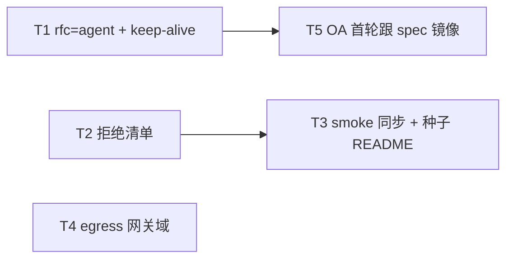

# 0040 · 交付面打开 RFC：drafter 落 docs/specs + 提交边界改拒绝清单

<!-- 本文件由 spec 工具维护：frontmatter 为结构化源数据（含 tasks DAG），正文为组级 rust-RFC 9 段总览。 -->

## Summary

交付面打开 RFC：`run.py` 写入 harness 仓 `.openagents/openagents.yml` 的 `stages.rfc` 从 `skip` 改为 `agent`。solve 先由 drafter 在 harness 仓 `docs/specs/` 落下施工规格（单文件组、Task DAG），再由 implementer 按 Task 改产品代码。`spec` CLI 由 vigil 容器镜像提供，不进入 harness 仓依赖、不把编排仓的 spec 制度焊进被进化对象。

打开 RFC 的前置条件是提交边界改形状。原先 harness 提交闸是顶层白名单（只许 `entry.py` / `agents/` / `tests/` 等固定名字），`docs/` 与新目录一律拒绝。rfc:agent 写下 `docs/specs` 后，Gitea smoke 会在数秒内变红，PR 合并不了。围堵已升到 vigil 专用容器（零宿主挂载、容器内自 clone）之后，过拟合信道（编排仓源码、`data/sessions`、benchmark 任务目录）vigil 文件系统看不见；白名单锁死产品形状已无必要。边界改为拒绝清单：只拒 `.openagents/`（vigil 运行态）和真实密钥（`.env` / `.env.*`，`.env.example` 除外）。pre-commit 钩子与 smoke.yml 内联脚本必须同步；钩子可被 `--no-verify` 绕过，服务端 smoke 绕不开。

容器出网只经 egress 代理。凡 `ANTHROPIC_BASE_URL` 指向非官方 Anthropic 域的协议网关，其域名必须写入 `egress-proxy.conf` 的 `allowed_egress`，否则 drafter/implementer 全部失败。当前部署实例放行 `.pjlab.org.cn`；抽象需求是「自定义网关域进 allowlist」，不是把某一家网关写进制度。

OpenAgents 侧契约（本仓镜像描述，不 vendor 其源码）：rfc:agent 且 worktree 已有对本 issue 的 `docs/specs` 组时，implement 首轮 context 必须按 Task 实现并引用 `Spec-NNNN`，而不是只啃 issue 正文；无 spec 时仍按 issue 正文。本仓 pin 仍是镜像 `auto-designer-vigil:latest`。打开 RFC 拉长 solve，需求面 `TOTAL_ROUNDS` 收尾时交付面往往还在跑：`VIGIL_KEEP_ALIVE` 缺省常驻，仅显式关闭才在需求面收尾拆 vigil。

本组不覆盖：harness 仓内具体产品改动（心跳、stall 文案等——那是被进化对象，held-out）；需求面编制/超时调参；OpenAgents 内部函数体实现细节。

## Motivation

换轨后的运行时是需求面 / 交付面二分。需求面（同一 nexau 运行时、不同 agent 定义）跑用户模拟，产出体感与 issue；Owner 是唯一准入点，admit 打 `openagents` 交接令牌。交付面是进程外的 OpenAgents vigil（独立 CLI，不 vendor 不 import），发现带令牌的票后走「盖 `ready` → curator 排依赖 → worktree/分支 → 实现 → 评审循环 → PR → conflict/CI/review 闸 → 合并进 main」。两面只通过 Gitea 标签与 main SHA 交互。CI/评审是工程质量闸（harness 仓结构冒烟，绝不跑 benchmark）；体感纯观测；benchmark 全程 held-out。观测锚点是 merge commit。

交付面 stages 起步把 `rfc` 定为 `skip`，原因当时成立：harness 是被进化的独立仓，仓内没有 spec 工具链；给被进化对象加一套制度会增加负担，且 drafter 需要 `spec` CLI。换轨时的显式取舍是「先让 PR 门禁转起来，RFC 二期再评估」。

二期条件现已具备，且 `skip` 的成本已经实证：

1. **spec CLI 不必进 harness 仓。** vigil 跑在专用容器里，镜像内已有 OpenAgents（含 `spec` CLI）。drafter 在容器工作目录（自 clone 的 harness 仓）落 `docs/specs/`，工具链留在镜像，被进化对象只多一个文档目录。
2. **白名单与 RFC 互斥。** 提交边界原先用顶层白名单防「把某个 benchmark 任务焊进 harness」。容器围堵之后，vigil 零宿主挂载，编排仓与 session 数据不在其文件系统内，那条过拟合信道已经切断。白名单继续存在时，合法演进（`docs/specs`、新包目录、`pyproject.toml`、README）会在 smoke 上被打死。实证：打开 `rfc:agent` 后 drafter 写下 `docs/`，smoke 约 3 秒红，PR 无法合并——RFC 阶段等于空转。
3. **implement 若不跟 spec，RFC 没有交付意义。** OpenAgents 缺省首轮 context 以 issue 正文为主。rfc:agent 之后 worktree 里已经有 Task 分解；若不把「按 Task 实现」提升为一等指令，drafter 的规格会被 implementer 忽略，回到「直接啃 issue」。
4. **solve 变长，需求面不能拆 vigil。** drafter + implement 两拍明显长于 `rfc:skip` 时的单拍实现。需求面常 `TOTAL_ROUNDS=1` 先结束；若 `stop_vigil` 仍 `docker rm`，未完成的 RFC/PR 被杀掉。缺省 keep-alive 把交付面生命周期从需求面 round 解耦。

因此本组同时改四件事：打开 RFC、改拒绝清单（钩子 + smoke 同步）、egress 放行自定义网关域、钉死 implement 首轮跟 spec 的跨仓契约。四者缺一，RFC 在闭环里都走不通。

本组明确不写进 Task 的事实（避免把运行操作和被进化对象焊进编排仓设计）：harness 仓产品向 PR（心跳、stall、`[unverified]` 文案等）是进化结果，施工规格应落在 harness 仓自己的 `docs/specs/`；需求面 GLM overlay、用户 LLM 超时、`N_DIVERGENTS` 默认值、synthesize 超时是编制/运行调参。

## Guide-level explanation

一次 Owner 准入之后，交付面按打开 RFC 的路径工作：

1. vigil 发现带 `openagents` 的票，盖 `ready`，curator 排依赖，开 worktree/分支。
2. **drafter**（`rfc:agent`）在 worktree 的 `docs/specs/` 落下 `NNNN-slug.md`（frontmatter Task + 组级总览）。不写产品实现。`spec` 命令来自容器 PATH，harness 仓 `docs/specs/README.md` 只说明落点。
3. **implementer** 首轮读到的 context 优先是这些 Task：有对应 spec 就按 Task 改代码并引用 `Spec-NNNN`；没有（或某次临时 `rfc:skip`）才按 issue 正文。
4. 提交时 pre-commit 钩子按拒绝清单检查：`docs/specs/0001-….md` 放行；`.env`、`.openagents/vigil-queue.db` 拒绝。即便有人 `--no-verify`，Gitea Actions 的 smoke 用同一份拒绝清单再拦一次。
5. smoke 绿、review/merge 闸过，合进 main。需求面 c 步仍只读 `origin/main` SHA 作观测游标。
6. 需求面这一轮已经结束也不拆 vigil 容器（缺省 keep-alive），交付面继续把票做完。

开发者改提交边界时必须同时改两处：`backend/auto_designer/guards/harness_boundary.py`（钩子生成源）和 `backend/harness_template/.gitea/workflows/smoke.yml`（服务端内联脚本，harness 仓独立、无法 import 编排包）。只改一处会在「钩子绿、CI 红」或「钩子红、CI 绿」上分叉。

接非官方 Anthropic 协议网关时：把网关域名加进 `backend/deploy/gitea/egress-proxy.conf` 的 `allowed_egress` 并重启 egress-proxy，同时设置 `ANTHROPIC_BASE_URL`（及网关所需的模型名覆盖）。漏加域名时，打开 RFC 只表现为容器内 LLM 调用被代理 403，日志在 `data/vigil.log`。

## Reference-level explanation

### 接缝与不变量（就地复述）

- **需求面 / 交付面二分不变。** Owner 唯一准入、交接令牌 `openagents`、vigil 盖 `ready`、观测游标跟 `origin/main`，本组不改。
- **held-out 不变。** smoke 仍是结构冒烟（`compileall` + 关键制品在位 + 拒绝清单），不跑 benchmark、不调 LLM。RFC 文档是施工计划，不是测试信号。
- **零代码耦合不变。** 本仓不 vendor、不 import OpenAgents。T5 的 `files` 列出 `OpenAgents/...` 路径，语义与换轨时相同：在 OpenAgents 仓按其 spec 另立落地，此处钉契约。本仓 pin = `auto-designer-vigil:latest`（`backend/deploy/vigil/build.sh`）。
- **spec CLI 的位置。** 在 vigil 镜像内，不进 harness `pyproject` / 种子依赖。harness 仓只拥有 `docs/specs/` 文本产物。

### T1：`stages.rfc=agent` 与 vigil keep-alive

`backend/auto_designer/experiment/controllers/ordinary.py` 的 `_VIGIL_STAGES` 是写入 `.openagents/openagents.yml` 的单一出处（每次 run 生成，勿手改 yml）。定稿：

```text
triage: skip      # 准入已由 Owner 完成
rfc: agent        # 本组：drafter 落 docs/specs，再 implement
conflict: agent
ci: skip          # 仍经 VIGIL_CI_STAGE 覆盖；零 check=永等 CI，未验证 act_runner 前不开
e2e: skip
review: agent
merge: agent
```

`rfc:skip` 起步时的注释（harness 无 spec 工具链、显式告警可接受）作废，改为「spec CLI 在镜像内」。

`VIGIL_KEEP_ALIVE`：缺省常驻。仅环境变量显式 `0` / `false` / `no` / `off` 时，需求面 `finally` 才 `docker rm` / 杀 subprocess。keep-alive 时 `stop_vigil` 只拆日志跟随器（`docker logs -f`），不拆 vigil 容器；再次 `start_vigil` 复用已在跑实例，不重复 `docker run`。`backend/auto_designer/experiment/controllers/swebench.py` 经同一 `start_vigil`，行为同源。

单测：`backend/tests/test_run_vigil.py` 断言 yml `stages.rfc == agent`、keep-alive 缺省/关闭、容器复用。

### T2：拒绝清单

`harness_boundary.violations(staged_paths)` 与生成的 pre-commit 钩子同源：

- `DENIED_TOP = {".openagents"}`（精确匹配路径第一段）。
- 任意路径分段等于 `.env` 或以 `.env.` 开头 → 拒绝；分段为 `.env.example` → 跳过该段判定。
- `__pycache__` / `.pyc` 可忽略，既不越界也不该入库。
- 其余顶层路径放行，包括但不限于：`docs/`、`src/`、`pyproject.toml`、`README.md`、`.gitea/`、任意新包名。

不再维护「允许的顶层名字」集合。白名单防过拟合的职责已由容器文件系统边界承担。

### T3：smoke 同步 + 种子落点

`backend/harness_template/.gitea/workflows/smoke.yml` 的「边界检查」步骤内联同一拒绝清单（仓独立、无法 `import auto_designer`）。改 T2 必须改 T3，字面规则一致。smoke 其余步骤不变：`python3 -m compileall`、`entry.py` / `params.yaml` / `agents/` 在位。

种子增加 `backend/harness_template/docs/specs/README.md`：drafter 落点；spec CLI 由 vigil 镜像提供。初始化 harness 仓时该文件随模板进入 Gitea，避免 drafter 面对空目录无约定。

### T4：egress 自定义网关域

`backend/deploy/gitea/egress-proxy.conf` 在既有 `.anthropic.com` / `.claude.ai` 之外，为当前实例增加 `.pjlab.org.cn`，并保留注释：自定义 `ANTHROPIC_BASE_URL` 必须把网关域名加入 `allowed_egress` 后重启代理。本组不把「使用哪一家网关」写成抽象需求；换网关只改 conf 与运行 env，不改 stages 或边界闸。

### T5：OpenAgents 镜像契约

在 OpenAgents 仓（不在本仓实现）：

- `openagents/recipes/vigil.py` 的 implement 首轮 context：若 worktree 已有 `docs/specs` 下对应本 issue 的组，指令为按 Task 实现并引用 `Spec-NNNN`；否则按 issue 正文与 Acceptance。禁止为「找需求」再打 Gitea API。
- `openagents/agents/implementer.py` 提示词与上述一致：有 spec 跟 Task；`rfc:skip` 或无 `docs/specs` 时不空转寻找 spec。

本仓验收是契约陈述 + 不出现对 OpenAgents 的 import/vendor。OA 仓内测试与其自己的 spec 流程走。

### DAG / 文件分配



T1 / T2 / T4 无互依赖，可并行。T3 依赖 T2（先定拒绝清单再抄到 smoke）。T5 依赖 T1（yml 已是 `rfc:agent` 后，首轮跟 spec 才有交付意义）。同组 `files` 互不相交。

| Task | 本仓 files | 备注 |
|---|---|---|
| T1 | `backend/auto_designer/experiment/controllers/ordinary.py`、`backend/tests/test_run_vigil.py`、`backend/auto_designer/experiment/controllers/swebench.py` | stages 单一出处 |
| T2 | `backend/auto_designer/guards/harness_boundary.py`、`backend/tests/guards/test_harness_boundary.py` | 钩子生成源 |
| T3 | `backend/harness_template/.gitea/workflows/smoke.yml`、`backend/harness_template/docs/specs/README.md` | 与 T2 字面同步 |
| T4 | `backend/deploy/gitea/egress-proxy.conf` | 部署实例域可换 |
| T5 | `OpenAgents/openagents/recipes/vigil.py`、`OpenAgents/openagents/agents/implementer.py` | 镜像；OA 仓另立 |

### 验证路径

无新增 `scripts/*.sh` e2e。验收：

```text
pytest backend/tests/test_run_vigil.py backend/tests/guards/test_harness_boundary.py
./tools/spec-driven-development/spec validate
./tools/spec-driven-development/spec render
./tools/spec-driven-development/spec graph --package-root backend/auto_designer
```

闭环手工：Owner admit → vigil drafter 在 PR 中出现 `docs/specs/` → implement 按 Task 改产品 → smoke 绿（含 `docs/`）→ merge → c 步 `origin/main` 前进。需求面结束后 vigil 容器仍在。自定义网关：代理 allowlist 外的域 403，allowlist 内的域可达。

实现时在改动处标注本组 Task 号（组号 + `/T*`）。

## Drawbacks

- **RFC 拉长交付时延与 token。** 每张 ready 票多一拍 drafter，solve 墙钟时间和 LLM 费用上升；无人值守下更容易撞到 vigil 看门狗。keep-alive 缓解「需求面先结束把票杀掉」，不降低单票成本。
- **拒绝清单比白名单更松。** 容器看不见编排仓，但 implementer 仍可在 harness 仓内添加与当前产品无关的大目录（例如把第三方基准子集拷进来）。smoke 不跑 benchmark，拦不住「仓变胖」。这是用结构演进换过拟合防护的明确代价；若再出现焊基准的实证，应加定向拒绝（路径前缀），而不是恢复整表白名单。
- **T2/T3 双份清单。** harness 仓不能 import 编排包，拒绝规则必须抄一份进 smoke。两处分叉只能靠评审与测试纪律；`--no-verify` 仍可能让坏密钥进 hook 前的本地历史，服务端能拦 PR，拦不住已 push 的 force 前状态。
- **egress 实例域写进仓库。** `.pjlab.org.cn` 是当前部署的网关，换网关要改 conf 并重启代理。把实例域留在 conf 里比抽象成 env 生成器更短，但 conf 会随部署环境脏。
- **跨仓镜像 Task。** T5 不在本仓实现，本仓 CI 不能证明 OA 提示词仍遵守契约；只能靠镜像 pin 与人工对照。这与换轨时 forge/Gitea driver 的切法相同。

## Rationale and alternatives

**打开 RFC，而不是继续 skip。** `rfc:skip` 让 implementer 直接啃 issue 正文，交付面只能做局部修补，难以把「施工计划」留在被进化对象里。打开 RFC 后规格随 PR 进 main，下一轮 implement 有可引用的 Task。代价是时延；本组接受，并用 keep-alive 避免时延转化成「票被编排进程杀掉」。

**拒绝清单，而不是放宽白名单。** 备选 A：在白名单里加 `docs/`（以及将来每一个新顶层名字）。这会把产品形状的每一次合法生长变成编排仓边界闸的修订，RFC 刚鼓励结构性改进，闸又把它登记成例外。备选 B：删除边界闸，只靠容器围堵。密钥和 `.openagents/` 运行态仍不该入库，服务端至少要拦这两类。拒绝清单是两者之间的最小闸。

**spec CLI 留在镜像，而不是 vendoring 进 harness。** 备选：把 `spec` 工具链种子进 harness 仓，使 RFC 在无 vigil 的 clone 里也可跑。这会把编排/OA 制度焊进被进化对象，违反「harness 是独立可启动程序」。drafter 只在 vigil 容器里跑，CLI 放镜像即可。

**keep-alive 缺省开，而不是加长需求面等待。** 备选：需求面 `finally` 轮询直到 vigil 队列空再退出。那会把交付面故障（needs-human、CI 红循环）变成需求面死等，违背两面只通过 Gitea 交互、生命周期解耦。缺省常驻、显式关闭才拆，与「vigil 是常驻守夜人」一致。

**egress 写死当前网关域，而不是运行时从 `ANTHROPIC_BASE_URL` 生成 allowlist。** 动态生成会让容器能把任意域加进代理，削弱出口 allowlist。conf 由人改、人重启，保持「出网点是部署决策」。

**implement 首轮跟 spec，而不是靠 prompt 自觉去「先读 docs/specs」。** 若不把已有 spec 写进首轮 context，implementer 会重复勘察 issue、忽略 drafter 产物。把优先级写进 `_first_round_context_text` 与 implementer 提示词，是契约而不是软约定。

## Prior art

- 换轨组把 `rfc:skip` 标为二期未决（harness 当时无 spec 工具链）。本组关闭该未决：工具链在 vigil 镜像内，被进化对象只收文档。
- 容器围堵组把 vigil 关进零宿主挂载的专用容器，出口经 egress allowlist。本组在该围堵之上打开 RFC，并说明白名单的过拟合假设已被文件系统边界取代。
- OpenAgents 自身用 `docs/specs/` + `spec` CLI 驱动 RFC→实现；harness 仓复用同一文档形态，不复用编排仓的组号空间。
- rust-lang/rfcs、以及本仓 spec-driven-development skill：施工规格先于实现；Task `files` 互斥。harness 仓内规格由 drafter 写，不由本组预置产品 RFC。

## Unresolved questions

无。打开 RFC、拒绝清单与 smoke 同步、自定义网关域进 egress、implement 首轮优先 worktree specs、以及 vigil 缺省 keep-alive，均已在需求澄清中定稿。T2/T3 双份清单如何生成合一，不阻塞本组，见 Future。

## Future possibilities

- 由 `harness_boundary` 生成 smoke 内联脚本（或 CI 跑与钩子同一份独立文件），消灭 T2/T3 手抄分叉。
- 若实证出现「把基准子集拷进 harness」，对已知过拟合路径加定向拒绝前缀，仍不恢复整表白名单。
- 观察 RFC 打开后的 needs-human / 看门狗率，再决定是否给 drafter 墙钟预算或缩小默认 spec 体积。
- OpenAgents 仓将 T5 契约写成其自己的 spec 组并纳入镜像构建的回归；本仓继续只 pin 镜像。
- egress allowlist 的实例域是否抽到未入库的 overlay，避免把部署网关写进主干 conf；需权衡「可审查的出网点」与「环境无关的仓库」。


