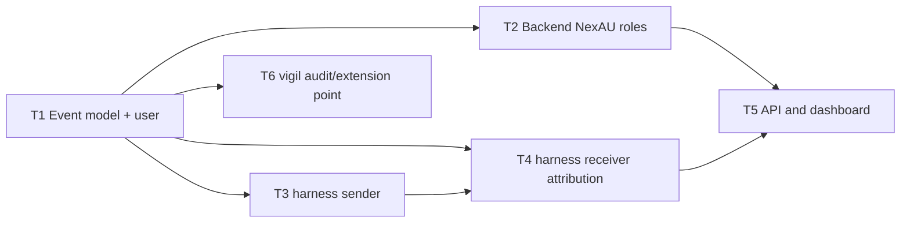

# 0041 · Unified LLM Token Usage Monitoring and End-to-End Attribution

<!-- This file is maintained by the spec tool: frontmatter is the structured source data (including the tasks DAG), and the body is a group-level overview in 9 rust-RFC sections. -->

## Summary

Establish a unified LLM Token ledger covering the entire AHE-Beta closed loop, collecting usage from user persona,
triager/architect/divergent/owner, the harness NexAU for each task, and developer/vigil where technically observable. Each actual
provider request writes one raw event, bound to `run_id / round_no / session_id / instance_id / interaction_id /
turn_no / agent_id / role / operation`. The API then aggregates raw events hierarchically by call, interaction, session, task, agent, role, round,
and run.

Collect user persona usage directly at the OpenAI-compatible `response.usage` boundary; collect usage for the four backend NexAU agent types
from complete LLM tracer responses. The harness runs in a separate subprocess: add a machine-only `type=usage` stdout side channel, which the launcher buffers separately,
with task context added on the host. vigil runs in a separate container: first audit whether OpenAgents/Claude provides structured per-call usage and reliable
attribution, then decide whether to integrate it as reported or explicitly mark it unavailable. Parsing ordinary logs to present fabricated precision is prohibited.

Raw per-call events remain the sole source of truth. Empty responses, gateway fallbacks, and other retries are accounted for separately; when usage is missing, retain
`usage_source=unavailable` and do not estimate from character length. The usage side channel must not enter user-visible replies, wait progress, session
timelines, or prompts, and must not carry request bodies, system prompts, tool parameters, or credentials. The final API can summarize user persona and harness breakdowns and totals by round, task, session,
and role; triager/architect/divergent/owner remain round-level role costs,
and developer/vigil remain explicitly unavailable while their separate containers lack a structured protocol. Monitoring writes are always best effort; failures
must not alter closed-loop control flow.

## Motivation

Cost observability must answer more than “how much did the entire process use”; it must answer “which round, which task, which session, which role, and which
call used how much.” The closed loop includes a main-process thread pool, harness subprocesses, and vigil containers. Any global cumulative counter loses
attribution, especially when two tasks run concurrently, making reliable separation afterward impossible.

A complete user session for one task includes two model paths. User persona judgment, action, and scoring form one path;
the NexAU agent run by the harness to answer the user forms the other, and the latter usually consumes more Tokens. Counting only persona systematically underestimates “per-task
cost” and prevents comparison of the relationships among task difficulty, harness iteration counts, and experience outcomes.

The gap is not a provider capability issue. NexAU already normalizes input, output,
reasoning, cache, and total Tokens across providers such as OpenAI and Anthropic, and retains `ModelResponse.usage` after each model call. The harness template's
`_StepCollector` is also already attached to the same LLM span and can see the complete outputs. What is actually missing is cross-process bridging and host-side attribution:

1. The harness subprocess does not know AHE-Beta's round/session/instance context;
2. The host knows the task context but cannot see each LLM usage record inside the subprocess;
3. stdout carries reply, progress, and status simultaneously; processing usage through the ordinary side channel would pollute the user-visible trace;
4. Empty responses and errors trigger multiple actual billable requests; recording only once at the terminal reply misses usage;
5. Up to two user sessions run concurrently, so global cumulative counts cannot be reliably separated back into individual tasks.
6. triager/architect/divergent/owner run in backend NexAU and are suitable for attribution by round and agent, but per-task allocations must not be fabricated
   when they combine multiple tasks.
7. developer/vigil span containers and OpenAgents/Claude protocols; stdout text alone does not provide the conditions for trustworthy, precise accounting.

Therefore, collect “how much” where the call occurs, add “who it belongs to” at the host session boundary, and then write a unified raw event. Accounting at either end alone
is insufficient for per-task auditing.

## Guide-level explanation

The end-to-end observability path is as follows:

```text
round N
  ├─ instance X / session S
  │    ├─ user persona response.usage ─────→ UsageStore(role=user)
  │    └─ harness subprocess NexAU LLM span
  │         └─ stdout type=usage → launcher → UsageStore(role=harness)
  ├─ triager NexAU tracer ─────────────────→ UsageStore(role=triager)
  ├─ architect/divergent/owner tracer ──────→ UsageStore(corresponding role)
  └─ vigil/OpenAgents/Claude
       ├─ structured per-call interface available → UsageStore(role=developer)
       └─ no reliable interface                    → capability unavailable
```

The harness produces one usage record for each actual provider request. If an answer involves three rounds of tool-use, it produces three records; if empty
content triggers a retry, the failed/empty response and the retry each produce an event. The terminal reply still contains only the answer shown to the user and the existing steps;
persona cannot see usage at all.

The host pregenerates `session_id` for each session, obtains `instance_id` from the SWE-bench workspace parameters, and obtains
`round_no` from the orchestrator context. The launcher is responsible only for lossless receipt and exactly-once draining; it does not infer attribution. The session layer explicitly fills in
the context during draining. This keeps the reader daemon thread from depending on `ContextVar`, which does not propagate automatically, and prevents cross-wiring between concurrent sessions.

After a round is selected, the dashboard displays each task:

```text
instance django__django-123
  user       12,430
  harness    47,800
  total      60,230
```

The same area separately lists that round's triager/architect/divergent/owner totals. These postprocessing roles may combine multiple tasks; unless the call context itself
has an instance_id, do not force allocation to individual tasks. developer/vigil are also not merged with the harness: they are different execution surfaces.

Users can drill down through raw events at successive levels: one provider call is the smallest unit; calls with the same `operation/interaction` form one
model phase; user and harness usage within the same session form a task's interaction cost; calls with the same agent_id form one agent execution;
round/run summaries support budgets and trends. Call chains that currently lack a stable interaction_id must retain both per-call and session-level views;
do not infer conversation turns from temporal proximity.

## Reference-level explanation

### Unified Data Model and Invariants

Authoritative raw events are appended to `backend/data/usage.jsonl`. Event fields are: timestamp, run_id, round_no, session_id,
instance_id, interaction_id, turn_no, agent_id, role, operation, provider, model, input_tokens, output_tokens, reasoning_tokens,
cached_input_tokens, total_tokens, latency_ms, success, error, request_id, usage_source. Missing optional fields use null;
retain events even when identity fields are unknown, and do not write unknown strings as fabricated ids.

`usage_source` has only three meanings: `reported` means explicitly reported by the provider/NexAU; `estimated` may only be explicitly produced by a future real tokenizer-based
estimator and is not enabled in this group; `unavailable` means the call occurred but Tokens are unavailable. Aggregations must also return
unavailable_count to prevent null values summed as zero from being misread as “zero cost.”

Security boundary: events must never contain API keys, Authorization, environment variable values, messages, complete system prompts, user request bodies,
model response bodies, or tool inputs and outputs. error stores only exception types/stable error codes. All write and parsing errors are swallowed by the observability layer or recorded as diagnostics;
they must not cause model calls, harness replies, agent.run, or the vigil lifecycle to fail.

### Context Propagation

The main process uses `ContextVar` as an immutable overlay. The orchestrator binds the round at the outer round scope; the user session pregenerates
session_id before model calls and binds instance_id/role/agent; NexAU workers already inherit it through `copy_context()`. Threads such as reader daemons that are created before
the session or do not inherit context must not write attributed events directly. Instead, they must buffer minimal usage and let a caller with explicit context
drain it. run_id may be explicitly supplied through the startup environment; otherwise, each new process generates a unique value. A module-global current session
must not serve as the source of concurrent attribution.

### User and Backend NexAU Collection Points

`ApiPersonaClient._create()` is the precise user boundary. Record every return or exception from `chat.completions.create()`;
the bare request after `enable_thinking=False` is rejected, backoff retries, and an increased max_tokens after empty content are all independent billable attempts and must
be accounted for individually. `respond/complete/classify_action` no longer handles counting, preventing omissions across branches.

triager/architect/divergent/owner share `run_agent_def + StepTracer`. Bind role through an explicit agent definition/call parameter;
do not infer it from output text. Use the NexAU canonical session id as the agent_id for one agent execution. In LLM span outputs,
`usage` / `usageMetadata` are per-call facts; the assistant text projection and usage projection are independent.

### Event Contract

Add a machine side channel to `stdio-jsonl-v1`:

```json
{
  "type": "usage",
  "provider": "openai-compatible",
  "model": "model-name",
  "input_tokens": 100,
  "output_tokens": 25,
  "reasoning_tokens": 8,
  "cached_input_tokens": 40,
  "total_tokens": 125,
  "latency_ms": 812.4,
  "success": true,
  "request_id": "req_...",
  "agent_run_id": "...",
  "usage_source": "reported"
}
```

Missing optional Token fields use `null`, not zero. When all Token fields are missing, use `usage_source=unavailable`; this group does not produce
`estimated`. `total_tokens` preferentially uses the provider-reported value; perform deterministic addition only when both input and output exist and total is missing.
Do not add reasoning/cache again to a total already reported by the provider.

Emit exactly one event per LLM span. NexAU's current `ModelResponse.usage` is a snapshot of that call; implementation tests must use two
consecutive calls with different usage to prove that a cumulative run snapshot has not been mistaken for a per-call value. A span error also emits an `success=false` event; if usage
is unavailable, Tokens are null. Events do not contain inputs, outputs content, messages, tool parameters, exception bodies, or
environment variables; error retains only safe exception types/error codes.

### Harness Sender

`backend/harness_template/entry.py` remains self-contained and does not import `ahe_beta.usage` from the orchestration repository. `_StepCollector`
performs small-scale defensive extraction in `end_span` of `SpanType.LLM` and immediately writes a complete JSON line through the existing `_stdout_lock`. Emit immediately
instead of placing it in the final reply, ensuring that completed calls remain observable on timeout, interrupt, process failure, or absence of a terminal reply.

usage and assistant steps are two orthogonal projections of the same span: assistant text still enters steps/progress; usage uses only
the machine side channel. Any extraction or write exception degrades silently without affecting the agent's main flow.

### Launcher Receiver

Add a dedicated usage buffer and `drain_usage_events()` to `_HarnessHandle`. All stdout consumption paths must use the same usage
recognition function, including `poll()`, `try_reply()`, and `_post_reply_drain()`, to prevent omissions or duplication across branches. usage does not enter:

- `last_sideband` / `last_progress`;
- `last_visible_events` / `visible_events`;
- `last_steps`;
- control ack detection;
- user-visible text generated by `_sideband_preview()`.

Behavior remains entirely unchanged when older harnesses do not send `type=usage`. Malformed events must not block subsequent replies; the receiver may normalize them to
unavailable or discard them and record diagnostics, but must not fabricate values.

### Explicit Attribution and Persistence

After harness startup and before the first model call, the session layer already holds the pregenerated `session_id` and can obtain
the SWE-bench task ID from `scenario.workspace.params.instance_id`. Each drain calls the unified
UsageStore in the current round context, adding:

```text
role=harness
run_id=<closed-loop run>
round_no=<current round>
session_id=<current user session>
instance_id=<SWE-bench instance>
agent_id=<agent_run_id sent by harness; stable handle id if missing>
operation=<NexAU span/call stage>
```

Normal replies, heartbeat reads, interrupts, exceptions, and close/finally must all provide an opportunity to drain; each event may be consumed only once.
UsageStore write failures must continue to uphold the invariant that observability does not bring down the main flow.

### Aggregation Semantics

The API sums only raw JSONL data, adding `instance_id` filtering and `by_session / by_instance / by_role`. By default, a task's total includes only
events explicitly carrying that instance_id, namely user + harness; do not proportionally allocate an architect that combines multiple tasks or a round-level owner.
unavailable events count toward call counts and unavailable counts, but their null Tokens are excluded from numeric sums. The interface must also display the missing count
to prevent misinterpretation as “0 Tokens.”

The query surface is fixed as:

- `GET /api/usage/events`: per-call raw events;
- `GET /api/usage/summary`: filtered totals and by_role/by_agent/by_session/by_instance;
- `GET /api/usage/sessions/{session_id}`: details and summary for one session.

events/summary support filtering by run_id, round_no, session_id, instance_id, interaction_id, turn_no, role, agent_id,
and model. For each user interaction, the control envelope assigns interaction_id/turn_no at the start of the outer beat; the persona calls in that beat and the
harness calls they trigger or consume use the same identifiers. Queued requests, heartbeats, and replies spanning beats must be associated through the request–reply ledger, not inferred from time windows;
when attribution cannot be determined, prefer interaction_id=null over incorrect association.

### Developer/vigil Decision Gate

vigil differs from harness: the harness NexAU tracer can be modified within this repository's template, while vigil runs
`ahe-beta-vigil:latest` and is invoked through the OpenAgents/Claude chain. T6 must actually inspect the image/CLI/upstream event objects; it must not substitute
“Claude usually has usage” for evidence. reported integration requires all of the following: usage for each provider call, stable agent/request ids,
and injectable run/round/work item attribution. If any requirement is missing, keep it unavailable and document the technical blockers and reserved event protocol in the design notes.

If the conditions are met, prefer an in-container sidecar or a dedicated JSONL/stdout machine channel; the host receives data read-only. Do not tail ordinary vigil
logs for regex parsing, label character-count estimates as reported, or expose credentials outside the container through events or mounts. Integration must not change container
reuse, keep-alive, egress containment, or stop semantics.

### Accuracy matrix

| Chain | Target granularity | Exact source | Missing-data strategy |
|---|---|---|---|
| user persona | call/session/instance/round | OpenAI-compatible response.usage | unavailable |
| triager/architect/divergent/owner | call/agent/role/round | NexAU LLM span usage | unavailable |
| harness | call/session/instance/round | Subprocess NexAU usage side channel | Old harness/unreported is unavailable |
| developer/vigil | call/agent/work item/run | Audited and verified OpenAgents/Claude structured usage | Capability unavailable if no reliable interface exists |

### DAG and file allocation



T2, T3, and T6 can run in parallel after the T1 event contract is finalized; T4 waits for T3, and T5 waits for all main chains that can be displayed. The six Tasks have nonoverlapping `files`,
consistent with repository implementation boundaries.

## Drawbacks

- Each model call adds one JSONL record; harness also adds one stdout JSON line. This is small relative to model latency and existing progress traffic,
  but still increases protocol traffic, disk growth, and the testing surface.
- The harness template must maintain lightweight usage extraction logic because the repository being evolved must be independent and cannot import the orchestration package; protocol tests
  must prevent drift between the two sides' field contracts.
- If the process is forcibly killed after the provider returns but before the tracer emits the event, recording may still be missed within an extremely narrow window; JSONL/stdio does not provide distributed transactions.
- This only applies to subsequent processes that load the new code and upgraded harnesses; historical runs cannot be backfilled precisely. When an old main version does not emit usage,
  only unavailable can be displayed.
- Per-problem totals exclude comprehensive design and vigil development costs that cannot be clearly attributed to a single problem, so they do not represent the organization's fully amortized costs.

## Rationale and alternatives

The unified pattern of “collection at the call site + explicit context + raw events” was chosen because billing facts and business attribution reside at different layers: the provider
response knows the Tokens, while the orchestrator/session knows who they belong to. Raw events preserve retries and missing-data facts, allowing all aggregates to be recomputed.

A stdout machine side channel was chosen for harness because it reuses the existing sole cross-process channel, which already handles concurrent write locking and lifecycle management, without adding
ports, shared mounts, or service dependencies. usage is sent immediately for each call, covering multistep agents, retries, and cases without a terminal reply.

The following alternatives were considered:

- **Put usage into the terminal reply.** Simple, but timeout/crash loses the entire round, multiple calls can only be returned later in a batch, and usage can easily be
  consumed as content by persona or timeline. Rejected.
- **Have harness write directly to the host's `backend/data/usage.jsonl`.** Breaks subprocess/evolved-repository isolation, requires a shared absolute path, and
  harness does not know session/instance. Rejected.
- **Read only cumulative NexAU run Tokens.** Cannot reliably handle retries or per-call auditing, and summing cumulative snapshots carries a high risk of double counting. Rejected.
- **Estimate locally using character counts or a tokenizer.** Inconsistent with the provider's reasoning/cache billing semantics; exact usage is already available,
  so estimates should not masquerade as a downgraded substitute. Rejected.
- **Distribute triager/architect/developer costs evenly across each problem.** These comprehensive roles work across problems without a basis for causal attribution; display only round-level costs,
  rejecting falsely precise allocation.
- **Add an HTTP collector.** Can scale to multiple processes, but single-host stdio is currently sufficient; service lifecycle, authentication, and failure modes
  are not worth introducing for this integration point. Reserved as a future option.

## Prior art

OpenAI-compatible `ChatCompletion.usage` is the direct source of truth on the user side. NexAU's `TokenUsage` and
`UsageUpdateEvent` already establish multiprovider normalization and per-model-call event semantics; this group does not redesign Token calculation, only projects the facts
into unified events. The existing harness `progress/status/reply` JSONL side channel and `_StepCollector` provide cross-process observation points.
ContextVar is an established Python pattern for concurrent request attribution; append-only JSONL suits the current single-process, multithreaded, replayable scale.

## Unresolved questions

- Whether the legacy protocol must continue sending usage long term, or only `stdio-jsonl-v1` will support it; decide before implementation based on the launcher's current compatibility window. Do not
  allow legacy wrapping into user-visible progress.
- Some providers report `completion_tokens` with reasoning already included, while others report it separately; unified events retain the provider total.
  Whether the dashboard should add a derived “billable output” value remains to be validated with real data.
- The current post-reply drain window is 0.2 seconds. Emitting usage immediately at LLM span end should theoretically precede reply; testing must still confirm
  that stdout ordering is sufficient, without relying on luck with the window due to trailing thread scheduling.
- Whether the specific OpenAgents version currently in the vigil image already provides subscribable per-call usage must be established through source code/real events
  when implementing T6; the spec does not presume its availability.

## Future possibilities

- Apply the same minimal event protocol to a vigil/OpenAgents sidecar to complete exact role costs for developer.
- Add provider pricing tables to derive currency costs and budget alerts while retaining raw Token facts.
- Unify interaction id with the existing utterance request–reply ledger into a cross-process trace id to support more complex queueing/interruption visualizations.
- Index JSONL into SQLite/columnar storage as data volume grows; retain JSONL as the replayable raw log.
- Add cross-process event sequence numbers and idempotency keys for deduplication after process restarts or future HTTP collector redelivery.
