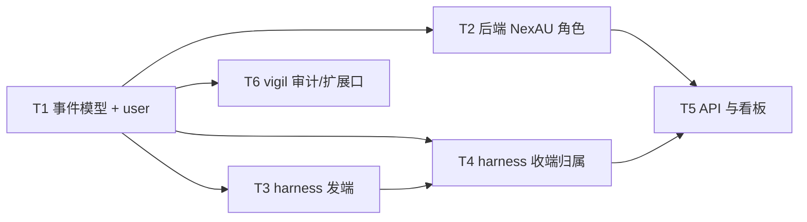

# 0041 · 统一 LLM Token 用量监测与全链路归属

<!-- 本文件由 spec 工具维护：frontmatter 为结构化源数据（含 tasks DAG），正文为组级 rust-RFC 9 段总览。 -->

## Summary

建立覆盖整个 auto-designer 闭环的统一 LLM Token 账本，采集对象包括 user persona、
triager/synthesizer/divergent/owner、每道题的 harness NexAU，以及技术上可观测时的 developer/vigil。每次真实
provider 请求写一条原始事件，绑定 `run_id / round_no / session_id / instance_id / interaction_id /
turn_no / agent_id / role / operation`，再由 API 从原始事件按调用、交互、session、题目、agent、角色、轮
和 run 分层聚合。

user persona 在 OpenAI-compatible `response.usage` 边界直接采集；后端四类 NexAU agent 从 LLM tracer
完整响应采集；harness 位于独立子进程，新增纯机器 `type=usage` stdout 旁路，由 launcher 隔离缓存并在
宿主补题目上下文；vigil 位于独立容器，必须先审计 OpenAgents/Claude 是否提供结构化逐调用 usage 与可靠
归属，再决定 reported 接入或明确 unavailable，禁止解析普通日志伪装精确值。

原始逐调用事件仍是唯一事实源。空回复、网关降级和其它重试分别记账；缺 usage 时保留
`usage_source=unavailable`，不以字符长度估算。usage 旁路不得进入用户可见 reply、等待进度、session
timeline 或 prompt，也不得携带请求正文、system prompt、工具参数及凭证。最终 API 能按轮、题、session、
role 汇总 user persona 与 harness 的分项和合计；triager/synthesizer/divergent/owner 继续作为轮级角色成本，
developer/vigil 在其独立容器尚无结构化协议时仍明确 unavailable。监测写入永远是 best effort，失败
不能改变闭环控制流。

## Motivation

成本观测需要回答的不只是“整个进程用了多少”，而是“哪一轮、哪道题、哪个 session、哪个角色、哪次
调用用了多少”。闭环同时存在主进程线程池、harness 子进程和 vigil 容器，任何全局累计计数都会丢失
归属，尤其在两道题并发时无法事后可靠拆分。

一题完整用户会话包含两条模型链路。user persona 判断、行动、评分是一条；
harness 为回答用户而运行的 NexAU agent 是另一条，且通常后者消耗更多 Token。只统计 persona 会把“每题
成本”系统性低估，也无法比较题目难度、harness 迭代次数与体验结果的关系。

缺口不是 provider 能力问题。当前 NexAU 已规范化 OpenAI、Anthropic 等 provider 的 input、output、
reasoning、cache 和 total Token，并在每次模型调用后保留 `ModelResponse.usage`。harness 模板的
`_StepCollector` 也已经接在相同 LLM span 上，完整 outputs 对它可见。真正缺失的是跨进程桥接和宿主归属：

1. harness 子进程不知道 auto-designer 的 round/session/instance 上下文；
2. 宿主知道题目上下文，却看不到子进程内部每次 LLM usage；
3. stdout 同时承载 reply、progress、status，usage 若沿普通旁路处理会污染用户可见轨迹；
4. 空回复和错误会触发多次真实计费请求，只在终态 reply 记一次会漏账；
5. 并发最多两个用户 session，全局累计数无法可靠拆回每道题。
6. triager/synthesizer/divergent/owner 运行在后端 NexAU 中，适合按轮和 agent 归属，但综合多题时不能伪造
   单题分摊。
7. developer/vigil 跨容器、跨 OpenAgents/Claude 协议；若只有 stdout 文本，就不具备可信的精确统计条件。

因此必须在调用发生处采集“多少”，在宿主会话边界补“属于谁”，再写统一原始事件；任一端单独统计都
不足以满足按题审计。

## Guide-level explanation

全链路观测路径如下：

```text
round N
  ├─ instance X / session S
  │    ├─ user persona response.usage ─────→ UsageStore(role=user)
  │    └─ harness 子进程 NexAU LLM span
  │         └─ stdout type=usage → launcher → UsageStore(role=harness)
  ├─ triager NexAU tracer ─────────────────→ UsageStore(role=triager)
  ├─ synthesizer/divergent/owner tracer ──────→ UsageStore(对应 role)
  └─ vigil/OpenAgents/Claude
       ├─ 有结构化逐调用接口 → UsageStore(role=developer)
       └─ 无可靠接口         → capability unavailable
```

harness 每发生一次真实 provider 请求就产生一条 usage。若一次回答经过三轮 tool-use，则产生三条；若空
content 后重试，则失败/空响应与重试分别产生事件。终态 reply 仍只包含给用户看的答案和既有 steps，
persona 完全看不到 usage。

宿主为每局会话预生成 `session_id`，从 SWE-bench workspace 参数取得 `instance_id`，从 orchestrator
上下文取得 `round_no`。launcher 只负责无损接收和恰好一次 drain，不猜归属；会话层在 drain 时显式补齐
上下文。这样 reader daemon 线程无需依赖不会自动传播的 `ContextVar`，并发 session 也不会串线。

看板选择某一轮后显示每道题：

```text
instance django__django-123
  user       12,430
  harness    47,800
  合计       60,230
```

同一区域另列该轮 triager/synthesizer/divergent/owner 总量。这些后处理角色可能综合多题，除非调用上下文本身
有 instance_id，否则不强行摊派到单题。developer/vigil 也不与 harness 合并：二者是不同执行面。

使用者可从原始事件逐层钻取：一次 provider 调用是最小单位；同一 `operation/interaction` 的调用组成一次
模型阶段；同一 session 的 user 与 harness 组成一道题的交互成本；同一 agent_id 组成一次 agent 执行；
round/run 汇总用于预算和趋势。当前没有稳定 interaction_id 的调用链必须保留到逐调用和 session 两级，
不能用时间邻近猜测对话 turn。

## Reference-level explanation

### 统一数据模型与不变量

权威原始事件追加到 `backend/data/usage.jsonl`。事件字段为：timestamp、run_id、round_no、session_id、
instance_id、interaction_id、turn_no、agent_id、role、operation、provider、model、input_tokens、output_tokens、reasoning_tokens、
cached_input_tokens、total_tokens、latency_ms、success、error、request_id、usage_source。可选字段缺失用 null；
身份字段未知也保留事件，不将未知字符串写成虚构 id。

`usage_source` 只有三种语义：`reported` 为 provider/NexAU 明确报告；`estimated` 仅允许未来真实 tokenizer
估算器显式产生，本组不启用；`unavailable` 表示调用事实存在但 Token 不可得。聚合必须同时返回
unavailable_count，避免 null 按零求和后被误读为“零成本”。

安全边界：事件绝不含 API key、Authorization、环境变量值、messages、完整 system prompt、用户请求正文、
模型响应正文或工具输入输出。error 只存异常类型/稳定错误码。所有写入与解析错误均被观测层吞掉或计诊断，
不得让模型调用、harness reply、agent.run、vigil 生命周期失败。

### 上下文传播

主进程用 `ContextVar` 作不可变 overlay。orchestrator 在 round 外层绑定轮次；user session 在模型调用前预生成
session_id，并绑定 instance_id/role/agent；NexAU worker 已通过 `copy_context()` 继承。reader daemon 等早于
session 创建或不继承上下文的线程不得直接写归属事件，而应缓存最小 usage 后由拥有显式上下文的调用方
drain。run_id 可由启动环境显式提供，未提供时每个新进程生成唯一值；不得把 module-global 当前 session
作为并发归属源。

### User 与后端 NexAU 采集点

`ApiPersonaClient._create()` 是 user 精确边界。每次 `chat.completions.create()` 返回或抛错都记录；
`enable_thinking=False` 被拒后的裸请求、退避重试、空 content 后扩大 max_tokens 均是独立计费尝试，必须
逐次入账。`respond/complete/classify_action` 不再承担计数，避免分支漏记。

triager/synthesizer/divergent/owner 共用 `run_agent_def + StepTracer`。role 由明确 agent definition/调用参数绑定，
不可从输出文本猜测；NexAU canonical session id 作为一次 agent execution 的 agent_id。LLM span outputs 中
`usage` / `usageMetadata` 是逐调用事实，assistant 文本投影与 usage 投影相互独立。

### 事件契约

`stdio-jsonl-v1` 新增机器旁路：

```json
{
  "type": "usage",
  "provider": "openai-compatible",
  "model": "model-name",
  "input_tokens": 100,
  "output_tokens": 25,
  "reasoning_tokens": 8,
  "cached_input_tokens": 40,
  "total_tokens": 125,
  "latency_ms": 812.4,
  "success": true,
  "request_id": "req_...",
  "agent_run_id": "...",
  "usage_source": "reported"
}
```

可选 Token 字段缺失用 `null`，不是零。所有 Token 字段均缺失时 `usage_source=unavailable`；本组不产生
`estimated`。`total_tokens` 优先采用 provider 报告值；只有 input 与 output 均存在且 total 缺失时才作
确定性相加。不得对 reasoning/cache 重复加总到 provider 已报告的 total。

每个 LLM span 恰好发一次事件。NexAU 当前 `ModelResponse.usage` 是该次调用快照；实现测试必须以两次
不同 usage 的连续调用证明没有把 run 累计快照当单次值。span error 同样发 `success=false` 事件，usage
若不可得则 Token 为 null。事件不含 inputs、outputs content、messages、tool parameters、异常正文或
环境变量；error 仅保留安全的异常类型/错误码。

### Harness 发端

`backend/harness_template/entry.py` 保持自包含，不 import 编排仓的 `auto_designer.usage`。`_StepCollector`
在 `SpanType.LLM` 的 `end_span` 中做小型防御式抽取，通过既有 `_stdout_lock` 立即写完整 JSON 行。立即发而
不是塞进最终 reply，确保 timeout、interrupt、进程异常和无终态 reply 时已完成调用仍可观测。

usage 与 assistant steps 是同一 span 的两个正交投影：assistant 文本仍进 steps/progress；usage 只走
机器旁路。任何抽取或写出异常均静默降级，不影响 agent 主流程。

### Launcher 收端

`_HarnessHandle` 增加专用 usage 缓冲与 `drain_usage_events()`。所有 stdout 消费路径必须走同一个 usage
识别函数，包括 `poll()`、`try_reply()` 和 `_post_reply_drain()`，避免分支间漏记或重复。usage 不进入：

- `last_sideband` / `last_progress`；
- `last_visible_events` / `visible_events`；
- `last_steps`；
- control ack 判定；
- `_sideband_preview()` 生成的用户可见文本。

旧 harness 不发送 `type=usage` 时行为完全不变。畸形事件不得阻断后续 reply；接收端可将其规范化为
unavailable 或丢弃并计诊断，但不能伪造数值。

### 显式归属与落盘

会话层在 harness 启动后、首次模型调用前已经持有预生成 `session_id`，并能从
`scenario.workspace.params.instance_id` 取得 SWE-bench 题号。每次 drain 在当前 round 上下文中调用统一
UsageStore，补充：

```text
role=harness
run_id=<闭环 run>
round_no=<当前轮>
session_id=<当前用户会话>
instance_id=<SWE-bench instance>
agent_id=<harness 发来的 agent_run_id；缺失则稳定句柄 id>
operation=<NexAU span/call stage>
```

正常 reply、心跳读取、interrupt、异常及 close/finally 都必须有 drain 机会；单条事件只能消费一次。
UsageStore 写失败继续遵守观测不拖垮主流程的不变量。

### 聚合语义

API 只从原始 JSONL 求和，新增 `instance_id` 过滤与 `by_session / by_instance / by_role`。某题合计默认只
含明确带该 instance_id 的事件，即 user + harness；不把综合多题的 synthesizer 或轮级 owner 按比例摊派。
unavailable 事件计入调用次数与不可用数，但其 null Token 不计入数值总和，界面必须同时显示缺失数量，
避免“0 Token”误读。

查询面固定为：

- `GET /api/usage/events`：逐调用原始事件；
- `GET /api/usage/summary`：过滤后的总量及 by_role/by_agent/by_session/by_instance；
- `GET /api/usage/sessions/{session_id}`：一局 session 明细与汇总。

events/summary 支持 run_id、round_no、session_id、instance_id、interaction_id、turn_no、role、agent_id、
model 过滤。单次用户交互由控制信封在外层拍开始时分配 interaction_id/turn_no；该拍的 persona 调用及其
触发或消费的 harness 调用使用同一标识。排队、心跳和跨拍回复必须沿请求–回复账本关联，不按时间窗口
猜测；无法判定时宁可 interaction_id=null，也不错误挂靠。

### Developer/vigil 判定门

vigil 与 harness 不同：harness 的 NexAU tracer 在本仓模板内可改，vigil 则运行
`auto-designer-vigil:latest`，经 OpenAgents/Claude 链路调用。T6 必须实际检查镜像/CLI/上游事件对象，不以
“Claude 通常有 usage”代替证据。reported 接入需同时满足：逐 provider 调用 usage、稳定 agent/request id、
以及 run/round/工作项归属可注入。缺一项即保持 unavailable，并在设计说明记录技术阻点和预留事件协议。

若条件满足，优先选择容器内 sidecar 或专用 JSONL/stdout 机器通道；宿主只读接收。不得 tail 普通 vigil
日志做正则解析，不得将字符数估算标成 reported，不得把凭证通过事件或挂载带出容器。接入不能改变容器
复用、keep-alive、egress 围堵和停止语义。

### 精确度矩阵

| 链路 | 目标粒度 | 精确来源 | 缺失策略 |
|---|---|---|---|
| user persona | 调用/session/instance/round | OpenAI-compatible response.usage | unavailable |
| triager/synthesizer/divergent/owner | 调用/agent/role/round | NexAU LLM span usage | unavailable |
| harness | 调用/session/instance/round | 子进程 NexAU usage 旁路 | 旧 harness/unreported 为 unavailable |
| developer/vigil | 调用/agent/work item/run | 经审计确认的 OpenAgents/Claude 结构化 usage | 无可靠接口则能力 unavailable |

### DAG 与文件分配



T2、T3、T6 在 T1 事件契约确定后可并行；T4 等 T3，T5 等所有可展示主链。六个 Task 的 `files` 互不
相交，符合仓库施工边界。

## Drawbacks

- 每次模型调用多一条 JSONL；harness 还多一行 stdout JSON。相对模型延迟与现有 progress 流量很小，
  但仍增加协议流量、磁盘增长和测试面。
- harness 模板内需维护一份轻量 usage 抽取逻辑，因为被进化仓必须独立，不能 import 编排包；两侧字段契约
  需靠协议测试防漂移。
- 进程在 provider 返回后、tracer 发事件前被强杀，极窄窗口内仍可能漏记；JSONL/stdio 不提供分布式事务。
- 只对加载新代码的后续进程和升级后的 harness 生效，历史运行无法精确回填；旧 main 版本不发 usage 时
  只能显示 unavailable。
- 按题合计不包含无法明确归属单题的综合设计与 vigil 开发成本，因此不是整个组织的完全摊销成本。

## Rationale and alternatives

选择“调用点采集 + 显式上下文 + 原始事件”的统一模式，是因为计费事实与业务归属位于不同层：provider
响应知道 Token，orchestrator/session 知道属于谁。原始事件保留重试和缺失事实，所有聚合可重算。

对 harness 选择 stdout 机器旁路，是因为它复用现有、已处理并发写锁和生命周期的唯一跨进程通道，不新增
端口、共享挂载或服务依赖。usage 立即逐调用发送，能覆盖多步 agent、重试与无终态 reply。

考虑过以下替代方案：

- **把 usage 塞进终态 reply。** 简单但 timeout/崩溃会丢整轮，多次调用只能批量延迟回传，也容易被
  persona 或 timeline 当内容消费，拒绝。
- **harness 直接写宿主 `backend/data/usage.jsonl`。** 破坏子进程/被进化仓隔离，要求共享绝对路径，且
  harness 不知道 session/instance，拒绝。
- **只读 NexAU run 累计 Token。** 无法可靠处理重试和单次调用审计，累计快照重复求和风险高，拒绝。
- **按字符数或 tokenizer 本地估算。** 与 provider 的 reasoning/cache 计费语义不一致；精确 usage 已可得，
  不应降级冒充，拒绝。
- **把 triager/synthesizer/developer 平摊给每道题。** 综合角色跨题工作，没有因果归属依据；只展示轮级成本，
  拒绝伪精确分摊。
- **新增 HTTP collector。** 可扩展到多进程，但当前单宿主 stdio 已足够；服务生命周期、认证和故障模式不
  值得为这一接缝引入，留作未来方案。

## Prior art

OpenAI-compatible `ChatCompletion.usage` 是 user 侧直接事实源。NexAU 的 `TokenUsage` 与
`UsageUpdateEvent` 已建立多 provider 归一和逐模型调用事件语义；本组不重新设计 Token 计算，只将事实
投影到统一事件。现有 harness `progress/status/reply` JSONL 旁路和 `_StepCollector` 提供跨进程观察点。
ContextVar 是 Python 并发请求归属的既有模式；append-only JSONL 适合当前单进程、多线程、可回放规模。

## Unresolved questions

- legacy 协议仍需长期发送 usage，还是仅 `stdio-jsonl-v1` 支持；实现前以 launcher 当前兼容窗口决定，不能
  让 legacy 包装进入用户可见 progress。
- 部分 provider 报告的 `completion_tokens` 已包含 reasoning，部分拆分；统一事件保留 provider total，
  看板是否另加“可计费输出”派生值留待真实数据验证。
- post-reply drain 当前窗口为 0.2 秒。立即在 LLM span end 发 usage 时理论上先于 reply；仍需测试确认
  stdout 排序足够，不因尾部线程调度依赖窗口碰运气。
- vigil 镜像当前具体 OpenAgents 版本是否已经提供可订阅的逐调用 usage，需要在实现 T6 时以源码/真实事件
  实证；spec 不预判其可用性。

## Future possibilities

- 将同一最小事件协议用于 vigil/OpenAgents sidecar，补齐 developer 的精确角色成本。
- 增加 provider 费用表，在保留 Token 原始事实的前提下派生币种成本与预算告警。
- 将 interaction id 与现有 utterance 请求–回复账本统一成跨进程 trace id，支持更复杂的排队/打断可视化。
- 数据量增大后将 JSONL 索引到 SQLite/列式存储；JSONL 仍作为可回放原始日志。
- 增加跨进程事件序号与幂等键，在进程重启或未来 HTTP collector 重投时做去重。
