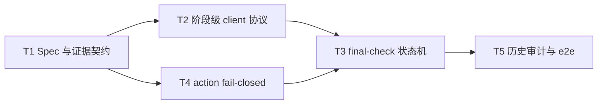

# 0048 · 用户模拟最终查验分支与动作协议失效保护

<!-- 本文件由 spec 工具维护：frontmatter 为结构化源数据（含 tasks DAG），正文为组级 rust-RFC 9 段总览。 -->

## Summary

本组为用户模拟的 `judge → intent → act` 决策链增加一个显式、一次性的 **final check**
分支：当 intent 表示「在决定前还需要最后核实」时，框架允许同一 persona 在当前工作区完成一次有界私有
查验；查验无论成功、失败还是不可用，随后都必须进入无工具的 `re-judge → re-intent → act`，同一
决策周期不得再次查验。`act` 由此恢复为纯外部动作收敛器，不再同时承担私有调查。

同时，本组把 persona 输出处理从「能解析成任意 JSON dict 即成功」升级为**阶段级语义契约**：judge、
intent、final-check、act、issue、rating 分别校验自己的必填字段和枚举；重试返回工具调用时，只有允许工具
的阶段才能继续分发；无工具阶段的工具 JSON 是协议错误。缺失或非法 action 不再按动作空间排序投影，更
不可能落到 `accept`。多次修复失败的会话持久化为 `evaluator-invalid`，与 harness 的通过/失败正交。

## Motivation

当前 `AgenticPersonaClient` 的内层 system 对几乎所有主阶段都暴露 private tool 协议，而 main act 的局部
prompt 又要求只从外部动作菜单中选一个 id。模型在「还想看一次 diff/测试」时具有合理的真人动机，却只能
在 act 阶段违反局部契约返回 `{"tool":"run_shell",...}`。该对象是合法 JSON，通用解析器会接纳；特别是
首次输出重复、截断后进入 `_parse_with_retry()` 时，重试得到的工具对象会被直接返回，未重新进入工具分发
循环，也未验证当前阶段必须含 `action`。

外层 `resolve_action()` 随后把缺失 action 读成空字符串，再由 `project_to_legal()` 返回排序后的
`space[0]`。ACTIVE 动作空间的第一项恰好是 `accept`，于是 evaluator 的协议故障被写成用户验收。这不是
理论风险，现有冻结实验已经给出两组证据：

- 固定 16 题、harness v0–v6 共 7 轮 112 局中，原始 broad Accept 为 94/112（83.93%）；逐条对照
  `persona_trace` 后，只有 53/112（47.32%）是模型显式选择，另有 41 次由缺失 action fallback 伪造，
  占原始 Accept 的 43.62%。各轮假 Accept 数依次为 5、5、5、7、9、6、4。
- hard64 的 harness-v0 运行中，原始 broad Accept 为 53/64（82.81%）；显式 broad Accept 仅 26/64
  （40.63%），其中 27 次直接 `accept` 来自缺失 action fallback。

这些非法输出不能统一解释为 harness 失败：已复核的前 6 轮 37 个样本中，最后 judge verdict 分布为
`failed_blame_harness=13`、`stuck=2`、`unsure=20`、`satisfied=2`。因此正确边界是 fail-closed（不得通过）
但 attribution-neutral（不得凭 evaluator 故障给 harness 定罪）。另一方面，一刀切禁止最终决定前的查验
也不拟真：面对 timeout、陈旧回复、无测试证据或磁盘上可能存在的部分改动，真实用户确实会临门再核实。
本组用显式的一次性分支保留该动机，并用强制收敛消除无限调查和假验收。

## Guide-level explanation

每次收到一条可供主循环判断的 harness 观察后，用户模拟执行一个 decision cycle：

```text
judge（沿用现有可选私有核实）
  ↓
intent → {intent, needs_final_check, check_goal}
  ├─ needs_final_check=false → act（无工具）
  └─ needs_final_check=true
       ↓
     final_check（一次有界工具 episode）
       ↓  无论 completed / failed / unavailable
     re-judge（无工具，必须产 verdict）
       ↓
     re-intent（无工具，final_check_available=false）
       ↓
     act（无工具，只能产合法外部 action）
```

`final_check` 是一次episode，不等于只允许一个原子工具调用。persona可以在小预算内读文件、运行测试，
competent/expert还可用write_file写测试或按其协作风格修改代码；是否操作仍取决于persona，不强制接管任务。
这是交互用户在实时工作区的能力，不是会话结束后的只读评阅。它不暴露report_issue；用户自己的编辑和
命令保存在persona_trace，不能据最终产物通过就宣称Harness独立完成。检查结果整理为private evidence，
连同成功、失败或不可用状态交给re-judge；框架不根据工具成功与否自行推断verdict。

例如，assistant 超时但声称已完成时，intent 可以返回：

```json
{
  "intent": "I want to verify the diff and focused test before deciding.",
  "needs_final_check": true,
  "check_goal": "Inspect the diff and run the focused regression test."
}
```

检查完成后，re-judge 必须基于新证据输出 `perceive + verdict`；re-intent 重新表达此刻意愿，但不能再申请
final check；最终 act 才选择 `accept`、`accept_with_reservations`、`send_message`、`give_up` 或其他当前
合法动作。若 persona 无私有工具或检查报错，状态分别记录为 `unavailable` / `failed`，仍进入同一条强制
re-judge 路径，不回到检查入口。

如果 act 返回工具调用、工具结果对象、缺少 action 的 dict、未知 id 或不在当前菜单内的 id，框架给一次
阶段专属纠错提示并重试。再次无效则结束为 `evaluator-invalid`；它不记 Accept、不记 harness Fail，也不
生成由该伪终态派生的 feeling。实验编排可以按原 seed/persona/harness pin 自动重跑该局。

## Reference-level explanation

### 阶段与工具能力矩阵

阶段由调用方显式传递或从唯一阶段标签解析，不能通过「返回对象里是否恰好有 tool/action」反推。

| 阶段 | 最终契约 | private tools | 说明 |
|---|---|---:|---|
| main/waiting judge | `perceive + verdict/judgment` | 沿用现有可选策略 | 形成初始判断 |
| main/waiting intent | `intent`，main 另含 final-check 字段 | 否 | 只表达意愿 |
| main final_check | `perceive + check_status` | 是，受 persona 能力与 final-check profile 限制 | 唯一新增调查分支 |
| main re-judge | `perceive + verdict` | 否 | 必须消费 final-check evidence |
| main re-intent | `intent + needs_final_check=false` | 否 | 重新形成意愿，不可回跳 |
| main/waiting act | `action + message + gap` | 否 | 纯外部动作收敛 |
| issue / rating | 各自既有契约 | 否 | 与本分支无关 |

final check 只在 ACTIVE 主决策周期开放；OPENING 没有待验收产物，waiting heartbeat 也不新增该分支。一次新的
harness reply/timeout/error 唤醒下一主决策周期时，`final_check_used` 才重新置为 false。final-check 工具
episode 使用独立的小预算。普通 judge 最多执行 8 次工具调用，final-check 最多执行 4 次；这里的额度只计
真正执行的工具，不计最终阶段 JSON 和一次契约纠错。工具额度用满后，dispatcher 保留完整的既有工具结果，
进入最多两次、机械禁用工具的强制结论调用。只有强制结论仍无法满足阶段契约时才产生 typed evaluator error；
不得把“恰好用满工具”本身解释为 `check_status=failed`，也不能退回无限工具循环。

### 8+4 预算的追加实验依据（2026-08-31）

spec-0048 首轮 hard64 真实 GLM canary 在人工停止时留下 47 个 terminal session：11 accepted、6 abandoned、
30 evaluator-invalid。30 个 invalid 全发生在 `main_judge`，其中 24 个是旧实现的
`tool_budget_exhausted`，6 个是连续不可解析输出。24 个预算失败里，20 个已经成功执行满 8 个工具；其余 4 个
也执行了 7 个工具，只是一次非法契约输出或末次解析失败占掉了旧的“模型步数”额度。20/24 的工具结果没有
任何执行错误，而且 24 个样本中只有 1 个重复了完全相同的命令。因此主要根因不是查验命令重试或工具故障，
而是旧实现混淆了“工具额度”和“结论额度”，在渐进调查结束前没有预留结构化收口。

同批 trace 的 136 次 main-judge 共执行 375 个工具调用；91 次 judge 使用过工具，使用时平均 4.12 次，工具数
分布为 `0:45, 1:23, 2:13, 3:8, 4:11, 5:6, 6:2, 7:8, 8:20`。这支持保留普通 judge 的 8 次硬上限，
并在第 4 次后加入软收敛提示，而不是把硬上限降到 3。final-check 的 12 次调用中，8 次旧式预算失败：6 次
执行 4 个工具、2 次执行 3 个工具后被非法输出占步；8 次都已经走过合法 rejudge/reintent，最终动作均为
`send_message`，没有直接 Accept 污染。因此 final-check 维持 4 次工具上限，并新增独立无工具结论调用。

2026-10-16按用户确认的模拟目标修订：运行中的用户保留按persona读/跑/写的能力，只有终态评阅保持只读。
以下为先前收敛实验的历史观察，不能将用户自行跑测试或合法编辑一概判成评估污染；应保留真实贡献轨迹。

当时审计还发现普通 judge 的 375 个工具中有 27 条具有修改倾向的命令，失败调用中占 21 条，包括安装依赖、
stash、删除缓存和临时写脚本。故 opening judge 机械禁用 private tools；普通 judge 不再暴露 `write_file`，
prompt 同时禁止安装、reset/stash 和接管实现；final-check 仍严格只暴露 `read_file/run_shell`。

追加的 8-session 真实 GLM canary（runtime `86ab396`，Harness v0，同一 hard64 shard-00 seed）在并发 8 下
全部 terminal：6 次显式 accept、2 次显式 give_up、0 evaluator-invalid、0 runner failure。所选样本包含 4 个
旧 `tool_budget_exhausted`、1 个旧 `unparseable_json` 和 3 个旧正常 Accept 对照；五个旧异常样本均恢复为
合法终态。8 个 opening judge 工具数全部为 0；一次普通 judge 用满 8 个工具、一次 final-check 用满 4 个工具，
两者都由新增的无工具结论调用返回合法契约。8 个终态 action 全部与最后 `main_act` 原始 JSON 一致，无 fallback
Accept。整批墙钟 1,364 秒，API telemetry 记录 806 次调用、23,983,943 reported tokens。

该 canary 同时证明“从工具清单移除 `write_file` + prompt 禁止修改”还不构成机械只读：虽然没有任何
`write_file` 调用，`run_shell` 中仍出现一次 `git checkout` 和一次 `git stash/pop`。因此本轮只认证预算与
协议收口，不认证 verification sandbox 的非 authoring 隔离；full hard64 前应为 judge/final-check 的 shell
增加机械只读边界或等价的变更拒绝/回滚检测。

对 6 个显式 Accept 的语义复核显示，不能用 message 中出现“myself”直接判假：5 局已经由 Harness 产出代码、
测试或提交，“自己”指独立验证、重度指导或最后提交；只有 Matplotlib 一局明确只完成了用户当轮要求的只读
诊断，补丁仍计划由用户随后完成。因此 `accept` 的协议真实性已经恢复，但它仍同时承载“本轮交互满意”和
“原始 benchmark 全任务完成”两种含义。后续聚合需增加 `completion_scope`、`delivery_state` 与 `work_credit`
等正交字段；否则 scoped diagnosis 的合理 Accept 仍会被误报成 SWE-bench full-task pass。

### 阶段级语义校验与重试

通用 `_parse_json()` 只负责从文本中取出 JSON 对象，不再宣称该对象满足 OUTPUT CONTRACT。其后必须执行
`validate_stage_output(stage, obj, context)`：

- judge/re-judge 校验感知字段和合法 verdict；
- intent 校验字符串 intent、布尔 `needs_final_check`，为 true 时 `check_goal` 非空；re-intent 强制其为 false；
- final-check 校验 `check_status in {completed, failed, unavailable}` 与感知摘要；
- act 校验 `action` 非空且属于当轮 action space，并校验 channel/message/gap；
- issue/rating 维持各自字段和枚举约束。

重试是同一个 stage dispatcher 的一次新迭代，而不是绕过 dispatcher 的 helper 返回值。重试结果若是 tool call：

- tool-enabled stage：校验工具属于本阶段 profile，执行后回灌结果，再等待最终阶段输出；
- tool-disabled stage：不执行，记一次 `tool_not_allowed_in_stage` 契约错误并发送 stage-specific reminder；
- 超过 stage 的协议重试预算：抛出带 stage、raw 摘要和原因的 `PersonaProtocolError`。

所有原始输出、解析对象、校验结果、工具步骤和重试原因继续进入 `persona_trace`，但不得把完整敏感命令输出
复制进 error message。

### Final-check 状态机

主循环为每个 decision cycle 建立局部状态：

```text
FinalCheckState {
  available: bool       # ACTIVE、有工具且尚未使用
  used: bool            # 一旦进入 episode 即为 true，失败也不复位
  goal: str | null
  status: not_requested | completed | failed | unavailable
  evidence: str
}
```

intent 的 `needs_final_check=true` 只是一条内部控制请求，不进入外层 action catalog、不计一轮用户发言、不发给
harness、也不消耗 patience。框架进入 final-check episode 后立即把 `used=true`，以防异常路径重复进入。
episode 结束统一构建 final-check evidence，调用无工具 re-judge，然后调用无工具 re-intent；两次调用的 prompt
显式携带 `final_check_used=true`。只有新的 harness 观察开始新的 decision cycle 后才恢复 available。

### Action fail-closed 与 evaluator 语义

`action:"free"` 仍可走现有自归类，但归类结果也必须通过当轮 action-space 校验。缺失 action、未知 action、
合法 catalog id 但当前阶段不可用，均不得调用 `space[0]`，也不得按相同 Effect 猜测映射。动作空间排序只用于
稳定展示，永远不承载 fallback 语义。防御层的 `resolve_action()` 对非法输入抛 typed error；主循环负责一次
协议修复，失败后结束 evaluator-invalid。

持久化的 `sim_trace` 增加：

```json
{
  "evaluation_status": "valid | invalid",
  "evaluation_error": {
    "stage": "main_act",
    "code": "missing_action | tool_not_allowed_in_stage | ...",
    "attempts": 2
  }
}
```

`evaluation_status=invalid` 与 `end_reason` 分离；它不是 `accepted`、`abandoned` 或 `issue_filed`。聚合报表必须
同时给出总局数、valid 分母、invalid 数及原因；正式 Accept/Fail 比较只使用 valid 会话。需要保守敏感性分析
时可以另报「invalid 全按非 Accept」下界，但不得命名为 harness fail rate。历史 JSON 不回写，审计脚本生成
独立 correction artifact。

### 历史审计与回归认证

审计脚本逐 session 比较最终 TurnLog.action 与对应 main_act trace 的显式 action，输出 raw、explicit、invalid
三套计数和按轮明细；不得仅凭最终 prose 或 verdict 猜补 action。冻结的 112 局和 hard64 作为 golden audit
fixture 的摘要输入，最低断言分别保住 41 和 27 个 invalid fallback，不让修复后重新把历史 raw Accept 当真。

端到端脚本 `backend/scripts/e2e-spec-0048-final-check-convergence.sh` 至少覆盖：一次 intent 请求 final check、
一次工具 episode、强制 re-judge/re-intent、合法 act；以及 act 连续返回 tool JSON 后 evaluator-invalid、Accept
计数保持为零。离线 deterministic fake 是 CI 必跑；配置真实 USER_LLM_* 时可追加 GLM canary，产物明确标注
模型和源码 pin。

Spec-0071 整理后，当前维护的审计与 canary 位于 `tools.dev.audit`，从仓库根目录调用：

```bash
PYTHONPATH=backend .venv/bin/python -m tools.dev.audit.audit_sim_action_integrity \
  /path/to/collected/sessions --output /path/to/separate-audit.json
# 可选在线 canary：明确提供 USER 模型配置，会调用模型。
PYTHONPATH=backend .venv/bin/python -m tools.dev.audit.canary_spec0048_final_check \
  --secrets-file /path/to/chosen.env
```

历史 GLM canary 的原始模型、源码 pin 与验收记录保持原样；上述调用说明当前工具位置，不声称重新执行了历史验收。

### DAG 与文件分配



| Task | 职责 | 文件所有权 |
|---|---|---|
| T1 | 写清状态机、历史证据、失败语义和验收口径 | `docs/specs/0048-user-sim-final-check-convergence.md` |
| T2 | stage-aware 语义校验、工具能力矩阵、重试重新分发 | `persona_client.py` 及其 agentic client 测试 |
| T3 | prompt 与主 loop 接入一次 final check、强制 re-judge/re-intent、invalid 持久化 | `prompt.py`、`loop.py`、models/sim_user 投影及集成测试 |
| T4 | 移除排序 fallback，动作边界 typed fail-closed | `action_space.py` 及动作空间测试 |
| T5 | 历史 correction artifact 与 deterministic/live e2e | 新审计脚本、证据文档、脚本测试与 e2e shell |

验证路径：

```bash
./tools/spec-driven-development/spec validate
PYTHONPATH=backend .venv/bin/pytest backend/tests/user/sim/test_persona_client_agentic.py -v
PYTHONPATH=backend .venv/bin/pytest backend/tests/user/sim/test_action_space.py -v
PYTHONPATH=backend .venv/bin/pytest backend/tests/user/sim/test_prompt.py backend/tests/user/sim/test_loop.py backend/tests/user/sim/test_heartbeat.py -v
PYTHONPATH=backend .venv/bin/pytest backend/tests/scripts/test_audit_sim_action_integrity.py -v
backend/scripts/e2e-spec-0048-final-check-convergence.sh
.venv/bin/ruff check backend/auto_designer/user/sim backend/scripts tools/dev/audit backend/tests/user/sim backend/tests/scripts
.venv/bin/ruff format --check backend/auto_designer/user/sim backend/scripts tools/dev/audit backend/tests/user/sim backend/tests/scripts
```

## Drawbacks

- 只有 intent 请求 final check 的周期会新增一次工具 episode、一次 re-judge 和一次 re-intent，增加延迟与 token；
  小预算和每周期一次上限用于约束成本。
- 阶段 schema 变严格后，会把此前被宽松 fallback 掩盖的模型协议问题显式暴露为 invalid，短期报表中的可用样本
  数可能下降；这是测量质量改善，不应通过恢复隐式投影来“修复”。
- final check 不暴露 write_file/report_issue，不能在会话内模拟“用户临门接管修改”；接管剩余工作统一使用现有
  `give_up` 结束 Harness 会话。这里的放弃对象是 Harness，不要求用户放弃现实任务，也不把用户后续产物归功于 Harness。
- 现有 prompt 已允许 judge 私有核实，新增分支在少数情况下会产生重复检查；re-intent 显式说明已有证据、预算小且
  只在 intent 主动申请时进入，以减少该成本。

## Rationale and alternatives

选择「一次 final check + 强制重新判断」是因为工具动机本身合理，而工具出现在 act 的位置不合理。显式内部
分支既保留真人在 timeout、证据不足时临门核实的行为，又让 act 保持可验证的纯映射，并且有清晰的循环上界。

备选一是 act 完全禁用工具且不设分支。它实现最简单，却迫使仍需证据的用户在不充分信息下 Accept/Fail/发消息，
降低模拟真实性，也无法表达“我自己最后看一眼”。备选二是继续允许 act 内任意工具循环；它保留灵活性，但 act
不再是最终动作，容易重复调查、预算失控并再次产生阶段错配。备选三是把非法 action 一律映射为 give_up/Fail；
它能压住 Accept 虚高，却把 evaluator 故障错误归因给 harness，并会错杀已经 satisfied 但格式失效的样本。
备选四是根据前一拍 verdict 猜 action；`unsure` 占历史 invalid 的大头，且 verdict 只是粗 bucket，无法区分等待、
追问、保留验收或放弃，仍会制造不可审计的后处理标签。

## Prior art

该设计沿用 agent runtime 常见的两层边界：deliberation/tool loop 负责取证，typed transition 负责提交状态变化；
工具调用不是最终业务动作。数据库事务的 prepare/commit、编译器的 parse/type-check，以及工作流引擎的 retryable
activity/terminal transition 也采用类似原则：语法成功不等于语义合法，终态转换必须经过独立校验。

## Unresolved questions

无阻塞问题。默认决策已经确定：final check 按每个 ACTIVE 主决策周期计一次；默认最多 4 个内层模型步；不暴露
write_file/report_issue；完成后必须无工具 re-judge 和 re-intent；invalid 与 harness fail 分离。真实 GLM canary
是否成为正式 CI 阻塞门，取决于 endpoint 在 CI 环境的可用性，首版只作为显式配置的认证步骤。

## Future possibilities

- 继续用真实 trace 检验七个既有动作的互斥性；不为接管行为新增 action、owner 或 completion 实体。
- 按 final-check 命中率、工具成本和 verdict 变化量评估该分支是否值得按 persona/任务难度动态开放。
- 将阶段 schema 升级为 provider 原生 structured output；本组的本地语义校验仍作为不可移除的防御层。
- 实验编排可对 evaluator-invalid 自动重放同一 seed，并报告首次有效结果与重试成本。
