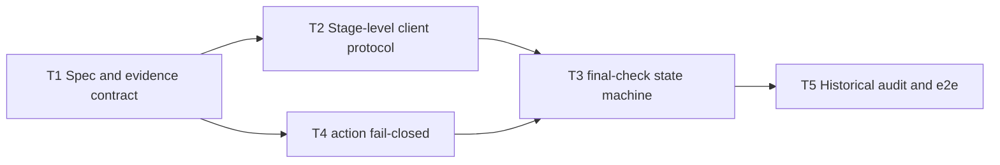

# 0048 · User Simulation Final-Check Branch and Action Protocol Fail-Safe

<!-- This file is maintained by the spec tool: frontmatter is the structured source data (including the tasks DAG), and the body is a group-level, nine-section rust-RFC overview. -->

## Summary

This group adds an explicit, one-time **final check**
branch to the user simulation's `judge → intent → act` decision chain: when intent indicates that one final verification is needed before deciding, the framework allows the same persona to perform one bounded private
check in the current workspace; whether the check succeeds, fails, or is unavailable, it must then proceed to tool-free `re-judge → re-intent → act`, with no further
check permitted in the same decision cycle. `act` thus returns to being a pure external-action convergence mechanism, no longer also responsible for private investigation.

This group also upgrades persona output handling from “success if it parses as any JSON dict” to **stage-level semantic contracts**: judge,
intent, final-check, act, issue, and rating each validate their own required fields and enums; when a retry returns a tool call, only tool-enabled
stages may continue dispatching it; tool JSON in a tool-free stage is a protocol error. Missing or invalid actions are no longer projected according to action-space sort order, and
can never fall through to `accept`. Sessions in which repeated repair attempts fail are persisted as `evaluator-invalid`, orthogonal to harness pass/fail outcomes.

## Motivation

Currently, the inner system of `AgenticPersonaClient` exposes the private tool protocol to almost all main stages, while the local
prompt for main act requires selecting exactly one id from the external action menu. When the model wants to inspect the diff or tests one more time, it has a reasonable human motivation, but can only
violate the local contract in the act stage by returning `{"tool":"run_shell",...}`. This object is valid JSON and is accepted by the generic parser; in particular,
when an initial output is repetitive or truncated and enters `_parse_with_retry()`, a tool object obtained on retry is returned directly, without re-entering the tool dispatch
loop or validating that the current stage must contain `action`.

The outer `resolve_action()` then reads the missing action as an empty string, after which `project_to_legal()` returns the sorted
`space[0]`. The first item in the ACTIVE action space happens to be `accept`, so an evaluator protocol failure is recorded as user acceptance. This is not
a theoretical risk: existing frozen experiments have already provided two sets of evidence:

- Across 112 sessions in 7 rounds of harness v0–v6 on a fixed set of 16 tasks, raw broad Accept was 94/112 (83.93%); checking each case against
  `persona_trace` showed that only 53/112 (47.32%) were explicit model choices, while another 41 were fabricated by the missing-action fallback,
  accounting for 43.62% of raw Accepts. False Accept counts by round were 5, 5, 5, 7, 9, 6, and 4.
- In the hard64 harness-v0 run, raw broad Accept was 53/64 (82.81%); explicit broad Accept was only 26/64
  (40.63%), with 27 direct `accept` outcomes originating from the missing-action fallback.

These invalid outputs cannot all be interpreted as harness failures: among the 37 reviewed samples from the first 6 rounds, the final judge verdict distribution was
`failed_blame_harness=13`, `stuck=2`, `unsure=20`, and `satisfied=2`. The correct boundary is therefore fail-closed (must not pass)
but attribution-neutral (must not condemn the harness based on an evaluator failure). On the other hand, a blanket ban on checking before the final decision
would also be unrealistic: faced with a timeout, a stale response, missing test evidence, or possible partial changes on disk, real users do perform a last-minute verification.
This group preserves that motivation through an explicit one-time branch and uses mandatory convergence to eliminate endless investigation and false acceptance.

## Guide-level explanation

After each harness observation that the main loop can evaluate, the user simulation executes a decision cycle:

```text
judge (reuse existing optional private verification)
  ↓
intent → {intent, needs_final_check, check_goal}
  ├─ needs_final_check=false → act (no tools)
  └─ needs_final_check=true
       ↓
     final_check (one bounded tool episode)
       ↓  regardless of completed / failed / unavailable
     re-judge (no tools, must produce verdict)
       ↓
     re-intent (no tools, final_check_available=false)
       ↓
     act (no tools, can only produce a valid external action)
```

`final_check` is an episode, not a limit of one atomic tool call. Within a small budget, the persona can read files and run tests;
competent/expert personas can also use write_file to write tests or modify code according to their collaboration style; whether to act still depends on the persona, with no forced task takeover.
This is the capability of an interactive user in the live workspace, not a read-only review after the session ends. It does not expose report_issue; the user's own edits and
commands are saved in persona_trace, and a passing final artifact cannot be used to claim that the Harness completed the work independently. Check results are organized as private evidence,
and passed to re-judge along with a success, failure, or unavailable status; the framework does not infer a verdict on its own from tool success or failure.

For example, when the assistant times out but claims completion, intent can return:

```json
{
  "intent": "I want to verify the diff and focused test before deciding.",
  "needs_final_check": true,
  "check_goal": "Inspect the diff and run the focused regression test."
}
```

After the check, re-judge must output `perceive + verdict` based on the new evidence; re-intent restates the current intention but cannot request
another final check; only the final act selects `accept`, `accept_with_reservations`, `send_message`, `give_up`, or another currently
legal action. If the persona has no private tools or the check errors, the status is recorded as `unavailable` / `failed` respectively, and execution still enters the same mandatory
re-judge path without returning to the check entry point.

If act returns a tool call, a tool-result object, a dict missing action, an unknown id, or an id outside the current menu, the framework provides one
stage-specific correction prompt and retries. If the result is invalid again, the session ends as `evaluator-invalid`; it records neither Accept nor harness Fail, and does not
generate a feeling derived from this spurious terminal state. Experiment orchestration can automatically rerun the session with the original seed/persona/harness pin.

## Reference-level explanation

### Stage and tool capability matrix

The stage is explicitly supplied by the caller or parsed from a unique stage label; it cannot be inferred from whether the returned object happens to contain tool/action.

| Stage | Final contract | private tools | Notes |
|---|---|---:|---|
| main/waiting judge | `perceive + verdict/judgment` | Retain the existing optional policy | Form the initial judgment |
| main/waiting intent | `intent`, with additional final-check fields for main | No | Express intention only |
| main final_check | `perceive + check_status` | Yes, subject to persona capabilities and the final-check profile | The only new investigation branch |
| main re-judge | `perceive + verdict` | No | Must consume final-check evidence |
| main re-intent | `intent + needs_final_check=false` | No | Reform intention, with no backward transition |
| main/waiting act | `action + message + gap` | No | Pure external-action convergence |
| issue / rating | Their respective existing contracts | No | Unrelated to this branch |

final check is available only in ACTIVE main decision cycles; OPENING has no artifact awaiting acceptance, and waiting heartbeats do not add this branch either. Only when a new
harness reply/timeout/error wakes the next main decision cycle is `final_check_used` reset to false. The final-check tool
episode uses a separate small budget. A normal judge may execute at most 8 tool calls, and final-check at most 4; these quotas count only
tools actually executed, excluding the final stage JSON and one contract correction. Once the tool quota is exhausted, the dispatcher retains all existing tool results
and enters at most two mandatory conclusion calls with tools mechanically disabled. A typed evaluator error is produced only if the mandatory conclusion still cannot satisfy the stage contract;
merely exhausting the tool quota must not itself be interpreted as `check_status=failed`, nor may execution fall back into an unbounded tool loop.

### Additional experimental basis for the 8+4 budget (2026-08-31)

The first spec-0048 hard64 live GLM canary left 47 terminal sessions when manually stopped: 11 accepted, 6 abandoned,
and 30 evaluator-invalid. All 30 invalid cases occurred in `main_judge`, including 24 instances of the old implementation's
`tool_budget_exhausted` and 6 instances of consecutive unparseable outputs. Of the 24 budget failures, 20 had successfully executed all 8 tool calls; the remaining 4
had also executed 7 tools, but one invalid contract output or a final parse failure consumed the old “model step” quota. Tool results in 20/24 cases had
no execution errors, and only 1 of the 24 samples repeated an identical command. The main root cause was therefore not retries of verification commands or tool failures,
but the old implementation's conflation of “tool quota” with “conclusion quota,” leaving no reserved capacity for structured closure before the incremental investigation ended.

Across 136 main-judge calls in the same batch of traces, 375 tool calls were executed; 91 judge calls used tools, averaging 4.12 calls when tools were used, with the tool-count
distribution `0:45, 1:23, 2:13, 3:8, 4:11, 5:6, 6:2, 7:8, 8:20`. This supports retaining the normal judge's hard limit of 8 calls
and adding a soft convergence reminder after the 4th call, rather than reducing the hard limit to 3. Of the 12 final-check calls, 8 encountered the old-style budget failure: 6
executed 4 tools, and 2 executed 3 tools before an invalid output consumed a step; all 8 had already passed through valid rejudge/reintent, and their final actions were all
`send_message`, with no direct Accept contamination. final-check therefore retains its 4-tool limit and gains a separate tool-free conclusion call.

2026-10-16 revision based on the user-confirmed simulation goal: users retain persona-specific read/run/write capabilities during execution; only terminal review remains read-only.
The following are historical observations from earlier convergence experiments; users running tests themselves or making legal edits must not all be classified as evaluation contamination. Actual contribution traces should be retained.

The audit at the time also found 27 commands with a tendency to modify state among the normal judge's 375 tools, accounting for 21 failed calls, including dependency installation,
stash, cache deletion, and temporary script writing. Therefore, private tools are mechanically disabled for opening judge; normal judge no longer exposes `write_file`,
and its prompt also prohibits installation, reset/stash, and taking over implementation; final-check still strictly exposes only `read_file/run_shell`.

An additional 8-session live GLM canary (runtime `86ab396`, Harness v0, the same hard64 shard-00 seed) reached terminal states for all sessions at concurrency 8:
6 explicit accept, 2 explicit give_up, 0 evaluator-invalid, and 0 runner failure. The selected samples included 4 old
`tool_budget_exhausted` cases, 1 old `unparseable_json` case, and 3 old normal Accept controls; all five previously abnormal samples recovered to
valid terminal states. All 8 opening judge tool counts were 0; one normal judge exhausted all 8 tools, and one final-check exhausted all 4 tools,
and both returned valid contracts through the newly added tool-free conclusion calls. All 8 terminal actions matched the final `main_act` raw JSON, with no fallback
Accept. Total wall-clock time was 1,364 seconds, and API telemetry recorded 806 calls and 23,983,943 reported tokens.

This canary also demonstrated that “removing `write_file` from the tool list + prohibiting modifications in the prompt” does not yet constitute mechanically enforced read-only access: although there were no
`write_file` calls, `run_shell` still contained one `git checkout` and one `git stash/pop`. This round therefore certifies only budget handling and
protocol closure, not non-authoring isolation of the verification sandbox; before full hard64, the judge/final-check shell
should gain a mechanically enforced read-only boundary or equivalent change rejection/rollback detection.

Semantic review of the 6 explicit Accepts showed that the occurrence of “myself” in a message cannot directly establish a false Accept: in 5 sessions, the Harness had already produced code,
tests, or commits, and “self” referred to independent verification, extensive guidance, or the final commit; only the Matplotlib session had explicitly completed just the read-only
diagnosis requested by the user in that turn, with the patch still planned for the user to complete afterward. Thus, the protocol authenticity of `accept` has been restored, but it still carries both
“satisfaction with this interaction” and “completion of the entire original benchmark task.” Subsequent aggregation needs additional orthogonal fields such as `completion_scope`, `delivery_state`, and `work_credit`;
otherwise, a reasonable Accept for scoped diagnosis will still be misreported as a SWE-bench full-task pass.

### Stage-level semantic validation and retries

The generic `_parse_json()` is responsible only for extracting a JSON object from text, and no longer claims that the object satisfies the OUTPUT CONTRACT. It must be followed by
`validate_stage_output(stage, obj, context)`:

- judge/re-judge validates perception fields and a legal verdict;
- intent validates a string intent and boolean `needs_final_check`, requiring nonempty `check_goal` when true; re-intent forces it to false;
- final-check validates `check_status in {completed, failed, unavailable}` and the perception summary;
- act validates that `action` is nonempty and belongs to the current action space, and validates channel/message/gap;
- issue/rating retain their respective field and enum constraints.

A retry is a new iteration of the same stage dispatcher, not a helper return value that bypasses the dispatcher. If a retry result is a tool call:

- tool-enabled stage: validate that the tool belongs to this stage's profile, execute it, feed the result back, and then wait for final stage output;
- tool-disabled stage: do not execute it; record one `tool_not_allowed_in_stage` contract error and send a stage-specific reminder;
- stage protocol retry budget exceeded: raise `PersonaProtocolError` containing the stage, a raw-output summary, and the reason.

All raw outputs, parsed objects, validation results, tool steps, and retry reasons continue to enter `persona_trace`, but complete sensitive command output must not
be copied into error messages.

### Final-check state machine

The main loop creates local state for each decision cycle:

```text
FinalCheckState {
  available: bool       # ACTIVE, has tools, and not yet used
  used: bool            # true once the episode is entered; not reset on failure
  goal: str | null
  status: not_requested | completed | failed | unavailable
  evidence: str
}
```

The intent's `needs_final_check=true` is only an internal control request: it does not enter the outer action catalog, count as a user turn, get sent to the
harness, or consume patience. Immediately after entering the final-check episode, the framework sets `used=true` to prevent repeated entry through exceptional paths.
At the end of the episode, final-check evidence is constructed centrally, followed by a tool-free re-judge and then a tool-free re-intent; the prompts for both calls
explicitly include `final_check_used=true`. Availability is restored only after a new harness observation starts a new decision cycle.

### Action fail-closed and evaluator semantics

`action:"free"` may still use the existing self-classification, but the classification result must also pass action-space validation for the current turn. A missing action, an unknown action,
or a valid catalog id that is unavailable in the current stage must never invoke `space[0]`, nor may a mapping be guessed based on an identical Effect. Action-space ordering is used only
for stable presentation and never carries fallback semantics. The defensive layer's `resolve_action()` throws a typed error for invalid input; the main loop is responsible for one
protocol repair attempt, ending as evaluator-invalid if it fails.

The persisted `sim_trace` adds:

```json
{
  "evaluation_status": "valid | invalid",
  "evaluation_error": {
    "stage": "main_act",
    "code": "missing_action | tool_not_allowed_in_stage | ...",
    "attempts": 2
  }
}
```

`evaluation_status=invalid` is separate from `end_reason`; it is not `accepted`, `abandoned`, or `issue_filed`. Aggregate reports must
include the total number of sessions, the valid denominator, and the invalid count and reasons; formal Accept/Fail comparisons use only valid sessions. When conservative sensitivity analysis
is needed, a lower bound treating all invalid sessions as non-Accept may be reported separately, but it must not be named the harness fail rate. Historical JSON is not rewritten; the audit script generates
a separate correction artifact.

### Historical audit and regression verification

For each session, the audit script compares the final TurnLog.action with the explicit action in the corresponding main_act trace, producing raw, explicit, and invalid
counts and per-turn details; it must not infer missing actions solely from the final prose or verdict. The frozen 112 sessions and hard64 serve as summary inputs for the golden audit
fixture, with minimum assertions preserving 41 and 27 invalid fallbacks respectively, preventing historical raw Accept results from being treated as valid again after the fix.

The end-to-end script `backend/scripts/e2e-spec-0048-final-check-convergence.sh` must cover at least: one intent request for a final check,
one tool episode, mandatory re-judge/re-intent, and a valid act; as well as evaluator-invalid after act repeatedly returns tool JSON, with the Accept
count remaining zero. The offline deterministic fake is mandatory in CI; when real USER_LLM_* settings are configured, a GLM canary may be added, with artifacts explicitly identifying
the model and source pin.

After the Spec-0071 reorganization, the currently maintained audit and canary are located at `tools.dev.audit` and are invoked from the repository root:

```bash
PYTHONPATH=backend .venv/bin/python -m tools.dev.audit.audit_sim_action_integrity \
  /path/to/collected/sessions --output /path/to/separate-audit.json
# Optional online canary: explicitly provide the USER model configuration; this calls the model.
PYTHONPATH=backend .venv/bin/python -m tools.dev.audit.canary_spec0048_final_check \
  --secrets-file /path/to/chosen.env
```

The original model, source pin, and acceptance records for the historical GLM canary remain unchanged; the invocation above documents the current tool location and does not claim that historical acceptance was rerun.

### DAG and file allocation



| Task | Responsibility | File ownership |
|---|---|---|
| T1 | Document the state machine, historical evidence, failure semantics, and acceptance criteria | `docs/specs/0048-user-sim-final-check-convergence.md` |
| T2 | Stage-aware semantic validation, tool capability matrix, retry redispatch | `persona_client.py` and its agentic client tests |
| T3 | Integrate a single final check into the prompt and main loop, enforce re-judge/re-intent, persist invalid results | `prompt.py`, `loop.py`, models/sim_user projections, and integration tests |
| T4 | Remove ordering-based fallback; enforce typed fail-closed behavior at the action boundary | `action_space.py` and action-space tests |
| T5 | Historical correction artifact and deterministic/live e2e | New audit scripts, evidence documents, script tests, and e2e shell |

Verification path:

```bash
./tools/spec-driven-development/spec validate
PYTHONPATH=backend .venv/bin/pytest backend/tests/user/sim/test_persona_client_agentic.py -v
PYTHONPATH=backend .venv/bin/pytest backend/tests/user/sim/test_action_space.py -v
PYTHONPATH=backend .venv/bin/pytest backend/tests/user/sim/test_prompt.py backend/tests/user/sim/test_loop.py backend/tests/user/sim/test_heartbeat.py -v
PYTHONPATH=backend .venv/bin/pytest backend/tests/scripts/test_audit_sim_action_integrity.py -v
backend/scripts/e2e-spec-0048-final-check-convergence.sh
.venv/bin/ruff check backend/ahe_beta/user/sim backend/scripts tools/dev/audit backend/tests/user/sim backend/tests/scripts
.venv/bin/ruff format --check backend/ahe_beta/user/sim backend/scripts tools/dev/audit backend/tests/user/sim backend/tests/scripts
```

## Drawbacks

- Only cycles in which intent requests a final check add a tool episode, a re-judge, and a re-intent, increasing latency and token usage;
  a small budget and a once-per-cycle limit constrain costs.
- Stricter stage schemas will explicitly expose model protocol problems previously hidden by permissive fallback as invalid results, potentially reducing
  the number of usable samples in short-term reports; this is an improvement in measurement quality and should not be “fixed” by restoring implicit projection.
- The final check does not expose write_file/report_issue and cannot simulate “the user taking over modifications at the last moment” within the session; taking over the remaining work consistently uses the existing
  `give_up` to end the Harness session. What is abandoned here is the Harness; users are not required to abandon their real-world tasks, and their subsequent outputs are not credited to the Harness.
- The existing prompt already allows private verification by judge, so the new branch may produce duplicate checks in a few cases; re-intent explicitly states the evidence already available, the budget is small, and
  entry occurs only when intent actively requests it, reducing this cost.

## Rationale and alternatives

The choice of “one final check + mandatory reassessment” reflects that the motivation for using tools is reasonable, while placing tools in act is not. An explicit internal
branch preserves real users' last-minute verification behavior after timeouts or when evidence is insufficient, while keeping act a verifiable pure mapping with a clear loop bound.

Alternative one disables tools entirely in act and provides no branch. It is the simplest implementation, but forces users who still need evidence to Accept/Fail/send a message with
insufficient information, reducing simulation realism and preventing expression of “I'll take one last look myself.” Alternative two continues to allow arbitrary tool loops within act; it preserves flexibility, but act
is no longer the final action, making repeated investigation, uncontrolled budgets, and renewed stage mismatches likely. Alternative three maps all invalid actions to give_up/Fail;
it suppresses inflated Accept counts but incorrectly attributes evaluator failures to the harness and wrongly rejects samples that are already satisfied but have invalid formatting.
Alternative four guesses the action from the previous beat's verdict; `unsure` accounts for the bulk of historical invalid results, and verdict is only a coarse bucket that cannot distinguish waiting,
follow-up questions, acceptance with reservations, or giving up, so it would still create unauditable postprocessing labels.

## Prior art

This design follows the two-layer boundary common in agent runtimes: the deliberation/tool loop gathers evidence, while typed transitions commit state changes;
a tool call is not the final business action. Database transaction prepare/commit, compiler parse/type-check, and workflow engine retryable
activity/terminal transition use similar principles: syntactic success does not imply semantic validity, and terminal transitions must pass independent validation.

## Unresolved questions

There are no blocking questions. The default decisions are settled: one final check per ACTIVE main decision cycle; at most 4 inner model steps by default; no exposure of
write_file/report_issue; mandatory tool-free re-judge and re-intent afterward; separation of invalid from harness fail. Whether the real GLM canary
becomes a formal blocking CI gate depends on endpoint availability in the CI environment; the first version uses it only as an explicitly configured verification step.

## Future possibilities

- Continue using real traces to test the mutual exclusivity of the seven existing actions; do not add action, owner, or completion entities for takeover behavior.
- Evaluate whether this branch should be enabled dynamically by persona/task difficulty based on final-check hit rate, tool cost, and verdict changes.
- Upgrade stage schemas to provider-native structured output; this group's local semantic validation remains a nonremovable defensive layer.
- Experiment orchestration may automatically replay the same seed for evaluator-invalid results and report the first valid result and retry cost.
