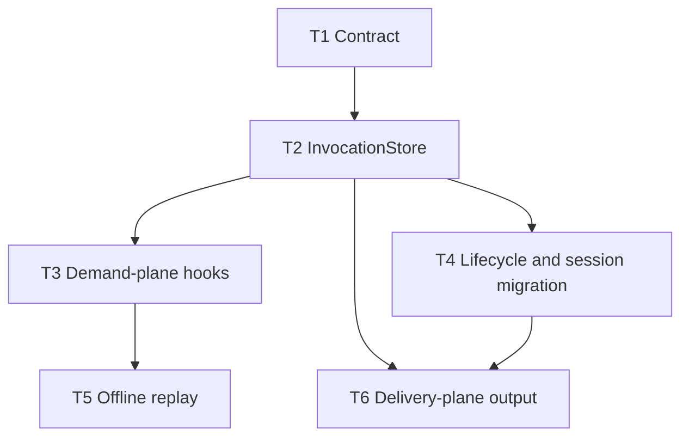

# 0049 · Role Invocation Input/Output Persistence and Cross-Surface Attribution

<!-- This file is maintained by the spec tool: the frontmatter is structured source data (including the tasks DAG), and the body is the group-level rust-RFC nine-section overview. -->

## Summary

> Current mapping after 0071 cleanup: the in-package ordinary controller retains the evidence lifetime for role_runs and phase recovery; the singleton run.sh at the repository root has exited. Descriptions below concerning singleton resets and the lifetime of old entry points are design-time background, not the current startup method. New runs and existing v2 management are handled by the unified entry point.

First principles: **logs must be able to reconstruct this experiment**, otherwise it is impossible to determine afterward whether the problem occurred in user simulation, with a role on the demand surface, or with a role on the delivery surface.

Therefore, one closed-loop process corresponds to one `run_id`, whose authoritative directory is `backend/data/role_runs/<run_id>/`. It stores all of the following:

- User simulation sessions (the existing `SessionStore`: `sim_trace` / `persona_trace` / `harness_steps`);
- The completed `message` and structured submit output for every `run_agent_def` on the demand surface;
- The completed prompt/`context` and final-line JSON for every `run_agent` on the delivery surface;
- The minimum `manifest.json` (model name, agent_def pin, composition, and harness SHA for each round).

This directory is not deleted. OpenAgents does not create a separate record store; it writes delivery-surface invocations into `ROLE_RUNS_DIR` using the same schema. The dashboard `data/live/` is a volatile projection **within this experiment process**, not a cross-experiment archive.

**The unit that starts from a seed is an experiment, not a round.** Round 2 and round 3 within one experiment must continue from the already evolved `origin/main`; reverting to v0 is prohibited. Only a new experiment starts from a seed (v0 / explicit seed pin). Currently, `./run.sh` calls `_reset_to_initial` on the **shared** Gitea at process start. This is used when there is “only one experiment on the entire machine” to destroy the previous experiment’s repository and make room for the next process. This is a singleton defect, not correct round semantics. 0049 does not promote this behavior to the target model; 0047 eliminates it with per-experiment independent Gitea. While the old entry point still exists, if startup still resets shared Gitea, it must not also delete `role_runs/`.

Analysis units: on the user side, one session; on the role side, one `run_agent_def` / `run_agent`. It is not the full tool loop, not the Gitea issue view, and not the truncated dashboard process stream. Role behavior can be evaluated by replaying frozen `input.prompt` and diffing `output.structured`. Implementers do not replay file writes.

## Motivation

To audit “which stage failed,” an observer must have the inputs and structured outputs **from that time**, rather than whatever remains after the shared directory has been cleared by the next experiment process.

User simulation already writes each persona’s system/user/raw/parsed data for each phase, along with the process summary with the harness, into `data/sessions/<id>.json`. Within the **same** `./run.sh` process, multiple rounds do not delete these files (`_reset_to_initial` is called only once at process start, not between `run_round`). However, there is currently one `backend/data` and one Gitea for the entire machine: starting another `./run.sh` process force-pushes v0, closes legacy issues, deletes `sessions/*.json`, and `clear_live`. This turns “a new experiment” into “destroying the previous experiment.” For parallel experiment runs, the requirement is one independent Gitea and `sessions/` per experiment, `stop` must not be deleted, and only `destroy` may be deleted, but this has not yet been implemented. The demand and delivery surfaces, meanwhile, have almost no equivalent files even within the current experiment process.

Current demand-surface state (ahe-beta, code as of 2026-09-01):

1. **The sole dispatch entry point** is `run_agent_def` in `architect/agent_runtime.py`. The four drivers (`triage.py` / `architect.py` / `divergent.py` / `owner.py`) each construct `message` and call it, then call `read_submit` to obtain the structured array and write it to Gitea. `message` is the complete input at that time; the submit echo is the structured output at that time. Both exist only on that function stack.
2. **The dashboard process stream is not an experiment record.** `loop/live_tracer.py` truncates tool arguments to approximately 200 characters and tool results to approximately 500 characters; the agent log of `loop/live.py` is capped at 500 entries. `archive_agent` still writes this truncated projection into `data/live/history.json`. It is cleared by `clear_live` at the beginning of every `./run.sh`.
3. **Token-usage JSONL contains measurement only.** `usage.py` records tokens and role/round for each event, fails open, and contains neither prompts nor outputs. One usage event corresponds to one LLM HTTP request; one role invocation may contain multiple usage events internally.
4. **Gitea retains only the product.** The proposal body, Owner comments, and labels are governance results, not the completed `message` and not invalid submits discarded by the driver.
5. **Existing replay scripts reconstruct inputs rather than replaying frozen inputs.** `scripts/replay_roles_offline.py` and others run the driver again from sessions + FakeTracker. If the agent definition or tracker view changes, the constructed `message` changes.

Current delivery-surface state (OpenAgents `ahe-beta/v0.1`, launched by AHE-Beta `start_vigil`):

1. **The sole dispatch entry point** is `run_agent` in `openagents/runtime/engine.py`. `task`, `context`, and the validated dict all exist in full during this call.
2. **Existing telemetry explicitly does not treat the transcript as an analysis object.** Tool-name JSONL and token JSONL remain in the worktree; the machine-readable full text is in `protocol_output` (an OpenAgents field name; this group’s schema does not reuse that key). The container has zero host mounts by default, and after `--rm` the host cannot retrieve it.
3. **The implementer’s structured output is the validated final-line JSON.** File editing occurs within the same `backend.run`. v1 does not replay file writes and does not collect diffs.

The containment and overfitting constraints remain effective: the architect and the coding agent inside the container must not read task traces into decisions for the next round. `role_runs` and `sessions` / `harness_runs` are of the same kind and must be included in the jail deny-read list; vigil only mounts `delivery/` for this `run_id`.

Therefore, this group makes the auditable slice of “one experiment process” into `role_runs/<run_id>/`: user sessions move into the same package, and role invocations are written according to the schema. This is aligned with “independent sessions per experiment, stop does not delete”; once experiment execution is deployed, this directory is telemetry/sessions under the experiment root, not a second authority.

## Guide-level explanation

When a closed-loop process begins, `run.py` generates `run_id` and sets `AHE_BETA_RUN_ID` and `ROLE_RUNS_DIR=backend/data/role_runs/<run_id>`. `SessionStore` writes `ROLE_RUNS_DIR/sessions/`. Usage JSONL writes `ROLE_RUNS_DIR/usage.jsonl`. If the dashboard still reads `data/sessions`, that path is merely an alias (symbolic link or equivalent) to the sessions of the **current** `run_id`; switching `run_id` changes only the alias and does not delete the previous package.

Each round within an experiment continues from the evolved main and does not reset. **Do not** delete any existing `run_id` under `role_runs/`. If the old singleton entry point still force-pushes v0 to shared Gitea at startup, that is to make room for a **new experiment process** and must not be written as “each round starts from the seed”; that path must still not delete the record directory. The live dashboard serves only the current process. When switching experiment processes, clearing live is allowed; clearing `role_runs` from the previous experiment is not.

Each demand-surface call to `run_agent_def` writes one JSON record to `demand/`. Delivery-surface vigil mounts only `delivery/` read-write into `/role_runs` in the container. When a user session ends, it still uses the existing `SessionStore.save`; only the root directory moves into this package, without writing two copies of persona_trace.

An auditor opening one `run_id` directory should be able to answer: how the user judged and acted in each session, what the harness process summary was, what input triage/architect/owner/drafter/… each received, and what structured output each produced. Feed the `input.prompt` from a demand record to a rewritten agent definition and diff `output.structured` to perform stage ablation. The implementer records `replayable=false`; scripts skip it.

Example (demand-surface role invocation; the session JSON retains the existing SessionStore shape):

```json
{
  "schema_version": 1,
  "invocation_id": "9f3c…",
  "run_id": "a1b2…",
  "round": 3,
  "side": "demand",
  "role": "owner",
  "subject": {"kind": "round", "id": "3"},
  "replayable": true,
  "input": {"prompt": "You are the investment and portfolio governance Owner. …", "context": "", "placeholders": {}},
  "output": {"structured": {"decisions": [{"issue": 12, "disposition": "hold"}]}, "status": "success", "error": null},
  "env": {"model": "…", "agent_def_pin": "sha256:…", "captured_at": "2026-09-01T08:00:00+00:00"}
}
```

Retaining `backend/data/role_runs/<run_id>/` retains the reconstructable slice of that experiment. Starting another experiment process must not erase it.

## Reference-level explanation

### First principles: reconstruction checklist

In v1, “reconstructing an experiment” means being able to audit the stage using only that `run_id` directory, without depending on “shared Gitea not yet having been reverted to v0 by the next experiment process.”

| Question to answer | What v1 uses | What it does not use |
|---|---|---|
| Why did the user Accept / abandon? | `persona_trace` and `sim_trace` from `sessions/*.json` | live dashboard |
| How did the user and product go back and forth? | `harness_steps` in the same file (the existing length limit remains) | the complete transcript inside the harness |
| Was a demand-surface role overly conservative? | `input.prompt` + `output.structured` in `demand/` | Gitea comments, truncated live log |
| Was a delivery-surface role overly conservative? | Same in `delivery/` | container worktree, tool arguments |
| Which definition/model and which harness version were used at the time? | `manifest.json` (pins and round SHAs) | dirty host worktree |
| How many tokens were spent? | `usage.jsonl` | estimates |

v1 **cannot** reconstruct: the file tree modified by the implementer, the complete tool loop, or the full harness tool text before truncation. If the issue body has been written to Gitea, closing the issue does not delete its history. In the singleton setup, if a later experiment process still force-pushes v0, the current Gitea main no longer represents the previous experiment; auditing the previous experiment requires the `run_id` package and the round SHAs recorded at that time, not only the current shared repository.

After 0047 is deployed: this package becomes sessions/telemetry under `experiment_id`; only `destroy` may delete it. This group does not implement the 0047 CLI.

### Terminology (preventing term capture)

| This group | Meaning in this group | Must not be treated as |
|---|---|---|
| role invocation / invocation | One `run_agent_def` or one `run_agent` | One LLM HTTP request (usage event); one tool step |
| `run_id` | `AHE_BETA_RUN_ID`, one closed-loop process | `docker run`; `agent.run`; `data/live/run.json` |
| `side` | `demand` \| `delivery` | issue `plane` → `report`/`proposal`/`ready` |
| `input.prompt` | Demand surface = completed `message`; delivery surface = `task` after substitution | Storing `systemprompt.md` separately |
| `output.structured` | Demand-surface submit or echo; delivery-surface `OUTPUT_SCHEMA` dict | OpenAgents key name `protocol_output`; 0043 artifact |
| `role_runs/<run_id>` | Reconstructable slice of one experiment (sessions + role invocations + manifest + usage) | `evaluate_role_traces.py`’s compliant JSONL; `harness_runs` working copy |
| jail deny-read directory names | `sessions` / `harness_runs` / `role_runs` | The external names remain “experiment slice / invocation record” |

`output.status`’s `protocol_error` / `backend_error` retain the existing literals of OpenAgents `run_agent`.

### Role invocation schema (demand / delivery)

Unit: one role invocation. v1 **records** the same fields as the previous version: `schema_version`, `invocation_id`, `run_id`, `round`, `side`, `role`, `subject`, `replayable`, `input.{prompt,context,placeholders}`, `output.{structured,status,error}`, `env.{model,agent_def_pin,captured_at}`.

v1 **does not record**: complete chat transcripts, tool arguments/command bodies/file contents, patch hunks, Gitea tokens, or API keys. If `input` accidentally contains a secret from known environment variables, replace the exact substring with `${ENV_NAME}` before writing it; if replacement fails, skip the entire record (still fail-open).

User sessions are **not** rewritten into the invocation schema, avoiding a second protocol alongside SessionStore. The authority remains the SessionStore files; only the root directory moves into this package.

### Directory

```
backend/data/role_runs/
  <run_id>/
    manifest.json        # model name, roster, agent_def pin, round SHA list; no secrets
    usage.jsonl          # usage events for this run (AHE_BETA_USAGE_PATH)
    sessions/            # SessionStore (index.json + <session_id>.json)
    index.jsonl          # role invocation index {invocation_id, side, role, status, path}
    demand/
      <utc>_<role>_<invocation_id>.json
    delivery/
      <utc>_<role>_<invocation_id>.json
```

`InvocationStore` in `ahe_beta/invocation.py`: fail-open, atomically write JSON, append to the index. When `ROLE_RUNS_DIR` is not set, the role invocation API is a no-op; the session path must still be explicitly passed into this package by `run.py` to avoid falling back to the old root that may be deleted.

`run.py` is set before importing the usage module (or at the earliest point of `main`):

- `AHE_BETA_RUN_ID`
- `ROLE_RUNS_DIR=<DATA>/role_runs/<run_id>`
- `AHE_BETA_USAGE_PATH=<ROLE_RUNS_DIR>/usage.jsonl`

`SessionStore` is constructed as `ROLE_RUNS_DIR/sessions`. If `data/sessions` is hard-coded by the dashboard, it may only serve as an alias to the current sessions; change the alias when switching runs. Entrypoints such as SWE-bench that likewise call `_reset_to_initial` / `SessionStore(DATA/sessions)` must follow the same convention (change together with `run.py` or share a helper); they must not write again to a shared root that will be cleared by a reset.

`_reset_to_initial`: Must not be invoked at the `run_round` / experiment-round boundary. If the legacy singleton `run.py` is still invoked at **process startup** (starting another experiment process on the shared Gitea), it is **forbidden** to perform `unlink`/`rmtree` `role_runs`, and it is also forbidden to delete sessions that have already been migrated into this package according to shared `DATA/sessions/*.json`. `clear_live` only clears the current process's dashboard projection. The target state (during experiment execution) is a new experiment-specific Gitea + seed pin, with no further force-push of v0 to other people's repositories. The field contract remains governed by `issue_schema`; the product state during this experiment is governed by the experiment's Gitea.

`manifest.json` provides read/write access through T2; at the end of each round, T4 appends the origin/main SHA observed by the orchestrator to `rounds`. When the SHA is unavailable, this key is `null`; it must not be fabricated.

### Demand-Side Hooks

Only change storage writes in `run_agent_def`; the four drivers only add `subject=` (and optionally `replayable=True`). The triage subject is the current report number; for architect/divergent/owner, if processing a batch, use `kind=round` and `id=str(round_no)`. Do not heuristically extract issue numbers from `message`. On timeout, write `status=timeout` and then re-raise; when submit is not called, write `status=no_submit`. For offline replay, the role should receive only `input.prompt`.

### Delivery-Side Hooks and Containment Exception

`run_agent` writes out with `finally` fail-open. Inside the container, `ROLE_RUNS_DIR=/role_runs`, mount only `…/<run_id>/delivery`. Do not mount `sessions/`, `demand/`, or the parent directory. Rebuild the container when keep-alive is enabled and `run_id` changes. The implementer `replayable=false`.

### Overfitting Isolation

Add `role_runs` to the directory names that the jail is forbidden to read. The architect must not read this package as evidence.

### Replay

`scripts/replay_role_invocations.py --run-dir data/role_runs/<id> --side demand --role owner --agent-def backend/agent_defs/owner`: replay only the demand records of `replayable=true`. e2e: `backend/scripts/e2e-spec-0049-role-invocation-io-store.sh`. Do not replace `evaluate_role_traces.py`. User-side audits read `sessions/` from this package directly, without going through this script.

### Task DAG and File Allocation



T3 and T4 can run in parallel. T6 implements the write-out in OpenAgents `ahe-beta/v0.1`; this repository contains the golden fixtures and contract tests.

## Drawbacks

Disk: Full session transcripts plus role prompts may reach tens to hundreds of MB over multiple rounds. Operators archive old `run_id` themselves.

Secrets and privacy: Session and issue bodies may contain user data; only known env values are redacted precisely. The directory is gitignored as an experiment artifact.

Containment: The rw mount of the delivery subdirectory is an exception to zero mounts; sessions are not passed into the container.

The implementer's file tree still cannot be reconstructed from v1. The harness tool summary remains subject to the existing truncation. After the singleton shared Gitea is rolled back to v0 by a later experiment process, auditors must inspect the package and SHA according to `run_id`, and must not inspect only the current Gitea main.

When the dashboard hardcodes `data/sessions`, it depends on an alias; if the alias fails, the dashboard is empty for this round while the package remains (fail-open favors preservation).

## Rationale and alternatives

**Choose “one directory per run_id, migrate sessions rather than double-write”** because experiment reconstruction requires user-side and role-side data to have the same lifetime and slicing; double-writing would drift. The SessionStore shape is already auditable for users, so it does not need to be changed to an invocation schema.

**Start the experiment from the seed, and start each round from the previous round's main.** A new experiment must be independent and therefore needs a seed; experiments are not independent because they contend for the same Gitea, not because a round was not rolled back to v0. Deletion of sessions can no longer serve as isolation. This group guarantees only that records are not accidentally deleted at the legacy singleton entry point; eliminating the startup force-push on shared Gitea is a matter for experiment execution.

Alternative A: Use Gitea comments as the log. The issue page is not the prompt; an unsubmitted item will not appear.

Alternative B: Promote live/history. Truncation, 500 records, cleared each time.

Alternative C: Full transcript. Size and overfitting; the delivery surface is explicitly out of scope.

Alternative D: Write JSONL only in the OpenAgents worktree. Unified persistence would fail.

Alternative E: Continue writing sessions to shared `data/sessions`, with only the convention “copy it out first.” A soft convention cannot prevent the next experiment process from deleting it, violating first principles. Rejected.

Alternative F: Wait until 0047 is implemented before saving sessions. During the period when 0047 is not deployed, consecutive `./run.sh` would still lose user records; the audit requirement cannot wait. Rejected.

Alternative G: Use `plane` / `protocol` / `task` as schema keys. Namespace collision. Rejected.

## Prior art

`usage.py`'s fail-open behavior and contextvars ownership. `SessionStore` has already demonstrated that session JSON is sufficient to audit user simulations; what is missing is lifetime. 0047 specifies independent sessions for each experiment and that only `destroy` may delete them. This group first aligns the legacy entry point with that lifetime model using the `run_id` directory. 0046 uses a fresh target to protect frozen handoff and does not change `./run.sh`. OpenAgents separates `protocol_output` from the display summary. LangSmith saves complete messages in spans; this group is narrower.

## Unresolved questions

None. The operator has decided: logs must reconstruct the experiment; user sessions and role invocations must persist in the same package; store structured data rather than tool loops; the authoritative directory is ahe-beta. Rebuild the container when keep-alive is enabled and run_id changes. The fact that 0047 is not implemented is not a reason to defer saving.

## Future possibilities

Browse historical slices by `run_id` in the dashboard. v2 implementer `diff_stat`. Project structured demand into `evaluate_role_traces.py` input. Have the 0047 experiment root point `ROLE_RUNS_DIR` to `<experiments-root>/<id>/`. Full transcript only `ROLE_RUNS_TRANSCRIPT=1`. Package the harness tree corresponding to the round SHA as an optional bundle (the Git bundle from the 0047 archive); v1 in this group does not include it.
