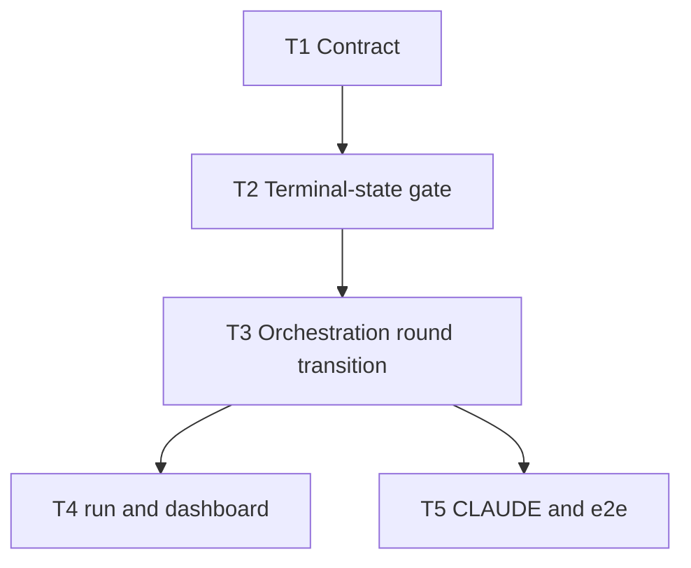

# 0050 · Round Delivery Gate and Benefit Attribution

<!-- This file is maintained by the spec tool: the frontmatter contains structured source data (including the tasks DAG), and the body is a group-level nine-section rust-RFC overview. -->

## Summary

Within an experiment, **only a product that has passed the gate can be measured by users in the next round**; otherwise, user experience cannot be attributed to the “changes made in this round.”

Orchestration therefore changes to a two-stage round structure:

- **Non-final round**: users measure the current `main` → proposals → Owner admission → **wait until all admission issues for this round reach terminal states** → only then start users in the next round.
- **Final round**: run only user interaction; **do not run requirements and do not add issues to the delivery queue**. The user experience in this round measures the benefit of the product already gated in the previous round.

A deadlock (`needs-human`, watchdog, or wait timeout) = this round has no valid gate completion → **the experiment stops in this round and does not start users in the next round**.

User sessions within the same round may still run in parallel, and delivery of multiple issues in the same round may still run in parallel. What is prohibited is overlap between users in the next round and delivery in the current round.

## Motivation

The training signal is user experience, and the test is a held-out benchmark. To ask whether “the changes in round N produced a positive benefit,” we must compare:

- Round N users: their experience with product A
- Round N+1 users: their experience with product B

B must be the product that was decided for implementation in round N and has already been completed; it cannot be a random mixture of A and several unfinished PRs.

The current orchestration does not work this way. The requirements side `Orchestrator.run_round` ends immediately after the Owner adds the `openagents` handoff token, then reads `main` HEAD once more as the observation cursor, **without waiting for merges**. The delivery side `openagents vigil` is a persistent process started at the beginning of the experiment: it claims issues when they appear, writes code, opens PRs, and merges them, with no rendezvous point with the requirements-side rounds. After RFCs became available, individual issues also became longer, and “the requirements side `TOTAL_ROUNDS` ends first while the delivery side continues running” was written as the default keep-alive behavior.

The result is that when round 2 users start, round 1 issues may still be under implementation. They measure the subset that happened to be merged by `origin/main` at that time. The experience curve cannot be aligned with rounds, so we cannot say whether a round produced a positive benefit or whether it damaged the product.

Earlier, developers were also inside the orchestration process and pushed `main` directly within a round, so round boundaries and product boundaries roughly coincided. After switching to a persistent vigil, development was removed from the round, and a round became an “issue-creation beat” while product evolution became “something continuously changing beside it.” This benefits wall-clock throughput but harms attribution. This group restores the rendezvous point: vigil remains the delivery executor, but **users in the next round must wait until the executor completes or explicitly fails all issues from the current round**.

If the final round also went through proposals and admission, it would produce a set of changes for which there would never be “next-round users” to measure. The operator decided that the final round only measures and does not evolve the product further.

## Guide-level explanation

At `TOTAL_ROUNDS=3`, the experiment looks like this:

```
Round 1  User tests seed A
         Proposals + Owner admits issues #10 #11
         Wait: #10 and #11 both closed and no needs-human
         main is now product B (the result of merging #10 and #11)

Round 2  User tests product B  ← user experience difference between B and A = round 1 gain
         Proposals + Owner admits issue #20
         Wait: #20 closed and no needs-human
         main is now product C

Round 3  User tests product C  ← user experience difference between C and B = round 2 gain
         End. No more proposals, admissions, or waiting for delivery.
```

There is no “benefit from round 3 changes.” This is intentional: the final round is dedicated to producing measurements.

`TOTAL_ROUNDS=1`: measure only the seed; do not start the delivery side.

If #11 receives `needs-human` while round 1 is waiting (or remains open until timeout), the experiment exits with failure in round 1, and **round 2 and round 3 users do not run**. #10, which has already been merged into `main`, remains in the repository, but does not enter the “positive benefit in round 1” conclusion—the round did not have a complete gate closure, so there is no controlled experiment.

The dashboard shows whether the current state is “users / proposal admission / waiting for delivery / deadlocked.” When deadlocked, the delivery-side container remains for manual handling; after a clean run, it is removed.

## Reference-level explanation

### Round procedure

`Orchestrator.run(n_rounds)`:

1. `i = 1 .. n_rounds`.
2. Resolve `origin/main` (if there is no origin, use local `main`). All user sessions in this round `launch` that SHA (a session-level snapshot; parallel users in the same round remain allowed). Record `user_sha`.
3. Run the user sessions (the existing section a).
4. If `i == n_rounds`: run the integrity tripwire, rehydrate the current HEAD, `on_round_end`, and finish. Do not call triage / divergent / architect / Owner, and do not call the delivery gate.
5. Otherwise: generate two beats + `Owner.admit_once()`. The wait set = `AdmitOutcome.admitted` returned this time (only issues newly marked with `openagents` in this round). Proposals that the Owner merges/declines/holds in this round do not enter the wait set: they are not delivery-side work items.
6. `wait_round_delivery(numbers=admitted)`. An empty list succeeds immediately (nothing was added to the delivery queue in this round, so next-round users still measure the same SHA; the experience difference should be close to 0. This is a valid conclusion: “no delivery in this round”).
7. After the gate succeeds, `fetch` resolve HEAD again, record `sealed_sha`, `on_round_end`. Step 2 of the next round must read this advanced `main` (or the same SHA if the wait set is empty).
8. If the gate raises `RoundDeliveryBlocked`: do not enter `i+1`; propagate the exception to `run.py`.

`run_round` remains the non-final path for “users + requirements + gate,” for existing unit tests that call it by default; `run()` does not run the requirements stage in the final round.

### Terminal-state determination

Read issues through the tracker’s existing single-issue retrieval interface (Gitea `get_issue`; tests use the equivalent Fake). For every issue in the wait set:

| Observation | Determination |
|---|---|
| `state=closed` and the labels do not contain `needs-human` | Successful terminal state (merged and closed, or equivalently closed) |
| Labels contain `needs-human` (regardless of open/closed) | Deadlocked |
| Still open and without `needs-human` | In delivery; continue waiting |
| Wall-clock time exceeds `ROUND_DELIVERY_TIMEOUT_SEC` (default 14400) while delivery is still in progress | Deadlocked (fallback for a silent vigil / watchdog that failed to apply the label) |

Any deadlocked issue causes the entire gate to fail and raises `RoundDeliveryBlocked(numbers=…, reason=…)`. Partial merges do not count as gate closure.

The polling interval is `ROUND_DELIVERY_POLL_SEC` (default 15). The gate reads only Gitea; it does not import OpenAgents or read the vigil sqlite database.

### Processes and vigil

vigil remains a persistent executor, and multiple issues in a round may run in parallel. It no longer competes with users in the next round for time.

- `TOTAL_ROUNDS=1`: do not `start_vigil`.
- During non-final-round waiting, vigil must be running.
- `RoundDeliveryBlocked`: the process exits with a nonzero code; `stop_vigil` **does not** remove the container (keep-alive), live `phase=blocked`, and record the deadlocked issue numbers.
- After users in the final round finish normally: there is no further delivery work for this experiment, so `stop_vigil` removes the container. Clean shutdown no longer depends on “the requirements side finishes first while the delivery side continues working”—the non-final rounds have already waited, and the final round does not add issues.

The default keep-alive changes from “delivery is still running when the requirements side wraps up” to “retain the container only when deadlocked.” Explicit `VIGIL_KEEP_ALIVE=1` may still retain the container for debugging after a clean shutdown.

### Attribution formula

Let `F(k)` be the agreed aggregate of the user experience for all user sessions in round k (using the existing session scores; this group does not change the scoring rules).

- `F(1)` measures `user_sha[1]` = the seed (or the `main` at the start of this experiment).
- For `k = 1 .. n_rounds-1`, `F(k+1) - F(k)` is attributed to the delivery result of the wait set for round k (`user_sha[k] → sealed_sha[k]`).
- `F(n_rounds)` has no “round n delivery” paired with it.

The benchmark remains held-out throughout and does not enter the gate or round-switching conditions.

### Dashboard

`data/live/run.json` adds `phase` (`users` / `demand` / `delivery_wait` / `blocked` / `done`) and optional `blocked_issues`. Existing `round_shas` writes the HEAD after the gate for non-final rounds (`sealed_sha`), and writes the SHA used by users in that round for the final round. Until the frontend fields are updated, it can still display the SHA list.

### Relationship to persisted role calls

If the experiment slice directory records the SHA for each round, non-final rounds should also distinguish `user_sha` from `sealed_sha`. This group does not change file ownership in that storage scheme.

### Task DAG and file allocation



T4 and T5 may run in parallel. e2e: `backend/scripts/e2e-spec-0050-round-delivery-gate.sh`.

## Drawbacks

Wall-clock time increases: non-final rounds include the RFC, implementation, and review in the round. Time that previously overlapped with users in the next round is now serialized before the round switch. This is the cost of attribution.

A deadlock stops the experiment: one `needs-human` wastes the user budget for the remaining rounds. The operator chose this to avoid using an incomplete product to draw a false conclusion about whether the round produced a benefit.

The final round does not evolve the product: among `TOTAL_ROUNDS` users, only `n-1` receive delivery. Previously, the final round also created issues without a measurement round; now there is explicitly one fewer evolution round and one more clean measurement round.

Waiting polls Gitea rather than receiving a vigil callback. The maximum delay is one poll interval. The default timeout is 4 hours; an unusually long RFC may be incorrectly judged deadlocked, so use an environment variable to extend it.

## Rationale and alternatives

**Put the rendezvous point before users in the next round, rather than when the vigil internal queue is empty.** The wait set is `admitted` for the current round, not every ready issue in the repository. Issues left over from a previous experiment should be cleared during process-start reset; this experiment is responsible only for the issues it adds.

**Stop on deadlock rather than continuing with a marker.** Continuing with a marker would still expose users in the next round to partial merges, making their experience uninterpretable. Stopping turns “this round did not reach gate closure” into an experiment result rather than dirty data.

**The final round contains only users rather than adding another pure measurement round.** The final round itself is the measurement round; there is no need to invent a second kind of round.

Alternative A: keep the two sides unsynchronized and record in the logs “the SHA used by this round’s users versus the unmerged PRs at that time.” This can explain contamination after the fact but cannot produce clean round-level benefits. Rejected.

Alternative B: consider any SHA advance to be gate closure (partial issue merges). The next round would measure a subset that cannot be attributed to “the changes in this round.” Rejected.

Alternative C: have the requirements side `finally` wait until vigil is globally empty before exiting, while still allowing overlap between rounds. This fixes only experiment shutdown, not attribution between rounds. Rejected.

Alternative D: embed developers in the orchestration process again and push `main` directly within a round. This can achieve gate closure but loses PRs, review, and the containment box. Rejected.

Alternative E: continue to the next round after a deadlock and mark the experience invalid. The dashboard would contain data, but the operator has required that the next round not start. Rejected.

## Prior art

Experiment design requires changing one treatment group at a time and measuring the complete treatment before measuring the next group; A/B testing and feature freezes likewise separate “release” from “measurement.” In continuous delivery, trunk may merge continuously, but metrics for “this version relative to the previous version” are still bounded by a release or experiment bucket rather than by an arbitrary moment on main. This group treats vigil as the continuous-delivery executor and the round as the experiment bucket.

OpenAgents vigil’s `needs-human` is already the public terminal state for the delivery side, and this repository’s delivery dashboard counts by that label. The gate reuses the same label rather than inventing a second deadlock protocol.

## Unresolved questions

None. The operator has decided: non-final rounds wait for all admission issues in the current round to reach terminal states; a deadlock stops the experiment; the final round runs only user interaction; no additional measurement round is added.

## Future possibilities

Change the gate to use Gitea webhooks or vigil completion events and remove polling. After a deadlocked issue is manually released, resume the next round from `blocked` (the current production behavior is failure exit). Draw `F(k+1)-F(k)` on the dashboard. Use issue age rather than one wall-clock timeout for the entire gate. When experiments run in parallel, restrict the gate’s wait set to this experiment’s Gitea issues to avoid waiting for someone else’s issues.


