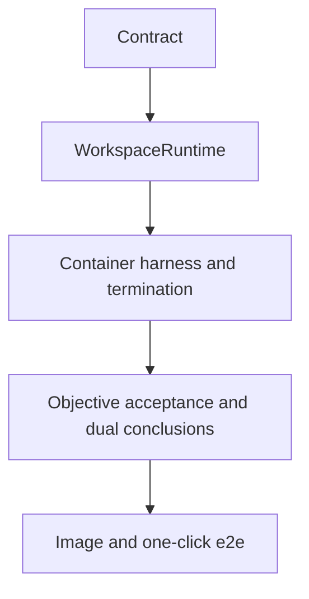

# 0051 · Session Container Isolation and Objective Verification Evidence

<!-- This file is maintained by the spec tool: frontmatter is the structured source data (including the tasks DAG), and the body is a group-level nine-section rust-RFC overview. -->

## Summary

SWE-bench user sessions no longer `docker cp` the repository from the seed image into a WSL/host temporary directory for execution. Each session creates an isolated container from the same **runnable** seed image; the harness, persona `read_file`/`run_shell`, and dependency preparation access `/workspace/<instance_id>/repo` only through that container. A single round can run 16 containers in parallel, with only one stored copy of the image and a separate writable layer for each container.

Whether the user accepts remains a product experience conclusion and must not masquerade as passing the task. After the session ends, save the complete git diff and artifact receipts; after collection and sealing, an independent post-session command applies the diff in a fresh official SWE-bench instance image and runs the canonical evaluator. The original `user_outcome` is not rewritten; objective results and the acceptance relationship are written only to the scoring report. Historical `objective_evaluation` and `accept_validity` fields remain readable. Timeouts, crashes, missing valid verification, or objective failures must never become `valid_accept`.

Auditing is not for the persona, but for experiment operators, reviewers, and future report authors: they should be able to reconstruct from session JSON “which container, which request, when it timed out, what diff was exported, and what the objective command returned.” This group implements only a minimal evidence chain, not a general-purpose compliance logging platform.

The online objective evaluation entry point and its environment variables have been removed; the official SWE executor becomes an internal module of the scoring adapter. The current public call is `experiment.py grade RUN_ID --plan /path/grading-plan.json`, which scores collected archives bound to the original session. Direct and simulated interactions share the artifact contract; the acceptance relationship is written only to new scoring reports, not back to historical Sessions. The user runner no longer accepts evaluator injection, and immediate session verification cannot be enabled through the host environment.

## Motivation

0044 defined the seed image as a storage package for `FROM scratch` and explicitly chose `docker create → docker cp → docker rm`. The orchestrator then passed the resulting absolute host path to both the harness and persona; the harness was itself a host Python subprocess, and the persona sandbox was also a host `subprocess`. Thus, the user's ability to see `/mnt/c/Users/.../Temp/sim_ws_docker_seed_*` was not a Docker escape: the implementation never placed execution inside a container.

Another error was treating “the user is willing to accept” as “the implementation has passed.” The original implementation allowed accept to proceed after the final check failed or was unavailable, and abandoned a daemon worker after a 240-second deadline, potentially leaving old work writing to disk; the accept explanation was also projected into a user turn actually sent to the harness. As a result, sessions such as `sr-12-steinberger` still said “verified / Done” after tests timed out, producing false acceptance and unauditable success rates. This T3 revision removes that harness whole-turn deadline; slow requests return to the persona heartbeat decisions of 0012/0022/0023.

Previously collected data cannot be retroactively made trustworthy: its execution boundaries, writes after timeout, and grounds for acceptance have already been lost. This group guarantees complete evidence only for new sessions; old runs remain unchanged and are marked as historically invalid experiments.

## Guide-level explanation

A session has the following fixed lifecycle:

1. `docker-seed` verifies that the image carries the runnable protocol label, creates a uniquely named container for the session, and starts it; it then removes other seed instances and pool-wide build-state in that container's writable layer, leaving only the target instance in `/workspace`. The working directory is `/workspace/<instance_id>/repo` inside the container.
2. Persona tools read, write, and execute through `WorkspaceRuntime`; the harness checkout is copied into `/opt/ahe-beta/harness/<sha>` in the container as read-only input, then launched by `docker exec -i`. The repo must not be exported as a host working directory.
3. A normal harness reply carries machine status `completed | interrupted | crashed`. Slow requests no longer have a 240-second whole-turn deadline; every 90 seconds, the persona chooses `keep_waiting | send_message | interrupt | give_up`. `timed_out` is reserved only for infrastructure failures such as the host absolute limit and, like `crashed`, fails closed.
4. On normal completion, export the `git diff --binary` text and SHA-256 from the session container; then delete the session container.
5. The evaluator starts a **new container** from the corresponding official SWE-bench instance image, applies the diff, and runs the canonical eval command. Dependencies, untracked processes, and test caches in the interaction container are not carried into verification.
6. The session displays subjective and objective conclusions in two columns. Persona accept with objective failure/interaction timeout is `false_accept`; no execution of the official evaluator is `unverified_accept`; only an explicit pass from a fresh evaluator is `valid_accept`.

Experiments still use a one-click entry point, but must perform a fail-closed runnable image check before launch. With concurrency configured to 16, there are at most 16 session containers, not 16 image copies; five rounds total at most 80 create/destroy cycles across session lifecycles.

Before the formal rerun, a standalone `user-only` canary may be used for a small-scale live trial: it must run exactly one round, all non-user role counts must be 0, and it must use a separate experiment id, persona roster, and interaction plan. It reuses the same isolation, objective verification, and audit paths, but does not start triage, design, Owner, or delivery planes.

## Reference-level explanation

### Runtime protocol

`WorkspaceRuntime` is the only consumer-side seam: `cwd`, `read_text`, `write_text`, `run`, `export_patch`, `close`. Local fixtures are wrapped by `LocalWorkspaceRuntime` to preserve development/unit-test compatibility; `docker-seed` returns `DockerWorkspaceRuntime`, no longer `str`. Any call site requiring cwd must consume this protocol and must not bypass it using `Path(runtime)` or host `open()`.

Container creation must use: a unique session name, `--label ahe-beta.session=<id>`, non-privileged mode, no host bind mount, and the repo as the working directory. The shared runnable image may package the task pool to reuse image layers, but before provision returns, deletion state must be established for `/workspace/*` outside the allowlist in that container's overlay writable layer, and `/build-state.json` containing the full pool manifest must be deleted; relying solely on cwd is insufficient because the harness shell can use absolute paths. Networking defaults to `none`; for formal GLM experiments, the runner explicitly configures bridge to access the `172.22.64.1` gateway, which may later be tightened to an egress allowlist. Image label `org.auto-designer.seed-runtime=1` is the runnable contract; old storage images lack the label and must fail at startup with a rebuild prompt, rather than silently falling back to `docker cp`.

### Termination semantics

The wire v1 terminal reply adds `status`. The launcher records the latest request result as `{request_id,status,started_at,finished_at}` and exposes the latest terminal state unchanged to sim through `last_request_status`. The harness itself no longer produces a 240-second `timed_out`: the worker thread is used only to receive interrupts concurrently, with no deadline. The persona heartbeat is an observation and decision point, not a timeout. Only when the host's 1800-second absolute limit or a real crash prevents the runtime from confirming termination should it record `timed_out` / `crashed` and fail closed, avoiding killing only the `docker exec` client while leaving execution running.

### Dual conclusions

Persisted fields:

| Field | Meaning |
|---|---|
| `user_outcome` | The persona's `end_reason` and terminal note; subjective experience only |
| `request_outcomes` | Each harness request's id, status, and UTC start/end times |
| `workspace_evidence` | Image digest, container id/name, workspace, diff SHA-256 |
| `objective_evaluation` | Evaluator, fresh image digest, command, exit code, stdout/stderr, UTC, passed |
| `accept_validity` | `valid_accept / false_accept / unverified_accept / not_applicable` |

The acceptance relationship is derived by a pure function in an independent scoring report: first confirm that the original interaction was valid and the user accepted, then verify the scoring status and adapter execution contract. A valid request failure or valid objective failure is `false_accept`; absence of valid binary verification is `unverified_accept`; only a verified contract and `passed=true` yield `valid_accept`. Scoring does not write back to historical Session fields, and technical passing must not be inferred from experience scores.

The accept action's `message` is redefined as `terminal_note`; it is neither routed to the harness nor projected as a user turn in the transcript.

### Objective evaluator

The adapter accepts only argv, without a shell; it generates an official prediction JSONL for a single patch and calls `swebench.harness.run_evaluation`. The official runner creates a fresh instance container, applies the patch/test patch, and executes the canonical eval script; this system retains its `results.json`, exit code, and length-limited output. If the official evaluator or image is missing, return `unavailable`; persona-run pytest must not be substituted.

### Minimal audit

Session JSON is the authoritative carrier; events are ordered by monotonic `seq` and use UTC wall-clock time, not process-local monotonic time as cross-process time. Container start/stop, harness request terminal, patch export, and evaluation terminal must be recorded. Bodies may be truncated, but hashes, exit codes, statuses, and times must not be omitted.

### Task DAG

## Drawbacks

A runnable image includes an additional Python, shell, git, and NexAU runtime compared with a storage scratch image, increasing image size; 16 concurrent containers also each consume process RSS and writable-layer space. The payoff is a real execution boundary. Image layers are shared, so this does not copy a 2–5 GB image 16 times.

Removing the harness whole-turn deadline may let real livelocks occupy containers longer; the 90-second persona heartbeat is the primary convergence mechanism, and the 1800-second host absolute limit is only a final infrastructure safeguard.

Official fresh evaluation adds a container startup and test run. It cannot be combined with the persona's quick checks because the two answer different questions.

## Rationale and alternatives

Choose one container per session rather than one shared container per round: a shared container's cwd, processes, caches, and untracked files would contaminate one another across 16 tasks, making it impossible to associate a diff with a single session. Choose starting multiple containers from one seed image rather than copying the image 16 times: Docker's read-only layers are already shared.

Choose an explicit runtime object rather than continuing to pass `workspace_dir: str` and relying on callers to inspect path prefixes: strings cannot express lifecycle, remote execution, or contamination state, and sooner or later `open()` or `subprocess(cwd=...)` would route execution back to the host.

Choose “subjective + objective side by side” rather than prohibiting users from accepting after tests fail: users may choose acceptance based on experience, time, or trust, which is a valid product signal; the error lies only in counting it as a technical pass. Nor do we adopt “persona-run pytest counts as objective,” because it may select the wrong tests, use a contaminated environment, or misjudge after a timeout.

Choose minimal event evidence rather than hash chains/WORM storage: the current goal is reviewable experiments, not defense against a malicious administrator able to modify the entire experiment directory. If compliance-grade tamper resistance is needed later, a signature chain can be added without changing field semantics.

## Prior art

The official SWE-bench harness builds/starts Docker images per instance, applies candidate patches and test patches inside containers, and parses results based on FAIL_TO_PASS/PASS_TO_PASS. Its key property is “objective execution of each candidate in a fresh instance environment,” which this group preserves as an independent post-interaction stage.

Disposable workers in container orchestration, Kubernetes Jobs, and CI ephemeral runners all bind an untrusted execution to a process namespace that can be reclaimed as a whole; terminating only the host waiting thread is not equivalent to terminating the task.

## Unresolved questions

No blocking questions. The operator has decided: start Docker using the prepared image; retain the persona's ability to inspect the workspace directly; preserve both subjective acceptance and objective execution results; initially implement only minimal reviewable audit evidence; remove the harness 240-second whole-turn timeout, with the 90-second persona heartbeat deciding whether long requests continue.

The formal 16×5 rerun uses a new `isolated-v2` experiment id and runnable seed digest. The old `ahe-beta-seed:swebench-medium-hard-16` is storage-only and, under this spec, must be rejected by startup checks rather than run in compatibility mode; the old experiment directory remains unchanged.

## Future possibilities

Automatically tier container resource limits by historical repo peaks; extend networking from `none` to an egress allowlist permitting only the GLM gateway; connect the objective evaluator directly to the official SWE-bench Python API and produce official prediction/report directories; sign session evidence and generate a round-wide manifest; retain an optional read-only forensic snapshot after failure, but never allow it to continue participating in the session or verification.
