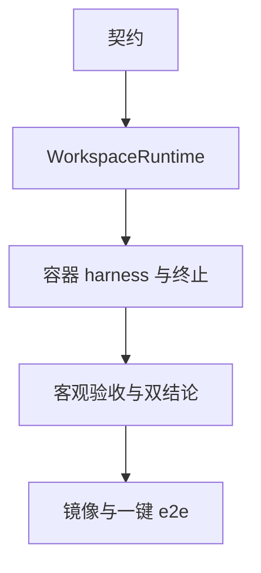

# 0051 · 会话容器隔离与客观验收证据

<!-- 本文件由 spec 工具维护：frontmatter 为结构化源数据（含 tasks DAG），正文为组级 rust-RFC 9 段总览。 -->

## Summary

SWE-bench 用户会话不再把 seed image 中的仓库 `docker cp` 到 WSL/宿主临时目录后执行。每一局从同一个**可运行** seed image 创建一个独立容器；harness、persona 的 `read_file`/`run_shell` 和依赖准备都只通过该容器访问 `/workspace/<instance_id>/repo`。同一轮可并行 16 个容器，镜像只存一份，容器各有自己的可写层。

用户是否接受仍是产品体验结论，不能冒充题目通过。会话结束后保存完整 git diff 与产物回执，收集并封口后由独立事后命令在新鲜官方 SWE-bench instance image 中应用 diff、执行 canonical evaluator。原 `user_outcome` 不改写，客观结果和接受关系只写评分报告；历史 `objective_evaluation` 与 `accept_validity` 字段仍可读取。超时、崩溃、缺有效验收或客观失败均不得成为 `valid_accept`。

审计不是给 persona 看，而是给实验操作者、复核者及以后写报告的人看：他们应能从 session JSON 还原“哪个容器、哪次请求、何时超时、导出了什么 diff、客观命令返回什么”。本组只做最小证据链，不建设通用合规日志平台。

在线 objective evaluation 入口及其环境变量已删除；SWE 官方执行器成为评分适配器的内部模块。当前公开调用为 `experiment.py grade RUN_ID --plan /path/grading-plan.json`，由已收集归档与原会话绑定评分，direct 与模拟交互共用产物合同；接受关系只写新评分报告，不回写历史 Session。用户 runner 不再接受 evaluator 注入，不能通过宿主环境开启会话即时验收。

## Motivation

0044 把 seed image 定义成 `FROM scratch` 的存储包，并明确选择 `docker create → docker cp → docker rm`。随后 orchestrator 把得到的宿主绝对路径同时传给 harness 和 persona；harness 又是宿主 Python 子进程，persona sandbox 也是宿主 `subprocess`。所以用户能看到 `/mnt/c/Users/.../Temp/sim_ws_docker_seed_*` 不是 Docker 逃逸，而是实现从未把执行放进容器。

另一条错误是把“用户愿意接受”当成“实现已经通过”。原实现允许 final check 失败或不可用后继续 accept，并用 240 秒 deadline 放弃 daemon worker，旧工作可能继续写盘；accept 的说明文字还会被投影成一条实际发送给 harness 的 user turn。结果是 `sr-12-steinberger` 一类会话在测试超时后仍说“verified / Done”，产生假接受和不可审计的成功率。本次 T3 修订删除这个 harness 整轮 deadline，慢请求回到 0012/0022/0023 的 persona 心跳决策。

之前已跑的数据不能事后补成可信数据：其执行边界、超时后的写入和接受依据已经丢失。本组只保证新 session 的证据完整，旧 run 保留原样并标记为历史无效实验。

## Guide-level explanation

一局的生命周期固定为：

1. `docker-seed` 校验 image 带有 runnable 协议标签，为该 session 创建唯一命名容器并启动；随后在该容器可写层移除其它 seed instance 与全池 build-state，使 `/workspace` 只剩目标 instance；工作目录是容器内 `/workspace/<instance_id>/repo`。
2. persona 工具经 `WorkspaceRuntime` 读写/执行；harness checkout 作为只读输入复制进容器的 `/opt/auto-designer/harness/<sha>`，随后由 `docker exec -i` 启动。不得把 repo 导出成宿主工作目录。
3. harness 正常 reply 带机器状态 `completed | interrupted | crashed`。慢请求不再有 240 秒整轮 deadline；每 90 秒由 persona 选择 `keep_waiting | send_message | interrupt | give_up`。`timed_out` 仅保留给宿主绝对上限等基础设施故障，与 `crashed` 一样 fail-closed。
4. 正常结束时从会话容器导出 `git diff --binary` 文本及 SHA-256；随后删除会话容器。
5. evaluator 从对应的官方 SWE-bench instance image 启动**新容器**，应用 diff 并运行 canonical eval 命令。交互容器里的依赖、未跟踪进程和测试缓存不带入验收。
6. session 同时展示主观与客观两栏。persona accept 但客观失败/交互超时是 `false_accept`；未执行官方 evaluator 是 `unverified_accept`；只有 fresh evaluator 明确通过才是 `valid_accept`。

实验仍用一键入口，但启动前必须 fail-closed 检查 runnable image。配置了 16 并发时是最多 16 个会话容器，不是 16 份镜像；五轮按 session 生命周期累计最多 80 次创建/销毁。

正式重跑前允许用独立 `user-only` canary 做小流量实测：必须恰好一轮，非 user 角色计数全为 0，使用独立 experiment id、persona roster 与 interaction plan。它复用同一隔离、客观验收和审计路径，但不启动 triage、设计、Owner 或交付面。

## Reference-level explanation

### 运行时协议

`WorkspaceRuntime` 是消费侧唯一接缝：`cwd`、`read_text`、`write_text`、`run`、`export_patch`、`close`。本地 fixture 由 `LocalWorkspaceRuntime` 包装以保持开发/单测兼容；`docker-seed` 返回 `DockerWorkspaceRuntime`，不再返回 `str`。任何需要 cwd 的调用点必须消费该协议，不得用 `Path(runtime)` 或宿主 `open()` 绕过。

容器创建须使用：唯一 session 名、`--label auto-designer.session=<id>`、非特权、无宿主 bind mount、工作目录为 repo。共享 runnable image 可以打包任务池以复用镜像层，但 provision 返回前必须在该容器的 overlay 可写层对白名单外的 `/workspace/*` 建立删除态，并删除含全池清单的 `/build-state.json`；不能只依赖 cwd，因为 harness shell 可使用绝对路径。网络默认 `none`；正式 GLM 实验由 runner 显式配置 bridge 以访问 `172.22.64.1` 网关，后续可收紧为 egress allowlist。镜像标签 `org.auto-designer.seed-runtime=1` 是可运行契约；存储型旧镜像没有标签，启动即失败并提示重建，不能静默回退到 `docker cp`。

### 终止语义

wire v1 的 terminal reply 增加 `status`。launcher 将最近请求结果记录为 `{request_id,status,started_at,finished_at}`，并通过 `last_request_status` 将最近终态原样暴露给 sim。harness 自身不再产生 240 秒 `timed_out`：工作线程只用于并行收 interrupt，不设 deadline。persona 心跳是观测与决策点，不是超时。仅当宿主 1800 秒绝对上限或真实崩溃使运行时无法确认收束时，记录 `timed_out` / `crashed` 并 fail-closed，避免只杀 `docker exec` 客户端却留下执行。

### 双结论

落盘字段：

| 字段 | 含义 |
|---|---|
| `user_outcome` | persona 的 `end_reason` 与 terminal note；仅主观体验 |
| `request_outcomes` | 每次 harness 请求的 id、状态、UTC 起止时间 |
| `workspace_evidence` | image digest、container id/name、workspace、diff SHA-256 |
| `objective_evaluation` | evaluator、fresh image digest、命令、exit code、stdout/stderr、UTC、passed |
| `accept_validity` | `valid_accept / false_accept / unverified_accept / not_applicable` |

接受关系由独立评分报告的纯函数派生：先确认原交互有效且用户接受，再核验评分状态与适配器执行合同。有效请求失败或有效客观失败为 `false_accept`；缺有效二值验收为 `unverified_accept`；核验合同且 `passed=true` 才为 `valid_accept`。Session 的历史字段不由评分回写，不能以体验评分推断技术通过。

accept 动作的 `message` 政名义为 `terminal_note`，不路由给 harness，也不投影为 transcript 的 user turn。

### 客观 evaluator

适配器只接受 argv，不经 shell；它为单个 patch 生成官方 prediction JSONL，调用 `swebench.harness.run_evaluation`。官方 runner 自行创建新 instance 容器、应用 patch/test patch 并执行 canonical eval script；本系统保留其 `results.json`、退出码与限长输出。官方 evaluator 或 image 缺失时返回 `unavailable`，不得以 persona 自跑的 pytest 替代。

### 最小审计

session JSON 是权威载体；事件按单调 `seq` 排序且用 UTC wall-clock，不使用进程局部 monotonic 作为跨进程时间。必须记录容器 start/stop、harness request terminal、patch export、evaluation terminal。正文可截断，但 hash、退出码、状态和时间不可省略。

### Task DAG

## Drawbacks

可运行 image 比存储型 scratch image 多一套 Python、shell、git 与 NexAU runtime，镜像增大；16 个并发容器还会各自占用进程 RSS 和可写层。代价是执行边界真实存在。镜像层共享，所以不是把 2–5 GB 镜像复制 16 次。

去掉 harness 整轮 deadline 后，真活锁可能占用容器更久；90 秒 persona 心跳是主要收敛机制，1800 秒宿主绝对上限仅是最后基础设施保护。

官方 fresh evaluation 增加一次容器启动和测试时间。它与 persona 的快速核实不能合并，因为二者回答的问题不同。

## Rationale and alternatives

选择每 session 一个容器，而不是每轮一个共享容器：共享容器的 cwd、进程、缓存和未跟踪文件会跨 16 个任务互相污染，无法把 diff 与一次会话对应。选择一个 seed image 多次起容器，而不是复制 16 份 image：Docker 的只读层本来就共享。

选择显式 runtime 对象，而不是继续传 `workspace_dir: str` 再靠调用方判断路径前缀：字符串无法表达生命周期、远端执行和污染态，迟早会被 `open()` 或 `subprocess(cwd=...)` 绕回宿主。

选择“主观 + 客观并列”，而不是禁止用户在测试失败后 accept：用户可以因为体验、时间或信任选择接受，这是有效产品信号；错误只在于把它计成技术通过。也不采用“persona 自己跑 pytest 就算客观”，因为它可能选择错测试、使用被污染环境或在超时后误判。

选择最小事件证据而非哈希链/WORM 存储：当前目标是可复核实验，不是对抗能修改整个实验目录的恶意管理员。若以后需要合规防篡改，可在不改字段语义的前提下追加签名链。

## Prior art

SWE-bench 官方 harness 以 instance 为单位构建/启动 Docker image，在容器内应用候选 patch 和 test patch，并根据 FAIL_TO_PASS/PASS_TO_PASS 解析结果。它的关键性质是“每个候选在新鲜实例环境客观执行”，本组将这个性质保留为交互后的独立阶段。

容器编排中的 disposable worker、Kubernetes Job 以及 CI 的 ephemeral runner 都把一次不可信执行绑定到一个可整体回收的进程命名空间；只终止宿主等待线程不等价于终止任务。

## Unresolved questions

无阻塞问题。操作者已确定：使用做好的 image 起 Docker；persona 保留直接查看工作区的能力；主观接受与客观执行结果都保留；审计先做最小可复核证据；移除 harness 240 秒整轮超时，长请求由 90 秒 persona 心跳决定是否继续。

正式 16×5 重跑使用新的 `isolated-v2` experiment id 与 runnable seed digest。旧的 `auto-designer-seed:swebench-medium-hard-16` 是 storage-only，按本 spec 必须被启动检查拒绝，而不是兼容运行；旧 experiment 目录保持原样。

## Future possibilities

把容器资源上限按 repo 历史峰值自动分档；将网络从 `none` 扩展为只允许 GLM 网关的 egress allowlist；客观 evaluator 直接接官方 SWE-bench Python API 并产官方 prediction/report 目录；将 session 证据签名并生成整轮 manifest；失败后保留可选的只读 forensic snapshot，但不得让它继续参与会话或验收。
