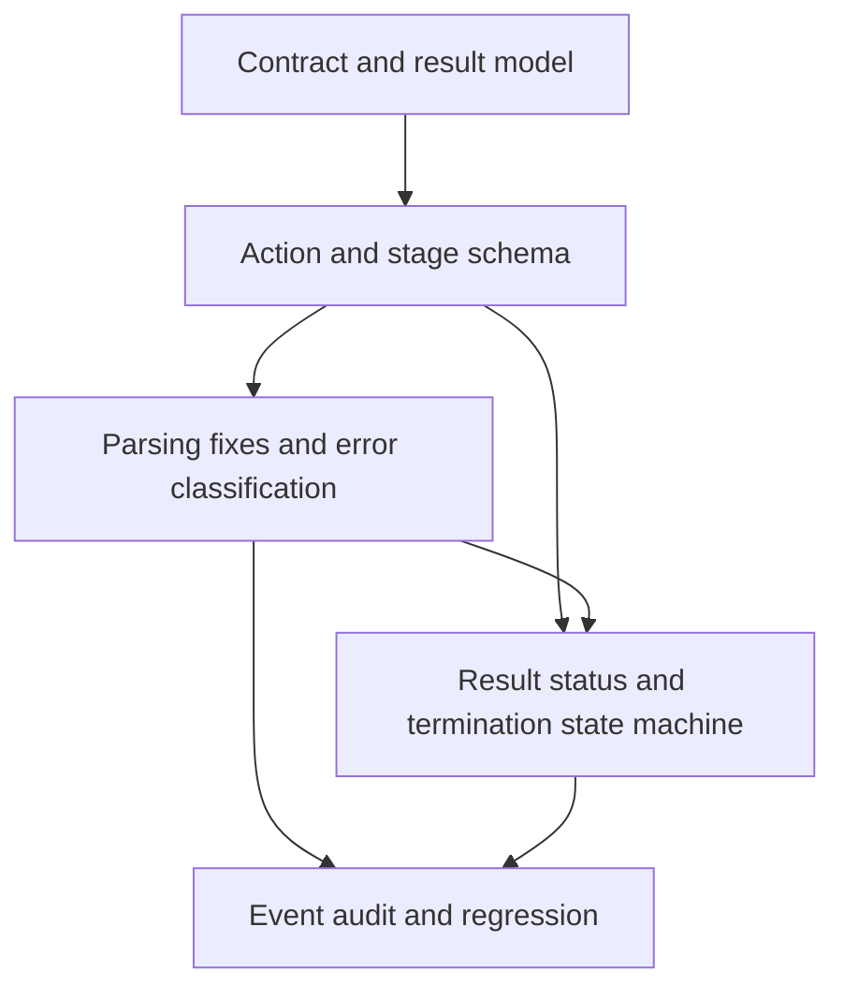

# 0053 · Persona Semantic Action Contract and Auditable Termination State Machine

<!-- This file is maintained by the spec tool: frontmatter is structured source data (including the tasks DAG), and the body is a group-level rust-RFC nine-section overview. -->

## Summary

This group fixes the entire distortion chain in user simulation: “model output triggers a protocol error, the protocol error overrides the objective result, and state becomes inconsistent after termination.” The current action catalog incorrectly treats `channel=EMIT` as “must have a non-empty message,” causing the semantically valid `accept` to be classified as `missing_message`; `gap` is also globally enforced across all act stages, and an occasional extra message in `waiting_act` directly terminates the session. Ultimately, a single formatting issue is summarized as `evaluator_invalid`, obscuring the user verdict, code execution result, and container lifecycle.

This group changes action definitions to **semantic contracts**: each action explicitly declares whether its message is `required`, `optional`, or `forbidden`, and each stage validates only the fields it needs. It stores the raw model response, normalized decision, protocol status, user verdict, objective evaluator result, and lifecycle status separately; applies bounded repair to recoverable formatting errors and fails closed only on genuine ambiguity; and flushes evidence to disk before stopping the container on normal termination. This group does not relax restrictions on unauthorized actions, treat tests run by the model itself as official objective acceptance, or introduce a post-processing verdict classifier.

## Motivation

The two most recent experiments with the same configuration provide replayable evidence: in the previous round, only one of four personas was recorded as `valid_accept`, while the other three became `evaluator_invalid` because of an empty `accept` message after the users had already completed normal interactions. In the current round, two of the three sessions written to disk triggered the same issue again, and the other triggered `invalid_gap`; the PyVista session triggered `unexpected_message` during the waiting stage and did not form a complete session. No persona explicitly selected `give_up`, yet the final results look as though users abandoned the task or a technical failure occurred.

The root cause is that the protocol layer mixes four judgments that should remain separate: whether the model generated a parseable object, which action the user chose, whether code execution objectively passed, and whether the container completed cleanup. The uniform “actions must have a message” rule and global `gap` field cannot express the actual semantics of termination actions; exception handling also writes `evaluator_invalid` directly at the first protocol error. This allows acceptance to shape user behavior in reverse, weakening the experiment's ability to measure real interactions and development capability.

The goal is not to allow arbitrary model output, but to make the framework strict only about **safety-relevant ambiguity**, while making formatting noise unrelated to action semantics explainable, repairable, and auditable, and never overwriting objective evidence already obtained.

## Guide-level explanation

The decision chain for a user session remains `judge → intent → act`, but each layer has clear responsibilities:

1. `judge` produces user-perceptible `perceive` and coarse-grained self-labels; it does not determine platform actions. When necessary, the user reads files, inspects diffs, or runs commands using private inner-layer tools; summaries of this evidence return only to the user's own context.
2. `intent` expresses only what the user genuinely wants to do at that moment, without prematurely narrowing that desire because the current menu or help text does not support it.
3. `act` resolves intent into an action. The action catalog is driven by semantic contracts and must not guess unauthorized actions from natural-language keywords.
4. A termination action writes a user termination event; the optional explanation for `accept` is called `terminal_note`, is not sent to the harness, and does not fabricate a harness-facing user turn.
5. The framework records protocol, user, objective, and lifecycle conclusions separately. Only an explicit persona `give_up` produces `abandoned`.

The conceptual result object is as follows:

```json
{
  "interaction_status": "completed | protocol_repaired | protocol_unrecoverable",
  "user_verdict": "accepted | accepted_with_reservations | abandoned | issue_filed | unknown",
  "objective_status": "passed | failed | not_run | unavailable",
  "lifecycle_status": "active | flushing | stopped | crashed"
}
```

The four fields are independent of one another. For example, “the user accepted, the target tests passed, and the model's first response required formatting repair” should be recorded as `accepted + passed + protocol_repaired`, not flattened into `evaluator_invalid`.

## Reference-level explanation

### Semantic action contract

The action catalog retains executor, channel, and effect, but adds `message_policy`, which is orthogonal to channel, and defines fields by action:

| Action | effect | Message | `gap` | harness behavior |
|---|---|---|---|---|
| `send_message` | advance | required | optional | Send one natural-language message |
| `accept` | terminate | optional | optional | Do not send; begin normal cleanup |
| `accept_with_reservations` | terminate | required | optional | Do not send; write reservations to the audit log |
| `file_issue` | terminate | required | required | Do not send; begin issue cleanup |
| `give_up` | terminate | optional | optional | Do not send; record abandoned |
| `keep_waiting` | advance | forbidden | optional | Do not send; wait for the next heartbeat |
| `interrupt` | advance | forbidden | optional | Interrupt the current harness request |

`channel` indicates only whether an external channel exists; it no longer determines whether a message is required. `terminal_note` and `message` are named separately, so a termination explanation cannot be mistaken for a harness request. The body of `file_issue` remains user-provided free text; personas are not forced to fill in a platform template.

Action parsing must use the action space allowed by the stage. Missing, unauthorized, or conflicting actions remain fail-closed; `free` must not be guessed into a termination action using keywords. Private tools such as `read_file`/`run_shell` must never appear in the outer action space.

### Stage-local schema

A single global act schema must no longer require every stage to return `action`, `message`, and `gap`. At least the following local contracts must be used:

```text
main_judge:   {perceive: string, verdict: enum}
main_intent:  {intent: string, needs_final_check: boolean, check_goal?: string}
main_act:     {action: enum, message?: string, gap?: boolean, terminal_note?: string}
waiting_judge:{perceive: string, judgment: enum}
waiting_intent:{intent: string}
waiting_act:  {action: enum, message?: string, gap?: boolean}
issue:        {issue: string}
rating:       {score: integer, reason: string}
```

Whether a field appears, whether it is empty, and whether it can be ignored are determined by the current action/stage contract. A termination action does not fail because an unrelated `gap` is missing; a silent action with a non-empty outbound message is still explicitly rejected.

### Protocol handling and error classification

The framework must retain four artifacts: the raw model text `raw_response`, the parsed object `parsed`, the normalized object `normalized`, and the validation result `validation`. Processing order is: parsing → local schema validation → semantic normalization → action-space validation → action execution.

Errors are classified as follows:

- `recoverable_format`: JSON wrapping, whitespace, and field types that can be safely converted. Retry a limited number of times, write `repair_attempt`, and set `interaction_status=protocol_repaired` on success.
- `inferable_semantics`: For example, `accept` has no additional explanation. Normalize it directly according to the action contract; no longer require the model to invent a sentence.
- `unrecoverable_protocol`: Unauthorized actions, multiple mutually exclusive actions, or key fields whose meaning cannot be determined. After limited retries, set `protocol_unrecoverable`, but retain prior user and objective evidence.

Protocol retries must not loop indefinitely, and protocol errors must not be relabeled as `evaluator_invalid`. `evaluator_invalid` only indicates that the evaluator itself has determined that the input or result is invalid; model formatting issues use the separate `interaction_status`.

### Results and acceptance boundaries

The objective evaluator consumes only the patch actually exported, official test results, and exit codes. It must not substitute the persona's private pytest results, nor may its result be fabricated as passed/failed because the persona parser failed. If no executable patch exists before termination, write `objective_status=not_run`; if the evaluator is unavailable, write `unavailable`.

A user may accept when tests have not passed; this is a valid product signal. In that case, record `user_verdict=accepted` and `objective_status=failed`, and do not rewrite them as a technical pass. Conversely, if objective tests pass but the accept protocol needs repair, `objective_status=passed` must also be preserved.

### Termination and container lifecycle

Normal termination uses an explicit state machine:

```text
ACTIVE
  -> TERMINAL_REQUESTED
  -> FLUSHING
  -> OBJECTIVE_SNAPSHOT
  -> AUDIT_COMMIT
  -> CONTAINER_STOPPING
  -> STOPPED
```

`FLUSHING` must complete persistence of the final persona decision, the terminal state of harness requests, evaluator results, and audit events; only then may the container be stopped. Forced stops or process failures follow `finally/watchdog` and must write at least `crashed`/`stopped`, unfinished requests, and the container retention policy. Stopping does not delete containers, logs, or traces unless the operator separately authorizes it.

### Event-sourced audit

The session event chain contains at least the following events:

```text
container_started
persona_raw_response
persona_parsed
persona_normalized
validation_result
repair_attempt
harness_request_started
harness_request_terminal
objective_evaluator_result
user_terminal_action
container_stopping
container_stopped
```

Each event carries `session_id`, `turn_id`, monotonic `seq`, UTC time, before and after state values, and any necessary exit codes. The body may be length-limited, but the raw-text summary, error code, and time must not be omitted. Experiment-level `journal` and `live` snapshots must be updated by the same cleanup function on both normal and exceptional paths, and the final manifest state must match the journal.

### Regression gate

The eight existing v2/v3 user interactions serve as offline fixtures instead of depending on remote models again. The gate must assert at least that:

- `accept` with an empty message no longer produces `missing_message`;
- `accept` does not generate a false harness turn;
- An empty message for `keep_waiting` is valid, while a message produces an explicit error;
- `gap` is no longer globally required for termination actions;
- `invalid_gap` and `unexpected_message` have separate protocol statuses and do not overwrite objective results;
- Only an explicit `give_up` is `abandoned`;
- Both normal termination and forced stops can write complete lifecycle events;
- The final states of the journal, live snapshot, and session JSON are consistent;
- Objective `passed/failed/not_run/unavailable` and interaction status can coexist in combination.

### Task DAG / file allocation



The file sets for tasks in the same group do not overlap. T1 only establishes the specification; T2/T3/T4 implement runtime semantics in sequence; T5 consolidates experiment-level state and historical replay.

## Drawbacks

Changing action contracts from global rules to semantic definitions will increase the number of schemas, parsers, and tests in the short term; this is a necessary cost of making implicit branches explicit. Protocol repair and multidimensional results will also make individual session JSON files larger than they are now. Retaining containers and raw responses will increase disk usage, but they are necessary evidence for auditable experiments.

Allowing `accept` without an additional message means some termination actions lack a natural-language explanation; `user_verdict` and audit events provide the missing information, and the model is no longer forced to generate meaningless pleasantries. Genuinely ambiguous output will still fail closed, so automatic recovery from every model error cannot be guaranteed.

## Rationale and alternatives

`message_policy` is chosen instead of simply changing `accept` to `SILENT` because accept may have an optional user explanation; stage-local schemas are chosen instead of making all fields optional to both avoid false failures caused by irrelevant fields and retain strict constraints on critical actions.

`interaction_status`, `user_verdict`, and `objective_status` are separated because they answer three different questions: whether the protocol completed, what judgment the user made, and whether the code is objectively valid. Flattening all three into one enum would continue to create the false impression that “formatting error equals functional failure.”

Bounded repair is chosen over unlimited retries to prevent the model from getting stuck in a self-correction loop; event sourcing is chosen over updating only the final JSON so that the framework's interpretation of a raw model response can be reconstructed.

The following alternatives are not adopted:

- Globally relax `message`/`gap`: this would remove constraints from `send_message` and `file_issue`, which genuinely require a body;
- Convert all protocol errors to accepted: this would produce false acceptances;
- Use a second LLM to post-process the verdict: this would introduce new classification errors and obscure the original evidence;
- Delete the container immediately on timeout: this would lose background processes, unflushed traces, and forensic evidence;
- Let the persona run its own tests for objective acceptance: test selection and the environment may be contaminated and cannot replace the official evaluator.

## Prior art

Spec-0031 already splits user simulation into judge → intent → act and places private inspection in the user's inner layer; this group retains that layering but adds formal contracts for action semantics and termination cleanup. Spec-0048 specifies final checks and the convergence path; this group does not change the product semantics of whether the user accepts, only repairs its protocol representation. Spec-0051 specifies session containers and objective evidence; this group reuses its container boundaries and requires that protocol events cannot overwrite objective evidence. Spec-0047, 0050 specify experiment execution and the delivery gate; this group only completes state consistency when sessions and experiments stop, without changing concurrency or the delivery DAG.

The official SWE-bench harness remains the sole source of objective execution: after persona interaction ends, the candidate patch is run through the official evaluator in a fresh instance environment, with results independent of the user's subjective verdict.

## Unresolved questions

These do not block implementation of this group, but three decisions remain for later:

1. Whether to add a separate maximum length and sensitive-information sanitization rules for `terminal_note`;
2. Whether to append an event-chain summary hash to the experiment-level manifest instead of retaining seq only within the session;
3. Whether to provide a read-only forensic replay entry point for unrecoverable protocol errors. This entry point must not re-execute the harness or modify the original session.

## Future possibilities

The same semantic contracts can be extended to triage, architect, and delivery agents, standardizing the separation of “structured output status” and “business outcome status.” Once the event chain is stable, the UI can add layered expansion of raw responses, normalized actions, repair records, and objective results; if compliance-grade tamper resistance is needed, a signature chain can be appended to the existing event fields. Every new action must declare executor, channel, effect, message_policy, and its field contract before being added to the action space and regression matrix.
