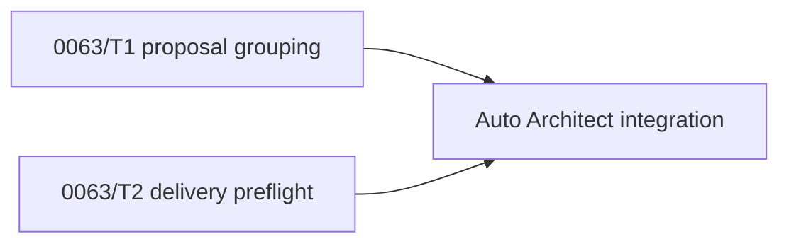

# 0063 · Lightweight delivery preflight and soft scheduling

<!-- This file is maintained by the spec tool: frontmatter is the structured source data (including the tasks DAG), and the body is a group-level nine-section rust-RFC overview. -->

## Summary

The optimization objective is “effective parallel delivery gains minus coordination and rework costs.” After Triage, the requirements side performs bounded grouping of proposals
from the same round once, and existing Architect workers design them in mutually exclusive groups; after independent Owner admission, the delivery side generates shared mechanisms,
suggested ordering, and reuse hints for the ready queue. Both preflight steps only purchase inexpensive information: they do not merge independent requirements, change acceptance,
or turn suggestions into hard dependencies, and failures restore the original processing paths.

This group has been implemented and verified. The delivery-side implementation corresponds to the lightweight preflight version in OpenAgents; Auto Architect handles configuration enablement,
requirements-side grouping, and wiring across boundaries.

## Motivation

When many issues arrive in the same round, multiple entirely uncoordinated Architects each read the entire proposal pool, repeat classification, and may simultaneously
design overlapping mechanisms; delivery workers may also implement the same underlying capabilities in parallel, discovering reuse opportunities only during conflict resolution or review.
Fully planning all issues first or establishing strong dependencies introduces another class of costs: model misclassification, cyclic suggestions, or a slow issue can block work
that could be delivered independently, and planning itself may cost more than implementation.

Preflight therefore affects only work assignment and claim preferences at the same priority. Requirements, objectives, and acceptance remain stored in each Gitea issue;
Owner retains independent handoff for each issue, and workers must still verify the current code after starting work. The benchmark does not enter classification, scheduling, or
delivery gates and remains available only for retrospective observation.

## Guide-level explanation

Users first interact on the main SHA frozen for the current round. Ordinary reports produced in non-final rounds become proposals through Triage; PM proposals
proceed independently to Owner. When `ARCHITECT_GROUPING` is enabled, the coordinator reads only the numbers, titles, and summaries of proposals visible in the current round
and makes one tool-free classification call; each ID must appear exactly once. Groups with more than six issues are split into consecutive batches, with each
group assigned to one Architect for sequential processing, while different groups are claimed in parallel by existing Architects. If classification times out, is truncated, or is invalid,
issues are split by issue number into batches of at most six and executed sequentially, retaining every issue.

Owner independently admits each proposal and applies `openagents`. Vigil applies ready upon discovery; soft mode reads up to 64
open ready issues, excludes `automation-failed`, and generates at most 8 shared mechanism candidates, 8 suggested ordering relationships, and 8 reuse
hints. The output is a length-limited planning view; the original issue always remains the complete authoritative input.

During claiming, existing action priorities for replies, merges, reviews, and similar actions remain unchanged; hotspot differences and suggested predecessors are considered only among new development issues at the same priority.
Dispatch continues whenever a slot is available; shared hotspots or cyclic suggestions do not block it. After 15 minutes of waiting, FIFO aging offsets suggestion preferences. Each issue still goes through
its own worktree, design, implementation, CI/e2e configuration gates, review, merge, and closure; workers claim the next issue as soon as they finish, without waiting for the entire batch.

Auto Architect starts the next user round only after all admitted issues in the current round reach terminal states. Any `automation-failed`, historical
`needs-human`, or timeout still stops the current round; the final round performs user observation only.

## Reference-level explanation

### Configuration and budgets

`backend/ahe_beta/experiment/controllers/ordinary.py` generates `coordination: soft`, and the same `openagents.yml` is used for subprocess and vigil
containers. `VIGIL_COORDINATION=off` disables preflight and restores ordinary priority/FIFO; `dependencies` explicitly selects strong-dependency
mode. The mode takes effect at the next startup and does not modify running experiments. The runtime image must contain an
OpenAgents version that recognizes the `coordination` field.

Architect grouping uses a single completion, no tools, a 16,384 output-token limit, and a 300-second wall-clock budget.
Delivery preflight uses a single round, no execution tools, an 8,192 output-token limit, and a 90-second wall-clock budget, with no additional protocol-repair calls.
Delivery results are cached by issue content fingerprint, including failures; a 120-second cooldown applies during rapid Owner admissions, and issue closure alone does not trigger recomputation.
Truncation, missed classifications, invalid output, and timeouts all fall back to ordinary scheduling without setting `automation-failed` or `blocked_by`.

Actual concurrency is `N_DEVELOPERS`, with a built-in default of 1; recent mixed experiments configured it as 4. Generated OpenAgents stages remain
triage/ci/e2e=skip and rfc/conflict/review/merge=agent; CI can be enabled through `VIGIL_CI_STAGE`. Enabling preflight
does not increase the worker count or claim that skipped stages were executed.

### Tasks and verification

T1 and T2 can be implemented independently, ultimately converging at the Auto Architect entry point and the pinned OpenAgents image:

Requirements-side regression covers ID completeness, batch size, group affinity, parallel mutual exclusion, fallback, current-round isolation, and the audit configuration entry point.
Delivery-side verification entry points are `OpenAgents/tools/preflight_stress.py` and `OpenAgents/tests/test_preflight.py`; results are saved
in `OpenAgents/docs/e2e-results/preflight-20260911/REPORT.md`. `.openagents/preflight.json`
records fingerprints, status, elapsed time, and sanitized suggestions; token usage goes into `token-usage.jsonl`.

Verification includes a real preflight model, replay of historical planning output, configuration loading in containers without network access, and local concurrent-queue stress tests; it did not launch a real
developer A/B test. It therefore establishes wiring, queue safety, and fallback behavior, not long-term rework rates or end-to-end elapsed-time gains.

## Drawbacks

The two classifications add model cost and waiting time for the first issue. Soft suggestions do not guarantee optimal ordering, and incorrect suggestions may still cause related workers to do more investigation;
failure caching preserves a transient failure while content remains unchanged. Observing at most 64 issues may also miss relationships deeper in the backlog.

Group affinity reduces parallelism within each group; throughput declines when classification groups independently executable issues together. The design aims to avoid repeated pool reads and
shared-mechanism conflicts, without promising faster execution for every workload.

## Rationale and alternatives

Soft scheduling is chosen because the cost of incorrect hints should be bounded: workers can still verify and correct them, claiming works without suggestions, and aging eventually returns scheduling to
FIFO. Writing suggestions as `blocked_by` or batch barriers would amplify the impact of missed classifications and slow issues, so only explicit forge dependencies remain
hard constraints.

Calling the coordination model for every issue would quickly increase costs and repeatedly plan nearly identical queues during successive Owner admissions; this group uses queue
snapshots, content-fingerprint caching, and cooldowns. Eliminating coordination entirely has the lowest cost but retains duplicate design, duplicate implementation, and late conflicts.

Automatically merging issues could reduce task counts, but would compress independent user objectives and acceptance and blur failure attribution; this group provides only shared mechanisms and
reuse hints, and each issue always remains independent.

## Prior art

Scheduler priority aging, content-addressed caching in compilation/build systems, and team backlog refinement all offer mechanisms
worth drawing on: suggestions affect selection, authoritative tasks remain independent, and caches are invalidated by input changes. Existing Vigil transactional claiming, flock, liveness proofs, and
crash recovery continue to provide concurrency correctness; preflight does not establish another queue protocol.

## Unresolved questions

A real developer A/B test has not yet been run, so shared implementation reuse, rework rates, merge-conflict rates, and total elapsed-time gains still require observation in subsequent normal
experiments. Current concurrency remains unchanged; this controlled verification cannot establish the optimal worker count or preflight budget.

## Future possibilities

After accumulating sufficient real delivery data, compare soft/off in terms of first-issue latency, repeated changes, conflicts, and total finalization time, then decide whether to adjust
snapshot limits, cooldowns, aging, or suggestion counts. A board could also display preflight cache hits, fallback, and hint adoption in the future, but these
observations must not feed back into benchmark-driven training gates.
