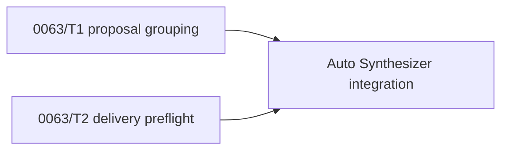

# 0063 · 轻量交付前置与软调度

<!-- 本文件由 spec 工具维护：frontmatter 为结构化源数据（含 tasks DAG），正文为组级 rust-RFC 9 段总览。 -->

## Summary

优化目标是“有效并行交付收益减去协调与返工成本”。需求侧在 Triage 后把同轮 proposal
做一次有界分组，由已有 Synthesizer workers 按互斥组设计；交付侧在 Owner 独立准入后，对 ready
队列生成共享机制、建议顺序和复用提示。两次前置都只购买便宜信息，不合并独立需求、不改变验收、
不把建议变成硬依赖，失败时恢复原有处理路径。

本组已经实现并验证。交付侧实现对应 OpenAgents 的轻量前置版本；Auto Synthesizer 负责启用配置、
需求侧分组和跨边界接线。

## Motivation

大量 issue 同轮进入时，完全无协调的多个 Synthesizer 会各自读取整池 proposal，重复分类并可能同时
设计重叠机制；交付 worker 也可能并行实现相同底层能力，直到冲突或评审阶段才发现复用机会。
将所有票先做完整规划或建立强依赖又会产生另一类成本：模型漏判、建议成环或一张慢票会阻塞本可
独立交付的工作，规划本身还可能比实现更昂贵。

因此前置只影响工作分配和同级领取偏好。需求、目标和 acceptance 继续由每张 Gitea issue 保存；
Owner 保留每张票的独立交接；worker 开始工作后仍须核实当前代码。benchmark 不进入分类、调度或
交付门禁，仍只在事后观测。

## Guide-level explanation

用户先在本轮冻结 main SHA 上交互。非末轮产生的普通报告经 Triage 变成 proposal，PM proposal
独立到 Owner。启用 `SYNTHESIZER_GROUPING` 时，协调器只读取本轮可见 proposal 的编号、标题和摘要，
调用一次无工具分类；每个 ID 必须恰好出现一次。组内超过六张时切成连续 batch，同一组固定由一个
Synthesizer 顺序处理，不同组由现有 Synthesizer 并行领取。分类超时、截断或非法时，按票号切成最多
六张的 batch 串行执行，所有票继续保留。

Owner 对各 proposal 独立准入并打 `openagents`。Vigil 发现后打 ready，soft 模式读取最多 64 张
开放 ready 票，排除 `automation-failed`，生成至多 8 个共享机制候选、8 条建议先后和 8 条复用
提示。输出是限长规划视图，原 issue 始终是完整权威输入。

领取时，回复、合并、评审等既有动作优先级保持不变；只在同级新开发票之间参考热点差异和建议前序。
有空槽就继续派发，同热点或建议成环不阻塞。等待 15 分钟后 FIFO 老化抵消建议偏好。每张票仍走
独立 worktree、设计、实现、CI/e2e 配置闸、评审、合并与关闭；worker 完成即领下一张，不等整批。

Auto Synthesizer 等本轮全部准入票终态后才开始下一轮用户。任何 `automation-failed`、历史
`needs-human` 或超时仍停止本轮；末轮只做用户观察。

## Reference-level explanation

### 配置与预算

`backend/run.py` 生成 `coordination: soft`，同一份 `openagents.yml` 用于 subprocess 和 vigil
容器。`VIGIL_COORDINATION=off` 关闭前置并恢复普通优先级/FIFO；`dependencies` 显式选择强依赖
模式。模式在下次启动生效，不修改正在运行的实验。运行镜像必须包含认识 `coordination` 字段的
OpenAgents 版本。

Synthesizer grouping 使用单次 completion、无工具、16,384 输出 token 上限和 300 秒墙钟预算。
交付前置使用单轮、无执行工具、8,192 输出 token 上限和 90 秒墙钟预算，不追加协议修复调用。
交付结果按 issue 内容指纹缓存，失败也缓存；Owner 密集准入时有 120 秒冷却，单纯闭票不触发重算。
截断、漏判、非法输出和超时均回普通调度，不设置 `automation-failed` 或 `blocked_by`。

实际并发取 `N_DEVELOPERS`，内建默认 1；近期混合实验配置为 4。生成的 OpenAgents 阶段仍是
triage/ci/e2e=skip，rfc/conflict/review/merge=agent，CI 可由 `VIGIL_CI_STAGE` 开启。启用前置
不会提高 worker 数或把跳过阶段宣称为已执行。

### 任务与验证

T1 与 T2 可独立实现，最终在 Auto Synthesizer 入口和固定 OpenAgents 镜像处汇合：

需求侧回归覆盖 ID 完整性、批大小、组亲和、并行互斥、fallback、当前轮隔离和审计配置入口。
交付侧验证入口为 `OpenAgents/tools/preflight_stress.py` 与 `OpenAgents/tests/test_preflight.py`；结果保存
在 `OpenAgents/docs/e2e-results/preflight-20260911/REPORT.md`。`.openagents/preflight.json`
记录指纹、状态、耗时和净化建议，token 用量进入 `token-usage.jsonl`。

验证包含真实前置模型、历史规划输出回放、无网络容器配置加载和本地并发队列压力测试，没有启动真实
developer A/B。因此它证明接线、队列安全与降级行为，不证明长期返工率或端到端耗时收益。

## Drawbacks

两次分类增加模型成本和首票等待时间。软建议不保证最优顺序，错误建议仍可能让相关 worker 多做调查；
失败缓存会在内容不变时保留一次暂时性失败。按最多 64 张票观察也可能漏掉更深积压的关系。

组亲和减少同一组内部并行度；当分类把可独立票放在一起时，吞吐会下降。设计选择以避免重复读池和
共享机制冲突为目标，不承诺所有负载都更快。

## Rationale and alternatives

选择软调度，是因为错误提示的损失应有界：worker 仍可核实和纠正，没有建议也能领取，老化最终回到
FIFO。将建议写成 `blocked_by` 或批次 barrier 会放大漏判和慢票影响，因此只保留显式 forge 依赖的
硬约束。

每张票各自调用协调模型会快速增加成本，并在 Owner 连续准入时对几乎相同队列重复规划；本组采用队列
快照、内容指纹缓存和冷却。完全取消协调成本最低，但保留了重复设计、重复实现和晚期冲突问题。

自动合票可以减少任务数，却会压缩独立用户目标与验收，也让失败归因变模糊；本组只提供共享机制和
复用提示，每张 issue 始终独立。

## Prior art

调度器的优先级老化、编译构建系统的内容寻址缓存，以及团队 backlog refinement 都提供了可借鉴的
机制：建议影响选择，权威任务保持独立，缓存按输入失效。现有 Vigil 的事务领取、flock、生存证明和
崩溃回收继续承担并发正确性，前置不另建队列协议。

## Unresolved questions

真实 developer A/B 尚未执行，因此共享实现复用率、返工率、合并冲突率和总耗时收益仍需由后续正常
实验观测。当前并发保持不变，不能从本次受控验证推导最佳 worker 数或前置预算。

## Future possibilities

积累足够真实交付数据后，可以比较 soft/off 的首票延迟、重复修改、冲突和总封口时间，再决定是否调整
快照上限、冷却、老化或建议数量。未来也可在看板展示前置缓存命中、fallback 和提示采纳情况，但这些
观测不能反向成为 benchmark 驱动的训练门禁。
