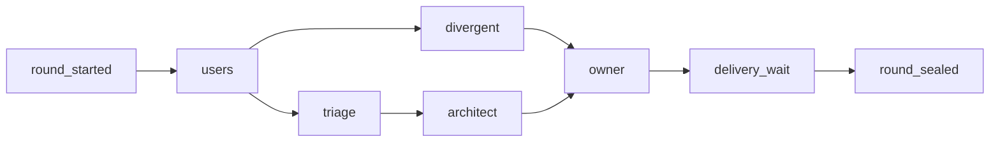
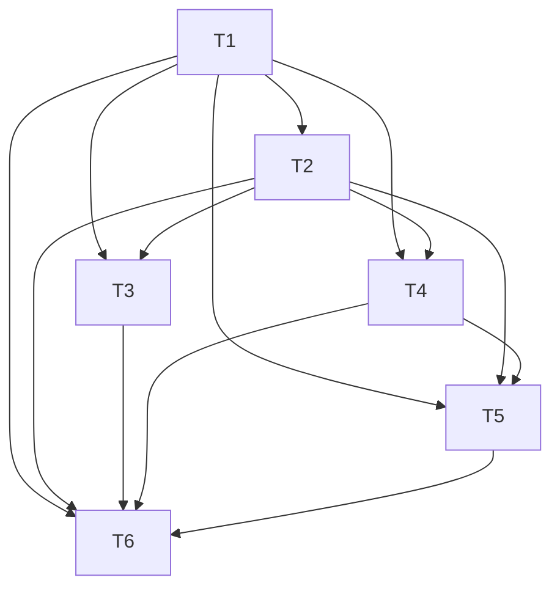

# 0064 · Stage-Level Resumable Experiment Runtime

<!-- This file is maintained by the spec tool: the frontmatter is structured source data (including the tasks DAG), and the body is the group-level nine-section rust-RFC overview. -->

## Summary

The real experiment loop is changed to a persistent, re-entrant stage state machine. After freezing the user plan and harness SHA for each round, it advances through user sessions, Triage and Divergent, Architect, Owner, delivery waiting, and round sealing; every parallel work item has a stable idempotency key, input digest, output receipt, and verifiable postconditions. After process or infrastructure failure, the unified `resume` entry point first reconciles SessionStore, Gitea, and git, then continues from the smallest incomplete work item without repeating completed user interactions or model calls, and without reinitializing the experiment.

This group restores execution progress without changing training signals, role responsibilities, admission criteria, delivery terminal states, or benchmark held-out boundaries. It also does not serialize Python processes, threads, containers, or in-progress model streams; an individual crashed work item is replayed from persisted input or a model-output receipt, while completed work items are skipped directly.

## Motivation

The repository already has `RunState`, checkpoint tar, and `HarborRunner`, but they record `round` and the main cursor only after a complete round ends; the current real entry point directly invokes one Orchestrator covering the whole round. In an actual audited experiment, `resume` only restarts infrastructure; the requirement-facing startup path still recreates the local harness repository, forcibly resets remote main, closes legacy issues, and clears the live projection. Therefore, if Triage, Architect, Owner, or delivery waiting fails after all user sessions are complete, recovery can only rely on manually reading logs, modifying the entry point, or rerunning expensive upstream stages.

Real side effects are distributed across two authoritative surfaces: SessionStore stores sessions, while Gitea stores issues, comments, labels, PRs, and harness main. Existing role invocation JSON is a fail-open audit artifact and cannot prove that side effects completed; a single `phase` field cannot express that nine of ten users completed or three of four Triage workers completed. Writing “stage complete” in more locations also leaves the classic crash window: the remote issue has been created, but the local completion marker has not yet been written, so restart creates duplicate issues or comments.

Experiment cost is concentrated in model calls, user sessions, and delivery. Recovery must reduce rework while preserving audit authenticity and ensuring that the final SessionStore and Gitea state after recovery is equivalent to one fault-free run. Failure must not be rewritten as success by recovery; `automation-failed`, configuration drift, and unexplainable remote state must still explicitly block execution.

## Guide-level explanation

### Operator entry point

New experiments are created with explicit fresh semantics. Only the fresh path may seed the initial harness, reset the dedicated Gitea repository, and clear the projection for this run. Before the experiment starts, immutable identity is written: experiment id, run id, configuration hash, controller code SHA, model and image pins, and a complete interaction-plan digest.

After abnormal experiment exit, the operator executes the same `experiment resume <id>` entry point. It acquires the experiment-level exclusive lock, loads the checkpoint, verifies immutable identity, and reads the real SessionStore, Gitea issues/PRs, and `origin/main`. After reconciliation, the state machine continues from the latest safe position. For example:

- When six of eight users are complete, rerun only the two incomplete sessions; completed sessions are not charged or ticketed again.
- When the user stage is complete but Triage has not started, begin Triage directly from the frozen report snapshot.
- When part of the report has been normalized, process only work items that still belong to that Triage snapshot and are incomplete.
- When Architect grouping completes and then fails, reuse the saved grouping and model output and continue from unapplied batches.
- When Owner completes and then fails, reuse the fixed admitted issue set and restore only Vigil and delivery waiting.
- When all admission issues have successfully terminated, reconcile remote main, seal the sealed SHA, and enter the next round.

`resume` does not automatically ignore business failures. When an issue carries `automation-failed`, the round remains blocked; after fixing or relaunching delivery for that issue, resume again and recheck only the delivery set. If configuration, source code, or frozen-plan drift is detected, fail closed; create another experiment or perform an explicit, auditable migration instead of silently continuing the old experiment with new code.

### Recovery granularity

| Stage | Smallest recovery unit | Completion evidence |
|---|---|---|
| round start | One round plan | Fixed pair list, user SHA, and input digest |
| users | One persona × seed session | Unique session file, index entry, and associated issue postconditions |
| triage | One frozen report | Saved structured decision and the issue’s target state/labels/body |
| divergent | One worker call and each of its proposals | Output receipt and Gitea issue with a source-bearing idempotency identifier |
| architect | One grouping and one batch | Grouping digest, design output, source state, and new proposal receipt |
| owner | One proposal decision | Decision receipt, label/comment postconditions, and fixed admitted set |
| delivery | One admitted issue | Gitea issue/PR terminal state and merge commit |
| seal | One round | All delivery successful and unique sealed main SHA |

In-progress model requests cannot resume at an intermediate token position. During recovery, use atomically saved structured model output first; call the model again only for the smallest work item whose output was never completely persisted. An in-progress user session restarts with the same plan item; its temporary workspace may be rebuilt, but any ticket created midway must be identified by its idempotency key and must not be created again.

## Reference-level explanation

### 1. Authoritative state and file layout

The experiment root adds a versioned snapshot `recovery.json` and append-only event log `recovery.jsonl` under `checkpoints/`. Snapshots are published with a temporary file, fsync, and atomic replace; the event log records state transitions, attempt numbers, errors, and reconciliation conclusions. The portable tar checkpoint at round boundaries remains, but stage continuation does not copy the entire Gitea database at every node.

The recovery snapshot contains at least:

```text
schema_version, revision
experiment_id, run_id, config_hash, controller_sha, plan_hash
round, round_status, user_sha, sealed_sha
stages[stage].status
stages[stage].input_digest
stages[stage].units[operation_key] = {
  status, attempt, output_artifact, output_digest,
  expected_postconditions, observed_postconditions, error
}
admitted_issue_ids
```

The state file is the orchestration cursor and intent record. The full Session files remain authoritative for user results; Gitea remains authoritative for issues, PRs, and main; and the frozen manifest remains authoritative for experiment configuration. Role invocation files are retained for audit; only output successfully saved by the recovery store with a verifiable digest may be used to avoid model replay. The archive must include the recovery snapshot, event log, and referenced role outputs.

A single controller obtains write access through the existing experiment lock; snapshot revisions increase monotonically, and an old process must not overwrite a newer revision. Sensitive credentials must not enter snapshots, logs, idempotency identifiers, or exception text.

### 2. State machine and commit protocol

The round DAG is:



Triage and Divergent belong to the same beat but are recorded separately. Architect starts only after all Triage units complete; Owner waits for both Architect and Divergent to complete. The final round seals directly after users complete and generates or delivers no proposals.

Every work item follows one protocol:

1. Compute a stable `operation_key` and input digest from the frozen plan or the previous stage’s completed output.
2. Atomically record `running`, the attempt, and expected postconditions.
3. Call the model; first save the complete structured output and digest as an immutable receipt.
4. Apply local/Gitea side effects using that output, carrying the same operation key at every step.
5. Read the authoritative surfaces to verify postconditions, then atomically mark `completed`.

If the process crashes between steps 4 and 5, the recovery system reconciles first. If postconditions are satisfied, it records completed; if not, it continues applying the saved output. If an input object was externally modified, partial effects contradict one another, or the same key points to different content, it marks `blocked/inconsistent` and forbids another model call from concealing the conflict.

The operation key uses the stable logical identity of `experiment/round/stage/unit`; an input digest is stored separately to prevent the same key from being reused for different content. SessionStore changes the same session id to an upsert index; new issues and comments include parseable signed identifiers; labels, body, and state are confirmed through read-after-write verification. Recovery must not skip remote checks solely because local `completed` exists.

### 3. Stage-specific rules

At round start, materialize the entire persona/seed pair list before any user work, call the session plan exactly once, and persist it; recovery must not resample. User SHA is frozen within the round. Each session uses a stable plan item id; a failed temporary workspace may be rebuilt after cleanup, but completed-session outputs and issue references must be reused.

After users complete, Triage takes exactly one report snapshot and persists worker shards. Recovery neither reslices nor absorbs reports added manually later. Issues that have left the report surface must be reconciled with saved receipts; only issues still in the report without complete output may call Triage again.

When Divergent or Architect creates a proposal, it writes an operation-key signature. Architect grouping’s directory and group id are derived from the round and input digest, replacing random UUIDs as recovery identities; once classification output is saved, it is reused. Model output is persisted first, then structural proposals are created and sources merged; partial merges are completed source by source through postconditions.

Owner first persists the full batch of decisions, then applies them proposal by proposal. Admit, hold, exact merge, comments, and evidence publication are each verified; comment signatures prevent duplicate appends during recovery. When Owner completes, admitted issue ids are fixed; subsequent changes to the open queue must not expand this round’s delivery set.

delivery resume reconnects to existing Vigil/Gitea resources and classifies state according to the fixed set; it does not rerun Owner. Successful closure must still have no failure label; failure or needs-human remains blocked; inflight continues waiting. After all succeed, fetch and parse remote main, write the sealed SHA, and idempotently update the round manifest. Stop if main conflicts with the recorded sealed SHA.

### 4. Fresh, resume, and compatibility

The real entry point accepts an explicit run mode. `fresh` requires that no valid recovery state exist and initializes dedicated resources; `resume` requires that state exist and forbids destructive resets of harness/Gitea/live. For old experiments without recovery state, do not guess a fine-grained cursor; continue using the existing manual recovery process, or use a separate migration command to generate an initial snapshot from Gitea, sessions, and the manifest for manual confirmation.

The experiment runtime, audit controller, and SWE-bench loop entry point share the same resume implementation. Infrastructure recovery and requirement-state recovery are two steps of one operation; the CLI no longer reports “the container has started” as “the experiment has resumed.” Run id remains stable during resume, attempt increments, and the journal records fresh, reconcile, resume, blocked, and completed.

The live file remains a projection. Resume preserves history, fixes stale running slots, and displays recovering/current stage; live corruption cannot determine whether work is rerun. The old HarborRunner is changed to call the same stage state machine, avoiding a second round-recovery semantics.

### 5. Task DAG, file allocation, and verification

| Task | Content | Dependencies |
|---|---|---|
| T1 | Persistent state, receipts, and reconciliation primitives | — |
| T2 | Orchestrator stage state machine and delivery recovery | T1 |
| T3 | Work-item-level recovery for user sessions | T1, T2 |
| T4 | First-beat recovery for Triage/Divergent | T1, T2 |
| T5 | Save Architect/Owner output before applying it | T1, T2, T4 |
| T6 | Fresh/resume real entry point and fault-injection acceptance | T1–T5 |



The end-to-end script is `backend/scripts/e2e-stage-resume.sh`. It injects a forced exit before and after every model-output save point and every external side effect, then executes resume; each case compares session id/index, issue count and content, comments/labels, admitted set, PR terminal state, round manifest, and sealed SHA with a fault-free baseline. Tests must cover partially completed parallel users, partially completed Triage, Architect-created proposals whose sources have not fully migrated, partially applied Owner work, delivery inflight/failed/success, and rejection paths for configuration and remote-state drift. Tests use FakeTracker/Gitea fixtures to validate the fault matrix and do not invoke the benchmark as a development gate.

## Drawbacks

The persistent state machine, idempotency signatures, and reconciliation logic increase code volume and split the control flow that was previously direct within one function into multiple re-entrant steps. Writing to disk and reading Gitea after each work item adds slight latency; parallel stages also need to handle completion ordering and revision races.

Fine-grained recovery can only avoid repeating completed work; it cannot restore an in-progress model stream or transient process inside a container. A work item whose complete output was not saved still incurs another charge. After external objects are manually modified, conservative reconciliation may require human judgment rather than guessing the correct state.

## Rationale and alternatives

Adopt “lightweight state snapshot + authoritative-surface reconciliation + idempotent apply” because Gitea and SessionStore already persist most business facts. Copying the entire Gitea volume at every stage is intuitive but expensive and slow to recover, and it does not solve duplicate execution when a side effect occurs between the snapshot and completion marker; complete volume backups are better suited to round-level disaster recovery.

Writing a single phase file only after users, Triage, and Architect would be faster, but could not handle partially completed parallel stages or distinguish “side effect occurred, marker not written” from “never executed.” This group therefore retains the stage cursor while recording work-item receipts and postconditions.

Turning each role into a message-queue consumer would naturally provide ack/retry, but would introduce a resident broker, message schemas, and a new operational surface. The current single controller, file storage, and Gitea are sufficient to express recovery semantics, so no service is added for now.

Replaying every upstream stage is simple, but changes the random user plan, repeats model cost and Gitea side effects, and damages experiment attribution before and after failure; it is therefore not the formal recovery strategy.

## Prior art

The database write-ahead log’s “record intent first, apply next, commit last,” workflow engines’ durable execution, and Kubernetes controllers’ desired-state/actual-state reconciliation all use the same idea. Existing HarborRunner round checkpoints, experiment journal, atomic SessionStore files, and Gitea postcondition checks provide a reusable starting point, but this group unifies their semantics and connects them to the real experiment entry point.

## Unresolved questions

The first version has no design-blocking questions. Automatic migration of old experiments is out of scope for the first version; the migration tool only generates a candidate snapshot and requires manual confirmation. Whether cross-machine recovery needs automatic Docker-volume packaging will be decided after disaster-recovery requirements are clarified; it does not affect stage continuation under the same experiment root and retained-volume conditions.

## Future possibilities

Later, the controller could automatically back off and resume after retryable infrastructure errors, reducing operator commands. A dashboard could also show each stage, work item, attempt, recovery reason, and estimated remaining cost. Stable operation keys and the event log could support forking a new experiment from a specified historical stage, comparing model outputs before and after recovery, and replacing the local controller with an external durable workflow engine without changing role protocols.
