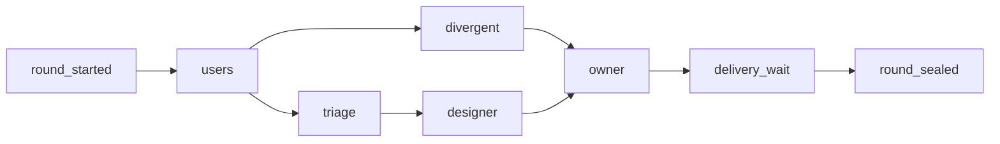
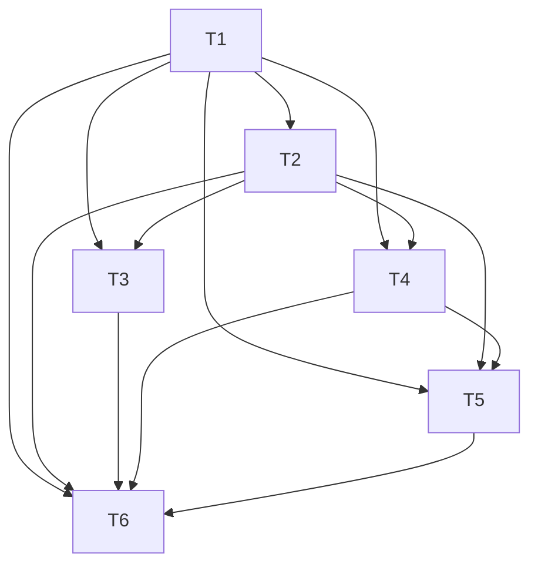

# 0064 · 阶段级可恢复实验运行

<!-- 本文件由 spec 工具维护：frontmatter 为结构化源数据（含 tasks DAG），正文为组级 rust-RFC 9 段总览。 -->

## Summary

真实实验闭环改为持久化、可重入的阶段状态机。每轮在冻结用户计划与 harness SHA 后，按
用户会话、Triage 与 Divergent、Designer、Owner、交付等待、轮次封口推进；每个并行
工作项有稳定幂等键、输入摘要、输出回执和可验证后置条件。进程或基础设施失败后，统一的
`resume` 入口先对账 SessionStore、Gitea 与 git，再从最小未完成工作项继续，不重复已经完成
的用户交互或模型调用，也不重新初始化实验。

本组恢复执行进度，不改变训练信号、角色职责、准入标准、交付终态或 benchmark held-out
边界。它也不序列化 Python 进程、线程、容器或进行中的模型流；崩溃中的单个工作项从持久化
输入或模型输出回执重放，已完成工作项直接跳过。

## Motivation

仓库已有 `RunState`、checkpoint tar 和 `HarborRunner`，但它们只在完整轮次结束后记录
`round` 与 main 游标；当前真实入口直接调用一次覆盖整轮的 Orchestrator。实际审计实验的
`resume` 只重新启动基础设施，需求面启动路径仍会重新创建本地 harness 仓、强制复位远端
main、关闭遗留 issue，并清空 live 投影。因此，用户会话已经全部完成后若 Triage、Designer、
Owner 或交付等待失败，恢复只能依赖人工阅读日志、修改入口或重跑昂贵的上游阶段。

真实副作用分散在两个权威面：SessionStore 保存会话，Gitea 保存 issue、评论、标签、PR 与
harness main。现有角色调用 JSON 是 fail-open 审计制品，不能证明副作用完成；单一 `phase`
字段也不能表达十个用户中完成九个、四个 Triage worker 中完成三个的状态。直接在更多位置
写“阶段完成”还会留下经典崩溃窗口：远端 issue 已创建，但本地完成标记尚未写入，重启后
再次执行便产生重复票或重复评论。

实验成本集中在模型调用、用户会话与交付。恢复机制必须在保留审计真实性的同时减少重做，
并保证恢复后的最终 SessionStore、Gitea 状态与一次无故障运行等价。失败不能被恢复流程
改写成成功；`automation-failed`、配置漂移和无法解释的远端状态仍应明确阻断。

## Guide-level explanation

### 操作者入口

新实验使用显式 fresh 语义创建。只有 fresh 路径可以种初始 harness、复位专属 Gitea 仓和
清空本次运行投影。实验开始前写入不可变身份：experiment id、run id、配置哈希、controller
代码 SHA、模型与镜像 pin、完整交互计划摘要。

实验异常退出后，操作者执行同一个 `experiment resume <id>` 入口。它取得实验级独占锁，
加载 checkpoint，验证不可变身份，并读取真实 SessionStore、Gitea issue/PR 和 `origin/main`。
对账完成后，状态机会从最近安全位置继续。例如：

- 八个用户中六个完成时，只补跑两个未完成 session；已完成 session 不重新收费或重复开票。
- 用户阶段完成而 Triage 尚未开始时，直接从冻结的 report 快照开始 Triage。
- 一部分 report 已规范化时，只处理仍属于该 Triage 快照且未完成的工作项。
- Designer 分组完成后失败时，复用已保存的分组和模型输出，从未应用的 batch 继续。
- Owner 完成后失败时，复用固定的 admitted issue 集合，只恢复 Vigil 和交付等待。
- 所有准入票已成功终结时，对账远端 main 并封存 sealed SHA，然后进入下一轮。

`resume` 不自动忽略业务失败。某张票带 `automation-failed` 时，轮次保持 blocked；修复或重新
发起该票的交付后再次 resume，只重新检查交付集合。配置、源码或冻结计划漂移时 fail-closed，
需要另建实验或执行显式、可审计的迁移，不能静默用新代码续旧实验。

### 恢复粒度

| 阶段 | 最小恢复单元 | 完成证据 |
|---|---|---|
| round start | 一轮计划 | 固定 pair 列表、user SHA 与输入摘要 |
| users | 一个 persona × seed session | 唯一 session 文件、索引项及关联 issue 后置条件 |
| triage | 一张冻结 report | 保存的结构化决策及该票目标状态/标签/正文 |
| divergent | 一个 worker 调用及其每项 proposal | 输出回执及带来源幂等标识的 Gitea issue |
| designer | 一次 grouping 与一个 batch | grouping 摘要、设计输出、来源状态和新 proposal 回执 |
| owner | 一张 proposal 决策 | 决策回执、标签/评论后置条件及固定 admitted 集合 |
| delivery | 一张 admitted issue | Gitea issue/PR 终态与合并提交 |
| seal | 一轮 | 全部交付成功及唯一 sealed main SHA |

进行中的模型请求无法恢复到 token 中间位置。恢复时优先使用已经原子保存的结构化模型输出；
只有输出从未完整落盘的最小工作项才重新调用模型。进行中的用户会话使用同一计划项重新开始，
其临时 workspace 可以重建，但已经发生的中途开票必须通过幂等键识别，不能重复创建。

## Reference-level explanation

### 1. 权威状态与文件布局

实验根的 `checkpoints/` 新增版本化快照 `recovery.json` 和追加式事件日志
`recovery.jsonl`。快照用临时文件、fsync 和原子 replace 发布；事件日志记录状态迁移、尝试号、
错误和对账结论。轮次边界的可移植 tar checkpoint 继续存在，但阶段续跑不在每个节点复制整套
Gitea 数据库。

恢复快照至少包含：

```text
schema_version, revision
experiment_id, run_id, config_hash, controller_sha, plan_hash
round, round_status, user_sha, sealed_sha
stages[stage].status
stages[stage].input_digest
stages[stage].units[operation_key] = {
  status, attempt, output_artifact, output_digest,
  expected_postconditions, observed_postconditions, error
}
admitted_issue_ids
```

状态文件是编排游标和意图记录。Session 全量文件仍是用户结果权威，Gitea 仍是 issue、PR 与 main
权威，冻结 manifest 仍是实验配置权威。角色 invocation 文件保留审计用途；只有 recovery store
成功保存并能校验摘要的输出才可用于免模型重放。archive 必须包含 recovery 快照、事件日志和其
引用的角色输出。

单 controller 通过现有实验锁获得写权；快照 revision 单调递增，旧进程不得覆盖新 revision。
敏感凭证不进入快照、日志、幂等标识或异常文本。

### 2. 状态机与提交协议

轮次 DAG 为：



Triage 与 Divergent 属于同一拍但分别记录，Designer 只在全部 Triage 单元完成后启动；Owner
等待 Designer 与 Divergent 都完成。末轮在 users 完成后直接 seal，不生成或交付提案。

每个工作项执行统一协议：

1. 从冻结计划或上一阶段完成输出计算稳定 `operation_key` 与输入摘要。
2. 原子记录 `running`、attempt 和预期后置条件。
3. 调用模型；先把完整结构化输出与摘要保存为不可变回执。
4. 用该输出执行本地/Gitea 副作用，每一步携带同一个 operation key。
5. 读取权威面验证后置条件，再原子标记 `completed`。

进程在第 4、5 步之间崩溃时，恢复器先对账。后置条件已满足则补记 completed；尚未满足则用已保存
输出继续 apply；出现输入对象被外部修改、部分效果互相矛盾或同一键指向不同内容时标记
`blocked/inconsistent`，禁止重新调用模型掩盖冲突。

operation key 使用 `experiment/round/stage/unit` 的稳定逻辑身份，另存输入 digest 防止相同键
复用到不同内容。SessionStore 对同一 session id 改为 upsert 索引；新 issue 与评论写入可解析的
签名标识；标签、正文和状态通过读后校验确认。恢复器不能仅凭本地 `completed` 跳过远端检查。

### 3. 各阶段特殊规则

round start 在任何用户工作前物化整轮 persona/seed pair，callable session plan 只调用一次并
持久化；恢复不得重新抽样。user SHA 在轮次内冻结。每个 session 使用稳定 plan item id；失败的
临时 workspace 清理后可以重建，已完成 session 的输出和 issue 引用必须复用。

Triage 在 users 完成后只拍一次 report 快照，并持久化 worker 分片。恢复不重新切片，也不吸收
后来人工新增的 report。已离开 report 平面的票必须与保存回执对账；仍在 report 且无完整输出的票
才重新调用 Triage。

Divergent、Designer 创建 proposal 时写入 operation key 签名。Designer grouping 的目录和 group
id 由轮次与输入摘要派生，替换随机 UUID 作为恢复身份；分类输出一旦保存便复用。模型输出先落盘，
再创建结构 proposal、合并来源；部分合并通过每个来源的后置条件逐项补齐。

Owner 先持久化整批决策，再按 proposal 逐项应用。admit、hold、精确 merge、评论和证据发布各自
校验；评论签名避免恢复时重复追加。Owner 阶段完成时固化 admitted issue ids，之后不因开放队列
变化重新扩大本轮交付集合。

delivery resume 重新连接已有 Vigil/Gitea 资源并按固化集合分类状态，不重跑 Owner。成功关闭必须
仍无失败标签；失败或 needs-human 保持 blocked；inflight 继续等待。全体成功后 fetch 并解析远端
main，写 sealed SHA，再幂等更新轮次 manifest。若 main 与已记录 sealed SHA 冲突则停止。

### 4. Fresh、resume 与兼容

真实入口接收显式运行模式。`fresh` 要求不存在有效 recovery state，负责初始化专属资源；
`resume` 要求存在 state，禁止调用 harness/Gitea/live 的破坏性复位。旧实验没有 recovery state 时
不得猜测细粒度游标；可以继续使用现有人工恢复流程，或经单独 migration 命令从 Gitea、session 与
manifest 生成一份待人工确认的初始快照。

实验 runtime、审计 controller 和 SWE-bench 闭环入口共享同一个 resume 实现。基础设施恢复与需求
状态恢复是一次操作的两个步骤，CLI 不再把“容器已启动”报告成“实验已续跑”。run id 在 resume
中保持稳定，attempt 递增；journal 记录 fresh、reconcile、resume、blocked、completed。

live 文件仍是投影。resume 保留 history，修正遗留 running 槽并展示 recovering/当前阶段；live
损坏不能决定工作是否重跑。旧的 HarborRunner 改为调用同一阶段状态机，避免保留第二套轮次恢复语义。

### 5. 任务 DAG、文件分配与验证

| Task | 内容 | 依赖 |
|---|---|---|
| T1 | 持久化状态、回执和对账原语 | — |
| T2 | Orchestrator 阶段状态机与交付恢复 | T1 |
| T3 | 用户 session 工作项级恢复 | T1, T2 |
| T4 | Triage/Divergent 第一拍恢复 | T1, T2 |
| T5 | Designer/Owner 输出先存后应用 | T1, T2, T4 |
| T6 | Fresh/resume 真实入口和故障注入验收 | T1–T5 |



端到端脚本为 `backend/scripts/e2e-stage-resume.sh`。它在每个模型输出保存点和每个外部副作用
前后注入一次强制退出，随后执行 resume；每个 case 与无故障基线比较 session id/index、issue
数量与内容、评论/标签、admitted 集、PR 终态、轮次 manifest 和 sealed SHA。测试必须覆盖并行
用户部分完成、Triage 部分完成、Designer 创建后来源未完全迁移、Owner 部分应用、delivery
inflight/failed/success，以及配置和远端状态漂移的拒绝路径。测试使用 FakeTracker/Gitea fixture
验证故障矩阵，不调用 benchmark 作为开发门禁。

## Drawbacks

持久化状态机、幂等签名和对账逻辑会增加代码量，并把原来单函数内直观的控制流拆成多个可重入步骤。
每个工作项完成后写盘和读取 Gitea 会增加少量延迟；并行阶段还需处理完成顺序与 revision 竞争。

细粒度恢复只能避免重复已完成工作，不能恢复进行中的模型流或容器内瞬时进程。一个未保存完整输出的
工作项仍会重新收费。外部对象被人工修改后，保守对账可能要求人工判断，而不是自动猜测正确状态。

## Rationale and alternatives

采用“轻量状态快照 + 权威面对账 + 幂等 apply”，因为 Gitea 和 SessionStore 已经持久化了大部分
业务事实。每个阶段复制整套 Gitea volume 虽然直观，但成本高、恢复慢，并且无法解决副作用发生在
快照与完成标记之间的重复执行问题；完整 volume 备份更适合作为轮次级灾备。

只在用户、Triage、Designer 后写单一 phase 文件实现较快，但无法处理并行阶段部分完成，也无法区分
“副作用已发生、标记未写”和“从未执行”。本组因此保留阶段游标，同时记录工作项回执与后置条件。

把每个角色变成消息队列消费者可以天然获得 ack/retry，但会引入常驻 broker、消息 schema 和新的
运维面。当前单 controller、文件存储和 Gitea 已足够表达恢复语义，先不增加服务。

直接重放所有上游阶段实现简单，却会改变随机用户计划、重复模型成本和 Gitea 副作用，也破坏失败前后
实验归因，因此不作为正式恢复策略。

## Prior art

数据库 write-ahead log 的“先记意图、再应用、最后提交”、工作流引擎的 durable execution、以及
Kubernetes controller 的期望状态/实际状态 reconciliation 都使用相同思路。现有 HarborRunner 的
轮次 checkpoint、实验 journal、SessionStore 原子文件和 Gitea 后置条件检查提供了可复用起点，
但本组统一其语义并接入真实实验入口。

## Unresolved questions

首版没有阻塞设计的问题。旧实验的自动迁移不纳入首版；迁移工具只生成候选快照并要求人工确认。
跨机器恢复是否需要自动打包 Docker volume 留到灾备需求明确后决定，不影响同一实验根和保留 volume
条件下的阶段续跑。

## Future possibilities

后续可让 controller 在可重试基础设施错误后自动退避并自行 resume，减少操作者执行命令；也可在看板
展示每个阶段、工作项、attempt、恢复原因和预计剩余成本。稳定 operation key 与事件日志还能支持从
指定历史阶段 fork 新实验、比较恢复前后模型输出，以及将本地 controller 替换为外部 durable workflow
引擎而不改变角色协议。
