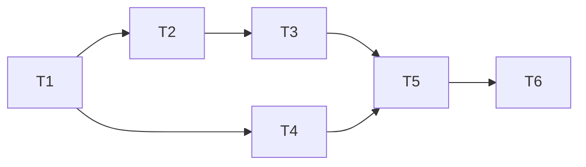

# 0068 · Complete Renaming of the Architect Role and Cleanup of Legacy Developer Artifacts

<!-- This file is maintained by the spec tool: the frontmatter contains structured source data (including the tasks DAG), and the body is a nine-section group-level rust-RFC overview. -->

## Summary

> Current mapping after 0071 cleanup: living tasks retain only the existing new request packages, Agent definitions, package-level controllers, maintenance tools, current documentation, and tests. Paths on the left side using old names, deleted dev middleware, historical research launchers, old schema templates, and v1 tests no longer map to live code; the naming migration table below preserves the original before-and-after comparison and rationale. Historical materials and original source versions are traceable from research/inventory.json and are not current execution entry points.

This group previously completed request-role renaming and cleanup of legacy Developer artifacts. On 2026-11-02, following the terminology used in the paper, the project name was standardized as AHE-Beta and the architecture role as Architect; the current implementation branch is `refactor/ahe-beta-architect`. As during the development phase, the naming is unified directly, without establishing compatibility layers for the old role names.

The role that performs **cross-proposal structural synthesis** on the request side is uniformly named **Architect**. Delete old `Designer` classes, modules, parameters, and configuration aliases; synchronize directories, scripts, environment variables, JSON fields, Agent identities, recovery keys, dashboards, and current documentation to avoid two naming systems consisting of a “new interface and old protocol.”

This is naming cleanup during development and does not change the role’s decision responsibilities, evidence boundaries, covers absorption behavior, model parameters, or delivery process. Source code, configuration, and dashboards directly use the new names; this does not upgrade the schema, add role-version handshakes, or identify old experiments. The project display name is `AHE-Beta`, the top-level Python package is `ahe_beta`, and its own environment variable uses `AHE_BETA_*`. Evidence identifiers for the fixed OpenAgents version, delivery-log fields, published image addresses, and frozen historical records retain their actual names; log fields are mapped only at the delivery boundary and do not serve as configuration aliases in this repository. Frozen history remains unchanged; developers manually handle their own experimental inputs as needed.

Also clean up directory remnants of the retired Developer: move the still-used workspace_jail, repo_guard, and harness_boundary to `guards/`; delete commit_checkpoint, completion_gate, and their dedicated tests, which no longer have runtime references; and finally remove the old `dev/` package.

## Motivation

This role reads normalized proposals, ready summaries, and experience trends from Triage and existing delivery paths, reads authorized evidence as needed, analyzes common contradictions and structural mechanisms across multiple proposals, and outputs structural proposals. Each structural artifact must cite at least two visible sources; it determines `covers`, which the driver absorbs from the corresponding open sources after successful creation. PM independently discovers product opportunities, Owner coordinates handoffs and retains independent acceptance, and OpenAgents completes implementation. This role does not take responsibility for the design and development of the entire product, so Architect is more accurate than Designer.

The current responsibility prompt already uses structural-synthesis semantics, but the technical surface still contains names such as `Designer`, `designer`, `DESIGNER_*`, and `designer_run`. The previous uncommitted proposal introduced coexistence of new and old class names, environment-variable fallback, and frontend conversion; the user explicitly requires these compatibility layers to be deleted.

The scope is not limited to one class: `backend/agent_defs/designer/`, the shared Python package, dynamic imports in scripts, frozen audit configuration, recovery operation keys, role usage attribution, static exports, CSS, and executable experimental scripts in date-based directories all directly consume these names. Changing only static imports or display text would cause scripts to fail, recovery to execute repeatedly, or the dashboard to silently omit records.

`dev/` also has a mismatch between its responsibilities and directory name: the old built-in Developer has been retired, while three still-used boundary checks and two unconnected middleware components remain in the same directory. Deleting the entire directory would remove valid checks; retaining it unchanged would mislead readers into thinking it still contains its own Developer. Therefore, move the valid mechanisms into guards and remove the unused legacy code.

## Guide-level explanation

### Current Sole Terminology

| Layer | Sole name | Meaning |
| --- | --- | --- |
| Role | `Architect` / Architect | Synthesizes relationships across proposals and forms structural improvement directions |
| Action | `architect` | Performs structural synthesis; the action name is not an alias for the old role |
| Artifact | synthesis proposal / structural proposal | Retains the existing What, Why, verifiable results, and covers contract |
| Shared request-side package | `ahe_beta.demand` | Simultaneously hosts Triage, PM, Architect, Owner, and shared evidence/runtime |
| Role implementation | `demand/architect.py`, `demand/grouped_architect.py` | `Architect`, `SynthesisOutcome`, `GroupedArchitect` |
| Agent definition | `backend/agent_defs/architect/` | The role’s YAML, prompt, and complete tool definitions |
| Shared request-model configuration | `DEMAND_LLM_*` | Still shared by multiple request-side roles; it is not falsely presented as Architect-specific |

Example development entry point:

```python
from ahe_beta.demand.architect import Architect, SynthesisOutcome
from ahe_beta.demand.grouped_architect import GroupedArchitect, group_architect_stage
# Orchestrator(..., architects=[...])
```

Local configuration uses `N_ARCHITECTS`, `ARCHITECT_GROUPING`, and `DEMAND_LLM_MODEL/API_KEY/BASE_URL/REASONING_EFFORT`. Audited experiments use `roster.architect`, `models.architect`, and `execution.architect_grouping`. Model configuration for simulated users and subject Harnesses remains unchanged.

The implementation reads only the new variables and fields; it retains no old parameters, aliases, fallbacks, or dual writes, and it does not add code to check whether old variables exist. When an optional switch is not configured, the existing default behavior continues; ordinary required-field and type checks remain in place.

Frozen experiments and snapshots are not rewritten in bulk. Developers manually prepare inputs as required by each experiment; this renaming does not introduce automatic migration, legacy-version identification, or rejection layers. Normal checkpoint recovery continues to depend on the existing structure, identity, and summary checks.

Shared boundary checks are provided uniformly by `ahe_beta.guards`; it is not a new Developer implementation. Existing valid checks continue to run, while the two obsolete submission-discipline middleware components are no longer provided.

## Reference-level explanation

### 1. Renaming Mapping and Deletion List

| Old name | New name / handling |
| --- | --- |
| `backend/ahe_beta/designer/` | Move the entire package to `backend/ahe_beta/demand/`; synchronize all Python imports, YAML bindings, and dynamic loading paths |
| `designer.py`, `grouped_designer.py` | Delete the old modules; the sole implementations are `architect.py` and `grouped_architect.py`, with no re-export shim |
| `Designer`, `DesignOutcome`, `GroupedDesigner` | `Architect`, `SynthesisOutcome`, `GroupedArchitect` |
| `group_designer_stage`, `filter_designer_round`, `designer_batch_scope` | `group_architect_stage`, `filter_architect_round`, `architect_batch_scope` |
| `designers`, `_designers`, `make_designer_status` | `architects`, `_architects`, `make_architect_status`; retain no old parameters/properties |
| `backend/agent_defs/designer/` | Move the entire directory to `backend/agent_defs/architect/`; relative tool paths must remain resolvable, and the old directory is deleted |
| `backend/tests/designer/` | `backend/tests/demand/`; rename the test module together with the role file |
| `test_designer.py`, `test_grouped_designer.py` | `test_architect.py`, `test_grouped_architect.py` |
| `N_DESIGNERS`, `DESIGNER_GROUPING` | `N_ARCHITECTS`, `ARCHITECT_GROUPING`; delete fallback and dual writes |
| `DESIGNER_LLM_*` | `DEMAND_LLM_*`, including reasoning effort; update the four agent configuration types, grouped calls, call metadata, and redaction list together |
| JSON/roster/model `designer` | `architect`; retain each role’s existing model-selection behavior |
| `designer_grouping`, `designer_run` | `architect_grouping`, `architect_run` |
| Agent ID `designer-N` / `designer-grouping` | `architect-N` / `architect-grouping` |
| Role fragments in recovery stage / job name / operation key | Standardize on `architect`, change the grouping key to `grouped-architect`; generate summaries from the new fragment and do not reuse old hashes |
| CSS `--role-designer`, `.role-designer`, `.role-dot.designer` | Synchronize to `architect` while retaining colors and layout |
| Frontend `roleLabel` old-name conversion | Delete this compatibility logic; the new API, static snapshots, and components use the same role type |
| `docs/designer-grouping.md` | `docs/architect-grouping.md`, synchronized into the chain |

The package name uses `demand` because changing the shared directory to `architect` would incorrectly place Triage/PM/Owner under a single role name. Only the concrete Agent definition directory is named `architect`.

Role renaming does not require renaming every use of the English word design: `design-only` experimental mode and generic design wording remain according to their actual meanings. `from-architect` is a source action label, and `submit_rfcs` is an existing tool protocol name; neither is a Designer compatibility entry point, so their semantics are unchanged in this change.

### 2. Startup Configuration and Credentials

- Ordinary entry points, audit entry points, offline replay, and grouped model calls directly use the new variables and fields; they do not output both new and old variables.
- `DEMAND_LLM_*` retains the existing shared model strategy, including the current behavior for model, base URL, API key, max_tokens, timeout, and reasoning effort.
- The new API key name continues through the existing call-record and exception-redaction paths; use fake credentials for verification and do not output a real key.
- Do not add old-name detection facilities such as `naming.py`, and do not upgrade the experiment configuration or recovery schema to version 2 because of the renaming.
- Retain existing required fields, data structures, configuration hash, controller SHA, recovery identity, and operation-summary checks; this does not cancel the experiment’s integrity requirements.

### 3. Recovery, Observability, and Experiment Materials

- Newly generated stages, grouping units, receipts, and operation keys use `architect`; all other recovery state-machine logic remains unchanged.
- Interrupt/resume runs of the same experiment continue to validate frozen inputs and side-effect receipts; completed structural proposals are not generated again; grouped parallel execution continues to ensure that each source is claimed by only one worker.
- Live/history/usage/invocation, role authorization, and gap-source identification use the new names; PM input isolation and referenced session scope remain unchanged.
- The API, static exports, and frontend directly read and write the new role fields; do not add `role_contract_version`, a frontend version handshake, or an old-snapshot error page.
- Existing `frontend/public/experiments/`, experiment archives, billing, freeze records, original traces/receipts, and frozen configuration remain byte-for-byte unchanged. When historical materials are needed, developers manually decide the inputs and source code to run; no general migration or rejection layer is built.

### 4. scripts and evaluation Execution Entry Points

Script names are organized according to their actual responsibilities:

| Old script | New script |
| --- | --- |
| `backend/scripts/probe_timeout_to_designer.py` | `probe_timeout_to_architect.py` |
| `backend/scripts/replay_design_from_sessions.py` | `replay_roles_from_sessions.py`, which actually orchestrates multiple request-side roles |
| `backend/scripts/replay_observation_design.py` | `replay_observation_synthesis.py` |
| `backend/scripts/replay_architect_owner_from_repo.py` | `replay_architect_owner_from_repo.py` |
| `backend/scripts/replay_pm_synth_owner_offline.py` | `replay_pm_architect_owner_offline.py` |

Other scripts retain filenames unrelated to roles, but update imports, CLI choices, definition directories, output fields, filenames, test monkeypatches, and model environments. In particular, check module names assembled through string concatenation, such as the dynamically constructed patch path after `module = "designer"`; scanning only static imports is insufficient.

Although `evaluation/harness-suite-20260920/` contains a date, its launchers, remote smoke tests, state synchronization, and dashboard remain executable code and are included in the changes. Existing dated frozen JSON files are not migrated in place; newly named examples derived from them after redaction go into `examples/experiments/architect-*.json`, with an explicit requirement to re-enter the source and asset pins for the version to be run. Current examples use the new fields, and operators prepare the actual experimental inputs themselves; the scripts do not identify old naming and guide migration. This does not assert that old experiments have been successfully reproduced with the new source code.

### 5. Cleanup of the Old dev Directory and Relocation to guards

`backend/ahe_beta/dev/` originated from the old built-in Developer. Current delivery is performed by the independent OpenAgents CLI, but not everything in the directory is retired: four types of request Agents still use file-access middleware in YAML, the main runtime entry point still installs the Harness submission hook, and the main entry point and SWE-bench entry point still validate orchestration-repository integrity. The two old submission-discipline middleware components are referenced only by their own tests, and no runtime assembly was found.

| Current file | Action | Actual responsibility / evidence |
| --- | --- | --- |
| `dev/workspace_jail.py` | Move to `guards/workspace_jail.py` | Triage, Architect, PM, and Owner YAML files load it directly; constrains tool file paths and integrates observation artifact reads authorized per call |
| `dev/repo_guard.py` | Move to `guards/repo_guard.py` | `backend/run.py` and `run_swebench_closed_loop.py` capture orchestration-repository snapshots and pass integrity-check callbacks to the Orchestrator |
| `dev/harness_boundary.py` | Move to `guards/harness_boundary.py` | `backend/run.py` creates the seed Harness and then installs a pre-commit hook that rejects secret files and `.openagents` state from being committed |
| `dev/commit_checkpoint.py` | Delete, do not migrate | Phase-based commit prompting from the old Developer; currently called only by its own unit tests |
| `dev/completion_gate.py` | Delete, do not migrate | Completion check for the old Developer's complete_task cleanup; currently called only by its own unit tests |
| `dev/__init__.py` | Delete; create `guards/__init__.py` | The new package describes boundary checks for orchestration and tool access, rather than implementation by a development role |

Directory layout after cleanup:

```text
backend/ahe_beta/
  demand/                 # Triage / PM / Architect / Owner and shared demand processing
  guards/
    __init__.py
    workspace_jail.py
    repo_guard.py
    harness_boundary.py
```

This change only moves checks that are still in use and deletes old middleware confirmed to be unwired. It does not change the strength or trigger locations of the three checks:

- The four YAML middleware bindings use `ahe_beta.guards.workspace_jail:WorkspaceJailMiddleware`. The reference to the observation provider in `workspace_jail` is changed to `ahe_beta.demand.observation_provider`; artifact declarations, session authorization scope, the allowed source and temporary-tool-output ranges, and Triage's runtime-directory restriction retain their existing behavior.
- The file-path middleware is not an operating-system sandbox; renaming a directory must not be described as adding isolation capability. Existing deny/allow semantics are not removed because OpenAgents takes over delivery.
- `repo_guard` still records the current baseline at startup and validates at existing round boundaries; the existing cache-file ignore rules are retained. Check failures still propagate and abort execution; they must not be changed to log-only behavior or post-hoc reminders.
- `harness_boundary` still installs a self-contained hook after the seed commit; generated text does not depend on importing the orchestration package, and the comment source is changed to guards. The `.env`, `.env.*`, and `.openagents` rejection rules, as well as the allow rules for `.env.example` and normal product source/docs, are retained; the corresponding checks in the existing seed smoke workflow are unchanged by the package move.
- Do not create a built-in Developer, inject CommitCheckpoint / CompletionGate into OpenAgents, or advertise deletion of unwired code as “quality assurance has been migrated to OpenAgents.” OpenAgents' existing delivery and quality gates continue to take effect independently.

Test-directory handling: `tests/dev/test_workspace_jail.py`, `test_repo_guard.py`, and `test_harness_boundary.py` are moved to `tests/guards/` and their imports are updated; `test_commit_checkpoint.py` and `test_completion_gate.py` are deleted along with their now-invalid implementations. Retain the requirements-observation test's cross-module verification of WorkspaceJail, and add `tests/guards/test_guard_wiring.py` to check seed-launcher hook installation and the loading of four categories of real YAML check middleware/tool wiring, so that only helper unit tests do not remain.

Ultimately, neither `backend/ahe_beta/dev/` nor `backend/tests/dev/` exists, and no `ahe_beta.dev` re-export, module alias, or symlink to the old directory remains. Residual scanning targets only specific old package/middleware symbols; it must not prohibit `developer`, which is a valid delivery role, or incorrectly delete project-level development-environment naming.

The active-file mappings for the current Specs are migrated to guards in sync; tasks corresponding only to the two deleted middleware components are retired through the Spec tool and their status summaries are updated, rather than continuing to mark them as effective done tasks. Other tasks that still map to active mechanisms are retained. The old implementation and old audit results remain in Git history and frozen reports; this change does not rewrite historical evidence.

### 6. One-time residual verification

At the end of implementation, use search to inspect active source code, YAML bindings, entry scripts, configuration examples, current documentation, and path names, confirming that old role implementations and old package paths for valid checks have been removed. This verification belongs to this review and does not add a permanent naming scanner, dedicated scan test, or CI step.

During verification, distinguish project identities (`ahe-beta`, `ahe_beta`, `AHE_BETA_*`), existing Gitea account identities, and immutable history; do not perform a mechanical repository-wide replacement. The old-to-new mapping in this specification is for review and does not represent a retained old entry point.

The current-state descriptions, file paths, and references for active-numbered Specs are updated together; the role-word slug is changed to `architect` while numeric identifiers remain stable; frozen audit records are not rewritten. OVERVIEW / ARCHITECTURE are rebuilt by the CLI, and README remains consistent in Chinese and English.

### 7. Task DAG and file allocation

The precise source/target file lists are in frontmatter; during migration, the source and target paths are assigned to the same Task. Tasks do not overlap in files. Do not change old imports in parallel before the module move is complete; execute tasks according to the dependencies below.

| Task | Scope | Acceptance focus |
| --- | --- | --- |
| T1 | Python requirements package, guards, import consumers, backend role data, and recovery | Delete old Designer/dev packages and invalid middleware; retain valid checks, authorization, and recovery behavior |
| T2 | agent_defs, main launcher, model/profile, and configuration examples | Role and guards paths load; hook/integrity wiring is retained; configuration is not duplicated |
| T3 | replay/probe/e2e/export and evaluation execution scripts | Static and dynamic paths, CLI, outputs, and new examples are aligned |
| T4 | Frontend API, types, floor, and CSS | New roles are visible; no version handshake or label-conversion layer |
| T5 | Current documentation and Spec mappings, bilingual entry points, and derived views | Guards responsibilities are clear; invalid tasks are retired; current paths are valid and history is not rewritten |
| T6 | Existing behavior tests, one-time search verification, and offline e2e | No additional naming gate; behavior and wiring of valid checks are both verified |



### 8. Executable acceptance

The offline end-to-end script is `backend/scripts/e2e-architect-naming.sh`. It does not call paid models, connect to real Gitea, or start delivery containers; it uses a fake model and FakeTracker to verify: new configuration → agent-definition loading → structural synthesis across two proposals → covers handling → Owner handoff → interruption/recovery → new observation and snapshot fields.

Acceptance includes:

- The old Designer/dev modules, old agent_defs directory, and tests/dev directory do not exist; all imports for the new package, all YAML tool bindings, and dynamic-loading tests for all retained scripts pass.
- New configuration, the shared model environment, and the normal recovery flow succeed; no dedicated naming gate is added to identify old fields, old environment variables, or old checkpoints.
- Normal synthesis and grouped-synthesis outputs, source absorption, and renaming are unchanged from before; evidence authorization, PM isolation, and call-token/time attribution retain their existing constraints.
- The current backend, static export, and frontend types use `architect` / `architect_run`; no role-version field or old-snapshot rejection UI is added.
- The four role YAML files actually load guards middleware; allowed paths can be read, out-of-scope paths are rejected, and observation-artifact authorization is not expanded. The requirements workflow continues to pass regression coverage that accesses observation files through the actual middleware.
- After a generated hook is installed in a temporary Harness repository, normal product files/docs and `.env.example` are accepted, while commits containing `.env` / `.env.local` / `.openagents` are rejected. The hook runs in an independent repository and does not require ahe-beta to be installed.
- The integrity check passes when the temporary orchestration repository is unchanged; changes to non-ignored files or a changed HEAD raise an error, and the Orchestrator propagates the failure instead of continuing the round. The binding locations for the main entry point and SWE-bench entry point remain unchanged.
- Full pytest, frontend tests and build, Ruff lint/format, and Spec validate/render/graph pass; derived views have no drift.
- One-time search finds no unexplained active references to old names; frozen-history verification and unchanged content remain intact, and historical materials are not rewritten for tests.
- The final git diff contains no compatibility exports, old parameters, environment fallbacks, duplicate-write keys, or frontend conversion for old roles; user review and residual-name auditing are completed before commit.

Verification results (2026-09-29): full Python regression: 1021 passed, 2 skipped (optional tau2 not installed); frontend: 9 tests passed, production build passed; Ruff, Spec validate, and the configuration-contract checks for the fixed OpenAgents commit ee87df3 passed. Byte-for-byte comparison passed for 50 baseline checksums and 74 frozen files. One-time search confirmed that runtime code contains no naming-rejection module or role-version handshake. No real models or delivery services were called. The final name audit confirmed that the only independent uses of designer in the current source refer to existing Gitea accounts (8 occurrences); all other occurrences remain in project identities, frozen history, and the before/after rename comparison in this Spec. There is no old role entry point or compatibility layer. The user has authorized committing this change.

Manual review: inspect directories, imports, scripts, model environments, and UI names, then run the offline workflow script. Confirm that the four requirements Agents actually load guards and that normal recovery does not repeat side effects; do not accept naming migration or rejection of old data as functionality.

## Drawbacks

This is a cross-directory cleanup during development, with a larger change scope than a display-name adjustment. Local `.env`, scripts, and experiment inputs are updated in sync by developers; there are no released users yet, so no upgrade protocol is maintained for this rename.

Moving shared directories causes many import and Spec-file mapping changes; pure renames and behavioral changes need to be reviewed separately. To reduce risk, responsibilities and algorithms remain unchanged, and executable residual scans and recovery-side-effect tests are used to demonstrate the boundaries rather than relying only on search-and-replace.

Cleaning up the dev package also requires validating real assembly to prevent files from moving while YAML, hooks, or integrity callbacks remain unupdated. The middleware is deleted because it currently has no runtime callers; this does not promise that OpenAgents provides exactly the same old commit discipline.

## Rationale and alternatives

- **Change only display names**: Lower effort, but agent_defs, scripts, fields, and recovery records would continue using two sets of terminology and would not satisfy this requirement; rejected.
- **Retain a Designer shim, environment fallback, and read-time conversion**: Could preserve historical compatibility, but would introduce long-term dual naming; this is precisely the approach the user asked to remove, so it is rejected.
- **Perform a global replacement without distinguishing identifier uses**: This would break third-party protocols, published images, and frozen evidence. Current code, configuration, and documentation use the new names consistently; external fixed identifiers and historical originals are retained according to their actual uses.
- **Rename the shared package directly to architect**: This would place Triage/PM/Owner under a single role; the neutral `demand` package is used instead, with specific roles and agent_defs named separately.
- **Add an independent model-environment prefix for each requirements role**: This would expand model routing and experiment-control scope; this change uses `DEMAND_LLM_*` to express the existing shared mechanism without changing the sharing strategy.
- **Build a naming-migration or old-input-rejection layer**: There are currently no actual users, so this would add unnecessary runtime, test, and documentation maintenance costs; update the current implementation and development configuration directly without adopting a version handshake or dedicated gate.
- **Delete the entire dev package directly**: This would sever the requirements Agents' file-scope constraints, orchestration-repository integrity checks, and Harness commit hooks; rejected.
- **Change only dev to guards and move all five modules there**: This would disguise the two middleware components with no runtime references as active mechanisms; rejected. Only the three valid modules are migrated.
- **Port the old commit middleware into OpenAgents**: This concerns another repository's quality gates and execution protocol and is outside the target of this naming/residual cleanup; not implemented.

## Prior art

The existing implementation already labels structural-proposal sources as `from-architect` and limits cross-proposal synthesis responsibilities in the prompt and tool contract, showing that responsibility naming had already converged toward synthesis. The current audit entry point freezes the controller SHA, configuration, and plan, while the recovery layer validates the schema and operating identity; this proposal retains these existing mechanisms and does not add a naming-version boundary.

## Unresolved questions

None. Per the user's latest requirements, retain the demand/guards and new configuration naming, and remove the migration, version handshake, rejection, and permanent scanning facilities added for this rename.

## Future possibilities

Independent model configuration for requirements roles or renaming the project as a whole can be discussed separately and is not implicitly triggered by this specification. If there are released users and upgrade requirements in the future, design a compatibility strategy based on the actual needs at that time.
