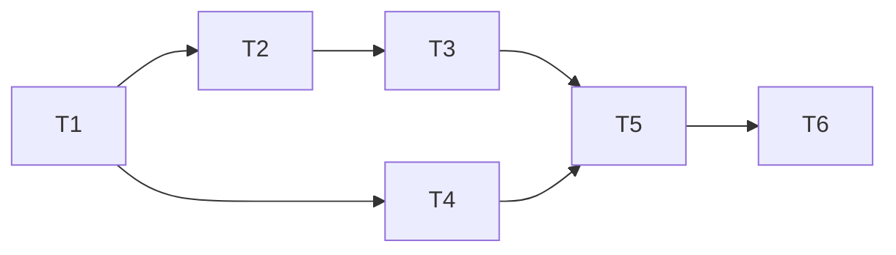

# 0068 · Synthesizer 角色彻底改名与旧 Developer 遗留清理

<!-- 本文件由 spec 工具维护：frontmatter 为结构化源数据（含 tasks DAG），正文为组级 rust-RFC 9 段总览。 -->

## Summary

> 0071 清理后的当前映射：living tasks 仅保留已经存在的新需求包、Agent 定义、包内 controller、维护工具、当前文档与测试。旧名称左侧路径、已删除 dev 中间件、历史研究 launcher、旧 schema 模板与 v1 测试不再映射为活代码；下文命名迁移表保留原前后对照与动机。历史资料与原源码版本从 research/inventory.json 追溯，不作为当前执行入口。

用户于 2026-09-29 审阅通过，并补充明确：项目仍在开发阶段、尚无实际用户，直接统一新名称即可，不建设版本迁移、兼容或旧输入拒绝设施。实施分支 `refactor/synthesizer-clean-rename`。用户复查通过，授权完成最终名称检查后提交 commit。

将需求面执行**跨提案结构综合**的角色统一命名为 **Synthesizer（结构综合）**。删除旧 `Designer` 类、模块、参数及配置别名；同步目录、脚本、环境变量、JSON 字段、Agent 身份、恢复键、看板和当前文档，避免出现“新界面、旧协议”的两套命名。

本次是开发阶段的命名整理，不改变角色的决策职责、证据边界、covers 吸收行为、模型参数和交付流程。源码、配置和看板直接使用新名称；不为此升级 schema、增加角色版本握手或识别旧实验。项目 `auto-designer` 本身不改名。冻结历史保持原样，开发者按需手动处理自己的实验输入。

同时清理退役 Developer 的目录遗留：仍使用的 workspace_jail、repo_guard、harness_boundary 迁至 `guards/`，删除已无运行时引用的 commit_checkpoint、completion_gate 及其专属测试，最终移除旧 `dev/` 包。

## Motivation

当前这个角色读取 Triage 和既有交付路线的规范化 proposal、ready 摘要与体验趋势，按需读取已授权证据，分析多条提案的共同矛盾与结构机制，输出结构 proposal。每条结构产物至少引用两个可见来源；它决定 `covers`，由驱动器在创建成功后吸收相应开放来源。PM 独立发现产品机会，Owner 协调交接并保留独立验收，OpenAgents 完成实现。该角色不承担整个产品的设计与开发职责，故 Synthesizer 比 Designer 更准确。

目前职责提示词已经使用结构综合语义，技术表面仍散落 `Designer`、`designer`、`DESIGNER_*`、`designer_run` 等名称。上一轮未提交方案又引入新旧类名并存、环境变量回退和前端转换，用户明确要求删除这些兼容层。

影响范围不局限一个类：`backend/agent_defs/designer/`、共享 Python 包、脚本动态 import、审计配置冻结、恢复操作键、角色用量归属、静态导出、CSS 和日期目录中的可执行实验脚本均直接消费这些名称。只改静态 import 或显示文字会导致脚本失效、恢复重复执行或看板悄悄漏掉记录。

`dev/` 也存在职责与目录名不符的问题：旧内置 Developer 已退役，三个仍在使用的边界检查与两个未接线中间件却放在同一目录。删除整个目录会误删有效检查；原样保留又会误导读者以为仍有自有 Developer，因此将有效机制归入 guards，并移除无调用的遗留代码。

## Guide-level explanation

### 当前唯一术语

| 层次 | 唯一名称 | 含义 |
| --- | --- | --- |
| 角色 | `Synthesizer` / 结构综合 | 综合跨提案关系并形成结构改进方向 |
| 动作 | `synthesize` | 执行结构综合；动作名不是旧角色别名 |
| 产物 | synthesis proposal / 结构提案 | 保持现有 What、Why、可验证结果及 covers 契约 |
| 需求面共享包 | `auto_designer.demand` | 同时承载 Triage、PM、Synthesizer、Owner 和共享取证/运行时 |
| 角色实现 | `demand/synthesizer.py`、`demand/grouped_synthesizer.py` | `Synthesizer`、`SynthesisOutcome`、`GroupedSynthesizer` |
| Agent 定义 | `backend/agent_defs/synthesizer/` | 该角色的 YAML、提示词和全部工具定义 |
| 共享需求模型配置 | `DEMAND_LLM_*` | 仍由需求侧多个角色共享，不假称 Synthesizer 专属模型 |

开发入口示例：

```python
from auto_designer.demand.synthesizer import Synthesizer, SynthesisOutcome
from auto_designer.demand.grouped_synthesizer import GroupedSynthesizer, group_synthesizer_stage
# Orchestrator(..., synthesizers=[...])
```

本地配置使用 `N_SYNTHESIZERS`、`SYNTHESIZER_GROUPING` 和 `DEMAND_LLM_MODEL/API_KEY/BASE_URL/REASONING_EFFORT`。审计实验中使用 `roster.synthesizer`、`models.synthesizer`、`execution.synthesizer_grouping`。模拟用户和被试 Harness 的模型配置不变。

实现只读取新变量和新字段，不保留旧参数、别名、回退或双写，也不增加检查旧变量是否存在的代码。未配置可选开关时继续使用原有默认行为；普通必填字段和类型检查保留。

冻结实验和快照不批量改写。开发者按实验需要手动准备输入，不由本次重命名引入自动迁移、旧版识别或拒绝层；正常断点恢复继续依赖已有结构、身份与摘要检查。

共享边界检查统一由 `auto_designer.guards` 提供；它不是新的 Developer 实现。现有有效检查继续执行，两份已失效的提交纪律中间件不再提供。

## Reference-level explanation

### 1. 重命名映射与删除清单

| 旧名称 | 新名称 / 处理 |
| --- | --- |
| `backend/auto_designer/designer/` | 整包迁至 `backend/auto_designer/demand/`，所有 Python import、YAML binding、动态加载路径同步 |
| `designer.py`、`grouped_designer.py` | 删除旧模块；唯一实现为 `synthesizer.py`、`grouped_synthesizer.py`，不留重导出 shim |
| `Designer`、`DesignOutcome`、`GroupedDesigner` | `Synthesizer`、`SynthesisOutcome`、`GroupedSynthesizer` |
| `group_designer_stage`、`filter_designer_round`、`designer_batch_scope` | `group_synthesizer_stage`、`filter_synthesizer_round`、`synthesizer_batch_scope` |
| `designers`、`_designers`、`make_designer_status` | `synthesizers`、`_synthesizers`、`make_synthesizer_status`；不保留旧参数/property |
| `backend/agent_defs/designer/` | 整目录迁至 `backend/agent_defs/synthesizer/`；相对工具路径仍可解析，旧目录删除 |
| `backend/tests/designer/` | `backend/tests/demand/`；测试模块随角色文件改名 |
| `test_designer.py`、`test_grouped_designer.py` | `test_synthesizer.py`、`test_grouped_synthesizer.py` |
| `N_DESIGNERS`、`DESIGNER_GROUPING` | `N_SYNTHESIZERS`、`SYNTHESIZER_GROUPING`；删除回退与双写 |
| `DESIGNER_LLM_*` | `DEMAND_LLM_*`，包含 reasoning effort；四类 agent 配置、分组调用、调用元数据与脱敏列表一起更新 |
| JSON/roster/model 的 `designer` | `synthesizer`；保留各角色原有模型选择行为 |
| `designer_grouping`、`designer_run` | `synthesizer_grouping`、`synthesizer_run` |
| Agent ID `designer-N` / `designer-grouping` | `synthesizer-N` / `synthesizer-grouping` |
| recovery stage / job name / operation key 的角色片段 | 统一 `synthesizer`，分组键改 `grouped-synthesizer`；按新片段生成摘要，不复用旧哈希 |
| CSS `--role-designer`、`.role-designer`、`.role-dot.designer` | 同步为 `synthesizer`，保留配色与布局 |
| 前端 `roleLabel` 旧名称转换 | 删除该兼容逻辑；新 API、静态快照与组件使用同一角色类型 |
| `docs/designer-grouping.md` | `docs/synthesizer-grouping.md`，同步入链 |

包名使用 `demand`，因为把共享目录改成 `synthesizer` 会把 Triage/PM/Owner 错误放到某一角色名下。只有具体 Agent 定义目录叫 `synthesizer`。

角色改名不要求重命名所有英语 design：`design-only` 实验模式、generic design 文案按实际含义保留。`from-synthesize` 是来源动作标签，`submit_rfcs` 是现有工具协议名，都不是 Designer 兼容入口，本次不改变其语义。

### 2. 启动配置与凭证

- 普通入口、审计入口、offline replay 和分组模型调用直接使用新变量与字段；不同时输出新旧变量。
- `DEMAND_LLM_*` 保持原有共享模型策略，已有 model、base URL、API key、max_tokens、timeout 和 reasoning effort 行为不变。
- 新 API key 名继续经过已有调用记录和异常脱敏路径；用假凭证验证，不输出真实 key。
- 不新增 `naming.py` 之类的旧名称检测设施，也不因改名把实验配置或 recovery schema 升至版本 2。
- 保留已有必填字段、数据结构、配置 hash、controller SHA、恢复身份和操作摘要检查；不是取消实验本身的完整性要求。

### 3. 恢复、观测与实验材料

- 新生成的阶段、grouping unit、receipt、operation key 使用 `synthesizer`，其余恢复状态机逻辑保持不变。
- 同次实验的中断/续跑继续校验 frozen input 与副作用回执，已完成结构提案不重复生成；分组并行继续保证一个来源只由一个 worker 领取。
- live/history/usage/invocation、角色授权与 gap 来源识别使用新名称；PM 输入隔离和引用 session 范围不变。
- API、静态导出和前端直接读写新角色字段，不增加 `role_contract_version`、前端版本握手或旧快照错误页面。
- 已有 `frontend/public/experiments/`、实验归档、账单、freeze-record、原始 trace/receipt 和冻结配置保持字节不变。需要使用历史材料时由开发者手动决定输入和运行源码，不建设通用迁移或拒绝层。

### 4. scripts 与 evaluation 执行入口

脚本名称按真实职责整理：

| 旧脚本 | 新脚本 |
| --- | --- |
| `backend/scripts/probe_timeout_to_designer.py` | `probe_timeout_to_synthesizer.py` |
| `backend/scripts/replay_design_from_sessions.py` | `replay_roles_from_sessions.py`，它实际编排多个需求角色 |
| `backend/scripts/replay_observation_design.py` | `replay_observation_synthesis.py` |
| `backend/scripts/replay_synthesize_owner_from_repo.py` | `replay_synthesizer_owner_from_repo.py` |
| `backend/scripts/replay_pm_synth_owner_offline.py` | `replay_pm_synthesizer_owner_offline.py` |

其他脚本保留与角色无关的文件名，但修改 import、CLI choices、定义目录、输出字段、文件名、测试 monkeypatch 和模型环境。特别检查字符串拼接的模块名，例如 `module = "designer"` 后动态构造 patch 路径，不能只扫描静态 import。

`evaluation/harness-suite-20260920/` 虽有日期，里面的 launchers、远程 smoke、状态同步和 dashboard 仍为可执行代码，纳入修改。现有带日期的冻结 JSON 不原地迁移；从它们派生、经去敏的新命名示例放到 `examples/experiments/synthesizer-*.json`，明确重新填入待运行版本的源码和资产 pin。当前示例使用新字段，操作者自行准备实际实验输入；脚本不承担识别旧命名并引导迁移的职责。这不声明旧实验已经用新源码复现成功。

### 5. 旧 dev 目录清理与 guards 归位

`backend/auto_designer/dev/` 源于旧的内置 Developer。当前交付已经由独立 OpenAgents CLI 执行，但目录内并非全部退役：四类需求 Agent 仍在 YAML 中使用文件访问中间件，主运行入口仍安装 Harness 提交钩子，主入口和 SWE-bench 入口仍校验编排仓完整性。两份旧提交纪律中间件则只被自身测试引用，未发现运行时装配。

| 当前文件 | 处理 | 实际职责 / 证据 |
| --- | --- | --- |
| `dev/workspace_jail.py` | 移至 `guards/workspace_jail.py` | Triage、Synthesizer、PM、Owner YAML 直接加载，约束工具文件路径并接入按调用授权的观测制品读取 |
| `dev/repo_guard.py` | 移至 `guards/repo_guard.py` | `backend/run.py` 与 `run_swebench_closed_loop.py` 拍摄编排仓快照，并向 Orchestrator 传入完整性校验回调 |
| `dev/harness_boundary.py` | 移至 `guards/harness_boundary.py` | `backend/run.py` 创建 seed Harness 后安装 pre-commit 钩子，拒绝密钥文件与 `.openagents` 状态入库 |
| `dev/commit_checkpoint.py` | 删除，不迁移 | 旧 Developer 的阶段性提交催促，当前仅自身单测调用 |
| `dev/completion_gate.py` | 删除，不迁移 | 旧 Developer 的 complete_task 收尾检查，当前仅自身单测调用 |
| `dev/__init__.py` | 删除；新建 `guards/__init__.py` | 新包描述为编排与工具访问的边界检查，不再描述为开发角色实现 |

清理后目录形态：

```text
backend/auto_designer/
  demand/                 # Triage / PM / Synthesizer / Owner 及共享需求处理
  guards/
    __init__.py
    workspace_jail.py
    repo_guard.py
    harness_boundary.py
```

本次仅移动仍在使用的检查、删除确定未接线的旧中间件，不改变三项检查的强度与触发位置：

- 四类 YAML middleware binding 使用 `auto_designer.guards.workspace_jail:WorkspaceJailMiddleware`。`workspace_jail` 内对 observation provider 的引用改为 `auto_designer.demand.observation_provider`；声明制品、session 授权范围、允许读取的源码及临时工具输出范围、Triage 的运行态目录限制保持原行为。
- 文件路径中间件不是操作系统沙箱；不把目录重命名描述成新增隔离能力。现有拒绝/放行语义不因 OpenAgents 接管交付而删掉。
- `repo_guard` 仍在启动时记录当前基线、在已有轮次边界校验；保留原有缓存文件忽略规则。检查失败仍传播并中止，不能改为只打日志或事后提醒。
- `harness_boundary` 仍在 seed 提交之后安装自包含钩子；生成文本不依赖编排包 import，注释来源改为 guards。保留 `.env`、`.env.*` 与 `.openagents` 拒绝规则，以及 `.env.example` 和正常产品源码/文档的允许规则；现有 seed smoke 工作流的对应检查不因包移动而改变。
- 不新建内置 Developer，不把 CommitCheckpoint / CompletionGate 注入 OpenAgents，不把删除未接线代码宣传为“已将其质量保证迁给 OpenAgents”。OpenAgents 原有交付与质量门继续独立生效。

测试目录处理：`tests/dev/test_workspace_jail.py`、`test_repo_guard.py`、`test_harness_boundary.py` 迁到 `tests/guards/` 并更新 import；`test_commit_checkpoint.py`、`test_completion_gate.py` 随其失效实现删除。保留需求观测测试对 WorkspaceJail 的跨模块验证，新加 `tests/guards/test_guard_wiring.py` 检查 seed launcher 钩子安装并加载四类真实 YAML 检查 middleware/tool 接线，避免只剩 helper 单测。

最终 `backend/auto_designer/dev/` 与 `backend/tests/dev/` 都不存在，不留 `auto_designer.dev` re-export、模块别名或旧目录软链接。残留扫描只针对具体旧包/中间件符号，不禁止 `developer` 这个有效交付角色，也不误删项目级开发环境命名。

当前 Spec 的活跃文件映射同步迁移到 guards；只对应两份已删中间件的任务通过 Spec 工具退役并更新现状摘要，不继续标注为生效的 done 任务。其它仍映射活跃机制的任务保留。旧实现和旧审计结果由 Git 历史与冻结报告留存，本次不重写历史证据。

### 6. 一次性残留核对

实施结束时用搜索检查活动源码、YAML binding、入口脚本、配置示例、当前说明和路径名，确认旧角色实现和有效检查的旧包路径已清理。此核对属于本次审查，不新增永久命名扫描器、专用扫描测试或 CI 步骤。

核对时区分项目身份（`auto-designer`、`auto_designer`、`AUTO_DESIGNER_*`）、既有 Gitea 账号身份和不可变历史，不进行全仓机械替换。本规格的旧新映射用于审查，不代表保留旧入口。

活跃编号 Spec 的现状叙述、文件路径与引用同步更新，角色词 slug 改为 `synthesizer`，数字编号稳定；冻结审计记录不改写。OVERVIEW / ARCHITECTURE 由 CLI 重建，README 保持中英文一致。

### 7. Task DAG 与文件分配

精确源/目标文件列表在 frontmatter，迁移时源路径与目标路径均归同一 Task；Task 之间无文件重叠。模块移动完成前不并行改其旧 import，任务按下面依赖执行。

| Task | 范围 | 验收重点 |
| --- | --- | --- |
| T1 | Python 需求包、guards、导入消费者、后端角色数据与恢复 | 旧 Designer/dev 包及失效中间件删除；有效检查、授权与恢复行为保留 |
| T2 | agent_defs、主 launcher、模型/profile 与配置示例 | 角色与 guards 路径可加载；hook/完整性接线保留；配置不双写 |
| T3 | replay/probe/e2e/export 与 evaluation 执行脚本 | 静态和动态路径、CLI、输出、新示例全部对齐 |
| T4 | 前端 API、类型、楼层与 CSS | 新角色可见；无版本握手或 label 转换层 |
| T5 | 当前文档与 Spec 映射、双语入口、派生视图 | guards 职责明确；失效任务退役；当前路径有效，历史不改写 |
| T6 | 现有行为测试、一次性搜索复核与离线 e2e | 无额外命名门禁；有效检查的行为和接线均验证 |



### 8. 可执行验收

离线端到端脚本为 `backend/scripts/e2e-synthesizer-naming.sh`。它不调用付费模型、不连接真实 Gitea、不启动交付容器；使用假模型与 FakeTracker 验证：新版配置 → agent 定义加载 → 跨两提案结构综合 → covers 处理 → Owner 交接 → 中断/恢复 → 观测与快照新字段。

验收包括：

- 旧 Designer/dev 模块、旧 agent_defs 目录和 tests/dev 目录不存在；新包所有 import、全部 YAML 工具 binding、所有保留脚本的动态加载测试通过。
- 新配置、共享模型环境和正常恢复流程成功；不增加专门识别旧字段、旧环境变量或旧 checkpoint 的命名门禁。
- 正常 synthesis 与分组 synthesis 输出及来源吸收与重命名前一致；证据授权、PM 隔离、调用 token/耗时归属保持原约束。
- 当前后端、静态导出和前端类型使用 `synthesizer` / `synthesizer_run`，不增加角色版本字段或旧快照拒绝界面。
- 四角色 YAML 实际加载 guards 中间件；允许路径能读取、越界路径被拒，观测制品授权不扩大。保留需求流程通过实际中间件访问观测文件的回归。
- 临时 Harness 仓安装生成 hook 后，提交正常产品文件/文档与 `.env.example` 成功，提交 `.env` / `.env.local` / `.openagents` 被拒。hook 在独立仓执行，不需要安装 auto-designer。
- 临时编排仓未变化时完整性检查通过；非忽略文件变化或 HEAD 改变时抛错，Orchestrator 传播失败而非继续该轮。主入口和 SWE-bench 入口的绑定位置保持。
- 全量 pytest、前端测试与构建、Ruff lint/format、Spec validate/render/graph 通过，派生视图无漂移。
- 一次性搜索没有未解释的活动旧引用；冻结历史校验和未变化，不为测试改写历史材料。
- 最终 git diff 中不含兼容导出、旧参数、环境回退、双写键或前端旧角色转换；提交前完成用户复查与名称残留审计。

验证结果（2026-09-29）：完整 Python 回归 1021 passed、2 skipped（未安装可选 tau2）；前端 9 tests passed、生产构建通过；Ruff、Spec validate、OpenAgents 固定提交 ee87df3 的配置契约检查通过。50 份基线校验和及 74 份冻结文件逐字节比较通过。一次性搜索确认运行代码无命名拒绝模块或角色版本握手。未调用真实模型或交付服务。最终名称审计确认：当前源码中独立的 designer 仅用于既有 Gitea 账号（8 处），其余保留于项目身份、冻结历史及本 Spec 的改名前后对照；没有旧角色入口或兼容层。用户已授权提交本次改动。

人工复核：检查目录、import、脚本、模型环境与 UI 名称，再执行离线流程脚本。确认四类需求 Agent 实际加载 guards、正常恢复未重复副作用；不验收命名迁移或旧数据拒绝功能。

## Drawbacks

这是一次开发期的跨目录整理，改动范围大于显示名称调整。本地 `.env`、脚本和实验输入由开发者同步更新；尚无已发布用户，因此不为本次改名维护升级协议。

共享目录移动会带来大量 import 和 Spec 文件映射修改，纯 rename 与行为变化需要分开审查。为降低风险，职责和算法保持不变，使用可执行的残留扫描与恢复副作用测试证明边界，而非仅靠查找替换。

清理 dev 包还需要验证真实装配，防止文件已移动但 YAML、hook 或完整性回调漏改。删除中间件的依据是当前没有运行时调用；不据此承诺 OpenAgents 提供完全相同的旧提交纪律。

## Rationale and alternatives

- **只改显示名**：工作量小，但 agent_defs、脚本、字段和恢复记录继续两套术语，无法满足本次要求，放弃。
- **保留 Designer shim、环境回退和读时转换**：可兼容历史，但引入长期双命名；这正是用户要求删除的方案，放弃。
- **把所有 designer 字符串替换成 synthesizer**：会误改项目名、Python 顶层包、Git URL、Gitea 用户以及冻结证据，不采用。
- **共享包直接改为 synthesizer**：会把 Triage/PM/Owner 归入单个角色之下；采用中性的 `demand` 包，具体角色与 agent_defs 单独命名。
- **为每个需求角色新增独立模型环境前缀**：会扩大模型路由与实验控制范围；本次用 `DEMAND_LLM_*` 表达既有共享机制，不改变共享策略。
- **建设命名迁移或旧输入拒绝层**：当前没有实际用户，会增加不必要的运行时、测试与文档维护成本；直接更新当前实现和开发配置，不采用版本握手或专门门禁。
- **直接删除 dev 整包**：会切断需求 Agent 的文件范围约束、编排仓完整性校验及 Harness 提交钩子，放弃。
- **只把 dev 改成 guards、把五个模块全搬过去**：会把无运行时引用的两份旧中间件伪装为现役机制，放弃；只迁移三个有效模块。
- **将旧提交中间件移植进 OpenAgents**：涉及另一个仓库的质量门和执行协议，不是此次命名/遗留清理的目标，不实施。

## Prior art

现有实现已将结构提案来源标为 `from-synthesize`，并在 prompt 与工具契约中限定跨提案综合职责，说明职责命名本来已向 synthesis 收敛。当前审计入口冻结 controller SHA、配置与计划，恢复层校验 schema 和操作身份；本方案保留这些现有机制，不额外建立命名版本边界。

## Unresolved questions

无。按用户最新要求，保留 demand/guards 和新配置命名，移除为此次改名增加的迁移、版本握手、拒绝和永久扫描设施。

## Future possibilities

需求角色独立模型配置或项目整体改名可另行讨论，不由本规格隐式触发。未来确有已发布用户和升级需求时，再按实际需求设计兼容策略。
