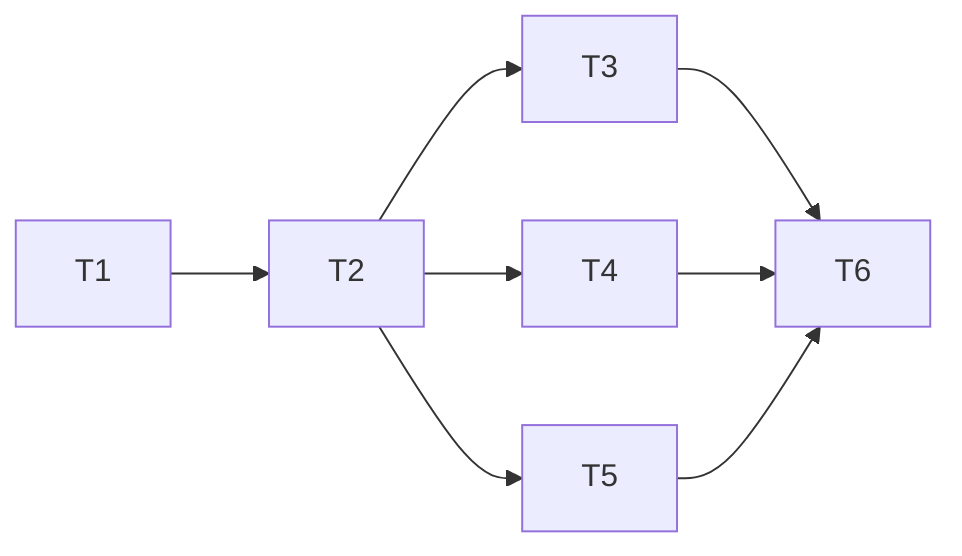

# 0069 · 本地 Docker 与 E2B 可选实验启动

<!-- 本文件由 spec 工具维护：frontmatter 为结构化源数据（含 tasks DAG），正文为组级 rust-RFC 9 段总览。 -->

## Summary

统一开源实验入口为 `backend/scripts/experiment.py`，以一份版本化实验定义描述任务、persona、Harness 初始版本、角色、模型和轮数，提供 `local`（本机 Docker + 自动启动 localhost Gitea）与 `e2b`（E2B + 用户自己的 Gitea.com）两种执行后端。共用材料解析、冻结、预检、闭环控制与运行管理，后端仅承担资源和执行环境差异。交付两份可执行 N=1 示例、中英 QuickStart、从干净 checkout 完成五轮的教程和可核查的实跑记录。

本文已经用户批准，当前进入实施与验证；任务状态记录实现进度。现有私人试跑 wrapper 不作为开源入口，也不把启动成功视为五轮完成。

## Motivation

当前入口分别解决了不同阶段的问题，没有形成一条新用户路径：

- `experiment.py` 的 create/plan/preflight/start 偏向基础设施管理，start 启动 Compose 并记录 RUNNING，却不等价于启动实验 controller；stop 也未统一管理 controller 进程。
- `run_auditable_experiment.py` 能组织本地完整闭环，但要求用户准备多份已经冻结的材料、镜像及版本；它与基础设施入口还各自构造 context。
- 历史 `run_n1_e2b.py` 依赖固定任务、persona、外部 Harness 归档和本机路径。当前 E2B JSON 部分路径、模型设置和资源声明没有被执行器读取，填了配置不代表生效。
- 本地和 E2B 的配置版本、Owner 计数、模型映射、恢复与产物目录语义不一致。真实试跑还需要仓外 wrapper 和凭证拼装。
- README/QuickStart 没有清晰列出“用户填写什么、程序生成什么、怎样证明完整结束”，也混合了历史复现与新实验。

这次统一不改进化算法：用户使用 → 报告 → 需求处理与 Owner 准入 → OpenAgents 交付 → 本轮封口 → 下一轮；末轮仅用户试用。主观评分不作工程合并门禁，官方 benchmark 评分仍独立事后执行。

## Guide-level explanation

### 两条路径，一个操作流程

| 项目 | local | e2b |
| --- | --- | --- |
| 用户本机 | Linux 或 WSL2、Python/uv、Docker Engine/Compose | Python/uv，执行完整实验不要求本机 Docker |
| 实验环境 | 本机 controller，隔离的用户工作区与 vigil 容器 | 每场实验一个 E2B sandbox，controller 与 vigil 在其中运行 |
| Gitea | 自动创建实验专用 localhost 服务、账户、token、私有仓库 | 使用用户 Gitea.com token 创建实验专用私有仓库 |
| 附加凭证 | 无需手工部署 Gitea 或填写管理员密码 | E2B_API_KEY、GITEA_TOKEN；账户由 API 解析，配置名称用于校验 |
| 模型 | User、Harness、共享需求面及 Claude Code 交付模型 | 相同模型配置结构 |
| 管理 | 同一组 run/status/logs/stop/resume/collect/destroy 命令 | 同左；显示云资源到期时间与最后观察时间 |

三个 Git 仓库要明确区分：auto-designer 是控制器；新建的 Gitea 仓库保存被进化的 Harness；pvlib 等任务仓库是 User/Harness 的试用工作区，按任务 revision 重置，不是 OpenAgents 要进化的仓库。

以下为仓库根目录执行的目标界面；实施前不能把它作为当前可用教程：

```bash
uv sync --locked --extra experiments
cp examples/experiment.env.example .env.experiment
# 填写模型凭证；E2B 路径另填 E2B_API_KEY / GITEA_TOKEN。
uv run python backend/scripts/experiment.py check --config examples/experiments/synthesizer-n1-e2b.json --offline
uv run python backend/scripts/experiment.py prepare --config examples/experiments/synthesizer-n1-e2b.json --secrets-file .env.experiment
# prepare 输出 run_id、冻结目录、资源计划及下一条可复制命令。
uv run python backend/scripts/experiment.py run <run_id> --secrets-file .env.experiment
uv run python backend/scripts/experiment.py status <run_id>
uv run python backend/scripts/experiment.py logs <run_id> --follow
uv run python backend/scripts/experiment.py stop <run_id>
uv run python backend/scripts/experiment.py resume <run_id> --secrets-file .env.experiment
uv run python backend/scripts/experiment.py collect <run_id>
uv run python backend/scripts/experiment.py destroy <run_id> --confirm <run_id>
```

本地只替换 config 为 `synthesizer-n1-local.json`，不改命令。不需要新用户选择历史 launcher。`run --config ... --secrets-file ...` 为 prepare → run 的便利组合，调用同一实现；不增加独立配置通路。`prepare` 不调用模型、不启动实验资源；下载依赖和任务材料、构建本地镜像会明确输出进度。E2B 模板准备如果需要创建云资源，归于 run 的可见 provisioning 阶段。

### 用户要准备的材料

| 材料 | 格式与要求 | N=1 示例默认来源 |
| --- | --- | --- |
| 实验定义 | JSON，`schema_version: 2`，相对路径以配置文件目录为基准 | 两份 examples/experiments/synthesizer-n1-*.json |
| 模型设置 | JSON 中填模型名及 base URL/key 的环境变量名，凭证写独立 env 文件 | examples/experiment.env.example 列全字段和用途 |
| 初始 Harness | `builtin`，或自备 archive + SHA-256；有可启动入口 | 仓内 backend/harness_template，冻结当前代码版本 |
| 试用任务 | task package JSON + instruction.md；代码来源、固定 revision、setup recipe | 仓内 pvlib__pvlib-python-1478 定义，公开代码固定 revision |
| persona | persona library JSON + persona_ids；校验实际库 schema 与 ID | 明确引用仓内已有库；不要求下载个人目录中的库 |
| 自定义 SWE 任务 | SWE 实例材料，包含任务文本、repo、base_commit 等，明确 kind=swebench | 示例可由仓内单实例定义生成所需 Parquet，无需完整数据集 |
| 云基础设施凭证 | 仅 E2B 路径，独立 env 文件 | 用户自己的账户 |

roster、pool、逐轮 plan、单实例 Parquet、Harness 归档、源代码归档、SHA-256 清单、运行 context、Gitea 地址与仓库名均由 prepare/run 生成。高级用户可提供已冻结材料，但仍进入同一校验链，不能绕过哈希和 schema 检查。`.env.experiment` 被 Git 忽略，权限检查后使用，不写入配置快照或打包产物。

`builtin` 表示此版本源码中的 seed，绝不标为历史 `cade14d`。精确重现实验旧基线时必须显式提供那份 archive 及真实校验和；没有该归档就报告缺失，不偷偷换 seed。

### 示例与完整教程

两份 N=1 配置使用同一 pvlib 任务、同一 persona、同一 Harness 来源、相同模型/角色/轮数，仅基础设施与显示名称不同。五轮为 R1–R4 用户试用后执行需求与交付，R5 仅试用最终版本。无可交付 issue 的合法轮次也可封口；`automation-failed` 等失败不能被包装为成功。

QuickStart 先给两路径选择表、依赖和凭证表、最短启动命令，再链接完整教程。教程必须覆盖：干净 clone → 锁定依赖 → 填 env → 检查配置 → 准备材料 → 资源预检 → 真正启动 controller → 查看当前轮与 Gitea → 中断/恢复 → 五轮结果与证据 → 收集与释放资源；每步给预期输出和常见失败的定位命令。说明运行耗时、费用由模型和云资源决定，公布本次验证的实际环境与用量，不编造固定完成时间。

在调用真实模型前可跑离线 contract tests；可另用两轮 canary 验证交付链。canary 不能替代这份五轮示例的完整验收。完整跑通指闭环与证据完整；不等于 pvlib 修复获得官方 SWE-bench pass。

## Reference-level explanation

### 1. 配置、模型与材料编译

新增 schema_version=2 的公开 schema；所有层级拒绝未知字段，后端不支持的字段报错，不能接受后忽略。示意结构如下，模型名由用户填入其账户可用值：

```json
{
  "schema_version": 2,
  "name": "synthesizer-n1",
  "runtime": {
    "backend": "e2b",
    "e2b": {"cpu_count": 2, "memory_mb": 2048, "timeout_seconds": 86400},
    "gitea": {"provider": "gitea.com", "repository_prefix": "synthesizer-n1"}
  },
  "harness": {"source": "builtin"},
  "workload": {
    "kind": "swebench",
    "task_package": "../tasks/pvlib-1478/task.json",
    "persona_library": "../personas/n1.json",
    "persona_ids": ["sr-15-swyx"]
  },
  "rounds": {"count": 5, "sessions_per_round": 1, "max_parallel_users": 1},
  "roles": {"triager": 1, "synthesizer": 1, "divergent": 0, "owner_mode": "mechanical", "developer": 1},
  "models": {
    "user": {"model": "YOUR_MODEL", "base_url_env": "USER_LLM_BASE_URL", "api_key_env": "USER_LLM_API_KEY"},
    "harness": {"model": "YOUR_MODEL", "base_url_env": "HARNESS_LLM_BASE_URL", "api_key_env": "HARNESS_LLM_API_KEY"},
    "demand": {"model": "YOUR_MODEL", "base_url_env": "DEMAND_LLM_BASE_URL", "api_key_env": "DEMAND_LLM_API_KEY"},
    "delivery": {"backend": "claude-code", "model": "YOUR_CLAUDE_MODEL", "base_url_env": "ANTHROPIC_BASE_URL", "api_key_env": "ANTHROPIC_AUTH_TOKEN"}
  },
  "evaluation": {"official_grading": false}
}
```

上述具体文件由实施阶段补齐，不能让示例引用不存在的材料。local runtime 使用 `backend: local`、`gitea.provider: localhost`，不允许同时包含 e2b 配置。共享模型运行时对应 `models.demand`，明确 triager/synthesizer/divergent 使用同一需求面配置，不暴露当前无法独立生效的逐角色模型假选项。机械 Owner 不占 LLM 角色槽位，不再让 owner=0 与“缺失 Owner”混淆。上下文长度、输出长度、重试、超时等只暴露能接通底层并测试生效的选项。

模型 key/base URL 仅从显式 secrets-file 或显式进程环境读取（文件覆盖同名进程变量），不隐式读取开发者 backend/.env、~/.claude 或其他试跑目录。CLI 校验缺失时只输出变量名。管理命令读取凭证来源引用或允许 `--secrets-file` 覆盖，仅加载该操作必需凭证；status/collect/destroy 不要求模型 key。

task package schema 至少包含 kind、id、instruction_file、source（Git URL + 完整 revision，或受管本地目录快照）、setup recipe 与依赖锁。任务 recipe 是受信执行输入，prepare 展示脚本来源与内容摘要。普通场景保持 seed-card 语义；SWE 保持其来源声明，不伪装 `not_in_benchmark=true`。只供运行所需的任务文本和初始代码，不能把标准答案、gold patch、hidden tests 传给优化角色。官方评分需要的完整元数据在独立评分流程使用。

prepare 原子生成 `<experiments_root>/<run_id>/`，默认 experiments_root 为仓库 `.experiments/`，支持全局 `--runs-dir` 或环境变量定位。run_id 自动生成且不可重用，name 仅显示用途。冻结 config、task/persona、Harness、计划、完整 source SHAs、依赖锁、构建 recipe 与所有材料 SHA-256；凭证只记变量名和受保护的文件位置引用。以后 run/resume 使用冻结材料，不重读用户修改后的原配置；源 checkout 改动不阻塞既有实验管理。

公开 release compatibility 清单提供 OpenAgents、NexAU 的真实不可变版本和 runtime recipe，prepare 自动缓存，普通用户不用摆放三个 sibling checkout。不将现有 `reader_release_commit: null` 当作已发布兼容版本；在联合发布前可明确标记候选 commit 并验证，新手正式教程绑定通过验收的版本。源代码归档白名单、依赖链接展开和上传 hash 校验必须覆盖曾出现的 symlink 外部源码漏上传问题。

### 2. 共用运行器与后端边界

共用 controller 适配现有 Orchestrator、RecoveryStore、SeedSource、观察/证据发布及交付等待，不另写第二份轮次调度器。对 ordinary 与 SWE runner 统一注入冻结 context，去掉已提供运行配置后仍强制读取 backend/.env 的行为。资源绑定地址、角色配置、路径映射由一个 context builder 生成。

Backend 协议提供 provision、preflight、launch/inspect/stop controller、logs、collect、destroy；返回带 ownership 的资源描述与实际能力，不暴露各自不同的“实验开始”语义。用户调用 run 后只有 controller 健康、身份匹配才进入 RUNNING，Compose up 或 sandbox 创建成功只算 PROVISIONING。

local adapter 复用实验级 Compose 隔离，记录映射端口和 host/container 两套可达 URL，初始化账户/token/repo。新建账户的真实用户名和密码保存到 run 的受保护 `secrets/local-gitea-login.env`（0600，目录 0700）；恢复保留原密码，旧账户缺记录时不伪造或自动重置。先启动所需基础设施，再启动配置完整的 vigil；启用工程 CI 才启动已注册 act_runner，跳过 CI 就不启动空 token runner。根据明确模型 URL 生成必要 egress 配置，保持容器围堵默认策略。构建/拉取镜像进入 prepare 的明确阶段，不要求用户猜测缺哪些镜像。

e2b adapter 固定 Gitea.com API 路径，先验证用户身份、建仓权限和证据上传/真实读取能力；验证仓库或 attachment 标记为 probe 并清理。复用已完成的 ZIP 传输协商及 reader capability gate，既验证发布端，也验证 sandbox 内实际运行的 OpenAgents reader。创建模板/实例后检查实际 CPU、内存、template/build ID、超时和网络能力，把实际值追加到独立 runtime manifest，绝不回写 frozen config/config_hash；resume 对照原 template/build 和资源身份检查。不能拿 JSON 中的期望值冒充资源证据。资源不符合配置即停止并清理。

E2B 不依赖嵌套 Docker，使用 sandbox 内隔离任务目录与已准备依赖运行用户任务，vigil 是 sandbox 内进程。其边界是整场实验的 sandbox，不能宣称具有与 local 每角色容器完全相同的隔离。公开配置明确此差异，放宽现有“subprocess 仅宿主调试”的规则时只适用于经验证的 E2B sandbox，不能顺带放宽宿主路径。Claude Code 使用固定版本安装配方及可用性检查，不要求用户上传个人机器二进制。

### 3. 生命周期、恢复与收集

不可变 manifest 保存输入身份，动态 runtime 分开记录 experiment_state、resource_state、collection_state；COMPLETED 不被 STOPPED/ARCHIVED 覆盖。实验状态至少有 PREPARING、PREPARED、PROVISIONING、RUNNING、STOPPING、STOPPED、COMPLETED、FAILED、LOST；不可达记 observation=UNKNOWN，不未经证据判断完成或存活。prepare 构建期间记录 PREPARING、未完成标记并持有操作锁，status 可非阻塞查看；只有准备成功才允许 run 调用 provider。status 显示轮次/阶段、controller 心跳、Gitea repo、最后一次观察、云到期时间与最后成功收集时间。

创建云资源前先持久化本地启动 journal、固定 run ownership 标签与唯一资源名称，获得 ID 后立即写盘。覆盖 provider 创建成功而 ID 尚未落盘的崩溃窗口：重启先按标签/唯一名称查询并 reconcile sandbox 与 Gitea repo，只有确认不存在才创建；查询不确定时停止并给出人工定位信息，不盲目重建。controller 独占锁与远端身份共同防止重复运行；重复 run/resume 在确认存活时 attach 或返回已运行，不启动第二个 controller。仅凭没有 exit-code 文件不能推断已停止。

本地用户会话容器同样带 run/config ownership 标签，强制中断后只回收本 run 遗留会话。stop 先请求 controller 和交付进程停止，终止所属进程组，封存 checkpoint，再停可停资源；失败时报告尚存资源及状态。E2B stop 停止进程不等于销毁 sandbox，仍可能计费。resume 重用 run_id、repo、冻结材料和 checkpoint，重新核对在途交付，不能同时有两份 vigil/controller。sandbox 到期/删除或必要本地资源丢失标记 LOST，不暗中新建并称为续跑。

collect 支持运行中 best-effort 快照和终态完整归档，两者标记不同。归档内有材料与产物清单、hash、轮次/封口 SHA、退出原因；终态一致性和校验通过才称 COMPLETE。周期收集在主机在线时执行，记录上次成功位置；主机关机且 sandbox 到期可能丢失未收集数据，教程必须诚实说明，不能把本地 detached monitor 说成云端永久保管。自动收集失败时保留仍存在资源并报告截止时间；正常完成后在验证终态归档完整后释放实验专有计算资源。

destroy 默认保留本地产物、Gitea 实验仓库与共享模板/cache；验证资源 ownership，仅删除本 run 专有资源。没有完整收集时默认拒绝破坏性删除，可显式 `--discard-uncollected --confirm <run_id>`。运行管理凭证只用于相应 provider，缺模型凭证或源工作树变脏不妨碍收集/释放。

### 4. 入口收敛与迁移

新的公开教程只出现 experiment.py。现有 create/start/preflight/archive 可以作为有限期薄别名，明确映射与提示；旧 schema 必须经显式版本适配或给出可操作迁移错误，禁止新解析器默默猜测历史字段。原本 infra-only 的 start 不再报告完整实验 RUNNING。`run_auditable_experiment.py` 退为共用链路 wrapper；历史 evaluation launchers 保留复现实验用途，帮助与文档明确非新实验入口，迁移新入口无需删除历史证据。

现有运行目录仍可由旧路径管理；新入口检测旧 manifest 明确提示适用命令，不直接覆写为 v2。历史固定身份实验不得自动转换为新 schema 并沿用原 run_id。

### 5. 文件分工与验证

任务 frontmatter 是精确文件分工的权威来源；本表说明模块责任，不扩大单任务文件所有权。

| 任务 | 责任 | 依赖 |
| --- | --- | --- |
| T1 | 公开 v2 schema、严格解析、材料编译与冻结 | 无 |
| T2 | 共用运行 context/controller 与 backend 协议、模型注入 | T1 |
| T3 | local 资源与执行适配，修复 Gitea/bootstrap/容器生命周期 | T2 |
| T4 | E2B/Gitea.com 适配、运行环境、实际能力检查 | T2 |
| T5 | 统一 CLI、manifest 状态、管理与旧入口迁移 | T2（与后端按稳定协议并行） |
| T6 | 依赖与兼容清单、示例、双语教程、两路径实跑验收 | T3、T4、T5 |



端到端入口为 `backend/scripts/e2e-spec-0069-experiment-entry.sh`：默认离线 contract/fake-provider 验证；显式 `--live --backend local|e2b` 才消耗模型/云资源。CI 默认不使用个人秘密或创建付费资源。验证要求：

1. 两份示例 schema 合法、材料引用真实；归一化后的实验语义一致；未知/未实现字段、错误哈希、缺素材、非法 persona ID 均提前失败。env 引用不被误判成明文秘密。
2. run 真实启动 controller，status 来自健康检查；普通/SWE context、所有公开模型参数和本地动态 Gitea 端口均被使用。收集与停止状态不覆盖实验结果。
3. 验证重复 run/resume、进程中断、启动中失败（包含资源已创建但 ID 未落盘）、云端不可达/到期、失败收集、dirty checkout、无模型 key 时管理；资源不得孤儿化或双 controller。
4. 从干净 checkout、没有开发者 HOME 下材料开始，在 local 与 E2B 各跑一次完整 N=1 五轮；不得编辑 Python 常量、monkeypatch、依赖私有 wrapper/内部 Gitea。凭证与网络是唯一外部账户输入，依赖/公开素材由文档明确获取。
5. 逐轮保存 session、用户反馈/需求提案、Owner 准入、交付结果与 sealed SHA；验证下一轮实际使用上一轮封口 Harness。实际存在的交付验证对应协商 profile 的附件读取：默认 local 的 gzip/direct 与 Gitea.com 的 ZIP/R2 均用实际 OpenAgents reader 验证；若该实跑无交付票，另加对应 transport canary，不制造用户投诉。
6. 测试一次工作中 stop/resume，身份不变且无重复交付。保留脱敏验证报告：代码/依赖 pins、实际资源、命令、时间、各阶段结果与产物 hash。失败如实列出，不能把模型不可用标为闭环通过。
7. 英中 README、QuickStart、配置和 N=1 教程命令一致；正式文档只能将有上述证据的步骤标成已验证。官方评测明确未执行，或单独提供独立评测报告。

## Drawbacks

统一配置和生命周期涉及多个旧入口，容易产生迁移回归，因此保留明确旧运行识别并逐步薄封装，避免改写历史 recovery identity。两后端实际隔离不同，无法靠统一 CLI 消除；需在配置与证据中记录差异。首次依赖下载/镜像构建仍有成本。五轮真实验收需要模型和云资源费用，不能用离线测试代替，也不适合每次 PR 自动执行。

## Rationale and alternatives

只写两份独立教程或新增一层 shell 分发，无法解决配置字段未生效、停止不停止 controller、恢复身份和材料不一致，故不采用。强制所有人先部署公网 Gitea 增加门槛，也违背用户明确的两条路径。把 Gitea 搬进 E2B 会新增服务寿命、持久化与公网访问设计，本次选择用户已有 Gitea.com。直接重写 controller 风险更高，采用既有闭环加共用材料编译器与两个 backend adapter。公开 schema 明确升级，优于长期背负同名不同义字段。

## Prior art

本仓现有实验 manifest/Compose 管理提供隔离基础；auditable launcher 提供材料校验与全流程；E2B N=1 试跑提供 sandbox/context 经验；已完成的两仓证据传输修改提供 Gitea.com ZIP 与 capability gate。本设计整合这些能力，不把临时 wrapper 作为新的产品框架，也不新增 OpenAgents 内部业务协议。

## Unresolved questions

当前需求没有必须由用户再次选择的产品分歧：明确支持 local+localhost 与 E2B+Gitea.com，统一入口和完整 N=1 教程。实施验收前必须核实的发布条件为：兼容版本 pin、可用 Claude Code 安装配方、两后端真实五轮结果。材料使用现有真实 persona，不自动替换合成人格。用户文档按最终开源后的获取方式编写，不加入当前内部访问状态或来源审查提示；验证报告记录实际命令和结果。

## Future possibilities

在同一 schema/adapter 接口下支持自托管公网 Gitea、高级多用户 scaling、云端持久化归档与已销毁 sandbox 的新身份重启。上述内容不纳入此次开源最短路径；已有历史实验仍可独立复现。

