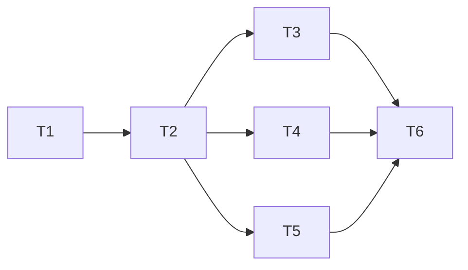

# 0069 · Selectable Local Docker and E2B Experiment Launch

<!-- This file is maintained by the spec tool: the frontmatter is structured source data (including the tasks DAG), and the body is a nine-section group-level rust-RFC overview. -->

## Summary

> Current contract after the 0071 cleanup: v1 lifecycle compatibility, the create/start/preflight/archive aliases, and the auditable wrapper have exited; only v2 check/prepare/run/status/logs/stop/resume/collect/destroy are currently supported. The prepared v2 run retains its original frozen source and hash, and its controller is not upgraded. The old-entry descriptions in Motivation below are historical background; the current task package still supports only one session per round.

Unify the open-source experiment entry point as `backend/scripts/experiment.py`. A versioned experiment definition describes the task, persona, initial Harness version, roles, models, and number of rounds, and provides `local` (local Docker + automatically started localhost Gitea) and `e2b` (E2B + the user's own Gitea.com) as two execution backends. Material parsing, freezing, preflight checks, closed-loop control, and run management are shared; the backends handle only differences in resources and execution environments. Deliver two executable N=1 examples, Chinese and English QuickStarts, a tutorial that completes five rounds from a clean checkout, and verifiable records of an actual run.

This document has been approved by the user and is now entering implementation and verification; task status records implementation progress. The existing private trial wrapper is not an open-source entry point, and successful startup is not treated as completion of five rounds.

## Motivation

The current entry points solve problems at different stages and do not form a new-user path:

- The create/plan/preflight/start commands of `experiment.py` focus on infrastructure management. start launches Compose and records RUNNING, but this is not equivalent to starting the experiment controller; stop also does not uniformly manage the controller process.
- `run_auditable_experiment.py` can orchestrate a complete local closed loop, but requires users to prepare multiple already-frozen materials, images, and versions; it also constructs context separately from the infrastructure entry point.
- Historical `run_n1_e2b.py` depends on fixed tasks, personas, external Harness archives, and local paths. In the current E2B JSON, some paths, model settings, and resource declarations are not read by the executor; filling in configuration does not mean it takes effect.
- Configuration versions, Owner counts, model mappings, recovery, and artifact-directory semantics differ between local and E2B. A real trial still requires an out-of-repository wrapper and assembled credentials.
- The README/QuickStart does not clearly state “what the user fills in, what the program generates, and how to prove complete termination,” and mixes historical reproduction with new experiments.

This unification does not change the evolution algorithm: user use → report → requirement handling and Owner admission → OpenAgents delivery → close the current round → next round; the final round is for user trial only. Subjective scores are not an engineering merge gate, and official benchmark scoring is still performed independently afterward.

## Guide-level explanation

### Two Paths, One Operating Flow

| Item | local | e2b |
| --- | --- | --- |
| User machine | Linux or WSL2, Python/uv, Docker Engine/Compose | Python/uv; local Docker is not required to run the complete experiment |
| Experiment environment | Local controller, isolated user workspace, and vigil container | One E2B sandbox per experiment, with the controller and vigil running inside it |
| Gitea | Automatically creates an experiment-specific localhost service, account, token, and private repository | Uses the user's Gitea.com token to create an experiment-specific private repository |
| Additional credentials | No manual Gitea deployment or administrator password entry required | E2B_API_KEY, GITEA_TOKEN; the account is resolved through the API, and the configured name is used for validation |
| Models | User, Harness, shared requirements surface, and Claude Code delivery model | Same model configuration structure |
| Management | Same run/status/logs/stop/resume/collect/destroy commands | Same; displays cloud-resource expiration time and last-observed time |

The three Git repositories must be clearly distinguished: ahe-beta is the controller; the newly created Gitea repository stores the Harness being evolved; task repositories such as pvlib are trial workspaces for the User/Harness, reset according to the task revision, and are not repositories that OpenAgents should evolve.

The following is the target interface executed from the repository root; it must not be treated as a currently usable tutorial before implementation:

```bash
uv sync --locked --extra experiments
cp examples/experiment.env.example .env.experiment
# Fill in model credentials; for E2B, also set E2B_API_KEY / GITEA_TOKEN.
uv run python backend/scripts/experiment.py check --config examples/experiments/u1-e2b.json --offline
uv run python backend/scripts/experiment.py prepare --config examples/experiments/u1-e2b.json --secrets-file .env.experiment
# prepare outputs run_id, the frozen directory, the resource plan, and the next copyable command.
uv run python backend/scripts/experiment.py run <run_id> --secrets-file .env.experiment
uv run python backend/scripts/experiment.py status <run_id>
uv run python backend/scripts/experiment.py logs <run_id> --follow
uv run python backend/scripts/experiment.py stop <run_id>
uv run python backend/scripts/experiment.py resume <run_id> --secrets-file .env.experiment
uv run python backend/scripts/experiment.py collect <run_id>
uv run python backend/scripts/experiment.py destroy <run_id> --confirm <run_id>
```

For local, replace only config with `u1-local.json`; do not change the command. New users do not need to choose a historical launcher. `run --config ... --secrets-file ...` is a convenience combination of prepare → run and calls the same implementation; it does not add an independent configuration path. `prepare` does not call models or start experiment resources; downloading dependencies and task materials and building local images must report progress explicitly. If preparing an E2B template requires creating cloud resources, that belongs to run's visible provisioning phase.

### Materials the User Must Prepare

| Material | Format and requirements | Default source for the N=1 examples |
| --- | --- | --- |
| Experiment definition | JSON, `schema_version: 2`; relative paths are based on the configuration file's directory | Two files, examples/experiments/u1-*.json |
| Model settings | Fill in model names and the environment-variable names for the base URL/key in the JSON; put credentials in a separate env file | examples/experiment.env.example lists all fields and their purposes |
| Initial Harness | `builtin`, or a self-provided archive + SHA-256; must have a launchable entry point | backend/harness_template in the repository, freezing the current code version |
| Trial task | Task package JSON + instruction.md; code source, fixed revision, setup recipe | The in-repository pvlib__pvlib-python-1478 definition, with a public code fixed revision |
| persona | Persona library JSON + persona_ids; validate the actual library schema and IDs | Explicitly references an existing in-repository library; does not require downloading a library from a personal directory |
| Custom SWE task | SWE instance materials, including task text, repo, base_commit, etc.; explicitly set kind=swebench | A single in-repository instance definition can generate the required Parquet without a complete dataset |
| Cloud infrastructure credentials | E2B path only, in a separate env file | The user's own account |

roster, pool, per-round plans, single-instance Parquet, Harness archives, source-code archives, SHA-256 manifests, run context, Gitea addresses, and repository names are generated by prepare/run. Advanced users may provide already-frozen materials, but they still enter the same validation chain and cannot bypass hash and schema checks. `.env.experiment` is ignored by Git, used after permission checks, and is not written to configuration snapshots or packaged artifacts.

`builtin` denotes the seed in this version of the source code and must never be labeled as historical `cade14d`. To reproduce an old experiment baseline exactly, that archive and its actual checksum must be provided explicitly; if the archive is unavailable, report it as missing and do not silently substitute another seed.

### Examples and Complete Tutorial

The two N=1 configurations use the same pvlib task, persona, Harness source, and model/role/round settings; only the infrastructure and display name differ. The five rounds are R1–R4 user trials followed by requirement execution and delivery, while R5 is trial of the final version only. A valid round with no deliverable issue may also be closed; failures such as `automation-failed` must not be wrapped as success.

The QuickStart first provides a two-path selection table, dependency and credential tables, and the shortest startup command, then links to the complete tutorial. The tutorial must cover: clean clone → lock dependencies → fill in env → check configuration → prepare materials → preflight resources → actually start the controller → view the current round and Gitea → interrupt/recover → five-round results and evidence → collect and release resources; each step must include expected output and diagnostic commands for common failures. Explain that runtime duration and cost depend on the models and cloud resources, and publish the actual environment and usage for this verification run; do not invent a fixed completion time.

Before calling real models, offline contract tests may be run; a separate two-round canary may be used to verify the delivery chain. The canary cannot replace complete acceptance of this five-round example. A complete run means that the closed loop and evidence are complete; it does not mean that the pvlib fix receives an official SWE-bench pass.

## Reference-level explanation

### 1. Configuration, Models, and Material Compilation

Add a public schema with schema_version=2; all levels reject unknown fields, and fields unsupported by a backend must produce an error rather than being accepted and ignored. The illustrative structure is as follows; the user supplies model names available through their account:

```json
{
  "schema_version": 2,
  "name": "u1",
  "runtime": {
    "backend": "e2b",
    "e2b": {"cpu_count": 2, "memory_mb": 2048, "timeout_seconds": 86400},
    "gitea": {"provider": "gitea.com", "repository_prefix": "u1"}
  },
  "harness": {"source": "builtin"},
  "workload": {
    "kind": "swebench",
    "task_package": "../tasks/pvlib-1478/task.json",
    "persona_library": "../personas/u1.json",
    "persona_ids": ["sr-15-swyx"]
  },
  "rounds": {"count": 5, "sessions_per_round": 1, "max_parallel_users": 1},
  "roles": {"triager": 1, "architect": 1, "divergent": 0, "owner_mode": "mechanical", "developer": 1},
  "models": {
    "user": {"model": "YOUR_MODEL", "base_url_env": "USER_LLM_BASE_URL", "api_key_env": "USER_LLM_API_KEY"},
    "harness": {"model": "YOUR_MODEL", "base_url_env": "HARNESS_LLM_BASE_URL", "api_key_env": "HARNESS_LLM_API_KEY"},
    "demand": {"model": "YOUR_MODEL", "base_url_env": "DEMAND_LLM_BASE_URL", "api_key_env": "DEMAND_LLM_API_KEY"},
    "delivery": {"backend": "claude-code", "model": "YOUR_CLAUDE_MODEL", "base_url_env": "ANTHROPIC_BASE_URL", "api_key_env": "ANTHROPIC_AUTH_TOKEN"}
  },
  "evaluation": {"official_grading": false}
}
```

The specific files above must be completed during implementation; examples must not reference nonexistent materials. The local runtime uses `backend: local` and `gitea.provider: localhost` and must not contain e2b configuration at the same time. The shared model runtime corresponds to `models.demand` and clearly states that triager/architect/divergent use the same requirements-surface configuration, without exposing per-role model pseudo-options that cannot currently take effect independently. The mechanical Owner does not occupy an LLM role slot, and owner=0 must no longer be conflated with a “missing Owner.” Context length, output length, retries, timeouts, and similar options may expose only settings that connect to the underlying layer and have been tested to take effect.

Model keys/base URLs are read only from an explicitly specified secrets-file or explicit process environment (the file overrides a process variable with the same name); do not implicitly read developer backend/.env, ~/.claude, or other trial directories. When CLI validation finds a missing value, it must output only the variable name. Management commands read credential-source references or allow `--secrets-file` to override them, and load only the credentials required for that operation; status/collect/destroy do not require a model key.

task package schema must include at least kind, id, instruction_file, source (Git URL + complete revision, or a managed local-directory snapshot), setup recipe, and locked dependencies. The task recipe is trusted execution input; prepare displays the script source and a content summary. Ordinary scenarios retain seed-card semantics; SWE retains its source declaration and must not masquerade as `not_in_benchmark=true`. Provide only the task text and initial code required for execution; do not pass standard answers, gold patches, or hidden tests to optimization roles. Complete metadata required for official scoring is used in a separate scoring flow.

prepare atomically generates `<experiments_root>/<run_id>/`. By default, experiments_root is `.experiments/` in the repository, with support for locating it through global `--runs-dir` or an environment variable. run_id is generated automatically and cannot be reused; name is for display only. Freeze the config, task/persona, Harness, plan, complete source SHAs, dependency locks, build recipe, and SHA-256 values for all materials; credentials record only variable names and protected file-location references. Subsequent run/resume operations use the frozen materials and do not reread the user's modified original configuration; changes to the source checkout do not block management of an existing experiment.

The public release compatibility manifest provides real immutable versions and runtime recipes for OpenAgents and NexAU. prepare caches them automatically, so ordinary users do not need to place three sibling checkouts. Do not treat existing `reader_release_commit: null` as a released compatible version; before the joint release, it may be explicitly marked as a candidate commit and verified, while the formal beginner tutorial must bind to a version that has passed acceptance. The source-archive allowlist, dependency-link expansion, and upload hash validation must cover the previously encountered issue where external source code reached through symlinks was not uploaded.

### 2. Shared Runner and Backend Boundary

The shared controller adapts the existing Orchestrator, RecoveryStore, SeedSource, observation/evidence publication, and delivery waiting; do not write a second round scheduler. Inject the frozen context uniformly into ordinary and SWE runners, removing the behavior that still forcibly reads backend/.env after runtime configuration has been supplied. Resource binding addresses, role configuration, and path mappings are generated by one context builder.

The Backend protocol provides provision, preflight, launch/inspect/stop controller, logs, collect, and destroy; it returns resource descriptions with ownership and actual capabilities, without exposing different backend-specific meanings of “experiment start.” After the user calls run, only a healthy controller with matching identity may enter RUNNING; successful Compose startup or sandbox creation counts only as PROVISIONING.

The local adapter reuses experiment-level Compose isolation and records both mapped ports and host/container reachable URLs, initializing the account/token/repository. The actual username and password for the newly created account are stored in the run's protected `secrets/local-gitea-login.env` (0600, directory 0700); recovery retains the original password, and when an old account lacks a record, it must not fabricate or automatically reset one. Start the required infrastructure first, then start vigil with complete configuration; start the registered act_runner only when project CI is enabled, and do not start an empty-token runner when CI is skipped. Generate the necessary egress configuration from the explicit model URL while preserving the default containment policy for containers. Image building/pulling is an explicit prepare phase, so users do not have to guess which images are missing.

e2b adapter fixes the Gitea.com API path and first validates user identity, repository-creation permission, evidence-upload capability, and actual read capability; mark the validation repository or attachment as probe and clean it up. Reuse the completed ZIP transfer negotiation and reader capability gate, validating both the publication side and the actual OpenAgents reader running inside the sandbox. After creating the template/instance, check the actual CPU, memory, template/build ID, timeout, and network capabilities, and append the actual values to a separate runtime manifest; never write them back to frozen config/config_hash. resume checks against the original template/build and resource identity. Expected values in JSON must not be presented as resource evidence. Stop and clean up when resources do not satisfy the configuration.

E2B does not depend on nested Docker. It runs user tasks with isolated task directories and prepared dependencies inside the sandbox, and vigil is a process inside the sandbox. Its boundary is the sandbox for the entire experiment; it must not claim to provide exactly the same per-role container isolation as local. The public configuration explicitly states this difference. Relaxing the existing rule that “subprocess is for host debugging only” applies only to a validated E2B sandbox and must not also relax host paths. Claude Code uses a fixed-version installation recipe and availability check; users are not required to upload binaries from their personal machines.

### 3. Lifecycle, Recovery, and Collection

The immutable manifest stores input identity, while dynamic runtime data is recorded separately as experiment_state, resource_state, and collection_state; COMPLETED is not overwritten by STOPPED/ARCHIVED. Experiment states include at least PREPARING, PREPARED, PROVISIONING, RUNNING, STOPPING, STOPPED, COMPLETED, FAILED, and LOST; unreachable resources are recorded with observation=UNKNOWN, and completion or liveness is not inferred without evidence. During prepare construction, record PREPARING, mark the operation incomplete, and hold the operation lock; status may inspect it without blocking. Only a successful preparation permits run to call the provider. status displays the round/phase, controller heartbeat, Gitea repo, last observation, cloud expiration time, and last successful collection time.

Before creating cloud resources, first persist a local startup journal, fixed run ownership labels, and a unique resource name; write the ID to disk immediately after obtaining it. Cover the crash window in which the provider has created the resource but its ID has not yet been persisted: after restart, first query by label/unique name and reconcile the sandbox and Gitea repo, creating only after confirming that they do not exist. If the query is uncertain, stop and provide information for manual investigation; do not blindly recreate. The controller-exclusive lock and remote identity together prevent duplicate runs; duplicate run/resume operations attach when liveness is confirmed or return that the run is already active, and do not start a second controller. The absence of an exit-code file alone cannot imply that the run has stopped.

Local user-session containers likewise carry run/config ownership labels; after a forced interruption, reclaim only sessions left by this run. stop first requests that the controller and delivery process stop, terminates the owned process group, archives the checkpoint, and then stops resources that can be stopped; on failure, report the resources and states that remain. E2B process termination is not equivalent to destroying the sandbox, which may still incur charges. resume reuses run_id, repo, frozen materials, and checkpoint, and rechecks in-flight delivery; two vigil/controller instances must not exist simultaneously. If the sandbox expires/is deleted or a required local resource is lost, mark the run LOST; do not silently create a new one and call it a continuation.

collect supports best-effort snapshots while running and complete archival in a terminal state; the two are marked differently. The archive contains material and artifact inventories, hashes, round/sealing SHA, and the exit reason; only after terminal-state consistency and validation pass may it be called COMPLETE. Periodic collection runs while the host is online and records the last successful position; if the host is shut down and the sandbox expires, uncollected data may be lost. The tutorial must state this honestly and must not describe a local detached monitor as permanent cloud storage. When automatic collection fails, retain resources that still exist and report the deadline; after normal completion, release experiment-specific compute resources only after verifying that the terminal archive is complete.

destroy retains local artifacts, the Gitea experiment repository, and shared templates/cache by default; verify resource ownership and delete only resources dedicated to this run. If complete collection has not occurred, destructive deletion is refused by default; `--discard-uncollected --confirm <run_id>` may be supplied explicitly. Runtime management credentials are used only for the corresponding provider; missing model credentials or a dirty source worktree do not prevent collection/release.

### 4. Entry-Point Consolidation and Migration

Current public experiments use only the v2 commands of experiment.py. The old create/start/preflight/archive commands and the v1 schema are rejected before provider operations; no forwarding wrapper or compatibility chain in which a new main calls the old launcher is provided. Historical implementations, configurations, and materials are consolidated in research/archives and reproduced using the frozen checkout specified by the inventory. Current and already-prepared v2 experiments use their respective frozen controllers, retaining identity and input hashes; multi-task support and historical-import append rounds are not yet connected.

Existing run directories can still be managed through the old paths; the new entry point detects an old manifest and clearly indicates the applicable command, without directly overwriting it as v2. Historical fixed-identity experiments must not be automatically converted to the new schema while retaining the original run_id.

### 5. File Ownership and Verification

Task frontmatter is the authoritative source for exact file ownership; this table describes module responsibilities and does not expand per-task file ownership.

| Task | Responsibility | Dependencies |
| --- | --- | --- |
| T1 | Public v2 schema, strict parsing, material compilation, and freezing | None |
| T2 | Shared run context/controller and backend protocol, model injection | T1 |
| T3 | Local resource and execution adapter; fix Gitea/bootstrap/container lifecycle | T2 |
| T4 | E2B/Gitea.com adapter, runtime environment, and actual capability checks | T2 |
| T5 | Unified CLI, manifest state, management, and old-entry-point migration | T2 (parallel with backends under a stable protocol) |
| T6 | Dependency and compatibility inventory, examples, bilingual tutorials, and two-path live-run acceptance | T3, T4, T5 |



The end-to-end entry point is `backend/scripts/e2e-spec-0069-experiment-entry.sh`: offline contract/fake-provider verification by default; only explicit `--live --backend local|e2b` consumes model/cloud resources. CI does not use personal secrets or create paid resources by default. Verification requirements:

1. Both example schemas are valid and material references are real; normalized experiment semantics are consistent; unknown/unimplemented fields, incorrect hashes, missing materials, and invalid persona IDs fail early. env references must not be misclassified as plaintext secrets.
2. run actually starts the controller, and status comes from health checks; the ordinary/SWE contexts, all public model parameters, and the local dynamic Gitea port are used. Collection and stop states must not overwrite experiment results.
3. Verify management of duplicate run/resume operations, process interruption, startup failure (including resources created but their IDs not persisted), cloud unreachability/expiration, failed collection, dirty checkouts, and absent model keys; resources must not become orphaned and there must not be two controllers.
4. Starting from a clean checkout with no developer HOME-based materials, run one complete N=1 five-round experiment in local and E2B respectively; do not edit Python constants, monkeypatch, or depend on private wrappers/internal Gitea. Credentials and network are the only external account inputs; dependencies/public materials are obtained explicitly as documented.
5. Save each round's session, user feedback/requirement proposals, Owner admission, delivery results, and sealed SHA; verify that the next round actually uses the previous round's sealed Harness. Verification of actual deliveries reads attachments using the negotiated profile: default local gzip/direct and Gitea.com ZIP/R2 are both verified with the actual OpenAgents reader; if the live run has no delivery issue, add a corresponding transport canary instead of fabricating a user complaint.
6. Test one stop/resume during execution; identity must remain unchanged and there must be no duplicate delivery. Retain a redacted verification report containing code/dependency pins, actual resources, commands, timestamps, results for each phase, and artifact hashes. List failures honestly; do not mark the loop closed when the model is unavailable.
7. English and Chinese README, QuickStart, configuration, and N=1 tutorial commands must be consistent; formal documentation may mark a step as verified only when it has the evidence described above. State explicitly that the official evaluation was not performed, or provide a separate independent evaluation report.

## Drawbacks

Unified configuration and lifecycle management involve multiple old entry points and can easily introduce migration regressions, so explicit recognition of old runs is retained and the migration is gradually thinly wrapped, avoiding rewrites of historical recovery identity. The two backends have materially different isolation, which cannot be eliminated by a unified CLI; the differences must be recorded in the configuration and evidence. Initial dependency downloads/image builds still incur costs. Five-round live acceptance requires model and cloud-resource spending, cannot be replaced by offline tests, and is not suitable for automatic execution on every PR.

## Rationale and alternatives

Writing only two independent tutorials or adding another shell dispatch layer would not solve configuration fields failing to take effect, stopping without stopping the controller, or inconsistency of recovery identity and materials, so neither approach is adopted. Requiring everyone to deploy public Gitea would add a barrier and violate the user's explicit two paths. Moving Gitea into E2B would add service-lifetime, persistence, and public-access design; this effort instead uses the user's existing Gitea.com. Directly rewriting the controller carries higher risk, so the existing closed loop is used with a shared material compiler and two backend adapters. Making the public schema explicitly versioned is preferable to carrying same-name, different-meaning fields indefinitely.

## Prior art

The repository's existing experiment manifest/Compose management provides an isolation foundation; the auditable launcher provides material validation and the full workflow; the E2B N=1 trial provides sandbox/context experience; and the completed two-repository evidence-transport changes provide Gitea.com ZIP and capability-gate support. This design integrates those capabilities without turning a temporary wrapper into a new product framework or adding an internal OpenAgents business protocol.

## Unresolved questions

The current requirements contain no product divergence that requires another user choice: local+localhost and E2B+Gitea.com are explicitly supported, with a unified entry point and a complete N=1 tutorial. Release conditions that must be verified before implementation acceptance are compatible version pins, an available Claude Code installation recipe, and real five-round results on both backends. Materials use existing real personas and do not automatically replace them with synthetic personas. User documentation is written according to the acquisition method after final open-sourcing and does not include current internal access status or source-review notices; the verification report records actual commands and results.

## Future possibilities

Support self-hosted public Gitea, advanced multi-user scaling, cloud-persistent archives, and restarting with a new identity after a sandbox has been destroyed under the same schema/adapter interfaces. These items are outside the shortest open-source path for this effort; existing historical experiments can still be reproduced independently.

