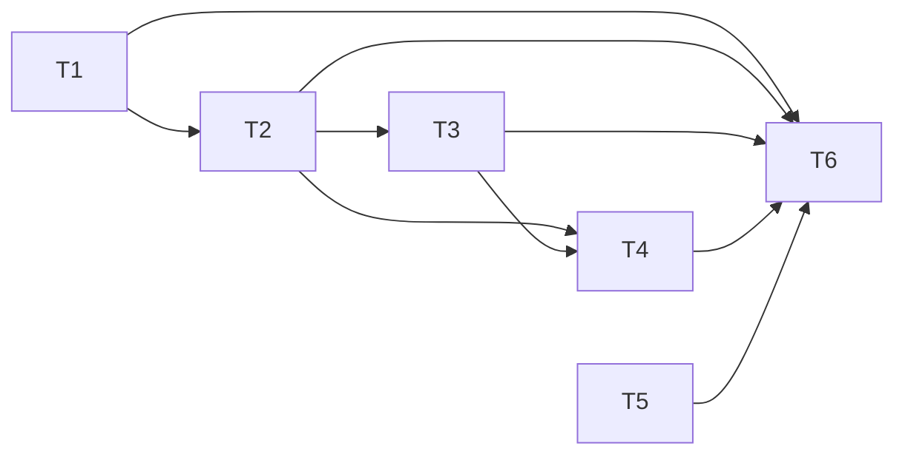

# 0071 · Repository Cleanup and Historical Research Archival After Unifying the Experiment Entry Point

<!-- This file is maintained by the spec tool: frontmatter is the structured source data (including the tasks DAG), and the body is a group-level, nine-section rust-RFC overview. -->

## Summary

> The archive layout below records the original cleanup. The current tree no longer ships `research/` or validates its inventory. The archived files and their inventory remain in Git at `e2130a727a95da161d4994a452af276a93c54f89`.

Organize the current open-source working tree around “one public experiment entry point, two runtime backends, explicit development tools, and separate scoring and historical research materials.” Public experiments use only `backend/scripts/experiment.py` and `schema_version=2`, supporting local + localhost Gitea and E2B + Gitea.com. Remove old launch aliases, personal experiment shortcut scripts, and implicit configuration sources; move the ordinary/SWE controllers still in use into the package; organize historical configurations, research scripts, and public presentation data; and prevent them from being mixed back in through directory contract checks.

This is a repository cleanup; it does not extend support for multiple tasks or appending new rounds from historical artifacts. Existing v2 N1 experiment behavior and the ability to recover frozen runs must be preserved. The old N4/N8 research workflows leave the public entry point, but retain a reproduction path through archived materials and explicitly frozen code versions. Implementation and offline acceptance have been completed on the `feat/unified-experiment-entry` branch and remain uncommitted for developer review; see [Verification Methods](../VERIFICATION.zh-CN.md) for currently reproducible checks.

## Motivation

As of baseline `6d213f6f1383f6aed89111ddc83a076ba3f93976`, the unified entry point supports N1 on both backends, but the directories and dependencies still follow the layout left by multiple rounds of development:

- Of the five JSON files in `examples/experiments/`, the two N1 v2 configurations pass offline checks; ordinary-five-rounds, mixed-scaling, and scaling-e2b still use the historical string schema and are rejected by the unified entry point with `Expected schema_version=2`. They contain placeholder pins and differ materially from the frozen configurations under dated evaluation, so they cannot simply be overwritten as duplicate files.
- `experiment.py --help` still shows create/plan/preflight/start/archive; these commands use v1 infrastructure management. The root-level `run.sh`, auditable runner, and dated E2B launcher provide additional launch methods, with different actual effects for identically named start/run/resume commands.
- The new entry point still calls `backend/run.py` and `backend/scripts/run_swebench_closed_loop.py`. These are not dead code: their logic must be migrated, and internal calls, image recipes, and tests must be fixed before deletion.
- `backend/scripts/` contains 52 version-controlled files, mixing public entry points, CI checks, build helpers, research probes, role replays, and one-time migrations. Three run-glm52fp8 shell scripts hardcode `/root/src/...`; multiple probes hardcode `/Users/bytedance/cjh/.env`.
- Model configuration appears in `backend/.env.example`, `examples/models.env.example`, and `examples/experiment.env.example`, alongside automatic discovery of `.boyue`/`.e2b`. New users cannot determine which rules apply from file locations.
- The dated harness suite contains 122 files, and public-bench-pilot contains 36. They include old executors, frozen research records, task materials, and adapters still referenced by scoring code, so they cannot be deleted wholesale without distinction.
- The historical mixed16 snapshot on the public static dashboard is still labeled “current experiment” and RUNNING; the source-freezing allowlist also includes all of scripts and examples, which would bring obsolete development files into new run materials.

Another capability boundary must be stated explicitly: the current `task-package-v1` supports only `sessions_per_round=1`. Even with eight real personas configured, eight sessions per round will be rejected by offline validation. This N8 round append used operational scripts outside the repository and does not constitute evidence that the unified entry point supports N8. Cleanup must not pass off a schema rename or a copied JSON file as a capability migration.

## Guide-level explanation

### Entry point for new users

New users enter only through README → QuickStart → N1 tutorial and choose one of the following:

```bash
uv run --locked --extra experiments python backend/scripts/experiment.py check \
  --config examples/experiments/u1-local.json --offline
uv run --locked --extra experiments python backend/scripts/experiment.py prepare \
  --config examples/experiments/u1-local.json --secrets-file .env.experiment
uv run --locked --extra experiments python backend/scripts/experiment.py run <run_id>
```

E2B uses the same commands with the configuration changed to `u1-e2b.json`. The only management commands are status/logs/stop/resume/collect/destroy; model and cloud credentials are supplied through explicit references in `examples/experiment.env.example`. Users do not need to find files under someone's personal HOME, choose a shell script named after a model, or run controllers manually.

The tasks, personas, rounds, roles, model mappings, and final-round trial-only semantics of the N1 examples remain unchanged. The tutorial makes clear that the current public task package contains a single task; N4/N8 multi-scenario runs and appending rounds to historical results are outside the scope supported by this version of the unified entry point.

### Directory responsibilities

| Location | Meaning |
| --- | --- |
| `examples/experiments/` | Validatable experiment definitions using the current schema; retains only the two N1 examples |
| `examples/tasks/`, `examples/personas/` | Task packages and persona materials required by the public examples |
| `examples/experiment.env.example` | The sole recommended credential template for public experiments |
| `backend/ahe_beta/experiment/controllers/` | In-package ordinary/SWE controllers launched by the supervisor |
| `backend/scripts/` | Current public entry point, offline demo, static export, and CI/build checks |
| `tools/dev/` | Currently maintained probes, role replays, and delivery verification tools; not an experiment entry point |
| `evaluation/harness_bench/`, `evaluation/adapters/`, `evaluation/tests/` | Current independent scoring, shared adapters, and corresponding tests |
| `research/archives/` | Historical configurations, research implementations, and results grouped by source; no claim that they can run directly on the current version |
| `research/README.md`, `research/inventory.json` | Historical purposes, frozen versions, original paths, and archive mappings |
| `.experiments/` | Ignored run outputs; the source repository does not store private raw experiment artifacts |

Historical experiments are reproduced in a separate checkout using the full source commit and original configuration path specified in the inventory. The research archive is not a third supported backend; no compatibility shim is provided in the new main to forward calls to old entry points.

## Reference-level explanation

### 1. Itemized disposition inventory

Cleanup is based on version-controlled files and must not include local virtual environments, private credentials, current experiment directories, or users' uncommitted files in its deletion scope.

| Original file or category | Decision | Rationale and destination |
| --- | --- | --- |
| `backend/scripts/experiment.py` | Retain | Sole public experiment entry point |
| `backend/run.py` | Delete original file after migration | Move logic into `controllers/ordinary.py`; fix all production and test imports |
| `backend/scripts/run_swebench_closed_loop.py` | Delete original file after migration | Move logic into `controllers/swebench.py`; SWE reuses ordinary's delivery and recovery logic without rewriting the scheduler |
| `run.sh` | Delete | Remove the singleton launch entry point that bypasses prepare/context |
| `run_auditable_experiment.py` | Archive and delete original path | Retire from the current v1 lifecycle; keep the historical implementation locatable |
| `run_mixed_closed_loop.py` | Archive and delete original path | Document that multiple tasks are not currently covered; reproduce historical N4/N8 runs from frozen code |
| Three `run-glm52fp8-*.sh` files | Delete original paths | Personal-path shortcut commands have no general-purpose interface; history remains in Git |
| `migrate_trunk_main.py` | Archive and delete original path | The one-time main/release migration is complete; it is not a tool for new experiments |
| Eight `probe_*` files | Move into `tools/dev/probes/` | Remove personal paths and implicit credentials while retaining debugging purposes; do not automatically execute online probes |
| Role replay and trace/integrity audits | Move into corresponding subdirectories of `tools/dev/` | Retain currently useful debugging and auditing, and fix tests and e2e calls |
| OpenAgents manual prepare/validation tools | Move into `tools/dev/delivery/` | Independent development verification; require explicit run/configuration inputs and retire fixed shared containers and WIS-specific defaults |
| `e2e-*`, contract checks, offline demo, snapshot export | Retain | Current verification/export responsibilities; distinguish them from experiment launching |
| SWE seed build/acceptance helpers and deploy recipes | Retain referenced portions | Dockerfile COPY and build helpers still depend on them; historical names are not grounds for deletion |
| Three historical `examples/experiments/*.json` files | Archive and delete original paths | Store separately from dated frozen configurations and document the distinction between template and frozen versions; do not incorrectly deduplicate |
| `examples/models.env.example`, `backend/.env.example` | Archive and delete original paths | Recommend only one configuration set for current experiments; retain the subject Harness's own `.env.example` |
| Two dated evaluation directories | Split and migrate | Move research code/configurations/results into research; migrate adapters referenced by current scoring separately |
| Main persona library, sublibraries, seeds, SWE pools | Organize after checking usage | Place the current main library in `examples/personas/library.json`; archive old default seeds/pools/sublibraries used only by historical dependencies without presenting them as v2 experiment configurations |
| `backend/seed_workspaces/billing-split/` | Retain | Current workspace/persona test fixture; must not be deleted as an obsolete experiment |
| `docs/specs/`, audit reports | Retain and synchronize mappings to active code | Do not rewrite historical evidence through global replacement; retired tasks and current contracts must be represented accurately |
| Public frontend mixed16 snapshot | Retain evidence and correct presentation | Display “historical snapshot/recorded time”; interpret RUNNING in the original record only as the status at that time, without inventing completion |

All version-controlled experiment scripts/configurations and affected data are recorded in `research/inventory.json`: `original_path`, `disposition` (maintained/moved/archived/removed), `destination` (where applicable), `reason`, `source_commit`, `source_sha256`; byte-preserving moves also record the destination hash. Whole-directory archives must be expanded to individual files rather than using a single directory marker to conceal unknown files. The inventory is a verifiable implementation result, not a tool that automatically decides what to delete based on file extensions.

### 2. Historical archives and independent scoring

Archives preserve the source hierarchy: `research/archives/harness-suite-20260920/`, `research/archives/public-bench-pilot/`, `research/archives/public-templates/`, `research/archives/legacy-runtime/`. Explicit English presentation translations may be recorded with `translation: {language: en, source_sha256: <original hash>}` and a locked `destination_sha256`. The original source commit/hash must remain unchanged, and later edits to either an original archive or its declared translation must still fail checksum validation. Reproduce the original experiment from its frozen source checkout. Otherwise, historical file contents remain unchanged in principle; original paths/relative references belong to the original version, and the archive root documentation explicitly directs reproduction using the frozen commit rather than execution with broken relative paths in the current working tree.

The frozen code baseline uses the full commit `6d213f6f1383f6aed89111ddc83a076ba3f93976`, which existed before this cleanup and can be fetched from the remote; list any other pins/external materials required by an experiment accurately. Where the default configuration in a historical original runbook points to a file changed later, explain that the configuration frozen at the time must be specified explicitly. Do not label an experiment as verified reproducible merely because its files were successfully archived. Currently running cloud instances and Gitea repositories are unaffected by directory cleanup.

Extract `evaluation/public-bench-pilot/adapters/harness_v0/` from the old directory into `evaluation/adapters/harness_v0/`, and fix upload paths, Python imports, and still-useful adapter tests for the production Harbor adapter. Archive the Daytona launcher, results, timeout policy, and research tests tied to the old pilot together; production scoring must not continue to import research. Preserve independent scoring semantics, held-out boundaries, and optional dependencies; do not require rerunning the official benchmark as part of cleanup. Inputs to currently maintained adapters must not depend on developers' absolute directories; frozen baseline archives/wheels must be declared through explicit arguments or environment variables, with actionable errors when materials are not supplied.

The default pytest testpaths/pythonpath no longer include dated research. Ruff excludes frozen source code in `research/archives/` while continuing to check all maintained code and `tools/dev/`. Original tests for archived code are archived with their source and are not treated as support commitments for the current product; tests verifying active functionality such as Orchestrator, recovery, signals, and path isolation must be migrated and retained. Archive v1 capacity/health code that has no production callers and only tests for its own old runtime system with the research version, and remove the current dead branches; retain shared Compose ownership, logging, atomic manifest, and resource verification functions according to current backend dependencies.

### 3. Internal controllers, materials, and already prepared v2 runs

Controller migration must also fix backend/repo root discovery based on `__file__`, the repo guard, and execution paths in images; changing import names alone is insufficient. Maintained SWE seed build helpers must explicitly specify manifests, source materials, and images, and must no longer reference the archived medium-hard-16 pool or a sibling NexAU checkout by default; retain runtime helpers actually used by COPY and their valid tests.

For new runs, the supervisor launches the `ahe_beta.experiment.controllers.ordinary` or `.swebench` module using the context frozen and injected by prepare, and no longer accepts implicit backend/.env without context, default seeds, or personal SWE parquet paths. Preserve the current task/package/schema, role configurations, and model variables without introducing a third public runner or a second round scheduler.

Reconfirm the source-freezing allowlist according to execution needs: retain the controller package, role definitions, Harness, backend/build recipes, dependency locks, and compatible versions; task/persona materials are already frozen independently, so no longer include all examples wholesale; `tools/dev/`, research, historical configurations, and personal launchers must not appear in the controller source archive for new runs. After changing the allowlist, reverify the local Docker build context and E2B bootstrap to ensure no files actually read or used by COPY are missing.

v2 runs already prepared before cleanup continue to use their own frozen source and original materials:

1. Do not recompute its config/source hash or change its run_id, Gitea repo, checkpoint, source pins, or sealing SHA.
2. Newly prepared manifests record the controller entrypoint recipe; when an old v2 manifest lacks this field, select the original `backend/run.py` / SWE script solely from its validated frozen source file list, without falling back to a file of the same name in the current checkout.
3. Module/script selection follows the frozen source contract; do not retain empty wrappers or old import aliases in the current working tree. Fail closed when required frozen files are missing; do not prepare again and present it as resume.
4. inspect/logs/collect/stop/destroy on local and E2B must still manage prepared v2 runs; the launcher embedded in the E2B backend also uses the same entrypoint rules.

Reading old v2 manifests provides compatibility for persisted artifacts; it does not mean retaining a new v1 launch entrypoint.

### 4. Old CLI, implicit configuration, and development tools

Public help shows only check/prepare/run/status/logs/stop/resume/collect/destroy. Remove `_legacy_dispatch` and the v1 runtime API; do not continue registering old commands as thin aliases. For old schema input or an explicit reference to an old manifest, report an error stating that the current entrypoint does not support that version and identifying the applicable frozen commit/archive instructions, and stop before any provider call or resource change; do not silently convert configuration, automatically reuse names, or invoke archived scripts.

Manage old v1 and historical runs in the matching frozen checkout. This cleanup does not automatically migrate running resources, nor does it stop processes, delete repositories, or destroy sandboxes while traversing directories. Prepared v2 runs retain the management capabilities described in the previous section.

`tools/dev/README.md` lists the purpose, inputs, whether it calls models/writes to remote systems, output location, and one valid command for every retained tool. Clearly distinguish replay, read-only checks, and new end-to-end experiments. Online tools use explicit credential files/variables, run/context, and configurable providers; there are no backdoor defaults that automatically search for `/Users/bytedance/...`, `/root/src/...`, or `.boyue`/`.e2b`, or hard-code a personal model. Custom debugging inputs for tools are not registered as new public experiment schemas.

### 5. Documentation and frontend presentation

Update the English and Chinese README, QuickStart, Configuration, and N1 tutorials together to explain the single entrypoint, two backends, material formats, and current single-task limitation; remove `./run.sh`, manual Gitea bootstrap, old env templates, and model-specific launchers from current user workflows. Research documentation preserves the facts and is accessed consistently through the research index. Update CLAUDE's directory descriptions, run entrypoints, and retired components as well, so subsequent agents do not reintroduce entrypoints based on old instructions.

The static dashboard explicitly distinguishes historical snapshots from the live API: display the snapshot time, label static status as “status at the time,” and remove “current experiment” from the title. Do not change RUNNING to an unproven COMPLETED or alter original research results; retain live API status display and polling. Public snapshot export documentation explains these presentation semantics.

This change does not modify the OpenAgents repository or evidence transport protocol. Retain existing gzip/ZIP capabilities, compatibility version pins, and OpenAgents contract checks; only fix invocations affected by path changes.

### 6. File ownership and task order

The exact `files` in frontmatter is the single-writer list; migration tasks list both original and destination paths. If implementation reveals new dependency files, first expand the corresponding task list before modifying them; do not broaden deletion scope based on a directory's name.

| Task | Responsibility | Dependencies |
| --- | --- | --- |
| T1 | Separate historical evaluation/configuration/material archives from active scoring adapters | None |
| T2 | Move ordinary/SWE controllers into the package, freeze source, and manage old v2 runs | T1 |
| T3 | Remove the v1 CLI/runtime and old launch scripts, retaining failure detection | T2 |
| T4 | Consolidate development probes/replay/delivery verification tools and make configuration explicit | T2, T3 |
| T5 | Present static historical snapshots | None |
| T6 | Documentation, directory contract checks, CI, and comprehensive acceptance | T1, T2, T3, T4, T5 |



### 7. Executable acceptance checks

The implementation adds `backend/scripts/check_experiment_repository.py` and `backend/scripts/e2e-spec-0071-experiment-cleanup.sh`. CI runs directory checks directly, verifying at least the following:

- Traverse `examples/experiments/*.json`; all entries belong to the current schema and pass material validation without a provider, rather than hard-coding checks for only two N1 examples.
- The public command set matches the commands in README/QuickStart; old commands/old schemas fail before network access, and default help no longer shows historical commands.
- Maintained imports, execution paths, Dockerfile COPY, build helpers, and source freeze lists do not depend on deleted paths or research; destinations in the configuration/script inventory actually exist, with no omissions. Limit checks to maintained code and current documentation; do not blindly ban strings across the entire repository, including frozen historical strings.
- New controller source archives contain no archived/development tools; local and E2B build and launch contracts remain complete.
- The single-task limitation continues to produce a clear error; cleanup must not repackage old N4/N8 templates as valid v2 examples.
- Both the recovery contract for old v2 manifests + frozen old code and the current v2 module launch contract pass; recovery identity remains unchanged, missing files cause rejection, and no second controller is created.
- Static snapshots display their identity and time; historical RUNNING evidence is not modified, and the live API is unaffected.

Default e2e checks are offline/fake-provider checks and do not access personal credentials or paid resources. Verification includes relevant tests, the full pytest suite, Ruff, frontend tests and build, and spec validate/render/graph. When old tests for historical tools leave the default suite, explain the reason for each; do not delete failing tests instead of fixing active behavior.

Existing N1 five-round acceptance records remain baseline facts, but cannot directly serve as evidence of real runs after refactoring. Real smoke tests after cleanup reuse the explicit live mode of the existing spec-0069 e2e: separately verify that local/E2B can proceed from prepare into real user sessions, confirming frozen materials, delivery process configuration, and artifact collection; additionally cover old v2 source with an offline recovery matrix, and record the stages actually covered by real stop/resume verification. Execute real runs only within the scope of existing credentials and user authorization, and report failures truthfully; this change does not require rerunning N8 or the official benchmark. If real runs are not executed, label post-refactoring real runs as unverified; do not redate old reports.

## Drawbacks

Controller migration affects imports in current tests, image builds, the E2B launcher, and source snapshots, posing greater risk than deleting documentation; verification must follow dependency order. Research archives still occupy space, but have a clear purpose and are no longer mixed with public examples. Retiring v1 commands is an explicit breaking change during development; old experiments require matching frozen checkouts, while existing v2 runs must remain manageable. The current unified entrypoint still supports only a single task; clearer directories do not automatically resolve scaling or the need to continue historical results.

## Rationale and alternatives

Choose “one public entrypoint + in-package controllers + development tools + research archives”: files in public directories should have a current purpose, while historical materials are centralized and discoverable. Verifying directory contracts through CI prevents regression more effectively than merely adding README notices.

The first alternative is to mark old files as deprecated at the top and retain all aliases. This requires fewer changes, but leaves multiple configuration sources and launch semantics in place and continues including old scripts in new snapshots, which does not meet this cleanup's goals.

The second alternative is to delete all of evaluation and every dated file. This would break active scoring adapters, fixtures, and historical evidence, so it is rejected.

The third alternative is to implement N4/N8 multitasking and additional rounds from historical artifacts before performing all cleanup. This would expand a repository cleanup into a new experiment protocol and recovery design. This change first clearly marks support boundaries and preserves frozen research reproduction paths; subsequent capabilities will integrate through the same entrypoint under separate designs, without creating temporary public launchers.

## Prior art

The existing v2 entrypoint already provides material freezing, run supervision, local/E2B resource management, and recovery; controller cleanup reuses these capabilities. Existing standalone scoring modules and the public snapshot exporter already separate held-out scoring from public coarse-grained presentation, and this change preserves that boundary. Git's immutable commits and original configuration records locate historical code, while the research inventory restores discoverability after directory migration, without adding another historical execution platform.

## Unresolved questions

The scope confirmed during review has been implemented: cleanup is complete on the current branch, without adding multitasking or an entrypoint for new rounds from historical artifacts; research executors leave public paths, historical reproduction uses designated frozen checkouts, and existing v2 runs retain management capabilities. There are currently no design questions awaiting user decisions.

Material references, frozen launch contracts for both backends, and active scoring adapter inputs have passed offline verification. Real local/E2B smoke tests and online stop/resume after refactoring have not been executed; old N1 records serve only as a baseline. The default development frontend API is also not yet automatically bound to a v2 run; current progress is viewed through status/logs. The acceptance report explicitly states these coverage boundaries.

## Future possibilities

Design a task-pool schema separately: freeze the one-to-one task/persona mapping, per-round sets, concurrency, and result associations to support N4/N8 through the same entrypoint. Then design historical artifact import and additional rounds: distinguish same-identity interrupted resume from continuation that creates a new identity from historical results, preserving the parent run, feedback source, initial Harness SHA, scenario snapshot, and evidence for added rounds. Standard collect can add full archives and lightweight sharing packages, but must not lose evidence associations. Until these features are complete, do not add scaling examples that claim support.
