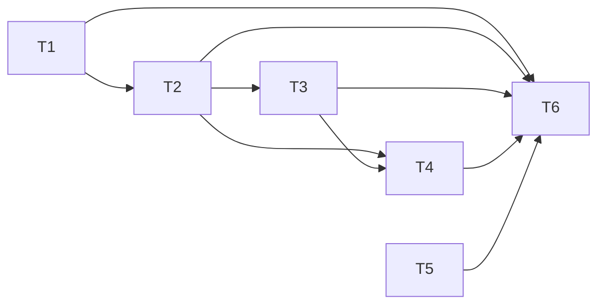

# 0071 · 统一实验入口后的仓库清理与历史研究归档

<!-- 本文件由 spec 工具维护：frontmatter 为结构化源数据（含 tasks DAG），正文为组级 rust-RFC 9 段总览。 -->

## Summary

将当前开源工作树整理为「一个公开实验入口、两种运行后端、明确的开发工具、独立的评分与历史研究资料」。公开实验只使用 `backend/scripts/experiment.py` 与 `schema_version=2`，支持 local + localhost Gitea、E2B + Gitea.com。删除旧启动别名、个人实验快捷脚本与隐式配置来源，将仍被使用的 ordinary/SWE 控制器迁入包内，整理历史配置、研究脚本和公开展示数据，并通过目录契约检查阻止重新混入。

本次是仓库清理，不扩展多任务或从历史产物追加新轮的能力。现有 v2 N1 实验行为与冻结运行的恢复能力必须保持；旧 N4/N8 研究流程退出公共入口，但通过归档资料和明确的冻结代码版本保留复现路径。已在 `feat/unified-experiment-entry` 分支完成实现与离线验收，保持未提交供开发者查看；实际覆盖和未执行的在线检查见[清理验收报告](../validation/spec0071-experiment-cleanup.md)。

## Motivation

截至基线 `6d213f6f1383f6aed89111ddc83a076ba3f93976`，统一入口已完成 N1 两后端，但目录和依赖仍沿用多轮开发留下的布局：

- `examples/experiments/` 的五份 JSON 中，两份 N1 v2 配置可通过离线检查；ordinary-five-rounds、mixed-scaling、scaling-e2b 三份仍为历史字符串 schema，统一入口以 `Expected schema_version=2` 拒绝。它们含 placeholder pins，与 dated evaluation 下的冻结配置存在真实差异，不能当作重复文件直接覆盖。
- `experiment.py --help` 仍显示 create/plan/preflight/start/archive；这些命令走 v1 基础设施管理。根目录 `run.sh`、auditable runner、dated E2B launcher 又提供其他启动方式，同名 start/run/resume 的实际效果不同。
- 新入口仍调用 `backend/run.py` 和 `backend/scripts/run_swebench_closed_loop.py`。它们不是废代码：删除前必须迁移逻辑、修复内部调用、镜像配方和测试。
- `backend/scripts/` 有 52 个受版本控制文件，混合公开入口、CI 检查、构建辅助、研究探针、角色回放和一次性迁移。三份 run-glm52fp8 shell 写死 `/root/src/...`；多个 probe 写死 `/Users/bytedance/cjh/.env`。
- 模型配置同时出现 `backend/.env.example`、`examples/models.env.example`、`examples/experiment.env.example`，还有 `.boyue`/`.e2b` 自动探测。新用户无法从文件位置判断哪套规则有效。
- dated harness suite 有 122 个文件，public-bench-pilot 有 36 个文件。它们既含旧执行器，也含冻结研究记录、任务材料和仍被评分代码引用的适配器，不能整体无差别删除。
- 公开静态看板的历史 mixed16 快照仍标为“当前实验”、RUNNING；源码冻结白名单又包含整个 scripts 与 examples，会把过时开发文件带入新运行材料。

另一个能力边界必须明示：当前 `task-package-v1` 只支持 `sessions_per_round=1`。即使配置八个真实 persona，每轮八个会话也会被离线校验拒绝。这次 N8 追加轮使用了仓库外的操作脚本，不构成统一入口支持 N8 的证据。清理不能通过改 schema 名字或复制一份 JSON 冒充能力迁移。

## Guide-level explanation

### 新用户的入口

新用户只从 README → QuickStart → N1 教程进入，选择以下之一：

```bash
uv run --locked --extra experiments python backend/scripts/experiment.py check \
  --config examples/experiments/u1-local.json --offline
uv run --locked --extra experiments python backend/scripts/experiment.py prepare \
  --config examples/experiments/u1-local.json --secrets-file .env.experiment
uv run --locked --extra experiments python backend/scripts/experiment.py run <run_id>
```

E2B 使用同一组命令，将配置换为 `u1-e2b.json`。管理命令只有 status/logs/stop/resume/collect/destroy；模型与云端凭证从 `examples/experiment.env.example` 的显式引用提供。用户无需寻找个人 HOME 下的文件、选择带模型名的 shell 或手动运行控制器。

N1 示例的任务、persona、轮次、角色、模型映射和末轮只试用语义保持。教程明确当前公开任务包是单任务；N4/N8 多场景和历史结果追加轮不属于这版统一入口的支持范围。

### 目录分工

| 位置 | 含义 |
| --- | --- |
| `examples/experiments/` | 当前 schema 的可校验实验定义，仅保留两份 N1 示例 |
| `examples/tasks/`、`examples/personas/` | 公开示例所需的任务包与 persona 材料 |
| `examples/experiment.env.example` | 公开实验唯一推荐的凭证模板 |
| `backend/auto_designer/experiment/controllers/` | 包内 ordinary/SWE 控制器，供监督器启动 |
| `backend/scripts/` | 当前公开入口、offline demo、静态导出及 CI/构建检查 |
| `tools/dev/` | 当前可维护的探针、角色回放和交付验证工具，不是实验入口 |
| `evaluation/harness_bench/`、`evaluation/adapters/`、`evaluation/tests/` | 当前独立评分、共享适配器与相应测试 |
| `research/archives/` | 按来源集中保存历史配置、研究实现和结果；不声称能在当前版本直接执行 |
| `research/README.md`、`research/inventory.json` | 历史用途、冻结版本、原路径与归档映射 |
| `.experiments/` | 忽略的运行输出；源码仓不保存私人原始实验产物 |

历史实验的复现使用 inventory 指定的完整 source commit 和原配置路径，在独立 checkout 执行。研究归档不是第三套受支持的后端；不提供新 main 中转调旧入口的 compatibility shim。

## Reference-level explanation

### 1. 逐项处置清单

清理基于受版本控制文件，不能把本机虚拟环境、私人凭证、当前实验目录或用户未提交文件纳入删除范围。

| 原文件或类别 | 决定 | 理由与目标 |
| --- | --- | --- |
| `backend/scripts/experiment.py` | 保留 | 唯一公开实验入口 |
| `backend/run.py` | 迁移后删除原文件 | 逻辑进入 `controllers/ordinary.py`；修复所有生产与测试导入 |
| `backend/scripts/run_swebench_closed_loop.py` | 迁移后删除原文件 | 逻辑进入 `controllers/swebench.py`；SWE 复用 ordinary 的交付和恢复逻辑，不重写调度器 |
| `run.sh` | 删除 | 去掉绕过 prepare/context 的单例启动入口 |
| `run_auditable_experiment.py` | 归档，删除原路径 | 退出当前 v1 生命周期；历史实现可定位 |
| `run_mixed_closed_loop.py` | 归档，删除原路径 | 记录当前多任务未覆盖；历史 N4/N8 从冻结代码复现 |
| 三份 `run-glm52fp8-*.sh` | 删除原路径 | 私人路径快捷命令无通用接口，Git 中保留历史 |
| `migrate_trunk_main.py` | 归档，删除原路径 | main/release 一次性迁移已结束，不作为新实验工具 |
| 八个 `probe_*` | 迁入 `tools/dev/probes/` | 移除个人路径和隐式凭证，保留调试目的；不自动执行在线探针 |
| 角色 replay、trace/integrity 审计 | 迁入 `tools/dev/` 对应子目录 | 保留当前有用的调试与审计，并修复测试和 e2e 调用 |
| OpenAgents 手工 prepare/validation 工具 | 迁入 `tools/dev/delivery/` | 独立开发验证；显式输入 run/配置，退出固定共享容器与 WIS 专用默认值 |
| `e2e-*`、contract checks、offline demo、snapshot export | 保留 | 当前验证/导出职责；与实验启动区分 |
| SWE seed 构建/验收辅助、deploy 配方 | 保留被引用部分 | Dockerfile COPY 与构建 helper 仍有依赖，不能因名称历史而删除 |
| 三份历史 `examples/experiments/*.json` | 归档，删除原路径 | 与 dated 冻结配置分开保存，记录 template 与 frozen 的区别，不错误去重 |
| `examples/models.env.example`、`backend/.env.example` | 归档，删除原路径 | 当前实验只推荐一套配置；被试 Harness 自己的 `.env.example` 保留 |
| 两个 dated evaluation 目录 | 分拆迁移 | 研究代码/配置/结果移入 research；当前评分引用的适配器独立迁移 |
| persona 主库、分库、seeds、SWE pools | 核对用途后整理 | 当前主库放 `examples/personas/library.json`；仅历史依赖的旧默认 seeds/pools/分库归档，不将它们伪装成 v2 实验配置 |
| `backend/seed_workspaces/billing-split/` | 保留 | 当前 workspace/persona 测试 fixture，不能当作废实验删除 |
| `docs/specs/`、审计报告 | 保留并同步活代码映射 | 不用全局替换改写历史证据；退休 task 与当前契约必须准确表达 |
| 前端公开 mixed16 快照 | 保留证据，修正展示 | 显示“历史快照/记录时间”；原记录中的 RUNNING 仅解释为当时状态，不编造已完成 |

所有受版本控制实验脚本/配置及被影响数据在 `research/inventory.json` 中有记录：`original_path`、`disposition`（maintained/moved/archived/removed）、`destination`（适用时）、`reason`、`source_commit`、`source_sha256`；字节不变的迁移还记录目标哈希。整目录归档需展开到文件，不用一个目录标记掩盖未知文件。清单是实现中的可验证结果，不是根据扩展名自动决定删除的工具。

### 2. 历史归档和独立评分

归档保留来源层级：`research/archives/harness-suite-20260920/`、`research/archives/public-bench-pilot/`、`research/archives/public-templates/`、`research/archives/legacy-runtime/`。历史文件内容原则上不改；原路径/相对引用属于原版本，archive 根文档明确使用冻结 commit 复现，而非在当前工作树执行失效相对路径。

冻结代码基线使用本次清理前已存在且可从远端取回的完整 commit `6d213f6f1383f6aed89111ddc83a076ba3f93976`；某条实验需要其他 pins/外部素材时如实列出。历史原 runbook 中的默认配置指向后来变更过的文件时，说明应显式指定当时冻结配置。不能仅因为文件归档成功就标注该实验已验证可复现。当前已经运行的云端实例与 Gitea 仓库不受目录清理影响。

`evaluation/public-bench-pilot/adapters/harness_v0/` 从旧目录抽出到 `evaluation/adapters/harness_v0/`，修复正式 Harbor adapter 的上传路径、Python import 与仍有价值的 adapter 测试。与旧试点绑定的 Daytona launcher、结果、timeout policy 及其研究测试集中归档；不让正式评分继续 import research。独立评分的语义、held-out 边界和可选依赖保持，不借清理要求重新运行官方 benchmark。当前维护的 adapter 输入不得依赖开发者绝对目录，冻结 baseline archive/wheel 通过显式参数或环境变量声明；未提供材料时给出可操作错误。

pytest 的默认 testpaths/pythonpath 不再包含 dated research。Ruff 排除 `research/archives/` 的冻结源码，仍检查所有维护代码与 `tools/dev/`。归档代码的原测试随来源归档，不把它们当当前产品的支持承诺；正在验证 Orchestrator、恢复、信号、路径隔离等活功能的测试必须迁移保留。对没有生产调用、只有自身旧运行体系测试的 v1 capacity/health 代码，随同研究版本归档并删除当前死分支；共享的 Compose ownership、日志、原子 manifest 与资源核验函数按当前后端依赖保留。

### 3. 内部控制器、材料和已准备的 v2 运行

控制器迁移同步修正基于 `__file__` 的 backend/repo 根定位、repo guard 和镜像中的执行路径，不能只改 import 名字。维护的 SWE seed 构建辅助改为显式指定 manifest、源材料和镜像，不再默认引用已归档的 medium-hard-16 pool 或 sibling NexAU checkout；实际被 COPY 的运行辅助与其有效测试保留。

监督器为新运行启动 `auto_designer.experiment.controllers.ordinary` 或 `.swebench` 模块，使用 prepare 冻结并注入的 context，不继续接受无 context 的隐式 backend/.env、默认 seed 或个人 SWE parquet 路径。当前 task/package/schema、角色配置和模型变量保持，不引入第三个公开 runner 或第二套轮次调度。

源码冻结白名单按执行需要重新确认：保留 controller 包、角色定义、Harness、后端/构建配方、依赖锁与兼容版本；task/persona 已作为独立 materials 冻结，不再整包带入所有 examples；`tools/dev/`、research、历史配置和个人启动器不得出现在新运行的 controller source archive。白名单改变后重新验证 local Docker build context 与 E2B bootstrap，不能漏掉实际被读取或 COPY 的文件。

清理前已经 prepare 的 v2 运行仍使用自己的冻结源码和原材料：

1. 不重算其 config/source hash，不改 run_id、Gitea repo、checkpoint、source pins 或封口 SHA。
2. 新准备的 manifest 记录 controller entrypoint recipe；旧 v2 manifest 没有该字段时，只根据其已校验冻结 source file 清单选择原 `backend/run.py` / SWE script，不能回落到当前 checkout 的同名文件。
3. 模块/脚本选择以冻结源码契约为准，不在当前工作树保留空 wrapper 或旧 import alias。缺必要冻结文件时 fail-closed，不重新 prepare 冒充 resume。
4. local 和 E2B 的 inspect/logs/collect/stop/destroy 仍可管理已准备的 v2 运行；E2B 后端内嵌的启动程序也使用同一 entrypoint 规则。

针对旧 v2 manifest 的读取是持久化产物兼容，不等同于保留新的 v1 启动入口。

### 4. 旧 CLI、隐式配置与开发工具

公开 help 仅展示 check/prepare/run/status/logs/stop/resume/collect/destroy。移除 `_legacy_dispatch` 及 v1 runtime API，不把旧命令继续注册为薄别名。旧 schema 输入或显式指向旧 manifest 时，给出「当前入口不支持该版本、适用 frozen commit/归档说明」错误，且在任何 provider 调用或资源变更前停止；不能偷偷转换配置、自动复用名称或调用归档脚本。

旧 v1 与历史运行的管理在匹配的冻结 checkout 中进行。此次清理不自动迁移正在运行的资源，也不在遍历目录时停进程、删仓或销毁 sandbox。已经准备的 v2 运行按上一节保留管理能力。

`tools/dev/README.md` 为每个保留工具列用途、输入、是否调用模型/写远端、输出位置及一条有效命令。回放、只读检查与新的端到端实验明确区分。在线工具使用显式凭证文件/变量、run/context 和可配置 provider；不存在 `/Users/bytedance/...`、`/root/src/...`、`.boyue`/`.e2b` 自动搜寻或固定个人模型的后门默认值。工具的自定义调试输入不注册为新的公开实验 schema。

### 5. 文档与前端展示

英中 README、QuickStart、Configuration、N1 教程同步说明单入口、两后端、材料格式及当前单任务限制；移除当前用户流程中的 `./run.sh`、手工 Gitea bootstrap、旧 env 模板和模型专用 launcher。研究文档保留事实，统一从 research 索引访问。CLAUDE 的目录说明、运行入口和已退休组件也同步，避免后续 agent 按旧说明重新添加入口。

静态看板显式区分历史快照和 live API：显示 snapshot 时间，静态状态标注“当时状态”，标题去掉“当前实验”。不把 RUNNING 改为未经证明的 COMPLETED，也不改原始研究结果；live API 的状态显示和轮询保持。公开快照导出文档说明这一展示语义。

本次不修改 OpenAgents 仓库或证据传输协议。已有 gzip/ZIP capability、兼容版本 pins 与 OpenAgents 契约检查保留；修复由路径变化引起的调用即可。

### 6. 文件分工与任务顺序

frontmatter 的 exact `files` 是单一 writer 清单；迁移任务同时列出原路径和目标路径。实现发现新的依赖文件时先扩充相应 task 清单，再修改，不能以某个目录的名称为依据扩大删除范围。

| 任务 | 责任 | 依赖 |
| --- | --- | --- |
| T1 | 历史 evaluation/配置/材料归档与活评分适配器分离 | 无 |
| T2 | ordinary/SWE 控制器入包、源码冻结及旧 v2 运行管理 | T1 |
| T3 | 删除 v1 CLI/runtime 与旧启动脚本、保留失败识别 | T2 |
| T4 | 开发探针/回放/交付验证工具收拢及显式配置 | T2、T3 |
| T5 | 静态历史快照展示 | 无 |
| T6 | 文档、目录契约检查、CI 与综合验收 | T1、T2、T3、T4、T5 |



### 7. 可执行验收

实现新增 `backend/scripts/check_experiment_repository.py` 与 `backend/scripts/e2e-spec-0071-experiment-cleanup.sh`。目录检查由 CI 直接执行，至少验证：

- 遍历 `examples/experiments/*.json`，全部属于当前 schema 且通过无 provider 的材料校验，不再硬编码只检查两份 N1。
- 公共命令集合与 README/QuickStart 的命令一致；旧命令/旧 schema 在触网前失败，默认 help 不再出现历史命令。
- maintained import、执行路径、Dockerfile COPY、构建 helper 及源码冻结列表不依赖被删路径或 research；配置/脚本清单中的去向真实存在且无遗漏。检查范围限定维护代码和当前文档，不对冻结历史字符串做盲目全库禁词。
- 新 controller source archive 不含归档/开发工具；local 与 E2B 的构建和启动合同仍完整。
- 单任务限制继续给出明确错误；不能通过清理将旧 N4/N8 模板包装成有效 v2 示例。
- 旧 v2 manifest + 冻结旧代码的恢复合同、当前 v2 模块启动合同均通过，恢复身份不变，缺文件拒绝，不产生第二个 controller。
- 静态快照展示标识和时间；不修改历史 RUNNING 证据，不影响 live API。

默认 e2e 是离线/fake-provider 检查，不访问个人凭证或付费资源。验证包括相关测试、完整 pytest、Ruff、前端测试与构建、spec validate/render/graph。历史工具的旧测试退出默认集合时必须逐项说明理由，不能用删除失败测试代替修复活行为。

已有 N1 五轮验收记录保持为基线事实，但不能直接当作重构后的实跑证据。清理完成后的真实 smoke 复用现有 spec-0069 e2e 的显式 live 模式：分别验证 local/E2B 能从 prepare 进入真实用户会话，确认冻结材料、交付进程配置和产物收集；另以离线恢复矩阵覆盖旧 v2 source，真实 stop/resume 验证记录实际覆盖阶段。实跑只在已有凭证和用户授权的范围内执行，失败如实报告；不要求本次重新跑 N8 或官方 benchmark。不执行实跑时标注重构后实跑未验证，不把旧报告重新贴日期。

## Drawbacks

控制器迁移会影响当前测试的 import、镜像构建、E2B 启动程序和源码快照，风险大于删文档，必须按依赖顺序验证。研究归档仍占空间，但其目的明确，不再与公共示例混放。v1 命令退出是开发阶段的显式破坏性变更，旧实验需要匹配的冻结 checkout；现有 v2 运行则必须继续可管理。当前统一入口仍只有单任务能力，目录变清楚不会自动解决 scaling 和历史结果续跑需求。

## Rationale and alternatives

选择「单公开入口 + 包内控制器 + 开发工具 + 研究归档」：公共目录的文件应有当前用途，历史资料集中且可定位。用 CI 验证目录契约，比只增加 README 提示更能防止回退。

备选一是仅在旧文件顶部写 deprecated 并保留所有别名。它改动较小，但仍会有多套配置来源与启动语义，也继续把旧脚本打进新快照，不符合本次清理目标。

备选二是删除整个 evaluation 和所有带日期文件。它会破坏正在使用的评分适配器、fixture 和历史证据，因此不采用。

备选三是先实现 N4/N8 多任务与历史产物追加轮，再做全部清理。这会把一次仓库整理扩大为新的实验协议和恢复设计。本次先清楚标注支持边界，保留冻结研究复现路径；后续能力以独立设计接入同一入口，不再产生临时公共 launcher。

## Prior art

现有 v2 入口已经提供材料冻结、运行监督、local/E2B 资源管理与恢复，控制器清理复用这些能力。现有独立评分模块与公开快照导出器已经将 held-out 评分和公开粗粒度展示分离，本次保留该边界。Git 的不可变 commit 和原配置记录提供历史代码定位，research inventory 补足目录迁移后的发现性，不新增一套历史执行平台。

## Unresolved questions

审阅确认的范围已实施：当前分支完成清理，不增加多任务或历史产物新轮入口；研究执行器退出公开路径，历史复现使用指定冻结 checkout；现有 v2 运行保留管理。当前没有等待用户决定的设计问题。

材料引用、两后端冻结启动合同及活评分适配器输入已完成离线核验。重构后的真实 local/E2B smoke 和在线 stop/resume 未执行，旧 N1 记录仅作为基线；默认开发前端 API 也尚未自动绑定 v2 run，当前进度通过 status/logs 查看。验收报告明确这些覆盖边界。

## Future possibilities

后续单独设计 task-pool schema：冻结 task/persona 一一对应关系、每轮集合、并发与结果关联，在同一入口支持 N4/N8。再设计历史产物导入与追加轮：区分同身份中断 resume 和从历史结果创建新身份 continuation，保存父运行、反馈来源、初始 Harness SHA、场景快照和新增轮证据。标准 collect 可增加完整归档与轻量分享包，但不能丢失证据关联。这些功能完成前不新增宣称已支持的 scaling 示例。
