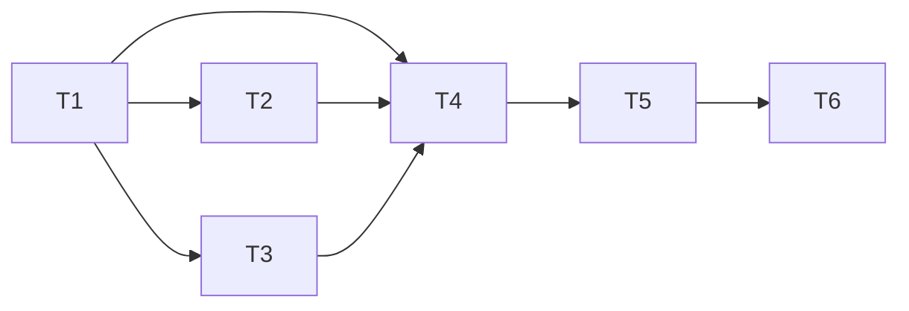

# 0073 · 统一入口的多任务与多用户实验

<!-- 本文件由 spec 工具维护：frontmatter 为结构化源数据（含 tasks DAG），正文为组级 rust-RFC 9 段总览。 -->

## Summary

为 `schema_version: 2` 入口增加任务包列表，将单任务和多任务输入统一编译成冻结任务目录与逐轮会话计划。支持 N1/N4/N8 等用户数量、同一任务由多个用户试用，以及普通任务与 SWE 任务混合运行。local + 本地 Gitea、E2B + Gitea.com 继续使用同一套生命周期命令。所有会话围绕同一个 Harness 仓库迭代，每个会话拥有独立的可写代码和任务虚拟环境。

本组同时将 ordinary/SWE 两个重复控制器收敛为一个控制器，任务差异留在任务包与工作区准备阶段。现有单任务配置继续可用；已经冻结的实验继续由自己的源码和启动配方恢复。设计已通过审阅；实施与验收状态由 frontmatter 任务状态及验收报告记录。

## Motivation

公开入口已支持冻结源码、凭证引用、角色策略、模拟用户与直接任务交互，以及同一 run 的停止与恢复。旧研究脚本已经归档，不能让用户通过旧脚本才能使用多用户功能。但目前存在四处单任务假设：

- `materials.check_materials()` 要求 `sessions_per_round=1`，计划禁止同轮重复 task ID，连“多个用户试同一个任务”也被禁止。
- 源码、指令、setup、锁、任务包及后端 workspace 都只有一个槽位。SWE 控制器在统一入口路径会忽略当前任务 metadata，返回唯一冻结场景；只放开任务池可能重复跑第一个任务。
- ordinary/SWE 控制器分别装配角色、交付与轮次回调。再增加 mixed 控制器会形成第三份重复流程。
- Orchestrator 已有并发、恢复、交付闸和 round seal，但观察槽使用 `user-{persona}`，恢复操作键包含场景中的资源参数。当前正常恢复使用已记录资源与冻结场景，并没有已证实的身份漂移；新任务绑定必须继续保证逻辑身份与资源坐标分离。

目标是恢复有价值的历史编排能力，同时保持一个公开入口和一条执行链。跨任务反馈用于改进通用 Harness，不分别维护多份 Harness，不把旧实验脚本搬回主目录。

## Guide-level explanation

### 准备什么材料

用户准备实验配置、persona 库和一个或多个 `task-package-v1`。每个包包含唯一 ID、`ordinary`/`swebench` 类型、指令、固定源码、setup 和依赖锁。普通任务声明 `not_in_benchmark=true`，SWE 保留固定 Git revision/repo；任务包的 `interaction` 选择 `simulated_user` 或 `direct`，缺省仍为前者。

旧单任务配置原样可用：

```json
"workload": {
  "kind": "swebench",
  "task_package": "../tasks/pvlib-1478/task.json",
  "persona_library": "../personas/n1.json",
  "persona_ids": ["sr-15-swyx"]
}
```

新配置使用列表，各任务类型由包决定，不再填一个代表全实验的 `kind`：

```json
"workload": {
  "task_packages": [
    "../tasks/pvlib-1478/task.json",
    "../tasks/order-service/task.json"
  ],
  "persona_library": "../personas/library.json",
  "persona_ids": ["persona-a", "persona-b", "persona-c", "persona-d"],
  "interaction_plan": [
    [["persona-a", "pvlib__pvlib-python-1478"],
     ["persona-b", "pvlib__pvlib-python-1478"],
     ["persona-c", "order-service"],
     ["persona-d", "order-service"]],
    [["persona-a", "order-service"],
     ["persona-b", "order-service"],
     ["persona-c", "pvlib__pvlib-python-1478"],
     ["persona-d", "pvlib__pvlib-python-1478"]]
  ]
},
"rounds": {
  "count": 2,
  "sessions_per_round": 4,
  "max_parallel_users": 2
}
```

以上是配置片段，persona ID 是解释用占位值，真实配置必须引用库中的 ID。实现阶段提供 local/E2B 两份完整 N4 示例，引用四张已有卡和两个受维护任务包；普通任务使用小型 MIT 示例代码。保留现有两份 N1 示例。N8 按相同格式增加 persona 与会话数量，不新增入口或 schema。

`task_package + kind` 与 `task_packages` 必须二选一；列表非空，单元素列表也走统一模型。同轮允许重复 task，但本组规定每个 persona 同轮只出现一次；后续轮次可以换任务。会话数等于每轮计划长度，不超过选中 persona 数；并发上限不超过会话数。

没有显式计划时确定性生成：第 r 轮从 1 开始、槽位 i 从 0 开始，`k=(r-1)*sessions_per_round+i`，依次选择 `persona_ids[k % persona_count]` 与 `task_packages[k % task_count]`。不使用随机数或宿主环境。单用户、两张 persona 卡仍得到 ABAB。这是顺序轮转，不承诺覆盖全部用户×任务组合；对照实验用显式计划指定交叉分配、AABB 或固定分配。

### 一轮怎样执行

同轮所有用户试用同一冻结 Harness SHA，各自从对应任务的干净基线创建工作区。最多 `max_parallel_users` 局同时运行，其余按冻结槽位排队。反馈保留 task/persona/session/round 归属，整轮共用分诊、综合、发散、准入和一次交付闸；完成代码交付、合并与 seal 后，下一轮试用新 Harness。最后一轮仍只试用，不产生额外交付。

N4 表示一轮四局，不表示四条独立进化流水线。一次交付仍改 Harness，不将用户工作区修改合并为被测项目的公共源码。

命令不变，新示例使用方式：

```bash
uv run --locked --extra experiments python backend/scripts/experiment.py check --config examples/experiments/synthesizer-n4-local.json --offline
uv run --locked --extra experiments python backend/scripts/experiment.py prepare --config examples/experiments/synthesizer-n4-local.json --secrets-file /path/to/experiment.env
uv run --locked --extra experiments python backend/scripts/experiment.py run RUN_ID
uv run --locked --extra experiments python backend/scripts/experiment.py status RUN_ID
uv run --locked --extra experiments python backend/scripts/experiment.py collect RUN_ID
```

`check --offline` 展示任务清单和逐轮分配预览，明确标记尚未冻结；不启动容器、不联网、不调用模型；`prepare` 冻结并准备全部任务。status 区分逐任务准备、逐轮会话状态和配置并发。local 仪表盘读取本 run 的实时材料；E2B 继续读取最近收集快照，明确标注采集时间。

## Reference-level explanation

### 1. 输入与冻结契约

新增 `experiment/workload.py`，只定义 TaskCatalog/SessionPlan 和其校验，不引入通用插件。新输入在 config/materials 边界转换一次，后续均消费唯一内部形态：

- TaskCatalog：`contract_version: 1`，保留配置任务顺序，并构建 `tasks_by_id`。全局任务 ID 唯一，包字段、源码 snapshot、指令、setup 和依赖锁共同形成内容摘要。
- SessionPlan：`contract_version: 1`，逐轮有序条目包含 round、slot、persona ID、task ID、任务摘要与解析后的 interaction。公开计划继续接受已有 `[persona_id, task_id]`，不新增另一种计划语言。
- 新冻结 config 使用规范化任务列表，列表顺序参与默认计划与 hash。目录摘要由完整任务材料决定，计划绑定目录/任务摘要进入恢复身份，避免源码变化而身份仍相同。
- 引用、轮数、每轮槽位数量、persona 同轮唯一、任务 ID 唯一、路径、源码声明与本地 setup/指令均在离线检查时校验。远程 Git 在此阶段只校验无凭证 URL、固定 revision 和包结构；prepare 拉取并核对 revision 后才生成完整源码清单、目录内容摘要和最终计划绑定，不能用占位摘要作为恢复身份。允许 task 同轮和跨轮重复，错误指出字段或任务 ID。

材料布局为 `materials/task-catalog.json`、`materials/session-plan.json`，以及 `materials/tasks/<task_id>/` 下的包、指令、setup、锁和源码 archive；源码树同样按 task 分组。ID 是安全的单路径段，沿用现有合法 SWE ID，包括 `__`，禁止按文件名猜任务身份。各文件注册到现有 hash 清单，一次成功后原子发布；第二个任务冻结失败不能留下可启动半成品。

新 manifest 保持外层 schema 2，增加 `workload_contract_version: 1` 和 `catalog_hash`，plan_hash 指向新 SessionPlan，source_snapshot.entrypoint 指向统一控制器。明确版本而不是凭文件存在猜格式；未知版本拒绝。读取旧冻结 manifest 不走新输入转换，不改原 config/plan/source hash，不补写材料。

### 2. 任务资源与会话资源分开

实际资源使用 `resources.task_workspaces[task_id]`，每项记录目录摘要、准备 recipe 摘要、source revision/hash、状态和验证结果。context 引用冻结目录、计划与工作区描述文件。任务资源映射必须与 catalog 集合相等，缺失、错配、旧 recipe 在模型调用前拒绝。凭证仍用现有私有环境传递，不进入冻结材料。

task baseline 保存原源码与已验证依赖配方，session workspace 是从它创建的新可写实例。任何用户修改都不进入 baseline，也不被其他用户或下一轮继承。未完成会话重试从干净 baseline 开始，已完整落盘会话通过 reconciliation 跳过。

缓存键至少覆盖源码、setup、锁、解释器、平台与构建 recipe；可以共享下载缓存、wheel 和 Docker 基础层，不共享可写 repo/venv/editable 元数据，不使用可写硬链接。缓存初始化串行或按内容键加锁，不以 task ID 作为跨 run 缓存证明。缓存允许正常新增内容，但已发布 artifact 不被会话改写，新内容按原子发布规则写入。

### 3. local 后端

保留每局一个 runnable Docker 容器。共享 controller/OpenAgents/Harness 基础镜像，每任务按固定源码和 setup 构建 seed image；普通/SWE 都消费同一任务包准备合同。资源表保存不可变 image ID/digest，不使用可变 tag 证明身份。任务与 Harness 解释器分离，原 worker 身份、代理与 ownership 校验保留。

`runtime.local.seed_image` 对单任务保留含义；多任务列表长度大于 1 时若填写该字段，离线报错说明目前不支持一个手工镜像覆盖多任务。自动构建可用，不增加另一套公开 image 列表配置。

session 按 task ID 选镜像、启动独立容器，标签绑定 run/config/session/task/round/attempt。逐任务探测实际 source 和依赖；会话容器不挂载其他任务可写目录。stop/destroy 只清理本 run 所有资源，共享镜像缓存不随一个 run 销毁而删除。

### 4. E2B 后端

本组沿用一个实验一个 sandbox。把唯一 `workspace/task` 改为逐任务 baseline 与资源表。准备阶段验证各任务 setup 和依赖；会话执行时复制纯源码，在最终 session 目录重新创建独立 `.venv` 并运行冻结 setup，复用下载/wheel 缓存。setup 明确绑定 `UV_LINK_MODE=copy` 或经过验证的同等隔离机制，禁止 hardlink/symlink 安装模式，验收修改一局 site-packages 不改变另一局或已发布缓存。**不默认搬迁已安装 venv**，避免 editable 安装、shebang、二进制绝对路径与符号链接污染其他会话。

现有 PrebuiltSource 文本替换可能沿着保留的符号链接修改共享目标；新合同不进入该搬迁路径。当前 checkout 的旧 prebuilt 调用接口也增加防共享写入保护及回归测试；旧冻结 run 仍执行自己归档的实现，此保护不声称修复其旧源码。源码复制禁止指向可写 baseline/cache 的外部链接；如有必要内部链接必须解析到本会话范围。验证 `.pth`、PEP660 finder、console-script、import.__file__ 指向本 session，baseline 与已发布缓存 artifact 不被改写，缓存正常填充另行记录。

session 工作区位于本 run 私有目录，按 session/attempt 记录所有权，执行完回收整个 attempt 目录，不在 `/tmp` 留无主父目录。setup、launch 之前绑定身份，失败也有对应资源诊断；超时或取消先按 attempt 的 PID/进程组身份终止并确认子进程退出，再删除目录，不能只在 finally 中删目录而留下安装进程；无法确认进程退出时保留诊断并拒绝复用该 attempt。管理操作使用管理身份；用户/Harness/交付保留已有非 root 契约。

禁止线程改 `os.environ`、进程 cwd 或全局 profile 来切换任务；PATH/VIRTUAL_ENV/cwd 与元数据绑定在会话 runtime。准备可顺序构建任务，用户阶段按冻结并发上限运行，不自动扩缩容。仍使用现有固定 Python 版本，不新增每任务自选解释器字段；不同依赖不代表支持任意 Python 版本。

独立目录保证正常并发修改与依赖导入互不污染，**不提供同 Unix 用户之间的恶意跨目录访问防护**。本组不新增每 session sandbox/UID，不承诺 Docker 等价安全边界。E2B sandbox 丢失仍按现有 LOST 处理，不顺带新增失效沙箱自动重建/历史追加轮能力。

收集准备/会话诊断、结果及环境摘要，继续排除 `.venv`、私有 HOME、凭证和下载缓存，不把完整依赖环境加入证据包。

### 5. 统一控制器与逻辑会话身份

新增 `controllers/unified.py`；共同设施移入 `controllers/runtime.py`，只负责上下文、Harness/Tracker、角色工厂、Vigil 与清理。删除当前 checkout 的 ordinary/SWE 双份控制器，更新维护中的导入与测试；旧实验已冻结这两个模块，不保留 forwarding wrapper。现有 loop 和 seed source 继续复用。

根据 catalog 组装场景，逐轮计划决定 persona/task 分配，交给同一个 Orchestrator。控制器另外传入从冻结 catalog 派生的只读 `task_kinds` 映射，使缓存核验在解析工作区前也能比对任务类型；此映射不增加会话计划字段或改变操作键。沿用 mixed session factory 路由 direct/simulated，不再从一个全局 TASK_PACKAGE 生成所有场景。需求角色、分组策略、预算、背压、交付闸、超时诊断、最后一轮只试用和 round seal 共用一条流程。

稳定 session ID 仍由 Orchestrator/RecoveryStore 一处生成，逻辑输入为冻结 round、slot、persona、task 摘要和 interaction，置于对应 run 的命名空间。资源路径、容器/sandbox ID、临时 tag、时间不参与该身份。需同时将 **round frozen plan、用户 unit key、unit input_digest** 改为相同逻辑绑定，不能只换 key 而保留含动态路径的 unit input。动态 WorkspaceSpec 在未完成会话执行前由 catalog 和验证后的资源表解析；现有非实验 loop 调用继续支持原协议。

materialize/setup/launch 和首次模型回调前就绑定 session/task/persona/round/slot/本轮 Harness SHA。同一 session ID 用于恢复、SessionStore、usage、live 与 Issue→证据关联；live 槽为 `user-{session_id}`，persona 是标签，direct/simulated 都有开始、完成和异常状态。mixed wrapper 必须转发 `load_completed_session`，保留 reconciliation 快路径。

Session/scenario 和索引中的任务归属增量加入兼容元数据，旧数据仍可读取。需求证据 L1 摘要增加 task ID/digest/kind，防止跨任务合成时丢失来源；不加入资源路径或把某用户体感自动升级为已确认事实。新结果的归属必须与冻结计划一致。

复用结果前比对 session/persona/task/digest/round/slot 与冻结 binding；只有 session ID 相同不构成来源证明，错配结果不得完成 unit 或生成 L1。已完成且归属相符的 SessionStore 结果先修复索引再跳过执行；两局完成第三局因 provision/setup/未捕获 runner 异常而 unit 未完成，只重试未完成局和后续依赖。存在未终结 unit 时不能进入需求/交付或 sealed。任务没完成、用户不满意，以及已被 runner 保存为终结结果的 `infrastructure_failure` 与执行异常不同：保留其 outcome/evaluation 状态和证据准入语义，不能当作成功通过，也不能阻止所有失败反馈进入需求。本组不增加最终 Session 的自动重试/晋升协议；完整文件 reconciliation 不改写同 ID 的最终内容。stop 清理活跃 session 与工具进程，重复 resume 不复制 Issue 或用户结果。实际 provider 丢失按原生命周期处理，不能把逻辑身份独立于路径误当成自动恢复一切资源。

### 6. 启动、观察与收集

engine 根据明确 workload 契约版本、已知 recipe 和冻结源码清单，启动新统一模块或旧 module/script。禁止任意模块、当前 checkout 回退。兼容范围仅为既有 schema-2 module/script 配方，不包括退出的 v1 CLI 或历史研究产物导入。旧运行使用原 context/env、单任务资源与后端配方；新运行使用 catalog/plan/resource map。兼容分支限定在 manifest/recipe/backend 边界，不贯穿用户与需求核心。

status 从恢复账本派生逐轮已完成/运行中/待运行/失败局数，并显示逐任务准备结果。无账本或 provider 不可访问时报告 unknown，不用配置数量假装已完成数量。dashboard 的用户条目、会话详情显示 task/persona/session/round/Harness SHA；E2B 继续执行 collection generation 检查，快照与实时状态标识不变。

collect 包含冻结目录与计划、所有会话与轨迹、角色调用、轮次 seal、准备/失败诊断和原证据材料。仍以 SessionStore/RecoveryStore 等现有材料为权威，不增加第二份结果数据库。冻结 manifest 不记录动态事实，动态数据进入 runtime/resources/receipts；销毁前收集检查保持原合同。

### 7. 验收与任务分解

离线闭环脚本：`backend/scripts/e2e-spec-0073-multi-task-users.sh`。调用真正的配置编译、用户分派、Orchestrator、SessionStore 与恢复逻辑，provider 替身仅模拟 Docker/E2B 边界，不能直接预写用户结果当作通过。

| 场景 | 可验证结果 |
| --- | --- |
| 旧 N1 输入、ABAB/AABB | 新 prepare 走统一 controller，顺序及原策略/凭证语义保留 |
| 单任务 N4/N8 | 4/8 个不同用户的独立 session，实测活跃数不超并发上限，全部完成前不交付 |
| ordinary + SWE、direct + simulated | 实际选对源码、指令、setup、依赖和交互工厂，不能只断言列表有两个 ID |
| 同 task 两用户 | 改一份 repo/venv/导入对象，另一份与 baseline 保持不变；证据归属正确 |
| 不同依赖并发 | shell 各自找到任务环境，editable import/entrypoint 指向各自 session，环境切换无全局变量竞争 |
| 中断及一局执行异常恢复 | 完整结果不重跑、ID 不变、无重复 Issue；仅未完成 unit 重试，随后正确交付/seal；已保存的失败反馈仍按原准入进入需求 |
| 逻辑绑定与资源参数分离 | 改替身中的工作区坐标，round/key/input_digest 不漂移；不声称支持 LOST 云沙箱重建 |
| setup 派生子进程后超时 | 按 attempt 终止完整进程组再清理，无遗留安装进程修改缓存/其他会话 |
| 正确 session ID、错误 task/digest 的缓存结果 | reconciliation 拒绝复用和 L1 生成，不冒认用户 unit 完成 |
| freeze/provision 中途失败 | 不发布半成品，错误关联具体 task；只清理本 run 资源，不串缓存 |
| 单包/列表并存、重复 ID、未知契约或目录/计划不匹配 | 离线或启动前明确拒绝，不能回退第一任务 |
| 材料或资源被替换 | 模型调用前拒绝错配，收集不混其他 run |
| 旧冻结 module/script | 原 manifest/hash/context/source 不变，从 archive 启动；未知版本/recipe 拒绝 |
| 观察与证据 | live 不覆盖，session/task/persona/round 全链路相符，L1 保留 task 来源，E2B 标注采集快照 |

真实后端另需 local/E2B 各两轮 N4、至少两任务、并发 2，包含停止与恢复；首轮反馈进入非空需求/交付，记录下一轮 Harness seal/试用结果。记录模型、任务、时刻、环境摘要和 run ID，不能用 provider mock 或零 Issue 空交付冒充完整闭环实测。环境/模型不可用时明确报告未验证，不宣称通过。

文件完整分配在 frontmatter，集合互不重叠；下表说明职责：

| Task | 职责 | 依赖 |
| --- | --- | --- |
| T1 | 输入 schema、TaskCatalog/SessionPlan、冻结/context、配置与材料测试 | 无 |
| T2 | local 任务镜像/工作区映射、Docker session 身份与隔离测试 | T1 |
| T3 | E2B 初始化、session 环境重建、prebuilt 保护与隔离测试 | T1 |
| T4 | controller 合并、逻辑身份、两种交互、SessionStore/live/usage、证据归属 | T1、T2、T3 |
| T5 | recipe/旧运行兼容、status/collect、dashboard/API/UI | T4 |
| T6 | N4 示例、普通任务、双语教程、仓库检查、集成脚本、验收报告 | T5 |



## Drawbacks

多任务增加冻结、依赖构建、磁盘和模型成本。E2B 每局重新 setup 比复制可搬迁环境慢，但避免不可靠路径替换；优先正确性，以下载/wheel 缓存减轻成本。选择 N8 不等于有足够内存，本组不自动提高 CPU/内存或并发。

控制器合并和旧冻结契约兼容有一次性重构成本，真实交付验证也比检查 JSON 耗时。为限制长期复杂度，新 N1 也走统一控制器，兼容仅服务旧冻结 run，不维护三条新业务链。

persona 同轮唯一不覆盖“同一个用户同轮做多个任务”；E2B 同 sandbox 不提供不可信用户之间的安全隔离。这两点写入公开文档，不作为隐藏承诺。

## Rationale and alternatives

- **仅放开用户数量**：简单，但不能保证任务选择、依赖隔离与证据归属，因此不采用。
- **另加 mixed/N4/N8 控制器或脚本**：短期适配快，长期每次恢复/预算修复要更新多份。选择一个控制器，任务差异在 workspace 供给端结束。
- **公开旧 pool/parquet/seed 配置**：让用户理解多套材料。选择 task-package-v1 列表，旧单包输入只在边界转换；历史导入另行设计。
- **强制 schema 3 和重写 N1**：本组是受控增加，旧字段语义不变。维持 schema 2，新增明确冻结材料版本，旧运行不重写。
- **每任务独立 Harness 流水线**：会变成多条实验。本组同轮共享 Harness SHA，反馈聚合后一次交付。
- **复制任意 venv 或每 session 一个 E2B sandbox**：前者不能可靠保证 editable/链接隔离，后者扩大资源生命周期。本组 session 重建环境，保留单 sandbox 并明确安全边界。

不添加 provider 插件框架、任务模式注册中心或任意回调 DSL；新增模型只表达任务材料、逻辑会话绑定与实际资源三种事实。

## Prior art

本仓 Orchestrator 已支持 fixed_set/逐轮计划、用户线程池、共享 Harness SHA、RecoveryStore、SessionStore reconciliation 与交付闸。DockerSeedSource 每次 provision 启动独立容器；PrebuiltSource 已能复制目录，但任意 venv 文本搬迁不作为新合同的正确性基础。

task-package-v1 已统一 ordinary/SWE 来源、指令和 setup，mixed session factory 已按 interaction 分派。此组补齐材料、资源、控制器与观察端的单任务假设，复用现有闭环。

## Unresolved questions

草案没有悬而未决的接口选择；审阅重点是三项已写明取舍：新列表不填全局 kind、persona 同轮唯一、E2B 单 sandbox 且各 session 重建环境。若修改，需同步公开校验、生命周期与验收，不能只改示例。

真实后端/模型是否可用属于验收执行前提，不改变配置合同；未完成的在线验证明确写进报告。

## Future possibilities

历史产物导入与新 run lineage、追加轮次、批量实验薄封装、基于封存 Harness SHA 的独立官方评分，分别作为后续组，依赖稳定任务目录与会话归属，不成为本组实施条件。

同 persona 同轮多任务、E2B 独立会话 sandbox、CI runner、纯文本任务、旧 seed 库转换及任意自托管 Gitea 都单独明确边界。本组不恢复归档入口，不修改研究 archive 来声称历史迁移完成，也不将全部历史功能一次塞入 schema。
