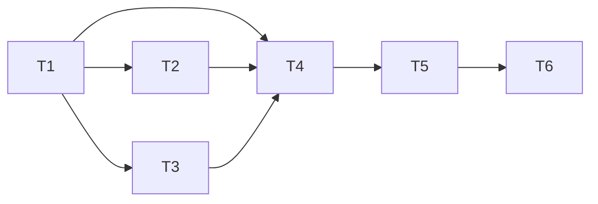

# 0073 · Multi-task and Multi-user Experiments Through a Unified Entry Point

<!-- This file is maintained by the spec tool: frontmatter is the structured source data (including the tasks DAG), and the body is a nine-section rust-RFC overview for the group. -->

## Summary

Add a task package list to the `schema_version: 2` entry point, compiling single-task and multi-task inputs into a frozen task catalog and per-round session plan. Support user counts such as N1/N4/N8, multiple users trying the same task, and mixed runs of ordinary and SWE tasks. local + local Gitea and E2B + Gitea.com continue to use the same lifecycle commands. All sessions iterate on the same Harness repository, with each session having independent writable code and a task virtual environment.

This group also consolidates the duplicate ordinary/SWE controllers into one controller, leaving task differences in task packages and workspace preparation. Existing single-task configurations remain usable; already frozen experiments continue to recover using their own source code and launch recipes. The design has passed review; implementation and acceptance status are recorded in frontmatter task statuses and acceptance reports.

## Motivation

The public entry point already supports frozen source code, credential references, role policies, simulated users and direct task interaction, and stopping and resuming the same run. The old research scripts have been archived; users must not have to use old scripts to access multi-user functionality. However, four single-task assumptions currently remain:

- `materials.check_materials()` requires `sessions_per_round=1`, and the plan prohibits duplicate task IDs in the same round, even preventing “multiple users trying the same task.”
- Source code, instructions, setup, locks, task packages, and backend workspaces each have only one slot. On the unified entry-point path, the SWE controller ignores the current task metadata and returns the sole frozen scenario; merely enabling a task pool could run the first task repeatedly.
- The ordinary/SWE controllers separately assemble roles, delivery, and round callbacks. Adding a mixed controller would create a third copy of the workflow.
- The Orchestrator already has concurrency, recovery, delivery gates, and round seals, but observation slots use `user-{persona}`, and recovery operation keys include resource parameters from the scenario. Normal recovery currently uses recorded resources and frozen scenarios, with no confirmed identity drift; new task bindings must continue to keep logical identity separate from resource coordinates.

The goal is to restore valuable historical orchestration capabilities while retaining one public entry point and one execution chain. Cross-task feedback improves the general-purpose Harness; separate copies of the Harness are not maintained, and old experiment scripts are not moved back into the main directory.

## Guide-level explanation

### Materials to prepare

Users prepare an experiment configuration, a persona library, and one or more `task-package-v1`. Each package contains a unique ID, an `ordinary`/`swebench` type, instructions, fixed source code, setup, and a dependency lock. Ordinary tasks declare `not_in_benchmark=true`, while SWE retains a fixed Git revision/repo; the task package's `interaction` selects `simulated_user` or `direct`, with the former remaining the default.

Existing single-task configurations work unchanged:

```json
"workload": {
  "kind": "swebench",
  "task_package": "../tasks/pvlib-1478/task.json",
  "persona_library": "../personas/u1.json",
  "persona_ids": ["sr-15-swyx"]
}
```

New configurations use a list, with each task's type determined by its package; they no longer specify a single `kind` representing the entire experiment:

```json
"workload": {
  "task_packages": [
    "../tasks/pvlib-1478/task.json",
    "../tasks/order-service/task.json"
  ],
  "persona_library": "../personas/library.json",
  "persona_ids": ["persona-a", "persona-b", "persona-c", "persona-d"],
  "interaction_plan": [
    [["persona-a", "pvlib__pvlib-python-1478"],
     ["persona-b", "pvlib__pvlib-python-1478"],
     ["persona-c", "order-service"],
     ["persona-d", "order-service"]],
    [["persona-a", "order-service"],
     ["persona-b", "order-service"],
     ["persona-c", "pvlib__pvlib-python-1478"],
     ["persona-d", "pvlib__pvlib-python-1478"]]
  ]
},
"rounds": {
  "count": 2,
  "sessions_per_round": 4,
  "max_parallel_users": 2
}
```

These are configuration excerpts; persona IDs are explanatory placeholders, and real configurations must reference IDs in the library. Implementation will provide two complete N4 examples, for local and E2B, referencing four existing cards and two maintained task packages; the ordinary task uses a small MIT-licensed code example. Retain the two existing N1 examples. N8 increases the number of personas and sessions using the same format, without adding an entry point or schema.

Exactly one of `task_package + kind` and `task_packages` must be selected; the list must be nonempty, and single-element lists also use the unified model. Tasks may repeat within a round, but this group requires each persona to appear only once per round; tasks may change in subsequent rounds. The session count equals the length of each round's plan and must not exceed the number of selected personas; the concurrency limit must not exceed the session count.

When no explicit plan is provided, generate one deterministically: round r starts at 1, slot i starts at 0, `k=(r-1)*sessions_per_round+i`, selecting `persona_ids[k % persona_count]` and `task_packages[k % task_count]` in order. Do not use randomness or the host environment. A single user with two persona cards still produces ABAB. This is sequential rotation and does not guarantee coverage of all user × task combinations; controlled experiments use explicit plans to specify cross-assignment, AABB, or fixed assignment.

### How a round executes

All users in the same round try the same frozen Harness SHA, each creating a workspace from the clean baseline of the corresponding task. At most `max_parallel_users` sessions run simultaneously; the rest queue in frozen slot order. Feedback retains task/persona/session/round attribution, and the entire round shares triage, synthesis, divergence, admission, and one delivery gate; after code delivery, merge, and seal are complete, the next round tries the new Harness. The final round still only performs trials and produces no additional delivery.

N4 means four sessions in one round, not four independent evolution pipelines. Each delivery still changes the Harness; user workspace changes are not merged into the shared source code of the project under test.

Commands remain unchanged. Usage of the new examples:

```bash
uv run --locked --extra experiments python backend/scripts/experiment.py check --config examples/experiments/u4-local.json --offline
uv run --locked --extra experiments python backend/scripts/experiment.py prepare --config examples/experiments/u4-local.json --secrets-file /path/to/experiment.env
uv run --locked --extra experiments python backend/scripts/experiment.py run RUN_ID
uv run --locked --extra experiments python backend/scripts/experiment.py status RUN_ID
uv run --locked --extra experiments python backend/scripts/experiment.py collect RUN_ID
```

`check --offline` displays the task list and a preview of per-round assignments, clearly marking them as not yet frozen; it does not start containers, access the network, or call models. `prepare` freezes and prepares all tasks. status distinguishes per-task preparation, per-round session status, and configured concurrency. The local dashboard reads live materials for this run; E2B continues to read the most recently collected snapshot, clearly labeling the collection time.

## Reference-level explanation

### 1. Input and freezing contracts

Add `experiment/workload.py`, defining only TaskCatalog/SessionPlan and their validation, without introducing general-purpose plugins. Convert new inputs once at the config/materials boundary; all subsequent stages consume a single internal representation:

- TaskCatalog: `contract_version: 1`, preserving the configured task order and building `tasks_by_id`. Task IDs are globally unique, and package fields, source snapshots, instructions, setup, and dependency locks jointly form the content digest.
- SessionPlan: `contract_version: 1`, with ordered entries for each round containing round, slot, persona ID, task ID, task digest, and resolved interaction. Public plans continue to accept the existing `[persona_id, task_id]`; no additional plan language is introduced.
- Newly frozen configs use a normalized task list whose order contributes to the default plan and hash. The catalog digest is determined by the complete task materials, and the plan binds catalog/task digests into recovery identity, preventing source changes from retaining the same identity.
- References, round counts, per-round slot counts, persona uniqueness within each round, task ID uniqueness, paths, source declarations, and local setup/instructions are all validated during offline checks. For remote Git, this stage validates only credential-free URLs, fixed revisions, and package structure; only after prepare fetches and verifies the revision are the complete source inventory, catalog content digest, and final plan bindings generated. Placeholder digests must not be used as recovery identities. Tasks may repeat within and across rounds, and errors identify the field or task ID.

The material layout consists of `materials/task-catalog.json`, `materials/session-plan.json`, and packages, instructions, setup, locks, and source archives under `materials/tasks/<task_id>/`; source trees are likewise grouped by task. IDs are safe single path segments, retaining existing valid SWE IDs, including `__`; task identity must not be inferred from filenames. Register all files in the existing hash inventory and publish atomically after the entire operation succeeds; failure to freeze the second task must not leave a launchable partial result.

The new manifest retains outer schema 2 and adds `workload_contract_version: 1` and `catalog_hash`; plan_hash points to the new SessionPlan, and source_snapshot.entrypoint points to the unified controller. Use explicit versions rather than inferring formats from file existence; reject unknown versions. Reading old frozen manifests does not invoke the new input conversion, alter original config/plan/source hashes, or backfill materials.

### 2. Separate task resources from session resources

Actual resources use `resources.task_workspaces[task_id]`, with each entry recording the catalog digest, preparation recipe digest, source revision/hash, status, and verification results. context references the frozen catalog, plan, and workspace descriptor files. The task resource mapping must equal the catalog set; reject missing entries, mismatches, and outdated recipes before model calls. Credentials continue to be passed through the existing private environment and are not included in frozen materials.

The task baseline stores the original source code and verified dependency recipe; a session workspace is a new writable instance created from it. No user changes enter the baseline or are inherited by other users or subsequent rounds. Retries of incomplete sessions start from a clean baseline, while fully persisted sessions are skipped through reconciliation.

Cache keys must cover at least source code, setup, locks, interpreter, platform, and build recipe; download caches, wheels, and Docker base layers may be shared, but writable repos/venvs/editable metadata must not be shared, and writable hard links must not be used. Cache initialization is serialized or locked by content key; task IDs are not proof of cross-run cache identity. Normal additions to caches are allowed, but published artifacts must not be modified by sessions, and new content is written according to atomic publication rules.

### 3. local backend

Retain one runnable Docker container per session. Share the controller/OpenAgents/Harness base image, and build a seed image for each task from fixed source code and setup; both ordinary and SWE tasks consume the same task package preparation contract. The resource table stores immutable image IDs/digests, and mutable tags are not used as proof of identity. Separate task and Harness interpreters, retaining existing worker identity, proxy, and ownership checks.

`runtime.local.seed_image` retains its meaning for single tasks; when a multi-task list has more than 1 element, specifying this field causes an offline error explaining that using one manual image for multiple tasks is currently unsupported. Automatic builds remain available, without adding another public image-list configuration.

Each session selects an image by task ID and starts an independent container, with labels binding run/config/session/task/round/attempt. Probe actual source code and dependencies for each task; session containers do not mount writable directories for other tasks. stop/destroy cleans up only all resources belonging to this run; shared image caches are not deleted when an individual run is destroyed.

### 4. E2B backend

This group retains one sandbox per experiment. Replace the sole `workspace/task` with per-task baselines and a resource table. During preparation, verify each task's setup and dependencies; during session execution, copy only source code, recreate an independent `.venv` in the final session directory, and run the frozen setup, reusing download/wheel caches. setup explicitly binds `UV_LINK_MODE=copy` or a verified equivalent isolation mechanism; hardlink/symlink installation modes are prohibited, and acceptance verifies that modifying one session's site-packages does not change another session or published caches. **Do not relocate installed venvs by default**, to prevent editable installations, shebangs, absolute binary paths, and symbolic links from contaminating other sessions.

Existing PrebuiltSource text replacement may modify shared targets through retained symbolic links; the new contract does not enter that relocation path. Also add protection against shared writes and regression tests to the old prebuilt call interface in the current checkout; old frozen runs still execute their own archived implementations, and this protection does not claim to fix their old source code. Source copying prohibits external links pointing to writable baselines/caches; any necessary internal links must resolve within the current session. Verify that `.pth`, the PEP660 finder, console-script, and import.__file__ point to the current session, and that baselines and published cache artifacts are not modified; record normal cache population separately.

Session workspaces reside in this run's private directory, with ownership recorded by session/attempt. Reclaim the entire attempt directory after execution, leaving no orphaned parent directories in `/tmp`. Bind identity before setup and launch, ensuring corresponding resource diagnostics exist even on failure; on timeout or cancellation, first terminate processes using the attempt's PID/process-group identity and confirm that child processes have exited, then delete the directory. Merely deleting directories in finally while leaving installation processes running is prohibited; if process exit cannot be confirmed, retain diagnostics and reject reuse of that attempt. Management operations use the management identity; users/Harness/delivery retain the existing non-root contract.

Threads must not change `os.environ`, process cwd, or global profiles to switch tasks; PATH/VIRTUAL_ENV/cwd and metadata are bound to the session runtime. Preparation may build tasks sequentially; the user phase runs according to the frozen concurrency limit, without automatic scaling. Continue using the existing fixed Python version, without adding a field for tasks to select their own interpreters; different dependencies do not imply support for arbitrary Python versions.

Independent directories prevent normal concurrent modifications and dependency imports from contaminating each other; **they do not protect against malicious cross-directory access by the same Unix user**. This group does not add per-session sandboxes/UIDs or promise a Docker-equivalent security boundary. Loss of an E2B sandbox continues to be handled as LOST under existing behavior; automatic rebuilding of failed sandboxes and appending rounds to historical runs are not added as incidental features.

Collect preparation/session diagnostics, results, and environment summaries, continuing to exclude `.venv`, private HOME directories, credentials, and download caches; do not include complete dependency environments in evidence bundles.

### 5. Unified controller and logical session identity

Add `controllers/unified.py`; move shared facilities into `controllers/runtime.py`, responsible only for context, Harness/Tracker, role factories, Vigil, and cleanup. Delete the duplicate ordinary/SWE controllers from the current checkout and update maintained imports and tests; old experiments have frozen these two modules, so no forwarding wrappers are retained. Continue reusing the existing loop and seed source.

Assemble scenarios from the catalog, use per-round plans to determine persona/task assignments, and pass them to the same Orchestrator. The controller also passes a read-only `task_kinds` mapping derived from the frozen catalog so cache verification can compare task types even before workspace resolution; this mapping neither adds session plan fields nor changes operation keys. Retain mixed session factory routing for direct/simulated sessions, and stop generating all scenarios from a single global TASK_PACKAGE. Required roles, grouping policies, budgets, backpressure, delivery gates, timeout diagnostics, trial-only final rounds, and round seals share one workflow.

Stable session IDs continue to be generated in one place by Orchestrator/RecoveryStore, with logical inputs consisting of frozen round, slot, persona, task digest, and interaction, within the corresponding run's namespace. Resource paths, container/sandbox IDs, temporary tags, and timestamps do not contribute to this identity. **round frozen plan, user unit key, and unit input_digest** must all be changed to use the same logical binding; changing only the key while retaining unit input containing dynamic paths is insufficient. Dynamic WorkspaceSpec is resolved from the catalog and verified resource table before an incomplete session executes; existing non-experiment loop calls continue to support the original protocol.

Bind session/task/persona/round/slot/this round's Harness SHA before materialize/setup/launch and the first model callback. Use the same session ID for recovery, SessionStore, usage, live, and Issue→evidence associations; the live slot is `user-{session_id}`, with persona as a label, and both direct/simulated sessions have started, completed, and exception states. The mixed wrapper must forward `load_completed_session`, preserving the reconciliation fast path.

Incrementally add compatible metadata for session/scenario and task ownership in the index; old data must remain readable. The requirements-evidence L1 summary adds task ID/digest/kind to prevent loss of provenance when synthesizing across tasks; do not add resource paths or automatically promote a user's experience into a confirmed fact. New result ownership must match the frozen plan.

Before reusing a result, compare session/persona/task/digest/round/slot with the frozen binding; a matching session ID alone does not prove provenance, and mismatched results must not complete a unit or generate L1. For completed SessionStore results with matching ownership, repair the index first and then skip execution; if two sessions are complete and the third is incomplete because of provision/setup/an uncaught runner exception, retry only the incomplete session and its downstream dependencies. When any unit is not finalized, do not enter requirements/delivery or sealed. A task that is incomplete or unsatisfactory to the user, and `infrastructure_failure` already saved by the runner as a terminal result, are different from an execution exception: preserve their outcome/evaluation states and evidence-admission semantics, do not treat them as successful passes, and do not prevent all failure feedback from entering requirements. This group does not add an automatic retry/promotion protocol for the final Session; full-file reconciliation must not rewrite the final content for the same ID. stop cleans up active sessions and tool processes; repeated resume must not duplicate Issues or user results. Actual provider loss follows the original lifecycle and must not treat logical identity independent of the path as automatic recovery of all resources.

### 6. Startup, Observation, and Collection

The engine starts a new unified module or an old module/script according to an explicit workload contract version, known recipe, and frozen source manifest. Arbitrary modules and fallback to the current checkout are prohibited. Compatibility is limited to existing schema-2 module/script recipes and does not include retired v1 CLI or historical research artifact imports. Old runs use the original context/env, single-task resources, and backend recipe; new runs use catalog/plan/resource map. The compatibility branch is confined to the manifest/recipe/backend boundary and does not extend through the user and requirements core.

status derives the completed/running/pending/failed session counts round by round from the recovery ledger and displays per-task preparation results. When there is no ledger or the provider is inaccessible, report unknown rather than pretending the number of configurations is the number completed. The dashboard's user entries and session details display task/persona/session/round/Harness SHA; E2B continues to perform the collection generation check, and snapshot and live-state markers remain unchanged.

collect includes the frozen directory and plan, all sessions and traces, role calls, round seals, preparation/failure diagnostics, and original evidence materials. SessionStore/RecoveryStore and other existing materials remain authoritative; do not add a second results database. The frozen manifest must not record dynamic facts; dynamic data goes into runtime/resources/receipts; the pre-destruction collection check retains its original contract.

### 7. Acceptance and Task Breakdown

Offline end-to-end script: `backend/scripts/e2e-spec-0073-multi-task-users.sh`. Invoke the actual configuration compilation, user assignment, Orchestrator, SessionStore, and recovery logic; provider substitutes may simulate only the Docker/E2B boundary and must not directly prewrite user results as a pass.

| Scenario | Verifiable result |
| --- | --- |
| Old N1 input, ABAB/AABB | New prepare uses the unified controller while preserving ordering and the original strategy/credential semantics |
| Single-task N4/N8 | 4/8 independent sessions for different users, measured active count does not exceed the concurrency limit, and delivery does not occur until all are complete |
| ordinary + SWE, direct + simulated | The correct source, instructions, setup, dependencies, and interaction factory are actually selected; it is not enough to assert that two IDs exist in a list |
| Two users on the same task | Modify one repo/venv/imported object while the other remains unchanged from baseline; evidence ownership is correct |
| Concurrent runs with different dependencies | Each shell finds its own task environment; editable import/entrypoint points to its own session; environment switching has no global-variable race |
| Interruption and recovery from an execution exception in one session | Complete results are not rerun, IDs remain unchanged, and no duplicate Issue is created; only incomplete units are retried, followed by correct delivery/seal; saved failure feedback enters requirements according to the original admission rules |
| Separation of logical binding and resource parameters | Changing workspace coordinates in the substitute does not drift round/key/input_digest; do not claim support for reconstructing LOST cloud sandboxes |
| Timeout after setup spawns child processes | Terminate the complete process group by attempt before cleanup, with no leftover installation process modifying the cache or other sessions |
| Correct session ID with incorrect task/digest cached result | Reconciliation rejects reuse and L1 generation and does not falsely claim that the user unit is complete |
| Failure midway through freeze/provision | Do not publish a partial result; associate the error with the specific task; clean up only resources from this run and do not cross-contaminate caches |
| Single package/list coexistence, duplicate IDs, unknown contract, or directory/plan mismatch | Reject clearly offline or before startup; do not fall back to the first task |
| Materials or resources replaced | Reject the mismatch before model invocation; collection must not mix in another run |
| Old frozen module/script | Keep the original manifest/hash/context/source unchanged and start from the archive; reject unknown versions/recipes |
| Observation and evidence | Live data is not overwritten; session/task/persona/round match across the full chain; L1 retains task provenance; E2B labels collection snapshots |

The real backend additionally requires two N4 rounds each on local/E2B, at least two tasks, and concurrency 2, including stop and recovery. First-round feedback must enter non-empty requirements/delivery, and the next round's Harness seal/trial results must be recorded. Record the model, tasks, timestamp, environment summary, and run ID; do not present a complete end-to-end live test using provider mocks or an empty-Issue delivery. When the environment/model is unavailable, explicitly report that it was not verified and do not claim a pass.

The complete file allocation is in frontmatter, and the sets must not overlap; the table below describes responsibilities:

| Task | Responsibility | Dependencies |
| --- | --- | --- |
| T1 | Input schema, TaskCatalog/SessionPlan, freeze/context, configuration and material tests | None |
| T2 | Local task mirroring/workspace mapping, Docker session identity and isolation tests | T1 |
| T3 | E2B initialization, session environment reconstruction, prebuilt protection and isolation tests | T1 |
| T4 | Controller integration, logical identity, two interactions, SessionStore/live/usage, evidence ownership | T1, T2, T3 |
| T5 | Recipe/old-run compatibility, status/collect, dashboard/API/UI | T4 |
| T6 | N4 examples, ordinary tasks, bilingual tutorials, repository checks, integration scripts, acceptance report | T5 |



## Drawbacks

Multiple tasks increase the cost of freezing, dependency builds, disk space, and models. Re-running setup for each E2B session is slower than copying a portable environment, but avoids unreliable path replacement; prioritize correctness and mitigate the cost with download/wheel caches. Choosing N8 does not imply sufficient memory; this group does not automatically increase CPU/memory or concurrency.

Merging the controller and maintaining compatibility with old frozen contracts impose one-time refactoring costs, and verifying real delivery also takes longer than checking JSON. To limit long-term complexity, new N1 also goes through the unified controller; compatibility serves only old frozen runs, and three new business pipelines are not maintained.

Uniqueness of a persona within a round does not cover “the same user performing multiple tasks in the same round”; an E2B sandbox does not provide security isolation between untrusted users. These two points are stated in public documentation and are not hidden promises.

## Rationale and alternatives

- **Only increase the number of users**: Simple, but it cannot guarantee task selection, dependency isolation, or evidence ownership, so this is not adopted.
- **Add a separate mixed/N4/N8 controller or script**: Fast to adapt in the short term, but every recovery/budget fix would require updating multiple copies in the long term. Use one controller, with task differences ending at the workspace provisioning layer.
- **Expose the old pool/parquet/seed configurations**: This would make users understand multiple sets of materials. Choose the task-package-v1 list; convert old single-package input only at the boundary; design historical imports separately.
- **Require schema 3 and rewrite N1**: This group is a controlled addition, and the semantics of old fields remain unchanged. Keep schema 2, add an explicit frozen-material version, and do not rewrite old runs.
- **Independent Harness pipeline for each task**: This would become multiple experiments. This group shares one Harness SHA within a round and delivers once after aggregating feedback.
- **Copy an arbitrary venv or use one E2B sandbox per session**: The former cannot reliably guarantee isolation for editable/link-based imports, while the latter expands the resource lifecycle. This group reconstructs the environment per session, retains a single sandbox, and makes the security boundary explicit.

Do not add a provider plugin framework, task-mode registry, or arbitrary callback DSL; the new model expresses only three facts: task materials, logical session binding, and actual resources.

## Prior art

This repository's Orchestrator already supports fixed_set/per-round plans, a user thread pool, shared Harness SHA, RecoveryStore, SessionStore reconciliation, and the delivery gate. DockerSeedSource starts an independent container for each provision; PrebuiltSource can copy directories, but arbitrary venv text relocation is not a correctness basis for the new contract.

task-package-v1 already unifies ordinary/SWE sources, instructions, and setup, and the mixed session factory dispatches by interaction. This group fills in the single-task assumptions in the materials, resources, controller, and observation layers while reusing the existing end-to-end loop.

## Unresolved questions

The draft has no unresolved interface choices; review should focus on the three explicit tradeoffs: the new list does not populate a global kind, persona uniqueness within a round, and one E2B sandbox with environment reconstruction per session. If changed, public validation, lifecycle, and acceptance must be updated together; changing only the examples is insufficient.

Whether the real backend/model is available is a prerequisite for acceptance execution and does not change the configuration contract; incomplete online verification must be explicitly recorded in the report.

## Future possibilities

Historical artifact imports and new-run lineage, appended rounds, a thin batch-experiment wrapper, and independent official scoring based on an archived Harness SHA are separate future groups. They depend on a stable task catalog and session ownership and are not implementation conditions for this group.

Multiple tasks for the same persona in the same round, independent E2B session sandboxes, CI runners, plain-text tasks, old seed-library conversion, and arbitrary self-hosted Gitea each require an explicitly separate boundary. This group does not restore archive entry points, modify the research archive to claim historical migration is complete, or put all historical functionality into the schema at once.
