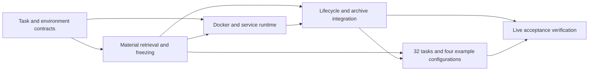

# 0081 · Migrating Research Task Materials and Docker Environments to a Unified Entry Point

<!-- This file is maintained by the spec tool: frontmatter is the structured source data (including the tasks DAG), and the body is a group-level rust-RFC nine-section overview. -->

## Summary

Migrate the existing raw task materials and Docker environment recipes for U8 mixed, U8 direct, U16, and U32 to a unified experiment entry point. The initial release retains the approach of one E2B sandbox per experiment and a separate Docker task environment for each session/attempt within the sandbox; it reuses the existing orchestration, user interaction, OpenAgents delivery, recovery, and archiving.

The public deliverables include accessible task materials for all 32 tasks with checksums, versioned environment declarations, four six-round experiment configurations, a batch list, and startup tutorials in Chinese and English. Task content, environment execution, and role orchestration are maintained separately; the shared layer coordinates through workspace and environment capability interfaces.

This design has been reviewed and approved; current implementation progress is maintained in the frontmatter Task statuses. Acceptance results for material publication, complete task readiness, and the real evolution chain are recorded independently; experiment completion cannot be inferred from implemented code.

## Motivation

The original experiments already have task materials. The task list stores the locations and SHA-256 hashes of agent/grader payloads; the execution environment restores inputs from original archives, project source code, databases, workbooks, and Docker images in E2B templates. Additional experiment scripts such as root_supervisor, round_environment, n16_environment, and task_runtime handle environment reconstruction and container connections for each round, then invoke the main repository's Orchestrator, user sessions, requirements roles, and delivery facilities as frozen at the time.

Material distribution and environment integration remain incomplete: a new user cannot reconstruct these environments through the current experiment.py merely by cloning the repository and providing credentials. Old template names, local Docker image IDs, and locations such as /opt/hse-run are not portable material identities; workspaces in which tasks have already been completed are not original inputs either.

The existing public entry point already supports schema 2 experiments, task lists, persona reuse, direct/simulated_user, six rounds with trial-only operation in the final round, local/E2B, batch, archive appends, and independent scoring. Task packages v1/v2 support source/dependency recipes, and v2 already has benchmark source and artifacts declarations; WorkspaceRuntime already provides command, file, Harness execution, and artifact boundaries. The missing piece is the container/service lifecycle for the original research tasks; these existing capabilities do not need to be rewritten.

The old environment bridge also used private registry overrides, string replacement after inspect.getsource, fixed host paths, and internal model addresses. Copying it directly would mix task content, resource management, and orchestration. This design extracts its validated preparation, reset, service, and collection semantics and integrates them through formal interfaces.

An earlier version of this document proposed a custom namespace/root implementation for two groups of five rounds with a fixed old seed; this design replaces it with the existing Docker execution boundary and four six-round examples. The short namespace probe on 2026-10-04 is only historical feasibility evidence and does not count as acceptance of this design's Docker environment or a complete experiment.

## Guide-level explanation

### User operations

Credentials continue to use examples/experiment.env.example; a new user selects one of four configurations and uses the same public entry point:

```bash
uv sync --locked --extra experiments
cp examples/experiment.env.example .env.experiment
chmod 600 .env.experiment
# Fill in model, E2B, and Gitea.com credentials.
CONFIG=examples/experiments/u32-mixed-e2b.json
uv run --locked --extra experiments python backend/scripts/experiment.py check --config "$CONFIG" --offline
uv run --locked --extra experiments python backend/scripts/experiment.py run --config "$CONFIG" --secrets-file .env.experiment
```

run --config still starts a run after prepare; users can also run prepare separately, check the frozen results, and then run RUN_ID. status, logs, stop, resume, collect, destroy, batch, and continuation continue to use the existing entry point. Users do not need to find personal snapshots, manually upload old images, copy environments from another checkout, or execute a research launcher.

### Four example groups

| Item | U8 mixed | U8 direct | U16 mixed | U32 mixed |
| --- | --- | --- | --- | --- |
| Rounds / sessions per round | 6 / 8 | 6 / 8 | 6 / 16 | 6 / 32 |
| simulated_user / direct | 6 / 2 | 0 / 8 | 12 / 4 | 25 / 7 |
| Triager / Architect / Divergent | 4 / 1 / 1 | 4 / 1 / 1 | 8 / 1 / 1 | 16 / 1 / 1 |
| Developer concurrency | 4 | 4 | 4 | 4 |
| Owner / grouping | mechanical / false | mechanical / false | mechanical / false | mechanical / false |
| User and Harness / requirements and delivery models | Flash / full version | Flash / full version | Flash / full version | Flash / full version |
| Independent scoring per round | Disabled by default | Disabled by default | Disabled by default | Disabled by default |
| R1–R5 / R6 | Feedback and delivery / trial only | Feedback and delivery / trial only | Feedback and delivery / trial only | Feedback and delivery / trial only |

All four groups use the current builtin seed by default; prepare freezes the actual source, versions, and model parameters. A historical fixed starting point is explicitly selected through the existing harness.source=archive plus SHA-256; the new examples are not described as byte-for-byte reproductions of historical runs. Public model names use the replaceable glm-5.3-flash / glm-5.3; addresses and credentials come from the model role configuration. The original persona library is reused directly, with repeated personas distinguished by slot/session.

All four public examples explicitly set max_parallel_users to 4 as the starting runtime setting for a shared 8 GiB sandbox; the E2B default is 4 CPU/8192 MiB. This differs from the initial concurrency of some old runs and must be stated directly in the example documentation. Users can modify resources and concurrency before prepare; the program checks configuration against actual capabilities and does not silently rewrite scheduling. User concurrency and Developer concurrency are distinct parameters; neither may be presented as a total resource guarantee.

The fixed example configurations do not replay model endpoint changes, output quota switches, or concurrency adjustments from historical runs. reserved_output_tokens in model limits is a capacity reservation, not the actual max_tokens switch; the actual output limit comes from the selected seed and existing runtime parameters and should be publicly listed with the frozen configuration. Environment migration does not add a model budget or early stopping policy.

### Material and source locations

```text
examples/
  experiments/u8-mixed-e2b.json、u8-direct-e2b.json
  experiments/u16-mixed-e2b.json、u32-mixed-e2b.json
  batches/evolution-four-e2b.json
  tasks/evolution32/
    manifest.json             # version, original source, file hash, public retrieval URL
    README.md、README.zh-CN.md
    <task-key>/task.json、instruction.md
  personas/library.json       # reuse the existing master library
```

The source repository stores reviewable task definitions, instructions, environment declarations, and recipes; larger inputs/recipe attachments are placed in a versioned Release, and images are placed in a registry and referenced by digest. Each material supports either a local file or a download URL with SHA-256; offline image/file caches can be reused. The task set manifest provides material identities and verification information, but does not become a second task scheduling configuration; orchestration continues to use the experiment's task_packages and interaction_plan.

The fixed materials for this release are published in the main repository's `evolution32-task-materials-v1` Release; the 37 runtime inputs, lock file, checksum manifest, and README are verified separately. Before the main repository becomes public, download using an identity and place the verified bytes in a separate cache; anonymous material downloads are to be verified after publication. The shared materials module does not add a GitHub authentication branch. Original task instructions and the fixed M04 recipe are preserved as published bytes and are not automatically formatted; identity is checked using task hashes, file inventory, and the Release lock file. The runtime and other new recipes maintained in this repository continue to undergo normal lint/format checks.

## Reference-level explanation

### 1. Layers and dependency direction

| Layer | Inputs and responsibilities | Interface boundary |
| --- | --- | --- |
| Task definitions and materials | Instructions, sources, initial data, images, environment recipes, services, artifact declarations | Defines what is needed; does not read role/round state |
| task_environments | Acquires and verifies materials, creates containers and services, checks readiness, finalizes, exports, and cleans up | Consumes only normalized environment definitions and bound attempt identities |
| local/E2B backend | Experiment-level Docker/sandbox capabilities, Gitea, networking, and overall resource lifecycle | Provides execution capabilities and actual resource facts |
| controller/Orchestrator | Assembles workspaces and runs users, feedback, delivery, and recovery | Uses tasks through workspace/runtime without branching on task ID or suite |

New modules are concentrated in experiment/task_environments/{contract,materials,docker}.py; user/sim/sources/container.py is a thin adapter integrating with the existing SeedSource. contract handles declarations, capabilities, and resource identities; materials handles material resolution/acquisition/freezing; docker handles registered concrete Docker resources and services. The initial implementation provides only Docker capability, without introducing a general workflow/DAG, arbitrary Python import plugins, or a separate manager for each benchmark. Modules are extended according to task attributes; a future environment driver should use the same capability contract.

contract does not depend on the Docker/E2B SDK, roles, or scorers; the Docker implementation depends on basic workspace/runtime capabilities, and the basic user/sim/runtime does not import concrete experiment managers in the reverse direction. backend/controller assembles the container source through an explicit factory/context rather than overriding a global instance at import time. The shared artifact collector calls only the runtime's bounded file/service export capabilities and does not import the Docker manager; environment capability implementations are separate from scoring consumption.

The environment module does not import Triager, Architect, Divergent, Owner, OpenAgents scheduling, or Harbor Index profile; the controller does not interpret preparation commands for KV/Excel/a particular benchmark. The existing evaluation/Harbor preserves evaluation independence; the environment module is not bound to a Harbor version, task list, or scorer. The Gitea evidence publisher/reader and OpenAgents delivery contract continue unchanged.

### 2. Task package versions and normalization

experiment continues to use schema_version=2. The original documents, default behavior, directory/venv paths, frozen hashes, and prepared run identities of existing task-package-v1/v2 packages remain unchanged; no environment default fields are injected into those packages. The new task-package-v3 specifically expresses container environments, avoiding the need for non-Python tasks to fabricate source directories, setup.sh, or requirements.lock.

Common v3 fields are id, the actual kind/benchmark source, instruction_file, interaction, environment, and execution/artifacts with their existing semantics. environment.kind=container, with fields including a fixed image, workdir, input mappings, initialization/readiness/finalization recipes, limited service declarations, and resource/capability requirements. SWE tasks retain actual Git repo/revision metadata and the original baseline; non-Git tasks explicitly declare that patch is not applicable and use actual file/service artifacts. ordinary still requires an explicit not_in_benchmark=true; a benchmark source cannot be converted into an ordinary task to bypass validation.

Version differences converge in the task parsing and material compilation layers into normalized environment definitions, frozen task records, and prepared workspace descriptions. Downstream components select a runtime based on environment capabilities rather than adding task-package version checks everywhere. The original package from the input is still used for identity/audit, and the normalized execution description must not retroactively change old package hashes. Startup is rejected when workspace capabilities are unknown; it must not be disguised as prebuilt.

v3 directly reuses the existing artifacts.version=1, workspace/managed_service, artifact id, required/max_bytes, and receipt definitions. Input mappings handle initial materials, artifacts handle final outputs, and service declarations handle runtime resources; these do not maintain a duplicate outputs/collect list. Managed services reference registered service outputs by handle; users do not provide arbitrary host read paths.

### 3. Material export, acquisition, and freezing

tools/dev/export-evolution-task-materials.py is a material publication tool that only exports and verifies original task inputs and environment recipes; it does not start user, requirements, or delivery roles. It reads the original agent payload, pristine source, workbooks/databases, baseline images, and service recipes according to per-task manifests, and records provenance, original SHA-256, file inventory, and necessary format conversion records. If items are missing, original hashes do not match, or an unsolved baseline cannot be found, it reports the specific gaps; it must not fill them from a workspace where the task was completed, R6 output, or another task.

Existing Docker image IDs are used only to verify provenance. Published images should be rebuildable from frozen recipes, or first exported from verified original images and then published as immutable registry digests, with a clear distinction between rebuildable and merely obtainable; personal template aliases are not treated as long-term material entry points. The runtime does not need historical templates from the original E2B account. Agent inputs do not include grader, gold patch, hidden assertions, or original experiment answers; management-side service materials are placed according to role, and an entire historical sandbox must not be copied to a task.

check --offline only checks local metadata, instructions, material references and hash formats, target paths, capability combinations, and pairings; for inputs with declared remote sources that are not cached locally, it explicitly lists pending downloads and does not claim that the actual content or provider has been verified. prepare downloads to a content-addressed cache, verifies archive hashes and file inventories, atomically publishes the cache, and freezes image digests, recipes, services, instructions, artifact declarations, and source identities. Download failures preserve verified cache entries and an explicit stage without entering PREPARED; retries can resume, but partially downloaded packages that have not passed verification must not be cached.

prepare retains responsibility for freezing inputs and preparing the toolchain; it does not implicitly start formal user sessions or create Gitea repositories. Required E2B toolchain templates are prepared from fixed recipes; actual Docker/kernel/permission capabilities are probed after run creates its sandbox and before model calls. Task containers are created per attempt according to concurrency slots and checked for readiness; a complete 32-task environment probe is part of release acceptance and does not require an additional round of 32 model tasks on every run.

Input targets reject traversal, link escapes, management paths, and overlapping conflicts; safe extraction preserves declared file types/modes and must not reuse the old scripts' arbitrary fully_trusted extraction. Both cached and remotely downloaded content undergo the same hash/inventory verification. Commands are expressed as argv with explicit cwd/timeout; environment preparation scripts are locked materials, not tool instructions generated on the fly by an Agent.

### 4. Docker task environments and workspace integration

The initial E2B path uses one sandbox per experiment, with a verified Docker daemon available inside the sandbox; each session/attempt creates a separate task container, writable inputs, temporary directories, and its own network/volumes. The existing local path remains available; the same environment driver can use local Docker, but rich tasks are declared supported locally only after acceptance of equivalent local capabilities, and must not silently fall back to a host directory.

The environment manager creates resources using the frozen task digest, recipe digest, and run/config/round/slot/session/attempt identities. Concurrent instances with the same persona, the same /app path, and the same port do not share writable volumes or service networks. The mapping between actual Docker image identity and declared digest, resource limits, and readiness results are recorded in the receipt. Total CPU/memory and concurrent resource requirements can be checked; combinations that cannot be satisfied are explicitly blocked, without automatically reducing concurrency, changing images, or rewriting task instructions.

The container source is connected through the existing public registry mechanism; it does not override prebuilt or modify the private _REGISTRY. Parameters are passed explicitly; run is not inferred from a fixed /opt directory, experiment alias, or globally mutable env. ContainerTaskRuntime reuses the command, file, and stdio implementations of the existing DockerWorkspaceRuntime, encapsulates the lifecycle with an environment handle, and avoids duplicating the entire runtime. Only genuinely necessary public capability hooks may enter WorkspaceRuntime; existing Local/Docker default behavior remains unchanged.

The user's file/command tools, persona-based modifications, Harness, public diff, and task artifacts all enter the same task runtime. The Harness's current JSONL request, progress, reply, and status/termination_reason semantics remain unchanged; stdout/stderr flow immediately and must not be replayed after completion; interruption and timeout apply to the execution process they belong to. Model connections and credentials are provided by the existing role/network layers; the task bundle and runtime adapter must not hard-code or rewrite any internal network endpoint.

The environment injects only the fixed toolchain and staging content required to run the Harness. It does not mount the entire controller checkout, role records, all task payloads, the Docker socket, Gitea/provider credentials, or other session directories. Source/dependency preparation retains real tool versions and does not force every task to use the controller's Python. When ordinary tasks do not require Git, patch/export capability is explicitly not applicable; the absence of .git must not cause valid non-code artifacts to be misclassified as a freeze failure.

### 5. Services, Actor Freeze, and Artifacts

environment.services is a finite, fixed service list: id, placement in the main task container or a companion, fixed image/argv, dependencies, readiness, startup and finalize limits, logs, and handles permitted for export. Services are not model sub-Agents and do not permit arbitrary dynamic orchestration. The KV target process and load generator each run according to the original task contract; only the target environment has capabilities such as ptrace required by that task. The management-side companion, measurement records, and code are not exposed through the task volume.

Reuse the existing quiesce → finalize_task → artifact collection call sites. The phase semantics for a service runtime are:

```text
Actor stops further edits
    → Services required by the task complete sampling/finalize per the recipe
    → Stop writes and freeze files and service outputs
    → The shared collector saves the artifact receipt and management records
    → close cleans up owned execution resources
```

The current ordinary Docker runtime's rule for fully cleaning up processes inside the container cannot be reused directly, because it would kill the KV server/loadgen prematurely. The new runtime must distinguish the Actor execution tree, managed services, and other writing processes, and confirm frozen only after service finalization. Initialization and measurement finalization have separate explicit limits and must follow the original task measurement points; after an Actor task deadline, only the established measurement/collection operations are permitted, with no additional time granted to continue solving the task.

Workspace files are collected through bounded export by their owning runtime; managed_service verifies the handle's run/session/attempt and sealed outputs through the environment manager, then proceeds through the existing artifact receipt. The scorer consumes only frozen artifacts and does not perform official grading at the environment layer; the existing per-round assessment-worker and post hoc grade remain independent. Migrating the task environment does not mean that all official acceptance contracts such as KV/TUA have already been completed.

When freeze/finalize fails, receipt.complete must be false even if exports is empty; record the failed phase, and do not treat all([]) as a successful freeze. If required artifacts are missing/exceed limits or collection fails, retain diagnosable resources; do not delete containers first and then claim completeness. Management records and safe projections readable by users/requirement roles are stored separately; hidden scoring data must not flow into feedback.

### 6. Recovery, Cleanup, and Unified Archiving

The task environment uses one persistent resource registry file, reuses the existing run resource identity and recovery attempt, records the creation intent before side effects, and after success registers the actual IDs, ownership, status, and collection receipts of containers/networks/volumes/services. Connections, collection, and cleanup all verify the actual resource labels against run/config/session/attempt/recipe; processes additionally record the PID and launch identity and cannot be reused as live processes based only on name or PID. Operations should support reconciliation and retry; do not add a separate experiment checkpoint or replay controller.

| Situation | Behavior |
| --- | --- |
| Retry of the same creation operation | Reconcile resources already registered for this attempt to prevent duplicate containers/Actors |
| Recovery of a completed session | Reuse the sealed Session, artifacts, and report receipts; do not rerun or resend the Issue |
| An incomplete environment is still alive | Verify and connect through the existing recovery semantics, or seal/stop it first and then establish a new attempt |
| Environment/service has been lost | Record an infrastructure failure and wait for recovery; create a new attempt from pristine inputs, without pretending to resume the original process |
| Finalization/collection failure | Retain the phase and resource identity, and resume finalization/collection; do not rerun a completed Actor because logs are missing |
| stop/destroy | Process only resources with matching ownership; stop further progress when ownership is unauthorized or cleanup cannot be confirmed |

Do not execute docker rm on all containers, perform a global network prune, kill by process name, or infer ownership from resource names. Infrastructure failures in task preparation/services/collection must not be wrapped as negative user experience, task failure, or an improvement Issue followed by continuation to the next round; ordinary task-solving failure remains valid usage feedback and must not be used to eliminate candidate Harnesses through environment mechanisms.

collect continues to use the existing archiver and preserves the identity of frozen materials, each round's Harness, user interactions, requirement/design/delivery records, Gitea snapshots, and task artifact/environment receipts; it does not recursively package the Docker graph, dependency caches, the entire E2B VM, or credentials. Completeness is determined by the actual state in this run. Automatic cleanup after collection of a successful terminal state for a single run, supervised collection for batches, and Gitea retention rules continue to apply.

A continuation inherits the public inputs and complete environment recipe, and creates new environment resources in the child run; the parent's terminal-state files and management measurements are retained as historical evidence and do not automatically become the initial state of the new round. Old frozen runs continue to use their original source code; their workspaces are not upgraded in place, nor are they falsely represented as having service capabilities.

### 7. Provenance Contract for the 32 Tasks and Four Configurations

The material set is based on the original tasks/personas list and payload hash for this study. The 32 ordered task keys are: O03, O09, O14, M03, O01, kv-live-surgery, tinydb, M01, O05, O06, vf2-speedup-networkx, pretrain-shard-corruption, 091-add-receipts-bookkeeping, flask-restful, M05, M09, O02, O04, astroid-1030, sqlfluff-3608, marshmallow-2123, payments-pipeline-fix, wal-recovery-ordering, vba-userform-port, react-lead-form, 080-convert-novel-epub, cookiecutter, tqdm, M02, M04, M07, M10. Metadata retains the actual benchmark task IDs; provenance must not be inferred from these short keys alone.

U8 takes the first eight items, U16 takes the first sixteen, and U32 uses all items; each group reuses the public persona master library according to the original pairings. For direct slots whose original tasks have no interactive persona, the existing sr-15-swyx is explicitly used as the terminal-state review persona, without claiming that another user actually participated. The ordered plan within each round is explicitly written to interaction_plan, preserving the original experiment's sequence of shifting the starting task slot by round, rather than inferring pairings through a new implicit rotation.

The original inputs, environments, personas, seeds, models, capacity/task budgets, resources, concurrency, roles, and scheduling for U8 mixed and direct are all identical; only the six interaction fields and derived identities differ. Interaction modes are explicitly overridden by task ID through workload.interaction_overrides; U8 direct overrides only the six original simulated_user tasks. Unknown task IDs or modes are rejected, and overrides are not allowed when inheriting the parent workload. There is only one copy of the task instructions, materials, and environment objects; pairing checks compare the actual source/input/image/recipe/persona identities after ignoring interaction, and must detect any additional differences. Task-set materials serve as the provenance manifest; there is still only one frozen catalog/session plan for task bindings.

All four groups default to 6 rounds. R1–R5 use the existing full feedback delivery process, while R6 includes only the user and explicitly enabled independent acceptance; the old five-round setup and the new six-round setup must not be conflated. Official task budgets come from fixed metadata or an explicit operator quota, and conflicts between sources must be reported; outer_timeout_seconds from old scripts must not be automatically promoted to the official task time limit. Time spent on prepare/image pulling/file preparation is recorded separately from the problem-solving budget.

### 8. Task DAG and Acceptance



| Task | File Ownership and Deliverables |
| --- | --- |
| T1 | Task schema/contract, configuration/workload parsing, and corresponding tests |
| T2 | Material export/retrieval/freezing, provenance and cache validation, and corresponding tests |
| T3 | Docker, container source, service finalization and shared artifact export integration, and corresponding tests |
| T4 | backend and controller assembly, integration with existing recovery/collect/continuation, and corresponding tests |
| T5 | 32 task definitions/recipes, four configurations, batch, bilingual documentation, and pairing checks |
| T6 | Rerunnable acceptance scripts, real execution evidence, and CI contract regression tests |

The unique Task ownership of each file is determined by its frontmatter. Within shared artifact collection files, this group's T3 is responsible for the runtime-managed export port, finalize failure propagation, and existing receipt distribution; the scoring plans, adapters, and original-environment acceptance in 0083 remain maintained by the scoring side, and a separate copy of container management or finalization must not be implemented. Unfinished acceptance in 0083 that depends on environment capabilities retains its original status; this group does not require all official benchmark scorers to be implemented first, nor does it automatically mark Tasks in other specs as done on that basis. The end-to-end entry point is backend/scripts/e2e-spec-0081-e2b-task-environments.sh.

| Acceptance level | Required observable results |
| --- | --- |
| Configuration and legacy-path regression | The original v1/v2 package hashes remain unchanged; U1/U4 local/E2B, direct/simulated, batch, and continuation remain usable; unknown versions are rejected |
| Material distributability | Materials can be prepared in a new directory or new E2B account from locked public sources; corrupted caches, partial downloads, mirror drift, and missing original inputs are diagnosable |
| Three basic task types | Original source-code tasks, real Excel/database tasks, and real KV services each complete prepare/readiness/execution/artifact collection |
| Readiness of 32 tasks | Every original task is individually checked for files, images/tools, services, working directory, and provenance; no substitution with toy tasks or different tasks bearing the same name |
| Concurrency and cross-round reset | At least two sessions using the same paths/ports do not leak data between them; original data baseline hashes match, and changes from a previous round or failed attempt do not carry into the next round |
| User and Harness execution | direct and real persona tool interactions use the same runtime; JSONL, live output, interruptions, failure states, and process termination can be verified |
| Service finalization and measurement | The KV target and loadgen are ready under the original contract; freezing does not inadvertently terminate measurement; service failures/timeouts remain failures, and an empty export cannot mask finalize errors |
| Artifacts and recovery | Real workbook/database/file/service artifacts are saved with bytes/hash; recovery from loss/restart/collection failure does not repeat completed Actors, and resources outside the ownership scope are unaffected |
| Complete evolution chain | Complete at least one set of two rounds of real task runs through the public entry point, with actual requirement handling and at least one delivery in the first round and only the user in the second round; exercise stop/resume, collect, archive inspection, and cleanup |
| Four configurations and documentation | Six rounds, roles, pairings, resources, and model/seed sources are explicit; the U8 control changes only the interaction mode; users can copy documentation commands to launch runs |

Record offline tests, readiness of the 32 tasks, bounded model probes, the two-round chain, and the four complete six-round research runs separately. T6 can be completed based on acceptance of the real chain and materials described above; it does not mean that all four six-round runs have been rerun. A separate “six rounds completed” credential may be published for a group only after all of its rounds have actually completed and its final-state archive is complete. For development acceptance, generate a separate two-round configuration outside the repository; do not overwrite or rewrite the public six-round example with a short test.

User acceptance with zero Issues is a valid outcome; do not fabricate complaints to satisfy delivery coverage or insert technical issues into the main record. The two-round acceptance should select scenarios in this task set that can genuinely expose problems; if no actual requirements or deliveries occur, record only the session/environment chain that passed, and do not claim that the required delivery acceptance was completed. An independent technical canary may verify interfaces, but it must be listed separately and must not be presented as natural feedback.

## Drawbacks

Docker, image publication, and service lifecycles are more complex than source/venv tasks and also increase initial download time and disk usage. One bounded environment module centrally bears these costs, caches recipes by content, and displays the preparation stage; generic roles/orchestration do not handle task details.

Tasks within one E2B sandbox share total CPU/memory, the Docker daemon, and the kernel; a separate container for each task is not the same as a separate E2B VM. Concurrency for the four groups is explicitly fixed, and resource shortfalls should be exposed as configuration/runtime facts. This proposal does not claim guarantees for arbitrary malicious code or lossless cross-account VM migration.

Adding task package v3 for container requires handling the new form at parsing/freezing, but avoids making non-Python environments depend on fictitious venv recipes. Existing packages and frozen runs retain their respective original contracts; implementation requires regression tests to prevent version normalization from rewriting legacy identities.

Some materials in old snapshots may exist only as binaries or local images. Public availability and full reconstructibility require separate evidence; identifying material gaps is a prerequisite for implementation, and an existing inventory is not grounds to claim that everything has already been independently exported.

## Rationale and alternatives

The existing Docker boundary was chosen because the original research already ran with per-task Docker environments, and the repository already has DockerWorkspaceRuntime, workspace provisioning, and artifact freezing interfaces. Migration focuses on materials, service lifecycles, and integration with the unified entry point, while retaining the same model/user/requirement/delivery orchestration.

| Alternative | Trade-off |
| --- | --- |
| Continue publishing dedicated launch scripts and personal snapshot aliases | Can keep runs working on existing machines, but new users cannot independently obtain the initial state, and recovery/archive maintenance is duplicated; cannot meet the unified-entry-point goal |
| Build custom mount/PID/network namespaces and a new root protocol | Reimplements Docker's existing boundaries, process channels, and cleanup capabilities; not adopted for this work, and old probes do not count toward the new acceptance |
| Start a separate E2B sandbox for each task | Can provide more independent VM resources, but changes current deployment and cost/scheduling conditions; retained as a future environment-driver extension |
| Convert all evolution tasks to Harbor tasks | Would bind the user environment to independent held-out evaluation and change the runtime semantics of some tasks; this work retains each task's source and scoring boundary |
| Standardize on the old source-plus-setup task form | Suits existing Python tasks, but would require Excel/database/running-service tasks to fake source/venv; use an explicit container package form |

The environment manager receives environment declarations and bound attempts, not complete role configurations; task ID and benchmark suite are used only for provenance. Materials, inputs, artifacts, and resource identities each have a single source of truth; do not create another task scheduling plan, set of scoring results, or experiment state machine.

## Prior art

The repository's SeedSource/WorkspaceRuntime, DockerWorkspaceRuntime, and unified controller have already brought user tools and Harness execution into the same location; existing artifact collection provides call sites for stopping Actors, finalize, sealing, and receipt. The ordinary file branch already works; managed_service is currently explicitly unsupported, and this work connects that reserved port.

The original four experiment groups' task inventories, payload SHA-256 values, per-round Docker rebuild scripts, readiness checks, and environment receipts provide the basis for task materials and behavior. They are migration inputs, not another publicly maintained entry point. Original materials, currently curated recipes, and new run results should be reconcilable item by item.

The existing unified entry point already handles Gitea.com, requirement/delivery isolation, round sealing, resource checks, archiving, and continuation. This work reuses those responsibilities and adds only task environment contracts and evidence; independent Harbor evaluation remains maintained by evaluation/.

## Unresolved questions

The scope, deployment method, and module boundaries for this work are fixed according to the confirmed plan, which has been approved in review and has entered implementation. There is no isolation scheme or second launch entry point for the implementer to choose.

Specific Release/registry coordinates, the actual exportability of the 32 materials, and toolchain reconstructibility are deliverables that must be verified during implementation and recorded in the locked manifest; do not launch with placeholder addresses. When original inputs are missing or budget sources conflict, retain the gap; do not resolve the blocker by substituting tasks, using a completed state, or silently changing conditions.

On 2026-11-01, the operator confirmed that M02's original workspace contained only the assignment brief and CI launcher, and requested that it remain unchanged as a robustness test for incomplete input. Retain the original instructions and original package bytes for this item; do not add candidate source code, regression tests, API placeholders, or a solution. Record this decision in the materials manifest; restoring these files is no longer a prerequisite for release. Record package verifiability, exportability, and whether the original assignment is complete enough to be solvable separately. This does not relax general material hash, archive safety, or environment readiness checks, and does not add an M02 special case at runtime.

## Future possibilities

The same environment contract could gain a per-task independent E2B or other execution driver, and local support for rich tasks could be expanded through capability-based acceptance; new task sets and service recipes could be added without modifying roles or branching the controller by benchmark.

An independent scoring framework could consume the service/non-code artifacts frozen by this work and add adapters according to each benchmark's original acceptance contract. New scoring does not change task initialization or recharacterize tasks already used for evolution as held-out.

The four complete six-round research runs, resource/concurrency comparisons, and additional model output budget experiments are recorded separately and are not implicitly completed outcomes of materials migration acceptance.

