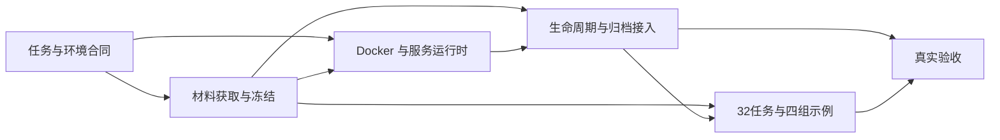

# 0081 · 研究任务材料与 Docker 环境迁入统一入口

<!-- 本文件由 spec 工具维护：frontmatter 为结构化源数据（含 tasks DAG），正文为组级 rust-RFC 9 段总览。 -->

## Summary

将已有 U8 mixed、U8 direct、U16、U32 的原始任务材料与 Docker 环境配方迁入统一实验入口。首批沿用一个实验一个 E2B 沙箱、沙箱内每个 session/attempt 创建独立 Docker 任务环境的方式；复用现有编排、用户交互、OpenAgents 交付、恢复和归档。

公开交付包括可获取且有校验和的 32 任务材料、版本化环境声明、四份六轮实验配置、批次列表和中英文启动教程。任务内容、环境运行和角色编排分别维护；通用层通过工作区及环境能力接口协作。

本设计已经审阅批准，当前实现进度由 frontmatter 的 Task 状态维护。材料发布、完整任务就绪与真实演化链路的验收结果独立记录，不能从代码已实现推断实验已完成。

## Motivation

原实验已经有任务材料。任务清单保存 agent/grader payload 的坐标和 SHA-256；执行环境从 E2B 模板中的原始压缩包、项目源码、数据库、工作簿及 Docker 镜像恢复输入。额外的 root_supervisor、round_environment、n16_environment、task_runtime 等实验脚本负责每轮环境重建和容器连接，再调用当时冻结的主仓 Orchestrator、用户会话、需求角色及交付设施。

尚未完成的是材料分发和环境接入：新用户不能仅 clone 仓库、填写凭证，就通过当前 experiment.py 重建这些环境。旧模板名、本地 Docker image ID、/opt/hse-run 等坐标不是可移植的材料身份；完成过任务的工作区也不是原始输入。

现有公开入口已经支持 schema 2 实验、任务列表、persona 复用、direct/simulated_user、六轮及末轮只试用、local/E2B、batch、归档追加与独立评分。任务包 v1/v2 支持源码/依赖配方，v2 已有 benchmark 来源和 artifacts 声明；WorkspaceRuntime 已提供命令、文件、Harness 执行及产物边界。当前缺少原研究任务的容器/服务生命周期，不需要重写这些已具备的功能。

旧环境桥接还使用过私有注册表覆盖、inspect.getsource 后字符串替换、固定宿主路径和内网模型地址。直接复制会使任务内容、资源管理和编排混在一起。本次提取它们已经验证过的准备、重置、服务及收集语义，以正式接口接入。

旧版本文提出自建 namespace/root 的实现，面向两组五轮及固定旧 seed；本次设计替换为现有 Docker 执行边界及四组六轮示例。2026-10-04 的 namespace 短时探针仅是历史可行性证据，不计为本方案 Docker 环境或完整实验验收。

## Guide-level explanation

### 用户操作

凭证继续使用 examples/experiment.env.example；新用户选择四份配置之一，使用同一个公开入口：

```bash
uv sync --locked --extra experiments
cp examples/experiment.env.example .env.experiment
chmod 600 .env.experiment
# 填写模型、E2B、Gitea.com 凭证。
CONFIG=examples/experiments/u32-mixed-e2b.json
uv run --locked --extra experiments python backend/scripts/experiment.py check --config "$CONFIG" --offline
uv run --locked --extra experiments python backend/scripts/experiment.py run --config "$CONFIG" --secrets-file .env.experiment
```

run --config 仍是 prepare 后启动；也可分别 prepare、核对冻结结果、run RUN_ID。status、logs、stop、resume、collect、destroy、batch 和 continuation 沿用现有入口。用户不需要寻找个人快照、手动上传旧镜像、拷贝其他 checkout 的环境或执行研究启动器。

### 四组示例

| 项目 | U8 mixed | U8 direct | U16 mixed | U32 mixed |
| --- | --- | --- | --- | --- |
| 轮数 / 每轮会话 | 6 / 8 | 6 / 8 | 6 / 16 | 6 / 32 |
| simulated_user / direct | 6 / 2 | 0 / 8 | 12 / 4 | 25 / 7 |
| Triager / Synthesizer / Divergent | 4 / 1 / 1 | 4 / 1 / 1 | 8 / 1 / 1 | 16 / 1 / 1 |
| Developer 并发 | 4 | 4 | 4 | 4 |
| Owner / grouping | mechanical / false | mechanical / false | mechanical / false | mechanical / false |
| 用户与 Harness / 需求与交付模型 | Flash / 完整版 | Flash / 完整版 | Flash / 完整版 | Flash / 完整版 |
| 逐轮独立评分 | 默认关闭 | 默认关闭 | 默认关闭 | 默认关闭 |
| R1–R5 / R6 | 反馈与交付 / 仅试用 | 反馈与交付 / 仅试用 | 反馈与交付 / 仅试用 | 反馈与交付 / 仅试用 |

四组默认使用当前 builtin seed；prepare 冻结实际源码、版本和模型参数。历史固定起点通过已有 harness.source=archive 加 SHA-256 显式选择，不把新示例称为历史运行的逐字节复现。模型名公开使用可替换的 glm-5.3-flash / glm-5.3，地址和凭证来自模型角色配置。原 persona 库直接复用，重复 persona 由 slot/session 区分。

四组公开示例的 max_parallel_users 统一显式设为 4，作为共享 8 GiB 沙箱的起始运行设置，E2B 默认 4 CPU/8192 MiB；它不同于部分旧运行的初始并发，需在示例说明中直接列出。用户可在 prepare 前修改资源和并发；程序检查配置与实际能力，不静默改写调度。用户并发和 Developer 并发是两个不同参数，不能将其中之一宣传成总资源保证。

示例固定配置不重演历史运行中的模型换址、输出额度切换和并发调整。模型 limits 中的 reserved_output_tokens 是容量预留，不是实际 max_tokens 开关；实际输出上限来自选定 seed 和已有运行参数，应随冻结配置公开列出。环境迁移不新增模型预算或早停策略。

### 材料与源码位置

```text
examples/
  experiments/u8-mixed-e2b.json、u8-direct-e2b.json
  experiments/u16-mixed-e2b.json、u32-mixed-e2b.json
  batches/evolution-four-e2b.json
  tasks/evolution32/
    manifest.json             # 版本、原始来源、文件 hash、公开获取地址
    README.md、README.zh-CN.md
    <task-key>/task.json、instruction.md
  personas/library.json       # 沿用现有主库
```

源码仓保存可审阅的任务定义、指令、环境声明和配方；较大输入/配方附件放版本化 Release，镜像放 registry 并使用 digest。每项材料同时支持带 SHA-256 的本地文件或下载地址，离线镜像/文件缓存可重用。任务集清单提供材料身份和校验信息，不成为第二套任务调度配置；编排仍以 experiment 的 task_packages 与 interaction_plan 为准。

本次固定材料发布于主仓 `evolution32-task-materials-v1` Release，37 项运行输入及锁文件、校验清单、README 分别核验。主仓公开前以身份下载并将已验证字节放入独立缓存，匿名材料下载待公开后验证；通用材料模块不增加 GitHub 认证分支。原始任务指令及 M04 固定配方按发布字节保存，不自动格式化，身份由任务 hash、文件 inventory 和 Release 锁文件检查；本仓维护的运行时与其他新配方继续接受常规 lint/format。

## Reference-level explanation

### 1. 分层与依赖方向

| 层 | 输入与职责 | 接口边界 |
| --- | --- | --- |
| 任务定义与材料 | 指令、来源、初始数据、镜像、环境配方、服务、产物声明 | 定义需要什么，不读角色/轮次状态 |
| task_environments | 获取并核验材料，创建容器与服务，检查就绪，收尾、导出和清理 | 只消费规范化环境定义及 bound attempt 身份 |
| local/E2B backend | 实验级 Docker/沙箱能力、Gitea、网络及总体资源生命周期 | 提供执行能力和实际资源事实 |
| controller/Orchestrator | 装配工作区，运行用户、反馈、交付和恢复 | 通过 workspace/runtime 使用任务，不分支判断 task ID 或 suite |

新增模块集中于 experiment/task_environments/{contract,materials,docker}.py；user/sim/sources/container.py 是接入既有 SeedSource 的薄适配。contract 负责声明、能力和资源身份，materials 负责材料解析/获取/冻结，docker 负责已登记的具体 Docker 资源与服务。首次只实现 Docker 能力，不引入通用 workflow/DAG、任意 Python import 插件或每个 benchmark 一套 manager。模块按任务属性扩展；未来需要另一种环境驱动时沿用相同能力合同。

contract 不依赖 Docker/E2B SDK、角色或评分器；Docker 实现依赖基础 workspace/runtime 能力，基础 user/sim/runtime 不反向导入 experiment 的具体管理器。backend/controller 通过明确的工厂/上下文装配 container source，不靠 import 时覆盖全局实例。共用 artifact collector 只调用 runtime 的有界文件/服务导出能力，不导入 Docker 管理器；环境能力的实现与评分消费分开。

环境模块不导入 Triager、Synthesizer、Divergent、Owner、OpenAgents 调度或 Harbor Index profile；controller 不解释 KV/Excel/某 benchmark 的准备命令。既有 evaluation/Harbor 留出评测独立，环境模块不绑定 Harbor 版本、任务名单或评分器。Gitea 证据 publisher/reader 及 OpenAgents 交付合同继续沿用。

### 2. 任务包版本和规范化

experiment 继续使用 schema_version=2。现有 task-package-v1/v2 的原始文档、默认行为、目录/venv 路径、冻结 hash 和已准备 run 身份保持不变；不向这些包注入 environment 默认字段。新增 task-package-v3 专门表达 container 环境，避免要求非 Python 任务伪造源码目录、setup.sh 或 requirements.lock。

v3 共同字段为 id、真实 kind/benchmark 来源、instruction_file、interaction、environment，以及已有语义的 execution/artifacts。environment.kind=container，字段包括固定 image、workdir、输入映射、初始化/就绪/收尾配方、有限服务声明和资源/能力要求。SWE 任务保留真实 Git repo/revision 元数据及原始基线；非 Git 任务明确声明 patch 不适用，使用真实文件/服务产物。ordinary 仍需明确 not_in_benchmark=true，benchmark 来源不能被转换成普通任务绕过校验。

版本差异在任务解析和材料编译层收敛为规范化环境定义、冻结任务记录及 prepared workspace 描述。下游根据环境能力选择 runtime，不按 task-package 版本到处加判断。输入中的原始 package 仍用于身份/审计，规范化执行描述不得反向改变旧包的 hash。工作区能力未知时拒绝启动，禁止伪装成 prebuilt。

v3 直接复用现有 artifacts.version=1、workspace/managed_service、artifact id、required/max_bytes 及 receipt 定义。输入映射负责初始材料，artifacts 负责终态输出，服务声明负责运行资源；三者不重复维护另一份 outputs/collect 清单。受管服务由 handle 引用已登记的服务输出，不由用户提供任意宿主读取路径。

### 3. 材料导出、获取和冻结

tools/dev/export-evolution-task-materials.py 是材料发布工具，只导出和校验原始任务输入及环境配方，不启动用户、需求或交付角色。它根据逐任务清单读取原始 agent payload、pristine 源码、工作簿/数据库、基线镜像及服务配方，并保存来源、原 SHA-256、文件 inventory 和必要的格式转换记录。缺项、原始 hash 不符或找不到未解题基线时报告具体缺口，不能从完成过任务的 workspace、R6 输出或其他题目补齐。

已有 Docker image ID 只用于核对来源。发布镜像应可由冻结配方重建，或先从经核验的原始镜像导出后发布为不可变 registry digest，并明确区分可重建与仅可获取；不把个人模板 alias 当长期材料入口。运行时不需要原 E2B 账户的历史模板。agent 输入不包含 grader、gold patch、隐藏断言或原实验答案；管理侧服务材料按角色放置，不能整个历史沙箱复制给任务。

check --offline 只检查本地元数据、指令、材料引用及 hash 格式、目标路径、能力组合和配对；对于声明了远端来源但本地未缓存的输入，明确列出待下载项，不声称已经核验实体或 provider。prepare 下载至内容寻址缓存，核对归档 hash 与文件 inventory，原子发布缓存，冻结 image digest、配方、服务、指令、artifact 声明和源码身份。下载失败保留已验证缓存及明确阶段，不落 PREPARED；可断点重试，但不能缓存未通过验证的半包。

prepare 维持冻结输入/准备工具链的职责，不隐式开始正式用户会话或创建 Gitea 仓。需要的 E2B 工具链模板按固定配方准备；真实 Docker/内核/权限能力在 run 创建所属沙箱后、模型调用前探测。任务容器按并发名额逐 attempt 创建并检查 readiness；完整 32 任务环境探针属于发布验收，不要求每次运行额外执行一轮 32 个模型任务。

输入目标拒绝遍历、链接逃逸、管理路径和重叠冲突；安全解压保留经声明的文件类型/模式，不能沿用旧脚本的任意 fully_trusted 解压。无论缓存还是远端下载，都经过相同 hash/inventory 校验。命令以 argv 和显式 cwd/超时表达，环境准备脚本是锁定材料，不是 Agent 临时生成的工具指令。

### 4. Docker 任务环境与工作区接入

首批 E2B 路径是一个实验一个沙箱，沙箱内提供已验证的 Docker daemon；各 session/attempt 创建独立任务容器、可写输入、临时目录和所属网络/卷。local 现有路径保持可用；同一环境驱动可使用本地 Docker，但富任务只有在本地相同能力验收通过后才声明支持，不静默落回宿主目录。

环境管理器使用 frozen task digest、recipe digest 以及 run/config/round/slot/session/attempt 身份创建资源。相同 persona、同路径 /app、同端口并发不共享可写卷或服务网络。Docker image 实际身份与声明 digest 的映射、资源限制和就绪结果写入 receipt。总 CPU/内存与并发资源需求可核对；无法满足的组合明确阻断，不自动降低并发、变更镜像或重写任务指令。

container source 通过现有公开注册方式接入，不覆盖 prebuilt 或修改私有 _REGISTRY；参数显式传入，不从某个固定 /opt 目录、实验别名或全局可变 env 猜测 run。ContainerTaskRuntime 复用现有 DockerWorkspaceRuntime 的命令、文件及 stdio 实现，以环境句柄封装生命周期，避免复制整份运行时。只有确有需要的公共能力钩子进入 WorkspaceRuntime；旧 Local/Docker 默认行为不变。

用户的文件/命令工具、按 persona 进行的修改、Harness、公开 diff 和任务产物均进入同一个 task runtime。Harness 的当前 JSONL 请求、进度、回复及 status/termination_reason 语义保持不变，stdout/stderr 即时流动，不能等待完成后回放；中断和超时作用于所属执行进程。模型连接和凭证由既有角色/网络层提供，任务包和 runtime 适配器不硬编码或改写某个内网 endpoint。

环境只注入运行 Harness 所需的固定工具链和 staging 内容，不挂整个 controller checkout、角色记录、所有任务 payload、Docker socket、Gitea/provider 凭证或其他会话目录。源码/依赖准备保留真实工具版本，不强迫所有任务使用控制器的 Python。普通任务不需要 Git 时，patch/export capability 明确为不适用，不能因缺 .git 把合法非代码产物误判为冻结失败。

### 5. 服务、Actor 冻结与产物

environment.services 是有限的固定服务清单：id、主任务容器内或 companion 的 placement、固定 image/argv、依赖、readiness、启动及 finalize 上限、日志和允许导出的 handle。服务不是模型子 Agent，也不允许任意动态编排。KV 的目标进程和负载生成器分别按原任务合同运行；只有目标环境具有该任务要求的 ptrace 等能力，管理侧 companion、测量原记录与代码不通过任务卷暴露。

复用既有 quiesce → finalize_task → artifact collection 调用点，服务型 runtime 的阶段语义为：

```text
Actor 停止继续修改
    → 任务要求保留的服务按配方完成采样/finalize
    → 关闭写入并冻结文件和服务输出
    → 共用采集函数保存 artifact receipt 与管理记录
    → close 清理所属执行资源
```

不能直接沿用当前普通 Docker runtime 的容器内进程全清理规则，提前杀掉 KV server/loadgen。新 runtime 必须区分 Actor 执行树、受管服务和其他写进程，服务收尾后才确认 frozen。初始化和测量收尾具有独立的明确上限，遵守原任务测量时点；Actor 任务截止后只允许既定测量/收集，不额外授予继续解题时间。

workspace 文件通过所属 runtime 的有界导出收集；managed_service 通过环境管理器核对 handle 的 run/session/attempt 和已封存输出，再走已有 artifact receipt。评分器只消费冻结产物，不在环境层执行官方判分；既有逐轮 assessment-worker 和事后 grade 继续独立。任务环境迁移不等于已经补齐 KV/TUA 等所有官方验收合同。

freeze/finalize 失败时，receipt.complete 必须 false，即使 exports 为空；记录失败阶段，不把 all([]) 当冻结成功。必需产物缺失/超限或收集失败保留可诊断资源，不能先删容器再宣称完整。管理原记录与可供用户/需求角色读取的安全投影分别保存，隐藏评分数据不流入反馈。

### 6. 恢复、清理与统一归档

任务环境使用一个持久资源登记文件，复用现有 run 资源身份和 recovery attempt，在副作用前记录创建意图，成功后登记容器/网络/卷/服务的实际 ID、所有权、状态及采集回执。连接、收集和清理都核对实际资源 labels 与 run/config/session/attempt/recipe；进程另记 PID 与启动身份，不能仅凭名称或 PID 存活复用。操作应可对账、可重试；不再增加独立的实验 checkpoint 或重放控制器。

| 情形 | 行为 |
| --- | --- |
| 同一创建操作重试 | 对账本次 attempt 的已登记资源，防止重复容器/Actor |
| 已完成会话恢复 | 复用封存 Session、产物及报告收据，不重跑或重发 Issue |
| 未完成环境仍存活 | 通过既有恢复语义核对并连接，或先封存/停止后建立新 attempt |
| 环境/服务已丢失 | 记录基础设施失败并等待恢复；新 attempt 从 pristine 输入创建，不冒充原进程续跑 |
| 收尾/收集失败 | 保留阶段及资源身份，恢复收尾/收集，不因缺日志重跑已完成 Actor |
| stop/destroy | 仅处理所有权匹配的资源；无权归属或无法确认清理时停止后续推进 |

不执行 docker rm 全部容器、全局网络 prune、按进程名 kill 或依据资源名称猜测归属。任务准备/服务/采集的基础设施失败不能包装为负体感、任务不通过或改进 Issue 后继续下一轮；正常解题失败仍是有效使用反馈，不能借环境机制淘汰候选 Harness。

collect 沿用既有归档器，保留冻结材料身份、各轮 Harness、用户交互、需求/设计/交付记录、Gitea 快照及任务产物/环境回执；不递归打包 Docker graph、依赖缓存、整个 E2B VM 或凭证。完整性由本次实际状态决定。单 run 成功终态收集后的自动清理、batch 的监督收集、Gitea 保留规则继续沿用。

continuation 继承公开输入和完整环境配方，在子 run 创建新的环境资源；父终态文件与管理测量作为历史证据保留，不自动变成新一轮初态。旧冻结 run 仍使用原源码，不原地升级工作区或伪造其具备服务能力。

### 7. 32 任务和四组配置的来源合同

材料集依据本次研究的原始 tasks/personas 清单与 payload hash，32 项有序 task key 为：O03、O09、O14、M03、O01、kv-live-surgery、tinydb、M01、O05、O06、vf2-speedup-networkx、pretrain-shard-corruption、091-add-receipts-bookkeeping、flask-restful、M05、M09、O02、O04、astroid-1030、sqlfluff-3608、marshmallow-2123、payments-pipeline-fix、wal-recovery-ordering、vba-userform-port、react-lead-form、080-convert-novel-epub、cookiecutter、tqdm、M02、M04、M07、M10。元数据保留实际 benchmark task ID，不能只靠这些短 key 推断来源。

U8 取前八项，U16 取前十六项，U32 使用全部；各组按原配对复用 public persona 主库。原任务没有交互 persona 的 direct 槽位，明确使用既有 sr-15-swyx 作终态评阅画像，不声称存在另一位实际参与的用户。轮次内的有序计划显式写入 interaction_plan，保留原实验按轮移动任务起始槽位的次序，不依靠新的隐式轮转推测配对。

U8 mixed 与 direct 的原始输入、环境、画像、seed、模型、容量/任务预算、资源、并发、角色和排程全部一致，仅六个 interaction 字段及派生身份不同。通过 workload.interaction_overrides 显式按 task ID 覆盖交互模式；U8 direct 只覆盖六个原 simulated_user 任务，未知 task ID 或模式拒绝，继承父 workload 时不允许覆盖。任务指令、材料与环境对象只有一份；配对检查忽略 interaction 后比较实际 source/input/image/recipe/persona 身份，必须发现任何额外差异。任务集材料是来源清单，任务绑定仍只有一份冻结 catalog/session plan。

四组默认 6 轮，R1–R5 走既有完整反馈交付，R6 仅用户及显式开启的独立验收；不将旧五轮与新六轮混写。正式任务预算来自固定元数据或显式 operator quota，来源冲突应报告；不将旧脚本 outer_timeout_seconds 自动升级为官方任务时限。prepare/拉镜像/准备文件的时间与解题预算分别记录。

### 8. Task DAG 与验收



| Task | 文件归属与交付 |
| --- | --- |
| T1 | 任务 schema/contract、配置/工作负载解析及相应测试 |
| T2 | 材料导出/获取/冻结，来源与缓存校验及相应测试 |
| T3 | Docker、container source、服务收尾与共用产物导出接入及相应测试 |
| T4 | backend、controller 装配、现有 recovery/collect/continuation 接入及相应测试 |
| T5 | 32 任务定义/配方、四份配置、batch、双语文档与配对检查 |
| T6 | 可重跑验收脚本、真实运行证据及 CI 合同回归 |

每个文件的唯一 Task 归属以 frontmatter 为准。共享 artifact 采集文件中，本组 T3 负责 runtime 受管导出端口、finalize 失败传播和现有 receipt 分发；0083 的评分计划、适配器和原环境验收仍由评分侧维护，不能另复制一份容器管理或收尾实现。0083 中依赖环境能力的未完成验收保持原状态；本组不要求先实现所有 benchmark 官方评分器，也不据此把其他 spec 的 Task 自动标 done。端到端入口为 backend/scripts/e2e-spec-0081-e2b-task-environments.sh。

| 验收层次 | 必须观察的结果 |
| --- | --- |
| 配置与旧路径回归 | v1/v2 原包 hash 不变，U1/U4 local/E2B、direct/simulated、batch 与 continuation 保持可用；版本未知拒绝 |
| 材料可分发性 | 新目录/新 E2B 账户可通过锁定的公开来源准备材料；缓存损坏、半下载、镜像漂移和原始输入缺失可诊断 |
| 基础三类任务 | 原始源码任务、真实 Excel/数据库任务、真实 KV 服务分别完成 prepare/readiness/执行/产物收集 |
| 32 任务 readiness | 所有原任务逐项校验文件、镜像/工具、服务、工作目录及来源；不以 toy 或名称相同的别题替换 |
| 并发与跨轮重置 | 至少两个同路径/同端口会话不串数据；原数据基线 hash 一致，上一轮或失败 attempt 的改动不进入下一轮 |
| 用户及 Harness 执行 | direct 和真实 persona 工具交互使用同一 runtime；JSONL、实时输出、中断、失败状态与进程终止可核对 |
| 服务收尾与测量 | KV 目标与 loadgen 按原合同就绪；冻结不误杀测量；服务失败/超时保持失败，空导出不能掩盖 finalize 错误 |
| 产物与恢复 | 真实工作簿/数据库/文件/服务产物保存 bytes/hash；丢失/重启/收集失败恢复不重复已完成 Actor，归属外资源不受影响 |
| 完整演化链路 | 通过公开入口至少完成一组两轮真实任务运行，第一轮有实际需求处理及至少一次交付，第二轮仅用户；演练 stop/resume、collect、归档检查和清理 |
| 四组配置与文档 | 六轮、角色、配对、资源、模型/seed 来源明确，U8 对照仅交互模式变化，用户可复制文档命令启动 |

离线测试、32 任务 readiness、有界模型探针、两轮链路与四组完整六轮研究运行分别记录。T6 可以按上述真实链路与材料验收完成；它不等于四组六轮都已重跑。只有各组实际全部轮次完成且终态归档完整，才可单独发布该组“六轮完成”凭据。开发验收在仓外生成单独两轮配置，不用短测试覆盖或改写公开六轮 example。

用户接受且产生零 Issue 是合法结果，不能为凑交付覆盖编造投诉或向主记录塞入技术票。两轮验收应选择本任务集中能真实暴露问题的场景；若未发生实际需求和交付，仅记录已通过的会话/环境链路，不声称完成了要求的交付验收。独立技术 canary 可验证接口，但必须单列，不能冒充自然反馈。

## Drawbacks

Docker、镜像发布和服务生命周期比源码/venv 任务复杂，也增加首次下载及磁盘占用。用一个有界环境模块集中承担这些成本，配方按内容缓存并展示准备阶段；通用角色/编排不承担任务细节。

一个 E2B 沙箱内的任务共享总 CPU/内存、Docker daemon 和内核；各任务独立容器不等于独立 E2B VM。四组并发显式固定，资源不足应暴露为配置/运行事实。本方案不宣称任意恶意代码或跨账户 VM 无损迁移保证。

为 container 增加任务包 v3 需要在解析/冻结处处理新形态，但避免让非 Python 环境依赖虚假的 venv 配方。现有包与已冻结 run 保持各自原合同，实施需要用回归防止版本归一化改写旧身份。

旧快照部分材料可能只有二进制或本地镜像。公开可获取性与完全可重建性需要分别举证；查清材料缺口是实施前置，不能因为已有清单就宣称全部已独立导出。

## Rationale and alternatives

选择现有 Docker 边界，是因为原研究已经用每任务 Docker 环境运行，仓内也已有 DockerWorkspaceRuntime、工作区供给和产物冻结接口。迁移集中在材料、服务生命周期和统一入口接入，保留相同的模型/用户/需求/交付编排。

| 备选 | 取舍 |
| --- | --- |
| 继续发布专用启动脚本和个人快照 alias | 能维持已有机器上的运行，但新用户不能独立取得初态，且重复维护恢复/归档，不能完成统一入口目标 |
| 自建 mount/PID/network namespace 和新的 root 协议 | 重复实现 Docker 已有边界、进程通道和清理能力；本次不采用，旧探针不作为新验收 |
| 每个任务新开独立 E2B 沙箱 | 可提供更独立的 VM 资源，但会改变当前部署和成本/调度条件；保留为后续环境驱动扩展 |
| 把所有演化任务改成 Harbor task | 会将用户使用环境与独立留出评测绑定，并改变部分任务的运行语义；本次保留各自任务来源和评分边界 |
| 统一为源码加 setup 的旧任务外形 | 适合现有 Python 任务，但会要求 Excel/数据库/运行服务伪造源码/venv；使用明确的 container 包形态 |

环境管理器接收环境声明和 bound attempt，不接收完整角色配置；task ID 和 benchmark suite 只用于 provenance。材料、输入、产物和资源身份各有单一事实来源，禁止再建一套任务调度计划、评分结果或实验状态机。

## Prior art

本仓的 SeedSource/WorkspaceRuntime、DockerWorkspaceRuntime 和统一 controller 已将用户工具与 Harness 的执行位置汇合；现有 artifact 采集提供停止 Actor、finalize、封存和 receipt 的调用点。普通文件分支已工作，managed_service 目前明确未支持，本组接通该预留端口。

原四组实验的任务清单、payload SHA-256、每轮 Docker 重建脚本、readiness 及环境回执提供任务材料和行为依据。它们是迁移输入，不是另一套继续维护的公开入口。原材料、当前整理配方和新运行结果应能逐项对账。

既有统一入口已负责 Gitea.com、需求/交付隔离、轮次封口、资源检查、归档与 continuation。本组复用这些职责，仅补足任务环境合同和证据，独立 Harbor 评测仍由 evaluation/ 维护。

## Unresolved questions

本次范围、部署方式和模块边界按已确认方案固定，已获审阅批准并进入实施。没有需要由实现者自行选择的隔离方案或第二启动入口。

具体 Release/registry 坐标、32 项材料实际可导出性和工具链可重建性是实施时必须核验并写入锁定清单的产物，不以占位地址启动。发现原始输入缺失或预算来源冲突时保留缺口，不能通过替换任务、使用完成态或静默改变条件解除阻断。

2026-11-01 操作者确认 M02 的原始工作区本来就只有委托书和 CI 启动器，要求保持原样作为不完整输入的鲁棒性测试。该项保留原指令和原包字节，不补候选源码、回归测试、API 占位或解法；材料清单记录此决定，不再以恢复这些文件作为发布前置条件。原包可校验、可导出与原委托是否完整可解分别记录，不因此放宽通用材料哈希、归档安全或环境就绪检查，也不在运行时新增 M02 特判。

## Future possibilities

可为同一个环境合同增加每任务独立 E2B 或其他执行驱动，并按能力验收扩大 local 富任务支持；可补充新的任务集和服务配方，不修改角色或按 benchmark 分支的 controller。

独立评分框架可消费本组已冻结的服务/非代码产物，按各 benchmark 原验收合同补齐适配。新增评分不改变任务初始化，也不把已用于演化的任务重新宣称为 held-out。

四组完整六轮研究运行、资源/并发对照和额外模型输出预算实验单独记录，不作为材料迁移验收的隐含已完成结果。

