# 架构现状（ARCHITECTURE）

> 本文件由 `spec graph` 自动生成，请勿手工编辑。源 = `backend\auto_designer/` 的代码与 docstring。

## 子系统与组件

### auto_designer

_auto-designer: 自进化 harness（用户侧 a）。_

| 组件 | 职责（文件级 docstring 首行） |
|----|----|
| `__init__.py` | auto-designer: 自进化 harness（用户侧 a）。 |
| `models.py` | 用户侧最小链路的公共数据结构（spec-0001/T1）。 |
| `nexau_runtime.py` | 单一 nexau 适配层（spec-0003/T2）：把一份角色定义(prompt+工具)加载成可调用 Agent。 |

### auto_designer.designer

_（缺模块级 docstring）_

| 组件 | 职责（文件级 docstring 首行） |
|----|----|
| `__init__.py` | （缺文件级 docstring） |
| `designer.py` | Designer：创新者 = 综合全局的 nexau agent（对偶于开发者的「局部补丁」）。 |

### auto_designer.dev

_（缺模块级 docstring）_

| 组件 | 职责（文件级 docstring 首行） |
|----|----|
| `__init__.py` | （缺文件级 docstring） |
| `agentic_developer.py` | agentic_developer：开发者 = 带 git 工具的 nexau agent（取代确定性 DeveloperAgent）。 |
| `commit_checkpoint.py` | CommitCheckpointMiddleware：用机制（而非软提示）保证 dev 尽早落一个已提交的增量。 |
| `completion_gate.py` | CompletionGateMiddleware：收尾闸门——保证 dev 收尾时是一次"完整提交"。 |
| `harness_boundary.py` | harness 提交边界闸：harness 是**通用编码助手**，仓里只该有它自身的制品—— |
| `workspace_jail.py` | WorkspaceJailMiddleware：dev/designer 只能碰自己的 harness 仓，越界读写一律拒。 |

### auto_designer.distill

_蒸馏侧（spec-0006）：persona 卡库读写 + 契约约束校验。_

| 组件 | 职责（文件级 docstring 首行） |
|----|----|
| `__init__.py` | 蒸馏侧（spec-0006）：persona 卡库读写 + 契约约束校验。 |
| `library.py` | PersonaLibrary（spec-0006/T1）：persona 卡库的最小读写 + 契约约束校验。 |
| `seed_adapter.py` | seed_adapter.py（spec-0010/T2）：把种子卡注入 0009 的 SeedSource 供给。 |
| `seed_library.py` | SeedLibrary（spec-0010/T1）：种子卡库的最小读写 + 契约约束校验。 |

### auto_designer.harness

_（缺模块级 docstring）_

| 组件 | 职责（文件级 docstring 首行） |
|----|----|
| `__init__.py` | （缺文件级 docstring） |
| `interface.py` | harness 多轮对话契约 HarnessInterface + 测试后端 FakeHarness（spec-0001/T2）。 |
| `launcher.py` | harness launcher（spec-0003/T1）：把某版 harness 程序接成 spec-0001 的 HarnessInterface。 |

### auto_designer.loop

_（缺模块级 docstring）_

| 组件 | 职责（文件级 docstring 首行） |
|----|----|
| `__init__.py` | （缺文件级 docstring） |
| `checkpoint.py` | checkpoint 存取（spec-0004/T1）：把自包含 STATE_DIR 打包成可下载 artifact，反向还原。 |
| `live.py` | 多 agent 活动注册表（流式观测）：各 agent（用户/创新者/开发者）的实时状态写到 data/live/。 |
| `live_tracer.py` | StepTracer：把 nexau agent 运行中的过程流成看板可见的结构化事件。 |
| `metrics.py` | metrics（spec-0003/T6）：从本地 SessionStore 统计 issue 数量与体感随时间的曲线。 |
| `orchestrator.py` | 闭环编排 orchestrator：a（用户产 issue+体感）→ d（创新者综合全局产结构性提案，可选） |
| `roster.py` | 角色编制（roster）：三类 agent 的数量，作为「后端编排」与「前端小镇房间」的单一真源。 |
| `run_state.py` | run_state（spec-0004/T1）：编排游标 + 三侧中间态标记，作为「无法从产物观测」之外的兜底。 |
| `runner.py` | 可恢复 harbor runner（spec-0004/T2）：作为一个 harbor task（方案 A，整条 run = 1 task）。 |
| `sim_user.py` | 把 spec-0005 控制信封 sim 用户 agent 接进 spec-0003/0007 闭环。 |

### auto_designer.tracker

_（缺模块级 docstring）_

| 组件 | 职责（文件级 docstring 首行） |
|----|----|
| `__init__.py` | （缺文件级 docstring） |
| `base.py` | IssueTracker 协议（spec-0001/T5）：issue 提交去向的抽象，用户侧不绑定具体后端。 |
| `fake.py` | FakeTracker（spec-0001/T5）：IssueTracker 的内存实现，供单测与无 Gitea 环境端到端跑通。 |
| `gitea.py` | GiteaTracker（spec-0002/T2）：spec-0001/T5 IssueTracker 接口的真后端。 |

### auto_designer.user

_（缺模块级 docstring）_

| 组件 | 职责（文件级 docstring 首行） |
|----|----|
| `__init__.py` | （缺文件级 docstring） |
| `session_store.py` | 本地 SessionStore（spec-0001/T6）：一局 Session 全量落盘 + 单一总索引。 |

### auto_designer.user.sim

_auto_designer.user.sim —— persona 驱动的 harness 用户模拟器(控制信封架构, 纯主观)。_

| 组件 | 职责（文件级 docstring 首行） |
|----|----|
| `__init__.py` | auto_designer.user.sim —— persona 驱动的 harness 用户模拟器(控制信封架构, 纯主观)。 |
| `action_space.py` | action_space.py |
| `actions.py` | actions.py |
| `clauses.py` | clauses.py |
| `demo.py` | demo.py |
| `deps.py` | 依赖供给：执行 WorkspaceSpec.setup 在工作区里备好依赖环境（spec-0009/T3）。 |
| `dimensions.py` | dimensions.py |
| `feeling.py` | feeling.py |
| `harness_adapter.py` | harness_adapter.py |
| `loop.py` | loop.py |
| `persona_client.py` | persona_client.py |
| `persona_io.py` | persona_io.py（spec-0006/T2）：把 persona 卡注入控制信封 sim。 |
| `prompt.py` | prompt.py |
| `run_agentic.py` | run_agentic.py — 实测内层 tool-using 用户 agent 是否真去操作工作区（spec-0008）。 |
| `run_live.py` | run_live.py |
| `sandbox.py` | 内层用户 agent 的最小执行 sandbox（spec-0008/T2）。 |
| `scenarios.py` | scenarios.py |
| `seed_source.py` | 可插拔的种子工作区供给接缝（spec-0009/T1）。 |
| `skills.py` | skill 占位接口（spec-0008/T3）。 |
| `state.py` | state.py |
| `tools.py` | 内层用户 agent 的原子工具 + D1 能力门控（spec-0008/T2）。 |
| `workspace.py` | seed 工作区落地（spec-0008/T1 → spec-0009/T1）。 |

### auto_designer.user.sim.sources

_SeedSource 实现子包（spec-0009/T1）。_

| 组件 | 职责（文件级 docstring 首行） |
|----|----|
| `__init__.py` | SeedSource 实现子包（spec-0009/T1）。 |
| `empty.py` | empty SeedSource（spec-0009/T2）。 |
| `git.py` | git SeedSource（spec-0009/T4）。 |
| `local_fixture.py` | local-fixture SeedSource（spec-0009/T1）。 |

### auto_designer.web

_（缺模块级 docstring）_

| 组件 | 职责（文件级 docstring 首行） |
|----|----|
| `__init__.py` | （缺文件级 docstring） |
| `api.py` | 前端观测看板的只读 HTTP 层（FastAPI）。 |

## 依赖关系图（import）

```mermaid
graph LR
    nauto_designer["auto_designer"]
    nauto_designer_designer["auto_designer.designer"]
    nauto_designer_designer_designer["designer.designer"]
    nauto_designer_dev["auto_designer.dev"]
    nauto_designer_dev_agentic_developer["dev.agentic_developer"]
    nauto_designer_dev_commit_checkpoint["dev.commit_checkpoint"]
    nauto_designer_dev_completion_gate["dev.completion_gate"]
    nauto_designer_dev_harness_boundary["dev.harness_boundary"]
    nauto_designer_dev_workspace_jail["dev.workspace_jail"]
    nauto_designer_distill["auto_designer.distill"]
    nauto_designer_distill_library["distill.library"]
    nauto_designer_distill_seed_adapter["distill.seed_adapter"]
    nauto_designer_distill_seed_library["distill.seed_library"]
    nauto_designer_harness["auto_designer.harness"]
    nauto_designer_harness_interface["harness.interface"]
    nauto_designer_harness_launcher["harness.launcher"]
    nauto_designer_loop["auto_designer.loop"]
    nauto_designer_loop_checkpoint["loop.checkpoint"]
    nauto_designer_loop_live["loop.live"]
    nauto_designer_loop_live_tracer["loop.live_tracer"]
    nauto_designer_loop_metrics["loop.metrics"]
    nauto_designer_loop_orchestrator["loop.orchestrator"]
    nauto_designer_loop_roster["loop.roster"]
    nauto_designer_loop_run_state["loop.run_state"]
    nauto_designer_loop_runner["loop.runner"]
    nauto_designer_loop_sim_user["loop.sim_user"]
    nauto_designer_models["auto_designer.models"]
    nauto_designer_nexau_runtime["auto_designer.nexau_runtime"]
    nauto_designer_tracker["auto_designer.tracker"]
    nauto_designer_tracker_base["tracker.base"]
    nauto_designer_tracker_fake["tracker.fake"]
    nauto_designer_tracker_gitea["tracker.gitea"]
    nauto_designer_user["auto_designer.user"]
    nauto_designer_user_session_store["user.session_store"]
    nauto_designer_user_sim["user.sim"]
    nauto_designer_user_sim_action_space["sim.action_space"]
    nauto_designer_user_sim_actions["sim.actions"]
    nauto_designer_user_sim_clauses["sim.clauses"]
    nauto_designer_user_sim_demo["sim.demo"]
    nauto_designer_user_sim_deps["sim.deps"]
    nauto_designer_user_sim_dimensions["sim.dimensions"]
    nauto_designer_user_sim_feeling["sim.feeling"]
    nauto_designer_user_sim_harness_adapter["sim.harness_adapter"]
    nauto_designer_user_sim_loop["sim.loop"]
    nauto_designer_user_sim_persona_client["sim.persona_client"]
    nauto_designer_user_sim_persona_io["sim.persona_io"]
    nauto_designer_user_sim_prompt["sim.prompt"]
    nauto_designer_user_sim_run_agentic["sim.run_agentic"]
    nauto_designer_user_sim_run_live["sim.run_live"]
    nauto_designer_user_sim_sandbox["sim.sandbox"]
    nauto_designer_user_sim_scenarios["sim.scenarios"]
    nauto_designer_user_sim_seed_source["sim.seed_source"]
    nauto_designer_user_sim_skills["sim.skills"]
    nauto_designer_user_sim_sources["sim.sources"]
    nauto_designer_user_sim_sources_empty["sources.empty"]
    nauto_designer_user_sim_sources_git["sources.git"]
    nauto_designer_user_sim_sources_local_fixture["sources.local_fixture"]
    nauto_designer_user_sim_state["sim.state"]
    nauto_designer_user_sim_tools["sim.tools"]
    nauto_designer_user_sim_workspace["sim.workspace"]
    nauto_designer_web["auto_designer.web"]
    nauto_designer_web_api["web.api"]
    nauto_designer_designer_designer --> nauto_designer_loop_live_tracer
    nauto_designer_designer_designer --> nauto_designer_models
    nauto_designer_designer_designer --> nauto_designer_tracker_base
    nauto_designer_designer_designer --> nauto_designer_user_session_store
    nauto_designer_dev_agentic_developer --> nauto_designer_loop_live_tracer
    nauto_designer_dev_agentic_developer --> nauto_designer_tracker_base
    nauto_designer_distill --> nauto_designer_distill_library
    nauto_designer_distill_seed_adapter --> nauto_designer_distill_seed_library
    nauto_designer_distill_seed_adapter --> nauto_designer_models
    nauto_designer_harness_launcher --> nauto_designer_harness_interface
    nauto_designer_loop_metrics --> nauto_designer_tracker_base
    nauto_designer_loop_metrics --> nauto_designer_user_session_store
    nauto_designer_loop_orchestrator --> nauto_designer_designer_designer
    nauto_designer_loop_orchestrator --> nauto_designer_dev_agentic_developer
    nauto_designer_loop_orchestrator --> nauto_designer_harness_interface
    nauto_designer_loop_orchestrator --> nauto_designer_harness_launcher
    nauto_designer_loop_orchestrator --> nauto_designer_models
    nauto_designer_loop_orchestrator --> nauto_designer_user_sim_deps
    nauto_designer_loop_orchestrator --> nauto_designer_user_sim_workspace
    nauto_designer_loop_runner --> nauto_designer_loop_checkpoint
    nauto_designer_loop_runner --> nauto_designer_loop_orchestrator
    nauto_designer_loop_runner --> nauto_designer_loop_run_state
    nauto_designer_loop_sim_user --> nauto_designer_harness_interface
    nauto_designer_loop_sim_user --> nauto_designer_models
    nauto_designer_loop_sim_user --> nauto_designer_tracker_base
    nauto_designer_loop_sim_user --> nauto_designer_user_session_store
    nauto_designer_loop_sim_user --> nauto_designer_user_sim_deps
    nauto_designer_loop_sim_user --> nauto_designer_user_sim_dimensions
    nauto_designer_loop_sim_user --> nauto_designer_user_sim_loop
    nauto_designer_loop_sim_user --> nauto_designer_user_sim_persona_client
    nauto_designer_loop_sim_user --> nauto_designer_user_sim_workspace
    nauto_designer_tracker_base --> nauto_designer_models
    nauto_designer_tracker_fake --> nauto_designer_models
    nauto_designer_tracker_gitea --> nauto_designer_models
    nauto_designer_user_session_store --> nauto_designer_models
    nauto_designer_user_sim --> nauto_designer_user_sim_dimensions
    nauto_designer_user_sim --> nauto_designer_user_sim_feeling
    nauto_designer_user_sim --> nauto_designer_user_sim_harness_adapter
    nauto_designer_user_sim --> nauto_designer_user_sim_loop
    nauto_designer_user_sim --> nauto_designer_user_sim_persona_client
    nauto_designer_user_sim --> nauto_designer_user_sim_persona_io
    nauto_designer_user_sim_action_space --> nauto_designer_user_sim_actions
    nauto_designer_user_sim_action_space --> nauto_designer_user_sim_dimensions
    nauto_designer_user_sim_action_space --> nauto_designer_user_sim_state
    nauto_designer_user_sim_clauses --> nauto_designer_user_sim_dimensions
    nauto_designer_user_sim_demo --> nauto_designer_user_sim_dimensions
    nauto_designer_user_sim_demo --> nauto_designer_user_sim_harness_adapter
    nauto_designer_user_sim_demo --> nauto_designer_user_sim_loop
    nauto_designer_user_sim_demo --> nauto_designer_user_sim_persona_client
    nauto_designer_user_sim_deps --> nauto_designer_models
    nauto_designer_user_sim_loop --> nauto_designer_user_sim_action_space
    nauto_designer_user_sim_loop --> nauto_designer_user_sim_actions
    nauto_designer_user_sim_loop --> nauto_designer_user_sim_dimensions
    nauto_designer_user_sim_loop --> nauto_designer_user_sim_feeling
    nauto_designer_user_sim_loop --> nauto_designer_user_sim_persona_client
    nauto_designer_user_sim_loop --> nauto_designer_user_sim_prompt
    nauto_designer_user_sim_loop --> nauto_designer_user_sim_state
    nauto_designer_user_sim_persona_client --> nauto_designer_user_sim_actions
    nauto_designer_user_sim_persona_client --> nauto_designer_user_sim_prompt
    nauto_designer_user_sim_persona_client --> nauto_designer_user_sim_sandbox
    nauto_designer_user_sim_persona_client --> nauto_designer_user_sim_skills
    nauto_designer_user_sim_persona_client --> nauto_designer_user_sim_state
    nauto_designer_user_sim_persona_client --> nauto_designer_user_sim_tools
    nauto_designer_user_sim_persona_io --> nauto_designer_distill_library
    nauto_designer_user_sim_persona_io --> nauto_designer_user_sim_dimensions
    nauto_designer_user_sim_prompt --> nauto_designer_user_sim_clauses
    nauto_designer_user_sim_prompt --> nauto_designer_user_sim_dimensions
    nauto_designer_user_sim_prompt --> nauto_designer_user_sim_skills
    nauto_designer_user_sim_prompt --> nauto_designer_user_sim_state
    nauto_designer_user_sim_prompt --> nauto_designer_user_sim_tools
    nauto_designer_user_sim_run_agentic --> nauto_designer_models
    nauto_designer_user_sim_run_agentic --> nauto_designer_user_sim_demo
    nauto_designer_user_sim_run_agentic --> nauto_designer_user_sim_loop
    nauto_designer_user_sim_run_agentic --> nauto_designer_user_sim_persona_client
    nauto_designer_user_sim_run_agentic --> nauto_designer_user_sim_run_live
    nauto_designer_user_sim_run_agentic --> nauto_designer_user_sim_sandbox
    nauto_designer_user_sim_run_agentic --> nauto_designer_user_sim_scenarios
    nauto_designer_user_sim_run_agentic --> nauto_designer_user_sim_workspace
    nauto_designer_user_sim_run_live --> nauto_designer_user_sim_demo
    nauto_designer_user_sim_run_live --> nauto_designer_user_sim_dimensions
    nauto_designer_user_sim_run_live --> nauto_designer_user_sim_loop
    nauto_designer_user_sim_run_live --> nauto_designer_user_sim_persona_client
    nauto_designer_user_sim_run_live --> nauto_designer_user_sim_scenarios
    nauto_designer_user_sim_seed_source --> nauto_designer_models
    nauto_designer_user_sim_seed_source --> nauto_designer_user_sim
    nauto_designer_user_sim_seed_source --> nauto_designer_user_sim_sources
    nauto_designer_user_sim_skills --> nauto_designer_user_sim_dimensions
    nauto_designer_user_sim_sources_empty --> nauto_designer_models
    nauto_designer_user_sim_sources_empty --> nauto_designer_user_sim_seed_source
    nauto_designer_user_sim_sources_git --> nauto_designer_models
    nauto_designer_user_sim_sources_git --> nauto_designer_user_sim_seed_source
    nauto_designer_user_sim_sources_local_fixture --> nauto_designer_models
    nauto_designer_user_sim_sources_local_fixture --> nauto_designer_user_sim_seed_source
    nauto_designer_user_sim_sources_local_fixture --> nauto_designer_user_sim_workspace
    nauto_designer_user_sim_state --> nauto_designer_user_sim_dimensions
    nauto_designer_user_sim_tools --> nauto_designer_user_sim_dimensions
    nauto_designer_user_sim_tools --> nauto_designer_user_sim_sandbox
    nauto_designer_user_sim_workspace --> nauto_designer_models
    nauto_designer_user_sim_workspace --> nauto_designer_user_sim_seed_source
    nauto_designer_web_api --> nauto_designer_loop_live
    nauto_designer_web_api --> nauto_designer_loop_metrics
    nauto_designer_web_api --> nauto_designer_loop_roster
    nauto_designer_web_api --> nauto_designer_tracker_base
    nauto_designer_web_api --> nauto_designer_tracker_gitea
    nauto_designer_web_api --> nauto_designer_user_session_store
```

