# Spec 总览（OVERVIEW）

> 本文件由 `spec render` 自动生成，请勿手工编辑（Spec-0014/T3）。

## 总览

本仓在做 **harness 自进化**。直接对轨迹做自进化，会把轨迹特征带进 harness、以 benchmark 分数为优化目标而过拟合，只能针对具体问题局部打补丁，难有结构性改进。本仓的根本做法是**训练信号与测试分离**：训练信号取「模拟真实使用」分布上的**用户体感**，benchmark 全程 **held-out**，只在事后验证体感驱动的进化是否带来真实能力提升——不进训练、不进发版门禁。

为此模拟一条「**用户使用 → 开发者迭代**」的闭环：**a｜用户侧** user agent 按 persona + 种子场景多轮使用 harness，产出体感评分（观测信号）与 issue（bug/需求）；**b｜开发者侧** 纯 trunk（单 main）无门禁——开发者 agent 是带 git 工具的 nexau agent，领 issue 后自己 checkout main → 改 harness → commit → 打 vK tag → push，直接推进主干（坏 commit 靠后续多轮迭代回正）；**c｜回灌** dev 直推后下一局用户侧自然解析到更新后的 main HEAD，循环。

被进化对象 harness 不是单个 agent，而是「可启动程序 + 黑盒对话契约」，内部 1 个或 N 个 nexau 的编排由其自带 entry 决定，源码独立托管于 Gitea；开发者 agent 直接在单 main 主干上 commit/push（无 branch/merge/release）。观测上记录 issue 数量随时间的曲线：长期不降说明 harness 在退化，过早归零说明 persona 多样性不足、探索停止。

下面按编号递进给出每组定位，串起整条脉络；依赖与衔接见后续「跨 feature 关系图」，单组完整方案见各组 `summary.md`。

- **0001 用户 agent 使用 harness 的最小链路** — 本组实现进化闭环的 **a｜用户侧**：让 user agent 扮成真实用户，按 persona + 种子场景多轮使用 harness，产出两类信号——**体感评分**（训练信号）与 **issue**（bug/需求）。本组只搭「最小链路」，且全部用 Fake 后端，不依赖真 Gitea / 真 harness，可独立测；真后端由 0002（Gitea）、0003（harness）补齐。

  读图即读任务：**T1** 定全部数据结构（地基，被其余任务共用）；**T2** 定与 harness 的对话契约；**T3** 是训练信号的产生点（扮得像不像真人决定信号真不真）；**T5** 定 issue 的去向；**T6** 定体感落地；**T4** 把它们编排成「跑一局」的唯一入口 `run_session`。下游：0003 的闭环直接复用 `run_session`。
- **0002 Gitea 接入与基建** — 本组补齐 **a 段的真实后端与基建**：0001 用 Fake 把接口立了起来，本组把「桩」换成「真」——起一个本地 Gitea（issue 与 harness 仓的家），并实现 0001/T5 `IssueTracker` 接口的真后端 `GiteaTracker`。

  **T1** 是一切前置（没有 Gitea 就没有 issue 去向、也没有 harness 仓）；**T2** 让用户 agent 产的 issue 真正进 Gitea；**T3** 把 v0 种子变成可演化的 harness 仓。本组完成后，a 段即可脱离 Fake 真跑。
- **0003 开发者侧与闭环** — 本组实现 **b｜开发者侧** 与 **c｜闭环回灌**，把前两组的零件总装成可重复的进化轮次。一轮 = a（用户产 issue + 体感）→ b（开发者改 harness、测试体感门禁、发版）→ c（新版 harness 回到 a）。

  支撑件：**T1** launcher 把「某版 harness 程序」接成 0001 的 `HarnessInterface`（粘合层），并给出 v0 种子 `harness_template`；**T2** 是 user/developer/test 三角色共用的 nexau 适配层。本组核心约束：**门禁只用体感，benchmark 全程 held-out**（只事后观测、不参与发版判定）。
- **0004 Harbor 运行与可恢复 checkpoint** — 本组给闭环加上**可恢复运行时**：所有 agent 在**单沙盒一波跑**（方案 A，整条 run = 1 个 harbor task），用 harbor 的 task→artifact 通道把 checkpoint 吐出沙盒、再喂回实现恢复。它横跨 a/b/c：checkpoint 在**单元边界**维护用户侧状态（已完成 session / 体感）、开发者侧状态（issue 分派、候选分支）与其他编排中间态（轮次 / 阶段 / release_ref / 待合并）。

  分层是本组关键，且与 spec-0001/T2「逐轮对话另立协议」一致：harbor 只包**外层 rollout 生命周期**；**内层**用户↔harness 的逐轮真人对话仍走 spec-0001 自立协议，不碰 harbor 批式 episode 接口。

  支撑件：**T1** 定义 checkpoint 存取与自包含 STATE_DIR（gitea + sessions + metrics + run_state）；**T2** 可恢复 harbor runner，在 orchestrator 外层加恢复与每轮 checkpoint。本组约束：**恢复按单元边界幂等重跑**（整会话重跑、开发者从分支 head 续作、release 见 tag 跳过），不快照 agent 进程内存。
- **0005 用户侧重型实现：控制信封模拟器与体感评分** — 本组实现进化闭环 **a｜用户侧** 的重型版：以「控制信封」架构替代 spec-0001/T3 的最小桩，让 user agent 更拟真地多轮使用 harness（能力分叉、追问、绕路、放弃），并补齐 spec-0001 的训练信号 **FeelingScore（1–4 体感分）**。落点 `backend/auto_designer/user/sim/`，与 0001 最小实现**并存、不覆盖**。

  读图即读任务：**T1** 定 persona 静态系数；**T2** 定每轮「能做什么 + 情绪如何演化」（纯主观状态机）； **T3** 把上下文喂 LLM 并取结构化判断、含会话末自评请求；**T5** 把它们编排成「跑一局」；**T4** 在会话末 产出训练信号（LLM 自评为主 + 框架派生兜底/校验）；**T6** 提供离线可跑的 harness 桩与运行入口。

  **本轮纯主观（客观线不实现）**：本组只取用户体感作训练信号；客观真值线（gold / GAP / ESCAPED_BUG / control-plane）整体推迟，不写 state、不进体感、harness 桩只回文本。能力分叉改由「persona 能力 + 文本感知」 驱动，bug 直接体现在 harness 回复文本里。这与项目「训练信号=用户体感、benchmark held-out」一致；客观真值 线的观测留待后续 spec。

  **与 0001 及闭环的关系**：本组是 0001 用户侧(a) 的重型实现/演进。真正接入闭环所需的契约并轨 （引擎 `run_session` ↔ 0001/T4、harness 桩 ↔ 0001/T2 `HarnessInterface`、9 维 Persona 与 `FeelingScore` 与 `models` 并轨、LLM 后端收敛 0003/T2 `nexau_runtime`、`issue_artifact` → `IssueDraft`） 集中记在各 Task 的 open-questions，归后续 Task/组。
- **0006 Persona 管线：采集（蒸馏）与注入 sim** — 本组实现 persona 管线：把「从真实数据采集 persona」与「把 persona 注入控制信封 sim」串成一条链， 为 0005 的用户侧重型实现供给真实画像。对应 CLAUDE.md「蒸馏模块」，落实约束「persona 来自真实数据、 不依据 benchmark 或轨迹构造」。

  读图即读任务：**T1** 定「采集什么、卡长什么样」——不另造 skill，而是收编既有的真实抽取方法（此前写在 NexAU 仓库里、非 NexAU 自身的方法），并按 **轮辐式**组织：唯一公共契约 `card-schema.md`（6 维卡 schema + 枚举 + D5 词表 + 注入分布 + 真实性门原则， source-agnostic）+ 各「薄抽取 skill」只描述「从某类来源提取 + ground 哪几维」、只依赖契约、彼此不依赖。本步 先落契约 + `extract-selfreport-persona`（第一人称自述，唯一 ground 信任轴 D4 且带 card_to_persona 覆盖规则）； cc/so/未来源作同契约的后续薄 skill 插入。库 schema 即该契约。**T2** 定「卡如何变成 sim 能跑的 Persona」 （唯一桥接层 card_to_persona）。

  **覆盖派生（关键约束）**：6 维卡是「正交 ground 的真实画像」，每维各自有证据；sim 9 维里 d3/trust/d6 原是 「从 D1/D5 派生」。注入时 **卡里 grounded 的 验收 D2 → sim d3、信任 D4 → sim trust 直接写入、不被 derive_* 改写**（这两个正是 sim 的派生维），finalize_persona 只填卡未 ground 的派生维——否则 expert×over-trust （selfreport 例 C / Karpathy）会被模拟成 skeptical×rigorous 的反面。此约束在 extract-selfreport-persona reference 例 C 已写明（card_to_persona），并要求 0005/T1 把 finalize_persona 降为 fallback-only（本组同改）。 注：卡 D6 自主 → sim D5Autonomy 是采样维（直接写入，本无 derive）；sim 的派生维 D6Authz 卡中无对应来源， 仍按 D5Autonomy + task_risk 派生（见 T2）。

  与 0005 的关系：本组是 0005（控制信封用户模拟器）的上游供给。6 维卡 ↔ sim 9 维 ↔ spec-0001 models.Persona 的最终并轨记在各 Task open-questions，待真实数据与下游需求收敛后定。
- **0007 开发者侧改为纯 trunk(main) 自进化** — ## Summary

  去掉 harness 仓的 `release` 常驻分支、发版、体感门禁与回退，改纯 **trunk（单 `main`）** 自进化：user agent 永远使用最新 `main`（会话开始锁定其 HEAD SHA、整局跑该快照），dev agent 不分 bug/feature、直接 commit 到 `main`。每次成功推进给 `main` 打轻量 `vK` tag，**仅作观测锚点，不是发版**。一往无前，不回退。

  ## Motivation

  **现状（背景就地复述，本 spec 自包含）。** harness 源码是托管于 Gitea 的独立 git 仓，原设计为 `release` 常驻分支 + 发版（`vK` tag）+ 体感门禁：dev 在 `fix/issue-N` 分支改 `agents/main.md`，`--no-ff` 合入 `release`、打 tag、推送；测试 agent 跑 N 局算平均体感、与 `release` 基线比较做回归门禁；orchestrator 把新 tag 作为下一轮用户侧的 harness。最近 commit `f27cc8c`「无门禁直接发版」移除了体感门禁与回退逻辑（`release.py` / `test_agent.py` 已删除）。

  **门禁一去，`release` 退化为 `main` 的滞后副本，带来四个问题：**

  1. **不挡任何东西** —— 门禁已删，`release` 分支不再承担任何把关职责。 2. **用户用滞后快照** —— user agent 跑的是 `release`（上一次切版的快照），dev 修好的 bug 要等下一次切版才对用户生效。 3. **削弱闭环核心信号** —— 训练信号是体感；切版滞后让体感 delta 无法干净归因到最近一次 commit，issue 曲线被切版节奏（而非真实改动）扭曲。 4. **仓状态混乱** —— `main` 冻在 557B 空种子、`release` 16KB 才是真进化版；`main` 是 `release` 的祖先（`release ⊃ main`，领先约 17 个提交）；遗留 4 条孤儿 `fix/issue-*` 分支与 re-seed 双 seed 历史；Gitea 默认分支仍指向冻结的 `main`。

  **为什么改 trunk。** 项目约束是「训练信号（体感）与测试（benchmark held-out）分离，发版门禁只用体感、benchmark 全程不参与」。门禁既已移除，`release` 的唯一残余作用只是滞后。纯 trunk 让 dev 的每次 commit 立刻成为下一局用户所用的版本，使体感 delta 能干净归因到最近改动——这正是闭环最需要的纯净信号。坏 commit 不靠门禁拦截，而靠后续多轮迭代回正（梯度下降式）。

  ## Guide-level explanation

  - **用户侧（a）**：每局会话开始记下 harness 仓 `main` 的 HEAD SHA，整个多轮会话固定跑这个 SHA（launcher 已支持按 SHA checkout，单会话内 harness 不会在脚下变）；体感分数与产出的 issue 都归因到该 SHA。下一局自然取到 dev 推进后的更新 `main`——对用户永远是「最新 main」。 - **开发者侧（b）**：单个 dev agent，不区分 bug/feature。`work_one` 领一条 open issue，端到端 `git checkout main → 改 agents/main.md → commit → git tag vK → git push origin main vK`。没有 branch、没有 merge、没有门禁。仓状态是 ground truth：新 `vK` tag 出现 = 成功，成功即 close 该 issue。`vK` 仅作版本戳。 - **观测（替代 release 的唯一正经用途）**：每次成功推进给 `main` 打 `vK` tag；体感回归 = 比较不同 `vK` tag 的体感**分布**（纯观测，不门禁、不挡）；benchmark held-out，指向某个 `vK` 的 SHA 事后判定。 - **分支模型**：只有 `main` 一条线，Gitea 默认分支保持 `main`（默认展示的就是真正在进化的版本）。`release`、孤儿 `fix/issue-*`、已合并分支全部删除。**一往无前，不回退。**

  ## Reference-level explanation

  ### 现状代码锚点（迁移前）

  - `dev/agentic_developer.py:79` `branch=f"fix/issue-{issue.number}"`；`:132-135` 注入给 nexau 的流程 `git checkout -B {branch} release` → `git merge --no-ff {branch}` → `git tag` → `git push origin {branch} release {tag}`；`DevOutcome`（定义于 `:27-34`，含 `released: bool`）；`:103-104` `released = bool(new_tags)`（新 tag 出现即成功，沿用为 ground truth）。 - `loop/orchestrator.py:39` `run_round(self, release_ref)`；`:42` 整个 fixed_set 用同一 `release_ref` launch；`:54` `ref = outcome.tag`（release 链式回灌）；`:63` `run(initial_ref)`。 - `loop/run_state.py:24` `current_release_ref: str`（编排游标）。 - `harness/launcher.py:109-139` `_resolve_sha` + `_checkout`：**已**按 commit SHA 解析并按 SHA 缓存 checkout（`release` 这类会变分支，内容一变即落新目录，绝不复用陈旧 checkout）。→ **本 spec 无需改动 launcher。** - `run.py:81` `_git(HARNESS_REPO, "branch", "release")`、`:226` `initial_ref="release"`；`scripts/bootstrap_harness.py:106-110` 建 `release` 分支。 - `agent_defs/developer_agent/systemprompt.md`：强制「第一步先建分支再改文件」`git checkout -B fix/issue-<N> release` + merge release + push branch/release/tag。

  ### 目标方案

  | 关注点 | 现状 | 目标 | |---|---|---| | dev git 流程 | `fix/issue-N` 分支 + `--no-ff` merge `release` + tag + push branch/release/tag | `checkout main` → 改 → commit → `tag vK` → `push origin main vK` | | `DevOutcome.released` | "已发版（new tag）" | 语义改为 "committed（已推 main）"；判定仍为「新 tag 出现」 | | orchestrator 回灌 | `release_ref` 链：`ref = outcome.tag` | 去链；每局解析 `main` HEAD SHA、按该 SHA launch（会话级快照）；回灌 = 「main 最新 SHA」 | | `run_state.current_release_ref` | 当前 release 版本 | 语义改为「当前 main SHA」（观测游标） | | 分支 | `main` + `release` + 孤儿 + 已合并 | 仅 `main` | | 门禁/回退/merge/release 链 | 存在（门禁已先删） | 全部去除 | | launcher | 按 SHA checkout | **不动**（已满足会话级 SHA 快照） |

  ### DAG

  T3（一次性迁移）与 T1 无代码依赖，可并行；T4 总装 e2e，依赖 T1、T2。

  ### 文件分配（各 Task `files` 互斥）

  - **T1**：`dev/agentic_developer.py`、`agent_defs/developer_agent/systemprompt.md`、`tests/dev/test_agentic_developer.py` - **T2**：`loop/orchestrator.py`、`loop/run_state.py`、`tests/loop/test_orchestrator.py`、`tests/loop/test_run_state.py` - **T3**：`scripts/migrate_trunk_main.py`、`tests/test_migrate_trunk_main.py` - **T4**：`run.py`、`scripts/bootstrap_harness.py`、`tests/test_bootstrap_harness.py`

  ### e2e 脚本

  `backend/run.py` —— 真实端到端跑一轮闭环（a→b→c，真 nexau + 真 Gitea + 本地 git 仓）。T4 改其种子（只种 `main`）、`initial_ref="main"` 与结果打印（「main SHA / 分支」取代「release_ref 链」）。

  ## Drawbacks

  - **无门禁兜底**：dev 推坏 commit，`main` 立刻劣化、下一局用户即受影响，只靠后续多轮迭代回正；短期体感可能抖动。 - **不回退**：放弃「随时回到稳定版」的能力，历史上「稳定 release」的概念消失，benchmark 只能锚到任意 `vK`/SHA 而非一个被祝福的发布版。 - **`vK` 语义稀释**：tag 失去发版含义后可能堆积成纯计数器，需靠观测看板赋予意义。 - **一次性迁移有破坏性**：`git branch -f` 与删远端分支不可逆，迁移脚本须幂等且对错误仓状态安全。

  ## Rationale and alternatives

  选纯 trunk，因为它让体感 delta 干净归因到最近 commit——闭环训练信号最纯，且与「门禁已移除」的现状一致、最简（奥卡姆）。

  - **备选 A：保留 `release`，每轮自动 fast-forward 到 `main`。** 行为等价于 trunk，却多一层永远等于 `main` 的无意义分支与同步逻辑，违奥卡姆。 - **备选 B：重新引入体感门禁挡回退。** 与项目硬约束「发版门禁只用体感、benchmark held-out、体感只作训练信号/观测」相容性差，且门禁刚在 `f27cc8c` 被有意移除——重新加回是倒退。 - **备选 C：每 dev 用短命分支 + 即时合并。** 仍引入 merge 提交噪声、却无任何并发收益（当前 dev 串行），徒增复杂度。

  故选 dev 直推 `main`。

  ## Prior art

  - **Trunk-based development**：业界持续集成实践，单一主干、短迭代、避免长命分支，与本设计的「单 `main` + 不回退」一致。 - **项目原设计**：CLAUDE.md「harness 源码为独立 git 仓，`release` + `feature` 分支，tag 即发布版本」——本 spec 将其收敛为单 `main`，是对该设计在「门禁移除」后的修正。 - **直接前置**：commit `f27cc8c`「无门禁直接发版」移除体感门禁与回退，是本 spec 的触发点。

  ## Unresolved questions

  - **`vK` tag 的粒度**：每条成功 issue 打一个 vs 每轮打一个？（当前实现：每条成功 issue 一个 `vK`，见 `agentic_developer.py:80,105`。）需用户确认。 - **体感/issue→SHA 归因的落盘**：MVP 是否仅靠「按 `main` HEAD SHA launch」隐式保证单会话快照即可，还是需把 SHA 显式写进 session 记录以支撑「按 `vK` 比体感分布」的观测？ - **迁移清单与执行者**：待删的 4 条孤儿 `fix/issue-*` 与 4 条已合并分支的确切名单，以及远端默认分支切换由脚本自动还是人工执行。

  ## Future possibilities

  - 体感分布回归看板：按 `vK` tag 对比体感分布（纯观测，不门禁）。 - benchmark held-out 评测挂钩到选定 `vK` 的 SHA，事后验证体感驱动进化是否带来真实能力提升。 - 坏 commit 的「软回退」观测：标记（而非 `revert`）退化点，保持「一往无前」的同时可视化退化。 - 多 dev 并发直推 `main` 的冲突合并策略（当前串行各领不同 issue）。

## 如何读这份文档

本文件是所有 spec 的**全局看板**，由各组 `tasks/T*.yaml` 自动汇总，偏索引视角。想读某一组的完整方案，请点进该组的 `summary.md`（每个 feature 段开头有链接）。

阅读顺序建议：不熟术语先看**名词解释** → 看**全局看板**掌握全部任务与状态 → 看**跨 feature 关系图**了解依赖 → 看**设计文件结构**掌握落盘布局与文件归属 → 在**各 feature 详情**里逐组读导语与任务一览。

## 名词解释

> 本仓共享术语表，英文优先；本块来源 `glossary.yaml`（手工维护），改名词解释改该文件后 re-render。

### 底座与运行时

- **harbor** — rollout 底座，承载整条自进化闭环的运行。
- **nexau** — agent 运行时实现，MVP 唯一接入的运行时；三角色（user/developer/test）均为「同一 nexau 运行时 + 不同 agent 定义（prompt+工具）」。
- **harness** — 被进化对象，建模为「可启动程序 + 黑盒对话契约」而非单个 agent；内部 1 个或 N 个 nexau 的编排由其自带 entry 决定，源码为独立 git 仓托管于 Gitea。
- **benchmark** — held-out 测试集，全程不参与训练、不进发版门禁，仅事后验证体感驱动的进化是否带来真实能力提升。

### 三角色（agent 定义）

- **user agent** — 扮演真实用户，按 Persona + SeedScenario 多轮使用 harness，产出体感评分（训练信号）与 issue。
- **developer agent** — 带 git 工具的 nexau agent，从 Gitea 领取 open issue 后自己在 harness 仓直接 checkout main → 改 agents/main.md → commit → 打 vK tag → push（纯 trunk，无分流/分支/门禁）。
- **test agent** — （spec-0003 初版概念，已被 spec-0007 纯 trunk 取代）原指用候选 harness 跑 N 局算平均体感、与 release 基线比较做回归门禁；现纯 trunk 无门禁，体感仅作观测、benchmark held-out。

### 用户侧数据结构（spec-0001/T1）

- **Persona** — 用户画像（身份/水平/领域/目标/说话风格），蒸馏自真实数据，不依据 benchmark 或轨迹构造。
- **SeedScenario** — 种子场景，一局会话的初始诉求/任务描述（给定输入，非测试用例）。
- **Transcript** — 有序 (role, content) 多轮对话记录，role ∈ {user, harness}。
- **FeelingScore** — 1–4 体感评分 + 理由，一局一个、会话末产出，作为训练信号。
- **IssueDraft** — 用户 agent 产出的问题草稿（title/body/labels），一局 0..n 条。
- **IssueRef** — issue 提交至 Gitea 后的回执（number/url/state）；本地只持回执，权威源在 Gitea。
- **Session** — 一局会话的完整封装，聚合 persona/scenario/transcript/feeling/issue_refs。

### 接口与组件

- **HarnessInterface** — 用户侧与 harness 的黑盒多轮对话契约（send/reset/close），使用户侧不感知 harness 内部结构。
- **IssueTracker** — issue 提交去向的抽象接口，使用户侧不绑定具体 tracker 后端。
- **FakeTracker** — IssueTracker 的内存桩实现，供用户侧独立测试（不依赖真 Gitea）。
- **GiteaTracker** — IssueTracker 的 Gitea 真后端，一个打 Gitea /api/v1 的薄 REST 客户端。
- **run_session** — 用户侧唯一入口，单一无状态函数把 Persona/SeedScenario/HarnessInterface/UserAgent 编排为一局 Session。
- **SessionStore** — 把一局 Session 持久化到本地 data/sessions/（全量文件 + 总索引），作为体感曲线与回归基线的数据源。
- **launcher** — 按 git ref 取出某版 harness、启动其自带 entry、按黑盒逐轮协议适配为 HarnessInterface 的粘合层。
- **nexau_runtime** — 单一 nexau 适配层，把一份角色定义（prompt+工具）加载成可调用的 agent，供三角色共用。
- **orchestrator** — 把用户侧(a)、开发者侧(b)、回灌(c) 串成可重复进化轮次的闭环编排。
- **metrics** — 从 Gitea 与本地 session 统计 issue 数量随时间的曲线与体感趋势的观测组件。

### 基建与流程

- **Gitea** — 自托管 git 服务（docker + sqlite），issue 与 harness 仓的家；负责发号/状态/标签/comment。
- **release 分支** — （spec-0003 初版概念，已被 spec-0007 纯 trunk 取代）原为 harness 仓的稳定分支；现单分支主干（main），开发者 agent 直接推进 main，不再有 release 常驻分支。
- **feature 分支** — （spec-0003 初版概念，已被 spec-0007 纯 trunk 取代）原为大 feature 的特性分支；现纯 trunk 不分 bug/feature、直接 commit 到 main。
- **tag** — harness 仓 main 上的轻量 vK 标记，每次开发者成功推进 main 打一个，仅作观测锚点（纯 trunk 下用户侧恒跟 live main，不据 tag pin）。
- **体感门禁** — （spec-0003 初版概念，已被 spec-0007 纯 trunk 取代）原为唯一发版门禁；现纯 trunk 无门禁，体感退化为观测信号、benchmark 全程 held-out，坏 commit 靠后续多轮迭代回正。
- **distill（蒸馏模块）** — 从真实使用数据（CC/codex/nexau 日志、issue tracker、社区反馈）蒸馏出 persona 库与种子场景库。
- **harness_template** — v0 harness 种子（entry + agents + params），用于初始化 Gitea 上的 harness 独立仓。

### 运行时与恢复（spec-0004）

- **harbor runner** — orchestrator 外层的可恢复运行入口，作为一个 harbor task（方案 A，整条 run = 1 task）在单沙盒内驱动逐轮编排，每轮 save_checkpoint 并经 harbor artifact 通道吐出沙盒；逐轮真人对话仍走 spec-0001 自立协议，harbor 只包外层 rollout 生命周期。
- **checkpoint** — harbor task 每轮边界吐出的自包含状态快照（STATE_DIR 的打包 artifact），供沙盒易失后恢复；是 Gitea/SessionStore 等权威源的整体快照，非第二权威。
- **STATE_DIR** — 收敛全部可恢复状态的单一自包含目录（Gitea data + sessions/ + metrics.jsonl + run_state.json），checkpoint 的打包对象。
- **run_state** — 编排游标（轮次/阶段/current_release_ref）与三侧中间态标记（用户侧已完成 session、开发者侧 issue 分派与候选分支、待合并/发版）；能从产物推断的优先推断，run_state 兜底。

## 全局看板

| 组 | 任务 | 标题 | 状态 | 依赖 |
|----|----|----|----|----|
| 0001 | 0001/T1 | 用户侧数据模型 | pending | — |
| 0001 | 0001/T2 | Harness 对话接口 | pending | T1 |
| 0001 | 0001/T3 | 用户 agent 驱动器 | pending | T1, T2 |
| 0001 | 0001/T4 | 会话编排 runner | pending | T1, T2, T3, T5, T6 |
| 0001 | 0001/T5 | IssueTracker 接口与 FakeTracker | pending | T1 |
| 0001 | 0001/T6 | 本地 SessionStore | pending | T1 |
| 0002 | 0002/T1 | Gitea 本地基建与标签方案 | pending | — |
| 0002 | 0002/T2 | GiteaTracker | pending | T1 |
| 0002 | 0002/T3 | harness 仓初始化 | pending | T1 |
| 0003 | 0003/T1 | harness launcher 与 harness_template | pending | 0001/T2 |
| 0003 | 0003/T2 | nexau_runtime 与角色定义 | pending | — |
| 0003 | 0003/T3 | developer_agent | pending | T2, 0002/T2 |
| 0003 | 0003/T4 | test_agent 体感门禁 | pending | T1, T2, 0001/T4 |
| 0003 | 0003/T5 | release 发版 | pending | T4, 0002/T3 |
| 0003 | 0003/T6 | 闭环编排与曲线 | pending | T3, T4, T5, 0001/T4, 0001/T6 |
| 0004 | 0004/T1 | checkpoint 存取（STATE_DIR ↔ artifact） | pending | 0001/T6 |
| 0004 | 0004/T2 | 可恢复 harbor runner（任务入口 + 每轮 checkpoint + 恢复） | pending | T1, 0003/T6 |
| 0005 | 0005/T1 | Persona 维度模型与文案 | pending | — |
| 0005 | 0005/T2 | 动作模型、动作空间与状态机 | pending | T1 |
| 0005 | 0005/T3 | 提示装配与 persona LLM 后端 | pending | T1, T2 |
| 0005 | 0005/T4 | 体感评分（两路并出） | pending | 0001/T1 |
| 0005 | 0005/T5 | 会话主循环引擎 | pending | T1, T2, T3, T4 |
| 0005 | 0005/T6 | harness 桩与运行入口 | pending | T5 |
| 0006 | 0006/T1 | Persona 采集（蒸馏，skill 形式） | pending | — |
| 0006 | 0006/T2 | Persona 注入 sim | pending | T1, 0005/T1 |
| 0007 | 0007/T1 | 开发者侧直推 main（去 branch/merge） | pending | — |
| 0007 | 0007/T2 | 编排去 release 链 · 会话级 main SHA 快照回灌 | pending | T1 |
| 0007 | 0007/T3 | 一次性迁移脚本：main ← release + 清理分支 | pending | — |
| 0007 | 0007/T4 | 去 release：种子/bootstrap/e2e trunk 化 | pending | T1, T2 |

## 跨 feature 关系图

> 图例：实线箭头 `A --> B` 表示 A **依赖** B；虚线箭头 `A -.type.-> B` 表示 A 与 B **关联**（type 为关联类型）。

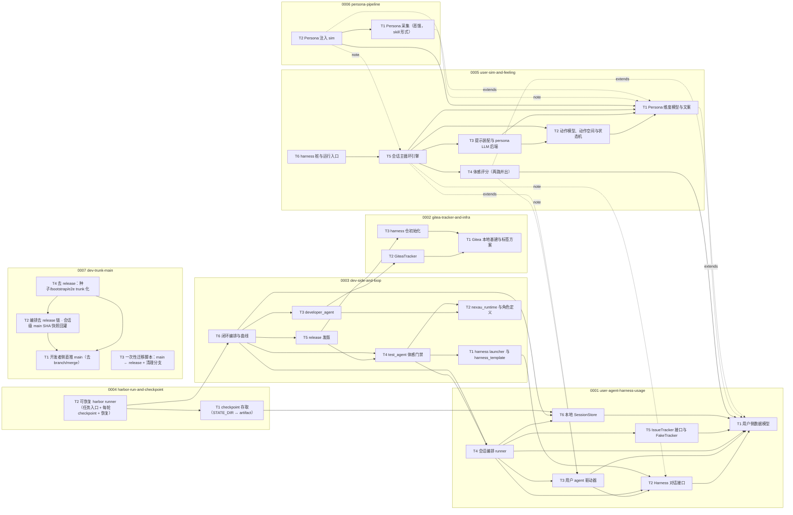

## 文件冲突报告

| 文件 | 涉及组 |
|----|----|
| backend/auto_designer/loop/orchestrator.py | 0003, 0007 |
| backend/auto_designer/loop/run_state.py | 0004, 0007 |
| backend/scripts/bootstrap_harness.py | 0002, 0007 |
| backend/tests/loop/test_orchestrator.py | 0003, 0007 |
| backend/tests/loop/test_run_state.py | 0004, 0007 |
| backend/tests/test_bootstrap_harness.py | 0002, 0007 |

## 设计文件结构

> 下列结构由各 Task 的 `files` 声明并集自动汇总；`←` 后为归属 Task（多占即冲突）。

```text
backend/
  agent_defs/
    developer_agent/
      prompt.md                  ← 0003/T3
      systemprompt.md            ← 0007/T1
    test_agent/
      prompt.md                  ← 0003/T4
    user_agent/
      prompt.md                  ← 0003/T2
  auto_designer/
    dev/
      agentic_developer.py       ← 0007/T1
      developer_agent.py         ← 0003/T3
      release.py                 ← 0003/T5
      test_agent.py              ← 0003/T4
    distill/
      library.py                 ← 0006/T1
    harness/
      interface.py               ← 0001/T2
      launcher.py                ← 0003/T1
    loop/
      checkpoint.py              ← 0004/T1
      metrics.py                 ← 0003/T6
      orchestrator.py            ← 0003/T6, 0007/T2
      run_state.py               ← 0004/T1, 0007/T2
      runner.py                  ← 0004/T2
    tracker/
      base.py                    ← 0001/T5
      fake.py                    ← 0001/T5
      gitea.py                   ← 0002/T2
    user/
      sim/
        action_space.py          ← 0005/T2
        actions.py               ← 0005/T2
        clauses.py               ← 0005/T1
        demo.py                  ← 0005/T6
        dimensions.py            ← 0005/T1
        feeling.py               ← 0005/T4
        harness_adapter.py       ← 0005/T6
        loop.py                  ← 0005/T5
        persona_client.py        ← 0005/T3
        persona_io.py            ← 0006/T2
        prompt.py                ← 0005/T3
        run_live.py              ← 0005/T6
        scenarios.py             ← 0005/T6
        state.py                 ← 0005/T2
      session.py                 ← 0001/T4
      session_store.py           ← 0001/T6
      user_agent.py              ← 0001/T3
    models.py                    ← 0001/T1
    nexau_runtime.py             ← 0003/T2
  deploy/
    gitea/
      README.md                  ← 0002/T1
      bootstrap.sh               ← 0002/T1
      docker-compose.yml         ← 0002/T1
  harness_template/
    agents/
      main.md                    ← 0003/T1
    entry.py                     ← 0003/T1
    params.yaml                  ← 0003/T1
  scripts/
    bootstrap_harness.py         ← 0002/T3, 0007/T4
    migrate_trunk_main.py        ← 0007/T3
  tests/
    dev/
      test_agentic_developer.py  ← 0007/T1
      test_developer_agent.py    ← 0003/T3
      test_release.py            ← 0003/T5
      test_test_agent.py         ← 0003/T4
    distill/
      test_library.py            ← 0006/T1
    harness/
      test_interface.py          ← 0001/T2
      test_launcher.py           ← 0003/T1
    loop/
      test_checkpoint.py         ← 0004/T1
      test_metrics.py            ← 0003/T6
      test_orchestrator.py       ← 0003/T6, 0007/T2
      test_run_state.py          ← 0004/T1, 0007/T2
      test_runner.py             ← 0004/T2
    tracker/
      test_fake.py               ← 0001/T5
      test_gitea.py              ← 0002/T2
    user/
      sim/
        test_action_space.py     ← 0005/T2
        test_dimensions.py       ← 0005/T1
        test_feeling.py          ← 0005/T4
        test_harness_adapter.py  ← 0005/T6
        test_loop.py             ← 0005/T5
        test_persona_io.py       ← 0006/T2
        test_prompt.py           ← 0005/T3
        test_state.py            ← 0005/T2
      test_session.py            ← 0001/T4
      test_session_store.py      ← 0001/T6
      test_user_agent.py         ← 0001/T3
    test_bootstrap_harness.py    ← 0002/T3, 0007/T4
    test_migrate_trunk_main.py   ← 0007/T3
    test_models.py               ← 0001/T1
    test_nexau_runtime.py        ← 0003/T2
  run.py                         ← 0007/T4
tools/
  persona-distill/
    extract-selfreport-persona/
      recruitment/
        seeds.md                 ← 0006/T1
      SKILL.md                   ← 0006/T1
      reference.md               ← 0006/T1
    card-schema.md               ← 0006/T1
```

## 各 feature 详情

### 0001 用户 agent 使用 harness 的最小链路（issue #0）

> 人读方案见 [`0001-user-agent-harness-usage/summary.md`](./0001-user-agent-harness-usage/summary.md)。

本组实现进化闭环的 **a｜用户侧**：让 user agent 扮成真实用户，按 persona + 种子场景多轮使用 harness，产出两类信号——**体感评分**（训练信号）与 **issue**（bug/需求）。本组只搭「最小链路」，且全部用 Fake 后端，不依赖真 Gitea / 真 harness，可独立测；真后端由 0002（Gitea）、0003（harness）补齐。

数据流脊柱（贯穿 T1…T6，后面每个任务都挂在这条线上）：

```
Persona / SeedScenario ─► UserAgent(T3) ⇄ HarnessInterface(T2) ─► Transcript
                                  │
                                  ├─► FeelingScore 1–4(+理由) ─► SessionStore(T6) 落本地
                                  └─► IssueDraft 0..n ─[IssueTracker(T5)]► Gitea ─► IssueRef
        run_session(T4) 收集上述 ─► Session（结构由 T1 定义）
```

读图即读任务：**T1** 定全部数据结构（地基，被其余任务共用）；**T2** 定与 harness 的对话契约；**T3** 是训练信号的产生点（扮得像不像真人决定信号真不真）；**T5** 定 issue 的去向；**T6** 定体感落地；**T4** 把它们编排成「跑一局」的唯一入口 `run_session`。下游：0003 的闭环直接复用 `run_session`。

**任务一览**

- **T1 用户侧数据模型**（pending） — 定义用户侧最小链路的公共数据结构，被 T2/T3/T4 共用。
- **T2 Harness 对话接口**（pending） — 将被使用的 harness 抽象为统一的多轮对话协议（HarnessInterface），使用户侧与具体 agent 实现解耦。
- **T3 用户 agent 驱动器**（pending） — 模拟真实用户：依据 Persona 与 SeedScenario 驱动与 harness 的多轮对话，由 agent 自主判定对话终止时机， 并在会话结束时产出体感评分（FeelingScore，1–4 及理由）。
- **T4 会话编排 runner**（pending） — 用户侧的最小可用入口：单一无状态函数将 Persona、SeedScenario、HarnessInterface 与 UserAgent 编排为一局会话，收集 Transcript、FeelingScore 与 IssueDraft，返回结构化的 Session。
- **T5 IssueTracker 接口与 FakeTracker**（pending） — 将 issue 的提交去向抽象为 IssueTracker 接口，使用户侧不绑定具体 tracker 后端。
- **T6 本地 SessionStore**（pending） — 将一局 Session 持久化到本地：全量文件 + 一个总索引。

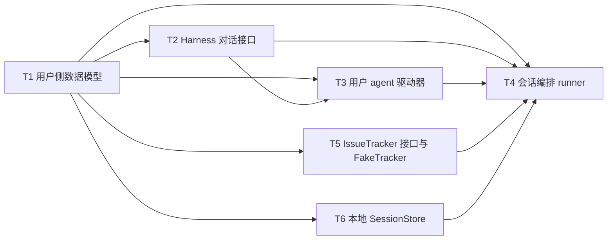

### 0002 Gitea 接入与基建（issue #0）

> 人读方案见 [`0002-gitea-tracker-and-infra/summary.md`](./0002-gitea-tracker-and-infra/summary.md)。

本组补齐 **a 段的真实后端与基建**：0001 用 Fake 把接口立了起来，本组把「桩」换成「真」——起一个本地 Gitea（issue 与 harness 仓的家），并实现 0001/T5 `IssueTracker` 接口的真后端 `GiteaTracker`。

与 0001 的接力关系：

```
0001：IssueTracker 接口 + FakeTracker（桩，仅供测试）
        └─► 0002/T2 GiteaTracker（真后端，运行时注入 run_session）
0002/T1 本地 Gitea（docker + sqlite，bootstrap 产出 URL/owner/repo/token）
        ├─► T2 GiteaTracker 读连接信息，打 /api/v1
        └─► T3 把 harness_template 推成独立 harness 仓（供 0003 开发者 agent 走真实分支/合并）
```

**T1** 是一切前置（没有 Gitea 就没有 issue 去向、也没有 harness 仓）；**T2** 让用户 agent 产的 issue 真正进 Gitea；**T3** 把 v0 种子变成可演化的 harness 仓。本组完成后，a 段即可脱离 Fake 真跑。

**任务一览**

- **T1 Gitea 本地基建与标签方案**（pending） — 提供本地 Gitea 服务的基建与一键初始化：docker-compose(Gitea + sqlite) 起服务，bootstrap 脚本建 admin、生成 access token、建工作仓与标签方案。
- **T2 GiteaTracker**（pending） — GiteaTracker 是 spec-0001/T5 IssueTracker 接口的真实后端：一个打 Gitea /api/v1 的薄 REST 客户端。
- **T3 harness 仓初始化**（pending） — 把 backend/harness_template/ 作为 v0 推送到 Gitea，建立 harness 独立仓，供 dev 侧开发者 agent 走真实分支与合并。

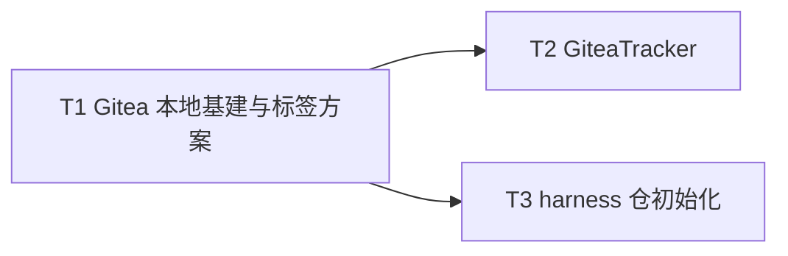

### 0003 开发者侧与闭环（issue #0）

> 人读方案见 [`0003-dev-side-and-loop/summary.md`](./0003-dev-side-and-loop/summary.md)。

本组实现 **b｜开发者侧** 与 **c｜闭环回灌**，把前两组的零件总装成可重复的进化轮次。一轮 = a（用户产 issue + 体感）→ b（开发者改 harness、测试体感门禁、发版）→ c（新版 harness 回到 a）。

一轮闭环（节点后标负责任务）：

```
a  用户会话(0001 run_session, harness=launch(release)) ─产→ issue(Gitea) + 体感(SessionStore)
        │
b       ├ developer_agent(T3)  取 issue → 按 label 分流 → 改 harness 分支
        ├ test_agent(T4)       候选 ref 跑 N 局算平均体感，与 release 基线比 → 体感门禁
        └ release(T5)          过门禁则合入 release 分支 + 打 tag（= 新版本）
        │
c  orchestrator(T6) 把新 tag 作为下一轮 a 的 harness，循环；metrics(T6) 记 issue 数~时间曲线
```

支撑件：**T1** launcher 把「某版 harness 程序」接成 0001 的 `HarnessInterface`（粘合层），并给出 v0 种子 `harness_template`；**T2** 是 user/developer/test 三角色共用的 nexau 适配层。本组核心约束：**门禁只用体感，benchmark 全程 held-out**（只事后观测、不参与发版判定）。

**任务一览**

- **T1 harness launcher 与 harness_template**（pending） — 把「被进化的 harness」接成 spec-0001 的 HarnessInterface：launcher 按 git ref 取出某版 harness、 启动其自带 entry、按黑盒逐轮协议适配为 send/reset/close。
- **T2 nexau_runtime 与角色定义**（pending） — 单一 nexau 适配层：把一份角色定义(prompt+工具)加载成可调用的 agent，供 user/developer/test 三角色共用。
- **T3 developer_agent**（pending） — 开发者 agent：从 Gitea 取一条 open issue，按 label 分流到对应分支策略，用 nexau 修改 harness bundle 并提交。
- **T4 test_agent 体感门禁**（pending） — 测试 agent：用候选 harness ref 跑固定集的 N 局用户会话，算平均体感并与当前 release 基线比较， 不退化则放行。
- **T5 release 发版**（pending） — 发版：体感门禁通过的候选分支合入 harness 仓 release 分支并打 tag；tag 即用户侧下一轮 pin 的版本。
- **T6 闭环编排与曲线**（pending） — orchestrator 把用户侧(a)、开发者侧(b)、回灌(c) 串成可重复的进化轮次；metrics 从 Gitea 与本地 session 统计 issue 数量随时间的曲线与体感趋势。

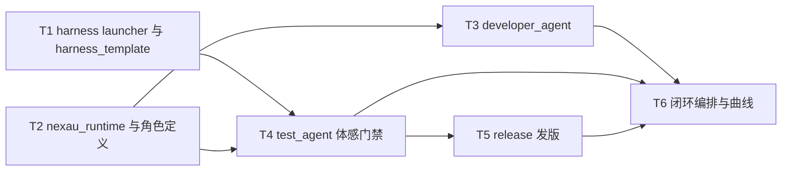

演化图：

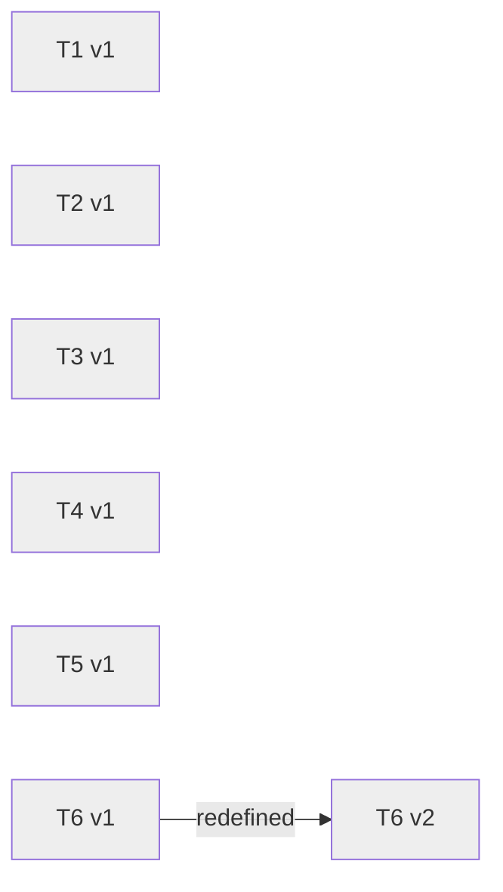

### 0004 Harbor 运行与可恢复 checkpoint（issue #0）

> 人读方案见 [`0004-harbor-run-and-checkpoint/summary.md`](./0004-harbor-run-and-checkpoint/summary.md)。

本组给闭环加上**可恢复运行时**：所有 agent 在**单沙盒一波跑**（方案 A，整条 run = 1 个 harbor task），用 harbor 的 task→artifact 通道把 checkpoint 吐出沙盒、再喂回实现恢复。它横跨 a/b/c：checkpoint 在**单元边界**维护用户侧状态（已完成 session / 体感）、开发者侧状态（issue 分派、候选分支）与其他编排中间态（轮次 / 阶段 / release_ref / 待合并）。

分层是本组关键，且与 spec-0001/T2「逐轮对话另立协议」一致：harbor 只包**外层 rollout 生命周期**；**内层**用户↔harness 的逐轮真人对话仍走 spec-0001 自立协议，不碰 harbor 批式 episode 接口。

```
harbor task（方案A：整条 run = 1 task）────────────────────────
 输入: pinned harness 版本 + persona/场景集 + 上次 checkpoint artifact
 沙盒内: restore(checkpoint) → orchestrator 逐轮(0003/T6)
         每轮末 save_checkpoint → 经 harbor artifact 吐出沙盒
 输出: 每轮增量 checkpoint artifact（最新者供下次恢复）
 内层 user↔harness 逐轮对话: spec-0001 自立协议（非 harbor 批接口）
```

支撑件：**T1** 定义 checkpoint 存取与自包含 STATE_DIR（gitea + sessions + metrics + run_state）；**T2** 可恢复 harbor runner，在 orchestrator 外层加恢复与每轮 checkpoint。本组约束：**恢复按单元边界幂等重跑**（整会话重跑、开发者从分支 head 续作、release 见 tag 跳过），不快照 agent 进程内存。

**任务一览**

- **T1 checkpoint 存取（STATE_DIR ↔ artifact）**（pending） — 把一轮闭环所需的全部可恢复状态收敛为单一自包含 STATE_DIR，连同 run_state 游标一起 dump/load，作为 harbor task 的 checkpoint artifact 内容。
- **T2 可恢复 harbor runner（任务入口 + 每轮 checkpoint + 恢复）**（pending） — 可恢复的 harbor 运行入口：作为一个 harbor task（方案 A，整条 run = 1 task）在沙盒内驱动 orchestrator 逐轮跑； 每轮边界吐一个增量 checkpoint artifact；新 task 喂最新 checkpoint 即从断点幂等续跑。

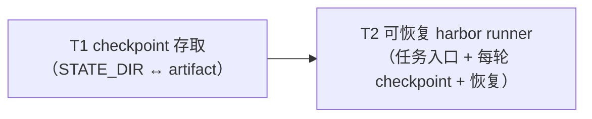

### 0005 用户侧重型实现：控制信封模拟器与体感评分（issue #0）

> 人读方案见 [`0005-user-sim-and-feeling/summary.md`](./0005-user-sim-and-feeling/summary.md)。

本组实现进化闭环 **a｜用户侧** 的重型版：以「控制信封」架构替代 spec-0001/T3 的最小桩，让 user agent
更拟真地多轮使用 harness（能力分叉、追问、绕路、放弃），并补齐 spec-0001 的训练信号
**FeelingScore（1–4 体感分）**。落点 `backend/auto_designer/user/sim/`，与 0001 最小实现**并存、不覆盖**。

数据流脊柱（贯穿 T1…T6）：

```
Persona 维度(T1) ─► 动作空间/状态机(T2) ◄─ 提示装配 + LLM 后端(T3)
                              │  每轮 persona 三层决策
                              ▼
                    会话主循环引擎(T5) ⇄ harness 桩(T6)
                              │  会话末
                              ▼
                  体感评分 两路并出(T4) ─► FeelingScore 1–4（训练信号）
```

读图即读任务：**T1** 定 persona 静态系数；**T2** 定每轮「能做什么 + 情绪如何演化」（纯主观状态机）；
**T3** 把上下文喂 LLM 并取结构化判断、含会话末自评请求；**T5** 把它们编排成「跑一局」；**T4** 在会话末
产出训练信号（LLM 自评为主 + 框架派生兜底/校验）；**T6** 提供离线可跑的 harness 桩与运行入口。

**本轮纯主观（客观线不实现）**：本组只取用户体感作训练信号；客观真值线（gold / GAP / ESCAPED_BUG /
control-plane）整体推迟，不写 state、不进体感、harness 桩只回文本。能力分叉改由「persona 能力 + 文本感知」
驱动，bug 直接体现在 harness 回复文本里。这与项目「训练信号=用户体感、benchmark held-out」一致；客观真值
线的观测留待后续 spec。

**与 0001 及闭环的关系**：本组是 0001 用户侧(a) 的重型实现/演进。真正接入闭环所需的契约并轨
（引擎 `run_session` ↔ 0001/T4、harness 桩 ↔ 0001/T2 `HarnessInterface`、9 维 Persona 与
`FeelingScore` 与 `models` 并轨、LLM 后端收敛 0003/T2 `nexau_runtime`、`issue_artifact` → `IssueDraft`）
集中记在各 Task 的 open-questions，归后续 Task/组。

**任务一览**

- **T1 Persona 维度模型与文案**（pending） — 控制信封的 persona 模型：9 维（D1 评估能力 / D2 领域深度 / D3 验收阈值 / D4.1-4.3 委派·监督·纠偏 / D5 自主性 / D6 授权 + 派生 trust），以及维度→英文注入文案的确定性查表（clauses）。
- **T2 动作模型、动作空间与状态机**（pending） — 控制信封的确定性机制层：动作目录（每个动作钉死 executor×channel×effect 三轴 + 终止原因）、动作空间 派生（局面 ∩ 能力掩码D1 ∩ 授权D6 ∪ 耐心门解锁的终止动作 ∪ accept）、自由产出归类与越权投影与 channel↔message 强校验、以及 patience/trust 状态机（只吃主观 verdict）。
- **T3 提示装配与 persona LLM 后端**（pending） — 提示装配与 persona LLM 后端。
- **T4 体感评分（两路并出）**（pending） — 对齐 spec-0001 训练信号 FeelingScore 的产出。
- **T5 会话主循环引擎**（pending） — 控制信封会话主循环，是 spec-0001/T3「用户 agent 驱动器」的重型实现：把 persona 模型(T1)、动作空间 与状态机(T2)、提示与 LLM 后端(T3)、体感评分(T4) 编排成一局完整会话。
- **T6 harness 桩与运行入口**（pending） — 脚本化 harness 桩与运行入口。

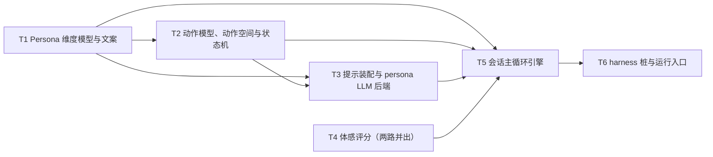

演化图：

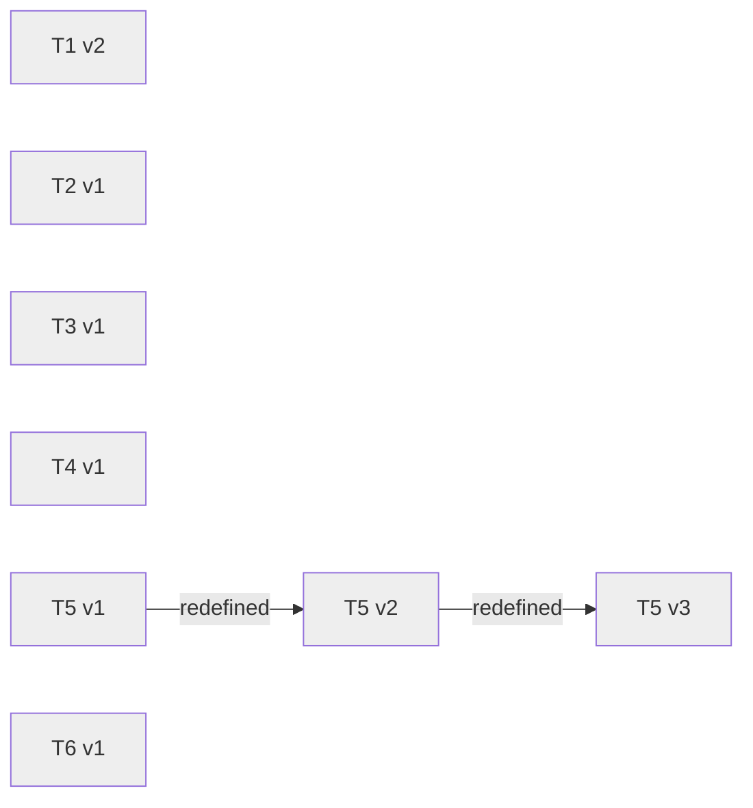

### 0006 Persona 管线：采集（蒸馏）与注入 sim（issue #0）

> 人读方案见 [`0006-persona-pipeline/summary.md`](./0006-persona-pipeline/summary.md)。

本组实现 persona 管线：把「从真实数据采集 persona」与「把 persona 注入控制信封 sim」串成一条链，
为 0005 的用户侧重型实现供给真实画像。对应 CLAUDE.md「蒸馏模块」，落实约束「persona 来自真实数据、
不依据 benchmark 或轨迹构造」。

数据流脊柱：

```
真实使用数据(第一人称自述 · GitHub 足迹 · Stack Overflow · 未来源)
        │  采集/归纳（T1，轮辐式：共享卡契约 + 薄抽取 skill）
        ▼
   persona 卡库（6 维行为卡：D1–D6 + authenticity/era/provenance）
        │  注入（T2，card_to_persona：grounded 轴透传 + 覆盖派生）
        ▼
   spec-0005 dimensions.Persona ─► 0005/T5 run_session 跑一局 ─► 体感 + issue
```

读图即读任务：**T1** 定「采集什么、卡长什么样」——不另造 skill，而是收编既有的真实抽取方法（此前写在 NexAU 仓库里、非 NexAU 自身的方法），并按
**轮辐式**组织：唯一公共契约 `card-schema.md`（6 维卡 schema + 枚举 + D5 词表 + 注入分布 + 真实性门原则，
source-agnostic）+ 各「薄抽取 skill」只描述「从某类来源提取 + ground 哪几维」、只依赖契约、彼此不依赖。本步
先落契约 + `extract-selfreport-persona`（第一人称自述，唯一 ground 信任轴 D4 且带 card_to_persona 覆盖规则）；
cc/so/未来源作同契约的后续薄 skill 插入。库 schema 即该契约。**T2** 定「卡如何变成 sim 能跑的 Persona」
（唯一桥接层 card_to_persona）。

**覆盖派生（关键约束）**：6 维卡是「正交 ground 的真实画像」，每维各自有证据；sim 9 维里 d3/trust/d6 原是
「从 D1/D5 派生」。注入时 **卡里 grounded 的 验收 D2 → sim d3、信任 D4 → sim trust 直接写入、不被 derive_*
改写**（这两个正是 sim 的派生维），finalize_persona 只填卡未 ground 的派生维——否则 expert×over-trust
（selfreport 例 C / Karpathy）会被模拟成 skeptical×rigorous 的反面。此约束在 extract-selfreport-persona
reference 例 C 已写明（card_to_persona），并要求 0005/T1 把 finalize_persona 降为 fallback-only（本组同改）。
注：卡 D6 自主 → sim D5Autonomy 是采样维（直接写入，本无 derive）；sim 的派生维 D6Authz 卡中无对应来源，
仍按 D5Autonomy + task_risk 派生（见 T2）。

与 0005 的关系：本组是 0005（控制信封用户模拟器）的上游供给。6 维卡 ↔ sim 9 维 ↔ spec-0001 models.Persona
的最终并轨记在各 Task open-questions，待真实数据与下游需求收敛后定。

**任务一览**

- **T1 Persona 采集（蒸馏，skill 形式）**（pending） — 采集（蒸馏）侧按**轮辐式**组织，不另造大 skill：① 唯一公共契约 card-schema.md（source-agnostic）—— 6 维行为卡 schema（D1–D6 + authenticity + era + provenance）+ 维度枚举 + D5.area 受控词表 + 注入分布 + 双向真实性门原则，采既有 selfreport skill 的最新约定（每维 source+basis+confidence、provenance 并集、value 键）； ② 薄抽取 skill extract-selfreport-persona——只描述「从第一人称自述（博客/访谈/演讲/推文长贴）提取 + ground 哪几维」，只引用契约、不依赖任何其它 skill。
- **T2 Persona 注入 sim**（pending） — 把采集到的 persona 卡（0006/T1 6 维行为卡）注入控制信封 sim：card_to_persona 将一条卡映射为 sim 的 dimensions.Persona —— 卡里 grounded 的轴直接透传，finalize_persona 仅填卡未 ground 的派生维度（即 「覆盖派生」：grounded 的验收/信任/授权不被 derive_* 改写）。

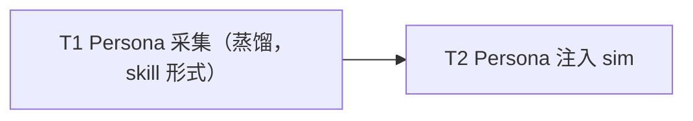

### 0007 开发者侧改为纯 trunk(main) 自进化（issue #12）

> 人读方案见 [`0007-dev-trunk-main/summary.md`](./0007-dev-trunk-main/summary.md)。

## Summary

去掉 harness 仓的 `release` 常驻分支、发版、体感门禁与回退，改纯 **trunk（单 `main`）** 自进化：user agent 永远使用最新 `main`（会话开始锁定其 HEAD SHA、整局跑该快照），dev agent 不分 bug/feature、直接 commit 到 `main`。每次成功推进给 `main` 打轻量 `vK` tag，**仅作观测锚点，不是发版**。一往无前，不回退。

一轮闭环（节点后标负责任务）：

```
a  user 会话(每局锁 main HEAD SHA, launcher 按 SHA checkout) ─产→ issue(Gitea) + 体感(SessionStore)
        │
b       └ dev agent(T1)  领一条 open issue → checkout main → 改 agents/main.md
                          → commit → git tag vK → git push origin main vK（无 branch/merge/门禁）
        │
c  orchestrator(T2) 回灌「main 最新 SHA」给下一轮 a；vK tag = 观测锚点
   迁移(T3) main ← release + 删分支；种子/bootstrap/e2e 去 release(T4)
```

## Motivation

**现状（背景就地复述，本 spec 自包含）。** harness 源码是托管于 Gitea 的独立 git 仓，原设计为 `release` 常驻分支 + 发版（`vK` tag）+ 体感门禁：dev 在 `fix/issue-N` 分支改 `agents/main.md`，`--no-ff` 合入 `release`、打 tag、推送；测试 agent 跑 N 局算平均体感、与 `release` 基线比较做回归门禁；orchestrator 把新 tag 作为下一轮用户侧的 harness。最近 commit `f27cc8c`「无门禁直接发版」移除了体感门禁与回退逻辑（`release.py` / `test_agent.py` 已删除）。

**门禁一去，`release` 退化为 `main` 的滞后副本，带来四个问题：**

1. **不挡任何东西** —— 门禁已删，`release` 分支不再承担任何把关职责。
2. **用户用滞后快照** —— user agent 跑的是 `release`（上一次切版的快照），dev 修好的 bug 要等下一次切版才对用户生效。
3. **削弱闭环核心信号** —— 训练信号是体感；切版滞后让体感 delta 无法干净归因到最近一次 commit，issue 曲线被切版节奏（而非真实改动）扭曲。
4. **仓状态混乱** —— `main` 冻在 557B 空种子、`release` 16KB 才是真进化版；`main` 是 `release` 的祖先（`release ⊃ main`，领先约 17 个提交）；遗留 4 条孤儿 `fix/issue-*` 分支与 re-seed 双 seed 历史；Gitea 默认分支仍指向冻结的 `main`。

**为什么改 trunk。** 项目约束是「训练信号（体感）与测试（benchmark held-out）分离，发版门禁只用体感、benchmark 全程不参与」。门禁既已移除，`release` 的唯一残余作用只是滞后。纯 trunk 让 dev 的每次 commit 立刻成为下一局用户所用的版本，使体感 delta 能干净归因到最近改动——这正是闭环最需要的纯净信号。坏 commit 不靠门禁拦截，而靠后续多轮迭代回正（梯度下降式）。

## Guide-level explanation

改完后各视角：

- **用户侧（a）**：每局会话开始记下 harness 仓 `main` 的 HEAD SHA，整个多轮会话固定跑这个 SHA（launcher 已支持按 SHA checkout，单会话内 harness 不会在脚下变）；体感分数与产出的 issue 都归因到该 SHA。下一局自然取到 dev 推进后的更新 `main`——对用户永远是「最新 main」。
- **开发者侧（b）**：单个 dev agent，不区分 bug/feature。`work_one` 领一条 open issue，端到端 `git checkout main → 改 agents/main.md → commit → git tag vK → git push origin main vK`。没有 branch、没有 merge、没有门禁。仓状态是 ground truth：新 `vK` tag 出现 = 成功，成功即 close 该 issue。`vK` 仅作版本戳。
- **观测（替代 release 的唯一正经用途）**：每次成功推进给 `main` 打 `vK` tag；体感回归 = 比较不同 `vK` tag 的体感**分布**（纯观测，不门禁、不挡）；benchmark held-out，指向某个 `vK` 的 SHA 事后判定。
- **分支模型**：只有 `main` 一条线，Gitea 默认分支保持 `main`（默认展示的就是真正在进化的版本）。`release`、孤儿 `fix/issue-*`、已合并分支全部删除。**一往无前，不回退。**

## Reference-level explanation

### 现状代码锚点（迁移前）

- `dev/agentic_developer.py:79` `branch=f"fix/issue-{issue.number}"`；`:132-135` 注入给 nexau 的流程 `git checkout -B {branch} release` → `git merge --no-ff {branch}` → `git tag` → `git push origin {branch} release {tag}`；`DevOutcome`（定义于 `:27-34`，含 `released: bool`）；`:103-104` `released = bool(new_tags)`（新 tag 出现即成功，沿用为 ground truth）。
- `loop/orchestrator.py:39` `run_round(self, release_ref)`；`:42` 整个 fixed_set 用同一 `release_ref` launch；`:54` `ref = outcome.tag`（release 链式回灌）；`:63` `run(initial_ref)`。
- `loop/run_state.py:24` `current_release_ref: str`（编排游标）。
- `harness/launcher.py:109-139` `_resolve_sha` + `_checkout`：**已**按 commit SHA 解析并按 SHA 缓存 checkout（`release` 这类会变分支，内容一变即落新目录，绝不复用陈旧 checkout）。→ **本 spec 无需改动 launcher。**
- `run.py:81` `_git(HARNESS_REPO, "branch", "release")`、`:226` `initial_ref="release"`；`scripts/bootstrap_harness.py:106-110` 建 `release` 分支。
- `agent_defs/developer_agent/systemprompt.md`：强制「第一步先建分支再改文件」`git checkout -B fix/issue-<N> release` + merge release + push branch/release/tag。

### 目标方案

| 关注点 | 现状 | 目标 |
|---|---|---|
| dev git 流程 | `fix/issue-N` 分支 + `--no-ff` merge `release` + tag + push branch/release/tag | `checkout main` → 改 → commit → `tag vK` → `push origin main vK` |
| `DevOutcome.released` | "已发版（new tag）" | 语义改为 "committed（已推 main）"；判定仍为「新 tag 出现」 |
| orchestrator 回灌 | `release_ref` 链：`ref = outcome.tag` | 去链；每局解析 `main` HEAD SHA、按该 SHA launch（会话级快照）；回灌 = 「main 最新 SHA」 |
| `run_state.current_release_ref` | 当前 release 版本 | 语义改为「当前 main SHA」（观测游标） |
| 分支 | `main` + `release` + 孤儿 + 已合并 | 仅 `main` |
| 门禁/回退/merge/release 链 | 存在（门禁已先删） | 全部去除 |
| launcher | 按 SHA checkout | **不动**（已满足会话级 SHA 快照） |

### DAG

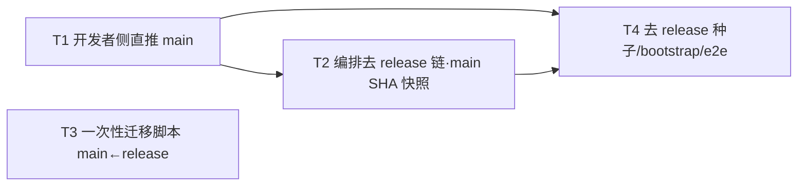

T3（一次性迁移）与 T1 无代码依赖，可并行；T4 总装 e2e，依赖 T1、T2。

### 文件分配（各 Task `files` 互斥）

- **T1**：`dev/agentic_developer.py`、`agent_defs/developer_agent/systemprompt.md`、`tests/dev/test_agentic_developer.py`
- **T2**：`loop/orchestrator.py`、`loop/run_state.py`、`tests/loop/test_orchestrator.py`、`tests/loop/test_run_state.py`
- **T3**：`scripts/migrate_trunk_main.py`、`tests/test_migrate_trunk_main.py`
- **T4**：`run.py`、`scripts/bootstrap_harness.py`、`tests/test_bootstrap_harness.py`

### e2e 脚本

`backend/run.py` —— 真实端到端跑一轮闭环（a→b→c，真 nexau + 真 Gitea + 本地 git 仓）。T4 改其种子（只种 `main`）、`initial_ref="main"` 与结果打印（「main SHA / 分支」取代「release_ref 链」）。

## Drawbacks

- **无门禁兜底**：dev 推坏 commit，`main` 立刻劣化、下一局用户即受影响，只靠后续多轮迭代回正；短期体感可能抖动。
- **不回退**：放弃「随时回到稳定版」的能力，历史上「稳定 release」的概念消失，benchmark 只能锚到任意 `vK`/SHA 而非一个被祝福的发布版。
- **`vK` 语义稀释**：tag 失去发版含义后可能堆积成纯计数器，需靠观测看板赋予意义。
- **一次性迁移有破坏性**：`git branch -f` 与删远端分支不可逆，迁移脚本须幂等且对错误仓状态安全。

## Rationale and alternatives

选纯 trunk，因为它让体感 delta 干净归因到最近 commit——闭环训练信号最纯，且与「门禁已移除」的现状一致、最简（奥卡姆）。

- **备选 A：保留 `release`，每轮自动 fast-forward 到 `main`。** 行为等价于 trunk，却多一层永远等于 `main` 的无意义分支与同步逻辑，违奥卡姆。
- **备选 B：重新引入体感门禁挡回退。** 与项目硬约束「发版门禁只用体感、benchmark held-out、体感只作训练信号/观测」相容性差，且门禁刚在 `f27cc8c` 被有意移除——重新加回是倒退。
- **备选 C：每 dev 用短命分支 + 即时合并。** 仍引入 merge 提交噪声、却无任何并发收益（当前 dev 串行），徒增复杂度。

故选 dev 直推 `main`。

## Prior art

- **Trunk-based development**：业界持续集成实践，单一主干、短迭代、避免长命分支，与本设计的「单 `main` + 不回退」一致。
- **项目原设计**：CLAUDE.md「harness 源码为独立 git 仓，`release` + `feature` 分支，tag 即发布版本」——本 spec 将其收敛为单 `main`，是对该设计在「门禁移除」后的修正。
- **直接前置**：commit `f27cc8c`「无门禁直接发版」移除体感门禁与回退，是本 spec 的触发点。

## Unresolved questions

- **`vK` tag 的粒度**：每条成功 issue 打一个 vs 每轮打一个？（当前实现：每条成功 issue 一个 `vK`，见 `agentic_developer.py:80,105`。）需用户确认。
- **体感/issue→SHA 归因的落盘**：MVP 是否仅靠「按 `main` HEAD SHA launch」隐式保证单会话快照即可，还是需把 SHA 显式写进 session 记录以支撑「按 `vK` 比体感分布」的观测？
- **迁移清单与执行者**：待删的 4 条孤儿 `fix/issue-*` 与 4 条已合并分支的确切名单，以及远端默认分支切换由脚本自动还是人工执行。

## Future possibilities

- 体感分布回归看板：按 `vK` tag 对比体感分布（纯观测，不门禁）。
- benchmark held-out 评测挂钩到选定 `vK` 的 SHA，事后验证体感驱动进化是否带来真实能力提升。
- 坏 commit 的「软回退」观测：标记（而非 `revert`）退化点，保持「一往无前」的同时可视化退化。
- 多 dev 并发直推 `main` 的冲突合并策略（当前串行各领不同 issue）。

**任务一览**

- **T1 开发者侧直推 main（去 branch/merge）**（pending）
- **T2 编排去 release 链 · 会话级 main SHA 快照回灌**（pending）
- **T3 一次性迁移脚本：main ← release + 清理分支**（pending）
- **T4 去 release：种子/bootstrap/e2e trunk 化**（pending）

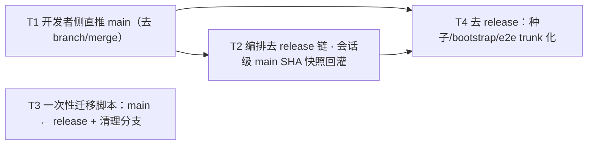
