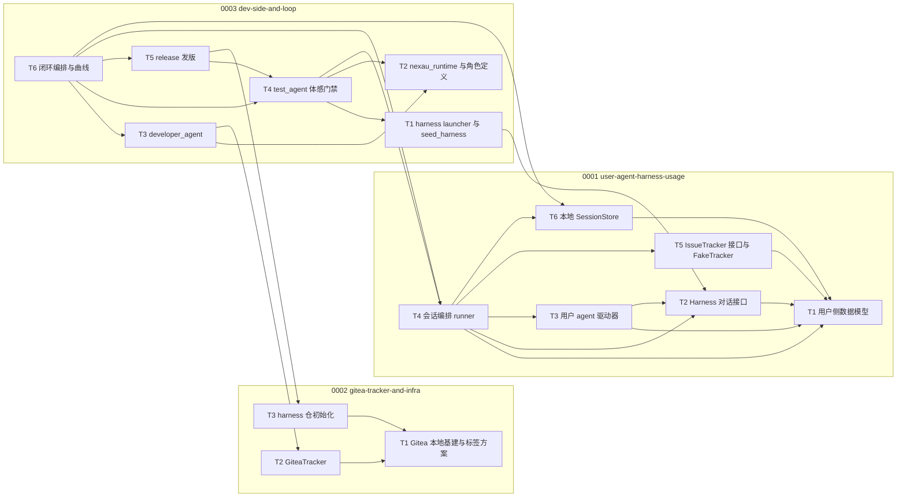
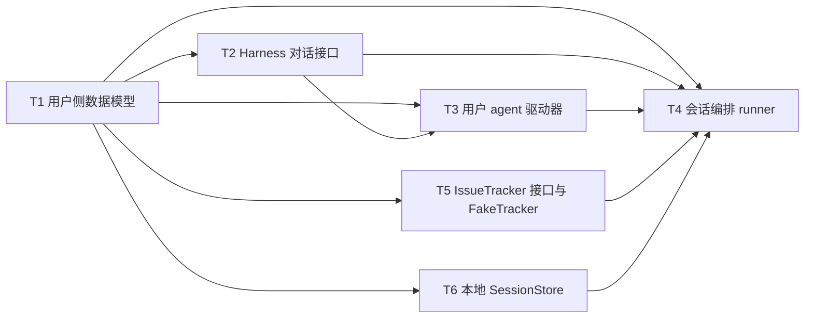
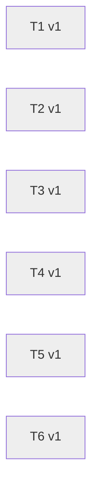
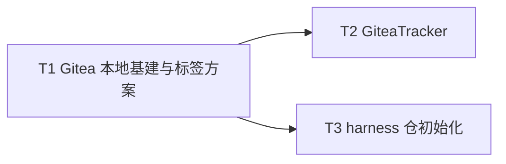
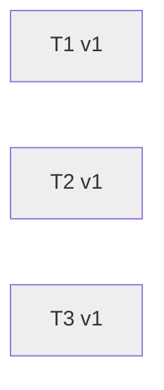
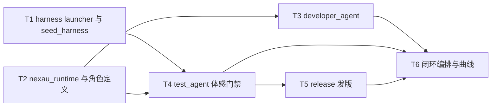

# Spec 总览（OVERVIEW）

> 本文件由 `spec render` 自动生成，请勿手工编辑（Spec-0014/T3）。

## 全局看板

| 组 | 任务 | 标题 | 状态 | 依赖 | 涉及文件 |
|----|----|----|----|----|----|
| 0001 | 0001/T1 | 用户侧数据模型 | pending | — | src/auto_designer/models.py<br>tests/test_models.py |
| 0001 | 0001/T2 | Harness 对话接口 | pending | T1 | src/auto_designer/harness/interface.py<br>tests/harness/test_interface.py |
| 0001 | 0001/T3 | 用户 agent 驱动器 | pending | T1, T2 | src/auto_designer/user/user_agent.py<br>tests/user/test_user_agent.py |
| 0001 | 0001/T4 | 会话编排 runner | pending | T1, T2, T3, T5, T6 | src/auto_designer/user/session.py<br>tests/user/test_session.py |
| 0001 | 0001/T5 | IssueTracker 接口与 FakeTracker | pending | T1 | src/auto_designer/tracker/base.py<br>src/auto_designer/tracker/fake.py<br>tests/tracker/test_fake.py |
| 0001 | 0001/T6 | 本地 SessionStore | pending | T1 | src/auto_designer/user/session_store.py<br>tests/user/test_session_store.py |
| 0002 | 0002/T1 | Gitea 本地基建与标签方案 | pending | — | infra/gitea/docker-compose.yml<br>infra/gitea/README.md<br>infra/gitea/bootstrap.sh |
| 0002 | 0002/T2 | GiteaTracker | pending | T1 | src/auto_designer/tracker/gitea.py<br>tests/tracker/test_gitea.py |
| 0002 | 0002/T3 | harness 仓初始化 | pending | T1 | scripts/bootstrap_harness.py<br>tests/test_bootstrap_harness.py |
| 0003 | 0003/T1 | harness launcher 与 seed_harness | pending | 0001/T2 | src/auto_designer/harness/launcher.py<br>seed_harness/entry.py<br>seed_harness/params.yaml<br>seed_harness/agents/main.md<br>tests/harness/test_launcher.py |
| 0003 | 0003/T2 | nexau_runtime 与角色定义 | pending | — | src/auto_designer/nexau_runtime.py<br>agent_defs/user_agent/prompt.md<br>tests/test_nexau_runtime.py |
| 0003 | 0003/T3 | developer_agent | pending | T2, 0002/T2 | src/auto_designer/dev/developer_agent.py<br>agent_defs/developer_agent/prompt.md<br>tests/dev/test_developer_agent.py |
| 0003 | 0003/T4 | test_agent 体感门禁 | pending | T1, T2, 0001/T4 | src/auto_designer/dev/test_agent.py<br>agent_defs/test_agent/prompt.md<br>tests/dev/test_test_agent.py |
| 0003 | 0003/T5 | release 发版 | pending | T4, 0002/T3 | src/auto_designer/dev/release.py<br>tests/dev/test_release.py |
| 0003 | 0003/T6 | 闭环编排与曲线 | pending | T3, T4, T5, 0001/T4, 0001/T6 | src/auto_designer/loop/orchestrator.py<br>src/auto_designer/loop/metrics.py<br>tests/loop/test_orchestrator.py<br>tests/loop/test_metrics.py |

## 跨 feature 关系图



## 文件冲突报告

无跨组文件冲突。

## 各 feature 详情

### 0001 用户 agent 使用 harness 的最小链路（issue #0）

> 人读方案见 [`0001-user-agent-harness-usage/summary.md`](./0001-user-agent-harness-usage/summary.md)。

本组实现进化闭环的 **a｜用户侧**：让 user agent 扮成真实用户，按 persona + 种子场景多轮使用 harness，产出两类信号——**体感评分**（训练信号）与 **issue**（bug/需求）。本组只搭「最小链路」，且全部用 Fake 后端，不依赖真 Gitea / 真 harness，可独立测；真后端由 0002（Gitea）、0003（harness）补齐。

数据流脊柱（贯穿 T1…T6，后面每个任务都挂在这条线上）：

```
Persona / SeedScenario ─► UserAgent(T3) ⇄ HarnessInterface(T2) ─► Transcript
                                  │
                                  ├─► FeelingScore 1–4(+理由) ─► SessionStore(T6) 落本地
                                  └─► IssueDraft 0..n ─[IssueTracker(T5)]► Gitea ─► IssueRef
        run_session(T4) 收集上述 ─► Session（结构由 T1 定义）
```

读图即读任务：**T1** 定全部数据结构（地基，被其余任务共用）；**T2** 定与 harness 的对话契约；**T3** 是训练信号的产生点（扮得像不像真人决定信号真不真）；**T5** 定 issue 的去向；**T6** 定体感落地；**T4** 把它们编排成「跑一局」的唯一入口 `run_session`。下游：0003 的闭环直接复用 `run_session`。

**任务一览**

- **T1 用户侧数据模型**（pending） — 定义用户侧最小链路的公共数据结构，被 T2/T3/T4 共用。
- **T2 Harness 对话接口**（pending） — 将被使用的 harness 抽象为统一的多轮对话协议（HarnessInterface），使用户侧与具体 agent 实现解耦。
- **T3 用户 agent 驱动器**（pending） — 模拟真实用户：依据 Persona 与 SeedScenario 驱动与 harness 的多轮对话，由 agent 自主判定对话终止时机， 并在会话结束时产出体感评分（FeelingScore，1–4 及理由）。
- **T4 会话编排 runner**（pending） — 用户侧的最小可用入口：单一无状态函数将 Persona、SeedScenario、HarnessInterface 与 UserAgent 编排为一局会话，收集 Transcript、FeelingScore 与 IssueDraft，返回结构化的 Session。
- **T5 IssueTracker 接口与 FakeTracker**（pending） — 将 issue 的提交去向抽象为 IssueTracker 接口，使用户侧不绑定具体 tracker 后端。
- **T6 本地 SessionStore**（pending） — 将一局 Session 持久化到本地：全量文件 + 一个总索引。



演化图：



### 0002 Gitea 接入与基建（issue #0）

> 人读方案见 [`0002-gitea-tracker-and-infra/summary.md`](./0002-gitea-tracker-and-infra/summary.md)。

本组补齐 **a 段的真实后端与基建**：0001 用 Fake 把接口立了起来，本组把「桩」换成「真」——起一个本地 Gitea（issue 与 harness 仓的家），并实现 0001/T5 `IssueTracker` 接口的真后端 `GiteaTracker`。

与 0001 的接力关系：

```
0001：IssueTracker 接口 + FakeTracker（桩，仅供测试）
        └─► 0002/T2 GiteaTracker（真后端，运行时注入 run_session）
0002/T1 本地 Gitea（docker + sqlite，bootstrap 产出 URL/owner/repo/token）
        ├─► T2 GiteaTracker 读连接信息，打 /api/v1
        └─► T3 把 seed_harness 推成独立 harness 仓（供 0003 开发者 agent 走真实分支/合并）
```

**T1** 是一切前置（没有 Gitea 就没有 issue 去向、也没有 harness 仓）；**T2** 让用户 agent 产的 issue 真正进 Gitea；**T3** 把 v0 种子变成可演化的 harness 仓。本组完成后，a 段即可脱离 Fake 真跑。

**任务一览**

- **T1 Gitea 本地基建与标签方案**（pending） — 提供本地 Gitea 服务的基建与一键初始化：docker-compose(Gitea + sqlite) 起服务，bootstrap 脚本建 admin、生成 access token、建工作仓与标签方案。
- **T2 GiteaTracker**（pending） — GiteaTracker 是 spec-0001 IssueTracker 接口的真实后端：一个打 Gitea /api/v1 的薄 REST 客户端。
- **T3 harness 仓初始化**（pending） — 把 seed_harness/ 作为 v0 推送到 Gitea，建立 harness 独立仓，供 dev 侧开发者 agent 走真实分支与合并。



演化图：



### 0003 开发者侧与闭环（issue #0）

> 人读方案见 [`0003-dev-side-and-loop/summary.md`](./0003-dev-side-and-loop/summary.md)。

本组实现 **b｜开发者侧** 与 **c｜闭环回灌**，把前两组的零件总装成可重复的进化轮次。一轮 = a（用户产 issue + 体感）→ b（开发者改 harness、测试体感门禁、发版）→ c（新版 harness 回到 a）。

一轮闭环（节点后标负责任务）：

```
a  用户会话(0001 run_session, harness=launch(release)) ─产→ issue(Gitea) + 体感(SessionStore)
        │
b       ├ developer_agent(T3)  取 issue → 按 label 分流 → 改 harness 分支
        ├ test_agent(T4)       候选 ref 跑 N 局算平均体感，与 release 基线比 → 体感门禁
        └ release(T5)          过门禁则合入 release 分支 + 打 tag（= 新版本）
        │
c  orchestrator(T6) 把新 tag 作为下一轮 a 的 harness，循环；metrics(T6) 记 issue 数~时间曲线
```

支撑件：**T1** launcher 把「某版 harness 程序」接成 0001 的 `HarnessInterface`（粘合层），并给出 v0 种子 `seed_harness`；**T2** 是 user/developer/test 三角色共用的 nexau 适配层。本组核心约束：**门禁只用体感，benchmark 全程 held-out**（只事后观测、不参与发版判定）。

**任务一览**

- **T1 harness launcher 与 seed_harness**（pending） — 把「被进化的 harness」接成 spec-0001 的 HarnessInterface：launcher 按 git ref 取出某版 harness、 启动其自带 entry、按黑盒逐轮协议适配为 send/reset/close。
- **T2 nexau_runtime 与角色定义**（pending） — 单一 nexau 适配层：把一份角色定义(prompt+工具)加载成可调用的 agent，供 user/developer/test 三角色共用。
- **T3 developer_agent**（pending） — 开发者 agent：从 Gitea 取一条 open issue，按 label 分流到对应分支策略，用 nexau 修改 harness bundle 并提交。
- **T4 test_agent 体感门禁**（pending） — 测试 agent：用候选 harness ref 跑固定集的 N 局用户会话，算平均体感并与当前 release 基线比较， 不退化则放行。
- **T5 release 发版**（pending） — 发版：体感门禁通过的候选分支合入 harness 仓 release 分支并打 tag；tag 即用户侧下一轮 pin 的版本。
- **T6 闭环编排与曲线**（pending） — orchestrator 把用户侧(a)、开发者侧(b)、回灌(c) 串成可重复的进化轮次；metrics 从 Gitea 与本地 session 统计 issue 数量随时间的曲线与体感趋势。



演化图：


