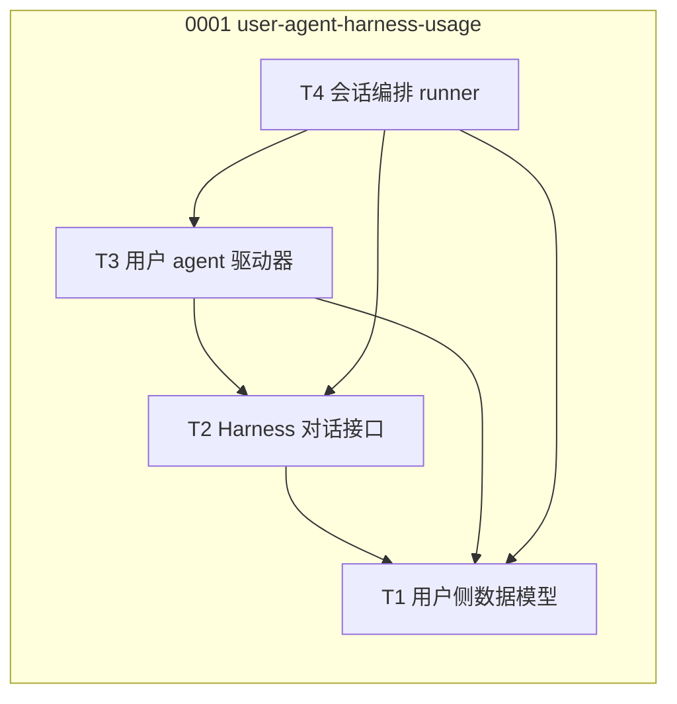
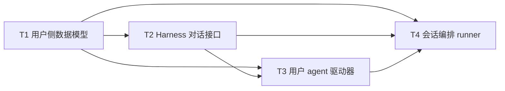
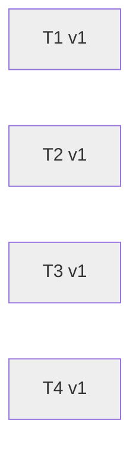

# Spec 总览（OVERVIEW）

> 本文件由 `spec render` 自动生成，请勿手工编辑（Spec-0014/T3）。

## 全局看板

| 组 | 任务 | 标题 | 状态 | 依赖 | 涉及文件 |
|----|----|----|----|----|----|
| 0001 | 0001/T1 | 用户侧数据模型 | pending | — | src/auto_designer/user_side/models.py tests/user_side/test_models.py |
| 0001 | 0001/T2 | Harness 对话接口 | pending | T1 | src/auto_designer/harness/interface.py tests/harness/test_interface.py |
| 0001 | 0001/T3 | 用户 agent 驱动器 | pending | T1, T2 | src/auto_designer/user_side/user_agent.py tests/user_side/test_user_agent.py |
| 0001 | 0001/T4 | 会话编排 runner | pending | T1, T2, T3 | src/auto_designer/user_side/session.py tests/user_side/test_session.py |

## 跨 feature 关系图

## 文件冲突报告

无跨组文件冲突。

## 各 feature 详情

### 0001 用户 agent 使用 harness 的最小链路（issue #0）

演化图：

