# Spec 总览（OVERVIEW）

> 本文件由 `spec render` 自动生成，请勿手工编辑（Spec-0014/T3）。

## TL;DR（人话速览）

### 0001 用户 agent 使用 harness 的最小链路
本组实现进化闭环的 **a｜用户侧**：让 user agent 扮成真实用户，按 persona + 种子场景多轮使用 harness，产出两类信号——**体感评分**（训练信号）与 **issue**（bug/需求）。本组只搭「最小链路」，且全部用 Fake 后端，不依赖真 Gitea / 真 harness，可独立测；真后端由 0002（Gitea）、0003（harness）补齐。

### 0002 Gitea 接入与基建
本组补齐 **a 段的真实后端与基建**：0001 用 Fake 把接口立了起来，本组把「桩」换成「真」——起一个本地 Gitea（issue 与 harness 仓的家），并实现 0001/T5 `IssueTracker` 接口的真后端 `GiteaTracker`。

### 0003 开发者侧与闭环
本组实现 **b｜开发者侧** 与 **c｜闭环回灌**，把前两组的零件总装成可重复的进化轮次。一轮 = a（用户产 issue + 体感）→ b（开发者改 harness、测试体感门禁、发版）→ c（新版 harness 回到 a）。

### 0004 Harbor 运行与可恢复 checkpoint
本组给闭环加上**可恢复运行时**：所有 agent 在**单沙盒一波跑**（方案 A，整条 run = 1 个 harbor task），用 harbor 的 task→artifact 通道把 checkpoint 吐出沙盒、再喂回实现恢复。它横跨 a/b/c：checkpoint 在**单元边界**维护用户侧状态（已完成 session / 体感）、开发者侧状态（issue 分派、候选分支）与其他编排中间态（轮次 / 阶段 / release_ref / 待合并）。

### 0005 用户侧重型实现：控制信封模拟器与体感评分
本组实现进化闭环 **a｜用户侧** 的重型版：以「控制信封」架构替代 spec-0001/T3 的最小桩，让 user agent 更拟真地多轮使用 harness（能力分叉、追问、绕路、放弃），并补齐 spec-0001 的训练信号 **FeelingScore（1–4 体感分）**。落点 `backend/auto_designer/user/sim/`，与 0001 最小实现**并存、不覆盖**。

### 0006 Persona 管线：采集（蒸馏）与注入 sim
本组实现 persona 管线：把「从真实数据采集 persona」与「把 persona 注入控制信封 sim」串成一条链， 为 0005 的用户侧重型实现供给真实画像。对应 CLAUDE.md「蒸馏模块」，落实约束「persona 来自真实数据、 不依据 benchmark 或轨迹构造」。

### 0007 开发者侧改为纯 trunk(main) 自进化
## Summary

### 0008 用户 agent 内层 tool-using（自有环境核实）
本组把 spec-0005 用户侧的「单次 `respond()` 主观判断」升级为**可在自有环境核实的内层 tool-using agent**： 让模拟用户像真人一样，在起疑时用**自己的工具栈**（读码 / 跑命令 / 写脚本）在自有 sandbox **真执行**， 使 `verdict` grounded 在真实结果而非脑补。**外层控制信封（动作空间 / 状态机 / 体感 / 终止）原样不动**， 唯一接缝是 `PersonaClient.respond(system, user) -> dict`。落点 `backend/auto_designer/user/sim/`，是 0005/T3 的演进。

### 0009 种子工作区供给可插拔（SeedSource 接缝）
本组承接 spec-0008/T1：彼时 `SeedScenario.workspace` 经 `WorkspaceSpec{fixture, setup}` + `materialize()` 落地，供给路径是**唯一且硬编码的本地 copytree**。随着任务源增多（NL2Repo 式空仓起步、未来 SWE-bench / Terminal-Bench 等），**供给侧需可插拔**；而**消费港口**——`SeedScenario.description` 文本 + 一个被 `Sandbox`/`sim_user` 当 cwd 的工作区目录——保持冻结、零改动。

### 0010 种子场景管线：采集(蒸馏)与注入 SeedSource
本组实现种子场景管线：把「从真实数据采集种子场景」与「把种子卡注入 SeedSource 供给」串成一条链， 为 0009 的 SeedSource（工作区供给接缝）与 0005 的用户侧模拟供给真实任务。对应 CLAUDE.md「蒸馏模块」 产出的**种子场景库**这一半（persona 半边是 0006，本组与之对称镜像），落实约束「seed 来自真实数据、 benchmark 全程 held-out」。上游供给给 0009 的 SeedSource，消费侧（models / seed_source / sources / run.py）零改。

### 0011 AgentBoard：卡通形式的活动 agent 页面
本组在观测看板前端新增一个独立页 **AgentBoard**：以卡通形式（emoji 头像 + CSS 动画）实时展示 当前活动的 agent，展示其身份并支持点击，取代此前嵌于每页顶部的朴素折叠面板 `AgentsPanel`。 数据源沿用既有 `/api/agents`（`data/live/agents.json` 的只读投影，2 秒轮询），**零后端改动、 零新依赖**——卡通表现由 emoji + CSS keyframes 实现，符合奥卡姆理念。

### 0012 用户侧等待体感真实化：心跳主动权 · 进度可见 · 任务相关耐心
把用户 agent 面对慢/卡 harness 时的「干等」升级为可感知的真实体感：等待中心跳唤醒后经 judge→intent→act 决策；等待条展示 live progress 与 prior_activity；keep_waiting 仅在无新进度时耗耐心；WAIT_GAP 与 ATTRIBUTION。起始耐心随任务量浮动。等待菜单与内外 IO 语义以 0022 为准（本组不再定义 invoke_control）。

### 0013 Harness 呈现与交互协议：拆信封 · 过程流分层 · 打断/心跳
把 harness 的对用户呈现与内层过程彻底分层，并补齐慢会话的交互协议：拆 complete_task 信封；内层过程经 steps 只吐观测层；进行中可发 mid-flight {'progress':…} 活动条（stdout 可多行旁路，终态仍为一行含 reply）；control:interrupt 回 [interrupted]；launcher begin/poll/control 分片轮询不盲杀。落点 harness_template + harness/launcher。旁路放宽与 peek 续等见 0019。

### 0014 旧内置 Developer 提交纪律（已退役）
旧内置 Developer 的两个提交中间件及其装配任务已退役，不再作为当前运行保障；历史设计与实现保留在 Git 历史。

### 0015 Harness 边界与需求工具访问：提交拒绝清单、trace 隔离与工作区检查
保留三项有效边界机制：Harness 提交钩子拒绝密钥与运行态，sandbox 工作目录与原始 trace 分离，需求 Agent 通过 guards 的工具路径检查及显式观测授权读取文件。

### 0016 设计师根因信号 + 读码效率 + 运行时聚合
补上设计师的「为什么差」根因信号、机制层对照数字与读码效率：① 体感 reason 随分数落 index 并喂设计师；② search_file_content + 先搜后读；③ runtime_agg 事后扫最近 N 局 Session 聚合 0 步/超时/打断/错误占比与预算钮，注入 propose_once（只观测不归因）。落点 synthesizer/ + user/session_store.py + agent_defs/synthesizer/。

### 0017 多用户会话并行化：a 段线程池 + 共享状态加锁
把闭环 a 段的用户会话从串行改为 ThreadPoolExecutor 并行：并发单元=整局会话（工作区+harness 子进程+client+run_session 一整包），信封内部时序不动；配套修共享状态（client 每局一实例、工作区供给前移、SessionStore/live 加锁），单会话失败降级不废整轮。d/b 段维持串行（同仓 push + 全局 env 的固有约束）。落点 loop/orchestrator + loop/sim_user + run.py + user/session_store + loop/live。

### 0018 设计师提案拆信封：complete_task 交付不再被静默丢弃
设计师用 complete_task 交回提案时，nexau 把结果套进 tool 信封（{success,status,output:{result:'[...]'}}），而 _parse_proposals 的平衡括号扫描刻意不进字符串内部，扫不到顶层数组 → 静默返回「本轮无提案」。实测 8 轮长跑 6 条结构性提案 0 条进 backlog；且该缺陷非确定性——agent 听话调 complete_task 就被丢，不听话直接吐裸数组反而入库（第 6 轮侥幸入库的 #6/#7/#8 使 dev 立刻去改 entry.py 与 tools/，证明结构性进化通道本身是通的、只是被这里堵死）。落点：synthesizer/_run_agent 出口拆信封 + 单测覆盖两条路径（带信封 / 裸数组）。

### 0019 launcher 非 reply 旁路放宽（progress 等）
放宽 harness stdout 旁路协议（任意非 reply JSON 可收，写入 last_sideband/last_progress）；control() 仍支持旁路 ack 或终态 reply 两种形状（wire 兼容）。用户侧经 control 做 peek/status 的路径已由 0022 取代并 abandon（原 T2）。现行用户等待环见 0022。

### 0020 覆盖关系兑现 + 开发者领取策略与票种预算
补全 synthesizer 覆盖判定的执行链（covers 结构化-挂链-降权-连带关闭-前端徽标），开发者领取改可配置分池（design 优先 + 保留 bug 专属 dev），并按票种给初始迭代预算、同票重试自动升级。

### 0021 dev agent 逃逸围堵：凭证隔离 + 编排绊线 + 污染清理
实测发现 dev agent 经 heredoc 隧道绕过 workspace-jail 的路径扫描，改写编排仓文件并用宿主继承的 GitHub 凭证推送。路径级 jail 关不住能调用解释器的 agent（其 docstring 已自陈），本组不加固扫描，改做纵深：进程级 git 凭证隔离掐断推送落地链、b 段后绊线断言编排仓未被触碰、清理历史逃逸的污染制品。OS 级沙箱留作治本方向。

### 0022 用户↔harness 内外通道：开放 intent · 中途 report_issue · slash 示范
钉死用户与 harness 的内外窗口：内=message（含 in-flight emit、slash 正文内分发），外=interrupt（Ctrl+C）与会话收场；等待菜单改为 keep_waiting/send_message/interrupt/give_up；intent 开放、由 act 收敛并自报 gap；中途 report_issue tool 可闲置；初始 harness 以 /exit\|/quit 示范 slash。取代原 0019 用户侧 peek-via-control 与 0012 的 invoke_control 菜单语义。

### 0023 等待环事件化钉死 · 废弃 one/two 与遗留信号
钉死 AwaitEvent 等待环（主 loop 吃 reply、心跳一次性、动作前 try_reply）；统一 [+Ns] history（已删 wait_cost）；废弃 decide/waiting 的 one\|two 与合并 builder；清死常量与无消费者 MAIN_GAP；探针对齐 0022 菜单。

### 0024 用户 god-view 落盘 + 设计师按需取用
Session.sim_trace 全量落盘上帝视角；设计师按需取证三层——使用事件时间线投影（get_session_timeline，含 utterance↔answers 请求-回复配对）→ 拍级 harness 活动（get_harness_beat）→ 单步展开（get_harness_step）；体感曲线带 session 句柄；jail 仍禁直接读 sessions/。runtime_agg 本组不废弃。

### 0025 issue triage 漏斗：用户提 issue → triage agent 分类定位 → synthesize agent 出 RFC → dev
把 issue 流建成真实软件团队的 triage 漏斗，并把现有单一 synthesizer 拆成两个 agent。用户 sim 产出 raw issue（用户端模板填用户可见字段、按 type 标签、needs-triage、盖轮号）；triage agent 就地分类(确认 type)+定位(读 harness 代码 + get_session_timeline 轨迹)+去重+驳回/needs-info；synthesize agent（原 synthesizer 收窄）只做跨 issue 结构综合、产 RFC（独立标签，凌驾 type，consolidate/supersede 局部 issue、最高 dev 预算）。dev 每轮按容量(N dev)顺序领 triaged issue + RFC，未清空的积压到下一轮（backlog = 上轮 carryover + 本轮新 triaged）。预算按 kind 分档、去 0020 分池/retry/stuck。产品/方向层 = distill persona/seed 卡库（人经 CLI，⓪ 层，不设 agent）；PM 职能 = 优先级由体感+频率机制派生。

### 0026 观测看板前端全面重构：浅/深主题可切换 + 分诊(triager)可见 + persona 展示 + 设计 token 化
观测看板前端从「纯黑底+白字、四栏、只显 SR-001 标识」全面重构为一套有设计系统的界面：① 引入设计 token 层（颜色/间距/字阶/圆角/阴影/层级）+ 浅/深主题可切换（跟随系统、localStorage 持久）；② 看板补齐 triager（分诊）房间——闭环 a→d1(triage)→d2(synthesize)→b 五角色都可见，各角色一致的强调色；③ 用户卡展示 persona（identity + 水平/领域/目标），不只 SR-001；issue/commit 卡在 0025 徽标基础上排版收敛；④ 详情面板信息架构刷新 + persona 块；⑤ 体感/backlog 曲线可视化（消费既有 /api/overview）；⑥ 响应式（页面不横向滚动、宽内容内部滚动）+ 两主题对比度/焦点态。后端仅小改：live 补 triager 排序、用户 agent 活动载荷带 persona 摘要。纯只读观测，不改闭环语义、不引 benchmark。

### 0027 统一 agent 结构化产出契约：issue_schema 单一真源 + submit-tool 原生校验，去掉第二次 LLM 重排与各自为政的解析
现状三个产结构化输出的 agent（用户 sim / triage / synthesizer）用了三套完全不同的严格度，且都是补丁摞补丁——issue_schema 的 USER 段是死代码（用户 sim 走自由文本、prompt 无约束、render/validate(section=user) 生产零调用）；triage 靠「第二次 LLM 调用做 json_schema 重排 + 括号扫描 + 一堆别名归一」三层兜底；synthesizer 只用括号扫描 + 容错映射、不用约束解码。本 spec 统一为：issue_schema 收敛成规范化字段的单一真源（去 USER/TRIAGE 分段，用户 body 保持自由文本 = 真实用户），并生成 submit-tool 的 input_schema；triage / synthesizer 各用一个带 input_schema 的 submit 工具原生吐结构化——nexau 在工具调用层用 jsonschema 强校验（违规抛 ToolValidationError→agent 重试），driver 直接读已校验参数。删掉第二次 LLM 重排、括号扫描、per-agent 别名归一，改为一处共享的「读 submit 参数 + 统一降级」。纯重构编排/agent 产出路径，不改闭环 a→d1→d2→b 语义、不引 benchmark。

### 0028 divergent PM + gate：产品候选并行通道与晋升评审
在 0025 triage 漏斗旁并行一条产品候选通道：divergent PM 与 synthesize 同信号并行落 divergent 不可领候选；Synthesizer.gate_once 做语义晋升（promote→feature+triaged / hold / drop）。默认 N_DIVERGENTS=0 关闭；dev 领取硬排除 divergent。

### 0029 三平面 issue 流：证据→提案→工作队列，唯一准入 Owner（白名单可领、生成器自由并行、去 gate 特殊通道）
现行 issue 流的三大病根：①「谁有权把活放进 dev 队列」有三个写手（triage accept、synthesize 直建 RFC 且能 supersede 别人、gate promote），入场规则不统一——synthesize 产出免审进队、divergent 产出要过 gate，纯历史演化无原则可言；② 标签把「工作项资格 / 流程状态 / 属性」压成一个平面，dev 可领判定是一张随新状态不断增长的黑名单（每加 divergent、gate-dropped 都得记得改 dev 排除集）；③ 去重被塞在想并行的生成侧（triage 边规范化边判重），与并行天然打架——此前 triage 分片讨论卡壳的根因。本 spec 重构为三平面单一准入模型：平面1 证据（用户报告/体感/runtime，输入）→ 平面2 提案（proposal，一律不可领；triage/synthesize/divergent 都只是生成器，产出为非约束性提案，故可自由并行、重复无害；且按证据源双轨分工——synthesize 吃规范化 backlog 找结构根因（delivery 轨），divergent 直吃原始会话行为挖未被提为 issue 的能力缺口（discovery 轨），去重靠构造而非 prompt 嘱咐）→ 唯一准入 Owner（每轮一次批量评审：admit→ready / merge 去重合并 / decline / hold；机械模式对字段齐全的单条修复案零 LLM 自动准入）→ 平面3 工作队列（ready 唯一可领白名单，dev 按 priority→age 拉取、只关自己的票——covers 级联在 Owner 准入时以 merge 完成）。配套：公共 agent 运行时抽出（消 triage/divergent 对 synthesizer 私有符号的依赖）、gate/divergent 特殊通道与 superseded/gate-dropped 中间态退役、proposal/ready 队列深度背压告警（= CLAUDE.md 退化信号落地）。不动纯 trunk/直推 main/benchmark held-out/submit-tool 契约（0027 复用，Owner 仅新增 submit_admission）。

### 0030 harness 产品化边界：/help 用户说明、平台侧接口与 connector 适配
把 harness 收敛为真人可运行产品：harness 模板内只保留 HELP.md 作为 /help 内容源、RUNTIME.md 作为维护说明；README/USER/MANUAL 不再作为模板文档，INTERFACE 归 auto-designer 平台侧；connector 适配 sim-user 到真人接口；launcher/template 支持 stdio-jsonl-v1 并兼容 legacy。

### 0031 用户模拟阶段契约下沉：薄 base system 与 prompt 去平台手册化
把用户模拟的全局 BLOCK_G 拆成薄 base system 与阶段局部 contract：judge/intent 不再继承动作、终止、issue、rating 等平台操作手册；act 只收敛外部动作（send_message + 终止），私有查验属于用户内层 agentic 行为，并以 private_evidence 摘要作为跨轮用户记忆；保留用户模型自标注 verdict，不引入后处理分类器。

### 0032 开发者侧换轨 OpenAgents：需求面/交付面二分 + Gitea forge 适配
现行开发者侧是过渡实现（spec-0025/T5 自述）：nexau dev 领 ready 票后直推 main，无分支/PR/评审/CI，坏 commit 只能靠后续多轮迭代回正；且多 dev 因同仓 push 互斥只能串行。OpenAgents（RFC 驱动多 agent 交付框架，独立仓）已把「issue→分支/worktree→spec→PR→CI→评审→合并」的交付闭环打磨成一个 level-triggered 守夜人（vigil），其执行面入口恰好与我方三平面（spec-0029）的终点同名同义——双方都以 `ready` label 为唯一工作队列白名单。本 spec 把接缝切在准入这一刀上：auto-designer 保留需求面（用户模拟→证据→提案→Owner 唯一准入），OpenAgents 接管交付面（ready→PR→合并），两系统仅通过 issue 标签与 main SHA 交互、零代码耦合。职责裁决：OpenAgents 的 triager/admitter 停用（准入职责已归 Owner，`stages.triage=skip`）、curator/drafter/implementer/reviewer/deliver/merger/replier 接管交付面；我方 AgenticDeveloper + developer_agent 整体退役，orchestrator 删 dev 拍（c 步回灌 main SHA 语义不变，天然兼容 PR 合并模型）。平台约束：本仓基建在本地 Gitea（spec-0002），而 OpenAgents 的 utils/github.py 全绑 gh CLI——故 OpenAgents 仓新增 forge 分发层（alias-import 零 call-site 改动）+ Gitea REST driver（checks→commit status、blocked_by→issue dependencies、draft→WIP 前缀、merge/update→Gitea pulls API 等语义映射）。直推 trunk 升级为 PR 门禁不违反 held-out 约束：CI/评审是工程质量闸（harness 仓冒烟，绝不跑 benchmark），体感仍纯观测、benchmark 全程 held-out。vK tag 体系退役，观测锚点=merge commit。

### 0033 交付面容器化围堵：vigil 专用容器（零宿主挂载、容器内自 clone）+ 出口代理 allowlist + 观测游标改跟 origin/main
spec-0032 换轨后交付面的 coding agent 是进程外的 claude CLI（bypassPermissions），nexau 时代的进程内 workspace_jail 够不着它——WSL/宿主裸跑时嵌套 agent 可读整个文件系统（编排仓、data/sessions 过拟合信道）且出网无限制，现存兜底（凭证隔离/boundary 钩子/repo_guard 绊线）只管「改了什么、推到哪」，不管「看了什么」。本 spec 把 spec-0021/0022 定下的「进程内 jail 靠不住 → 环境级围堵（无凭证 + 网络出口 allowlist）」完整落地：vigil 跑进专用容器（openagents + claude CLI + git），工作目录为**容器内自 clone 的 harness 仓**——零宿主挂载，「只能看到 harness 仓」从软件承诺变成文件系统边界；网络上 vigil 容器只挂 internal 网络（可达 gitea），外网经 egress 代理 allowlist（仅放行 Anthropic API 域）。可行性关键：两面（需求面/交付面）的唯一交互媒介本来就是 Gitea（issue 标签 + push/merge + main SHA），vigil 不需要宿主文件系统的任何东西；容器每 run 重建 = clone 与 .openagents 运行态自动归零（原 rmtree 重置语义保留）。连带修一个现存 bug：spec-0032 后推进 main 的是 Gitea 上的 server-side merge，而 orchestrator c 步与 launcher 读的是**本地** harness 仓的 main——本地永远停在 seed，游标不前进、用户永远跑 v0；_resolve_head 改为先 fetch origin 再解析 origin/main（无 origin 时退化本地，兼容既有测试与 Fake 场景）。宿主 subprocess 直跑模式保留为显式 opt-in（VIGIL_MODE=subprocess，仅限盯屏联调），容器为缺省。

### 0034 前端 Agent Company 大楼视图与用户心智轨迹
在现有列式观测看板之外补回 Agent Company 大楼视图：按用户/分诊/发散/设计/准入/交付面楼层展示 live/归档 agent，保留 SidePanel 详情与交付面 PR 面板；用户会话详情新增可折叠的 Judge/Intent/Act 心智轨迹，展示 sim_trace 而不改后端 API。

### 0035 stdout 可见 harness 状态与主 loop 等待/打断动作
用户侧状态反馈帮助用户理解当前状况并决定下一步；接缝层按顺序展示真实 stdout，主 loop 支持等待与打断，v0 harness 显示排队状态；与 0061 维护者诊断观测分别定义目标和验收。

### 0036 接缝层统一 stdin 写入口：去 begin/emit 二分，reply 软唤醒
接缝层 begin/emit_message 二分泄漏「正式轮次 vs 加塞」语义，并把读 stdout 绑在 in_flight 上，导致 reply 后 keep_waiting 空转。本组改为：用户消息统一一个写入口（始终写 stdin，类 CC 输入框）；堵/排队由 harness 决定；平台以 type=reply 为软唤醒（等下一条 reply 或超时），poll 不依赖写路径旗标；interrupt 仍为外通道。改动面集中在 launcher/loop/connector 与测试，不改 harness 线协议形状。

### 0037 人轴重构：时间气质 ⊥ 质量失败 · 过程卷入 · 蒸馏 spoke 对齐
接缝接近真人 CLI 后，等待体感差在「人」轴：旧设计把耐心焊在质量失败策略(d43)上、supervision 仍是回合制盯梢。本组新增 tempo(卡 D7)驱动耐心，d43 只答结果错了怎么办，supervision 改为过程卷入，D6Authz 标为会话策略不进卡；hub 加 D7 与正交注入；注入缺省 steady；三个蒸馏 spoke 对齐 ground/inject。不另起翻译模块，投影仍走 judge→intent→act；不把 interrupt/queued/slash 焊进人轴。

### 0038 OpenAgents 交付面独立页面与园区入口
前端新增 OpenAgents 独立交付面页面，并将 Agent Company 大楼扩展为需求面主楼与 OpenAgents 交付厂房组成的园区；二者以小型货运无人机/运输机表达交接关系，厂房整体点击进入独立交付页。

### 0039 Issue 标签维度与状态演进时间线
将 Gitea 标签事件归一为可回放的 issue 状态演进，在详情页按平面、来源、优先级、轮次与交付阻塞分维展示，并检测标签替换造成的元数据丢失。

### 0040 交付面打开 RFC：drafter 落 docs/specs + 提交边界改拒绝清单
把交付面 stages.rfc 从 skip 改为 agent，让 drafter 在 harness 仓落下施工规格；提交边界从顶层白名单改为拒绝清单（只拦密钥与 vigil 运行态），否则 RFC 写下的 docs/ 会被 smoke 打死。自定义 Anthropic 协议网关域名必须进 egress allowlist。OpenAgents 侧 implement 首轮优先跟 worktree 已有 specs（本仓只镜像描述）。

### 0041 统一 LLM Token 用量监测与全链路归属
为 user、triager、synthesizer、divergent、owner、harness 与 developer/vigil 建立统一逐调用 Token 原始事件、并发上下文归属、按题与按轮聚合及看板；上游缺失时显式 unavailable，绝不伪造精确值。

### 0042 需求面角色契约治理：统一术语、规范化提案投影与可靠状态迁移
消除需求面多代工作流语义并存的问题，以正式术语和角色职责矩阵为权威定义，建立统一 ProposalView，修复 Triage/Synthesizer/Owner 状态迁移与交接边界，统一 System Prompt、运行时消息与 submit-tool 契约，并以跨角色测试和历史会话回放验证。

### 0043 需求面角色认知契约：专属产物语言与行为质量门
在共享证据之上为 Triage、产品 PM、Synthesize 与 Owner 建立不同的认知任务、角色专属产物契约和可执行质量门，防止多角色退化为同一种技术分析 Agent。

### 0044 可复用 SWE-bench Seed 工作区供给
以显式 manifest、可恢复构建状态、prebuilt 与 storage-only Docker 镜像，为并发用户会话提供隔离且可审计的预构建工作区；闭环按题归属并保留 git 回退路径。

### 0045 Vigil Harness-aware 开发工具链
以显式 OpenAgents/NexAU 双 checkout pin 构建非 root vigil 镜像，提供 harness 内部编排所需的真实源码与测试工具；构建期依赖、Claude 版本、代理与运行配置均显式可审计。

### 0046 冻结设计产物到 OpenAgents 的隔离验证交接
将冻结需求面 summary 或只读 Gitea 快照复制到全新验证仓库，选择性保留交付令牌并生成不可覆盖 manifest；随后以显式 Anthropic-compatible 网关配置启动隔离 vigil，保证实验可复用且不污染来源。

### 0047 并行实验运行时与真实模型认证
保留当前实验身份、不可变 manifest、隔离本地基础设施与 v2 生命周期接线；旧 v1 命令、容量保护与认证设计已退出并归档。

### 0048 用户模拟最终查验分支与动作协议失效保护
当模拟用户在意图阶段仍需证据时，仅允许一次有界 final check，随后强制无工具 re-judge→intent→act；阶段级语义校验阻止非法输出和 evaluator 故障再次伪装成 Accept。

### 0049 角色调用输入输出持久化与跨面归因
以 run_id 为实验切片，把用户会话与需求面/交付面每次角色调用的填好输入和结构化产出落在同一份不可复位删除的目录里，使事后能还原实验并定位出问题的环节；OpenAgents 只按同一 schema 写出。

### 0050 轮次交付封口与收益归因
非末轮：用户测完后提案、准入，并等到本轮准入票全部终态才开下一轮用户；卡死则停实验。末轮只跑用户交互，不再跑需求与交付。第 N+1 轮体感相对第 N 轮体感归因于第 N 轮已封口产物。

### 0051 会话容器隔离与客观验收证据
每个用户会话从可运行 seed image 启动独立容器；persona 与 harness 只在容器工作区执行；harness 长请求由 90s persona 心跳决定续等或打断；主观接受与新鲜 SWE-bench 客观执行结果分栏落盘，假接受不得计为通过。

### 0052 Synthesizer 提案覆盖与重复合并权责
由 Synthesizer 基于全量 ProposalView 决定哪些 triage/proposal 被结构提案吸收；covers 作为唯一简化指令，目标提案创建后直接合并关闭被覆盖来源，Owner 只负责交付路由。

### 0053 Persona 语义动作契约与可审计终止状态机
将用户模拟从统一脆弱 JSON 校验改为按动作语义定义契约：消息 required/optional/forbidden、阶段局部字段、可恢复协议修复与不可恢复错误分级；把用户 verdict、交互协议状态、客观 evaluator 结果和容器收尾拆成独立且可审计的状态，并以现有八个交互建立回归门禁。

### 0054 用户模拟目标驱动与可修订目标账本
为用户模拟增加显式、可修订且可审计的目标账本：以不可删除的 B0 保留原始任务身份，允许用户根据交互重新表述目标并记录理由；每轮通过目标感知、目标指向、预期进展和目标效果影响动作决策，但不把目标状态或主观 accept 冒充客观验收。

### 0055 目标感知的需求面证据分层与角色可见性
在不把完整用户 trace 灌入需求面角色的前提下，将用户目标演化、关键交互行为和客观执行结果编成有来源的分层证据；Triage 默认获得当前 report 的有界目标感知证据，产品 PM 保持全局体验视野，Synthesize 只沿 proposal 关系下钻，避免额外延迟、跨题过拟合和主观 accept 冒充客观通过。

### 0056 终止接受的目标原子提交与 Persona 证据对齐
保留用户主观接受的自由，同时让目标账本、Persona 验收依据和客观评估成为三个互不覆盖、可审计的结果面；终止动作的 close 必须原子提交到目标账本，但不替代客观 evaluator。

### 0057 自主产品反馈与交互主动作并行
在原有用户动作中附带自主产品反馈，保留继续、等待、接受或放弃的语义；反馈可达性不依赖工具能力或纠偏策略，格式异常仅警告，不按低分自动提单。

### 0059 观测文件入口与设计角色按需取证
让 Triage、独立 PM 与 Synthesizer 通过普通文件工具按职责查阅制品自己的观测文件，保留原有需求产物与角色分工。

### 0060 独立 PM 路线与双轨交付协调
PM 独立交给 Owner，不进入 Synthesizer 的输入和证据授权；Synthesizer 综合交付路线提案；Owner 显式关联共享工作并保留独立验收。

### 0061 开发侧观测使用与制品日志演进闭环
制品维护诊断日志和版本说明，平台提供受限证据包；维护者取证缺口形成诊断补强，用户状态反馈走普通产品提案；功能设计分别说明两类影响并独立验收。

### 0062 交付失败终态协议兼容
本轮交付闸识别 automation-failed，保留 needs-human 兼容并禁止失败轮推进。

### 0063 轻量交付前置与软调度
对需求侧 proposal 先做一次分组并把交付侧共享机制、建议顺序与复用提示作为有界软信号，在不合票、不阻塞 worker 的前提下降低并行返工。

### 0064 阶段级可恢复实验运行
把真实闭环改造成带持久化阶段游标、工作项幂等键和外部状态对账的可重入状态机，使实验失败后从最近完成的用户、Triage、Synthesizer、Owner 或交付节点继续。

### 0065 标准化 Harness 评测框架
以不可变计划驱动隔离沙盒中的 Harness 评测，统一官方时间预算、直出与带心跳 LLM 用户模拟、官方 grader、失败分类、恢复和可复现实验报告。

### 0066 Provider latency 隔离与官方预算超时
保留完整 wall time，同时把模型提供方等待从机制 active-time 预算中隔离，并统一官方任务内层预算与外层加 600 秒规则。

### 0067 混合 Harness E2B Scaling 运行时
保留当前底层 direct 会话与终端 review 契约；历史 mixed E2B scaling 运行时归档，不扩展当前 v2 单任务入口。

### 0068 Synthesizer 角色彻底改名与旧 Developer 遗留清理
在开发阶段直接统一 Synthesizer、demand 与配置名称；有效边界检查归入 guards，移除旧 Designer/dev 入口及失效提交中间件，不建设迁移或旧版拒绝设施。

### 0069 本地 Docker 与 E2B 可选实验启动
共用实验定义，提供本地 Docker 默认路径与 E2B 云端路径，补齐准备、预检、运行、恢复和真实新用户验收。

### 0070 兼容 Gitea.com 的证据发布与联合预检
保留自建 Gitea 的 gzip 行为，增加 ZIP 发布、受限签名下载和读取端能力验证，保证旧证据与恢复兼容。

### 0071 统一实验入口后的仓库清理与历史研究归档
收拢公开示例、内部控制器和开发工具，退出旧启动入口与隐式配置，将历史实验资料集中归档并保持现有 v2 实验可恢复。

### 0072 统一入口的既有能力迁移与执行修复
补齐既有配置、交互计划和看板接线，修复单轮就绪与交付认证，并验证两后端真实消费者。

### 0073 统一入口的多任务与多用户实验
将任务目录和逐轮会话计划冻结到统一实验入口，支持同任务多用户与普通任务/SWE 混合编排，并隔离每个会话的工作区。

### 0074 统一入口的批量实验管理
用显式配置列表冻结批次成员，按真实运行状态限流并复用单 run 的检查、启动、收集与停止恢复。

### 0075 统一入口的实验后官方 SWE 评分
保留完整会话补丁，校验冻结任务与归档后独立运行官方 fresh-container 评分，结果不回流演化或改写原实验。

### 0076 旧 seed 卡库与纯文本任务导入
把明确提供的 seed 卡或文本指令转换成既有 ordinary task package，经同一冻结与 local/E2B 生命周期执行，不恢复旧入口或携带隐藏评估字段。

## 全局看板

| 组 | 任务 | 标题 | 状态 | 依赖 | 涉及文件 |
|----|----|----|----|----|----|
| 0001 | 0001/T1 | 用户侧数据模型 | pending | — | backend/auto_designer/models.py<br>backend/tests/test_models.py |
| 0001 | 0001/T2 | Harness 对话接口 | pending | T1 | backend/auto_designer/harness/interface.py<br>backend/tests/harness/test_interface.py |
| 0001 | 0001/T3 | 用户 agent 驱动器 | pending | T1, T2 | backend/auto_designer/user/user_agent.py<br>backend/tests/user/test_user_agent.py |
| 0001 | 0001/T4 | 会话编排 runner | pending | T1, T2, T3, T5, T6 | backend/auto_designer/user/session.py<br>backend/tests/user/test_session.py |
| 0001 | 0001/T5 | IssueTracker 接口与 FakeTracker | pending | T1 | backend/auto_designer/tracker/base.py<br>backend/auto_designer/tracker/fake.py<br>backend/tests/tracker/test_fake.py |
| 0001 | 0001/T6 | 本地 SessionStore | pending | T1 | backend/auto_designer/user/session_store.py<br>backend/tests/user/test_session_store.py |
| 0002 | 0002/T1 | Gitea 本地基建与标签方案 | pending | — | backend/deploy/gitea/docker-compose.yml<br>backend/deploy/gitea/README.md<br>backend/deploy/gitea/bootstrap.sh |
| 0002 | 0002/T2 | GiteaTracker | pending | T1 | backend/auto_designer/tracker/gitea.py<br>backend/tests/tracker/test_gitea.py |
| 0002 | 0002/T3 | harness 仓初始化 | pending | T1 | backend/scripts/bootstrap_harness.py<br>backend/tests/test_bootstrap_harness.py |
| 0003 | 0003/T1 | harness launcher 与 harness_template | pending | 0001/T2 | backend/auto_designer/harness/launcher.py<br>backend/harness_template/entry.py<br>backend/harness_template/params.yaml<br>backend/harness_template/agents/main.md<br>backend/tests/harness/test_launcher.py |
| 0003 | 0003/T2 | nexau_runtime 与角色定义 | pending | — | backend/auto_designer/nexau_runtime.py<br>backend/agent_defs/user_agent/prompt.md<br>backend/tests/test_nexau_runtime.py |
| 0003 | 0003/T3 | developer_agent | pending | T2, 0002/T2 | backend/auto_designer/dev/developer_agent.py<br>backend/agent_defs/developer_agent/prompt.md<br>backend/tests/dev/test_developer_agent.py |
| 0003 | 0003/T4 | test_agent 体感门禁 | pending | T1, T2, 0001/T4 | backend/auto_designer/dev/test_agent.py<br>backend/agent_defs/test_agent/prompt.md<br>backend/tests/dev/test_test_agent.py |
| 0003 | 0003/T5 | release 发版 | pending | T4, 0002/T3 | backend/auto_designer/dev/release.py<br>backend/tests/dev/test_release.py |
| 0003 | 0003/T6 | 闭环编排与曲线 | pending | T3, T4, T5, 0001/T4, 0001/T6 | backend/auto_designer/loop/orchestrator.py<br>backend/auto_designer/loop/metrics.py<br>backend/tests/loop/test_orchestrator.py<br>backend/tests/loop/test_metrics.py |
| 0004 | 0004/T1 | checkpoint 存取（STATE_DIR ↔ artifact） | pending | 0001/T6 | backend/auto_designer/loop/checkpoint.py<br>backend/auto_designer/loop/run_state.py<br>backend/tests/loop/test_checkpoint.py<br>backend/tests/loop/test_run_state.py |
| 0004 | 0004/T2 | 可恢复 harbor runner（任务入口 + 每轮 checkpoint + 恢复） | pending | T1, 0003/T6 | backend/auto_designer/loop/runner.py<br>backend/tests/loop/test_runner.py |
| 0005 | 0005/T1 | Persona 维度模型与文案 | pending | — | backend/auto_designer/user/sim/dimensions.py<br>backend/auto_designer/user/sim/clauses.py<br>backend/tests/user/sim/test_dimensions.py |
| 0005 | 0005/T2 | 动作模型、动作空间与状态机 | pending | T1 | backend/auto_designer/user/sim/actions.py<br>backend/auto_designer/user/sim/action_space.py<br>backend/auto_designer/user/sim/state.py<br>backend/tests/user/sim/test_action_space.py<br>backend/tests/user/sim/test_state.py |
| 0005 | 0005/T3 | 提示装配与 persona LLM 后端 | pending | T1, T2 | backend/auto_designer/user/sim/prompt.py<br>backend/auto_designer/user/sim/persona_client.py<br>backend/tests/user/sim/test_prompt.py |
| 0005 | 0005/T4 | 体感评分（两路并出） | pending | 0001/T1 | backend/auto_designer/user/sim/feeling.py<br>backend/tests/user/sim/test_feeling.py |
| 0005 | 0005/T5 | 会话主循环引擎 | pending | T1, T2, T3, T4 | backend/auto_designer/user/sim/loop.py<br>backend/tests/user/sim/test_loop.py |
| 0005 | 0005/T6 | harness 桩与运行入口 | pending | T5 | backend/auto_designer/user/sim/harness_adapter.py<br>backend/auto_designer/user/sim/scenarios.py<br>backend/auto_designer/user/sim/demo.py<br>backend/auto_designer/user/sim/run_live.py<br>backend/tests/user/sim/test_harness_adapter.py |
| 0006 | 0006/T1 | Persona 采集（蒸馏，skill 形式） | pending | — | tools/persona-distill/card-schema.md<br>tools/persona-distill/extract-selfreport-persona/SKILL.md<br>tools/persona-distill/extract-selfreport-persona/reference.md<br>tools/persona-distill/extract-selfreport-persona/recruitment/seeds.md<br>backend/auto_designer/distill/library.py<br>backend/tests/distill/test_library.py |
| 0006 | 0006/T2 | Persona 注入 sim | pending | T1, 0005/T1 | backend/auto_designer/user/sim/persona_io.py<br>backend/tests/user/sim/test_persona_io.py |
| 0006 | 0006/T3 | 观测型 persona spoke：SO / GitHub 收编（含局限声明） | done | T1 | tools/persona-distill/extract-stackoverflow-persona/SKILL.md<br>tools/persona-distill/extract-stackoverflow-persona/reference.md<br>tools/persona-distill/extract-github-persona/SKILL.md<br>tools/persona-distill/extract-github-persona/reference.md<br>tools/persona-distill/extract-github-persona/recruitment/domains.md<br>tools/persona-distill/extract-github-persona/recruitment/swe-bench.md<br>tools/persona-distill/extract-github-persona/recruitment/terminal-bench.md |
| 0007 | 0007/T1 | 开发者侧直推 main（去 branch/merge） | pending | — | backend/auto_designer/dev/agentic_developer.py<br>backend/agent_defs/developer_agent/systemprompt.md<br>backend/tests/dev/test_agentic_developer.py |
| 0007 | 0007/T2 | 编排去 release 链 · 会话级 main SHA 快照回灌 | pending | T1 | backend/auto_designer/loop/orchestrator.py<br>backend/auto_designer/loop/run_state.py<br>backend/tests/loop/test_orchestrator.py<br>backend/tests/loop/test_run_state.py |
| 0007 | 0007/T4 | 去 release：种子/bootstrap/e2e trunk 化 | pending | T1, T2 | backend/auto_designer/experiment/controllers/ordinary.py<br>backend/scripts/bootstrap_harness.py<br>backend/tests/test_bootstrap_harness.py |
| 0008 | 0008/T1 | seed 工作区扩展与共享注入（harness/用户 agent 同目录） | done | — | backend/auto_designer/user/sim/workspace.py<br>backend/seed_workspaces/billing-split/project/billing/core.py<br>backend/seed_workspaces/billing-split/manifest.yaml<br>backend/auto_designer/models.py<br>backend/auto_designer/loop/sim_user.py<br>backend/auto_designer/loop/orchestrator.py<br>backend/auto_designer/harness/launcher.py<br>backend/tests/user/sim/test_workspace.py<br>backend/tests/harness/test_launcher.py<br>backend/tests/loop/test_orchestrator.py |
| 0008 | 0008/T2 | 内层原子工具与 sandbox | done | T1 | backend/auto_designer/user/sim/tools.py<br>backend/auto_designer/user/sim/sandbox.py<br>backend/tests/user/sim/test_tools.py |
| 0008 | 0008/T3 | prompt 行为框架（可选核实）与 skill 占位接口 | done | — | backend/auto_designer/user/sim/prompt.py<br>backend/auto_designer/user/sim/clauses.py<br>backend/auto_designer/user/sim/skills.py<br>backend/tests/user/sim/test_inner_prompt.py |
| 0008 | 0008/T4 | 内层 tool-using agent（AgenticPersonaClient） | done | T1, T2, T3 | backend/auto_designer/user/sim/persona_client.py<br>backend/tests/user/sim/test_persona_client_agentic.py |
| 0009 | 0009/T1 | SeedSource 协议 + 注册表 + local-fixture 实现 | done | — | backend/auto_designer/user/sim/seed_source.py<br>backend/auto_designer/user/sim/sources/__init__.py<br>backend/auto_designer/user/sim/sources/local_fixture.py<br>backend/auto_designer/models.py<br>backend/auto_designer/user/sim/workspace.py<br>backend/tests/user/sim/test_seed_source.py<br>backend/tests/user/sim/test_workspace.py |
| 0009 | 0009/T2 | empty/nl-doc 源（可插拔证明） | done | T1 | backend/auto_designer/user/sim/sources/empty.py<br>backend/tests/user/sim/test_seed_source_empty.py |
| 0009 | 0009/T3 | 依赖供给（setup 钩子落地：per-workspace venv + pip） | done | T1 | backend/auto_designer/user/sim/deps.py<br>backend/tests/user/sim/test_deps.py<br>backend/auto_designer/user/sim/sandbox.py<br>backend/auto_designer/loop/orchestrator.py<br>backend/auto_designer/loop/sim_user.py |
| 0009 | 0009/T4 | git 源（clone repo@commit 成快照工作区） | done | T1 | backend/auto_designer/user/sim/sources/git.py<br>backend/tests/user/sim/test_git_source.py |
| 0010 | 0010/T1 | 种子场景采集（蒸馏，skill 形式） | done | — | tools/seed-distill/seed-card-schema.md<br>tools/seed-distill/extract-harness-seed/SKILL.md<br>tools/seed-distill/extract-harness-seed/reference.md<br>backend/auto_designer/distill/seed_library.py<br>backend/tests/distill/test_seed_library.py |
| 0010 | 0010/T2 | 种子注入（card → SeedScenario） | done | T1 | backend/auto_designer/distill/seed_adapter.py<br>backend/tests/distill/test_seed_adapter.py |
| 0011 | 0011/T1 | AgentBoard 卡通页 + 卡片 + 共享工具，摘除旧面板 | done | — | frontend/src/pages/AgentBoard.tsx<br>frontend/src/components/AgentCard.tsx<br>frontend/src/lib/agentHealth.ts<br>frontend/src/lib/avatar.ts<br>frontend/src/main.tsx<br>frontend/src/index.css<br>frontend/src/components/AgentsPanel.tsx |
| 0012 | 0012/T1 | 等待中主动权：心跳唤醒 + 进度可见 + 等待衰减口径统一 | done | — | backend/tests/user/sim/test_loop.py |
| 0012 | 0012/T2 | 状态耐心模型：任务量起始浮动 + 性格衰减系数 | done | — | backend/auto_designer/user/sim/state.py<br>backend/tests/user/sim/test_state.py |
| 0013 | 0013/T1 | 拆 complete_task 信封 + 过程流分层 + begin/poll/control 心跳协议 | pending | — | backend/harness_template/entry.py<br>backend/auto_designer/harness/launcher.py<br>backend/auto_designer/harness/interface.py<br>backend/auto_designer/loop/sim_user.py<br>backend/auto_designer/models.py<br>backend/tests/harness/test_template_entry.py<br>backend/tests/harness/test_launcher.py |
| 0013 | 0013/T2 | v0 种子自测 smoke + MANUAL 呈现契约 | pending | — | backend/harness_template/tests/test_smoke.py<br>backend/harness_template/MANUAL.md |
| 0015 | 0015/T1 | harness 仓提交边界硬闸（pre-commit 钩子） | pending | — | backend/auto_designer/guards/harness_boundary.py<br>backend/tests/guards/test_harness_boundary.py |
| 0015 | 0015/T2 | sandbox 工作目录下沉，物理隔离 trace | pending | — | backend/auto_designer/experiment/controllers/ordinary.py<br>backend/tests/test_sandbox_isolation.py |
| 0015 | 0015/T3 | WorkspaceJailMiddleware：写关仓内、读放行 NexAU 源码与运行时临时目录 | pending | — | backend/auto_designer/guards/workspace_jail.py<br>backend/tests/guards/test_workspace_jail.py |
| 0016 | 0016/T1 | 体感 reason 作根因信号喂设计师 | pending | — | backend/auto_designer/demand/synthesizer.py<br>backend/auto_designer/user/session_store.py<br>backend/tests/loop/test_synthesizer.py |
| 0016 | 0016/T2 | 设计师 grep + 先搜后读，降低读码开销 | pending | — | backend/agent_defs/synthesizer/agent.yaml<br>backend/agent_defs/synthesizer/systemprompt.md<br>backend/agent_defs/synthesizer/tools/search_file_content.tool.yaml |
| 0016 | 0016/T3 | 运行时行为聚合 runtime_agg：机制层观测数字喂设计师 | done | T1 | backend/auto_designer/demand/runtime_agg.py<br>backend/tests/loop/test_runtime_agg.py |
| 0017 | 0017/T1 | 存储与观测投影加锁 | done | — | backend/auto_designer/user/session_store.py<br>backend/auto_designer/loop/live.py<br>backend/tests/user/test_session_store.py<br>backend/tests/loop/test_live.py |
| 0017 | 0017/T2 | client 每局一实例（工厂注入） | done | — | backend/auto_designer/loop/sim_user.py<br>backend/tests/loop/test_sim_user.py<br>backend/tests/user/sim/test_workspace.py |
| 0017 | 0017/T3 | a 段并行化 + 并发度旋钮 | done | T1, T2 | backend/auto_designer/loop/orchestrator.py<br>backend/auto_designer/experiment/controllers/ordinary.py<br>backend/tests/loop/test_orchestrator.py |
| 0017 | 0017/T4 | 并发端到端回归测试 | done | T3 | backend/tests/loop/test_parallel_sessions.py |
| 0017 | 0017/T5 | harness checkout 并发安全 | done | — | backend/auto_designer/harness/launcher.py<br>backend/tests/harness/test_launcher.py |
| 0017 | 0017/T6 | tracker HTTP 会话线程安全 | done | — | backend/auto_designer/tracker/gitea.py<br>backend/tests/tracker/test_gitea.py |
| 0018 | 0018/T1 | _run_agent 出口拆 complete_task 信封 | done | — | backend/auto_designer/demand/synthesizer.py<br>backend/tests/loop/test_synthesizer.py |
| 0019 | 0019/T1 | launcher：非 reply 旁路一律收 + control 旁路/终结分流 | done | — | backend/auto_designer/harness/launcher.py<br>backend/tests/harness/test_launcher.py |
| 0020 | 0020/T1 | synthesizer covers 产出：提案字段解析 + body 机器行 + 被覆盖 bug 挂链 | done | — | backend/auto_designer/demand/synthesizer.py<br>backend/tests/loop/test_synthesizer.py |
| 0020 | 0020/T2 | dev 领取分池 + 票种预算与重试升档 + 结果回写 comment | done | — | backend/auto_designer/dev/agentic_developer.py<br>backend/auto_designer/tracker/fake.py<br>backend/tests/dev/test_agentic_developer.py<br>backend/tests/tracker/test_fake.py |
| 0020 | 0020/T3 | 编排接线：run.py 构造带策略/预算的 dev + 配置旋钮 | done | T2 | backend/auto_designer/experiment/controllers/ordinary.py<br>backend/auto_designer/loop/roster.py<br>backend/tests/loop/test_roster.py |
| 0020 | 0020/T4 | web API：/api/issues 附 covers/covered_by 字段 | done | T1 | backend/auto_designer/web/api.py<br>backend/tests/web/test_api.py |
| 0020 | 0020/T5 | 前端：issue 列表与详情的覆盖徽标 | done | T4 | frontend/src/components/SidePanel.tsx<br>frontend/src/components/detail/IssueDetail.tsx<br>frontend/src/types.ts<br>frontend/src/api.ts |
| 0021 | 0021/T1 | repo_guard 模块 + orchestrator b 段绊线 | done | — | backend/auto_designer/guards/repo_guard.py<br>backend/auto_designer/loop/orchestrator.py<br>backend/tests/guards/test_repo_guard.py<br>backend/tests/loop/test_orchestrator.py |
| 0021 | 0021/T2 | run.py 凭证隔离 + 构造并注入编排仓绊线 guard | done | T1 | backend/auto_designer/experiment/controllers/ordinary.py<br>backend/tests/test_run_git_isolation.py |
| 0021 | 0021/T3 | 清理历史逃逸污染制品 MANUAL.md | done | — | backend/agent_defs/developer_agent/MANUAL.md |
| 0022 | 0022/T1 | 内外窗口 + 等待菜单 + emit_message + 开放 intent | done | — | backend/auto_designer/user/sim/loop.py<br>backend/auto_designer/user/sim/prompt.py<br>backend/auto_designer/harness/launcher.py<br>backend/tests/user/sim/test_heartbeat.py<br>backend/tests/harness/test_launcher.py |
| 0022 | 0022/T2 | 中途 report_issue tool（可闲置）+ issue_notes flush | done | — | backend/auto_designer/user/sim/tools.py<br>backend/auto_designer/user/sim/persona_client.py<br>backend/auto_designer/loop/sim_user.py<br>backend/tests/user/sim/test_tools.py<br>backend/tests/user/sim/test_persona_client_agentic.py<br>backend/tests/loop/test_sim_user.py |
| 0022 | 0022/T3 | 初始 harness：/exit\|/quit slash 内部分发 + MANUAL | done | — | backend/harness_template/entry.py<br>backend/harness_template/MANUAL.md<br>backend/harness_template/RUNTIME.md<br>backend/harness_template/tests/test_smoke.py |
| 0023 | 0023/T1 | loop：只留 three · 清 MAIN_GAP/死常量/stalled | done | — | backend/auto_designer/user/sim/loop.py<br>backend/tests/user/sim/test_loop.py<br>backend/tests/user/sim/test_heartbeat.py |
| 0023 | 0023/T2 | prompt：删除 one/two 合并 builder · 单测改打 three | done | T1 | backend/auto_designer/user/sim/prompt.py<br>backend/tests/user/sim/test_prompt.py |
| 0023 | 0023/T3 | 探针：去掉 two 臂与 peek-via-control 心智 | done | T1 | tools/dev/probes/probe_wait_progress.py<br>tools/dev/probes/probe_peek_decision_trace.py<br>tools/dev/probes/probe_persona_wait_matrix.py<br>tools/dev/probes/probe_ontrack_new_harness.py |
| 0023 | 0023/T4 | launcher.try_reply 非阻塞契约（已落地） | done | — | backend/auto_designer/harness/launcher.py |
| 0024 | 0024/T1 | Session.sim_trace 落盘（TurnLog→SimTrace） | done | — | backend/auto_designer/models.py<br>backend/auto_designer/loop/sim_user.py<br>backend/auto_designer/user/sim/loop.py<br>backend/auto_designer/user/sim/persona_client.py<br>backend/tests/test_models.py<br>backend/tests/loop/test_sim_user.py |
| 0024 | 0024/T2 | index 扩 issue_numbers + 体感曲线带 session_id | done | T1 | backend/auto_designer/user/session_store.py<br>backend/tests/loop/test_synthesizer.py<br>backend/tests/user/test_session_store.py |
| 0024 | 0024/T3 | get_session_timeline tool 入口（按需取证通路） | done | T2 | — |
| 0024 | 0024/T4 | get_session_timeline 使用事件投影（去仿真外壳） | done | T3 | backend/auto_designer/demand/session_timeline.py<br>backend/agent_defs/synthesizer/tools/get_session_timeline.tool.yaml<br>backend/tests/demand/test_session_timeline.py |
| 0024 | 0024/T5 | 设计师渐进下钻 tool 接线（beat/step） | done | T4 | backend/agent_defs/synthesizer/tools/get_harness_beat.tool.yaml<br>backend/agent_defs/synthesizer/tools/get_harness_step.tool.yaml<br>backend/agent_defs/synthesizer/agent.yaml<br>backend/agent_defs/synthesizer/systemprompt.md<br>backend/auto_designer/demand/synthesizer.py |
| 0024 | 0024/T6 | 请求-回复配对：heard.answers → utterance | done | T5 | backend/tests/user/sim/test_heartbeat.py |
| 0025 | 0025/T1 | 平台层 issue schema：per-type 字段(用户填/triage填 分区) + RFC + validate/render | done | — | backend/auto_designer/demand/issue_schema.py<br>backend/tests/demand/test_issue_schema.py |
| 0025 | 0025/T2 | 用户 sim 产结构化 raw issue：暂定 type + needs-triage + 轮号 | done | T1 | backend/auto_designer/loop/sim_user.py<br>backend/tests/loop/test_sim_user.py |
| 0025 | 0025/T3 | triage agent（新角色）：就地分类+定位+去重+驳回/needs-info | done | T1, T2, T3a | backend/auto_designer/demand/triage.py<br>backend/tests/demand/test_triage.py |
| 0025 | 0025/T4 | synthesize agent（原 synthesizer 收窄）：跨 issue 结构综合 → RFC | done | T3 | backend/auto_designer/demand/synthesizer.py<br>backend/tests/loop/test_synthesizer.py |
| 0025 | 0025/T5 | dev 简化：按容量领 triaged/RFC、未清空积压，预算按 kind 分档，去分池/retry/stuck | done | T4 | backend/auto_designer/dev/agentic_developer.py<br>backend/tests/dev/test_agentic_developer.py |
| 0025 | 0025/T6 | 编排接线：d 段 triage→synthesize 两 agent + round 透传 + priority 机制派生 + roster | done | T5 | backend/auto_designer/experiment/controllers/ordinary.py<br>backend/auto_designer/loop/orchestrator.py<br>backend/auto_designer/loop/roster.py<br>backend/tests/loop/test_orchestrator.py<br>backend/tests/loop/test_roster.py |
| 0025 | 0025/T7 | web+metrics：issue 附 kind/round/状态/priority + 曲线盯可执行 backlog(含积压) | done | T4 | backend/auto_designer/web/api.py<br>backend/auto_designer/loop/metrics.py<br>backend/tests/web/test_api.py<br>backend/tests/loop/test_metrics.py |
| 0025 | 0025/T8 | 前端：issue 列表按 type/状态 + RFC 区 + 覆盖/取代/积压展示 | done | T7 | frontend/src/components/SidePanel.tsx<br>frontend/src/components/detail/IssueDetail.tsx<br>frontend/src/lib/issueMeta.ts<br>frontend/src/types.ts<br>frontend/src/api.ts |
| 0025 | 0025/T3a | tracker 补 set_labels：整组替换已有 issue 标签 | done | T1 | backend/auto_designer/tracker/base.py<br>backend/auto_designer/tracker/gitea.py<br>backend/auto_designer/tracker/fake.py<br>backend/tests/tracker/test_fake.py<br>backend/tests/tracker/test_gitea.py |
| 0026 | 0026/T1 | 后端：live 补 triager 排序 + 用户 agent 活动载荷带 persona 摘要 | done | — | backend/auto_designer/loop/live.py<br>backend/auto_designer/experiment/controllers/ordinary.py<br>backend/tests/loop/test_live.py |
| 0026 | 0026/T2 | 设计 token 层 + 浅/深主题（跟随系统 + localStorage 持久）+ 全局 CSS | done | — | frontend/src/styles.css<br>frontend/src/hooks/useTheme.ts<br>frontend/src/components/ThemeToggle.tsx |
| 0026 | 0026/T3 | 应用外壳 + 类型（AgentRole triager / Agent.meta）+ TopBar（主题开关）+ 概览曲线 | done | T2 | frontend/src/types.ts<br>frontend/src/App.tsx<br>frontend/src/components/TopBar.tsx<br>frontend/src/components/Charts.tsx |
| 0026 | 0026/T4 | 角色列 + 卡片：triager 房间渲染 + 角色强调色 + 用户卡 persona + issue/commit 卡收敛 | done | T1, T3 | frontend/src/components/AgentColumn.tsx<br>frontend/src/components/Card.tsx |
| 0026 | 0026/T5 | 详情面板信息架构刷新（agent/session/issue/commit + 侧栏）+ persona 块 | done | T2, T3 | frontend/src/components/detail/AgentRunDetail.tsx<br>frontend/src/components/detail/SessionDetail.tsx<br>frontend/src/components/detail/IssueDetail.tsx<br>frontend/src/components/detail/CommitDetail.tsx<br>frontend/src/components/SidePanel.tsx |
| 0027 | 0027/T1 | issue_schema 收敛为契约单一真源 + 契约生成/共享校验模块 | done | — | backend/auto_designer/demand/issue_schema.py<br>backend/auto_designer/demand/agent_contract.py<br>backend/tests/demand/test_issue_schema.py<br>backend/tests/demand/test_agent_contract.py |
| 0027 | 0027/T2 | triage 改 submit-tool 原生结构化（去第二次 LLM 重排与别名归一） | done | T1 | backend/auto_designer/demand/triage.py<br>backend/agent_defs/triage_agent/tools/submit_triage.tool.yaml<br>backend/agent_defs/triage_agent/agent.yaml<br>backend/agent_defs/triage_agent/systemprompt.md<br>backend/tests/demand/test_triage.py |
| 0027 | 0027/T3 | synthesizer 改 submit-tool 原生结构化 + 统一 driver-apply | done | T1 | backend/auto_designer/demand/synthesizer.py<br>backend/agent_defs/synthesizer/tools/submit_rfcs.tool.yaml<br>backend/agent_defs/synthesizer/agent.yaml<br>backend/agent_defs/synthesizer/systemprompt.md<br>backend/tests/loop/test_synthesizer.py |
| 0028 | 0028/T1 | issue_schema：divergent/gate-dropped 标签与可执行 backlog 口径 | done | — | backend/auto_designer/demand/issue_schema.py<br>backend/tests/demand/test_issue_schema.py |
| 0028 | 0028/T2 | Divergent 驱动器 + agent_defs/divergent_pm：落不可领产品候选 | done | T1 | backend/auto_designer/demand/divergent.py<br>backend/agent_defs/divergent_pm/<br>backend/scripts/preview_divergent_pm_rounds.py<br>backend/scripts/preview_gate_on_divergent.py<br>backend/tests/demand/test_divergent_gate.py |
| 0028 | 0028/T3 | Synthesizer.gate_once：promote/hold/drop 语义晋升 | done | T1 | backend/auto_designer/demand/synthesizer.py |
| 0028 | 0028/T4 | 编排接线：d2 synthesize∥divergent → d3 gate；roster/run 默认关 | done | T2, T3 | backend/auto_designer/loop/orchestrator.py<br>backend/auto_designer/loop/roster.py<br>backend/auto_designer/loop/live.py<br>backend/auto_designer/experiment/controllers/ordinary.py<br>backend/auto_designer/experiment/controllers/swebench.py<br>backend/tests/loop/test_roster.py |
| 0028 | 0028/T5 | dev 领取硬排除 divergent 候选 | done | T1 | backend/auto_designer/dev/agentic_developer.py<br>backend/tests/dev/test_agentic_developer.py |
| 0029 | 0029/T1 | issue_schema 三平面标签收敛：report/proposal/ready 白名单 + 老标签读侧映射 | done | — | backend/auto_designer/demand/issue_schema.py<br>backend/tests/demand/test_issue_schema.py |
| 0029 | 0029/T2 | agent_runtime 公共运行时抽出：跑 agent + 读 submit 一处实现 | done | — | backend/auto_designer/demand/agent_runtime.py<br>backend/tests/demand/test_agent_runtime.py |
| 0029 | 0029/T3 | triage 改纯规范化生成器：accept→就地升 proposal，判重职责移出 | done | T1, T2 | backend/auto_designer/demand/triage.py<br>backend/agent_defs/triage_agent/agent.yaml<br>backend/agent_defs/triage_agent/systemprompt.md<br>backend/agent_defs/triage_agent/tools/submit_triage.tool.yaml<br>backend/tests/demand/test_triage.py |
| 0029 | 0029/T4 | synthesize 收窄为纯生成器：产 proposal(from-synthesize)，gate_once 退役 | done | T1, T2 | backend/auto_designer/demand/synthesizer.py<br>backend/agent_defs/synthesizer/agent.yaml<br>backend/agent_defs/synthesizer/systemprompt.md<br>backend/agent_defs/synthesizer/tools/submit_rfcs.tool.yaml<br>backend/agent_defs/synthesizer/tools/submit_gate.tool.yaml<br>backend/tests/loop/test_synthesizer.py |
| 0029 | 0029/T5 | divergent 对齐纯生成器：产 proposal(from-divergent)，专属通道退役 | done | T1, T2 | backend/auto_designer/demand/divergent.py<br>backend/agent_defs/divergent_pm/agent.yaml<br>backend/agent_defs/divergent_pm/systemprompt.md<br>backend/agent_defs/divergent_pm/tools/submit_divergent.tool.yaml<br>backend/tests/demand/test_divergent_gate.py |
| 0029 | 0029/T6 | Owner 唯一准入：机械+评审双模式批量裁决（admit/merge/decline/hold） | done | T1, T2 | backend/auto_designer/demand/owner.py<br>backend/auto_designer/demand/agent_contract.py<br>backend/auto_designer/demand/submit_tools.py<br>backend/agent_defs/owner/<br>backend/tests/demand/test_owner.py |
| 0029 | 0029/T7 | dev 白名单领取：ready-only + priority→age 排序 + 级联关闭 | done | T1 | backend/auto_designer/dev/agentic_developer.py<br>backend/tests/dev/test_agentic_developer.py |
| 0029 | 0029/T8 | 编排/roster/run 接线：生成段全并行（triage 可分片）→ Owner → dev + 背压告警 | done | T3, T4, T5, T6, T7 | backend/auto_designer/loop/orchestrator.py<br>backend/auto_designer/loop/roster.py<br>backend/auto_designer/experiment/controllers/ordinary.py<br>backend/tests/loop/test_orchestrator.py<br>backend/tests/loop/test_roster.py |
| 0029 | 0029/T9 | 观测后端适配：plane 字段 + ready 深度曲线 + 漏斗计数 | done | T6, T7 | backend/auto_designer/web/api.py<br>backend/auto_designer/loop/metrics.py<br>backend/tests/web/test_api.py<br>backend/tests/loop/test_metrics.py |
| 0029 | 0029/T10 | 前端适配：三平面分组 + Owner 房间 + 漏斗与背压展示 | done | T9 | frontend/src/types.ts<br>frontend/src/lib/issueMeta.ts<br>frontend/src/components/SidePanel.tsx<br>frontend/src/components/detail/IssueDetail.tsx<br>frontend/src/App.tsx<br>frontend/src/api.ts |
| 0030 | 0030/T1 | 写 0030 活快照 | done | — | docs/specs/0030-harness-product-interface.md |
| 0030 | 0030/T2 | harness_template 精简为 HELP/RUNTIME/scripts/deps | done | — | backend/harness_template/LICENSE<br>backend/harness_template/HELP.md<br>backend/harness_template/RUNTIME.md<br>backend/harness_template/.env.example<br>backend/harness_template/requirements.txt<br>backend/harness_template/scripts/run.sh<br>backend/harness_template/scripts/smoke.sh<br>backend/harness_template/scripts/check.sh |
| 0030 | 0030/T3 | /help slash 与模板自测 | done | T2 | backend/harness_template/entry.py<br>backend/harness_template/agents/main.md<br>backend/harness_template/tests/test_smoke.py |
| 0030 | 0030/T4 | 产品提交边界：拒绝密钥与运行态 | done | T2 | backend/auto_designer/guards/harness_boundary.py<br>backend/tests/guards/test_harness_boundary.py |
| 0030 | 0030/T6 | connector 与 stdio-jsonl-v1 协议适配 | done | T2 | backend/auto_designer/harness/connector.py<br>backend/tests/harness/test_connector.py<br>backend/auto_designer/loop/sim_user.py<br>backend/tests/loop/test_sim_user.py<br>backend/auto_designer/user/sim/loop.py<br>backend/tests/user/sim/test_heartbeat.py<br>backend/auto_designer/harness/launcher.py<br>backend/tests/harness/test_launcher.py<br>backend/harness_template/params.yaml<br>backend/auto_designer/harness/INTERFACE.md |
| 0031 | 0031/T1 | 写 0031 活快照 | done | — | docs/specs/0031-user-sim-stage-contracts.md |
| 0031 | 0031/T2 | 拆 prompt：薄 base system 与阶段局部 contract | done | T1 | backend/auto_designer/user/sim/prompt.py<br>backend/tests/user/sim/test_prompt.py<br>backend/tests/user/sim/test_inner_prompt.py |
| 0031 | 0031/T3 | loop 集成防回归：主/心跳三跳只按阶段暴露契约 | done | T2 | backend/auto_designer/user/sim/loop.py<br>backend/tests/user/sim/test_loop.py<br>backend/tests/user/sim/test_heartbeat.py |
| 0031 | 0031/T4 | persona_client 与 agentic 路径适配阶段契约 | done | T2 | backend/auto_designer/user/sim/persona_client.py<br>backend/tests/user/sim/test_persona_client_agentic.py |
| 0032 | 0032/T1 | OpenAgents 仓：forge 分发层——alias-import 接缝 + 配置段 + merger 提示词参数化 | done | — | OpenAgents/openagents/utils/forge.py<br>OpenAgents/openagents/utils/agent_config.py<br>OpenAgents/openagents/recipes/vigil.py<br>OpenAgents/openagents/recipes/stages.py<br>OpenAgents/openagents/recipes/backfill.py<br>OpenAgents/openagents/runtime/gates.py<br>OpenAgents/openagents/runtime/context.py<br>OpenAgents/openagents/utils/identity.py<br>OpenAgents/openagents/utils/release.py<br>OpenAgents/openagents/cli.py<br>OpenAgents/openagents/agents/merger.py<br>OpenAgents/tests/test_forge.py |
| 0032 | 0032/T2 | OpenAgents 仓：Gitea REST driver——github.py 同名公共面对 Gitea /api/v1 | done | T1 | OpenAgents/openagents/utils/gitea.py<br>OpenAgents/tests/test_gitea_driver.py |
| 0032 | 0032/T3 | 准入交接：Owner 改打 openagents 发现标签，plane READY 收编 {ready, openagents} | done | — | backend/auto_designer/demand/issue_schema.py<br>backend/auto_designer/demand/owner.py<br>backend/tests/demand/test_issue_schema.py<br>backend/tests/demand/test_owner.py |
| 0032 | 0032/T4 | dev 侧退役：AgenticDeveloper/developer_agent 删除，orchestrator 去 dev 拍 | done | T3 | backend/auto_designer/dev/agentic_developer.py<br>backend/agent_defs/developer_agent/agent.yaml<br>backend/agent_defs/developer_agent/systemprompt.md<br>backend/auto_designer/loop/orchestrator.py<br>backend/auto_designer/loop/roster.py<br>backend/auto_designer/loop/live_tracer.py<br>backend/tests/dev/test_agentic_developer.py<br>backend/tests/loop/test_orchestrator.py<br>backend/tests/loop/test_parallel_sessions.py<br>backend/tests/loop/test_roster.py |
| 0032 | 0032/T5 | vigil 接线：run.py 写 openagents.yml、管 vigil 子进程生命周期、vK tag 退役 | done | T2, T4 | backend/auto_designer/experiment/controllers/ordinary.py<br>backend/auto_designer/experiment/controllers/swebench.py<br>backend/tests/test_run_vigil.py |
| 0032 | 0032/T6 | harness 仓最小 CI：Gitea Actions runner + 冒烟 workflow | done | T5 | backend/deploy/gitea/docker-compose.yml<br>backend/deploy/gitea/bootstrap.sh<br>backend/harness_template/.gitea/workflows/smoke.yml |
| 0032 | 0032/T7 | 交付面观测：GiteaTracker PR 读路径 + web API + 前端交付面视图 | done | T5 | backend/auto_designer/tracker/gitea.py<br>backend/auto_designer/web/api.py<br>backend/tests/web/test_api.py<br>frontend/src/types.ts<br>frontend/src/api.ts<br>frontend/src/lib/issueMeta.ts<br>frontend/src/App.tsx<br>frontend/src/components/SidePanel.tsx<br>frontend/src/components/DeliveryPanel.tsx |
| 0032 | 0032/T8 | 文档收尾：CLAUDE.md 架构段与 spec 制品再生成 | done | T5 | CLAUDE.md |
| 0033 | 0033/T1 | vigil 容器与网络基建：Dockerfile/entrypoint/build + internal 网络 + egress 代理 allowlist | done | — | backend/deploy/vigil/Dockerfile<br>backend/deploy/vigil/entrypoint.sh<br>backend/deploy/vigil/build.sh<br>backend/deploy/gitea/docker-compose.yml<br>backend/deploy/gitea/egress-proxy.conf |
| 0033 | 0033/T2 | run.py 双模式接线：容器缺省（docker run 生命周期/日志/env 注入）+ subprocess 显式 opt-in | done | T1 | backend/auto_designer/experiment/controllers/ordinary.py<br>backend/tests/test_run_vigil.py |
| 0033 | 0033/T3 | 观测游标改跟 origin/main：_resolve_head 先 fetch（无 origin 退化本地） | done | — | backend/auto_designer/loop/orchestrator.py<br>backend/tests/loop/test_orchestrator.py |
| 0033 | 0033/T4 | 文档与 spec 制品：CLAUDE.md 围堵段收口 + render/graph | done | T2 | CLAUDE.md |
| 0034 | 0034/T1 | 写 0034 活快照 | done | — | docs/specs/0034-frontend-agent-company-building.md |
| 0034 | 0034/T2 | 大楼视图接入：BuildingView + 楼层工作区 + 顶栏切换 | done | T1 | frontend/src/App.tsx<br>frontend/src/components/TopBar.tsx<br>frontend/src/components/BuildingView.tsx<br>frontend/src/components/building/BuildingTower.tsx<br>frontend/src/components/building/FloorWorkspace.tsx<br>frontend/src/components/building/buildingModel.ts<br>frontend/src/types.ts |
| 0034 | 0034/T3 | 大楼样式与角色色：发散/准入可读性修复 | done | T2 | frontend/src/styles.css |
| 0034 | 0034/T4 | 用户心智轨迹：SessionDetail 展示 sim_trace 三阶段 | done | T2, T3 | frontend/src/components/detail/SessionDetail.tsx |
| 0035 | 0035/T1 | 写 0035 活快照 | done | — | docs/specs/0035-stdout-visible-harness-state.md |
| 0035 | 0035/T2 | 用户主 loop：常驻等待与打断动作 | done | T1 | backend/auto_designer/user/sim/actions.py<br>backend/auto_designer/user/sim/action_space.py<br>backend/auto_designer/user/sim/prompt.py<br>backend/auto_designer/user/sim/loop.py<br>backend/tests/user/sim/test_action_space.py<br>backend/tests/user/sim/test_heartbeat.py |
| 0035 | 0035/T3 | 接缝层可见事件：扩充用户感知为 stdout 事件流 | done | T1 | backend/auto_designer/harness/launcher.py<br>backend/auto_designer/harness/connector.py<br>backend/auto_designer/models.py<br>backend/tests/harness/test_launcher.py<br>backend/tests/harness/test_connector.py |
| 0035 | 0035/T4 | v0 harness：busy 输入 queued/status 可见性 | done | T1 | backend/harness_template/entry.py<br>backend/harness_template/RUNTIME.md<br>backend/harness_template/HELP.md<br>backend/harness_template/tests/test_smoke.py |
| 0035 | 0035/T5 | divergent PM 用户可见契约观察 lens | done | T1 | backend/agent_defs/divergent_pm/systemprompt.md |
| 0036 | 0036/T1 | 写 0036 活快照 | done | — | docs/specs/0036-unify-harness-stdin-write.md |
| 0036 | 0036/T2 | launcher：统一写入口 + poll 不绑写旗标 | done | T1 | backend/auto_designer/harness/launcher.py<br>backend/tests/harness/test_launcher.py |
| 0036 | 0036/T3 | loop：主/心跳发消息走统一写；keep_waiting→poll | done | T1, T2 | backend/auto_designer/user/sim/loop.py<br>backend/tests/user/sim/test_loop.py<br>backend/tests/user/sim/test_heartbeat.py |
| 0036 | 0036/T4 | connector 与 INTERFACE 对齐统一写 | done | T2 | backend/auto_designer/harness/connector.py<br>backend/auto_designer/harness/INTERFACE.md<br>backend/tests/harness/test_connector.py |
| 0037 | 0037/T1 | 写 0037 活快照 | done | — | docs/specs/0037-persona-time-temperament-reframe.md |
| 0037 | 0037/T2 | sim：tempo 驱动耐心 · 过程卷入语义 · D6Authz 会话策略 | done | T1 | backend/auto_designer/user/sim/dimensions.py<br>backend/auto_designer/user/sim/state.py<br>backend/auto_designer/user/sim/clauses.py<br>backend/auto_designer/user/sim/demo.py<br>backend/tests/user/sim/test_dimensions.py<br>backend/tests/user/sim/test_state.py<br>backend/tests/user/sim/test_heartbeat.py |
| 0037 | 0037/T3 | hub：card-schema 增 D7 与语义注记 | done | T1 | tools/persona-distill/card-schema.md |
| 0037 | 0037/T4 | 注入：card_to_persona 读 D7→tempo | done | T1, T2, T3 | backend/auto_designer/user/sim/persona_io.py<br>backend/tests/user/sim/test_persona_io.py |
| 0037 | 0037/T5 | 蒸馏 spoke 对齐 D7 与人轴语义 | done | T1, T3 | tools/persona-distill/extract-selfreport-persona/SKILL.md<br>tools/persona-distill/extract-selfreport-persona/reference.md<br>tools/persona-distill/extract-github-persona/SKILL.md<br>tools/persona-distill/extract-github-persona/reference.md<br>tools/persona-distill/extract-stackoverflow-persona/SKILL.md<br>tools/persona-distill/extract-stackoverflow-persona/reference.md |
| 0037 | 0037/T6 | 探针：tempo / 过程卷入 / d43 正交可观测 | done | T2, T4 | tools/dev/probes/probe_persona_reframe.py<br>tools/dev/probes/probe_swebench_persona.py<br>tools/dev/probes/probe_d43_quality_fail.py |
| 0038 | 0038/T1 | 写 0038 活快照 | done | — | docs/specs/0038-openagents-frontend-delivery-view.md |
| 0038 | 0038/T2 | OpenAgents 入口、URL 状态与页面装配 | done | T1 | frontend/src/types.ts<br>frontend/src/App.tsx<br>frontend/src/components/TopBar.tsx |
| 0038 | 0038/T3 | OpenAgents 数据聚合模型 | done | T1 | frontend/src/components/openagents/openAgentsModel.ts |
| 0038 | 0038/T4 | OpenAgents 独立页面 UI | done | T2, T3 | frontend/src/components/openagents/OpenAgentsView.tsx |
| 0038 | 0038/T5 | 园区厂房语义、状态聚合与交付边界 | done | T2, T3 | frontend/src/components/BuildingView.tsx<br>frontend/src/components/building/FloorWorkspace.tsx<br>frontend/src/components/building/buildingModel.ts |
| 0038 | 0038/T6 | 园区沙盘、厂房入口与双停机坪航线 | done | T4, T5 | frontend/src/components/building/BuildingTower.tsx<br>frontend/src/styles.css |
| 0038 | 0038/T7 | OpenAgents 聚合模型回归测试 | done | T3, T5 | frontend/package.json<br>frontend/package-lock.json<br>frontend/src/components/openagents/openAgentsModel.test.ts |
| 0039 | 0039/T1 | 固化规格与跨仓验收边界 | done | — | docs/specs/0039-issue-state-timeline.md |
| 0039 | 0039/T2 | 读取并折叠 Gitea issue timeline | done | T1 | backend/auto_designer/tracker/gitea.py<br>backend/auto_designer/web/issue_timeline.py<br>backend/tests/tracker/test_gitea_timeline.py |
| 0039 | 0039/T3 | 扩展 issue 详情 timeline API | done | T2 | backend/auto_designer/web/api.py<br>backend/tests/web/test_api.py |
| 0039 | 0039/T4 | 为 Synthesizer 综合票写入轮次标签 | done | T1 | backend/auto_designer/demand/synthesizer.py<br>backend/auto_designer/experiment/controllers/ordinary.py<br>backend/auto_designer/experiment/controllers/swebench.py<br>backend/tests/loop/test_synthesizer.py |
| 0039 | 0039/T5 | 建立前端标签维度与时间线展示模型 | done | T3 | frontend/src/types.ts<br>frontend/src/lib/issueMeta.ts<br>frontend/src/components/detail/issueTimelineModel.ts<br>frontend/src/components/detail/issueTimelineModel.test.ts |
| 0039 | 0039/T6 | 展示 issue 状态演进并完成跨仓验收 | done | T4, T5 | frontend/src/components/detail/IssueDetail.tsx<br>frontend/src/styles.css<br>backend/scripts/e2e-spec-0039-issue-state-timeline.sh |
| 0040 | 0040/T1 | stages.rfc=agent 定稿 + vigil 缺省 keep-alive | done | — | backend/auto_designer/experiment/controllers/ordinary.py<br>backend/tests/test_run_vigil.py<br>backend/auto_designer/experiment/controllers/swebench.py |
| 0040 | 0040/T2 | 提交边界从白名单改为拒绝清单 | done | — | backend/auto_designer/guards/harness_boundary.py<br>backend/tests/guards/test_harness_boundary.py |
| 0040 | 0040/T3 | smoke 拒绝清单与种子 docs/specs 落点 | done | T2 | backend/harness_template/.gitea/workflows/smoke.yml<br>backend/harness_template/docs/specs/README.md |
| 0040 | 0040/T4 | 自定义 Anthropic 网关域进 egress allowlist | done | — | backend/deploy/gitea/egress-proxy.conf |
| 0040 | 0040/T5 | OpenAgents 镜像：implement 首轮优先 worktree specs | done | T1 | OpenAgents/openagents/recipes/vigil.py<br>OpenAgents/openagents/agents/implementer.py |
| 0041 | 0041/T1 | 统一事件模型、上下文与 user 精确采集 | done | — | backend/auto_designer/usage.py<br>backend/auto_designer/user/sim/persona_client.py<br>backend/tests/test_usage.py<br>backend/tests/user/sim/test_persona_usage.py |
| 0041 | 0041/T2 | 后端 NexAU 角色逐调用采集与轮级归属 | done | T1 | backend/auto_designer/demand/agent_runtime.py<br>backend/auto_designer/loop/live_tracer.py<br>backend/auto_designer/loop/orchestrator.py<br>backend/tests/demand/test_agent_runtime.py<br>backend/tests/loop/test_live_tracer.py<br>backend/tests/loop/test_orchestrator.py |
| 0041 | 0041/T3 | Harness tracer 输出逐调用 usage 旁路 | done | T1 | backend/harness_template/entry.py<br>backend/harness_template/tests/test_smoke.py |
| 0041 | 0041/T4 | Harness 收端隔离、按题归属与落盘 | done | T1, T3 | backend/auto_designer/harness/launcher.py<br>backend/auto_designer/harness/connector.py<br>backend/auto_designer/loop/sim_user.py<br>backend/auto_designer/user/sim/loop.py<br>backend/tests/harness/test_launcher.py<br>backend/tests/harness/test_connector.py<br>backend/tests/loop/test_sim_user.py<br>backend/tests/loop/test_parallel_sessions.py |
| 0041 | 0041/T5 | 分层聚合 API 与看板 | pending | T1, T2, T4 | backend/auto_designer/web/api.py<br>backend/tests/web/test_api.py<br>frontend/src/api.ts<br>frontend/src/types.ts<br>frontend/src/components/UsagePanel.tsx<br>frontend/src/App.tsx<br>frontend/src/styles.css |
| 0041 | 0041/T6 | Developer/vigil 精确度审计与结构化扩展口 | done | T1 | backend/auto_designer/experiment/controllers/ordinary.py<br>backend/deploy/vigil/entrypoint.sh<br>backend/tests/test_run_vigil.py<br>docs/usage-monitoring.md |
| 0042 | 0042/T1 | 权威术语表、角色职责矩阵与现行流程基线 | done | — | docs/specs/0042-role-contract-governance.md<br>docs/specs/OVERVIEW.md |
| 0042 | 0042/T2 | Canonical ProposalView 与规范化提案版本 | done | T1 | backend/auto_designer/demand/proposal_view.py<br>backend/auto_designer/demand/synthesizer.py<br>backend/auto_designer/demand/divergent.py<br>backend/tests/demand/test_proposal_view.py |
| 0042 | 0042/T3 | Triage 可靠规范化迁移与结构化失败结果 | done | T1, T2 | backend/auto_designer/demand/triage.py<br>backend/auto_designer/tracker/base.py<br>backend/auto_designer/tracker/fake.py<br>backend/auto_designer/tracker/gitea.py<br>backend/tests/demand/test_triage.py<br>backend/tests/tracker/test_fake.py<br>backend/tests/tracker/test_gitea.py |
| 0042 | 0042/T4 | Owner 决策图验证与可靠批量落库 | done | T1, T2 | backend/auto_designer/demand/owner.py<br>backend/tests/demand/test_owner.py |
| 0042 | 0042/T5 | 五角色专业化 Prompt 与 Tool 契约统一 | done | T1, T2, T3, T4 | backend/agent_defs/user_agent/prompt.md<br>backend/agent_defs/triage_agent/systemprompt.md<br>backend/agent_defs/divergent_pm/systemprompt.md<br>backend/agent_defs/synthesizer/systemprompt.md<br>backend/agent_defs/owner/systemprompt.md<br>backend/agent_defs/triage_agent/tools/submit_triage.tool.yaml<br>backend/agent_defs/divergent_pm/tools/submit_divergent.tool.yaml<br>backend/agent_defs/synthesizer/tools/submit_rfcs.tool.yaml<br>backend/agent_defs/owner/tools/submit_admission.tool.yaml |
| 0042 | 0042/T6 | 跨角色契约测试、规格索引与历史会话回放 | done | T3, T4, T5 | backend/tests/demand/test_role_contract_flow.py<br>tools/dev/replay/replay_roles_from_sessions.py |
| 0043 | 0043/T1 | 角色产物模型与共享质量门契约 | done | — | backend/auto_designer/demand/role_contract.py<br>backend/auto_designer/demand/agent_contract.py<br>backend/auto_designer/demand/submit_tools.py<br>backend/tests/demand/test_role_contract.py<br>backend/tests/demand/test_agent_contract.py |
| 0043 | 0043/T2 | Triage 单报告认知隔离与事实型提案 | done | T1 | backend/auto_designer/demand/triage.py<br>backend/agent_defs/triage_agent/systemprompt.md<br>backend/agent_defs/triage_agent/tools/submit_triage.tool.yaml<br>backend/tests/demand/test_triage.py |
| 0043 | 0043/T3 | 产品 PM 全景洞察契约 | done | T1 | backend/auto_designer/demand/divergent.py<br>backend/agent_defs/divergent_pm/systemprompt.md<br>backend/agent_defs/divergent_pm/tools/submit_divergent.tool.yaml<br>backend/tests/demand/test_divergent_gate.py |
| 0043 | 0043/T4 | Synthesize 提案关系综合契约 | done | T1, T2, T3 | backend/auto_designer/demand/synthesizer.py<br>backend/agent_defs/synthesizer/agent.yaml<br>backend/agent_defs/synthesizer/systemprompt.md<br>backend/agent_defs/synthesizer/tools/submit_rfcs.tool.yaml<br>backend/tests/loop/test_synthesizer.py |
| 0043 | 0043/T5 | Owner 投资判断与组合质量门 | done | T1, T4 | backend/auto_designer/demand/owner.py<br>backend/agent_defs/owner/agent.yaml<br>backend/agent_defs/owner/systemprompt.md<br>backend/agent_defs/owner/tools/submit_admission.tool.yaml<br>backend/tests/demand/test_owner.py |
| 0043 | 0043/T6 | 跨角色行为评测与真实回放验收 | done | T2, T3, T4, T5 | backend/tests/demand/test_role_contract_flow.py<br>tools/dev/replay/replay_roles_from_sessions.py<br>tools/dev/audit/evaluate_role_traces.py |
| 0044 | 0044/T1 | Manifest 与供给契约 | done | — | docs/specs/0044-swebench-seed-workspace-supply.md |
| 0044 | 0044/T2 | Prebuilt 隔离复制与虚拟环境迁移 | done | T1 | backend/auto_designer/user/sim/sources/prebuilt.py<br>backend/tests/user/sim/test_prebuilt_source.py |
| 0044 | 0044/T3 | Storage-only Docker seed 供给 | done | T1, T2 | backend/auto_designer/user/sim/sources/docker_seed.py<br>backend/deploy/swebench-seed/Dockerfile<br>backend/deploy/swebench-seed/build.sh<br>backend/tests/user/sim/test_docker_seed_source.py |
| 0044 | 0044/T4 | 可恢复批量构建与镜像校验 | done | T1, T2, T3 | backend/scripts/build_swebench_seed_workspaces.py<br>backend/scripts/validate_swebench_seed_image.py<br>backend/tests/test_swebench_seed_builder.py |
| 0044 | 0044/T5 | 闭环题池选择与稳定实例归属 | done | T1, T2, T3 | backend/auto_designer/experiment/controllers/swebench.py<br>backend/auto_designer/loop/sim_user.py<br>backend/tests/loop/test_sim_user.py<br>backend/tests/test_run_swebench_closed_loop.py |
| 0045 | 0045/T1 | 工具链边界与双 pin 契约 | done | — | docs/specs/0045-vigil-harness-aware-toolchain.md |
| 0045 | 0045/T2 | 双 checkout 镜像与只读 NexAU 工具链 | done | T1 | backend/deploy/vigil/Dockerfile |
| 0045 | 0045/T3 | 显式构建镜像源、版本与代理配置 | done | T2 | backend/deploy/vigil/build.sh<br>backend/tests/test_vigil_build.py |
| 0045 | 0045/T4 | 运行入口接线与配置优先级 | done | T2 | backend/auto_designer/experiment/controllers/ordinary.py<br>backend/tests/test_run_vigil.py |
| 0046 | 0046/T1 | Fresh-target 与不可变 Manifest 契约 | done | — | docs/specs/0046-frozen-openagents-validation-handoff.md |
| 0046 | 0046/T2 | 冻结 Summary 物化为验证仓库 | done | T1 | tools/dev/delivery/prepare_openagents_from_summary.py<br>backend/tests/test_prepare_openagents_from_summary.py |
| 0046 | 0046/T3 | 只读 Gitea 快照的选择性交付复制 | done | T1 | tools/dev/delivery/prepare_openagents_validation.py<br>backend/tests/test_prepare_openagents_validation.py |
| 0046 | 0046/T4 | 隔离 Vigil 启动与网关协议转换 | done | T1, T3 | tools/dev/delivery/run_openagents_validation.py<br>backend/tests/test_run_openagents_validation.py |
| 0047 | 0047/T1 | 当前实验身份与隔离契约 | done | — | docs/specs/0047-parallel-experiment-runtime.md |
| 0047 | 0047/T2 | 不可变 Manifest 与共享身份原语 | done | T1 | backend/auto_designer/experiment/__init__.py<br>backend/auto_designer/experiment/config.py<br>backend/auto_designer/experiment/manifest.py<br>backend/tests/experiment/test_manifest.py<br>backend/tests/test_experiment_config_v2.py |
| 0047 | 0047/T3 | 每实验独立本地基础设施 | done | T2 | backend/deploy/experiment/docker-compose.yml<br>backend/deploy/experiment/egress-proxy.conf<br>backend/auto_designer/experiment/infrastructure.py<br>backend/tests/experiment/test_infrastructure.py |
| 0047 | 0047/T4 | 当前 v2 生命周期与闭环接线 | done | T2, T3 | backend/auto_designer/experiment/runtime.py<br>backend/auto_designer/experiment/cli.py<br>backend/scripts/experiment.py<br>backend/auto_designer/experiment/controllers/ordinary.py<br>backend/auto_designer/experiment/controllers/swebench.py<br>backend/tests/test_run_vigil.py<br>backend/tests/test_run_swebench_closed_loop.py<br>backend/tests/test_experiment_cli_v2.py<br>backend/tests/test_experiment_lifecycle_v2.py<br>backend/scripts/e2e-spec-0047-parallel-experiment-runtime.sh |
| 0048 | 0048/T1 | Spec 与实验根因证据契约 | done | — | docs/specs/0048-user-sim-final-check-convergence.md |
| 0048 | 0048/T2 | PersonaClient 阶段语义契约与工具重分发 | done | T1 | backend/auto_designer/user/sim/persona_client.py<br>backend/tests/user/sim/test_persona_client_agentic.py |
| 0048 | 0048/T3 | 一次性 final-check 与强制重新判断状态机 | done | T2, T4 | backend/auto_designer/user/sim/prompt.py<br>backend/auto_designer/user/sim/loop.py<br>backend/auto_designer/models.py<br>backend/auto_designer/loop/sim_user.py<br>backend/auto_designer/user/session_store.py<br>backend/tests/user/sim/test_prompt.py<br>backend/tests/user/sim/test_inner_prompt.py<br>backend/tests/user/sim/test_loop.py<br>backend/tests/user/sim/test_heartbeat.py<br>backend/tests/user/test_session_store.py |
| 0048 | 0048/T4 | Action 边界 fail-closed | done | T1 | backend/auto_designer/user/sim/action_space.py<br>backend/tests/user/sim/test_action_space.py |
| 0048 | 0048/T5 | 历史 action 完整性审计与端到端认证 | done | T3 | tools/dev/audit/audit_sim_action_integrity.py<br>tools/dev/audit/canary_spec0048_final_check.py<br>backend/tests/scripts/test_audit_sim_action_integrity.py<br>backend/scripts/e2e-spec-0048-final-check-convergence.sh<br>docs/0048-user-sim-final-check-convergence.md |
| 0049 | 0049/T1 | 调用记录契约与审计基线 | done | — | docs/specs/0049-role-invocation-io-store.md |
| 0049 | 0049/T2 | InvocationStore、run manifest 与 v1 schema | done | T1 | backend/auto_designer/invocation.py<br>backend/tests/test_invocation.py |
| 0049 | 0049/T3 | 需求面 run_agent_def 落盘 | done | T2 | backend/auto_designer/demand/agent_runtime.py<br>backend/auto_designer/demand/triage.py<br>backend/auto_designer/demand/synthesizer.py<br>backend/auto_designer/demand/divergent.py<br>backend/auto_designer/demand/owner.py<br>backend/tests/demand/test_agent_runtime.py |
| 0049 | 0049/T4 | run 生命周期、会话迁入、vigil 导出与 jail | done | T2 | backend/auto_designer/experiment/controllers/ordinary.py<br>backend/deploy/vigil/entrypoint.sh<br>backend/tests/test_run_vigil.py<br>backend/auto_designer/guards/workspace_jail.py<br>backend/tests/guards/test_workspace_jail.py |
| 0049 | 0049/T5 | 冻结调用离线重放 | done | T3 | tools/dev/replay/replay_role_invocations.py<br>backend/tests/scripts/test_replay_role_invocations.py<br>backend/scripts/e2e-spec-0049-role-invocation-io-store.sh |
| 0049 | 0049/T6 | 交付面 run_agent 写出同一 schema | done | T2, T4 | OpenAgents/openagents/runtime/engine.py<br>OpenAgents/tests/test_runtime_engine.py<br>backend/tests/test_delivery_invocation_contract.py<br>backend/tests/fixtures/delivery_invocation.v1.json |
| 0050 | 0050/T1 | 轮次封口契约 | done | — | docs/specs/0050-round-delivery-gate.md |
| 0050 | 0050/T2 | 本轮准入票终态闸 | done | T1 | backend/auto_designer/loop/round_gate.py<br>backend/tests/loop/test_round_gate.py |
| 0050 | 0050/T3 | 编排：末轮跳过需求交付、非末轮准入后封口 | done | T2 | backend/auto_designer/loop/orchestrator.py<br>backend/tests/loop/test_orchestrator.py |
| 0050 | 0050/T4 | run 接线、看板阶段、卡死保活 | done | T3 | backend/auto_designer/experiment/controllers/ordinary.py<br>backend/auto_designer/experiment/controllers/swebench.py<br>backend/auto_designer/loop/live.py<br>backend/tests/loop/test_live.py<br>backend/tests/test_run_vigil.py |
| 0050 | 0050/T5 | 架构说明与封口 e2e 脚本 | done | T3 | CLAUDE.md<br>backend/scripts/e2e-spec-0050-round-delivery-gate.sh |
| 0051 | 0051/T1 | 隔离与验收契约 | done | — | docs/specs/0051-session-container-objective-evidence.md |
| 0051 | 0051/T2 | 会话运行时与容器 seed | done | T1 | backend/auto_designer/user/sim/runtime.py<br>backend/auto_designer/user/sim/workspace.py<br>backend/auto_designer/user/sim/seed_source.py<br>backend/auto_designer/user/sim/sources/docker_seed.py<br>backend/auto_designer/user/sim/deps.py<br>backend/auto_designer/user/sim/sandbox.py<br>backend/auto_designer/user/sim/tools.py<br>backend/tests/user/sim/test_docker_seed_source.py<br>backend/tests/user/sim/test_workspace_runtime.py<br>backend/scripts/prepare_swebench_runtime_tree.py |
| 0051 | 0051/T3 | harness 容器执行与强制终止 | done | T2 | backend/auto_designer/harness/launcher.py<br>backend/harness_template/entry.py<br>backend/harness_template/RUNTIME.md<br>backend/harness_template/tests/test_smoke.py<br>backend/auto_designer/loop/orchestrator.py<br>backend/auto_designer/loop/sim_user.py<br>backend/auto_designer/user/sim/persona_client.py<br>backend/tests/harness/test_launcher.py<br>backend/tests/harness/test_template_entry.py<br>backend/tests/loop/test_orchestrator.py<br>backend/tests/loop/test_sim_user.py |
| 0051 | 0051/T4 | 双结论、客观执行与假接受 | done | T3 | backend/auto_designer/evaluation/swebench.py<br>backend/auto_designer/evaluation/__init__.py<br>backend/auto_designer/models.py<br>backend/auto_designer/user/session_store.py<br>backend/auto_designer/user/sim/loop.py<br>backend/tests/evaluation/test_swebench.py<br>backend/tests/user/test_session_store.py<br>backend/tests/user/sim/test_loop.py<br>backend/tests/test_models.py<br>pyproject.toml |
| 0051 | 0051/T5 | 可运行镜像、包内控制器与审计冒烟 | done | T4 | backend/deploy/swebench-seed/Dockerfile<br>backend/deploy/swebench-seed/runtime.Dockerfile<br>backend/scripts/build_swebench_runtime_image.sh<br>backend/auto_designer/experiment/controllers/swebench.py<br>backend/scripts/e2e-spec-0051-session-container.sh<br>CLAUDE.md |
| 0052 | 0052/T1 | Synthesizer covers 合并语义与状态迁移 | done | — | backend/auto_designer/demand/synthesizer.py<br>backend/auto_designer/demand/issue_schema.py<br>backend/auto_designer/demand/role_contract.py |
| 0052 | 0052/T2 | Owner 退回纯交付路由 | done | T1 | backend/auto_designer/demand/owner.py<br>backend/auto_designer/demand/agent_contract.py<br>backend/agent_defs/synthesizer/systemprompt.md<br>backend/agent_defs/owner/systemprompt.md<br>backend/agent_defs/owner/tools/submit_admission.tool.yaml |
| 0052 | 0052/T3 | 覆盖合并回归测试与规格验证 | done | T1, T2 | backend/tests/loop/test_synthesizer.py<br>backend/tests/demand/test_owner.py<br>backend/tests/demand/test_role_contract.py<br>backend/tests/demand/test_agent_contract.py<br>docs/specs/0052-synthesizer-covers-consolidation.md |
| 0053 | 0053/T1 | 定义语义动作契约与分层结果模型 | done | — | docs/specs/0053-persona-semantic-action-lifecycle.md |
| 0053 | 0053/T2 | 实现动作语义契约与阶段局部 schema | done | — | backend/auto_designer/user/sim/actions.py<br>backend/auto_designer/user/sim/action_space.py<br>backend/tests/user/sim/test_action_space.py |
| 0053 | 0053/T3 | 实现协议解析修复与错误分级 | in-progress | T2 | backend/auto_designer/user/sim/persona_client.py<br>backend/tests/user/sim/test_persona_client_agentic.py<br>backend/auto_designer/models.py<br>backend/auto_designer/loop/sim_user.py<br>backend/auto_designer/user/session_store.py<br>backend/tests/test_models.py |
| 0053 | 0053/T4 | 接入独立结果状态与优雅终止状态机 | pending | T2, T3 | backend/auto_designer/user/sim/loop.py<br>backend/auto_designer/user/sim/state.py<br>backend/tests/user/sim/test_loop.py<br>backend/tests/user/sim/test_heartbeat.py |
| 0053 | 0053/T5 | 补齐事件溯源审计与八会话回归门禁 | pending | T3, T4 | backend/auto_designer/experiment/runtime.py<br>backend/auto_designer/experiment/cli.py<br>backend/auto_designer/loop/live.py<br>backend/tests/test_experiment_cli_v2.py<br>backend/tests/test_experiment_lifecycle_v2.py |
| 0054 | 0054/T1 | 目标账本与修订事件模型 | done | — | backend/auto_designer/user/sim/goals.py<br>backend/tests/user/sim/test_goals.py |
| 0054 | 0054/T2 | 目标进入用户感知与动作决策 | done | T1 | backend/auto_designer/user/sim/loop.py<br>backend/auto_designer/user/sim/prompt.py<br>backend/auto_designer/user/sim/persona_client.py<br>backend/tests/user/sim/test_loop.py<br>backend/tests/user/sim/test_persona_client_agentic.py |
| 0054 | 0054/T3 | 目标结果与主客观结论分离 | done | T1, T2 | backend/auto_designer/models.py<br>backend/auto_designer/user/session_store.py<br>backend/tests/test_models.py<br>backend/tests/user/test_session_store.py |
| 0054 | 0054/T4 | 时间线投影与目标账本完整审计 | done | T2, T3 | backend/auto_designer/demand/session_timeline.py<br>backend/tests/demand/test_session_timeline.py |
| 0055 | 0055/T1 | 定义目标感知证据包与分层读取契约 | done | 0054/T4 | backend/auto_designer/demand/evidence_contract.py<br>backend/tests/demand/test_evidence_contract.py |
| 0055 | 0055/T2 | 用户反馈 handoff 与 Triage 单报告输入 | done | T1, 0054/T4 | backend/auto_designer/demand/triage.py<br>backend/auto_designer/demand/role_contract.py<br>backend/agent_defs/triage_agent/systemprompt.md<br>backend/agent_defs/triage_agent/tools/get_session_timeline.tool.yaml<br>backend/tests/demand/test_triage.py |
| 0055 | 0055/T3 | 产品 PM 全局体验输入与产品视角边界 | done | T1, 0054/T4 | backend/auto_designer/demand/divergent.py<br>backend/agent_defs/divergent_pm/systemprompt.md<br>backend/agent_defs/divergent_pm/tools/get_session_timeline.tool.yaml<br>backend/tests/demand/test_divergent_gate.py |
| 0055 | 0055/T4 | Synthesize 提案关系输入与证据下钻约束 | done | T1, T2, T3, 0054/T4 | backend/auto_designer/demand/synthesizer.py<br>backend/agent_defs/synthesizer/systemprompt.md<br>backend/auto_designer/demand/session_timeline.py<br>backend/tests/loop/test_synthesizer.py |
| 0055 | 0055/T5 | 角色可见性、过拟合和延迟回归评测 | done | T2, T3, T4 | tools/dev/audit/evaluate_role_traces.py<br>backend/tests/demand/test_role_contract_flow.py |
| 0056 | 0056/T1 | 终止动作与目标账本原子提交 | done | 0054/T4 | backend/auto_designer/user/sim/goals.py<br>backend/tests/user/sim/test_goals.py |
| 0056 | 0056/T2 | Persona 验收依据与能力对齐 | done | 0053/T4 | backend/auto_designer/user/sim/prompt.py<br>backend/auto_designer/user/sim/persona_client.py |
| 0056 | 0056/T3 | 可见初始完成条件与客观结果分轨 | done | 0051/T4, 0054/T2 | backend/auto_designer/models.py<br>backend/auto_designer/loop/sim_user.py<br>backend/auto_designer/demand/evidence_contract.py<br>backend/auto_designer/demand/session_timeline.py<br>backend/tests/demand/test_terminal_evidence.py |
| 0056 | 0056/T4 | 终止一致性回归 | done | T1, T2, T3 | backend/auto_designer/user/sim/loop.py<br>backend/tests/user/sim/test_loop.py<br>backend/scripts/e2e-spec-0056-0057-user-semantics.sh |
| 0057 | 0057/T1 | 主动作伴随反馈与既有提单兼容 | done | — | backend/auto_designer/user/sim/loop.py<br>backend/auto_designer/user/sim/prompt.py<br>backend/auto_designer/user/sim/clauses.py |
| 0057 | 0057/T2 | 动作兼容与持久化回归 | done | T1 | backend/tests/user/sim/test_feedback.py<br>backend/tests/user/sim/test_heartbeat.py<br>backend/tests/user/sim/test_prompt.py |
| 0059 | 0059/T1 | 制品观测文件的只读入口和访问审计 | done | — | backend/auto_designer/demand/observation_provider.py<br>backend/auto_designer/demand/agent_runtime.py<br>backend/auto_designer/guards/workspace_jail.py |
| 0059 | 0059/T2 | 独立 PM 和结构综合按需取证与证据引用延续 | done | T1 | backend/auto_designer/demand/divergent.py<br>backend/auto_designer/demand/synthesizer.py<br>backend/auto_designer/demand/proposal_view.py<br>backend/auto_designer/demand/evidence_contract.py<br>backend/auto_designer/demand/session_timeline.py<br>backend/tests/loop/test_synthesizer.py<br>backend/agent_defs/synthesizer<br>backend/agent_defs/divergent_pm/systemprompt.md<br>backend/agent_defs/triage_agent/systemprompt.md |
| 0059 | 0059/T3 | 边界回归与真实模型单链路回放 | done | T1, T2 | backend/tests/demand/test_observation_provider.py<br>tools/dev/replay/replay_observation_synthesis.py |
| 0060 | 0060/T1 | 双轨角色边界与协调契约 | done | — | backend/auto_designer/demand/synthesizer.py<br>backend/auto_designer/demand/owner.py<br>backend/auto_designer/demand/agent_contract.py<br>backend/auto_designer/loop/orchestrator.py<br>backend/agent_defs/synthesizer/systemprompt.md<br>backend/agent_defs/divergent_pm/systemprompt.md<br>backend/agent_defs/owner/systemprompt.md<br>backend/agent_defs/owner/tools/submit_admission.tool.yaml<br>backend/agent_defs/synthesizer/tools/submit_rfcs.tool.yaml<br>CLAUDE.md |
| 0060 | 0060/T2 | 角色与跨轮观测回归和实验审计 | done | T1 | backend/tests/demand/test_role_contract_flow.py<br>backend/tests/demand/test_owner.py<br>backend/tests/demand/test_observation_provider.py<br>docs/audits/0060-spec0059-observation-audit.md |
| 0061 | 0061/T1 | NexAU 起点的制品自有观测包 | done | — | backend/harness_template/entry.py<br>backend/harness_template/observability.py<br>backend/harness_template/OBSERVABILITY.md<br>backend/harness_template/tests/test_observability.py<br>backend/tests/harness/test_template_entry.py<br>backend/harness_template/params.yaml |
| 0061 | 0061/T2 | 会话收集、版本绑定与历史留存 | done | T1 | backend/auto_designer/user/sim/runtime.py<br>backend/auto_designer/loop/sim_user.py<br>backend/auto_designer/harness/launcher.py<br>backend/auto_designer/observations/publication.py<br>backend/auto_designer/observations/__main__.py<br>backend/auto_designer/demand/observation_provider.py<br>backend/tests/observations/test_publication.py |
| 0061 | 0061/T3 | 跨容器开发证据交接 | done | T2 | backend/auto_designer/demand/owner.py<br>backend/auto_designer/demand/delivery_evidence.py<br>backend/auto_designer/observations/grants.py<br>backend/auto_designer/tracker/gitea.py<br>backend/tests/demand/test_delivery_evidence.py |
| 0061 | 0061/T4 | 开发设计、实现、评审的观测职责 | done | T3 | backend/harness_template/META_SPEC.md<br>backend/deploy/vigil/observability-overlay.Dockerfile<br>backend/deploy/vigil/observation-runtime.json<br>docs/audits/0061-observation-goal-boundaries.json<br>OpenAgents/openagents/runtime/engine.py<br>OpenAgents/openagents/runtime/context.py<br>OpenAgents/openagents/recipes/stages.py<br>OpenAgents/openagents/recipes/vigil.py<br>OpenAgents/openagents/utils/gitea.py<br>OpenAgents/openagents/observations/evidence.py<br>OpenAgents/tests/test_observation_evidence.py |
| 0061 | 0061/T5 | 诊断观测缺口提案与可恢复提交 | done | T3 | backend/auto_designer/observations/gaps.py<br>backend/auto_designer/observations/delivery_gaps.py<br>backend/auto_designer/demand/agent_runtime.py<br>backend/auto_designer/demand/triage.py<br>backend/auto_designer/demand/divergent.py<br>backend/auto_designer/demand/synthesizer.py<br>backend/agent_defs/triage_agent/systemprompt.md<br>backend/agent_defs/triage_agent/agent.yaml<br>backend/agent_defs/divergent_pm/systemprompt.md<br>backend/agent_defs/divergent_pm/agent.yaml<br>backend/agent_defs/synthesizer/systemprompt.md<br>backend/agent_defs/synthesizer/agent.yaml<br>backend/agent_defs/owner/systemprompt.md<br>backend/agent_defs/owner/agent.yaml<br>backend/agent_defs/triage_agent/tools/submit_observation_gap.tool.yaml<br>backend/agent_defs/divergent_pm/tools/submit_observation_gap.tool.yaml<br>backend/agent_defs/synthesizer/tools/submit_observation_gap.tool.yaml<br>backend/agent_defs/owner/tools/submit_observation_gap.tool.yaml<br>backend/tests/observations/test_gaps.py<br>OpenAgents/openagents/observations/gaps.py<br>OpenAgents/openagents/v02/openagents_adapter.py |
| 0061 | 0061/T6 | 跨轮与替代 harness 验证 | done | T1, T2, T3, T4, T5 | backend/tests/observations/fixtures/alternate_v1.py<br>backend/tests/observations/fixtures/alternate_v2.py<br>tools/dev/replay/replay_observation_lifecycle.py<br>docs/audits/0061-observation-lifecycle-validation.md |
| 0062 | 0062/T1 | 当前与历史失败终态及闭环回归 | done | — | CLAUDE.md<br>backend/auto_designer/loop/round_gate.py<br>backend/tests/loop/test_round_gate.py<br>backend/tests/loop/test_orchestrator.py<br>docs/audits/0062-two-user-closure-and-framework-fixes.md |
| 0063 | 0063/T1 | 需求侧提案分组与并行 Synthesizer | done | — | backend/auto_designer/demand/grouped_synthesizer.py<br>backend/auto_designer/loop/orchestrator.py<br>backend/auto_designer/tracker/gitea.py<br>backend/auto_designer/experiment/controllers/ordinary.py<br>backend/auto_designer/experiment/controllers/swebench.py<br>backend/tests/demand/test_grouped_synthesizer.py<br>backend/tests/tracker/test_gitea.py<br>docs/synthesizer-grouping.md |
| 0063 | 0063/T2 | 交付侧有界前置与软调度 | done | — | CLAUDE.md<br>backend/tests/test_run_vigil.py<br>OpenAgents/openagents/runtime/preflight.py<br>OpenAgents/openagents/runtime/context.py<br>OpenAgents/openagents/runtime/engine.py<br>OpenAgents/openagents/recipes/stages.py<br>OpenAgents/openagents/recipes/vigil.py<br>OpenAgents/tests/test_preflight.py<br>OpenAgents/tools/preflight_stress.py |
| 0064 | 0064/T1 | 持久化恢复状态与对账原语 | done | — | backend/auto_designer/loop/recovery.py<br>backend/auto_designer/loop/run_state.py<br>backend/auto_designer/loop/checkpoint.py<br>backend/auto_designer/invocation.py<br>backend/auto_designer/tracker/base.py<br>backend/auto_designer/tracker/fake.py<br>backend/auto_designer/tracker/gitea.py<br>backend/tests/loop/test_recovery.py<br>backend/tests/loop/test_run_state.py<br>backend/tests/loop/test_checkpoint.py<br>backend/tests/tracker/test_fake.py<br>backend/tests/tracker/test_gitea.py |
| 0064 | 0064/T2 | 阶段化 Orchestrator 与交付恢复 | done | T1 | backend/auto_designer/loop/orchestrator.py<br>backend/auto_designer/loop/runner.py<br>backend/auto_designer/loop/round_gate.py<br>backend/tests/loop/test_orchestrator.py<br>backend/tests/loop/test_runner.py<br>backend/tests/loop/test_round_gate.py |
| 0064 | 0064/T3 | 用户会话工作项级恢复 | done | T1, T2 | backend/auto_designer/loop/sim_user.py<br>backend/auto_designer/user/session_store.py<br>backend/tests/loop/test_sim_user.py<br>backend/tests/user/test_session_store.py |
| 0064 | 0064/T4 | Triage 与 Divergent 第一拍恢复 | done | T1, T2 | backend/auto_designer/demand/triage.py<br>backend/auto_designer/demand/divergent.py<br>backend/tests/demand/test_triage.py<br>backend/tests/demand/test_divergent_gate.py |
| 0064 | 0064/T5 | Synthesizer 与 Owner 输出先存后应用 | done | T1, T2, T4 | backend/auto_designer/demand/synthesizer.py<br>backend/auto_designer/demand/grouped_synthesizer.py<br>backend/auto_designer/demand/owner.py<br>backend/auto_designer/demand/delivery_evidence.py<br>backend/tests/loop/test_synthesizer.py<br>backend/tests/demand/test_grouped_synthesizer.py<br>backend/tests/demand/test_owner.py<br>backend/tests/demand/test_delivery_evidence.py |
| 0064 | 0064/T6 | Fresh/resume 入口与故障矩阵验收 | done | T1, T2, T3, T4, T5 | backend/auto_designer/experiment/controllers/ordinary.py<br>backend/auto_designer/loop/live.py<br>backend/auto_designer/experiment/runtime.py<br>backend/auto_designer/experiment/cli.py<br>backend/auto_designer/experiment/manifest.py<br>backend/auto_designer/experiment/controllers/swebench.py<br>backend/scripts/e2e-stage-resume.sh<br>backend/tests/loop/test_live.py<br>backend/tests/test_run_swebench_closed_loop.py<br>backend/tests/test_stage_resume_e2e.py<br>docs/audits/0064-stage-resume-validation.md |
| 0065 | 0065/T1 | 版本化评测计划与不可变清单 | done | — | evaluation/harness_bench/schema.py<br>evaluation/harness_bench/config.py<br>evaluation/harness_bench/manifest.py<br>evaluation/harness_bench/cli.py<br>evaluation/tests/harness_bench/test_config.py<br>evaluation/tests/harness_bench/test_manifest.py |
| 0065 | 0065/T2 | 可插拔沙盒提供方与隔离生命周期 | done | — | evaluation/harness_bench/providers/base.py<br>evaluation/harness_bench/providers/daytona.py<br>evaluation/harness_bench/providers/local.py<br>evaluation/harness_bench/sandbox.py<br>evaluation/tests/harness_bench/test_sandbox.py |
| 0065 | 0065/T3 | Harness 持久会话与流式控制协议 | done | — | evaluation/harness_bench/harness/protocol.py<br>evaluation/harness_bench/harness/session.py<br>evaluation/harness_bench/harness/adapters.py<br>evaluation/tests/harness_bench/test_harness_session.py |
| 0065 | 0065/T4 | 直出与带心跳 LLM 用户模拟策略 | done | T1, T3 | evaluation/harness_bench/interactions/base.py<br>evaluation/harness_bench/interactions/direct.py<br>evaluation/harness_bench/interactions/simulated_user.py<br>evaluation/harness_bench/interactions/native_user.py<br>evaluation/tests/harness_bench/test_interactions.py |
| 0065 | 0065/T5 | Benchmark 插件、官方预算与隐藏 grader | done | T1, T2, T3 | evaluation/harness_bench/benchmarks/base.py<br>evaluation/harness_bench/benchmarks/swebench.py<br>evaluation/harness_bench/benchmarks/terminal_bench.py<br>evaluation/harness_bench/benchmarks/tua_bench.py<br>evaluation/harness_bench/benchmarks/tau3.py<br>evaluation/tests/harness_bench/test_benchmarks.py |
| 0065 | 0065/T6 | 可恢复编排、统一结果与配对报告 | done | T1, T2, T3, T4, T5 | evaluation/harness_bench/orchestrator.py<br>evaluation/harness_bench/state.py<br>evaluation/harness_bench/outcomes.py<br>evaluation/harness_bench/report.py<br>evaluation/tests/harness_bench/test_orchestrator.py<br>evaluation/tests/harness_bench/test_reporting.py |
| 0066 | 0066/T1 | 统一时间账本与 provider scope | done | — | backend/auto_designer/usage.py<br>backend/auto_designer/loop/live_tracer.py<br>backend/auto_designer/user/sim/persona_client.py |
| 0066 | 0066/T2 | 角色超时分类与可恢复取消 | done | T1 | backend/auto_designer/demand/agent_runtime.py<br>backend/auto_designer/demand/grouped_synthesizer.py<br>backend/auto_designer/loop/sim_user.py |
| 0066 | 0066/T4 | 时间分类回归验收 | done | T1, T2 | backend/tests/test_time_accounting.py |
| 0067 | 0067/T2 | 底层 direct 会话与终端 review 契约 | done | — | backend/auto_designer/loop/sim_user.py<br>backend/tests/user/test_direct_session.py |
| 0068 | 0068/T1 | 需求包、边界检查与角色名称统一 | done | — | backend/auto_designer/demand/__init__.py<br>backend/auto_designer/demand/agent_contract.py<br>backend/auto_designer/demand/agent_runtime.py<br>backend/auto_designer/demand/delivery_evidence.py<br>backend/auto_designer/demand/divergent.py<br>backend/auto_designer/demand/evidence_contract.py<br>backend/auto_designer/demand/grouped_synthesizer.py<br>backend/auto_designer/demand/issue_schema.py<br>backend/auto_designer/demand/observation_provider.py<br>backend/auto_designer/demand/owner.py<br>backend/auto_designer/demand/proposal_view.py<br>backend/auto_designer/demand/role_contract.py<br>backend/auto_designer/demand/runtime_agg.py<br>backend/auto_designer/demand/session_timeline.py<br>backend/auto_designer/demand/submit_tools.py<br>backend/auto_designer/demand/synthesizer.py<br>backend/auto_designer/demand/triage.py<br>backend/auto_designer/guards/__init__.py<br>backend/auto_designer/guards/harness_boundary.py<br>backend/auto_designer/guards/repo_guard.py<br>backend/auto_designer/guards/workspace_jail.py<br>backend/auto_designer/invocation.py<br>backend/auto_designer/loop/live.py<br>backend/auto_designer/loop/live_tracer.py<br>backend/auto_designer/loop/metrics.py<br>backend/auto_designer/loop/orchestrator.py<br>backend/auto_designer/loop/roster.py<br>backend/auto_designer/loop/sim_user.py<br>backend/auto_designer/observations/gaps.py<br>backend/auto_designer/user/session_store.py<br>backend/auto_designer/user/sim/goals.py<br>backend/auto_designer/user/sim/loop.py<br>backend/auto_designer/web/api.py<br>backend/auto_designer/web/issue_timeline.py |
| 0068 | 0068/T2 | Agent 定义与启动配置切换 | done | T1 | backend/agent_defs/divergent_pm/agent.yaml<br>backend/agent_defs/divergent_pm/systemprompt.md<br>backend/agent_defs/owner/agent.yaml<br>backend/agent_defs/owner/systemprompt.md<br>backend/agent_defs/synthesizer/agent.yaml<br>backend/agent_defs/synthesizer/systemprompt.md<br>backend/agent_defs/synthesizer/tools/get_harness_beat.tool.yaml<br>backend/agent_defs/synthesizer/tools/get_harness_step.tool.yaml<br>backend/agent_defs/synthesizer/tools/get_session_timeline.tool.yaml<br>backend/agent_defs/synthesizer/tools/list_directory.tool.yaml<br>backend/agent_defs/synthesizer/tools/read_file.tool.yaml<br>backend/agent_defs/synthesizer/tools/search_file_content.tool.yaml<br>backend/agent_defs/synthesizer/tools/submit_observation_gap.tool.yaml<br>backend/agent_defs/synthesizer/tools/submit_rfcs.tool.yaml<br>backend/agent_defs/triage_agent/agent.yaml<br>backend/agent_defs/triage_agent/systemprompt.md<br>backend/agent_defs/triage_agent/tools/submit_triage.tool.yaml<br>backend/auto_designer/experiment/controllers/ordinary.py<br>backend/auto_designer/experiment/controllers/swebench.py<br>examples/experiments/synthesizer-n1-e2b.json |
| 0068 | 0068/T3 | 当前开发工具与执行接口命名 | done | T2 | backend/scripts/e2e-spec-0039-issue-state-timeline.sh<br>backend/scripts/e2e-spec-0049-role-invocation-io-store.sh<br>backend/scripts/e2e-spec-0056-0057-user-semantics.sh<br>backend/scripts/e2e-stage-resume.sh<br>tools/dev/audit/evaluate_role_traces.py<br>backend/scripts/export_experiment_snapshot.py<br>tools/dev/delivery/prepare_openagents_validation.py<br>tools/dev/probes/probe_timeout_to_synthesizer.py<br>tools/dev/replay/replay_observation_lifecycle.py<br>tools/dev/replay/replay_observation_synthesis.py<br>tools/dev/replay/replay_owner_from_repo.py<br>tools/dev/replay/replay_pm_synthesizer_owner_offline.py<br>tools/dev/replay/replay_role_invocations.py<br>tools/dev/replay/replay_roles_from_sessions.py<br>tools/dev/replay/replay_roles_offline.py<br>tools/dev/replay/replay_synthesizer_owner_from_repo.py<br>evaluation/harness_bench/harbor_historical_user_agent.py |
| 0068 | 0068/T4 | 看板角色与显示名称统一 | done | T1 | frontend/README.md<br>frontend/src/App.tsx<br>frontend/src/api.test.ts<br>frontend/src/api.ts<br>frontend/src/components/building/FloorWorkspace.tsx<br>frontend/src/components/building/buildingModel.test.tsx<br>frontend/src/components/building/buildingModel.ts<br>frontend/src/components/detail/AgentRunDetail.tsx<br>frontend/src/components/detail/issueTimelineModel.test.ts<br>frontend/src/lib/issueMeta.ts<br>frontend/src/styles.css<br>frontend/src/types.ts |
| 0068 | 0068/T5 | 当前文档与 Spec 索引更新 | done | T3, T4 | CLAUDE.md<br>README.md<br>README.zh-CN.md<br>docs/ARCHITECTURE.md<br>docs/CONFIGURATION.md<br>docs/EXPORTING.md<br>docs/QUICKSTART.md<br>docs/specs/0014-dev-commit-discipline.md<br>docs/specs/0015-dev-overfit-isolation.md<br>docs/specs/0016-synthesizer-rootcause-signal.md<br>docs/specs/0017-user-parallel-sessions.md<br>docs/specs/0018-synthesizer-proposal-envelope.md<br>docs/specs/0020-issue-covers-dispatch-budget.md<br>docs/specs/0021-dev-escape-containment.md<br>docs/specs/0024-synthesizer-godview-timeline-tool.md<br>docs/specs/0025-issue-triage-funnel.md<br>docs/specs/0026-frontend-observability-redesign.md<br>docs/specs/0027-unified-agent-output-contract.md<br>docs/specs/0028-divergent-pm-gate.md<br>docs/specs/0029-three-plane-issue-flow.md<br>docs/specs/0030-harness-product-interface.md<br>docs/specs/0031-user-sim-stage-contracts.md<br>docs/specs/0032-openagents-gitea-dev-plane.md<br>docs/specs/0034-frontend-agent-company-building.md<br>docs/specs/0035-stdout-visible-harness-state.md<br>docs/specs/0039-issue-state-timeline.md<br>docs/specs/0040-rfc-stage-and-commit-denylist.md<br>docs/specs/0041-unified-llm-token-usage.md<br>docs/specs/0042-role-contract-governance.md<br>docs/specs/0043-role-cognitive-contracts.md<br>docs/specs/0045-vigil-harness-aware-toolchain.md<br>docs/specs/0047-parallel-experiment-runtime.md<br>docs/specs/0049-role-invocation-io-store.md<br>docs/specs/0052-synthesizer-covers-consolidation.md<br>docs/specs/0053-persona-semantic-action-lifecycle.md<br>docs/specs/0054-user-goal-driven-simulation.md<br>docs/specs/0055-goal-aware-demand-evidence-boundaries.md<br>docs/specs/0056-terminal-acceptance-alignment.md<br>docs/specs/0059-observation-evolution-contract.md<br>docs/specs/0060-independent-pm-delivery-route.md<br>docs/specs/0061-delivery-observability-lifecycle.md<br>docs/specs/0063-lightweight-delivery-preflight.md<br>docs/specs/0064-stage-resumable-experiment-runtime.md<br>docs/specs/0066-provider-latency-isolated-timeout.md<br>docs/specs/0067-mixed-e2b-scaling-runtime.md<br>docs/specs/0068-synthesizer-clean-rename.md<br>docs/specs/ARCHITECTURE.md<br>docs/specs/OVERVIEW.md<br>docs/synthesizer-grouping.md<br>docs/usage-monitoring.md |
| 0068 | 0068/T6 | 行为回归与离线流程验证 | done | T5 | backend/scripts/e2e-synthesizer-naming.sh<br>backend/tests/demand/test_agent_contract.py<br>backend/tests/demand/test_agent_runtime.py<br>backend/tests/demand/test_delivery_evidence.py<br>backend/tests/demand/test_divergent_gate.py<br>backend/tests/demand/test_evidence_contract.py<br>backend/tests/demand/test_grouped_synthesizer.py<br>backend/tests/demand/test_issue_schema.py<br>backend/tests/demand/test_observation_provider.py<br>backend/tests/demand/test_owner.py<br>backend/tests/demand/test_proposal_view.py<br>backend/tests/demand/test_role_contract.py<br>backend/tests/demand/test_role_contract_flow.py<br>backend/tests/demand/test_session_timeline.py<br>backend/tests/demand/test_terminal_evidence.py<br>backend/tests/demand/test_triage.py<br>backend/tests/experiment/test_manifest.py<br>backend/tests/guards/test_guard_wiring.py<br>backend/tests/guards/test_harness_boundary.py<br>backend/tests/guards/test_repo_guard.py<br>backend/tests/guards/test_workspace_jail.py<br>backend/tests/loop/test_live.py<br>backend/tests/loop/test_live_tracer.py<br>backend/tests/loop/test_metrics.py<br>backend/tests/loop/test_orchestrator.py<br>backend/tests/loop/test_recovery.py<br>backend/tests/loop/test_roster.py<br>backend/tests/loop/test_runner.py<br>backend/tests/loop/test_runtime_agg.py<br>backend/tests/loop/test_synthesizer.py<br>backend/tests/observations/test_gaps.py<br>backend/tests/observations/test_publication.py<br>backend/tests/test_export_experiment_snapshot.py<br>backend/tests/test_llm_limits.py<br>backend/tests/test_replay_roles_from_sessions.py<br>backend/tests/test_run_vigil.py<br>backend/tests/test_sandbox_isolation.py<br>backend/tests/test_stage_resume_e2e.py<br>backend/tests/test_time_accounting.py<br>backend/tests/test_usage.py<br>backend/tests/tracker/test_gitea_timeline.py<br>backend/tests/web/test_api.py<br>backend/tests/test_invocation.py |
| 0069 | 0069/T1 | 统一实验 schema 与材料冻结 | done | — | backend/auto_designer/experiment/config.py<br>backend/auto_designer/experiment/materials.py<br>backend/auto_designer/experiment/schemas/experiment-v2.json<br>backend/auto_designer/experiment/schemas/task-package-v1.json<br>backend/tests/test_experiment_config_v2.py<br>backend/tests/test_experiment_materials.py |
| 0069 | 0069/T2 | 共用 controller context 与后端协议 | done | T1 | backend/auto_designer/experiment/engine.py<br>backend/auto_designer/experiment/context.py<br>backend/auto_designer/experiment/backends/__init__.py<br>backend/auto_designer/experiment/backends/base.py<br>backend/auto_designer/experiment/controllers/ordinary.py<br>backend/auto_designer/experiment/controllers/swebench.py<br>backend/tests/test_experiment_engine.py |
| 0069 | 0069/T3 | 本地 Docker 与 localhost Gitea 适配 | done | T2 | backend/auto_designer/experiment/backends/local.py<br>backend/auto_designer/experiment/infrastructure.py<br>backend/deploy/experiment/docker-compose.yml<br>backend/deploy/vigil/Dockerfile<br>backend/deploy/vigil/entrypoint.sh<br>backend/tests/test_experiment_local_backend.py<br>backend/tests/experiment/test_infrastructure.py<br>backend/auto_designer/harness/launcher.py<br>backend/auto_designer/user/sim/sources/docker_seed.py<br>backend/tests/user/sim/test_docker_seed_source.py |
| 0069 | 0069/T4 | E2B 与 Gitea.com 执行适配 | done | T2 | backend/auto_designer/experiment/backends/e2b.py<br>backend/auto_designer/experiment/backends/e2b_bootstrap.py<br>backend/auto_designer/experiment/backends/e2b_template.py<br>backend/auto_designer/user/sim/sources/prebuilt.py<br>backend/auto_designer/user/sim/runtime.py<br>backend/tests/user/sim/test_prebuilt_source.py<br>backend/tests/user/sim/test_workspace_runtime.py<br>backend/tests/test_experiment_e2b_backend.py |
| 0069 | 0069/T5 | 统一 CLI 和生命周期管理 | done | T2 | backend/scripts/experiment.py<br>backend/auto_designer/experiment/cli.py<br>backend/auto_designer/experiment/runtime.py<br>backend/auto_designer/experiment/manifest.py<br>backend/auto_designer/experiment/collection.py<br>backend/tests/test_experiment_cli_v2.py<br>backend/tests/test_experiment_lifecycle_v2.py |
| 0069 | 0069/T6 | 双语教程与两路径完整验收 | done | T3, T4, T5 | README.md<br>README.zh-CN.md<br>CLAUDE.md<br>.gitignore<br>pyproject.toml<br>uv.lock<br>release/compatibility.json<br>examples/experiment.env.example<br>examples/experiments/synthesizer-n1-e2b.json<br>examples/experiments/synthesizer-n1-local.json<br>examples/tasks/pvlib-1478/task.json<br>examples/tasks/pvlib-1478/instruction.md<br>examples/tasks/pvlib-1478/setup.sh<br>examples/tasks/pvlib-1478/requirements.lock<br>examples/personas/n1.json<br>THIRD_PARTY.md<br>docs/QUICKSTART.md<br>docs/QUICKSTART.zh-CN.md<br>docs/CONFIGURATION.md<br>docs/CONFIGURATION.zh-CN.md<br>docs/tutorials/n1-experiment.md<br>docs/tutorials/n1-experiment.zh-CN.md<br>docs/validation/spec-0069-new-user.md<br>backend/scripts/e2e-spec-0069-experiment-entry.sh<br>backend/tests/test_experiment_public_examples.py<br>.github/workflows/experiment-contract.yml |
| 0070 | 0070/T1 | 附件能力解析与受限下载 | done | — | backend/auto_designer/tracker/gitea.py<br>backend/auto_designer/tracker/attachment_transport.py<br>backend/tests/tracker/test_gitea_evidence_transport.py<br>backend/tests/tracker/test_gitea.py<br>backend/tests/tracker/test_gitea_observe.py<br>backend/tests/tracker/test_gitea_timeline.py |
| 0070 | 0070/T2 | 双格式发布与冻结传输记录 | done | T1 | backend/auto_designer/demand/delivery_evidence.py<br>backend/auto_designer/observations/transport.py<br>backend/tests/demand/test_delivery_evidence.py<br>backend/tests/observations/test_transport_profile.py |
| 0070 | 0070/T3 | 实际交付运行时能力预检 | done | T1, T2 | backend/auto_designer/experiment/controllers/ordinary.py<br>backend/auto_designer/loop/sim_user.py<br>backend/auto_designer/observations/preflight.py<br>backend/tests/test_run_vigil.py<br>backend/tests/loop/test_sim_user.py<br>backend/tests/observations/test_transport_preflight.py |
| 0070 | 0070/T4 | 按需公网出口与镜像接线 | done | T3 | backend/deploy/gitea/docker-compose.yml<br>backend/deploy/gitea/egress-proxy.conf<br>backend/deploy/gitea/egress-gitea-com.conf<br>backend/deploy/experiment/docker-compose.yml<br>backend/deploy/experiment/egress-proxy.conf<br>backend/deploy/experiment/egress-gitea-com.conf<br>backend/deploy/vigil/entrypoint.sh<br>backend/deploy/vigil/build.sh<br>backend/deploy/vigil/observation-runtime.json<br>backend/tests/test_vigil_build.py<br>backend/tests/experiment/test_evidence_egress.py |
| 0070 | 0070/T5 | 跨仓验收与联合发布 | done | T2, T3, T4 | backend/scripts/check_observation_contract.py<br>backend/scripts/check_gitea_evidence_transport.py<br>backend/tests/test_observation_contract.py<br>.github/workflows/ci.yml<br>release/compatibility.json<br>docs/QUICKSTART.md<br>docs/CONFIGURATION.md<br>docs/RELEASING.md<br>backend/deploy/gitea/README.md |
| 0071 | 0071/T1 | 历史研究归档与活评分依赖分离 | done | — | evaluation/harness-suite-20260920/EXPERIMENT-MATRIX.md<br>evaluation/harness-suite-20260920/EXPERIMENT-QUICKSTART.md<br>evaluation/harness-suite-20260920/EXPERIMENT-RUNBOOK-ordinary-1-4-five-rounds.md<br>evaluation/harness-suite-20260920/N1-E2B-RUNBOOK.md<br>evaluation/harness-suite-20260920/README.md<br>evaluation/harness-suite-20260920/SPEC-experiment-preparation-and-sandbox-execution.md<br>evaluation/harness-suite-20260920/SPEC-mixed-scaling-e2b-executor.md<br>evaluation/harness-suite-20260920/SPEC-scaling-e2b-launch.md<br>evaluation/harness-suite-20260920/SPEC-time-accounting-provider-latency.md<br>evaluation/harness-suite-20260920/accept_n1_round1_as_canary.py<br>evaluation/harness-suite-20260920/build_e2b_template.py<br>evaluation/harness-suite-20260920/configs/mixed-scaling-20260922.json<br>evaluation/harness-suite-20260920/configs/mixed-scaling-20260922.tasks.json<br>evaluation/harness-suite-20260920/configs/n1-e2b-20260922.json<br>evaluation/harness-suite-20260920/configs/ordinary-1-4-five-rounds.json<br>evaluation/harness-suite-20260920/configs/ordinary-pilot.json<br>evaluation/harness-suite-20260920/configs/ordinary-scaling-1-4-8.json<br>evaluation/harness-suite-20260920/configs/scaling-e2b-20260922.json<br>evaluation/harness-suite-20260920/freeze-record.json<br>evaluation/harness-suite-20260920/freeze_scaling_runtime.py<br>evaluation/harness-suite-20260920/harbor-canary/environment/Dockerfile<br>evaluation/harness-suite-20260920/harbor-canary/instruction.md<br>evaluation/harness-suite-20260920/harbor-canary/task.toml<br>evaluation/harness-suite-20260920/harbor-canary/tests/test.sh<br>evaluation/harness-suite-20260920/harbor-integration-canary-20260920.json<br>evaluation/harness-suite-20260920/harbor-ordinary-o03/config.json<br>evaluation/harness-suite-20260920/harbor-ordinary-o03/environment/Dockerfile<br>evaluation/harness-suite-20260920/harbor-ordinary-o03/instruction.md<br>evaluation/harness-suite-20260920/harbor-ordinary-o03/task.toml<br>evaluation/harness-suite-20260920/harbor-ordinary-o03/tests/test.sh<br>evaluation/harness-suite-20260920/mechanism-seeds/M05/evaluation.json<br>evaluation/harness-suite-20260920/mechanism-seeds/M05/public/TASK.md<br>evaluation/harness-suite-20260920/mechanism-seeds/M05/public/legacy_client.py<br>evaluation/harness-suite-20260920/mechanism-seeds/M05/public/migrate.py<br>evaluation/harness-suite-20260920/mechanism-seeds/M05/public/schema.sql<br>evaluation/harness-suite-20260920/mechanism-seeds/M05/public/setup_workspace.py<br>evaluation/harness-suite-20260920/mechanism-seeds/M05/public/test_contract.py<br>evaluation/harness-suite-20260920/mechanism-seeds/M05/public/verify.sh<br>evaluation/harness-suite-20260920/mechanism-seeds/M05/reference/migrate.py<br>evaluation/harness-suite-20260920/mechanism-seeds/M05/user_context.md<br>evaluation/harness-suite-20260920/mechanism-seeds/M07/evaluation.json<br>evaluation/harness-suite-20260920/mechanism-seeds/M07/public/TASK.md<br>evaluation/harness-suite-20260920/mechanism-seeds/M07/public/clients/billing.py<br>evaluation/harness-suite-20260920/mechanism-seeds/M07/public/clients/dashboard.py<br>evaluation/harness-suite-20260920/mechanism-seeds/M07/public/exporter.py<br>evaluation/harness-suite-20260920/mechanism-seeds/M07/public/fixtures.json<br>evaluation/harness-suite-20260920/mechanism-seeds/M07/public/test_contract.py<br>evaluation/harness-suite-20260920/mechanism-seeds/M07/public/verify.sh<br>evaluation/harness-suite-20260920/mechanism-seeds/M07/reference/clients/dashboard.py<br>evaluation/harness-suite-20260920/mechanism-seeds/M07/reference/exporter.py<br>evaluation/harness-suite-20260920/mechanism-seeds/M07/user_context.md<br>evaluation/harness-suite-20260920/mechanism-seeds/M09/evaluation.json<br>evaluation/harness-suite-20260920/mechanism-seeds/M09/public/TASK.md<br>evaluation/harness-suite-20260920/mechanism-seeds/M09/public/daily_sales.csv<br>evaluation/harness-suite-20260920/mechanism-seeds/M09/public/pipeline.py<br>evaluation/harness-suite-20260920/mechanism-seeds/M09/public/report.py<br>evaluation/harness-suite-20260920/mechanism-seeds/M09/public/schedule.json<br>evaluation/harness-suite-20260920/mechanism-seeds/M09/public/test_contract.py<br>evaluation/harness-suite-20260920/mechanism-seeds/M09/public/test_pipeline.py<br>evaluation/harness-suite-20260920/mechanism-seeds/M09/public/verify.sh<br>evaluation/harness-suite-20260920/mechanism-seeds/M09/reference/pipeline.py<br>evaluation/harness-suite-20260920/mechanism-seeds/M09/reference/report.py<br>evaluation/harness-suite-20260920/mechanism-seeds/M09/user_context.md<br>evaluation/harness-suite-20260920/mechanism-seeds/M10/evaluation.json<br>evaluation/harness-suite-20260920/mechanism-seeds/M10/public/SYNC_CONTRACT.md<br>evaluation/harness-suite-20260920/mechanism-seeds/M10/public/TASK.md<br>evaluation/harness-suite-20260920/mechanism-seeds/M10/public/messages.json<br>evaluation/harness-suite-20260920/mechanism-seeds/M10/public/sync.py<br>evaluation/harness-suite-20260920/mechanism-seeds/M10/public/test_fixture.py<br>evaluation/harness-suite-20260920/mechanism-seeds/M10/public/test_regression.py<br>evaluation/harness-suite-20260920/mechanism-seeds/M10/public/test_smoke.py<br>evaluation/harness-suite-20260920/mechanism-seeds/M10/public/verify.sh<br>evaluation/harness-suite-20260920/mechanism-seeds/M10/reference/sync.py<br>evaluation/harness-suite-20260920/mechanism-seeds/M10/user_context.md<br>evaluation/harness-suite-20260920/mechanism-seeds/README.md<br>evaluation/harness-suite-20260920/mechanism-seeds/SPEC.md<br>evaluation/harness-suite-20260920/mechanism-seeds/check_manifest.py<br>evaluation/harness-suite-20260920/mechanism-seeds/manifest.json<br>evaluation/harness-suite-20260920/migrate_n1_oom.py<br>evaluation/harness-suite-20260920/monitor_scaling_runs.py<br>evaluation/harness-suite-20260920/n8-preflight-20260921.json<br>evaluation/harness-suite-20260920/prepare_scaling_resources.py<br>evaluation/harness-suite-20260920/prepare_scaling_runtime_bundles.py<br>evaluation/harness-suite-20260920/prompts/swebench-dev/marshmallow-code__marshmallow-2123.md<br>evaluation/harness-suite-20260920/prompts/swebench-dev/pylint-dev__astroid-1030.md<br>evaluation/harness-suite-20260920/prompts/swebench-dev/sqlfluff__sqlfluff-3608.md<br>evaluation/harness-suite-20260920/remote_design_delivery_smoke.py<br>evaluation/harness-suite-20260920/remote_historical_billing.py<br>evaluation/harness-suite-20260920/remote_real_developer_smoke.py<br>evaluation/harness-suite-20260920/resume_mixed_latency_recovery.py<br>evaluation/harness-suite-20260920/resume_n1_e2b.sh<br>evaluation/harness-suite-20260920/resume_n1_latency_recovery.py<br>evaluation/harness-suite-20260920/resume_scaling_e2b.sh<br>evaluation/harness-suite-20260920/resume_scaling_n16_e2b.sh<br>evaluation/harness-suite-20260920/resume_scaling_n1_e2b.sh<br>evaluation/harness-suite-20260920/resume_scaling_n32_e2b.sh<br>evaluation/harness-suite-20260920/resume_scaling_n4_e2b.sh<br>evaluation/harness-suite-20260920/resume_scaling_n8_e2b.sh<br>evaluation/harness-suite-20260920/run_canary_with_n1_gitea.py<br>evaluation/harness-suite-20260920/run_daytona_design_delivery.py<br>evaluation/harness-suite-20260920/run_daytona_historical_billing.py<br>evaluation/harness-suite-20260920/run_daytona_real_developer.py<br>evaluation/harness-suite-20260920/run_e2b_full_loop_canary.py<br>evaluation/harness-suite-20260920/run_n1_e2b.py<br>evaluation/harness-suite-20260920/run_scaling_bundle_e2b.py<br>evaluation/harness-suite-20260920/run_scaling_e2b.py<br>evaluation/harness-suite-20260920/schemas/batch-result.schema.json<br>evaluation/harness-suite-20260920/schemas/checkpoint.schema.json<br>evaluation/harness-suite-20260920/schemas/trial-result.schema.json<br>evaluation/harness-suite-20260920/start_n1_e2b.sh<br>evaluation/harness-suite-20260920/start_scaling_e2b.sh<br>evaluation/harness-suite-20260920/start_scaling_n16_e2b.sh<br>evaluation/harness-suite-20260920/start_scaling_n1_e2b.sh<br>evaluation/harness-suite-20260920/start_scaling_n32_e2b.sh<br>evaluation/harness-suite-20260920/start_scaling_n4_e2b.sh<br>evaluation/harness-suite-20260920/start_scaling_n8_e2b.sh<br>evaluation/harness-suite-20260920/sync_status_vps.py<br>evaluation/harness-suite-20260920/task-manifest.json<br>evaluation/harness-suite-20260920/tools/checkpoint_store.py<br>evaluation/harness-suite-20260920/tools/summarize_results.py<br>evaluation/harness-suite-20260920/tools/validate_mixed_config.py<br>evaluation/harness-suite-20260920/vps_status_dashboard.py<br>research/archives/harness-suite-20260920/EXPERIMENT-MATRIX.md<br>research/archives/harness-suite-20260920/EXPERIMENT-QUICKSTART.md<br>research/archives/harness-suite-20260920/EXPERIMENT-RUNBOOK-ordinary-1-4-five-rounds.md<br>research/archives/harness-suite-20260920/N1-E2B-RUNBOOK.md<br>research/archives/harness-suite-20260920/README.md<br>research/archives/harness-suite-20260920/SPEC-experiment-preparation-and-sandbox-execution.md<br>research/archives/harness-suite-20260920/SPEC-mixed-scaling-e2b-executor.md<br>research/archives/harness-suite-20260920/SPEC-scaling-e2b-launch.md<br>research/archives/harness-suite-20260920/SPEC-time-accounting-provider-latency.md<br>research/archives/harness-suite-20260920/accept_n1_round1_as_canary.py<br>research/archives/harness-suite-20260920/build_e2b_template.py<br>research/archives/harness-suite-20260920/configs/mixed-scaling-20260922.json<br>research/archives/harness-suite-20260920/configs/mixed-scaling-20260922.tasks.json<br>research/archives/harness-suite-20260920/configs/n1-e2b-20260922.json<br>research/archives/harness-suite-20260920/configs/ordinary-1-4-five-rounds.json<br>research/archives/harness-suite-20260920/configs/ordinary-pilot.json<br>research/archives/harness-suite-20260920/configs/ordinary-scaling-1-4-8.json<br>research/archives/harness-suite-20260920/configs/scaling-e2b-20260922.json<br>research/archives/harness-suite-20260920/freeze-record.json<br>research/archives/harness-suite-20260920/freeze_scaling_runtime.py<br>research/archives/harness-suite-20260920/harbor-canary/environment/Dockerfile<br>research/archives/harness-suite-20260920/harbor-canary/instruction.md<br>research/archives/harness-suite-20260920/harbor-canary/task.toml<br>research/archives/harness-suite-20260920/harbor-canary/tests/test.sh<br>research/archives/harness-suite-20260920/harbor-integration-canary-20260920.json<br>research/archives/harness-suite-20260920/harbor-ordinary-o03/config.json<br>research/archives/harness-suite-20260920/harbor-ordinary-o03/environment/Dockerfile<br>research/archives/harness-suite-20260920/harbor-ordinary-o03/instruction.md<br>research/archives/harness-suite-20260920/harbor-ordinary-o03/task.toml<br>research/archives/harness-suite-20260920/harbor-ordinary-o03/tests/test.sh<br>research/archives/harness-suite-20260920/mechanism-seeds/M05/evaluation.json<br>research/archives/harness-suite-20260920/mechanism-seeds/M05/public/TASK.md<br>research/archives/harness-suite-20260920/mechanism-seeds/M05/public/legacy_client.py<br>research/archives/harness-suite-20260920/mechanism-seeds/M05/public/migrate.py<br>research/archives/harness-suite-20260920/mechanism-seeds/M05/public/schema.sql<br>research/archives/harness-suite-20260920/mechanism-seeds/M05/public/setup_workspace.py<br>research/archives/harness-suite-20260920/mechanism-seeds/M05/public/test_contract.py<br>research/archives/harness-suite-20260920/mechanism-seeds/M05/public/verify.sh<br>research/archives/harness-suite-20260920/mechanism-seeds/M05/reference/migrate.py<br>research/archives/harness-suite-20260920/mechanism-seeds/M05/user_context.md<br>research/archives/harness-suite-20260920/mechanism-seeds/M07/evaluation.json<br>research/archives/harness-suite-20260920/mechanism-seeds/M07/public/TASK.md<br>research/archives/harness-suite-20260920/mechanism-seeds/M07/public/clients/billing.py<br>research/archives/harness-suite-20260920/mechanism-seeds/M07/public/clients/dashboard.py<br>research/archives/harness-suite-20260920/mechanism-seeds/M07/public/exporter.py<br>research/archives/harness-suite-20260920/mechanism-seeds/M07/public/fixtures.json<br>research/archives/harness-suite-20260920/mechanism-seeds/M07/public/test_contract.py<br>research/archives/harness-suite-20260920/mechanism-seeds/M07/public/verify.sh<br>research/archives/harness-suite-20260920/mechanism-seeds/M07/reference/clients/dashboard.py<br>research/archives/harness-suite-20260920/mechanism-seeds/M07/reference/exporter.py<br>research/archives/harness-suite-20260920/mechanism-seeds/M07/user_context.md<br>research/archives/harness-suite-20260920/mechanism-seeds/M09/evaluation.json<br>research/archives/harness-suite-20260920/mechanism-seeds/M09/public/TASK.md<br>research/archives/harness-suite-20260920/mechanism-seeds/M09/public/daily_sales.csv<br>research/archives/harness-suite-20260920/mechanism-seeds/M09/public/pipeline.py<br>research/archives/harness-suite-20260920/mechanism-seeds/M09/public/report.py<br>research/archives/harness-suite-20260920/mechanism-seeds/M09/public/schedule.json<br>research/archives/harness-suite-20260920/mechanism-seeds/M09/public/test_contract.py<br>research/archives/harness-suite-20260920/mechanism-seeds/M09/public/test_pipeline.py<br>research/archives/harness-suite-20260920/mechanism-seeds/M09/public/verify.sh<br>research/archives/harness-suite-20260920/mechanism-seeds/M09/reference/pipeline.py<br>research/archives/harness-suite-20260920/mechanism-seeds/M09/reference/report.py<br>research/archives/harness-suite-20260920/mechanism-seeds/M09/user_context.md<br>research/archives/harness-suite-20260920/mechanism-seeds/M10/evaluation.json<br>research/archives/harness-suite-20260920/mechanism-seeds/M10/public/SYNC_CONTRACT.md<br>research/archives/harness-suite-20260920/mechanism-seeds/M10/public/TASK.md<br>research/archives/harness-suite-20260920/mechanism-seeds/M10/public/messages.json<br>research/archives/harness-suite-20260920/mechanism-seeds/M10/public/sync.py<br>research/archives/harness-suite-20260920/mechanism-seeds/M10/public/test_fixture.py<br>research/archives/harness-suite-20260920/mechanism-seeds/M10/public/test_regression.py<br>research/archives/harness-suite-20260920/mechanism-seeds/M10/public/test_smoke.py<br>research/archives/harness-suite-20260920/mechanism-seeds/M10/public/verify.sh<br>research/archives/harness-suite-20260920/mechanism-seeds/M10/reference/sync.py<br>research/archives/harness-suite-20260920/mechanism-seeds/M10/user_context.md<br>research/archives/harness-suite-20260920/mechanism-seeds/README.md<br>research/archives/harness-suite-20260920/mechanism-seeds/SPEC.md<br>research/archives/harness-suite-20260920/mechanism-seeds/check_manifest.py<br>research/archives/harness-suite-20260920/mechanism-seeds/manifest.json<br>research/archives/harness-suite-20260920/migrate_n1_oom.py<br>research/archives/harness-suite-20260920/monitor_scaling_runs.py<br>research/archives/harness-suite-20260920/n8-preflight-20260921.json<br>research/archives/harness-suite-20260920/prepare_scaling_resources.py<br>research/archives/harness-suite-20260920/prepare_scaling_runtime_bundles.py<br>research/archives/harness-suite-20260920/prompts/swebench-dev/marshmallow-code__marshmallow-2123.md<br>research/archives/harness-suite-20260920/prompts/swebench-dev/pylint-dev__astroid-1030.md<br>research/archives/harness-suite-20260920/prompts/swebench-dev/sqlfluff__sqlfluff-3608.md<br>research/archives/harness-suite-20260920/remote_design_delivery_smoke.py<br>research/archives/harness-suite-20260920/remote_historical_billing.py<br>research/archives/harness-suite-20260920/remote_real_developer_smoke.py<br>research/archives/harness-suite-20260920/resume_mixed_latency_recovery.py<br>research/archives/harness-suite-20260920/resume_n1_e2b.sh<br>research/archives/harness-suite-20260920/resume_n1_latency_recovery.py<br>research/archives/harness-suite-20260920/resume_scaling_e2b.sh<br>research/archives/harness-suite-20260920/resume_scaling_n16_e2b.sh<br>research/archives/harness-suite-20260920/resume_scaling_n1_e2b.sh<br>research/archives/harness-suite-20260920/resume_scaling_n32_e2b.sh<br>research/archives/harness-suite-20260920/resume_scaling_n4_e2b.sh<br>research/archives/harness-suite-20260920/resume_scaling_n8_e2b.sh<br>research/archives/harness-suite-20260920/run_canary_with_n1_gitea.py<br>research/archives/harness-suite-20260920/run_daytona_design_delivery.py<br>research/archives/harness-suite-20260920/run_daytona_historical_billing.py<br>research/archives/harness-suite-20260920/run_daytona_real_developer.py<br>research/archives/harness-suite-20260920/run_e2b_full_loop_canary.py<br>research/archives/harness-suite-20260920/run_n1_e2b.py<br>research/archives/harness-suite-20260920/run_scaling_bundle_e2b.py<br>research/archives/harness-suite-20260920/run_scaling_e2b.py<br>research/archives/harness-suite-20260920/schemas/batch-result.schema.json<br>research/archives/harness-suite-20260920/schemas/checkpoint.schema.json<br>research/archives/harness-suite-20260920/schemas/trial-result.schema.json<br>research/archives/harness-suite-20260920/start_n1_e2b.sh<br>research/archives/harness-suite-20260920/start_scaling_e2b.sh<br>research/archives/harness-suite-20260920/start_scaling_n16_e2b.sh<br>research/archives/harness-suite-20260920/start_scaling_n1_e2b.sh<br>research/archives/harness-suite-20260920/start_scaling_n32_e2b.sh<br>research/archives/harness-suite-20260920/start_scaling_n4_e2b.sh<br>research/archives/harness-suite-20260920/start_scaling_n8_e2b.sh<br>research/archives/harness-suite-20260920/sync_status_vps.py<br>research/archives/harness-suite-20260920/task-manifest.json<br>research/archives/harness-suite-20260920/tools/checkpoint_store.py<br>research/archives/harness-suite-20260920/tools/summarize_results.py<br>research/archives/harness-suite-20260920/tools/validate_mixed_config.py<br>research/archives/harness-suite-20260920/vps_status_dashboard.py<br>evaluation/public-bench-pilot/.gitignore<br>research/archives/public-bench-pilot/.gitignore<br>evaluation/public-bench-pilot/README.md<br>research/archives/public-bench-pilot/README.md<br>evaluation/public-bench-pilot/adapters/__init__.py<br>evaluation/adapters/__init__.py<br>evaluation/public-bench-pilot/adapters/harness_v0/__init__.py<br>evaluation/adapters/harness_v0/__init__.py<br>evaluation/public-bench-pilot/adapters/harness_v0/harbor_driver.py<br>evaluation/adapters/harness_v0/harbor_driver.py<br>evaluation/public-bench-pilot/adapters/harness_v0/llm_user_simulator.py<br>evaluation/adapters/harness_v0/llm_user_simulator.py<br>evaluation/public-bench-pilot/adapters/harness_v0/stdio.py<br>evaluation/adapters/harness_v0/stdio.py<br>evaluation/public-bench-pilot/adapters/harness_v0/tau3.py<br>evaluation/adapters/harness_v0/tau3.py<br>evaluation/public-bench-pilot/daytona_common.py<br>research/archives/public-bench-pilot/daytona_common.py<br>evaluation/public-bench-pilot/expanded8-comparison-ds4-flash.json<br>research/archives/public-bench-pilot/expanded8-comparison-ds4-flash.json<br>evaluation/public-bench-pilot/expanded8-comparison-v0-vs-strict-goal-r3.json<br>research/archives/public-bench-pilot/expanded8-comparison-v0-vs-strict-goal-r3.json<br>evaluation/public-bench-pilot/expanded8-results-strict-goal-r3.json<br>research/archives/public-bench-pilot/expanded8-results-strict-goal-r3.json<br>evaluation/public-bench-pilot/fetch_and_prepare.sh<br>research/archives/public-bench-pilot/fetch_and_prepare.sh<br>evaluation/public-bench-pilot/grade_requests6028_daytona.py<br>research/archives/public-bench-pilot/grade_requests6028_daytona.py<br>evaluation/public-bench-pilot/llm-user-comparison-glm52.json<br>research/archives/public-bench-pilot/llm-user-comparison-glm52.json<br>evaluation/public-bench-pilot/preflight-results-strict-goal-r3.json<br>research/archives/public-bench-pilot/preflight-results-strict-goal-r3.json<br>evaluation/public-bench-pilot/preflight-results.json<br>research/archives/public-bench-pilot/preflight-results.json<br>evaluation/public-bench-pilot/prepare_evalset.py<br>research/archives/public-bench-pilot/prepare_evalset.py<br>evaluation/public-bench-pilot/protocol.json<br>research/archives/public-bench-pilot/protocol.json<br>evaluation/public-bench-pilot/remote_tau3_runner.py<br>research/archives/public-bench-pilot/remote_tau3_runner.py<br>evaluation/public-bench-pilot/run_daytona_expanded8.py<br>research/archives/public-bench-pilot/run_daytona_expanded8.py<br>evaluation/public-bench-pilot/run_daytona_harnessv0_requests6028.py<br>research/archives/public-bench-pilot/run_daytona_harnessv0_requests6028.py<br>evaluation/public-bench-pilot/run_daytona_llm_user_suite.py<br>research/archives/public-bench-pilot/run_daytona_llm_user_suite.py<br>evaluation/public-bench-pilot/run_daytona_swe_case.py<br>research/archives/public-bench-pilot/run_daytona_swe_case.py<br>evaluation/public-bench-pilot/run_daytona_tau3_preflight.py<br>research/archives/public-bench-pilot/run_daytona_tau3_preflight.py<br>evaluation/public-bench-pilot/run_daytona_terminal_case.py<br>research/archives/public-bench-pilot/run_daytona_terminal_case.py<br>evaluation/public-bench-pilot/run_daytona_terminal_preflight.py<br>research/archives/public-bench-pilot/run_daytona_terminal_preflight.py<br>evaluation/public-bench-pilot/run_daytona_tua_case.py<br>research/archives/public-bench-pilot/run_daytona_tua_case.py<br>evaluation/public-bench-pilot/run_daytona_tua_preflight.py<br>research/archives/public-bench-pilot/run_daytona_tua_preflight.py<br>evaluation/public-bench-pilot/selection.json<br>research/archives/public-bench-pilot/selection.json<br>evaluation/public-bench-pilot/standard6-results-baseline-v0-glm52.json<br>research/archives/public-bench-pilot/standard6-results-baseline-v0-glm52.json<br>evaluation/public-bench-pilot/standard6-results-strict-goal-r3-glm52.json<br>research/archives/public-bench-pilot/standard6-results-strict-goal-r3-glm52.json<br>evaluation/public-bench-pilot/tests/test_harness_v0_adapters.py<br>evaluation/tests/test_harness_v0_adapters.py<br>evaluation/public-bench-pilot/tests/test_timeout_policy.py<br>research/archives/public-bench-pilot/tests/test_timeout_policy.py<br>evaluation/public-bench-pilot/timeout_policy.py<br>research/archives/public-bench-pilot/timeout_policy.py<br>evaluation/public-bench-pilot/validate_evalset.py<br>research/archives/public-bench-pilot/validate_evalset.py<br>evaluation/tests/test_vps_proposals.py<br>research/archives/harness-suite-20260920/tests/test_vps_proposals.py<br>evaluation/tests/test_vps_status.py<br>research/archives/harness-suite-20260920/tests/test_vps_status.py<br>examples/experiments/synthesizer-ordinary-five-rounds.json<br>research/archives/public-templates/synthesizer-ordinary-five-rounds.json<br>examples/experiments/synthesizer-mixed-scaling.json<br>research/archives/public-templates/synthesizer-mixed-scaling.json<br>examples/experiments/synthesizer-scaling-e2b.json<br>research/archives/public-templates/synthesizer-scaling-e2b.json<br>backend/persona_library.json<br>examples/personas/library.json<br>backend/persona_library_github.json<br>research/archives/legacy-materials/persona_library_github.json<br>backend/persona_library_selfreport.json<br>research/archives/legacy-materials/persona_library_selfreport.json<br>backend/seeds.json<br>research/archives/legacy-materials/seeds.json<br>backend/swebench_pools/dev_balanced_64.json<br>research/archives/legacy-materials/swebench_pools/dev_balanced_64.json<br>backend/swebench_pools/medium_hard_16.json<br>research/archives/legacy-materials/swebench_pools/medium_hard_16.json<br>research/README.md<br>research/README.zh-CN.md<br>research/archives/README.md<br>evaluation/README.md<br>evaluation/harness_bench/harbor_v0_agent.py<br>pyproject.toml |
| 0071 | 0071/T2 | 控制器入包与冻结 v2 运行管理 | done | T1 | backend/run.py<br>backend/scripts/run_swebench_closed_loop.py<br>backend/auto_designer/experiment/controllers/__init__.py<br>backend/auto_designer/experiment/controllers/ordinary.py<br>backend/auto_designer/experiment/controllers/swebench.py<br>backend/auto_designer/experiment/engine.py<br>backend/auto_designer/experiment/context.py<br>backend/auto_designer/experiment/materials.py<br>backend/auto_designer/experiment/backends/local.py<br>backend/auto_designer/experiment/backends/e2b.py<br>backend/auto_designer/experiment/backends/e2b_bootstrap.py<br>backend/tests/test_run_swebench_closed_loop.py<br>backend/tests/test_run_git_isolation.py<br>backend/tests/test_run_vigil.py<br>backend/tests/test_sandbox_isolation.py<br>backend/tests/distill/test_seed_adapter.py<br>backend/tests/test_experiment_engine.py<br>backend/tests/test_experiment_materials.py<br>backend/tests/test_experiment_local_backend.py<br>backend/tests/test_experiment_e2b_backend.py<br>backend/scripts/build_swebench_seed_workspaces.py<br>backend/scripts/build_swebench_runtime_image.sh<br>backend/scripts/prepare_swebench_runtime_tree.py<br>backend/scripts/swebench_seed_sitecustomize.py<br>backend/scripts/validate_swebench_seed_image.py<br>backend/deploy/swebench-seed/Dockerfile<br>backend/deploy/swebench-seed/runtime.Dockerfile<br>backend/deploy/swebench-seed/build.sh<br>backend/tests/test_swebench_seed_builder.py<br>backend/scripts/check_openagents_contract.py<br>backend/tests/guards/test_guard_wiring.py |
| 0071 | 0071/T3 | 退出 v1 生命周期和旧启动配置 | done | T2 | run.sh<br>backend/scripts/experiment.py<br>backend/auto_designer/experiment/__init__.py<br>backend/auto_designer/experiment/cli.py<br>backend/auto_designer/experiment/config.py<br>backend/auto_designer/experiment/runtime.py<br>backend/auto_designer/experiment/manifest.py<br>backend/tests/test_experiment_cli_v2.py<br>backend/tests/test_experiment_config_v2.py<br>backend/tests/test_experiment_lifecycle_v2.py<br>backend/scripts/run_auditable_experiment.py<br>research/archives/legacy-runtime/backend/scripts/run_auditable_experiment.py<br>backend/scripts/run_mixed_closed_loop.py<br>research/archives/legacy-runtime/backend/scripts/run_mixed_closed_loop.py<br>backend/scripts/migrate_trunk_main.py<br>research/archives/legacy-runtime/backend/scripts/migrate_trunk_main.py<br>backend/auto_designer/experiment/capacity.py<br>research/archives/legacy-runtime/backend/auto_designer/experiment/capacity.py<br>backend/auto_designer/experiment/health.py<br>research/archives/legacy-runtime/backend/auto_designer/experiment/health.py<br>backend/tests/test_run_auditable_experiment.py<br>research/archives/legacy-runtime/backend/tests/test_run_auditable_experiment.py<br>backend/tests/test_migrate_trunk_main.py<br>research/archives/legacy-runtime/backend/tests/test_migrate_trunk_main.py<br>backend/tests/experiment/test_capacity.py<br>research/archives/legacy-runtime/backend/tests/experiment/test_capacity.py<br>backend/tests/experiment/test_cli.py<br>research/archives/legacy-runtime/backend/tests/experiment/test_cli.py<br>backend/tests/experiment/test_config.py<br>research/archives/legacy-runtime/backend/tests/experiment/test_config.py<br>backend/tests/experiment/test_evidence_egress.py<br>research/archives/legacy-runtime/backend/tests/experiment/test_evidence_egress.py<br>backend/tests/experiment/test_health.py<br>research/archives/legacy-runtime/backend/tests/experiment/test_health.py<br>backend/tests/experiment/test_manifest.py<br>research/archives/legacy-runtime/backend/tests/experiment/test_manifest.py<br>backend/tests/experiment/test_runtime.py<br>research/archives/legacy-runtime/backend/tests/experiment/test_runtime.py<br>examples/models.env.example<br>research/archives/legacy-runtime/examples/models.env.example<br>backend/.env.example<br>research/archives/legacy-runtime/backend/.env.example<br>backend/scripts/run-glm52fp8-1m-canary2-isolated.sh<br>backend/scripts/run-glm52fp8-1m-hard16-r5-isolated-v2.sh<br>backend/scripts/run-glm52fp8-1m-hard16-r5.sh |
| 0071 | 0071/T4 | 开发工具收拢与显式输入 | done | T2, T3 | tools/dev/README.md<br>tools/dev/__init__.py<br>tools/dev/probes/__init__.py<br>tools/dev/replay/__init__.py<br>tools/dev/delivery/__init__.py<br>tools/dev/audit/__init__.py<br>backend/scripts/audit_sim_action_integrity.py<br>tools/dev/audit/audit_sim_action_integrity.py<br>backend/scripts/canary_spec0048_final_check.py<br>tools/dev/audit/canary_spec0048_final_check.py<br>backend/scripts/evaluate_role_traces.py<br>tools/dev/audit/evaluate_role_traces.py<br>backend/scripts/prepare_openagents_from_summary.py<br>tools/dev/delivery/prepare_openagents_from_summary.py<br>backend/scripts/prepare_openagents_validation.py<br>tools/dev/delivery/prepare_openagents_validation.py<br>backend/scripts/probe_d43_quality_fail.py<br>tools/dev/probes/probe_d43_quality_fail.py<br>backend/scripts/probe_ontrack_new_harness.py<br>tools/dev/probes/probe_ontrack_new_harness.py<br>backend/scripts/probe_peek_decision_trace.py<br>tools/dev/probes/probe_peek_decision_trace.py<br>backend/scripts/probe_persona_reframe.py<br>tools/dev/probes/probe_persona_reframe.py<br>backend/scripts/probe_persona_wait_matrix.py<br>tools/dev/probes/probe_persona_wait_matrix.py<br>backend/scripts/probe_swebench_persona.py<br>tools/dev/probes/probe_swebench_persona.py<br>backend/scripts/probe_timeout_to_synthesizer.py<br>tools/dev/probes/probe_timeout_to_synthesizer.py<br>backend/scripts/probe_wait_progress.py<br>tools/dev/probes/probe_wait_progress.py<br>backend/scripts/replay_observation_lifecycle.py<br>tools/dev/replay/replay_observation_lifecycle.py<br>backend/scripts/replay_observation_synthesis.py<br>tools/dev/replay/replay_observation_synthesis.py<br>backend/scripts/replay_owner_from_repo.py<br>tools/dev/replay/replay_owner_from_repo.py<br>backend/scripts/replay_pm_synthesizer_owner_offline.py<br>tools/dev/replay/replay_pm_synthesizer_owner_offline.py<br>backend/scripts/replay_role_invocations.py<br>tools/dev/replay/replay_role_invocations.py<br>backend/scripts/replay_roles_from_sessions.py<br>tools/dev/replay/replay_roles_from_sessions.py<br>backend/scripts/replay_roles_offline.py<br>tools/dev/replay/replay_roles_offline.py<br>backend/scripts/replay_synthesizer_owner_from_repo.py<br>tools/dev/replay/replay_synthesizer_owner_from_repo.py<br>backend/scripts/run_openagents_validation.py<br>tools/dev/delivery/run_openagents_validation.py<br>backend/tests/test_prepare_openagents_validation.py<br>backend/tests/test_prepare_openagents_from_summary.py<br>backend/tests/test_run_openagents_validation.py<br>backend/tests/test_replay_roles_from_sessions.py<br>backend/tests/scripts/test_audit_sim_action_integrity.py<br>backend/tests/scripts/test_replay_role_invocations.py<br>backend/scripts/e2e-spec-0048-final-check-convergence.sh<br>backend/scripts/e2e-spec-0049-role-invocation-io-store.sh |
| 0071 | 0071/T5 | 历史快照展示语义 | done | — | frontend/public/experiments/index.json<br>frontend/src/api.ts<br>frontend/src/api.test.ts<br>frontend/src/App.tsx<br>frontend/src/components/ExperimentPicker.tsx<br>frontend/src/components/TopBar.tsx<br>frontend/src/styles.css |
| 0071 | 0071/T6 | 目录契约 CI、双语文档与综合验收 | done | T1, T2, T3, T4, T5 | research/inventory.json<br>backend/scripts/check_experiment_repository.py<br>backend/scripts/e2e-spec-0071-experiment-cleanup.sh<br>backend/tests/test_experiment_repository.py<br>backend/tests/test_experiment_public_examples.py<br>backend/scripts/e2e-spec-0069-experiment-entry.sh<br>.github/workflows/experiment-contract.yml<br>.github/workflows/ci.yml<br>.gitignore<br>README.md<br>README.zh-CN.md<br>CLAUDE.md<br>docs/QUICKSTART.md<br>docs/QUICKSTART.zh-CN.md<br>docs/CONFIGURATION.md<br>docs/CONFIGURATION.zh-CN.md<br>docs/ARCHITECTURE.md<br>docs/EXPORTING.md<br>docs/tutorials/n1-experiment.md<br>docs/tutorials/n1-experiment.zh-CN.md<br>docs/validation/spec0071-experiment-cleanup.md<br>frontend/README.md<br>examples/experiment.env.example<br>examples/experiments/synthesizer-n1-local.json<br>examples/experiments/synthesizer-n1-e2b.json<br>backend/scripts/e2e-synthesizer-naming.sh<br>docs/specs/0001-user-agent-harness-usage.md<br>docs/specs/0002-gitea-tracker-and-infra.md<br>docs/specs/0003-dev-side-and-loop.md<br>docs/specs/0004-harbor-run-and-checkpoint.md<br>docs/specs/0005-user-sim-and-feeling.md<br>docs/specs/0006-persona-pipeline.md<br>docs/specs/0007-dev-trunk-main.md<br>docs/specs/0008-user-agent-inner-tooluse.md<br>docs/specs/0009-seed-source-pluggable.md<br>docs/specs/0010-seed-scenario-pipeline.md<br>docs/specs/0011-agentboard-cartoon-page.md<br>docs/specs/0012-user-wait-realism.md<br>docs/specs/0013-harness-present-protocol.md<br>docs/specs/0014-dev-commit-discipline.md<br>docs/specs/0015-dev-overfit-isolation.md<br>docs/specs/0016-synthesizer-rootcause-signal.md<br>docs/specs/0017-user-parallel-sessions.md<br>docs/specs/0018-synthesizer-proposal-envelope.md<br>docs/specs/0019-control-sideband-peek-wait.md<br>docs/specs/0020-issue-covers-dispatch-budget.md<br>docs/specs/0021-dev-escape-containment.md<br>docs/specs/0022-user-harness-io-boundary.md<br>docs/specs/0023-event-driven-wait-cleanup.md<br>docs/specs/0024-synthesizer-godview-timeline-tool.md<br>docs/specs/0025-issue-triage-funnel.md<br>docs/specs/0026-frontend-observability-redesign.md<br>docs/specs/0027-unified-agent-output-contract.md<br>docs/specs/0028-divergent-pm-gate.md<br>docs/specs/0029-three-plane-issue-flow.md<br>docs/specs/0030-harness-product-interface.md<br>docs/specs/0031-user-sim-stage-contracts.md<br>docs/specs/0032-openagents-gitea-dev-plane.md<br>docs/specs/0033-vigil-container-containment.md<br>docs/specs/0034-frontend-agent-company-building.md<br>docs/specs/0035-stdout-visible-harness-state.md<br>docs/specs/0036-unify-harness-stdin-write.md<br>docs/specs/0037-persona-time-temperament-reframe.md<br>docs/specs/0038-openagents-frontend-delivery-view.md<br>docs/specs/0039-issue-state-timeline.md<br>docs/specs/0040-rfc-stage-and-commit-denylist.md<br>docs/specs/0041-unified-llm-token-usage.md<br>docs/specs/0042-role-contract-governance.md<br>docs/specs/0043-role-cognitive-contracts.md<br>docs/specs/0044-swebench-seed-workspace-supply.md<br>docs/specs/0045-vigil-harness-aware-toolchain.md<br>docs/specs/0046-frozen-openagents-validation-handoff.md<br>docs/specs/0047-parallel-experiment-runtime.md<br>docs/specs/0048-user-sim-final-check-convergence.md<br>docs/specs/0049-role-invocation-io-store.md<br>docs/specs/0050-round-delivery-gate.md<br>docs/specs/0051-session-container-objective-evidence.md<br>docs/specs/0052-synthesizer-covers-consolidation.md<br>docs/specs/0053-persona-semantic-action-lifecycle.md<br>docs/specs/0054-user-goal-driven-simulation.md<br>docs/specs/0055-goal-aware-demand-evidence-boundaries.md<br>docs/specs/0056-terminal-acceptance-alignment.md<br>docs/specs/0057-voluntary-product-feedback.md<br>docs/specs/0059-observation-evolution-contract.md<br>docs/specs/0060-independent-pm-delivery-route.md<br>docs/specs/0061-delivery-observability-lifecycle.md<br>docs/specs/0062-delivery-failure-terminal.md<br>docs/specs/0063-lightweight-delivery-preflight.md<br>docs/specs/0064-stage-resumable-experiment-runtime.md<br>docs/specs/0065-standardized-harness-evaluation.md<br>docs/specs/0066-provider-latency-isolated-timeout.md<br>docs/specs/0067-mixed-e2b-scaling-runtime.md<br>docs/specs/0068-synthesizer-clean-rename.md<br>docs/specs/0069-selectable-experiment-backends.md<br>docs/specs/0070-gitea-com-evidence-transport.md<br>docs/specs/ARCHITECTURE.md<br>docs/specs/OVERVIEW.md<br>docs/specs/0071-experiment-repository-cleanup.md<br>backend/auto_designer/distill/seed_library.py<br>docs/0048-user-sim-final-check-convergence.md<br>docs/synthesizer-grouping.md<br>docs/audits/0061-observation-lifecycle-validation.md<br>backend/scripts/e2e-spec-0047-parallel-experiment-runtime.sh<br>backend/deploy/gitea/bootstrap.sh<br>docs/audits/unified-entry-capability-migration-20261003.md |
| 0072 | 0072/T1 | 配置与消费者环境、认证和 Owner 接线 | done | — | backend/auto_designer/experiment/config.py<br>backend/auto_designer/experiment/context.py<br>backend/auto_designer/experiment/runtime.py<br>backend/auto_designer/experiment/schemas/experiment-v2.json<br>backend/auto_designer/experiment/schemas/task-package-v1.json<br>backend/tests/test_experiment_config_v2.py<br>backend/tests/test_experiment_engine.py<br>backend/tests/test_experiment_lifecycle_v2.py |
| 0072 | 0072/T2 | 冻结显式计划和 direct 交互 | done | — | backend/auto_designer/experiment/materials.py<br>backend/auto_designer/experiment/controllers/ordinary.py<br>backend/auto_designer/experiment/controllers/swebench.py<br>backend/tests/test_experiment_materials.py<br>backend/tests/test_run_swebench_closed_loop.py<br>backend/tests/test_run_vigil.py<br>backend/tests/test_experiment_interactions.py |
| 0072 | 0072/T3 | 后端单轮就绪与非 root 交付执行 | done | — | backend/auto_designer/experiment/backends/local.py<br>backend/auto_designer/experiment/backends/e2b.py<br>backend/auto_designer/experiment/backends/e2b_bootstrap.py<br>backend/deploy/vigil/entrypoint.sh<br>backend/tests/test_experiment_local_backend.py<br>backend/tests/test_experiment_e2b_backend.py<br>backend/tests/test_experiment_e2b_bootstrap.py |
| 0072 | 0072/T4 | 绑定 run 的观测看板入口 | done | — | backend/auto_designer/experiment/dashboard.py<br>backend/auto_designer/experiment/cli.py<br>backend/auto_designer/web/api.py<br>backend/tests/test_experiment_dashboard.py<br>backend/tests/test_experiment_cli_v2.py |
| 0072 | 0072/T5 | 能力矩阵、示例和两后端集成验收 | done | T1, T2, T3, T4 | backend/scripts/e2e-spec-0072-capability-migration.sh<br>backend/scripts/check_experiment_repository.py<br>backend/tests/test_experiment_capability_migration.py<br>backend/tests/test_experiment_repository.py<br>docs/validation/spec0072-capability-migration.md<br>docs/audits/unified-entry-capability-migration-20261003.md<br>docs/CONFIGURATION.md<br>docs/CONFIGURATION.zh-CN.md<br>docs/QUICKSTART.md<br>docs/QUICKSTART.zh-CN.md<br>docs/tutorials/n1-experiment.md<br>docs/tutorials/n1-experiment.zh-CN.md<br>docs/synthesizer-grouping.md<br>README.md<br>README.zh-CN.md<br>frontend/README.md<br>examples/experiments/synthesizer-n1-local.json<br>examples/experiments/synthesizer-n1-e2b.json<br>examples/experiment.env.example |
| 0073 | 0073/T1 | 统一任务目录与冻结会话计划 | done | — | backend/auto_designer/experiment/config.py<br>backend/auto_designer/experiment/schemas/experiment-v2.json<br>backend/auto_designer/experiment/workload.py<br>backend/auto_designer/experiment/materials.py<br>backend/auto_designer/experiment/context.py<br>backend/tests/test_experiment_config_v2.py<br>backend/tests/test_experiment_materials.py<br>backend/tests/test_experiment_workload.py |
| 0073 | 0073/T2 | local 多任务镜像与独立会话容器 | done | T1 | backend/auto_designer/experiment/backends/local.py<br>backend/scripts/prepare_swebench_runtime_tree.py<br>backend/auto_designer/user/sim/sources/docker_seed.py<br>backend/tests/test_experiment_local_backend.py<br>backend/tests/user/sim/test_docker_seed_source.py |
| 0073 | 0073/T3 | E2B 多任务基线与独立会话环境 | done | T1 | backend/auto_designer/experiment/backends/e2b.py<br>backend/auto_designer/experiment/backends/e2b_bootstrap.py<br>backend/auto_designer/user/sim/sources/prebuilt.py<br>backend/auto_designer/user/sim/runtime.py<br>backend/auto_designer/user/sim/deps.py<br>backend/tests/test_experiment_e2b_backend.py<br>backend/tests/test_experiment_e2b_bootstrap.py<br>backend/tests/user/sim/test_prebuilt_source.py<br>backend/tests/user/sim/test_multitask_workspace.py<br>backend/auto_designer/harness/launcher.py<br>backend/tests/harness/test_launcher.py |
| 0073 | 0073/T4 | 合并控制器并贯通逻辑会话身份 | done | T1, T2, T3 | backend/auto_designer/experiment/controllers/__init__.py<br>backend/auto_designer/experiment/controllers/unified.py<br>backend/auto_designer/experiment/controllers/runtime.py<br>backend/auto_designer/experiment/controllers/ordinary.py<br>backend/auto_designer/experiment/controllers/swebench.py<br>backend/auto_designer/loop/orchestrator.py<br>backend/auto_designer/loop/sim_user.py<br>backend/auto_designer/loop/live.py<br>backend/auto_designer/models.py<br>backend/auto_designer/user/session_store.py<br>backend/auto_designer/usage.py<br>backend/auto_designer/demand/evidence_contract.py<br>backend/scripts/check_openagents_contract.py<br>backend/tests/loop/test_orchestrator.py<br>backend/tests/loop/test_recovery.py<br>backend/tests/loop/test_sim_user.py<br>backend/tests/loop/test_live.py<br>backend/tests/user/test_session_store.py<br>backend/tests/demand/test_evidence_contract.py<br>backend/tests/test_experiment_interactions.py<br>backend/tests/test_experiment_capability_migration.py<br>backend/tests/test_experiment_multitask_controller.py<br>backend/tests/test_run_vigil.py<br>backend/tests/test_run_swebench_closed_loop.py<br>backend/tests/test_run_git_isolation.py<br>backend/tests/test_sandbox_isolation.py<br>backend/tests/guards/test_guard_wiring.py<br>tools/dev/replay/replay_synthesizer_owner_from_repo.py<br>tools/dev/replay/replay_roles_from_sessions.py<br>tools/dev/replay/replay_owner_from_repo.py |
| 0073 | 0073/T5 | 生命周期兼容与多任务观察 | done | T4 | backend/auto_designer/experiment/engine.py<br>backend/auto_designer/experiment/runtime.py<br>backend/auto_designer/experiment/dashboard.py<br>backend/auto_designer/web/api.py<br>backend/tests/test_experiment_engine.py<br>backend/tests/test_experiment_lifecycle_v2.py<br>backend/tests/test_experiment_dashboard.py<br>backend/tests/test_experiment_cli_v2.py<br>backend/tests/web/test_api.py<br>frontend/src/types.ts<br>frontend/src/components/AgentColumn.tsx<br>frontend/src/components/detail/SessionDetail.tsx<br>frontend/src/components/detail/SessionDetail.test.tsx |
| 0073 | 0073/T6 | 公开 N4 示例与双后端闭环验收 | done | T5 | examples/experiments/synthesizer-n4-local.json<br>examples/experiments/synthesizer-n4-e2b.json<br>examples/tasks/order-service/task.json<br>examples/tasks/order-service/instruction.md<br>examples/tasks/order-service/setup.sh<br>examples/tasks/order-service/requirements.lock<br>examples/tasks/order-service/source/orders.py<br>examples/tasks/order-service/source/test_orders.py<br>examples/tasks/order-service/source/LICENSE<br>README.md<br>README.zh-CN.md<br>docs/QUICKSTART.md<br>docs/QUICKSTART.zh-CN.md<br>docs/CONFIGURATION.md<br>docs/CONFIGURATION.zh-CN.md<br>docs/tutorials/n1-experiment.md<br>docs/tutorials/n1-experiment.zh-CN.md<br>docs/tutorials/multi-user-experiment.md<br>docs/tutorials/multi-user-experiment.zh-CN.md<br>docs/ARCHITECTURE.md<br>backend/scripts/check_experiment_repository.py<br>backend/scripts/e2e-spec-0073-multi-task-users.sh<br>backend/tests/test_experiment_public_examples.py<br>backend/tests/test_experiment_repository.py<br>backend/tests/test_experiment_multitask_e2e.py<br>docs/validation/spec0073-multi-task-users.md<br>CLAUDE.md<br>research/inventory.json |
| 0074 | 0074/T1 | 批次输入与冻结成员账本 | done | — | backend/auto_designer/experiment/batch_config.py<br>backend/auto_designer/experiment/batch_store.py<br>backend/auto_designer/experiment/schemas/batch-v1.json<br>backend/tests/test_experiment_batch_config.py<br>backend/tests/test_experiment_batch_store.py |
| 0074 | 0074/T2 | 复用单run的批次调度与恢复 | done | T1 | backend/auto_designer/experiment/batch.py<br>backend/tests/test_experiment_batch.py |
| 0074 | 0074/T3 | 统一CLI批次子命令与仓库契约 | done | T1 | backend/auto_designer/experiment/cli.py<br>backend/tests/test_experiment_cli_v2.py<br>backend/scripts/check_experiment_repository.py<br>backend/tests/test_experiment_repository.py |
| 0074 | 0074/T4 | 批次示例与双语教程 | done | T1 | examples/batches/n1-n4-local.json<br>examples/batches/n1-n4-e2b.json<br>README.md<br>README.zh-CN.md<br>docs/QUICKSTART.md<br>docs/QUICKSTART.zh-CN.md<br>docs/CONFIGURATION.md<br>docs/CONFIGURATION.zh-CN.md<br>docs/tutorials/batch-experiment.md<br>docs/tutorials/batch-experiment.zh-CN.md<br>backend/tests/test_experiment_batch_examples.py |
| 0074 | 0074/T5 | 批次闭环故障恢复验收 | done | T2, T3, T4 | backend/tests/test_experiment_batch_e2e.py<br>backend/scripts/e2e-spec-0074-batch-experiments.sh<br>docs/validation/batch-experiments.md |
| 0075 | 0075/T1 | 完整会话补丁与不可变预测回执 | done | — | backend/auto_designer/user/patches.py<br>backend/auto_designer/loop/sim_user.py<br>backend/tests/user/test_prediction_artifacts.py<br>backend/auto_designer/user/sim/runtime.py |
| 0075 | 0075/T2 | 已收集输入绑定与独立官方评分 | done | T1 | backend/auto_designer/experiment/grading.py<br>backend/auto_designer/evaluation/swebench.py<br>backend/tests/test_experiment_grading.py<br>backend/tests/evaluation/test_swebench.py |
| 0075 | 0075/T4 | 双语教程与历史能力状态 | done | — | docs/tutorials/post-run-grading.md<br>docs/tutorials/post-run-grading.zh-CN.md<br>docs/CONFIGURATION.md<br>docs/CONFIGURATION.zh-CN.md<br>docs/QUICKSTART.md<br>docs/QUICKSTART.zh-CN.md<br>README.md<br>README.zh-CN.md<br>docs/audits/unified-entry-capability-migration-20261003.md<br>CLAUDE.md |
| 0075 | 0075/T3 | 统一评分CLI与完整生产验收 | done | T2, T4 | backend/auto_designer/experiment/cli.py<br>backend/tests/test_experiment_cli_v2.py<br>backend/tests/test_experiment_grading_e2e.py<br>backend/scripts/e2e-spec-0075-post-run-grading.sh<br>docs/validation/post-run-grading.md<br>backend/scripts/check_experiment_repository.py |
| 0076 | 0076/T1 | 旧卡与文本材料转换 | done | — | backend/auto_designer/experiment/task_import.py<br>backend/tests/test_experiment_task_import.py |
| 0076 | 0076/T2 | 统一任务CLI与公开命令检查 | done | — | backend/auto_designer/experiment/cli.py<br>backend/tests/test_experiment_cli_v2.py<br>backend/scripts/check_experiment_repository.py<br>backend/tests/test_experiment_repository.py |
| 0076 | 0076/T3 | 双语输入教程与当前示例 | done | — | docs/tutorials/seed-task-import.md<br>docs/tutorials/seed-task-import.zh-CN.md<br>docs/CONFIGURATION.md<br>docs/CONFIGURATION.zh-CN.md<br>README.md<br>README.zh-CN.md<br>examples/seed-inputs/library.json<br>examples/seed-inputs/instruction.md<br>docs/audits/unified-entry-capability-migration-20261003.md<br>CLAUDE.md |
| 0076 | 0076/T4 | 转换到冻结与真实工作区验收 | done | T1, T2, T3 | backend/tests/test_experiment_task_import_e2e.py<br>backend/scripts/e2e-spec-0076-seed-task-import.sh<br>docs/validation/seed-task-import.md<br>.github/workflows/experiment-contract.yml |

## 跨 feature 关系图

```mermaid
graph LR
    subgraph G0001[0001 user-agent-harness-usage]
        n0001_T1["T1 用户侧数据模型"]
        n0001_T2["T2 Harness 对话接口"]
        n0001_T3["T3 用户 agent 驱动器"]
        n0001_T4["T4 会话编排 runner"]
        n0001_T5["T5 IssueTracker 接口与 FakeTracker"]
        n0001_T6["T6 本地 SessionStore"]
    end
    subgraph G0002[0002 gitea-tracker-and-infra]
        n0002_T1["T1 Gitea 本地基建与标签方案"]
        n0002_T2["T2 GiteaTracker"]
        n0002_T3["T3 harness 仓初始化"]
    end
    subgraph G0003[0003 dev-side-and-loop]
        n0003_T1["T1 harness launcher 与 harness_template"]
        n0003_T2["T2 nexau_runtime 与角色定义"]
        n0003_T3["T3 developer_agent"]
        n0003_T4["T4 test_agent 体感门禁"]
        n0003_T5["T5 release 发版"]
        n0003_T6["T6 闭环编排与曲线"]
    end
    subgraph G0004[0004 harbor-run-and-checkpoint]
        n0004_T1["T1 checkpoint 存取（STATE_DIR ↔ artifact）"]
        n0004_T2["T2 可恢复 harbor runner（任务入口 + 每轮 checkpoint + 恢复）"]
    end
    subgraph G0005[0005 user-sim-and-feeling]
        n0005_T1["T1 Persona 维度模型与文案"]
        n0005_T2["T2 动作模型、动作空间与状态机"]
        n0005_T3["T3 提示装配与 persona LLM 后端"]
        n0005_T4["T4 体感评分（两路并出）"]
        n0005_T5["T5 会话主循环引擎"]
        n0005_T6["T6 harness 桩与运行入口"]
    end
    subgraph G0006[0006 persona-pipeline]
        n0006_T1["T1 Persona 采集（蒸馏，skill 形式）"]
        n0006_T2["T2 Persona 注入 sim"]
        n0006_T3["T3 观测型 persona spoke：SO / GitHub 收编（含局限声明）"]
    end
    subgraph G0007[0007 dev-trunk-main]
        n0007_T1["T1 开发者侧直推 main（去 branch/merge）"]
        n0007_T2["T2 编排去 release 链 · 会话级 main SHA 快照回灌"]
        n0007_T4["T4 去 release：种子/bootstrap/e2e trunk 化"]
    end
    subgraph G0008[0008 user-agent-inner-tooluse]
        n0008_T1["T1 seed 工作区扩展与共享注入（harness/用户 agent 同目录）"]
        n0008_T2["T2 内层原子工具与 sandbox"]
        n0008_T3["T3 prompt 行为框架（可选核实）与 skill 占位接口"]
        n0008_T4["T4 内层 tool-using agent（AgenticPersonaClient）"]
    end
    subgraph G0009[0009 seed-source-pluggable]
        n0009_T1["T1 SeedSource 协议 + 注册表 + local-fixture 实现"]
        n0009_T2["T2 empty/nl-doc 源（可插拔证明）"]
        n0009_T3["T3 依赖供给（setup 钩子落地：per-workspace venv + pip）"]
        n0009_T4["T4 git 源（clone repo@commit 成快照工作区）"]
    end
    subgraph G0010[0010 seed-scenario-pipeline]
        n0010_T1["T1 种子场景采集（蒸馏，skill 形式）"]
        n0010_T2["T2 种子注入（card → SeedScenario）"]
    end
    subgraph G0011[0011 agentboard-cartoon-page]
        n0011_T1["T1 AgentBoard 卡通页 + 卡片 + 共享工具，摘除旧面板"]
    end
    subgraph G0012[0012 user-wait-realism]
        n0012_T1["T1 等待中主动权：心跳唤醒 + 进度可见 + 等待衰减口径统一"]
        n0012_T2["T2 状态耐心模型：任务量起始浮动 + 性格衰减系数"]
    end
    subgraph G0013[0013 harness-present-protocol]
        n0013_T1["T1 拆 complete_task 信封 + 过程流分层 + begin/poll/control 心跳协议"]
        n0013_T2["T2 v0 种子自测 smoke + MANUAL 呈现契约"]
    end
    subgraph G0014[0014 dev-commit-discipline]
    end
    subgraph G0015[0015 dev-overfit-isolation]
        n0015_T1["T1 harness 仓提交边界硬闸（pre-commit 钩子）"]
        n0015_T2["T2 sandbox 工作目录下沉，物理隔离 trace"]
        n0015_T3["T3 WorkspaceJailMiddleware：写关仓内、读放行 NexAU 源码与运行时临时目录"]
    end
    subgraph G0016[0016 synthesizer-rootcause-signal]
        n0016_T1["T1 体感 reason 作根因信号喂设计师"]
        n0016_T2["T2 设计师 grep + 先搜后读，降低读码开销"]
        n0016_T3["T3 运行时行为聚合 runtime_agg：机制层观测数字喂设计师"]
    end
    subgraph G0017[0017 user-parallel-sessions]
        n0017_T1["T1 存储与观测投影加锁"]
        n0017_T2["T2 client 每局一实例（工厂注入）"]
        n0017_T3["T3 a 段并行化 + 并发度旋钮"]
        n0017_T4["T4 并发端到端回归测试"]
        n0017_T5["T5 harness checkout 并发安全"]
        n0017_T6["T6 tracker HTTP 会话线程安全"]
    end
    subgraph G0018[0018 synthesizer-proposal-envelope]
        n0018_T1["T1 _run_agent 出口拆 complete_task 信封"]
    end
    subgraph G0019[0019 control-sideband-peek-wait]
        n0019_T1["T1 launcher：非 reply 旁路一律收 + control 旁路/终结分流"]
    end
    subgraph G0020[0020 issue-covers-dispatch-budget]
        n0020_T1["T1 synthesizer covers 产出：提案字段解析 + body 机器行 + 被覆盖 bug 挂链"]
        n0020_T2["T2 dev 领取分池 + 票种预算与重试升档 + 结果回写 comment"]
        n0020_T3["T3 编排接线：run.py 构造带策略/预算的 dev + 配置旋钮"]
        n0020_T4["T4 web API：/api/issues 附 covers/covered_by 字段"]
        n0020_T5["T5 前端：issue 列表与详情的覆盖徽标"]
    end
    subgraph G0021[0021 dev-escape-containment]
        n0021_T1["T1 repo_guard 模块 + orchestrator b 段绊线"]
        n0021_T2["T2 run.py 凭证隔离 + 构造并注入编排仓绊线 guard"]
        n0021_T3["T3 清理历史逃逸污染制品 MANUAL.md"]
    end
    subgraph G0022[0022 user-harness-io-boundary]
        n0022_T1["T1 内外窗口 + 等待菜单 + emit_message + 开放 intent"]
        n0022_T2["T2 中途 report_issue tool（可闲置）+ issue_notes flush"]
        n0022_T3["T3 初始 harness：/exit\|/quit slash 内部分发 + MANUAL"]
    end
    subgraph G0023[0023 event-driven-wait-cleanup]
        n0023_T1["T1 loop：只留 three · 清 MAIN_GAP/死常量/stalled"]
        n0023_T2["T2 prompt：删除 one/two 合并 builder · 单测改打 three"]
        n0023_T3["T3 探针：去掉 two 臂与 peek-via-control 心智"]
        n0023_T4["T4 launcher.try_reply 非阻塞契约（已落地）"]
    end
    subgraph G0024[0024 synthesizer-godview-timeline-tool]
        n0024_T1["T1 Session.sim_trace 落盘（TurnLog→SimTrace）"]
        n0024_T2["T2 index 扩 issue_numbers + 体感曲线带 session_id"]
        n0024_T3["T3 get_session_timeline tool 入口（按需取证通路）"]
        n0024_T4["T4 get_session_timeline 使用事件投影（去仿真外壳）"]
        n0024_T5["T5 设计师渐进下钻 tool 接线（beat/step）"]
        n0024_T6["T6 请求-回复配对：heard.answers → utterance"]
    end
    subgraph G0025[0025 issue-triage-funnel]
        n0025_T1["T1 平台层 issue schema：per-type 字段(用户填/triage填 分区) + RFC + validate/render"]
        n0025_T2["T2 用户 sim 产结构化 raw issue：暂定 type + needs-triage + 轮号"]
        n0025_T3["T3 triage agent（新角色）：就地分类+定位+去重+驳回/needs-info"]
        n0025_T4["T4 synthesize agent（原 synthesizer 收窄）：跨 issue 结构综合 → RFC"]
        n0025_T5["T5 dev 简化：按容量领 triaged/RFC、未清空积压，预算按 kind 分档，去分池/retry/stuck"]
        n0025_T6["T6 编排接线：d 段 triage→synthesize 两 agent + round 透传 + priority 机制派生 + roster"]
        n0025_T7["T7 web+metrics：issue 附 kind/round/状态/priority + 曲线盯可执行 backlog(含积压)"]
        n0025_T8["T8 前端：issue 列表按 type/状态 + RFC 区 + 覆盖/取代/积压展示"]
        n0025_T3a["T3a tracker 补 set_labels：整组替换已有 issue 标签"]
    end
    subgraph G0026[0026 frontend-observability-redesign]
        n0026_T1["T1 后端：live 补 triager 排序 + 用户 agent 活动载荷带 persona 摘要"]
        n0026_T2["T2 设计 token 层 + 浅/深主题（跟随系统 + localStorage 持久）+ 全局 CSS"]
        n0026_T3["T3 应用外壳 + 类型（AgentRole triager / Agent.meta）+ TopBar（主题开关）+ 概览曲线"]
        n0026_T4["T4 角色列 + 卡片：triager 房间渲染 + 角色强调色 + 用户卡 persona + issue/commit 卡收敛"]
        n0026_T5["T5 详情面板信息架构刷新（agent/session/issue/commit + 侧栏）+ persona 块"]
    end
    subgraph G0027[0027 unified-agent-output-contract]
        n0027_T1["T1 issue_schema 收敛为契约单一真源 + 契约生成/共享校验模块"]
        n0027_T2["T2 triage 改 submit-tool 原生结构化（去第二次 LLM 重排与别名归一）"]
        n0027_T3["T3 synthesizer 改 submit-tool 原生结构化 + 统一 driver-apply"]
    end
    subgraph G0028[0028 divergent-pm-gate]
        n0028_T1["T1 issue_schema：divergent/gate-dropped 标签与可执行 backlog 口径"]
        n0028_T2["T2 Divergent 驱动器 + agent_defs/divergent_pm：落不可领产品候选"]
        n0028_T3["T3 Synthesizer.gate_once：promote/hold/drop 语义晋升"]
        n0028_T4["T4 编排接线：d2 synthesize∥divergent → d3 gate；roster/run 默认关"]
        n0028_T5["T5 dev 领取硬排除 divergent 候选"]
    end
    subgraph G0029[0029 three-plane-issue-flow]
        n0029_T1["T1 issue_schema 三平面标签收敛：report/proposal/ready 白名单 + 老标签读侧映射"]
        n0029_T2["T2 agent_runtime 公共运行时抽出：跑 agent + 读 submit 一处实现"]
        n0029_T3["T3 triage 改纯规范化生成器：accept→就地升 proposal，判重职责移出"]
        n0029_T4["T4 synthesize 收窄为纯生成器：产 proposal(from-synthesize)，gate_once 退役"]
        n0029_T5["T5 divergent 对齐纯生成器：产 proposal(from-divergent)，专属通道退役"]
        n0029_T6["T6 Owner 唯一准入：机械+评审双模式批量裁决（admit/merge/decline/hold）"]
        n0029_T7["T7 dev 白名单领取：ready-only + priority→age 排序 + 级联关闭"]
        n0029_T8["T8 编排/roster/run 接线：生成段全并行（triage 可分片）→ Owner → dev + 背压告警"]
        n0029_T9["T9 观测后端适配：plane 字段 + ready 深度曲线 + 漏斗计数"]
        n0029_T10["T10 前端适配：三平面分组 + Owner 房间 + 漏斗与背压展示"]
    end
    subgraph G0030[0030 harness-product-interface]
        n0030_T1["T1 写 0030 活快照"]
        n0030_T2["T2 harness_template 精简为 HELP/RUNTIME/scripts/deps"]
        n0030_T3["T3 /help slash 与模板自测"]
        n0030_T4["T4 产品提交边界：拒绝密钥与运行态"]
        n0030_T6["T6 connector 与 stdio-jsonl-v1 协议适配"]
    end
    subgraph G0031[0031 user-sim-stage-contracts]
        n0031_T1["T1 写 0031 活快照"]
        n0031_T2["T2 拆 prompt：薄 base system 与阶段局部 contract"]
        n0031_T3["T3 loop 集成防回归：主/心跳三跳只按阶段暴露契约"]
        n0031_T4["T4 persona_client 与 agentic 路径适配阶段契约"]
    end
    subgraph G0032[0032 openagents-gitea-dev-plane]
        n0032_T1["T1 OpenAgents 仓：forge 分发层——alias-import 接缝 + 配置段 + merger 提示词参数化"]
        n0032_T2["T2 OpenAgents 仓：Gitea REST driver——github.py 同名公共面对 Gitea /api/v1"]
        n0032_T3["T3 准入交接：Owner 改打 openagents 发现标签，plane READY 收编 {ready, openagents}"]
        n0032_T4["T4 dev 侧退役：AgenticDeveloper/developer_agent 删除，orchestrator 去 dev 拍"]
        n0032_T5["T5 vigil 接线：run.py 写 openagents.yml、管 vigil 子进程生命周期、vK tag 退役"]
        n0032_T6["T6 harness 仓最小 CI：Gitea Actions runner + 冒烟 workflow"]
        n0032_T7["T7 交付面观测：GiteaTracker PR 读路径 + web API + 前端交付面视图"]
        n0032_T8["T8 文档收尾：CLAUDE.md 架构段与 spec 制品再生成"]
    end
    subgraph G0033[0033 vigil-container-containment]
        n0033_T1["T1 vigil 容器与网络基建：Dockerfile/entrypoint/build + internal 网络 + egress 代理 allowlist"]
        n0033_T2["T2 run.py 双模式接线：容器缺省（docker run 生命周期/日志/env 注入）+ subprocess 显式 opt-in"]
        n0033_T3["T3 观测游标改跟 origin/main：_resolve_head 先 fetch（无 origin 退化本地）"]
        n0033_T4["T4 文档与 spec 制品：CLAUDE.md 围堵段收口 + render/graph"]
    end
    subgraph G0034[0034 frontend-agent-company-building]
        n0034_T1["T1 写 0034 活快照"]
        n0034_T2["T2 大楼视图接入：BuildingView + 楼层工作区 + 顶栏切换"]
        n0034_T3["T3 大楼样式与角色色：发散/准入可读性修复"]
        n0034_T4["T4 用户心智轨迹：SessionDetail 展示 sim_trace 三阶段"]
    end
    subgraph G0035[0035 stdout-visible-harness-state]
        n0035_T1["T1 写 0035 活快照"]
        n0035_T2["T2 用户主 loop：常驻等待与打断动作"]
        n0035_T3["T3 接缝层可见事件：扩充用户感知为 stdout 事件流"]
        n0035_T4["T4 v0 harness：busy 输入 queued/status 可见性"]
        n0035_T5["T5 divergent PM 用户可见契约观察 lens"]
    end
    subgraph G0036[0036 unify-harness-stdin-write]
        n0036_T1["T1 写 0036 活快照"]
        n0036_T2["T2 launcher：统一写入口 + poll 不绑写旗标"]
        n0036_T3["T3 loop：主/心跳发消息走统一写；keep_waiting→poll"]
        n0036_T4["T4 connector 与 INTERFACE 对齐统一写"]
    end
    subgraph G0037[0037 persona-time-temperament-reframe]
        n0037_T1["T1 写 0037 活快照"]
        n0037_T2["T2 sim：tempo 驱动耐心 · 过程卷入语义 · D6Authz 会话策略"]
        n0037_T3["T3 hub：card-schema 增 D7 与语义注记"]
        n0037_T4["T4 注入：card_to_persona 读 D7→tempo"]
        n0037_T5["T5 蒸馏 spoke 对齐 D7 与人轴语义"]
        n0037_T6["T6 探针：tempo / 过程卷入 / d43 正交可观测"]
    end
    subgraph G0038[0038 openagents-frontend-delivery-view]
        n0038_T1["T1 写 0038 活快照"]
        n0038_T2["T2 OpenAgents 入口、URL 状态与页面装配"]
        n0038_T3["T3 OpenAgents 数据聚合模型"]
        n0038_T4["T4 OpenAgents 独立页面 UI"]
        n0038_T5["T5 园区厂房语义、状态聚合与交付边界"]
        n0038_T6["T6 园区沙盘、厂房入口与双停机坪航线"]
        n0038_T7["T7 OpenAgents 聚合模型回归测试"]
    end
    subgraph G0039[0039 issue-state-timeline]
        n0039_T1["T1 固化规格与跨仓验收边界"]
        n0039_T2["T2 读取并折叠 Gitea issue timeline"]
        n0039_T3["T3 扩展 issue 详情 timeline API"]
        n0039_T4["T4 为 Synthesizer 综合票写入轮次标签"]
        n0039_T5["T5 建立前端标签维度与时间线展示模型"]
        n0039_T6["T6 展示 issue 状态演进并完成跨仓验收"]
    end
    subgraph G0040[0040 rfc-stage-and-commit-denylist]
        n0040_T1["T1 stages.rfc=agent 定稿 + vigil 缺省 keep-alive"]
        n0040_T2["T2 提交边界从白名单改为拒绝清单"]
        n0040_T3["T3 smoke 拒绝清单与种子 docs/specs 落点"]
        n0040_T4["T4 自定义 Anthropic 网关域进 egress allowlist"]
        n0040_T5["T5 OpenAgents 镜像：implement 首轮优先 worktree specs"]
    end
    subgraph G0041[0041 unified-llm-token-usage]
        n0041_T1["T1 统一事件模型、上下文与 user 精确采集"]
        n0041_T2["T2 后端 NexAU 角色逐调用采集与轮级归属"]
        n0041_T3["T3 Harness tracer 输出逐调用 usage 旁路"]
        n0041_T4["T4 Harness 收端隔离、按题归属与落盘"]
        n0041_T5["T5 分层聚合 API 与看板"]
        n0041_T6["T6 Developer/vigil 精确度审计与结构化扩展口"]
    end
    subgraph G0042[0042 role-contract-governance]
        n0042_T1["T1 权威术语表、角色职责矩阵与现行流程基线"]
        n0042_T2["T2 Canonical ProposalView 与规范化提案版本"]
        n0042_T3["T3 Triage 可靠规范化迁移与结构化失败结果"]
        n0042_T4["T4 Owner 决策图验证与可靠批量落库"]
        n0042_T5["T5 五角色专业化 Prompt 与 Tool 契约统一"]
        n0042_T6["T6 跨角色契约测试、规格索引与历史会话回放"]
    end
    subgraph G0043[0043 role-cognitive-contracts]
        n0043_T1["T1 角色产物模型与共享质量门契约"]
        n0043_T2["T2 Triage 单报告认知隔离与事实型提案"]
        n0043_T3["T3 产品 PM 全景洞察契约"]
        n0043_T4["T4 Synthesize 提案关系综合契约"]
        n0043_T5["T5 Owner 投资判断与组合质量门"]
        n0043_T6["T6 跨角色行为评测与真实回放验收"]
    end
    subgraph G0044[0044 swebench-seed-workspace-supply]
        n0044_T1["T1 Manifest 与供给契约"]
        n0044_T2["T2 Prebuilt 隔离复制与虚拟环境迁移"]
        n0044_T3["T3 Storage-only Docker seed 供给"]
        n0044_T4["T4 可恢复批量构建与镜像校验"]
        n0044_T5["T5 闭环题池选择与稳定实例归属"]
    end
    subgraph G0045[0045 vigil-harness-aware-toolchain]
        n0045_T1["T1 工具链边界与双 pin 契约"]
        n0045_T2["T2 双 checkout 镜像与只读 NexAU 工具链"]
        n0045_T3["T3 显式构建镜像源、版本与代理配置"]
        n0045_T4["T4 运行入口接线与配置优先级"]
    end
    subgraph G0046[0046 frozen-openagents-validation-handoff]
        n0046_T1["T1 Fresh-target 与不可变 Manifest 契约"]
        n0046_T2["T2 冻结 Summary 物化为验证仓库"]
        n0046_T3["T3 只读 Gitea 快照的选择性交付复制"]
        n0046_T4["T4 隔离 Vigil 启动与网关协议转换"]
    end
    subgraph G0047[0047 parallel-experiment-runtime]
        n0047_T1["T1 当前实验身份与隔离契约"]
        n0047_T2["T2 不可变 Manifest 与共享身份原语"]
        n0047_T3["T3 每实验独立本地基础设施"]
        n0047_T4["T4 当前 v2 生命周期与闭环接线"]
    end
    subgraph G0048[0048 user-sim-final-check-convergence]
        n0048_T1["T1 Spec 与实验根因证据契约"]
        n0048_T2["T2 PersonaClient 阶段语义契约与工具重分发"]
        n0048_T3["T3 一次性 final-check 与强制重新判断状态机"]
        n0048_T4["T4 Action 边界 fail-closed"]
        n0048_T5["T5 历史 action 完整性审计与端到端认证"]
    end
    subgraph G0049[0049 role-invocation-io-store]
        n0049_T1["T1 调用记录契约与审计基线"]
        n0049_T2["T2 InvocationStore、run manifest 与 v1 schema"]
        n0049_T3["T3 需求面 run_agent_def 落盘"]
        n0049_T4["T4 run 生命周期、会话迁入、vigil 导出与 jail"]
        n0049_T5["T5 冻结调用离线重放"]
        n0049_T6["T6 交付面 run_agent 写出同一 schema"]
    end
    subgraph G0050[0050 round-delivery-gate]
        n0050_T1["T1 轮次封口契约"]
        n0050_T2["T2 本轮准入票终态闸"]
        n0050_T3["T3 编排：末轮跳过需求交付、非末轮准入后封口"]
        n0050_T4["T4 run 接线、看板阶段、卡死保活"]
        n0050_T5["T5 架构说明与封口 e2e 脚本"]
    end
    subgraph G0051[0051 session-container-objective-evidence]
        n0051_T1["T1 隔离与验收契约"]
        n0051_T2["T2 会话运行时与容器 seed"]
        n0051_T3["T3 harness 容器执行与强制终止"]
        n0051_T4["T4 双结论、客观执行与假接受"]
        n0051_T5["T5 可运行镜像、包内控制器与审计冒烟"]
    end
    subgraph G0052[0052 synthesizer-covers-consolidation]
        n0052_T1["T1 Synthesizer covers 合并语义与状态迁移"]
        n0052_T2["T2 Owner 退回纯交付路由"]
        n0052_T3["T3 覆盖合并回归测试与规格验证"]
    end
    subgraph G0053[0053 persona-semantic-action-lifecycle]
        n0053_T1["T1 定义语义动作契约与分层结果模型"]
        n0053_T2["T2 实现动作语义契约与阶段局部 schema"]
        n0053_T3["T3 实现协议解析修复与错误分级"]
        n0053_T4["T4 接入独立结果状态与优雅终止状态机"]
        n0053_T5["T5 补齐事件溯源审计与八会话回归门禁"]
    end
    subgraph G0054[0054 user-goal-driven-simulation]
        n0054_T1["T1 目标账本与修订事件模型"]
        n0054_T2["T2 目标进入用户感知与动作决策"]
        n0054_T3["T3 目标结果与主客观结论分离"]
        n0054_T4["T4 时间线投影与目标账本完整审计"]
    end
    subgraph G0055[0055 goal-aware-demand-evidence-boundaries]
        n0055_T1["T1 定义目标感知证据包与分层读取契约"]
        n0055_T2["T2 用户反馈 handoff 与 Triage 单报告输入"]
        n0055_T3["T3 产品 PM 全局体验输入与产品视角边界"]
        n0055_T4["T4 Synthesize 提案关系输入与证据下钻约束"]
        n0055_T5["T5 角色可见性、过拟合和延迟回归评测"]
    end
    subgraph G0056[0056 terminal-acceptance-alignment]
        n0056_T1["T1 终止动作与目标账本原子提交"]
        n0056_T2["T2 Persona 验收依据与能力对齐"]
        n0056_T3["T3 可见初始完成条件与客观结果分轨"]
        n0056_T4["T4 终止一致性回归"]
    end
    subgraph G0057[0057 voluntary-product-feedback]
        n0057_T1["T1 主动作伴随反馈与既有提单兼容"]
        n0057_T2["T2 动作兼容与持久化回归"]
    end
    subgraph G0059[0059 observation-evolution-contract]
        n0059_T1["T1 制品观测文件的只读入口和访问审计"]
        n0059_T2["T2 独立 PM 和结构综合按需取证与证据引用延续"]
        n0059_T3["T3 边界回归与真实模型单链路回放"]
    end
    subgraph G0060[0060 independent-pm-delivery-route]
        n0060_T1["T1 双轨角色边界与协调契约"]
        n0060_T2["T2 角色与跨轮观测回归和实验审计"]
    end
    subgraph G0061[0061 delivery-observability-lifecycle]
        n0061_T1["T1 NexAU 起点的制品自有观测包"]
        n0061_T2["T2 会话收集、版本绑定与历史留存"]
        n0061_T3["T3 跨容器开发证据交接"]
        n0061_T4["T4 开发设计、实现、评审的观测职责"]
        n0061_T5["T5 诊断观测缺口提案与可恢复提交"]
        n0061_T6["T6 跨轮与替代 harness 验证"]
    end
    subgraph G0062[0062 delivery-failure-terminal]
        n0062_T1["T1 当前与历史失败终态及闭环回归"]
    end
    subgraph G0063[0063 lightweight-delivery-preflight]
        n0063_T1["T1 需求侧提案分组与并行 Synthesizer"]
        n0063_T2["T2 交付侧有界前置与软调度"]
    end
    subgraph G0064[0064 stage-resumable-experiment-runtime]
        n0064_T1["T1 持久化恢复状态与对账原语"]
        n0064_T2["T2 阶段化 Orchestrator 与交付恢复"]
        n0064_T3["T3 用户会话工作项级恢复"]
        n0064_T4["T4 Triage 与 Divergent 第一拍恢复"]
        n0064_T5["T5 Synthesizer 与 Owner 输出先存后应用"]
        n0064_T6["T6 Fresh/resume 入口与故障矩阵验收"]
    end
    subgraph G0065[0065 standardized-harness-evaluation]
        n0065_T1["T1 版本化评测计划与不可变清单"]
        n0065_T2["T2 可插拔沙盒提供方与隔离生命周期"]
        n0065_T3["T3 Harness 持久会话与流式控制协议"]
        n0065_T4["T4 直出与带心跳 LLM 用户模拟策略"]
        n0065_T5["T5 Benchmark 插件、官方预算与隐藏 grader"]
        n0065_T6["T6 可恢复编排、统一结果与配对报告"]
    end
    subgraph G0066[0066 provider-latency-isolated-timeout]
        n0066_T1["T1 统一时间账本与 provider scope"]
        n0066_T2["T2 角色超时分类与可恢复取消"]
        n0066_T4["T4 时间分类回归验收"]
    end
    subgraph G0067[0067 mixed-e2b-scaling-runtime]
        n0067_T2["T2 底层 direct 会话与终端 review 契约"]
    end
    subgraph G0068[0068 synthesizer-clean-rename]
        n0068_T1["T1 需求包、边界检查与角色名称统一"]
        n0068_T2["T2 Agent 定义与启动配置切换"]
        n0068_T3["T3 当前开发工具与执行接口命名"]
        n0068_T4["T4 看板角色与显示名称统一"]
        n0068_T5["T5 当前文档与 Spec 索引更新"]
        n0068_T6["T6 行为回归与离线流程验证"]
    end
    subgraph G0069[0069 selectable-experiment-backends]
        n0069_T1["T1 统一实验 schema 与材料冻结"]
        n0069_T2["T2 共用 controller context 与后端协议"]
        n0069_T3["T3 本地 Docker 与 localhost Gitea 适配"]
        n0069_T4["T4 E2B 与 Gitea.com 执行适配"]
        n0069_T5["T5 统一 CLI 和生命周期管理"]
        n0069_T6["T6 双语教程与两路径完整验收"]
    end
    subgraph G0070[0070 gitea-com-evidence-transport]
        n0070_T1["T1 附件能力解析与受限下载"]
        n0070_T2["T2 双格式发布与冻结传输记录"]
        n0070_T3["T3 实际交付运行时能力预检"]
        n0070_T4["T4 按需公网出口与镜像接线"]
        n0070_T5["T5 跨仓验收与联合发布"]
    end
    subgraph G0071[0071 experiment-repository-cleanup]
        n0071_T1["T1 历史研究归档与活评分依赖分离"]
        n0071_T2["T2 控制器入包与冻结 v2 运行管理"]
        n0071_T3["T3 退出 v1 生命周期和旧启动配置"]
        n0071_T4["T4 开发工具收拢与显式输入"]
        n0071_T5["T5 历史快照展示语义"]
        n0071_T6["T6 目录契约 CI、双语文档与综合验收"]
    end
    subgraph G0072[0072 experiment-capability-migration]
        n0072_T1["T1 配置与消费者环境、认证和 Owner 接线"]
        n0072_T2["T2 冻结显式计划和 direct 交互"]
        n0072_T3["T3 后端单轮就绪与非 root 交付执行"]
        n0072_T4["T4 绑定 run 的观测看板入口"]
        n0072_T5["T5 能力矩阵、示例和两后端集成验收"]
    end
    subgraph G0073[0073 multi-task-user-experiments]
        n0073_T1["T1 统一任务目录与冻结会话计划"]
        n0073_T2["T2 local 多任务镜像与独立会话容器"]
        n0073_T3["T3 E2B 多任务基线与独立会话环境"]
        n0073_T4["T4 合并控制器并贯通逻辑会话身份"]
        n0073_T5["T5 生命周期兼容与多任务观察"]
        n0073_T6["T6 公开 N4 示例与双后端闭环验收"]
    end
    subgraph G0074[0074 batch-experiments]
        n0074_T1["T1 批次输入与冻结成员账本"]
        n0074_T2["T2 复用单run的批次调度与恢复"]
        n0074_T3["T3 统一CLI批次子命令与仓库契约"]
        n0074_T4["T4 批次示例与双语教程"]
        n0074_T5["T5 批次闭环故障恢复验收"]
    end
    subgraph G0075[0075 post-run-swe-grading]
        n0075_T1["T1 完整会话补丁与不可变预测回执"]
        n0075_T2["T2 已收集输入绑定与独立官方评分"]
        n0075_T4["T4 双语教程与历史能力状态"]
        n0075_T3["T3 统一评分CLI与完整生产验收"]
    end
    subgraph G0076[0076 seed-task-import]
        n0076_T1["T1 旧卡与文本材料转换"]
        n0076_T2["T2 统一任务CLI与公开命令检查"]
        n0076_T3["T3 双语输入教程与当前示例"]
        n0076_T4["T4 转换到冻结与真实工作区验收"]
    end
    n0001_T2 --> n0001_T1
    n0001_T3 --> n0001_T1
    n0001_T3 --> n0001_T2
    n0001_T4 --> n0001_T1
    n0001_T4 --> n0001_T2
    n0001_T4 --> n0001_T3
    n0001_T4 --> n0001_T5
    n0001_T4 --> n0001_T6
    n0001_T5 --> n0001_T1
    n0001_T6 --> n0001_T1
    n0002_T2 --> n0002_T1
    n0002_T3 --> n0002_T1
    n0003_T1 --> n0001_T2
    n0003_T3 --> n0003_T2
    n0003_T3 --> n0002_T2
    n0003_T4 --> n0003_T1
    n0003_T4 --> n0003_T2
    n0003_T4 --> n0001_T4
    n0003_T5 --> n0003_T4
    n0003_T5 --> n0002_T3
    n0003_T6 --> n0003_T3
    n0003_T6 --> n0003_T4
    n0003_T6 --> n0003_T5
    n0003_T6 --> n0001_T4
    n0003_T6 --> n0001_T6
    n0004_T1 --> n0001_T6
    n0004_T2 --> n0004_T1
    n0004_T2 --> n0003_T6
    n0005_T2 --> n0005_T1
    n0005_T3 --> n0005_T1
    n0005_T3 --> n0005_T2
    n0005_T4 --> n0001_T1
    n0005_T5 --> n0005_T1
    n0005_T5 --> n0005_T2
    n0005_T5 --> n0005_T3
    n0005_T5 --> n0005_T4
    n0005_T6 --> n0005_T5
    n0006_T2 --> n0006_T1
    n0006_T2 --> n0005_T1
    n0006_T3 --> n0006_T1
    n0007_T2 --> n0007_T1
    n0007_T4 --> n0007_T1
    n0007_T4 --> n0007_T2
    n0008_T2 --> n0008_T1
    n0008_T4 --> n0008_T1
    n0008_T4 --> n0008_T2
    n0008_T4 --> n0008_T3
    n0009_T2 --> n0009_T1
    n0009_T3 --> n0009_T1
    n0009_T4 --> n0009_T1
    n0010_T2 --> n0010_T1
    n0016_T3 --> n0016_T1
    n0017_T3 --> n0017_T1
    n0017_T3 --> n0017_T2
    n0017_T4 --> n0017_T3
    n0020_T3 --> n0020_T2
    n0020_T4 --> n0020_T1
    n0020_T5 --> n0020_T4
    n0021_T2 --> n0021_T1
    n0023_T2 --> n0023_T1
    n0023_T3 --> n0023_T1
    n0024_T2 --> n0024_T1
    n0024_T3 --> n0024_T2
    n0024_T4 --> n0024_T3
    n0024_T5 --> n0024_T4
    n0024_T6 --> n0024_T5
    n0025_T2 --> n0025_T1
    n0025_T3 --> n0025_T1
    n0025_T3 --> n0025_T2
    n0025_T3 --> n0025_T3a
    n0025_T4 --> n0025_T3
    n0025_T5 --> n0025_T4
    n0025_T6 --> n0025_T5
    n0025_T7 --> n0025_T4
    n0025_T8 --> n0025_T7
    n0025_T3a --> n0025_T1
    n0026_T3 --> n0026_T2
    n0026_T4 --> n0026_T1
    n0026_T4 --> n0026_T3
    n0026_T5 --> n0026_T2
    n0026_T5 --> n0026_T3
    n0027_T2 --> n0027_T1
    n0027_T3 --> n0027_T1
    n0028_T2 --> n0028_T1
    n0028_T3 --> n0028_T1
    n0028_T4 --> n0028_T2
    n0028_T4 --> n0028_T3
    n0028_T5 --> n0028_T1
    n0029_T3 --> n0029_T1
    n0029_T3 --> n0029_T2
    n0029_T4 --> n0029_T1
    n0029_T4 --> n0029_T2
    n0029_T5 --> n0029_T1
    n0029_T5 --> n0029_T2
    n0029_T6 --> n0029_T1
    n0029_T6 --> n0029_T2
    n0029_T7 --> n0029_T1
    n0029_T8 --> n0029_T3
    n0029_T8 --> n0029_T4
    n0029_T8 --> n0029_T5
    n0029_T8 --> n0029_T6
    n0029_T8 --> n0029_T7
    n0029_T9 --> n0029_T6
    n0029_T9 --> n0029_T7
    n0029_T10 --> n0029_T9
    n0030_T3 --> n0030_T2
    n0030_T4 --> n0030_T2
    n0030_T6 --> n0030_T2
    n0031_T2 --> n0031_T1
    n0031_T3 --> n0031_T2
    n0031_T4 --> n0031_T2
    n0032_T2 --> n0032_T1
    n0032_T4 --> n0032_T3
    n0032_T5 --> n0032_T2
    n0032_T5 --> n0032_T4
    n0032_T6 --> n0032_T5
    n0032_T7 --> n0032_T5
    n0032_T8 --> n0032_T5
    n0033_T2 --> n0033_T1
    n0033_T4 --> n0033_T2
    n0034_T2 --> n0034_T1
    n0034_T3 --> n0034_T2
    n0034_T4 --> n0034_T2
    n0034_T4 --> n0034_T3
    n0035_T2 --> n0035_T1
    n0035_T3 --> n0035_T1
    n0035_T4 --> n0035_T1
    n0035_T5 --> n0035_T1
    n0036_T2 --> n0036_T1
    n0036_T3 --> n0036_T1
    n0036_T3 --> n0036_T2
    n0036_T4 --> n0036_T2
    n0037_T2 --> n0037_T1
    n0037_T3 --> n0037_T1
    n0037_T4 --> n0037_T1
    n0037_T4 --> n0037_T2
    n0037_T4 --> n0037_T3
    n0037_T5 --> n0037_T1
    n0037_T5 --> n0037_T3
    n0037_T6 --> n0037_T2
    n0037_T6 --> n0037_T4
    n0038_T2 --> n0038_T1
    n0038_T3 --> n0038_T1
    n0038_T4 --> n0038_T2
    n0038_T4 --> n0038_T3
    n0038_T5 --> n0038_T2
    n0038_T5 --> n0038_T3
    n0038_T6 --> n0038_T4
    n0038_T6 --> n0038_T5
    n0038_T7 --> n0038_T3
    n0038_T7 --> n0038_T5
    n0039_T2 --> n0039_T1
    n0039_T3 --> n0039_T2
    n0039_T4 --> n0039_T1
    n0039_T5 --> n0039_T3
    n0039_T6 --> n0039_T4
    n0039_T6 --> n0039_T5
    n0040_T3 --> n0040_T2
    n0040_T5 --> n0040_T1
    n0041_T2 --> n0041_T1
    n0041_T3 --> n0041_T1
    n0041_T4 --> n0041_T1
    n0041_T4 --> n0041_T3
    n0041_T5 --> n0041_T1
    n0041_T5 --> n0041_T2
    n0041_T5 --> n0041_T4
    n0041_T6 --> n0041_T1
    n0042_T2 --> n0042_T1
    n0042_T3 --> n0042_T1
    n0042_T3 --> n0042_T2
    n0042_T4 --> n0042_T1
    n0042_T4 --> n0042_T2
    n0042_T5 --> n0042_T1
    n0042_T5 --> n0042_T2
    n0042_T5 --> n0042_T3
    n0042_T5 --> n0042_T4
    n0042_T6 --> n0042_T3
    n0042_T6 --> n0042_T4
    n0042_T6 --> n0042_T5
    n0043_T2 --> n0043_T1
    n0043_T3 --> n0043_T1
    n0043_T4 --> n0043_T1
    n0043_T4 --> n0043_T2
    n0043_T4 --> n0043_T3
    n0043_T5 --> n0043_T1
    n0043_T5 --> n0043_T4
    n0043_T6 --> n0043_T2
    n0043_T6 --> n0043_T3
    n0043_T6 --> n0043_T4
    n0043_T6 --> n0043_T5
    n0044_T2 --> n0044_T1
    n0044_T3 --> n0044_T1
    n0044_T3 --> n0044_T2
    n0044_T4 --> n0044_T1
    n0044_T4 --> n0044_T2
    n0044_T4 --> n0044_T3
    n0044_T5 --> n0044_T1
    n0044_T5 --> n0044_T2
    n0044_T5 --> n0044_T3
    n0045_T2 --> n0045_T1
    n0045_T3 --> n0045_T2
    n0045_T4 --> n0045_T2
    n0046_T2 --> n0046_T1
    n0046_T3 --> n0046_T1
    n0046_T4 --> n0046_T1
    n0046_T4 --> n0046_T3
    n0047_T2 --> n0047_T1
    n0047_T3 --> n0047_T2
    n0047_T4 --> n0047_T2
    n0047_T4 --> n0047_T3
    n0048_T2 --> n0048_T1
    n0048_T3 --> n0048_T2
    n0048_T3 --> n0048_T4
    n0048_T4 --> n0048_T1
    n0048_T5 --> n0048_T3
    n0049_T2 --> n0049_T1
    n0049_T3 --> n0049_T2
    n0049_T4 --> n0049_T2
    n0049_T5 --> n0049_T3
    n0049_T6 --> n0049_T2
    n0049_T6 --> n0049_T4
    n0050_T2 --> n0050_T1
    n0050_T3 --> n0050_T2
    n0050_T4 --> n0050_T3
    n0050_T5 --> n0050_T3
    n0051_T2 --> n0051_T1
    n0051_T3 --> n0051_T2
    n0051_T4 --> n0051_T3
    n0051_T5 --> n0051_T4
    n0052_T2 --> n0052_T1
    n0052_T3 --> n0052_T1
    n0052_T3 --> n0052_T2
    n0053_T3 --> n0053_T2
    n0053_T4 --> n0053_T2
    n0053_T4 --> n0053_T3
    n0053_T5 --> n0053_T3
    n0053_T5 --> n0053_T4
    n0054_T2 --> n0054_T1
    n0054_T3 --> n0054_T1
    n0054_T3 --> n0054_T2
    n0054_T4 --> n0054_T2
    n0054_T4 --> n0054_T3
    n0055_T1 --> n0054_T4
    n0055_T2 --> n0055_T1
    n0055_T2 --> n0054_T4
    n0055_T3 --> n0055_T1
    n0055_T3 --> n0054_T4
    n0055_T4 --> n0055_T1
    n0055_T4 --> n0055_T2
    n0055_T4 --> n0055_T3
    n0055_T4 --> n0054_T4
    n0055_T5 --> n0055_T2
    n0055_T5 --> n0055_T3
    n0055_T5 --> n0055_T4
    n0056_T1 --> n0054_T4
    n0056_T2 --> n0053_T4
    n0056_T3 --> n0051_T4
    n0056_T3 --> n0054_T2
    n0056_T4 --> n0056_T1
    n0056_T4 --> n0056_T2
    n0056_T4 --> n0056_T3
    n0057_T2 --> n0057_T1
    n0059_T2 --> n0059_T1
    n0059_T3 --> n0059_T1
    n0059_T3 --> n0059_T2
    n0060_T2 --> n0060_T1
    n0061_T2 --> n0061_T1
    n0061_T3 --> n0061_T2
    n0061_T4 --> n0061_T3
    n0061_T5 --> n0061_T3
    n0061_T6 --> n0061_T1
    n0061_T6 --> n0061_T2
    n0061_T6 --> n0061_T3
    n0061_T6 --> n0061_T4
    n0061_T6 --> n0061_T5
    n0064_T2 --> n0064_T1
    n0064_T3 --> n0064_T1
    n0064_T3 --> n0064_T2
    n0064_T4 --> n0064_T1
    n0064_T4 --> n0064_T2
    n0064_T5 --> n0064_T1
    n0064_T5 --> n0064_T2
    n0064_T5 --> n0064_T4
    n0064_T6 --> n0064_T1
    n0064_T6 --> n0064_T2
    n0064_T6 --> n0064_T3
    n0064_T6 --> n0064_T4
    n0064_T6 --> n0064_T5
    n0065_T4 --> n0065_T1
    n0065_T4 --> n0065_T3
    n0065_T5 --> n0065_T1
    n0065_T5 --> n0065_T2
    n0065_T5 --> n0065_T3
    n0065_T6 --> n0065_T1
    n0065_T6 --> n0065_T2
    n0065_T6 --> n0065_T3
    n0065_T6 --> n0065_T4
    n0065_T6 --> n0065_T5
    n0066_T2 --> n0066_T1
    n0066_T4 --> n0066_T1
    n0066_T4 --> n0066_T2
    n0068_T2 --> n0068_T1
    n0068_T3 --> n0068_T2
    n0068_T4 --> n0068_T1
    n0068_T5 --> n0068_T3
    n0068_T5 --> n0068_T4
    n0068_T6 --> n0068_T5
    n0069_T2 --> n0069_T1
    n0069_T3 --> n0069_T2
    n0069_T4 --> n0069_T2
    n0069_T5 --> n0069_T2
    n0069_T6 --> n0069_T3
    n0069_T6 --> n0069_T4
    n0069_T6 --> n0069_T5
    n0070_T2 --> n0070_T1
    n0070_T3 --> n0070_T1
    n0070_T3 --> n0070_T2
    n0070_T4 --> n0070_T3
    n0070_T5 --> n0070_T2
    n0070_T5 --> n0070_T3
    n0070_T5 --> n0070_T4
    n0071_T2 --> n0071_T1
    n0071_T3 --> n0071_T2
    n0071_T4 --> n0071_T2
    n0071_T4 --> n0071_T3
    n0071_T6 --> n0071_T1
    n0071_T6 --> n0071_T2
    n0071_T6 --> n0071_T3
    n0071_T6 --> n0071_T4
    n0071_T6 --> n0071_T5
    n0072_T5 --> n0072_T1
    n0072_T5 --> n0072_T2
    n0072_T5 --> n0072_T3
    n0072_T5 --> n0072_T4
    n0073_T2 --> n0073_T1
    n0073_T3 --> n0073_T1
    n0073_T4 --> n0073_T1
    n0073_T4 --> n0073_T2
    n0073_T4 --> n0073_T3
    n0073_T5 --> n0073_T4
    n0073_T6 --> n0073_T5
    n0074_T2 --> n0074_T1
    n0074_T3 --> n0074_T1
    n0074_T4 --> n0074_T1
    n0074_T5 --> n0074_T2
    n0074_T5 --> n0074_T3
    n0074_T5 --> n0074_T4
    n0075_T2 --> n0075_T1
    n0075_T3 --> n0075_T2
    n0075_T3 --> n0075_T4
    n0076_T4 --> n0076_T1
    n0076_T4 --> n0076_T2
    n0076_T4 --> n0076_T3
    n0005_T1 -.extends.-> n0001_T1
    n0005_T4 -.extends.-> n0001_T1
    n0005_T4 -.note.-> n0001_T3
    n0005_T5 -.extends.-> n0001_T3
    n0005_T5 -.note.-> n0001_T2
    n0006_T1 -.note.-> n0005_T1
    n0006_T2 -.extends.-> n0005_T1
    n0006_T2 -.note.-> n0005_T5
    n0006_T3 -.note.-> n0006_T2
    n0008_T1 -.extends.-> n0001_T1
    n0008_T1 -.note.-> n0005_T5
    n0008_T1 -.note.-> n0003_T1
    n0008_T1 -.note.-> n0007_T2
    n0008_T2 -.extends.-> n0005_T2
    n0008_T3 -.extends.-> n0005_T3
    n0008_T3 -.extends.-> n0005_T1
    n0008_T3 -.note.-> n0006_T1
    n0008_T4 -.extends.-> n0005_T3
    n0008_T4 -.note.-> n0005_T5
    n0009_T1 -.extends.-> n0008_T1
    n0009_T3 -.note.-> n0008_T1
    n0009_T3 -.note.-> n0008_T2
    n0009_T4 -.note.-> n0008_T1
    n0009_T4 -.note.-> n0009_T3
    n0010_T1 -.note.-> n0006_T1
    n0010_T1 -.note.-> n0009_T1
    n0010_T2 -.note.-> n0006_T2
    n0010_T2 -.note.-> n0009_T1
    n0010_T2 -.note.-> n0009_T4
    n0010_T2 -.note.-> n0009_T3
    n0011_T1 -.note.-> n0007_T4
    n0012_T1 -.note.-> n0022_T1
    n0019_T1 -.note.-> n0022_T1
    n0022_T1 -.note.-> n0012_T1
    n0022_T1 -.extends.-> n0013_T1
    n0022_T1 -.note.-> n0019_T1
    n0022_T2 -.extends.-> n0008_T2
    n0022_T3 -.extends.-> n0013_T1
    n0023_T1 -.extends.-> n0022_T1
    n0023_T1 -.note.-> n0012_T1
    n0023_T2 -.note.-> n0022_T1
    n0023_T3 -.note.-> n0022_T1
    n0023_T4 -.extends.-> n0022_T1
    n0023_T4 -.note.-> n0019_T1
    n0037_T5 -.extends.-> n0006_T1
    n0037_T5 -.extends.-> n0006_T3
    n0066_T2 -.extends.-> n0064_T2
    n0067_T2 -.extends.-> n0065_T4
```

## 文件冲突报告

| 文件 | 涉及组 |
|----|----|
| .github/workflows/ci.yml | 0070, 0071 |
| .github/workflows/experiment-contract.yml | 0069, 0071, 0076 |
| .gitignore | 0069, 0071 |
| CLAUDE.md | 0032, 0033, 0050, 0051, 0060, 0062, 0063, 0068, 0069, 0071, 0073, 0075, 0076 |
| OpenAgents/openagents/recipes/stages.py | 0032, 0061, 0063 |
| OpenAgents/openagents/recipes/vigil.py | 0032, 0040, 0061, 0063 |
| OpenAgents/openagents/runtime/context.py | 0032, 0061, 0063 |
| OpenAgents/openagents/runtime/engine.py | 0049, 0061, 0063 |
| OpenAgents/openagents/utils/gitea.py | 0032, 0061 |
| README.md | 0068, 0069, 0071, 0072, 0073, 0074, 0075, 0076 |
| README.zh-CN.md | 0068, 0069, 0071, 0072, 0073, 0074, 0075, 0076 |
| backend/agent_defs/developer_agent/systemprompt.md | 0007, 0032 |
| backend/agent_defs/divergent_pm/agent.yaml | 0029, 0061, 0068 |
| backend/agent_defs/divergent_pm/systemprompt.md | 0029, 0035, 0042, 0043, 0055, 0059, 0060, 0061, 0068 |
| backend/agent_defs/divergent_pm/tools/submit_divergent.tool.yaml | 0029, 0042, 0043 |
| backend/agent_defs/owner/agent.yaml | 0043, 0061, 0068 |
| backend/agent_defs/owner/systemprompt.md | 0042, 0043, 0052, 0060, 0061, 0068 |
| backend/agent_defs/owner/tools/submit_admission.tool.yaml | 0042, 0043, 0052, 0060 |
| backend/agent_defs/synthesizer/agent.yaml | 0016, 0024, 0027, 0029, 0043, 0061, 0068 |
| backend/agent_defs/synthesizer/systemprompt.md | 0016, 0024, 0027, 0029, 0042, 0043, 0052, 0055, 0060, 0061, 0068 |
| backend/agent_defs/synthesizer/tools/get_harness_beat.tool.yaml | 0024, 0068 |
| backend/agent_defs/synthesizer/tools/get_harness_step.tool.yaml | 0024, 0068 |
| backend/agent_defs/synthesizer/tools/get_session_timeline.tool.yaml | 0024, 0068 |
| backend/agent_defs/synthesizer/tools/search_file_content.tool.yaml | 0016, 0068 |
| backend/agent_defs/synthesizer/tools/submit_observation_gap.tool.yaml | 0061, 0068 |
| backend/agent_defs/synthesizer/tools/submit_rfcs.tool.yaml | 0027, 0029, 0042, 0043, 0060, 0068 |
| backend/agent_defs/triage_agent/agent.yaml | 0027, 0029, 0061, 0068 |
| backend/agent_defs/triage_agent/systemprompt.md | 0027, 0029, 0042, 0043, 0055, 0059, 0061, 0068 |
| backend/agent_defs/triage_agent/tools/submit_triage.tool.yaml | 0027, 0029, 0042, 0043, 0068 |
| backend/agent_defs/user_agent/prompt.md | 0003, 0042 |
| backend/auto_designer/demand/agent_contract.py | 0027, 0029, 0043, 0052, 0060, 0068 |
| backend/auto_designer/demand/agent_runtime.py | 0029, 0041, 0049, 0059, 0061, 0066, 0068 |
| backend/auto_designer/demand/delivery_evidence.py | 0061, 0064, 0068, 0070 |
| backend/auto_designer/demand/divergent.py | 0028, 0029, 0042, 0043, 0049, 0055, 0059, 0061, 0064, 0068 |
| backend/auto_designer/demand/evidence_contract.py | 0055, 0056, 0059, 0068, 0073 |
| backend/auto_designer/demand/grouped_synthesizer.py | 0063, 0064, 0066, 0068 |
| backend/auto_designer/demand/issue_schema.py | 0025, 0027, 0028, 0029, 0032, 0052, 0068 |
| backend/auto_designer/demand/observation_provider.py | 0059, 0061, 0068 |
| backend/auto_designer/demand/owner.py | 0029, 0032, 0042, 0043, 0049, 0052, 0060, 0061, 0064, 0068 |
| backend/auto_designer/demand/proposal_view.py | 0042, 0059, 0068 |
| backend/auto_designer/demand/role_contract.py | 0043, 0052, 0055, 0068 |
| backend/auto_designer/demand/runtime_agg.py | 0016, 0068 |
| backend/auto_designer/demand/session_timeline.py | 0024, 0054, 0055, 0056, 0059, 0068 |
| backend/auto_designer/demand/submit_tools.py | 0029, 0043, 0068 |
| backend/auto_designer/demand/synthesizer.py | 0016, 0018, 0020, 0024, 0025, 0027, 0028, 0029, 0039, 0042, 0043, 0049, 0052, 0055, 0059, 0060, 0061, 0064, 0068 |
| backend/auto_designer/demand/triage.py | 0025, 0027, 0029, 0042, 0043, 0049, 0055, 0061, 0064, 0068 |
| backend/auto_designer/dev/agentic_developer.py | 0007, 0020, 0025, 0028, 0029, 0032 |
| backend/auto_designer/distill/seed_library.py | 0010, 0071 |
| backend/auto_designer/evaluation/swebench.py | 0051, 0075 |
| backend/auto_designer/experiment/__init__.py | 0047, 0071 |
| backend/auto_designer/experiment/backends/e2b.py | 0069, 0071, 0072, 0073 |
| backend/auto_designer/experiment/backends/e2b_bootstrap.py | 0069, 0071, 0072, 0073 |
| backend/auto_designer/experiment/backends/local.py | 0069, 0071, 0072, 0073 |
| backend/auto_designer/experiment/cli.py | 0047, 0053, 0064, 0069, 0071, 0072, 0074, 0075, 0076 |
| backend/auto_designer/experiment/config.py | 0047, 0069, 0071, 0072, 0073 |
| backend/auto_designer/experiment/context.py | 0069, 0071, 0072, 0073 |
| backend/auto_designer/experiment/controllers/__init__.py | 0071, 0073 |
| backend/auto_designer/experiment/controllers/ordinary.py | 0007, 0015, 0017, 0020, 0021, 0025, 0026, 0028, 0029, 0032, 0033, 0039, 0040, 0041, 0045, 0047, 0049, 0050, 0063, 0064, 0068, 0069, 0070, 0071, 0072, 0073 |
| backend/auto_designer/experiment/controllers/swebench.py | 0028, 0032, 0039, 0040, 0044, 0047, 0050, 0051, 0063, 0064, 0068, 0069, 0071, 0072, 0073 |
| backend/auto_designer/experiment/dashboard.py | 0072, 0073 |
| backend/auto_designer/experiment/engine.py | 0069, 0071, 0073 |
| backend/auto_designer/experiment/infrastructure.py | 0047, 0069 |
| backend/auto_designer/experiment/manifest.py | 0047, 0064, 0069, 0071 |
| backend/auto_designer/experiment/materials.py | 0069, 0071, 0072, 0073 |
| backend/auto_designer/experiment/runtime.py | 0047, 0053, 0064, 0069, 0071, 0072, 0073 |
| backend/auto_designer/experiment/schemas/experiment-v2.json | 0069, 0072, 0073 |
| backend/auto_designer/experiment/schemas/task-package-v1.json | 0069, 0072 |
| backend/auto_designer/guards/harness_boundary.py | 0015, 0030, 0040, 0068 |
| backend/auto_designer/guards/repo_guard.py | 0021, 0068 |
| backend/auto_designer/guards/workspace_jail.py | 0015, 0049, 0059, 0068 |
| backend/auto_designer/harness/INTERFACE.md | 0030, 0036 |
| backend/auto_designer/harness/connector.py | 0030, 0035, 0036, 0041 |
| backend/auto_designer/harness/interface.py | 0001, 0013 |
| backend/auto_designer/harness/launcher.py | 0003, 0008, 0013, 0017, 0019, 0022, 0023, 0030, 0035, 0036, 0041, 0051, 0061, 0069, 0073 |
| backend/auto_designer/invocation.py | 0049, 0064, 0068 |
| backend/auto_designer/loop/checkpoint.py | 0004, 0064 |
| backend/auto_designer/loop/live.py | 0017, 0026, 0028, 0050, 0053, 0064, 0068, 0073 |
| backend/auto_designer/loop/live_tracer.py | 0032, 0041, 0066, 0068 |
| backend/auto_designer/loop/metrics.py | 0003, 0025, 0029, 0068 |
| backend/auto_designer/loop/orchestrator.py | 0003, 0007, 0008, 0009, 0017, 0021, 0025, 0028, 0029, 0032, 0033, 0041, 0050, 0051, 0060, 0063, 0064, 0068, 0073 |
| backend/auto_designer/loop/roster.py | 0020, 0025, 0028, 0029, 0032, 0068 |
| backend/auto_designer/loop/round_gate.py | 0050, 0062, 0064 |
| backend/auto_designer/loop/run_state.py | 0004, 0007, 0064 |
| backend/auto_designer/loop/runner.py | 0004, 0064 |
| backend/auto_designer/loop/sim_user.py | 0008, 0009, 0013, 0017, 0022, 0024, 0025, 0030, 0041, 0044, 0048, 0051, 0053, 0056, 0061, 0064, 0066, 0067, 0068, 0070, 0073, 0075 |
| backend/auto_designer/models.py | 0001, 0008, 0009, 0013, 0024, 0035, 0048, 0051, 0053, 0054, 0056, 0073 |
| backend/auto_designer/observations/gaps.py | 0061, 0068 |
| backend/auto_designer/tracker/base.py | 0001, 0025, 0042, 0064 |
| backend/auto_designer/tracker/fake.py | 0001, 0020, 0025, 0042, 0064 |
| backend/auto_designer/tracker/gitea.py | 0002, 0017, 0025, 0032, 0039, 0042, 0061, 0063, 0064, 0070 |
| backend/auto_designer/usage.py | 0041, 0066, 0073 |
| backend/auto_designer/user/session_store.py | 0001, 0016, 0017, 0024, 0048, 0051, 0053, 0054, 0064, 0068, 0073 |
| backend/auto_designer/user/sim/action_space.py | 0005, 0035, 0048, 0053 |
| backend/auto_designer/user/sim/actions.py | 0005, 0035, 0053 |
| backend/auto_designer/user/sim/clauses.py | 0005, 0008, 0037, 0057 |
| backend/auto_designer/user/sim/demo.py | 0005, 0037 |
| backend/auto_designer/user/sim/deps.py | 0009, 0051, 0073 |
| backend/auto_designer/user/sim/dimensions.py | 0005, 0037 |
| backend/auto_designer/user/sim/goals.py | 0054, 0056, 0068 |
| backend/auto_designer/user/sim/loop.py | 0005, 0022, 0023, 0024, 0030, 0031, 0035, 0036, 0041, 0048, 0051, 0053, 0054, 0056, 0057, 0068 |
| backend/auto_designer/user/sim/persona_client.py | 0005, 0008, 0022, 0024, 0031, 0041, 0048, 0051, 0053, 0054, 0056, 0066 |
| backend/auto_designer/user/sim/persona_io.py | 0006, 0037 |
| backend/auto_designer/user/sim/prompt.py | 0005, 0008, 0022, 0023, 0031, 0035, 0048, 0054, 0056, 0057 |
| backend/auto_designer/user/sim/runtime.py | 0051, 0061, 0069, 0073, 0075 |
| backend/auto_designer/user/sim/sandbox.py | 0008, 0009, 0051 |
| backend/auto_designer/user/sim/seed_source.py | 0009, 0051 |
| backend/auto_designer/user/sim/sources/docker_seed.py | 0044, 0051, 0069, 0073 |
| backend/auto_designer/user/sim/sources/prebuilt.py | 0044, 0069, 0073 |
| backend/auto_designer/user/sim/state.py | 0005, 0012, 0037, 0053 |
| backend/auto_designer/user/sim/tools.py | 0008, 0022, 0051 |
| backend/auto_designer/user/sim/workspace.py | 0008, 0009, 0051 |
| backend/auto_designer/web/api.py | 0020, 0025, 0029, 0032, 0039, 0041, 0068, 0072, 0073 |
| backend/auto_designer/web/issue_timeline.py | 0039, 0068 |
| backend/deploy/experiment/docker-compose.yml | 0047, 0069, 0070 |
| backend/deploy/experiment/egress-proxy.conf | 0047, 0070 |
| backend/deploy/gitea/README.md | 0002, 0070 |
| backend/deploy/gitea/bootstrap.sh | 0002, 0032, 0071 |
| backend/deploy/gitea/docker-compose.yml | 0002, 0032, 0033, 0070 |
| backend/deploy/gitea/egress-proxy.conf | 0033, 0040, 0070 |
| backend/deploy/swebench-seed/Dockerfile | 0044, 0051, 0071 |
| backend/deploy/swebench-seed/build.sh | 0044, 0071 |
| backend/deploy/swebench-seed/runtime.Dockerfile | 0051, 0071 |
| backend/deploy/vigil/Dockerfile | 0033, 0045, 0069 |
| backend/deploy/vigil/build.sh | 0033, 0045, 0070 |
| backend/deploy/vigil/entrypoint.sh | 0033, 0041, 0049, 0069, 0070, 0072 |
| backend/deploy/vigil/observation-runtime.json | 0061, 0070 |
| backend/harness_template/.gitea/workflows/smoke.yml | 0032, 0040 |
| backend/harness_template/HELP.md | 0030, 0035 |
| backend/harness_template/MANUAL.md | 0013, 0022 |
| backend/harness_template/RUNTIME.md | 0022, 0030, 0035, 0051 |
| backend/harness_template/agents/main.md | 0003, 0030 |
| backend/harness_template/entry.py | 0003, 0013, 0022, 0030, 0035, 0041, 0051, 0061 |
| backend/harness_template/params.yaml | 0003, 0030, 0061 |
| backend/harness_template/tests/test_smoke.py | 0013, 0022, 0030, 0035, 0041, 0051 |
| backend/scripts/bootstrap_harness.py | 0002, 0007 |
| backend/scripts/build_swebench_runtime_image.sh | 0051, 0071 |
| backend/scripts/build_swebench_seed_workspaces.py | 0044, 0071 |
| backend/scripts/check_experiment_repository.py | 0071, 0072, 0073, 0074, 0075, 0076 |
| backend/scripts/check_openagents_contract.py | 0071, 0073 |
| backend/scripts/e2e-spec-0039-issue-state-timeline.sh | 0039, 0068 |
| backend/scripts/e2e-spec-0047-parallel-experiment-runtime.sh | 0047, 0071 |
| backend/scripts/e2e-spec-0048-final-check-convergence.sh | 0048, 0071 |
| backend/scripts/e2e-spec-0049-role-invocation-io-store.sh | 0049, 0068, 0071 |
| backend/scripts/e2e-spec-0056-0057-user-semantics.sh | 0056, 0068 |
| backend/scripts/e2e-spec-0069-experiment-entry.sh | 0069, 0071 |
| backend/scripts/e2e-stage-resume.sh | 0064, 0068 |
| backend/scripts/e2e-synthesizer-naming.sh | 0068, 0071 |
| backend/scripts/experiment.py | 0047, 0069, 0071 |
| backend/scripts/prepare_swebench_runtime_tree.py | 0051, 0071, 0073 |
| backend/scripts/validate_swebench_seed_image.py | 0044, 0071 |
| backend/tests/demand/test_agent_contract.py | 0027, 0043, 0052, 0068 |
| backend/tests/demand/test_agent_runtime.py | 0029, 0041, 0049, 0068 |
| backend/tests/demand/test_delivery_evidence.py | 0061, 0064, 0068, 0070 |
| backend/tests/demand/test_divergent_gate.py | 0028, 0029, 0043, 0055, 0064, 0068 |
| backend/tests/demand/test_evidence_contract.py | 0055, 0068, 0073 |
| backend/tests/demand/test_grouped_synthesizer.py | 0063, 0064, 0068 |
| backend/tests/demand/test_issue_schema.py | 0025, 0027, 0028, 0029, 0032, 0068 |
| backend/tests/demand/test_observation_provider.py | 0059, 0060, 0068 |
| backend/tests/demand/test_owner.py | 0029, 0032, 0042, 0043, 0052, 0060, 0064, 0068 |
| backend/tests/demand/test_proposal_view.py | 0042, 0068 |
| backend/tests/demand/test_role_contract.py | 0043, 0052, 0068 |
| backend/tests/demand/test_role_contract_flow.py | 0042, 0043, 0055, 0060, 0068 |
| backend/tests/demand/test_session_timeline.py | 0024, 0054, 0068 |
| backend/tests/demand/test_terminal_evidence.py | 0056, 0068 |
| backend/tests/demand/test_triage.py | 0025, 0027, 0029, 0042, 0043, 0055, 0064, 0068 |
| backend/tests/dev/test_agentic_developer.py | 0007, 0020, 0025, 0028, 0029, 0032 |
| backend/tests/distill/test_seed_adapter.py | 0010, 0071 |
| backend/tests/evaluation/test_swebench.py | 0051, 0075 |
| backend/tests/experiment/test_evidence_egress.py | 0070, 0071 |
| backend/tests/experiment/test_infrastructure.py | 0047, 0069 |
| backend/tests/experiment/test_manifest.py | 0047, 0068, 0071 |
| backend/tests/guards/test_guard_wiring.py | 0068, 0071, 0073 |
| backend/tests/guards/test_harness_boundary.py | 0015, 0030, 0040, 0068 |
| backend/tests/guards/test_repo_guard.py | 0021, 0068 |
| backend/tests/guards/test_workspace_jail.py | 0015, 0049, 0068 |
| backend/tests/harness/test_connector.py | 0030, 0035, 0036, 0041 |
| backend/tests/harness/test_launcher.py | 0003, 0008, 0013, 0017, 0019, 0022, 0030, 0035, 0036, 0041, 0051, 0073 |
| backend/tests/harness/test_template_entry.py | 0013, 0051, 0061 |
| backend/tests/loop/test_checkpoint.py | 0004, 0064 |
| backend/tests/loop/test_live.py | 0017, 0026, 0050, 0064, 0068, 0073 |
| backend/tests/loop/test_live_tracer.py | 0041, 0068 |
| backend/tests/loop/test_metrics.py | 0003, 0025, 0029, 0068 |
| backend/tests/loop/test_orchestrator.py | 0003, 0007, 0008, 0017, 0021, 0025, 0029, 0032, 0033, 0041, 0050, 0051, 0062, 0064, 0068, 0073 |
| backend/tests/loop/test_parallel_sessions.py | 0017, 0032, 0041 |
| backend/tests/loop/test_recovery.py | 0064, 0068, 0073 |
| backend/tests/loop/test_roster.py | 0020, 0025, 0028, 0029, 0032, 0068 |
| backend/tests/loop/test_round_gate.py | 0050, 0062, 0064 |
| backend/tests/loop/test_run_state.py | 0004, 0007, 0064 |
| backend/tests/loop/test_runner.py | 0004, 0064, 0068 |
| backend/tests/loop/test_runtime_agg.py | 0016, 0068 |
| backend/tests/loop/test_sim_user.py | 0017, 0022, 0024, 0025, 0030, 0041, 0044, 0051, 0064, 0070, 0073 |
| backend/tests/loop/test_synthesizer.py | 0016, 0018, 0020, 0024, 0025, 0027, 0029, 0039, 0043, 0052, 0055, 0059, 0064, 0068 |
| backend/tests/observations/test_gaps.py | 0061, 0068 |
| backend/tests/observations/test_publication.py | 0061, 0068 |
| backend/tests/scripts/test_audit_sim_action_integrity.py | 0048, 0071 |
| backend/tests/scripts/test_replay_role_invocations.py | 0049, 0071 |
| backend/tests/test_bootstrap_harness.py | 0002, 0007 |
| backend/tests/test_experiment_capability_migration.py | 0072, 0073 |
| backend/tests/test_experiment_cli_v2.py | 0047, 0053, 0069, 0071, 0072, 0073, 0074, 0075, 0076 |
| backend/tests/test_experiment_config_v2.py | 0047, 0069, 0071, 0072, 0073 |
| backend/tests/test_experiment_dashboard.py | 0072, 0073 |
| backend/tests/test_experiment_e2b_backend.py | 0069, 0071, 0072, 0073 |
| backend/tests/test_experiment_e2b_bootstrap.py | 0072, 0073 |
| backend/tests/test_experiment_engine.py | 0069, 0071, 0072, 0073 |
| backend/tests/test_experiment_interactions.py | 0072, 0073 |
| backend/tests/test_experiment_lifecycle_v2.py | 0047, 0053, 0069, 0071, 0072, 0073 |
| backend/tests/test_experiment_local_backend.py | 0069, 0071, 0072, 0073 |
| backend/tests/test_experiment_materials.py | 0069, 0071, 0072, 0073 |
| backend/tests/test_experiment_public_examples.py | 0069, 0071, 0073 |
| backend/tests/test_experiment_repository.py | 0071, 0072, 0073, 0074, 0076 |
| backend/tests/test_invocation.py | 0049, 0068 |
| backend/tests/test_models.py | 0001, 0024, 0051, 0053, 0054 |
| backend/tests/test_prepare_openagents_from_summary.py | 0046, 0071 |
| backend/tests/test_prepare_openagents_validation.py | 0046, 0071 |
| backend/tests/test_replay_roles_from_sessions.py | 0068, 0071 |
| backend/tests/test_run_git_isolation.py | 0021, 0071, 0073 |
| backend/tests/test_run_openagents_validation.py | 0046, 0071 |
| backend/tests/test_run_swebench_closed_loop.py | 0044, 0047, 0064, 0071, 0072, 0073 |
| backend/tests/test_run_vigil.py | 0032, 0033, 0040, 0041, 0045, 0047, 0049, 0050, 0063, 0068, 0070, 0071, 0072, 0073 |
| backend/tests/test_sandbox_isolation.py | 0015, 0068, 0071, 0073 |
| backend/tests/test_stage_resume_e2e.py | 0064, 0068 |
| backend/tests/test_swebench_seed_builder.py | 0044, 0071 |
| backend/tests/test_time_accounting.py | 0066, 0068 |
| backend/tests/test_usage.py | 0041, 0068 |
| backend/tests/test_vigil_build.py | 0045, 0070 |
| backend/tests/tracker/test_fake.py | 0001, 0020, 0025, 0042, 0064 |
| backend/tests/tracker/test_gitea.py | 0002, 0017, 0025, 0042, 0063, 0064, 0070 |
| backend/tests/tracker/test_gitea_timeline.py | 0039, 0068, 0070 |
| backend/tests/user/sim/test_action_space.py | 0005, 0035, 0048, 0053 |
| backend/tests/user/sim/test_dimensions.py | 0005, 0037 |
| backend/tests/user/sim/test_docker_seed_source.py | 0044, 0051, 0069, 0073 |
| backend/tests/user/sim/test_goals.py | 0054, 0056 |
| backend/tests/user/sim/test_heartbeat.py | 0022, 0023, 0024, 0030, 0031, 0035, 0036, 0037, 0048, 0053, 0057 |
| backend/tests/user/sim/test_inner_prompt.py | 0008, 0031, 0048 |
| backend/tests/user/sim/test_loop.py | 0005, 0012, 0023, 0031, 0036, 0048, 0051, 0053, 0054, 0056 |
| backend/tests/user/sim/test_persona_client_agentic.py | 0008, 0022, 0031, 0048, 0053, 0054 |
| backend/tests/user/sim/test_persona_io.py | 0006, 0037 |
| backend/tests/user/sim/test_prebuilt_source.py | 0044, 0069, 0073 |
| backend/tests/user/sim/test_prompt.py | 0005, 0023, 0031, 0048, 0057 |
| backend/tests/user/sim/test_state.py | 0005, 0012, 0037 |
| backend/tests/user/sim/test_tools.py | 0008, 0022 |
| backend/tests/user/sim/test_workspace.py | 0008, 0009, 0017 |
| backend/tests/user/sim/test_workspace_runtime.py | 0051, 0069 |
| backend/tests/user/test_session_store.py | 0001, 0017, 0024, 0048, 0051, 0054, 0064, 0073 |
| backend/tests/web/test_api.py | 0020, 0025, 0029, 0032, 0039, 0041, 0068, 0073 |
| docs/0048-user-sim-final-check-convergence.md | 0048, 0071 |
| docs/ARCHITECTURE.md | 0068, 0071, 0073 |
| docs/CONFIGURATION.md | 0068, 0069, 0070, 0071, 0072, 0073, 0074, 0075, 0076 |
| docs/CONFIGURATION.zh-CN.md | 0069, 0071, 0072, 0073, 0074, 0075, 0076 |
| docs/EXPORTING.md | 0068, 0071 |
| docs/QUICKSTART.md | 0068, 0069, 0070, 0071, 0072, 0073, 0074, 0075 |
| docs/QUICKSTART.zh-CN.md | 0069, 0071, 0072, 0073, 0074, 0075 |
| docs/audits/0061-observation-lifecycle-validation.md | 0061, 0071 |
| docs/audits/unified-entry-capability-migration-20261003.md | 0071, 0072, 0075, 0076 |
| docs/specs/0014-dev-commit-discipline.md | 0068, 0071 |
| docs/specs/0015-dev-overfit-isolation.md | 0068, 0071 |
| docs/specs/0016-synthesizer-rootcause-signal.md | 0068, 0071 |
| docs/specs/0017-user-parallel-sessions.md | 0068, 0071 |
| docs/specs/0018-synthesizer-proposal-envelope.md | 0068, 0071 |
| docs/specs/0020-issue-covers-dispatch-budget.md | 0068, 0071 |
| docs/specs/0021-dev-escape-containment.md | 0068, 0071 |
| docs/specs/0024-synthesizer-godview-timeline-tool.md | 0068, 0071 |
| docs/specs/0025-issue-triage-funnel.md | 0068, 0071 |
| docs/specs/0026-frontend-observability-redesign.md | 0068, 0071 |
| docs/specs/0027-unified-agent-output-contract.md | 0068, 0071 |
| docs/specs/0028-divergent-pm-gate.md | 0068, 0071 |
| docs/specs/0029-three-plane-issue-flow.md | 0068, 0071 |
| docs/specs/0030-harness-product-interface.md | 0030, 0068, 0071 |
| docs/specs/0031-user-sim-stage-contracts.md | 0031, 0068, 0071 |
| docs/specs/0032-openagents-gitea-dev-plane.md | 0068, 0071 |
| docs/specs/0034-frontend-agent-company-building.md | 0034, 0068, 0071 |
| docs/specs/0035-stdout-visible-harness-state.md | 0035, 0068, 0071 |
| docs/specs/0036-unify-harness-stdin-write.md | 0036, 0071 |
| docs/specs/0037-persona-time-temperament-reframe.md | 0037, 0071 |
| docs/specs/0038-openagents-frontend-delivery-view.md | 0038, 0071 |
| docs/specs/0039-issue-state-timeline.md | 0039, 0068, 0071 |
| docs/specs/0040-rfc-stage-and-commit-denylist.md | 0068, 0071 |
| docs/specs/0041-unified-llm-token-usage.md | 0068, 0071 |
| docs/specs/0042-role-contract-governance.md | 0042, 0068, 0071 |
| docs/specs/0043-role-cognitive-contracts.md | 0068, 0071 |
| docs/specs/0044-swebench-seed-workspace-supply.md | 0044, 0071 |
| docs/specs/0045-vigil-harness-aware-toolchain.md | 0045, 0068, 0071 |
| docs/specs/0046-frozen-openagents-validation-handoff.md | 0046, 0071 |
| docs/specs/0047-parallel-experiment-runtime.md | 0047, 0068, 0071 |
| docs/specs/0048-user-sim-final-check-convergence.md | 0048, 0071 |
| docs/specs/0049-role-invocation-io-store.md | 0049, 0068, 0071 |
| docs/specs/0050-round-delivery-gate.md | 0050, 0071 |
| docs/specs/0051-session-container-objective-evidence.md | 0051, 0071 |
| docs/specs/0052-synthesizer-covers-consolidation.md | 0052, 0068, 0071 |
| docs/specs/0053-persona-semantic-action-lifecycle.md | 0053, 0068, 0071 |
| docs/specs/0054-user-goal-driven-simulation.md | 0068, 0071 |
| docs/specs/0055-goal-aware-demand-evidence-boundaries.md | 0068, 0071 |
| docs/specs/0056-terminal-acceptance-alignment.md | 0068, 0071 |
| docs/specs/0059-observation-evolution-contract.md | 0068, 0071 |
| docs/specs/0060-independent-pm-delivery-route.md | 0068, 0071 |
| docs/specs/0061-delivery-observability-lifecycle.md | 0068, 0071 |
| docs/specs/0063-lightweight-delivery-preflight.md | 0068, 0071 |
| docs/specs/0064-stage-resumable-experiment-runtime.md | 0068, 0071 |
| docs/specs/0066-provider-latency-isolated-timeout.md | 0068, 0071 |
| docs/specs/0067-mixed-e2b-scaling-runtime.md | 0068, 0071 |
| docs/specs/0068-synthesizer-clean-rename.md | 0068, 0071 |
| docs/specs/ARCHITECTURE.md | 0068, 0071 |
| docs/specs/OVERVIEW.md | 0042, 0068, 0071 |
| docs/synthesizer-grouping.md | 0063, 0068, 0071, 0072 |
| docs/tutorials/n1-experiment.md | 0069, 0071, 0072, 0073 |
| docs/tutorials/n1-experiment.zh-CN.md | 0069, 0071, 0072, 0073 |
| docs/usage-monitoring.md | 0041, 0068 |
| examples/experiment.env.example | 0069, 0071, 0072 |
| examples/experiments/synthesizer-n1-e2b.json | 0068, 0069, 0071, 0072 |
| examples/experiments/synthesizer-n1-local.json | 0069, 0071, 0072 |
| frontend/README.md | 0068, 0071, 0072 |
| frontend/src/App.tsx | 0026, 0029, 0032, 0034, 0038, 0041, 0068, 0071 |
| frontend/src/api.test.ts | 0068, 0071 |
| frontend/src/api.ts | 0020, 0025, 0029, 0032, 0041, 0068, 0071 |
| frontend/src/components/AgentColumn.tsx | 0026, 0073 |
| frontend/src/components/BuildingView.tsx | 0034, 0038 |
| frontend/src/components/SidePanel.tsx | 0020, 0025, 0026, 0029, 0032 |
| frontend/src/components/TopBar.tsx | 0026, 0034, 0038, 0071 |
| frontend/src/components/building/BuildingTower.tsx | 0034, 0038 |
| frontend/src/components/building/FloorWorkspace.tsx | 0034, 0038, 0068 |
| frontend/src/components/building/buildingModel.ts | 0034, 0038, 0068 |
| frontend/src/components/detail/AgentRunDetail.tsx | 0026, 0068 |
| frontend/src/components/detail/IssueDetail.tsx | 0020, 0025, 0026, 0029, 0039 |
| frontend/src/components/detail/SessionDetail.tsx | 0026, 0034, 0073 |
| frontend/src/components/detail/issueTimelineModel.test.ts | 0039, 0068 |
| frontend/src/lib/issueMeta.ts | 0025, 0029, 0032, 0039, 0068 |
| frontend/src/styles.css | 0026, 0034, 0038, 0039, 0041, 0068, 0071 |
| frontend/src/types.ts | 0020, 0025, 0026, 0029, 0032, 0034, 0038, 0039, 0041, 0068, 0073 |
| pyproject.toml | 0051, 0069, 0071 |
| release/compatibility.json | 0069, 0070 |
| research/inventory.json | 0071, 0073 |
| tools/dev/audit/audit_sim_action_integrity.py | 0048, 0071 |
| tools/dev/audit/canary_spec0048_final_check.py | 0048, 0071 |
| tools/dev/audit/evaluate_role_traces.py | 0043, 0055, 0068, 0071 |
| tools/dev/delivery/prepare_openagents_from_summary.py | 0046, 0071 |
| tools/dev/delivery/prepare_openagents_validation.py | 0046, 0068, 0071 |
| tools/dev/delivery/run_openagents_validation.py | 0046, 0071 |
| tools/dev/probes/probe_d43_quality_fail.py | 0037, 0071 |
| tools/dev/probes/probe_ontrack_new_harness.py | 0023, 0071 |
| tools/dev/probes/probe_peek_decision_trace.py | 0023, 0071 |
| tools/dev/probes/probe_persona_reframe.py | 0037, 0071 |
| tools/dev/probes/probe_persona_wait_matrix.py | 0023, 0071 |
| tools/dev/probes/probe_swebench_persona.py | 0037, 0071 |
| tools/dev/probes/probe_timeout_to_synthesizer.py | 0068, 0071 |
| tools/dev/probes/probe_wait_progress.py | 0023, 0071 |
| tools/dev/replay/replay_observation_lifecycle.py | 0061, 0068, 0071 |
| tools/dev/replay/replay_observation_synthesis.py | 0059, 0068, 0071 |
| tools/dev/replay/replay_owner_from_repo.py | 0068, 0071, 0073 |
| tools/dev/replay/replay_pm_synthesizer_owner_offline.py | 0068, 0071 |
| tools/dev/replay/replay_role_invocations.py | 0049, 0068, 0071 |
| tools/dev/replay/replay_roles_from_sessions.py | 0042, 0043, 0068, 0071, 0073 |
| tools/dev/replay/replay_roles_offline.py | 0068, 0071 |
| tools/dev/replay/replay_synthesizer_owner_from_repo.py | 0068, 0071, 0073 |
| tools/persona-distill/card-schema.md | 0006, 0037 |
| tools/persona-distill/extract-github-persona/SKILL.md | 0006, 0037 |
| tools/persona-distill/extract-github-persona/reference.md | 0006, 0037 |
| tools/persona-distill/extract-selfreport-persona/SKILL.md | 0006, 0037 |
| tools/persona-distill/extract-selfreport-persona/reference.md | 0006, 0037 |
| tools/persona-distill/extract-stackoverflow-persona/SKILL.md | 0006, 0037 |
| tools/persona-distill/extract-stackoverflow-persona/reference.md | 0006, 0037 |

## 各 feature 详情

### 0001 用户 agent 使用 harness 的最小链路（issue #0）

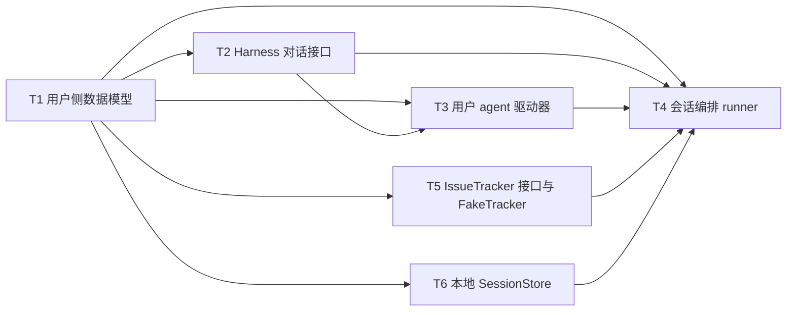

演化图：

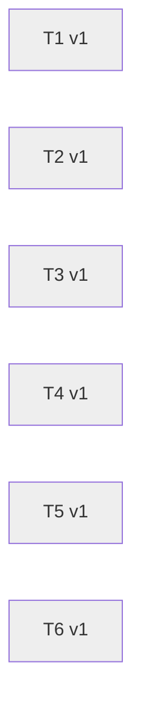

### 0002 Gitea 接入与基建（issue #0）

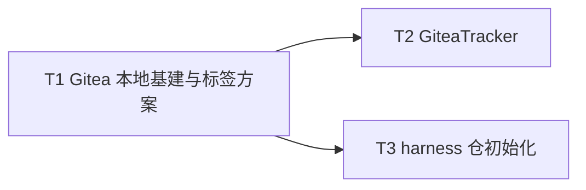

演化图：

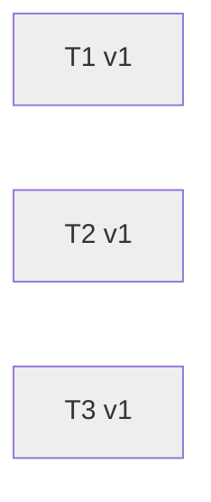

### 0003 开发者侧与闭环（issue #0）

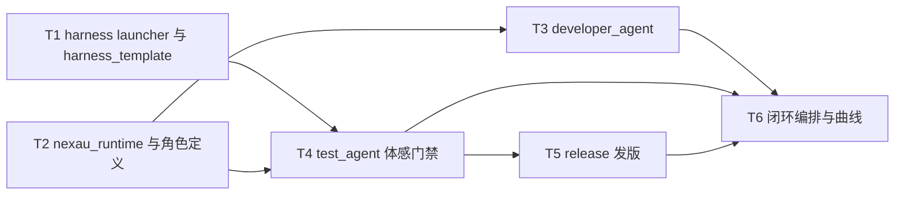

演化图：


### 0004 Harbor 运行与可恢复 checkpoint（issue #0）

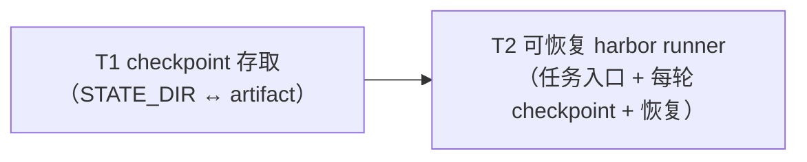

演化图：

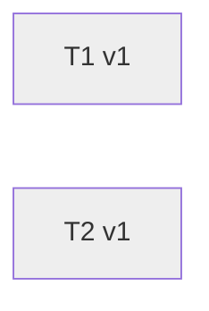

### 0005 用户侧重型实现：控制信封模拟器与体感评分（issue #0）

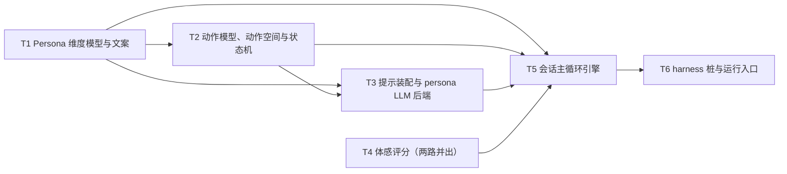

演化图：


### 0006 Persona 管线：采集（蒸馏）与注入 sim（issue #0）

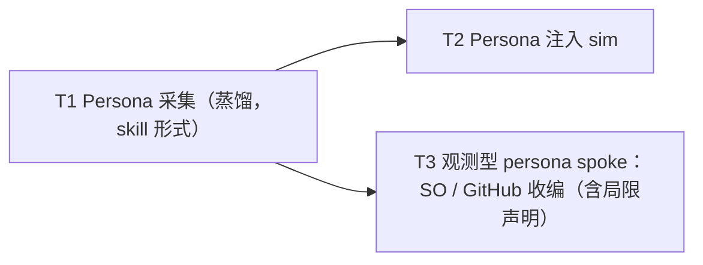

演化图：

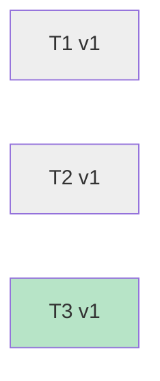

### 0007 开发者侧改为纯 trunk(main) 自进化（issue #12）

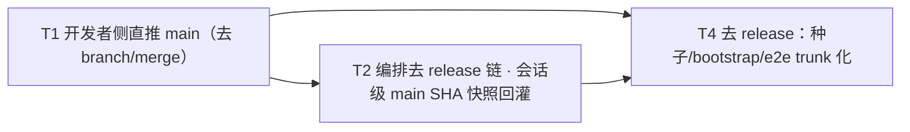

演化图：

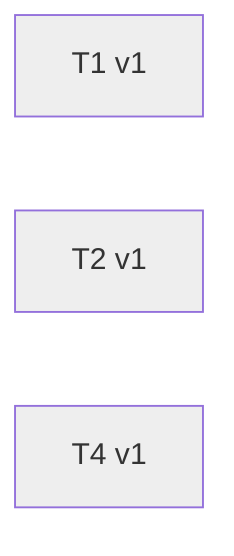

### 0008 用户 agent 内层 tool-using（自有环境核实）（issue #8）

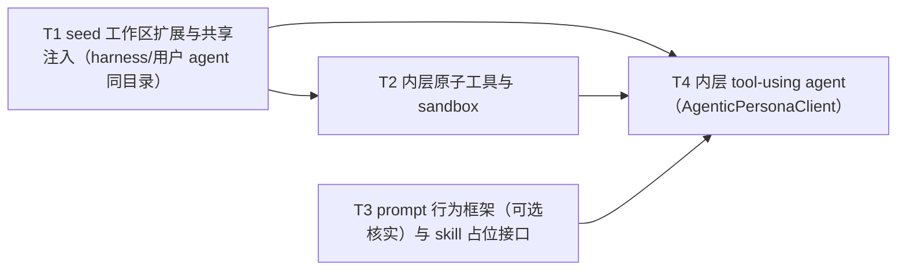

演化图：

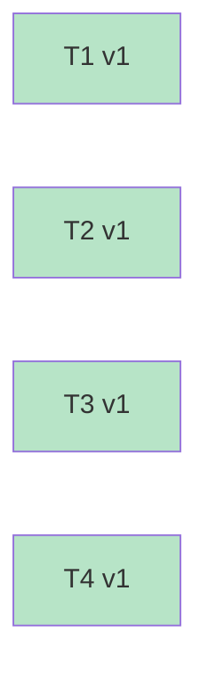

### 0009 种子工作区供给可插拔（SeedSource 接缝）（issue #9）

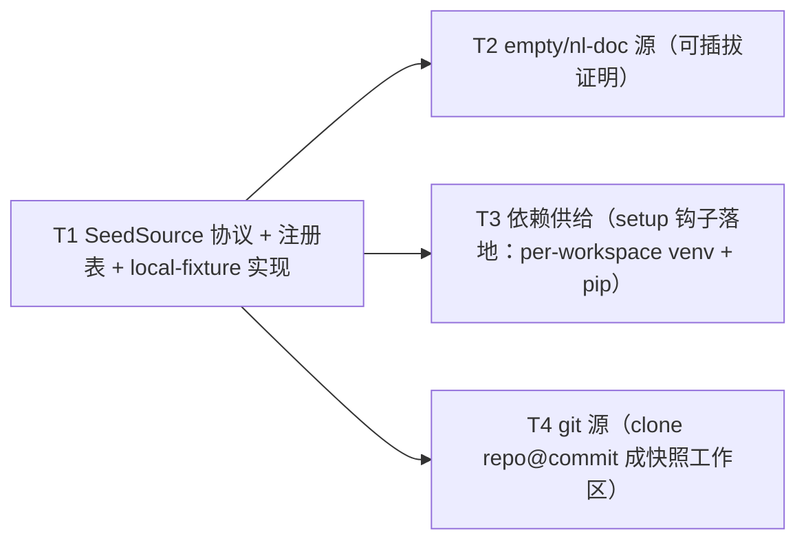

演化图：


### 0010 种子场景管线：采集(蒸馏)与注入 SeedSource（issue #10）

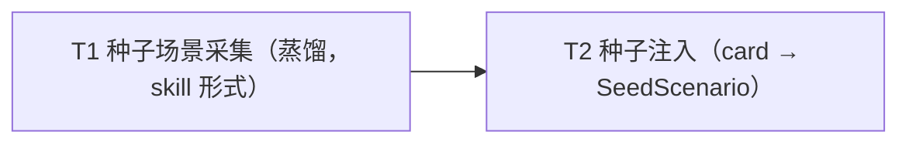

演化图：

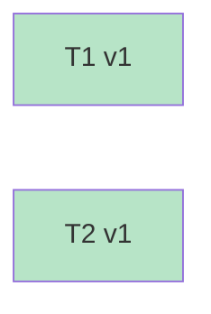

### 0011 AgentBoard：卡通形式的活动 agent 页面（issue #19）

```mermaid
graph LR
    nT1["T1 AgentBoard 卡通页 + 卡片 + 共享工具，摘除旧面板"]
```

演化图：

```mermaid
graph LR
    v_T1_1["T1 v1"]
    classDef st_done fill:#b7e4c7;
    class v_T1_1 st_done;
```

### 0012 用户侧等待体感真实化：心跳主动权 · 进度可见 · 任务相关耐心（issue #0）

```mermaid
graph LR
    nT1["T1 等待中主动权：心跳唤醒 + 进度可见 + 等待衰减口径统一"]
    nT2["T2 状态耐心模型：任务量起始浮动 + 性格衰减系数"]
```

演化图：

```mermaid
graph LR
    v_T1_1["T1 v1"]
    v_T2_1["T2 v1"]
    classDef st_done fill:#b7e4c7;
    class v_T1_1 st_done;
    class v_T2_1 st_done;
```

### 0013 Harness 呈现与交互协议：拆信封 · 过程流分层 · 打断/心跳（issue #0）

```mermaid
graph LR
    nT1["T1 拆 complete_task 信封 + 过程流分层 + begin/poll/control 心跳协议"]
    nT2["T2 v0 种子自测 smoke + MANUAL 呈现契约"]
```

演化图：

```mermaid
graph LR
    v_T1_1["T1 v1"]
    v_T2_1["T2 v1"]
    classDef st_pending fill:#eeeeee;
    class v_T1_1 st_pending;
    class v_T2_1 st_pending;
```

### 0014 旧内置 Developer 提交纪律（已退役）（issue #0）

```mermaid
graph LR
    empty[空]
```

演化图：

```mermaid
graph LR
```

### 0015 Harness 边界与需求工具访问：提交拒绝清单、trace 隔离与工作区检查（issue #0）

```mermaid
graph LR
    nT1["T1 harness 仓提交边界硬闸（pre-commit 钩子）"]
    nT2["T2 sandbox 工作目录下沉，物理隔离 trace"]
    nT3["T3 WorkspaceJailMiddleware：写关仓内、读放行 NexAU 源码与运行时临时目录"]
```

演化图：

```mermaid
graph LR
    v_T1_1["T1 v1"]
    v_T2_1["T2 v1"]
    v_T3_1["T3 v1"]
    classDef st_pending fill:#eeeeee;
    class v_T1_1 st_pending;
    class v_T2_1 st_pending;
    class v_T3_1 st_pending;
```

### 0016 设计师根因信号 + 读码效率 + 运行时聚合（issue #0）

```mermaid
graph LR
    nT1["T1 体感 reason 作根因信号喂设计师"]
    nT2["T2 设计师 grep + 先搜后读，降低读码开销"]
    nT3["T3 运行时行为聚合 runtime_agg：机制层观测数字喂设计师"]
    nT1 --> nT3
```

演化图：

```mermaid
graph LR
    v_T1_1["T1 v1"]
    v_T2_1["T2 v1"]
    v_T3_1["T3 v1"]
    classDef st_done fill:#b7e4c7;
    classDef st_pending fill:#eeeeee;
    class v_T1_1 st_pending;
    class v_T2_1 st_pending;
    class v_T3_1 st_done;
```

### 0017 多用户会话并行化：a 段线程池 + 共享状态加锁（issue #0）

```mermaid
graph LR
    nT1["T1 存储与观测投影加锁"]
    nT2["T2 client 每局一实例（工厂注入）"]
    nT3["T3 a 段并行化 + 并发度旋钮"]
    nT4["T4 并发端到端回归测试"]
    nT5["T5 harness checkout 并发安全"]
    nT6["T6 tracker HTTP 会话线程安全"]
    nT1 --> nT3
    nT2 --> nT3
    nT3 --> nT4
```

演化图：

```mermaid
graph LR
    v_T1_1["T1 v1"]
    v_T2_1["T2 v1"]
    v_T3_1["T3 v1"]
    v_T4_1["T4 v1"]
    v_T5_1["T5 v1"]
    v_T6_1["T6 v1"]
    classDef st_done fill:#b7e4c7;
    class v_T1_1 st_done;
    class v_T2_1 st_done;
    class v_T3_1 st_done;
    class v_T4_1 st_done;
    class v_T5_1 st_done;
    class v_T6_1 st_done;
```

### 0018 设计师提案拆信封：complete_task 交付不再被静默丢弃（issue #0）

```mermaid
graph LR
    nT1["T1 _run_agent 出口拆 complete_task 信封"]
```

演化图：

```mermaid
graph LR
    v_T1_1["T1 v1"]
    classDef st_done fill:#b7e4c7;
    class v_T1_1 st_done;
```

### 0019 launcher 非 reply 旁路放宽（progress 等）（issue #0）

```mermaid
graph LR
    nT1["T1 launcher：非 reply 旁路一律收 + control 旁路/终结分流"]
```

演化图：

```mermaid
graph LR
    v_T1_1["T1 v1"]
    classDef st_done fill:#b7e4c7;
    class v_T1_1 st_done;
```

### 0020 覆盖关系兑现 + 开发者领取策略与票种预算（issue #0）

```mermaid
graph LR
    nT1["T1 synthesizer covers 产出：提案字段解析 + body 机器行 + 被覆盖 bug 挂链"]
    nT2["T2 dev 领取分池 + 票种预算与重试升档 + 结果回写 comment"]
    nT3["T3 编排接线：run.py 构造带策略/预算的 dev + 配置旋钮"]
    nT4["T4 web API：/api/issues 附 covers/covered_by 字段"]
    nT5["T5 前端：issue 列表与详情的覆盖徽标"]
    nT2 --> nT3
    nT1 --> nT4
    nT4 --> nT5
```

演化图：

```mermaid
graph LR
    v_T1_1["T1 v1"]
    v_T2_1["T2 v1"]
    v_T3_1["T3 v1"]
    v_T4_1["T4 v1"]
    v_T5_1["T5 v1"]
    classDef st_done fill:#b7e4c7;
    class v_T1_1 st_done;
    class v_T2_1 st_done;
    class v_T3_1 st_done;
    class v_T4_1 st_done;
    class v_T5_1 st_done;
```

### 0021 dev agent 逃逸围堵：凭证隔离 + 编排绊线 + 污染清理（issue #0）

```mermaid
graph LR
    nT1["T1 repo_guard 模块 + orchestrator b 段绊线"]
    nT2["T2 run.py 凭证隔离 + 构造并注入编排仓绊线 guard"]
    nT3["T3 清理历史逃逸污染制品 MANUAL.md"]
    nT1 --> nT2
```

演化图：

```mermaid
graph LR
    v_T1_1["T1 v1"]
    v_T2_1["T2 v1"]
    v_T3_1["T3 v1"]
    classDef st_done fill:#b7e4c7;
    class v_T1_1 st_done;
    class v_T2_1 st_done;
    class v_T3_1 st_done;
```

### 0022 用户↔harness 内外通道：开放 intent · 中途 report_issue · slash 示范（issue #0）

```mermaid
graph LR
    nT1["T1 内外窗口 + 等待菜单 + emit_message + 开放 intent"]
    nT2["T2 中途 report_issue tool（可闲置）+ issue_notes flush"]
    nT3["T3 初始 harness：/exit\|/quit slash 内部分发 + MANUAL"]
```

演化图：

```mermaid
graph LR
    v_T1_1["T1 v1"]
    v_T2_1["T2 v1"]
    v_T3_1["T3 v1"]
    classDef st_done fill:#b7e4c7;
    class v_T1_1 st_done;
    class v_T2_1 st_done;
    class v_T3_1 st_done;
```

### 0023 等待环事件化钉死 · 废弃 one/two 与遗留信号（issue #0）

```mermaid
graph LR
    nT1["T1 loop：只留 three · 清 MAIN_GAP/死常量/stalled"]
    nT2["T2 prompt：删除 one/two 合并 builder · 单测改打 three"]
    nT3["T3 探针：去掉 two 臂与 peek-via-control 心智"]
    nT4["T4 launcher.try_reply 非阻塞契约（已落地）"]
    nT1 --> nT2
    nT1 --> nT3
```

演化图：

```mermaid
graph LR
    v_T1_1["T1 v1"]
    v_T2_1["T2 v1"]
    v_T3_1["T3 v1"]
    v_T4_1["T4 v1"]
    classDef st_done fill:#b7e4c7;
    class v_T1_1 st_done;
    class v_T2_1 st_done;
    class v_T3_1 st_done;
    class v_T4_1 st_done;
```

### 0024 用户 god-view 落盘 + 设计师按需取用（issue #0）

```mermaid
graph LR
    nT1["T1 Session.sim_trace 落盘（TurnLog→SimTrace）"]
    nT2["T2 index 扩 issue_numbers + 体感曲线带 session_id"]
    nT3["T3 get_session_timeline tool 入口（按需取证通路）"]
    nT4["T4 get_session_timeline 使用事件投影（去仿真外壳）"]
    nT5["T5 设计师渐进下钻 tool 接线（beat/step）"]
    nT6["T6 请求-回复配对：heard.answers → utterance"]
    nT1 --> nT2
    nT2 --> nT3
    nT3 --> nT4
    nT4 --> nT5
    nT5 --> nT6
```

演化图：

```mermaid
graph LR
    v_T1_1["T1 v1"]
    v_T2_1["T2 v1"]
    v_T3_1["T3 v1"]
    v_T4_1["T4 v1"]
    v_T5_1["T5 v1"]
    v_T6_1["T6 v1"]
    classDef st_done fill:#b7e4c7;
    class v_T1_1 st_done;
    class v_T2_1 st_done;
    class v_T3_1 st_done;
    class v_T4_1 st_done;
    class v_T5_1 st_done;
    class v_T6_1 st_done;
```

### 0025 issue triage 漏斗：用户提 issue → triage agent 分类定位 → synthesize agent 出 RFC → dev（issue #0）

```mermaid
graph LR
    nT1["T1 平台层 issue schema：per-type 字段(用户填/triage填 分区) + RFC + validate/render"]
    nT2["T2 用户 sim 产结构化 raw issue：暂定 type + needs-triage + 轮号"]
    nT3["T3 triage agent（新角色）：就地分类+定位+去重+驳回/needs-info"]
    nT4["T4 synthesize agent（原 synthesizer 收窄）：跨 issue 结构综合 → RFC"]
    nT5["T5 dev 简化：按容量领 triaged/RFC、未清空积压，预算按 kind 分档，去分池/retry/stuck"]
    nT6["T6 编排接线：d 段 triage→synthesize 两 agent + round 透传 + priority 机制派生 + roster"]
    nT7["T7 web+metrics：issue 附 kind/round/状态/priority + 曲线盯可执行 backlog(含积压)"]
    nT8["T8 前端：issue 列表按 type/状态 + RFC 区 + 覆盖/取代/积压展示"]
    nT3a["T3a tracker 补 set_labels：整组替换已有 issue 标签"]
    nT1 --> nT2
    nT1 --> nT3
    nT2 --> nT3
    nT3a --> nT3
    nT3 --> nT4
    nT4 --> nT5
    nT5 --> nT6
    nT4 --> nT7
    nT7 --> nT8
    nT1 --> nT3a
```

演化图：

```mermaid
graph LR
    v_T1_1["T1 v1"]
    v_T2_1["T2 v1"]
    v_T3_1["T3 v1"]
    v_T3a_1["T3a v1"]
    v_T4_1["T4 v1"]
    v_T5_1["T5 v1"]
    v_T6_1["T6 v1"]
    v_T7_1["T7 v1"]
    v_T8_1["T8 v1"]
    classDef st_done fill:#b7e4c7;
    class v_T1_1 st_done;
    class v_T2_1 st_done;
    class v_T3_1 st_done;
    class v_T3a_1 st_done;
    class v_T4_1 st_done;
    class v_T5_1 st_done;
    class v_T6_1 st_done;
    class v_T7_1 st_done;
    class v_T8_1 st_done;
```

### 0026 观测看板前端全面重构：浅/深主题可切换 + 分诊(triager)可见 + persona 展示 + 设计 token 化（issue #0）

```mermaid
graph LR
    nT1["T1 后端：live 补 triager 排序 + 用户 agent 活动载荷带 persona 摘要"]
    nT2["T2 设计 token 层 + 浅/深主题（跟随系统 + localStorage 持久）+ 全局 CSS"]
    nT3["T3 应用外壳 + 类型（AgentRole triager / Agent.meta）+ TopBar（主题开关）+ 概览曲线"]
    nT4["T4 角色列 + 卡片：triager 房间渲染 + 角色强调色 + 用户卡 persona + issue/commit 卡收敛"]
    nT5["T5 详情面板信息架构刷新（agent/session/issue/commit + 侧栏）+ persona 块"]
    nT2 --> nT3
    nT1 --> nT4
    nT3 --> nT4
    nT2 --> nT5
    nT3 --> nT5
```

演化图：

```mermaid
graph LR
    v_T1_1["T1 v1"]
    v_T2_1["T2 v1"]
    v_T3_1["T3 v1"]
    v_T4_1["T4 v1"]
    v_T5_1["T5 v1"]
    classDef st_done fill:#b7e4c7;
    class v_T1_1 st_done;
    class v_T2_1 st_done;
    class v_T3_1 st_done;
    class v_T4_1 st_done;
    class v_T5_1 st_done;
```

### 0027 统一 agent 结构化产出契约：issue_schema 单一真源 + submit-tool 原生校验，去掉第二次 LLM 重排与各自为政的解析（issue #0）

```mermaid
graph LR
    nT1["T1 issue_schema 收敛为契约单一真源 + 契约生成/共享校验模块"]
    nT2["T2 triage 改 submit-tool 原生结构化（去第二次 LLM 重排与别名归一）"]
    nT3["T3 synthesizer 改 submit-tool 原生结构化 + 统一 driver-apply"]
    nT1 --> nT2
    nT1 --> nT3
```

演化图：

```mermaid
graph LR
    v_T1_1["T1 v1"]
    v_T2_1["T2 v1"]
    v_T3_1["T3 v1"]
    classDef st_done fill:#b7e4c7;
    class v_T1_1 st_done;
    class v_T2_1 st_done;
    class v_T3_1 st_done;
```

### 0028 divergent PM + gate：产品候选并行通道与晋升评审（issue #0）

```mermaid
graph LR
    nT1["T1 issue_schema：divergent/gate-dropped 标签与可执行 backlog 口径"]
    nT2["T2 Divergent 驱动器 + agent_defs/divergent_pm：落不可领产品候选"]
    nT3["T3 Synthesizer.gate_once：promote/hold/drop 语义晋升"]
    nT4["T4 编排接线：d2 synthesize∥divergent → d3 gate；roster/run 默认关"]
    nT5["T5 dev 领取硬排除 divergent 候选"]
    nT1 --> nT2
    nT1 --> nT3
    nT2 --> nT4
    nT3 --> nT4
    nT1 --> nT5
```

演化图：

```mermaid
graph LR
    v_T1_1["T1 v1"]
    v_T2_1["T2 v1"]
    v_T3_1["T3 v1"]
    v_T4_1["T4 v1"]
    v_T5_1["T5 v1"]
    classDef st_done fill:#b7e4c7;
    class v_T1_1 st_done;
    class v_T2_1 st_done;
    class v_T3_1 st_done;
    class v_T4_1 st_done;
    class v_T5_1 st_done;
```

### 0029 三平面 issue 流：证据→提案→工作队列，唯一准入 Owner（白名单可领、生成器自由并行、去 gate 特殊通道）（issue #0）

```mermaid
graph LR
    nT1["T1 issue_schema 三平面标签收敛：report/proposal/ready 白名单 + 老标签读侧映射"]
    nT2["T2 agent_runtime 公共运行时抽出：跑 agent + 读 submit 一处实现"]
    nT3["T3 triage 改纯规范化生成器：accept→就地升 proposal，判重职责移出"]
    nT4["T4 synthesize 收窄为纯生成器：产 proposal(from-synthesize)，gate_once 退役"]
    nT5["T5 divergent 对齐纯生成器：产 proposal(from-divergent)，专属通道退役"]
    nT6["T6 Owner 唯一准入：机械+评审双模式批量裁决（admit/merge/decline/hold）"]
    nT7["T7 dev 白名单领取：ready-only + priority→age 排序 + 级联关闭"]
    nT8["T8 编排/roster/run 接线：生成段全并行（triage 可分片）→ Owner → dev + 背压告警"]
    nT9["T9 观测后端适配：plane 字段 + ready 深度曲线 + 漏斗计数"]
    nT10["T10 前端适配：三平面分组 + Owner 房间 + 漏斗与背压展示"]
    nT1 --> nT3
    nT2 --> nT3
    nT1 --> nT4
    nT2 --> nT4
    nT1 --> nT5
    nT2 --> nT5
    nT1 --> nT6
    nT2 --> nT6
    nT1 --> nT7
    nT3 --> nT8
    nT4 --> nT8
    nT5 --> nT8
    nT6 --> nT8
    nT7 --> nT8
    nT6 --> nT9
    nT7 --> nT9
    nT9 --> nT10
```

演化图：

```mermaid
graph LR
    v_T1_1["T1 v1"]
    v_T10_1["T10 v1"]
    v_T2_1["T2 v1"]
    v_T3_1["T3 v1"]
    v_T4_1["T4 v1"]
    v_T5_1["T5 v1"]
    v_T6_1["T6 v1"]
    v_T7_1["T7 v1"]
    v_T8_1["T8 v1"]
    v_T9_1["T9 v1"]
    classDef st_done fill:#b7e4c7;
    class v_T1_1 st_done;
    class v_T10_1 st_done;
    class v_T2_1 st_done;
    class v_T3_1 st_done;
    class v_T4_1 st_done;
    class v_T5_1 st_done;
    class v_T6_1 st_done;
    class v_T7_1 st_done;
    class v_T8_1 st_done;
    class v_T9_1 st_done;
```

### 0030 harness 产品化边界：/help 用户说明、平台侧接口与 connector 适配（issue #0）

```mermaid
graph LR
    nT1["T1 写 0030 活快照"]
    nT2["T2 harness_template 精简为 HELP/RUNTIME/scripts/deps"]
    nT3["T3 /help slash 与模板自测"]
    nT4["T4 产品提交边界：拒绝密钥与运行态"]
    nT6["T6 connector 与 stdio-jsonl-v1 协议适配"]
    nT2 --> nT3
    nT2 --> nT4
    nT2 --> nT6
```

演化图：

```mermaid
graph LR
    v_T1_1["T1 v1"]
    v_T2_1["T2 v1"]
    v_T3_1["T3 v1"]
    v_T4_1["T4 v1"]
    v_T6_1["T6 v1"]
    classDef st_done fill:#b7e4c7;
    class v_T1_1 st_done;
    class v_T2_1 st_done;
    class v_T3_1 st_done;
    class v_T4_1 st_done;
    class v_T6_1 st_done;
```

### 0031 用户模拟阶段契约下沉：薄 base system 与 prompt 去平台手册化（issue #0）

```mermaid
graph LR
    nT1["T1 写 0031 活快照"]
    nT2["T2 拆 prompt：薄 base system 与阶段局部 contract"]
    nT3["T3 loop 集成防回归：主/心跳三跳只按阶段暴露契约"]
    nT4["T4 persona_client 与 agentic 路径适配阶段契约"]
    nT1 --> nT2
    nT2 --> nT3
    nT2 --> nT4
```

演化图：

```mermaid
graph LR
    v_T1_1["T1 v1"]
    v_T2_1["T2 v1"]
    v_T3_1["T3 v1"]
    v_T4_1["T4 v1"]
    classDef st_done fill:#b7e4c7;
    class v_T1_1 st_done;
    class v_T2_1 st_done;
    class v_T3_1 st_done;
    class v_T4_1 st_done;
```

### 0032 开发者侧换轨 OpenAgents：需求面/交付面二分 + Gitea forge 适配（issue #0）

```mermaid
graph LR
    nT1["T1 OpenAgents 仓：forge 分发层——alias-import 接缝 + 配置段 + merger 提示词参数化"]
    nT2["T2 OpenAgents 仓：Gitea REST driver——github.py 同名公共面对 Gitea /api/v1"]
    nT3["T3 准入交接：Owner 改打 openagents 发现标签，plane READY 收编 {ready, openagents}"]
    nT4["T4 dev 侧退役：AgenticDeveloper/developer_agent 删除，orchestrator 去 dev 拍"]
    nT5["T5 vigil 接线：run.py 写 openagents.yml、管 vigil 子进程生命周期、vK tag 退役"]
    nT6["T6 harness 仓最小 CI：Gitea Actions runner + 冒烟 workflow"]
    nT7["T7 交付面观测：GiteaTracker PR 读路径 + web API + 前端交付面视图"]
    nT8["T8 文档收尾：CLAUDE.md 架构段与 spec 制品再生成"]
    nT1 --> nT2
    nT3 --> nT4
    nT2 --> nT5
    nT4 --> nT5
    nT5 --> nT6
    nT5 --> nT7
    nT5 --> nT8
```

演化图：

```mermaid
graph LR
    v_T1_1["T1 v1"]
    v_T2_1["T2 v1"]
    v_T3_1["T3 v1"]
    v_T4_1["T4 v1"]
    v_T5_1["T5 v1"]
    v_T6_1["T6 v1"]
    v_T7_1["T7 v1"]
    v_T8_1["T8 v1"]
    classDef st_done fill:#b7e4c7;
    class v_T1_1 st_done;
    class v_T2_1 st_done;
    class v_T3_1 st_done;
    class v_T4_1 st_done;
    class v_T5_1 st_done;
    class v_T6_1 st_done;
    class v_T7_1 st_done;
    class v_T8_1 st_done;
```

### 0033 交付面容器化围堵：vigil 专用容器（零宿主挂载、容器内自 clone）+ 出口代理 allowlist + 观测游标改跟 origin/main（issue #0）

```mermaid
graph LR
    nT1["T1 vigil 容器与网络基建：Dockerfile/entrypoint/build + internal 网络 + egress 代理 allowlist"]
    nT2["T2 run.py 双模式接线：容器缺省（docker run 生命周期/日志/env 注入）+ subprocess 显式 opt-in"]
    nT3["T3 观测游标改跟 origin/main：_resolve_head 先 fetch（无 origin 退化本地）"]
    nT4["T4 文档与 spec 制品：CLAUDE.md 围堵段收口 + render/graph"]
    nT1 --> nT2
    nT2 --> nT4
```

演化图：

```mermaid
graph LR
    v_T1_1["T1 v1"]
    v_T2_1["T2 v1"]
    v_T3_1["T3 v1"]
    v_T4_1["T4 v1"]
    classDef st_done fill:#b7e4c7;
    class v_T1_1 st_done;
    class v_T2_1 st_done;
    class v_T3_1 st_done;
    class v_T4_1 st_done;
```

### 0034 前端 Agent Company 大楼视图与用户心智轨迹（issue #0）

```mermaid
graph LR
    nT1["T1 写 0034 活快照"]
    nT2["T2 大楼视图接入：BuildingView + 楼层工作区 + 顶栏切换"]
    nT3["T3 大楼样式与角色色：发散/准入可读性修复"]
    nT4["T4 用户心智轨迹：SessionDetail 展示 sim_trace 三阶段"]
    nT1 --> nT2
    nT2 --> nT3
    nT2 --> nT4
    nT3 --> nT4
```

演化图：

```mermaid
graph LR
    v_T1_1["T1 v1"]
    v_T2_1["T2 v1"]
    v_T3_1["T3 v1"]
    v_T4_1["T4 v1"]
    classDef st_done fill:#b7e4c7;
    class v_T1_1 st_done;
    class v_T2_1 st_done;
    class v_T3_1 st_done;
    class v_T4_1 st_done;
```

### 0035 stdout 可见 harness 状态与主 loop 等待/打断动作（issue #0）

```mermaid
graph LR
    nT1["T1 写 0035 活快照"]
    nT2["T2 用户主 loop：常驻等待与打断动作"]
    nT3["T3 接缝层可见事件：扩充用户感知为 stdout 事件流"]
    nT4["T4 v0 harness：busy 输入 queued/status 可见性"]
    nT5["T5 divergent PM 用户可见契约观察 lens"]
    nT1 --> nT2
    nT1 --> nT3
    nT1 --> nT4
    nT1 --> nT5
```

演化图：

```mermaid
graph LR
    v_T1_1["T1 v1"]
    v_T2_1["T2 v1"]
    v_T3_1["T3 v1"]
    v_T4_1["T4 v1"]
    v_T5_1["T5 v1"]
    classDef st_done fill:#b7e4c7;
    class v_T1_1 st_done;
    class v_T2_1 st_done;
    class v_T3_1 st_done;
    class v_T4_1 st_done;
    class v_T5_1 st_done;
```

### 0036 接缝层统一 stdin 写入口：去 begin/emit 二分，reply 软唤醒（issue #0）

```mermaid
graph LR
    nT1["T1 写 0036 活快照"]
    nT2["T2 launcher：统一写入口 + poll 不绑写旗标"]
    nT3["T3 loop：主/心跳发消息走统一写；keep_waiting→poll"]
    nT4["T4 connector 与 INTERFACE 对齐统一写"]
    nT1 --> nT2
    nT1 --> nT3
    nT2 --> nT3
    nT2 --> nT4
```

演化图：

```mermaid
graph LR
    v_T1_1["T1 v1"]
    v_T2_1["T2 v1"]
    v_T3_1["T3 v1"]
    v_T4_1["T4 v1"]
    classDef st_done fill:#b7e4c7;
    class v_T1_1 st_done;
    class v_T2_1 st_done;
    class v_T3_1 st_done;
    class v_T4_1 st_done;
```

### 0037 人轴重构：时间气质 ⊥ 质量失败 · 过程卷入 · 蒸馏 spoke 对齐（issue #0）

```mermaid
graph LR
    nT1["T1 写 0037 活快照"]
    nT2["T2 sim：tempo 驱动耐心 · 过程卷入语义 · D6Authz 会话策略"]
    nT3["T3 hub：card-schema 增 D7 与语义注记"]
    nT4["T4 注入：card_to_persona 读 D7→tempo"]
    nT5["T5 蒸馏 spoke 对齐 D7 与人轴语义"]
    nT6["T6 探针：tempo / 过程卷入 / d43 正交可观测"]
    nT1 --> nT2
    nT1 --> nT3
    nT1 --> nT4
    nT2 --> nT4
    nT3 --> nT4
    nT1 --> nT5
    nT3 --> nT5
    nT2 --> nT6
    nT4 --> nT6
```

演化图：

```mermaid
graph LR
    v_T1_1["T1 v1"]
    v_T2_1["T2 v1"]
    v_T3_1["T3 v1"]
    v_T4_1["T4 v1"]
    v_T5_1["T5 v1"]
    v_T6_1["T6 v1"]
    classDef st_done fill:#b7e4c7;
    class v_T1_1 st_done;
    class v_T2_1 st_done;
    class v_T3_1 st_done;
    class v_T4_1 st_done;
    class v_T5_1 st_done;
    class v_T6_1 st_done;
```

### 0038 OpenAgents 交付面独立页面与园区入口（issue #0）

```mermaid
graph LR
    nT1["T1 写 0038 活快照"]
    nT2["T2 OpenAgents 入口、URL 状态与页面装配"]
    nT3["T3 OpenAgents 数据聚合模型"]
    nT4["T4 OpenAgents 独立页面 UI"]
    nT5["T5 园区厂房语义、状态聚合与交付边界"]
    nT6["T6 园区沙盘、厂房入口与双停机坪航线"]
    nT7["T7 OpenAgents 聚合模型回归测试"]
    nT1 --> nT2
    nT1 --> nT3
    nT2 --> nT4
    nT3 --> nT4
    nT2 --> nT5
    nT3 --> nT5
    nT4 --> nT6
    nT5 --> nT6
    nT3 --> nT7
    nT5 --> nT7
```

演化图：

```mermaid
graph LR
    v_T1_1["T1 v1"]
    v_T2_1["T2 v1"]
    v_T3_1["T3 v1"]
    v_T4_1["T4 v1"]
    v_T5_1["T5 v1"]
    v_T6_1["T6 v1"]
    v_T7_1["T7 v1"]
    classDef st_done fill:#b7e4c7;
    class v_T1_1 st_done;
    class v_T2_1 st_done;
    class v_T3_1 st_done;
    class v_T4_1 st_done;
    class v_T5_1 st_done;
    class v_T6_1 st_done;
    class v_T7_1 st_done;
```

### 0039 Issue 标签维度与状态演进时间线（issue #0）

```mermaid
graph LR
    nT1["T1 固化规格与跨仓验收边界"]
    nT2["T2 读取并折叠 Gitea issue timeline"]
    nT3["T3 扩展 issue 详情 timeline API"]
    nT4["T4 为 Synthesizer 综合票写入轮次标签"]
    nT5["T5 建立前端标签维度与时间线展示模型"]
    nT6["T6 展示 issue 状态演进并完成跨仓验收"]
    nT1 --> nT2
    nT2 --> nT3
    nT1 --> nT4
    nT3 --> nT5
    nT4 --> nT6
    nT5 --> nT6
```

演化图：

```mermaid
graph LR
    v_T1_1["T1 v1"]
    v_T2_1["T2 v1"]
    v_T3_1["T3 v1"]
    v_T4_1["T4 v1"]
    v_T5_1["T5 v1"]
    v_T6_1["T6 v1"]
    classDef st_done fill:#b7e4c7;
    class v_T1_1 st_done;
    class v_T2_1 st_done;
    class v_T3_1 st_done;
    class v_T4_1 st_done;
    class v_T5_1 st_done;
    class v_T6_1 st_done;
```

### 0040 交付面打开 RFC：drafter 落 docs/specs + 提交边界改拒绝清单（issue #0）

```mermaid
graph LR
    nT1["T1 stages.rfc=agent 定稿 + vigil 缺省 keep-alive"]
    nT2["T2 提交边界从白名单改为拒绝清单"]
    nT3["T3 smoke 拒绝清单与种子 docs/specs 落点"]
    nT4["T4 自定义 Anthropic 网关域进 egress allowlist"]
    nT5["T5 OpenAgents 镜像：implement 首轮优先 worktree specs"]
    nT2 --> nT3
    nT1 --> nT5
```

演化图：

```mermaid
graph LR
    v_T1_1["T1 v1"]
    v_T2_1["T2 v1"]
    v_T3_1["T3 v1"]
    v_T4_1["T4 v1"]
    v_T5_1["T5 v1"]
    classDef st_done fill:#b7e4c7;
    class v_T1_1 st_done;
    class v_T2_1 st_done;
    class v_T3_1 st_done;
    class v_T4_1 st_done;
    class v_T5_1 st_done;
```

### 0041 统一 LLM Token 用量监测与全链路归属（issue #0）

```mermaid
graph LR
    nT1["T1 统一事件模型、上下文与 user 精确采集"]
    nT2["T2 后端 NexAU 角色逐调用采集与轮级归属"]
    nT3["T3 Harness tracer 输出逐调用 usage 旁路"]
    nT4["T4 Harness 收端隔离、按题归属与落盘"]
    nT5["T5 分层聚合 API 与看板"]
    nT6["T6 Developer/vigil 精确度审计与结构化扩展口"]
    nT1 --> nT2
    nT1 --> nT3
    nT1 --> nT4
    nT3 --> nT4
    nT1 --> nT5
    nT2 --> nT5
    nT4 --> nT5
    nT1 --> nT6
```

演化图：

```mermaid
graph LR
    v_T1_1["T1 v1"]
    v_T2_1["T2 v1"]
    v_T3_1["T3 v1"]
    v_T4_1["T4 v1"]
    v_T5_1["T5 v1"]
    v_T6_1["T6 v1"]
    classDef st_done fill:#b7e4c7;
    classDef st_pending fill:#eeeeee;
    class v_T1_1 st_done;
    class v_T2_1 st_done;
    class v_T3_1 st_done;
    class v_T4_1 st_done;
    class v_T5_1 st_pending;
    class v_T6_1 st_done;
```

### 0042 需求面角色契约治理：统一术语、规范化提案投影与可靠状态迁移（issue #0）

```mermaid
graph LR
    nT1["T1 权威术语表、角色职责矩阵与现行流程基线"]
    nT2["T2 Canonical ProposalView 与规范化提案版本"]
    nT3["T3 Triage 可靠规范化迁移与结构化失败结果"]
    nT4["T4 Owner 决策图验证与可靠批量落库"]
    nT5["T5 五角色专业化 Prompt 与 Tool 契约统一"]
    nT6["T6 跨角色契约测试、规格索引与历史会话回放"]
    nT1 --> nT2
    nT1 --> nT3
    nT2 --> nT3
    nT1 --> nT4
    nT2 --> nT4
    nT1 --> nT5
    nT2 --> nT5
    nT3 --> nT5
    nT4 --> nT5
    nT3 --> nT6
    nT4 --> nT6
    nT5 --> nT6
```

演化图：

```mermaid
graph LR
    v_T1_1["T1 v1"]
    v_T2_1["T2 v1"]
    v_T3_1["T3 v1"]
    v_T4_1["T4 v1"]
    v_T5_1["T5 v1"]
    v_T6_1["T6 v1"]
    classDef st_done fill:#b7e4c7;
    class v_T1_1 st_done;
    class v_T2_1 st_done;
    class v_T3_1 st_done;
    class v_T4_1 st_done;
    class v_T5_1 st_done;
    class v_T6_1 st_done;
```

### 0043 需求面角色认知契约：专属产物语言与行为质量门（issue #0）

```mermaid
graph LR
    nT1["T1 角色产物模型与共享质量门契约"]
    nT2["T2 Triage 单报告认知隔离与事实型提案"]
    nT3["T3 产品 PM 全景洞察契约"]
    nT4["T4 Synthesize 提案关系综合契约"]
    nT5["T5 Owner 投资判断与组合质量门"]
    nT6["T6 跨角色行为评测与真实回放验收"]
    nT1 --> nT2
    nT1 --> nT3
    nT1 --> nT4
    nT2 --> nT4
    nT3 --> nT4
    nT1 --> nT5
    nT4 --> nT5
    nT2 --> nT6
    nT3 --> nT6
    nT4 --> nT6
    nT5 --> nT6
```

演化图：

```mermaid
graph LR
    v_T1_1["T1 v1"]
    v_T2_1["T2 v1"]
    v_T3_1["T3 v1"]
    v_T4_1["T4 v1"]
    v_T5_1["T5 v1"]
    v_T6_1["T6 v1"]
    classDef st_done fill:#b7e4c7;
    class v_T1_1 st_done;
    class v_T2_1 st_done;
    class v_T3_1 st_done;
    class v_T4_1 st_done;
    class v_T5_1 st_done;
    class v_T6_1 st_done;
```

### 0044 可复用 SWE-bench Seed 工作区供给（issue #0）

```mermaid
graph LR
    nT1["T1 Manifest 与供给契约"]
    nT2["T2 Prebuilt 隔离复制与虚拟环境迁移"]
    nT3["T3 Storage-only Docker seed 供给"]
    nT4["T4 可恢复批量构建与镜像校验"]
    nT5["T5 闭环题池选择与稳定实例归属"]
    nT1 --> nT2
    nT1 --> nT3
    nT2 --> nT3
    nT1 --> nT4
    nT2 --> nT4
    nT3 --> nT4
    nT1 --> nT5
    nT2 --> nT5
    nT3 --> nT5
```

演化图：

```mermaid
graph LR
    v_T1_1["T1 v1"]
    v_T2_1["T2 v1"]
    v_T3_1["T3 v1"]
    v_T4_1["T4 v1"]
    v_T5_1["T5 v1"]
    classDef st_done fill:#b7e4c7;
    class v_T1_1 st_done;
    class v_T2_1 st_done;
    class v_T3_1 st_done;
    class v_T4_1 st_done;
    class v_T5_1 st_done;
```

### 0045 Vigil Harness-aware 开发工具链（issue #0）

```mermaid
graph LR
    nT1["T1 工具链边界与双 pin 契约"]
    nT2["T2 双 checkout 镜像与只读 NexAU 工具链"]
    nT3["T3 显式构建镜像源、版本与代理配置"]
    nT4["T4 运行入口接线与配置优先级"]
    nT1 --> nT2
    nT2 --> nT3
    nT2 --> nT4
```

演化图：

```mermaid
graph LR
    v_T1_1["T1 v1"]
    v_T2_1["T2 v1"]
    v_T3_1["T3 v1"]
    v_T4_1["T4 v1"]
    classDef st_done fill:#b7e4c7;
    class v_T1_1 st_done;
    class v_T2_1 st_done;
    class v_T3_1 st_done;
    class v_T4_1 st_done;
```

### 0046 冻结设计产物到 OpenAgents 的隔离验证交接（issue #0）

```mermaid
graph LR
    nT1["T1 Fresh-target 与不可变 Manifest 契约"]
    nT2["T2 冻结 Summary 物化为验证仓库"]
    nT3["T3 只读 Gitea 快照的选择性交付复制"]
    nT4["T4 隔离 Vigil 启动与网关协议转换"]
    nT1 --> nT2
    nT1 --> nT3
    nT1 --> nT4
    nT3 --> nT4
```

演化图：

```mermaid
graph LR
    v_T1_1["T1 v1"]
    v_T2_1["T2 v1"]
    v_T3_1["T3 v1"]
    v_T4_1["T4 v1"]
    classDef st_done fill:#b7e4c7;
    class v_T1_1 st_done;
    class v_T2_1 st_done;
    class v_T3_1 st_done;
    class v_T4_1 st_done;
```

### 0047 并行实验运行时与真实模型认证（issue #0）

```mermaid
graph LR
    nT1["T1 当前实验身份与隔离契约"]
    nT2["T2 不可变 Manifest 与共享身份原语"]
    nT3["T3 每实验独立本地基础设施"]
    nT4["T4 当前 v2 生命周期与闭环接线"]
    nT1 --> nT2
    nT2 --> nT3
    nT2 --> nT4
    nT3 --> nT4
```

演化图：

```mermaid
graph LR
    v_T1_1["T1 v1"]
    v_T2_1["T2 v1"]
    v_T3_1["T3 v1"]
    v_T4_1["T4 v1"]
    classDef st_done fill:#b7e4c7;
    class v_T1_1 st_done;
    class v_T2_1 st_done;
    class v_T3_1 st_done;
    class v_T4_1 st_done;
```

### 0048 用户模拟最终查验分支与动作协议失效保护（issue #0）

```mermaid
graph LR
    nT1["T1 Spec 与实验根因证据契约"]
    nT2["T2 PersonaClient 阶段语义契约与工具重分发"]
    nT3["T3 一次性 final-check 与强制重新判断状态机"]
    nT4["T4 Action 边界 fail-closed"]
    nT5["T5 历史 action 完整性审计与端到端认证"]
    nT1 --> nT2
    nT2 --> nT3
    nT4 --> nT3
    nT1 --> nT4
    nT3 --> nT5
```

演化图：

```mermaid
graph LR
    v_T1_1["T1 v1"]
    v_T2_1["T2 v1"]
    v_T3_1["T3 v1"]
    v_T4_1["T4 v1"]
    v_T5_1["T5 v1"]
    classDef st_done fill:#b7e4c7;
    class v_T1_1 st_done;
    class v_T2_1 st_done;
    class v_T3_1 st_done;
    class v_T4_1 st_done;
    class v_T5_1 st_done;
```

### 0049 角色调用输入输出持久化与跨面归因（issue #0）

```mermaid
graph LR
    nT1["T1 调用记录契约与审计基线"]
    nT2["T2 InvocationStore、run manifest 与 v1 schema"]
    nT3["T3 需求面 run_agent_def 落盘"]
    nT4["T4 run 生命周期、会话迁入、vigil 导出与 jail"]
    nT5["T5 冻结调用离线重放"]
    nT6["T6 交付面 run_agent 写出同一 schema"]
    nT1 --> nT2
    nT2 --> nT3
    nT2 --> nT4
    nT3 --> nT5
    nT2 --> nT6
    nT4 --> nT6
```

演化图：

```mermaid
graph LR
    v_T1_1["T1 v1"]
    v_T2_1["T2 v1"]
    v_T3_1["T3 v1"]
    v_T4_1["T4 v1"]
    v_T5_1["T5 v1"]
    v_T6_1["T6 v1"]
    classDef st_done fill:#b7e4c7;
    class v_T1_1 st_done;
    class v_T2_1 st_done;
    class v_T3_1 st_done;
    class v_T4_1 st_done;
    class v_T5_1 st_done;
    class v_T6_1 st_done;
```

### 0050 轮次交付封口与收益归因（issue #0）

```mermaid
graph LR
    nT1["T1 轮次封口契约"]
    nT2["T2 本轮准入票终态闸"]
    nT3["T3 编排：末轮跳过需求交付、非末轮准入后封口"]
    nT4["T4 run 接线、看板阶段、卡死保活"]
    nT5["T5 架构说明与封口 e2e 脚本"]
    nT1 --> nT2
    nT2 --> nT3
    nT3 --> nT4
    nT3 --> nT5
```

演化图：

```mermaid
graph LR
    v_T1_1["T1 v1"]
    v_T2_1["T2 v1"]
    v_T3_1["T3 v1"]
    v_T4_1["T4 v1"]
    v_T5_1["T5 v1"]
    classDef st_done fill:#b7e4c7;
    class v_T1_1 st_done;
    class v_T2_1 st_done;
    class v_T3_1 st_done;
    class v_T4_1 st_done;
    class v_T5_1 st_done;
```

### 0051 会话容器隔离与客观验收证据（issue #0）

```mermaid
graph LR
    nT1["T1 隔离与验收契约"]
    nT2["T2 会话运行时与容器 seed"]
    nT3["T3 harness 容器执行与强制终止"]
    nT4["T4 双结论、客观执行与假接受"]
    nT5["T5 可运行镜像、包内控制器与审计冒烟"]
    nT1 --> nT2
    nT2 --> nT3
    nT3 --> nT4
    nT4 --> nT5
```

演化图：

```mermaid
graph LR
    v_T1_1["T1 v1"]
    v_T2_1["T2 v1"]
    v_T3_1["T3 v1"]
    v_T4_1["T4 v1"]
    v_T5_1["T5 v1"]
    classDef st_done fill:#b7e4c7;
    class v_T1_1 st_done;
    class v_T2_1 st_done;
    class v_T3_1 st_done;
    class v_T4_1 st_done;
    class v_T5_1 st_done;
```

### 0052 Synthesizer 提案覆盖与重复合并权责（issue #0）

```mermaid
graph LR
    nT1["T1 Synthesizer covers 合并语义与状态迁移"]
    nT2["T2 Owner 退回纯交付路由"]
    nT3["T3 覆盖合并回归测试与规格验证"]
    nT1 --> nT2
    nT1 --> nT3
    nT2 --> nT3
```

演化图：

```mermaid
graph LR
    v_T1_1["T1 v1"]
    v_T2_1["T2 v1"]
    v_T3_1["T3 v1"]
    classDef st_done fill:#b7e4c7;
    class v_T1_1 st_done;
    class v_T2_1 st_done;
    class v_T3_1 st_done;
```

### 0053 Persona 语义动作契约与可审计终止状态机（issue #0）

```mermaid
graph LR
    nT1["T1 定义语义动作契约与分层结果模型"]
    nT2["T2 实现动作语义契约与阶段局部 schema"]
    nT3["T3 实现协议解析修复与错误分级"]
    nT4["T4 接入独立结果状态与优雅终止状态机"]
    nT5["T5 补齐事件溯源审计与八会话回归门禁"]
    nT2 --> nT3
    nT2 --> nT4
    nT3 --> nT4
    nT3 --> nT5
    nT4 --> nT5
```

演化图：

```mermaid
graph LR
    v_T1_1["T1 v1"]
    v_T2_1["T2 v1"]
    v_T3_1["T3 v1"]
    v_T4_1["T4 v1"]
    v_T5_1["T5 v1"]
    classDef st_done fill:#b7e4c7;
    classDef st_in_progress fill:#fff3b0;
    classDef st_pending fill:#eeeeee;
    class v_T1_1 st_done;
    class v_T2_1 st_done;
    class v_T3_1 st_in_progress;
    class v_T4_1 st_pending;
    class v_T5_1 st_pending;
```

### 0054 用户模拟目标驱动与可修订目标账本（issue #0）

```mermaid
graph LR
    nT1["T1 目标账本与修订事件模型"]
    nT2["T2 目标进入用户感知与动作决策"]
    nT3["T3 目标结果与主客观结论分离"]
    nT4["T4 时间线投影与目标账本完整审计"]
    nT1 --> nT2
    nT1 --> nT3
    nT2 --> nT3
    nT2 --> nT4
    nT3 --> nT4
```

演化图：

```mermaid
graph LR
    v_T1_1["T1 v1"]
    v_T2_1["T2 v1"]
    v_T3_1["T3 v1"]
    v_T4_1["T4 v1"]
    classDef st_done fill:#b7e4c7;
    class v_T1_1 st_done;
    class v_T2_1 st_done;
    class v_T3_1 st_done;
    class v_T4_1 st_done;
```

### 0055 目标感知的需求面证据分层与角色可见性（issue #0）

```mermaid
graph LR
    nT1["T1 定义目标感知证据包与分层读取契约"]
    nT2["T2 用户反馈 handoff 与 Triage 单报告输入"]
    nT3["T3 产品 PM 全局体验输入与产品视角边界"]
    nT4["T4 Synthesize 提案关系输入与证据下钻约束"]
    nT5["T5 角色可见性、过拟合和延迟回归评测"]
    nT1 --> nT2
    nT1 --> nT3
    nT1 --> nT4
    nT2 --> nT4
    nT3 --> nT4
    nT2 --> nT5
    nT3 --> nT5
    nT4 --> nT5
```

演化图：

```mermaid
graph LR
    v_T1_1["T1 v1"]
    v_T2_1["T2 v1"]
    v_T3_1["T3 v1"]
    v_T4_1["T4 v1"]
    v_T5_1["T5 v1"]
    classDef st_done fill:#b7e4c7;
    class v_T1_1 st_done;
    class v_T2_1 st_done;
    class v_T3_1 st_done;
    class v_T4_1 st_done;
    class v_T5_1 st_done;
```

### 0056 终止接受的目标原子提交与 Persona 证据对齐（issue #0）

```mermaid
graph LR
    nT1["T1 终止动作与目标账本原子提交"]
    nT2["T2 Persona 验收依据与能力对齐"]
    nT3["T3 可见初始完成条件与客观结果分轨"]
    nT4["T4 终止一致性回归"]
    nT1 --> nT4
    nT2 --> nT4
    nT3 --> nT4
```

演化图：

```mermaid
graph LR
    v_T1_1["T1 v1"]
    v_T2_1["T2 v1"]
    v_T3_1["T3 v1"]
    v_T4_1["T4 v1"]
    classDef st_done fill:#b7e4c7;
    class v_T1_1 st_done;
    class v_T2_1 st_done;
    class v_T3_1 st_done;
    class v_T4_1 st_done;
```

### 0057 自主产品反馈与交互主动作并行（issue #0）

```mermaid
graph LR
    nT1["T1 主动作伴随反馈与既有提单兼容"]
    nT2["T2 动作兼容与持久化回归"]
    nT1 --> nT2
```

演化图：

```mermaid
graph LR
    v_T1_1["T1 v1"]
    v_T2_1["T2 v1"]
    classDef st_done fill:#b7e4c7;
    class v_T1_1 st_done;
    class v_T2_1 st_done;
```

### 0059 观测文件入口与设计角色按需取证（issue #0）

```mermaid
graph LR
    nT1["T1 制品观测文件的只读入口和访问审计"]
    nT2["T2 独立 PM 和结构综合按需取证与证据引用延续"]
    nT3["T3 边界回归与真实模型单链路回放"]
    nT1 --> nT2
    nT1 --> nT3
    nT2 --> nT3
```

演化图：

```mermaid
graph LR
    v_T1_1["T1 v1"]
    v_T2_1["T2 v1"]
    v_T3_1["T3 v1"]
    classDef st_done fill:#b7e4c7;
    class v_T1_1 st_done;
    class v_T2_1 st_done;
    class v_T3_1 st_done;
```

### 0060 独立 PM 路线与双轨交付协调（issue #0）

```mermaid
graph LR
    nT1["T1 双轨角色边界与协调契约"]
    nT2["T2 角色与跨轮观测回归和实验审计"]
    nT1 --> nT2
```

演化图：

```mermaid
graph LR
    v_T1_1["T1 v1"]
    v_T2_1["T2 v1"]
    classDef st_done fill:#b7e4c7;
    class v_T1_1 st_done;
    class v_T2_1 st_done;
```

### 0061 开发侧观测使用与制品日志演进闭环（issue #0）

```mermaid
graph LR
    nT1["T1 NexAU 起点的制品自有观测包"]
    nT2["T2 会话收集、版本绑定与历史留存"]
    nT3["T3 跨容器开发证据交接"]
    nT4["T4 开发设计、实现、评审的观测职责"]
    nT5["T5 诊断观测缺口提案与可恢复提交"]
    nT6["T6 跨轮与替代 harness 验证"]
    nT1 --> nT2
    nT2 --> nT3
    nT3 --> nT4
    nT3 --> nT5
    nT1 --> nT6
    nT2 --> nT6
    nT3 --> nT6
    nT4 --> nT6
    nT5 --> nT6
```

演化图：

```mermaid
graph LR
    v_T1_1["T1 v1"]
    v_T2_1["T2 v1"]
    v_T3_1["T3 v1"]
    v_T4_1["T4 v1"]
    v_T5_1["T5 v1"]
    v_T6_1["T6 v1"]
    classDef st_done fill:#b7e4c7;
    class v_T1_1 st_done;
    class v_T2_1 st_done;
    class v_T3_1 st_done;
    class v_T4_1 st_done;
    class v_T5_1 st_done;
    class v_T6_1 st_done;
```

### 0062 交付失败终态协议兼容（issue #0）

```mermaid
graph LR
    nT1["T1 当前与历史失败终态及闭环回归"]
```

演化图：

```mermaid
graph LR
    v_T1_1["T1 v1"]
    classDef st_done fill:#b7e4c7;
    class v_T1_1 st_done;
```

### 0063 轻量交付前置与软调度（issue #0）

```mermaid
graph LR
    nT1["T1 需求侧提案分组与并行 Synthesizer"]
    nT2["T2 交付侧有界前置与软调度"]
```

演化图：

```mermaid
graph LR
    v_T1_1["T1 v1"]
    v_T2_1["T2 v1"]
    classDef st_done fill:#b7e4c7;
    class v_T1_1 st_done;
    class v_T2_1 st_done;
```

### 0064 阶段级可恢复实验运行（issue #0）

```mermaid
graph LR
    nT1["T1 持久化恢复状态与对账原语"]
    nT2["T2 阶段化 Orchestrator 与交付恢复"]
    nT3["T3 用户会话工作项级恢复"]
    nT4["T4 Triage 与 Divergent 第一拍恢复"]
    nT5["T5 Synthesizer 与 Owner 输出先存后应用"]
    nT6["T6 Fresh/resume 入口与故障矩阵验收"]
    nT1 --> nT2
    nT1 --> nT3
    nT2 --> nT3
    nT1 --> nT4
    nT2 --> nT4
    nT1 --> nT5
    nT2 --> nT5
    nT4 --> nT5
    nT1 --> nT6
    nT2 --> nT6
    nT3 --> nT6
    nT4 --> nT6
    nT5 --> nT6
```

演化图：

```mermaid
graph LR
    v_T1_1["T1 v1"]
    v_T2_1["T2 v1"]
    v_T3_1["T3 v1"]
    v_T4_1["T4 v1"]
    v_T5_1["T5 v1"]
    v_T6_1["T6 v1"]
    classDef st_done fill:#b7e4c7;
    class v_T1_1 st_done;
    class v_T2_1 st_done;
    class v_T3_1 st_done;
    class v_T4_1 st_done;
    class v_T5_1 st_done;
    class v_T6_1 st_done;
```

### 0065 标准化 Harness 评测框架（issue #0）

```mermaid
graph LR
    nT1["T1 版本化评测计划与不可变清单"]
    nT2["T2 可插拔沙盒提供方与隔离生命周期"]
    nT3["T3 Harness 持久会话与流式控制协议"]
    nT4["T4 直出与带心跳 LLM 用户模拟策略"]
    nT5["T5 Benchmark 插件、官方预算与隐藏 grader"]
    nT6["T6 可恢复编排、统一结果与配对报告"]
    nT1 --> nT4
    nT3 --> nT4
    nT1 --> nT5
    nT2 --> nT5
    nT3 --> nT5
    nT1 --> nT6
    nT2 --> nT6
    nT3 --> nT6
    nT4 --> nT6
    nT5 --> nT6
```

演化图：

```mermaid
graph LR
    v_T1_1["T1 v1"]
    v_T2_1["T2 v1"]
    v_T3_1["T3 v1"]
    v_T4_1["T4 v1"]
    v_T5_1["T5 v1"]
    v_T6_1["T6 v1"]
    classDef st_done fill:#b7e4c7;
    class v_T1_1 st_done;
    class v_T2_1 st_done;
    class v_T3_1 st_done;
    class v_T4_1 st_done;
    class v_T5_1 st_done;
    class v_T6_1 st_done;
```

### 0066 Provider latency 隔离与官方预算超时（issue #0）

```mermaid
graph LR
    nT1["T1 统一时间账本与 provider scope"]
    nT2["T2 角色超时分类与可恢复取消"]
    nT4["T4 时间分类回归验收"]
    nT1 --> nT2
    nT1 --> nT4
    nT2 --> nT4
```

演化图：

```mermaid
graph LR
    v_T1_1["T1 v1"]
    v_T2_1["T2 v1"]
    v_T4_1["T4 v1"]
    classDef st_done fill:#b7e4c7;
    class v_T1_1 st_done;
    class v_T2_1 st_done;
    class v_T4_1 st_done;
```

### 0067 混合 Harness E2B Scaling 运行时（issue #0）

```mermaid
graph LR
    nT2["T2 底层 direct 会话与终端 review 契约"]
```

演化图：

```mermaid
graph LR
    v_T2_1["T2 v1"]
    classDef st_done fill:#b7e4c7;
    class v_T2_1 st_done;
```

### 0068 Synthesizer 角色彻底改名与旧 Developer 遗留清理（issue #0）

```mermaid
graph LR
    nT1["T1 需求包、边界检查与角色名称统一"]
    nT2["T2 Agent 定义与启动配置切换"]
    nT3["T3 当前开发工具与执行接口命名"]
    nT4["T4 看板角色与显示名称统一"]
    nT5["T5 当前文档与 Spec 索引更新"]
    nT6["T6 行为回归与离线流程验证"]
    nT1 --> nT2
    nT2 --> nT3
    nT1 --> nT4
    nT3 --> nT5
    nT4 --> nT5
    nT5 --> nT6
```

演化图：

```mermaid
graph LR
    v_T1_1["T1 v1"]
    v_T2_1["T2 v1"]
    v_T3_1["T3 v1"]
    v_T4_1["T4 v1"]
    v_T5_1["T5 v1"]
    v_T6_1["T6 v1"]
    classDef st_done fill:#b7e4c7;
    class v_T1_1 st_done;
    class v_T2_1 st_done;
    class v_T3_1 st_done;
    class v_T4_1 st_done;
    class v_T5_1 st_done;
    class v_T6_1 st_done;
```

### 0069 本地 Docker 与 E2B 可选实验启动（issue #0）

```mermaid
graph LR
    nT1["T1 统一实验 schema 与材料冻结"]
    nT2["T2 共用 controller context 与后端协议"]
    nT3["T3 本地 Docker 与 localhost Gitea 适配"]
    nT4["T4 E2B 与 Gitea.com 执行适配"]
    nT5["T5 统一 CLI 和生命周期管理"]
    nT6["T6 双语教程与两路径完整验收"]
    nT1 --> nT2
    nT2 --> nT3
    nT2 --> nT4
    nT2 --> nT5
    nT3 --> nT6
    nT4 --> nT6
    nT5 --> nT6
```

演化图：

```mermaid
graph LR
    v_T1_1["T1 v1"]
    v_T2_1["T2 v1"]
    v_T3_1["T3 v1"]
    v_T4_1["T4 v1"]
    v_T5_1["T5 v1"]
    v_T6_1["T6 v1"]
    classDef st_done fill:#b7e4c7;
    class v_T1_1 st_done;
    class v_T2_1 st_done;
    class v_T3_1 st_done;
    class v_T4_1 st_done;
    class v_T5_1 st_done;
    class v_T6_1 st_done;
```

### 0070 兼容 Gitea.com 的证据发布与联合预检（issue #0）

```mermaid
graph LR
    nT1["T1 附件能力解析与受限下载"]
    nT2["T2 双格式发布与冻结传输记录"]
    nT3["T3 实际交付运行时能力预检"]
    nT4["T4 按需公网出口与镜像接线"]
    nT5["T5 跨仓验收与联合发布"]
    nT1 --> nT2
    nT1 --> nT3
    nT2 --> nT3
    nT3 --> nT4
    nT2 --> nT5
    nT3 --> nT5
    nT4 --> nT5
```

演化图：

```mermaid
graph LR
    v_T1_1["T1 v1"]
    v_T2_1["T2 v1"]
    v_T3_1["T3 v1"]
    v_T4_1["T4 v1"]
    v_T5_1["T5 v1"]
    classDef st_done fill:#b7e4c7;
    class v_T1_1 st_done;
    class v_T2_1 st_done;
    class v_T3_1 st_done;
    class v_T4_1 st_done;
    class v_T5_1 st_done;
```

### 0071 统一实验入口后的仓库清理与历史研究归档（issue #0）

```mermaid
graph LR
    nT1["T1 历史研究归档与活评分依赖分离"]
    nT2["T2 控制器入包与冻结 v2 运行管理"]
    nT3["T3 退出 v1 生命周期和旧启动配置"]
    nT4["T4 开发工具收拢与显式输入"]
    nT5["T5 历史快照展示语义"]
    nT6["T6 目录契约 CI、双语文档与综合验收"]
    nT1 --> nT2
    nT2 --> nT3
    nT2 --> nT4
    nT3 --> nT4
    nT1 --> nT6
    nT2 --> nT6
    nT3 --> nT6
    nT4 --> nT6
    nT5 --> nT6
```

演化图：

```mermaid
graph LR
    v_T1_1["T1 v1"]
    v_T2_1["T2 v1"]
    v_T3_1["T3 v1"]
    v_T4_1["T4 v1"]
    v_T5_1["T5 v1"]
    v_T6_1["T6 v1"]
    classDef st_done fill:#b7e4c7;
    class v_T1_1 st_done;
    class v_T2_1 st_done;
    class v_T3_1 st_done;
    class v_T4_1 st_done;
    class v_T5_1 st_done;
    class v_T6_1 st_done;
```

### 0072 统一入口的既有能力迁移与执行修复（issue #0）

```mermaid
graph LR
    nT1["T1 配置与消费者环境、认证和 Owner 接线"]
    nT2["T2 冻结显式计划和 direct 交互"]
    nT3["T3 后端单轮就绪与非 root 交付执行"]
    nT4["T4 绑定 run 的观测看板入口"]
    nT5["T5 能力矩阵、示例和两后端集成验收"]
    nT1 --> nT5
    nT2 --> nT5
    nT3 --> nT5
    nT4 --> nT5
```

演化图：

```mermaid
graph LR
    v_T1_1["T1 v1"]
    v_T2_1["T2 v1"]
    v_T3_1["T3 v1"]
    v_T4_1["T4 v1"]
    v_T5_1["T5 v1"]
    classDef st_done fill:#b7e4c7;
    class v_T1_1 st_done;
    class v_T2_1 st_done;
    class v_T3_1 st_done;
    class v_T4_1 st_done;
    class v_T5_1 st_done;
```

### 0073 统一入口的多任务与多用户实验（issue #0）

```mermaid
graph LR
    nT1["T1 统一任务目录与冻结会话计划"]
    nT2["T2 local 多任务镜像与独立会话容器"]
    nT3["T3 E2B 多任务基线与独立会话环境"]
    nT4["T4 合并控制器并贯通逻辑会话身份"]
    nT5["T5 生命周期兼容与多任务观察"]
    nT6["T6 公开 N4 示例与双后端闭环验收"]
    nT1 --> nT2
    nT1 --> nT3
    nT1 --> nT4
    nT2 --> nT4
    nT3 --> nT4
    nT4 --> nT5
    nT5 --> nT6
```

演化图：

```mermaid
graph LR
    v_T1_1["T1 v1"]
    v_T2_1["T2 v1"]
    v_T3_1["T3 v1"]
    v_T4_1["T4 v1"]
    v_T5_1["T5 v1"]
    v_T6_1["T6 v1"]
    classDef st_done fill:#b7e4c7;
    class v_T1_1 st_done;
    class v_T2_1 st_done;
    class v_T3_1 st_done;
    class v_T4_1 st_done;
    class v_T5_1 st_done;
    class v_T6_1 st_done;
```

### 0074 统一入口的批量实验管理（issue #0）

```mermaid
graph LR
    nT1["T1 批次输入与冻结成员账本"]
    nT2["T2 复用单run的批次调度与恢复"]
    nT3["T3 统一CLI批次子命令与仓库契约"]
    nT4["T4 批次示例与双语教程"]
    nT5["T5 批次闭环故障恢复验收"]
    nT1 --> nT2
    nT1 --> nT3
    nT1 --> nT4
    nT2 --> nT5
    nT3 --> nT5
    nT4 --> nT5
```

演化图：

```mermaid
graph LR
    v_T1_1["T1 v1"]
    v_T2_1["T2 v1"]
    v_T3_1["T3 v1"]
    v_T4_1["T4 v1"]
    v_T5_1["T5 v1"]
    classDef st_done fill:#b7e4c7;
    class v_T1_1 st_done;
    class v_T2_1 st_done;
    class v_T3_1 st_done;
    class v_T4_1 st_done;
    class v_T5_1 st_done;
```

### 0075 统一入口的实验后官方 SWE 评分（issue #0）

```mermaid
graph LR
    nT1["T1 完整会话补丁与不可变预测回执"]
    nT2["T2 已收集输入绑定与独立官方评分"]
    nT4["T4 双语教程与历史能力状态"]
    nT3["T3 统一评分CLI与完整生产验收"]
    nT1 --> nT2
    nT2 --> nT3
    nT4 --> nT3
```

演化图：

```mermaid
graph LR
    v_T1_1["T1 v1"]
    v_T2_1["T2 v1"]
    v_T3_1["T3 v1"]
    v_T4_1["T4 v1"]
    classDef st_done fill:#b7e4c7;
    class v_T1_1 st_done;
    class v_T2_1 st_done;
    class v_T3_1 st_done;
    class v_T4_1 st_done;
```

### 0076 旧 seed 卡库与纯文本任务导入（issue #0）

```mermaid
graph LR
    nT1["T1 旧卡与文本材料转换"]
    nT2["T2 统一任务CLI与公开命令检查"]
    nT3["T3 双语输入教程与当前示例"]
    nT4["T4 转换到冻结与真实工作区验收"]
    nT1 --> nT4
    nT2 --> nT4
    nT3 --> nT4
```

演化图：

```mermaid
graph LR
    v_T1_1["T1 v1"]
    v_T2_1["T2 v1"]
    v_T3_1["T3 v1"]
    v_T4_1["T4 v1"]
    classDef st_done fill:#b7e4c7;
    class v_T1_1 st_done;
    class v_T2_1 st_done;
    class v_T3_1 st_done;
    class v_T4_1 st_done;
```
