# Specification overview (OVERVIEW)

> Generated by `spec render`. Edit the source specifications, then regenerate this file.

## Summary by feature

### 0001 Minimal workflow for a user agent to use the harness
This group implements **a｜user side** of the evolution loop: a user agent acts as a real user, using the harness over multiple turns based on a persona + seed scenario to produce two types of signals—**experience scores** (training signals) and **issues** (bugs/requirements). This group builds only the 'minimal workflow' and uses Fake backends throughout, with no dependency on real Gitea / a real harness, so it can be tested independently; real backends are supplied by 0002 (Gitea) and 0003 (harness).

### 0002 Gitea integration and infrastructure
This group completes **the real backend and infrastructure for stage a**: 0001 established the interfaces using Fake implementations; this group replaces the “stubs” with “real implementations”—starting a local Gitea instance (home to issues and the harness repository) and implementing `GiteaTracker`, the real backend for the 0001/T5 `IssueTracker` interface.

### 0003 Developer side and closed loop
This group implements **b \| Developer side** and **c \| Closed-loop feedback**, assembling the components from the previous two groups into repeatable evolution rounds. One round = a (users produce issues + user experience) → b (developers modify the harness, test the user experience gate, and release) → c (the new harness version returns to a).

### 0004 Harbor run and recoverable checkpoint
This group adds a **recoverable runtime** to the closed loop: all agents run **in one pass in a single sandbox** (option A, the entire run = 1 harbor task), using harbor's task→artifact channel to export checkpoints from the sandbox and feed them back in for recovery. It spans a/b/c: checkpoints maintain user-side state (completed sessions / experience), developer-side state (issue assignments, candidate branches), and other orchestration intermediate state (round / stage / release_ref / pending merges) at **unit boundaries**.

### 0005 Heavyweight user-side implementation: control-envelope simulator and experience scoring
This group implements the heavyweight version of **a｜user side** in the evolutionary closed loop: it replaces the minimal stub in spec-0001/T3 with a “control-envelope” architecture so that the user agent uses the harness more realistically over multiple turns (capability-dependent branching, follow-up questions, workarounds, abandonment), and completes the training signal **FeelingScore (1–4 experience score)** from spec-0001. Located at `backend/ahe_beta/user/sim/`, it **coexists with, rather than overwrites**, the 0001 minimal implementation.

### 0006 Persona pipeline: collection (distillation) and injection into sim
This group implements the persona pipeline: linking “collect personas from real data” with “inject personas into the control envelope sim” in a single chain to supply real user profiles to 0005's heavyweight user-side implementation. This corresponds to the CLAUDE.md “distillation module” and enforces the constraint that “personas come from real data and are not constructed from benchmarks or trajectories”.

### 0007 Switch the developer side to pure trunk(main) self-evolution
## Summary

### 0008 User agent inner tool use (verification in its own environment)
This group upgrades the user-side “single `respond()` subjective judgment” in spec-0005 to an **inner tool-using agent that can verify in its own environment**: like a real person, the simulated user uses **its own tool stack** (reading code / running commands / writing scripts) to **actually execute** in its own sandbox when suspicious, grounding `verdict` in real results rather than speculation. **The outer control envelope (action space / state machine / user experience / termination) remains unchanged**; the only integration point is `PersonaClient.respond(system, user) -> dict`. The implementation target is `backend/ahe_beta/user/sim/`, an evolution of 0005/T3.

### 0009 Pluggable seed workspace provisioning (SeedSource seam)
This group builds on spec-0008/T1: at that time, `SeedScenario.workspace` was implemented through `WorkspaceSpec{fixture, setup}` + `materialize()`, with **a single, hard-coded local copytree** provisioning path. As task sources increase (NL2Repo-style starts from empty repositories, future SWE-bench / Terminal-Bench, etc.), **the provisioning side needs to be pluggable**; meanwhile, **the consumption interface**—`SeedScenario.description` text + a workspace directory used as cwd by `Sandbox`/`sim_user`—remains frozen, with zero changes.

### 0010 Seed scenario pipeline: collection (distillation) and injection into SeedSource
This group implements the seed scenario pipeline: it connects “collecting seed scenarios from real data” and “injecting seed cards into SeedSource provisioning” into a single chain, supplying real tasks for 0009's SeedSource (the workspace provisioning seam) and 0005's user-side simulation. It corresponds to the **seed scenario library** half of the output from the “distillation module” in CLAUDE.md (the persona half is 0006; this group mirrors it symmetrically), enforcing the constraint that “seeds come from real data, and benchmarks remain held-out throughout.” It provides upstream inputs to 0009's SeedSource, with zero changes on the consumer side (models / seed_source / sources / run.py).

### 0011 AgentBoard: A Cartoon-Style Active Agent Page
This group adds an independent **AgentBoard** page to the observation dashboard frontend: it displays currently active agents in real time in cartoon form (emoji avatars + CSS animations), shows their identities, and supports clicking, replacing the plain collapsible panel `AgentsPanel` previously embedded at the top of every page. The data source continues to use the existing `/api/agents` (a read-only projection of `data/live/agents.json`, polled every 2 seconds), with **zero backend changes and zero new dependencies**—the cartoon presentation is implemented with emoji + CSS keyframes, consistent with Occam’s razor.

### 0012 Making the user's waiting experience realistic: heartbeat-driven initiative · visible progress · task-dependent patience
Upgrade the user agent's “idle waiting” when facing a slow/stalled harness to a perceptible, realistic user experience: after a heartbeat wakes it during a wait, it decides through judge→intent→act; the waiting bar displays live progress and prior_activity; keep_waiting consumes patience only when there is no new progress; WAIT_GAP and ATTRIBUTION. Initial patience varies with task load. Waiting menus and internal/external IO semantics follow 0022 (this group no longer defines invoke_control).

### 0013 Harness Presentation and Interaction Protocol: Envelope Unwrapping · Layered Process Streams · Interruption/Heartbeat
Fully separate user-facing harness presentation from internal processes, and complete the interaction protocol for slow sessions: unwrap complete_task envelopes; expose only the observation layer of internal processes through steps; emit mid-flight {'progress':…} activity strips while running (stdout may carry multiple side-channel lines, while the terminal state remains one line containing reply); control:interrupt returns [interrupted]; launcher begin/poll/control uses segmented polling without blindly killing processes. Implementation targets: harness_template + harness/launcher. See 0019 for relaxed side-channel handling and continued waiting with peek.

### 0014 Legacy Built-in Developer Commit Discipline (Retired)
The legacy built-in Developer's two commit middleware components and their assembly tasks have been retired and no longer serve as current runtime safeguards; the historical design and implementation remain in Git history.

### 0015 Harness Boundaries and Requirements Tool Access: Commit Denylist, Trace Isolation, and Workspace Checks
Retain three active boundary mechanisms: Harness commit hooks reject secrets and runtime state, sandbox working directories are separated from raw traces, and the requirements Agent reads files through guards tool-path checks and explicit observation authorization.

### 0016 Architect root-cause signals + code-reading efficiency + runtime aggregation
Add the Architect's missing 'why is it bad' root-cause signal, mechanism-level comparison numbers, and code-reading efficiency: ① feed the experience reason to the Architect alongside the score; ② search_file_content + search before reading; ③ runtime_agg scans the most recent N Session sessions after the fact, aggregates the proportions of 0-step/timeouts/interruptions/errors and the budget knobs, and injects them into propose_once (observation only, no attribution). Locations: architect/ + user/session_store.py + agent_defs/architect/.

### 0017 Parallelize multi-user sessions: thread pool for stage a + lock shared state
Change user sessions in the closed-loop stage a from serial execution to ThreadPoolExecutor parallelism: the concurrency unit is an entire session (workspace + Harness subprocess + client + run_session as one package), while the envelope's internal ordering remains unchanged; correspondingly fix shared state (one client instance per session, move workspace provisioning earlier, lock SessionStore/live), and degrade a single-session failure without invalidating the entire round. Stages d/b remain serial due to inherent constraints (same-repository push + global env). Locations: loop/orchestrator + loop/sim_user + run.py + user/session_store + loop/live.

### 0018 Unwrap architect proposal envelopes: complete_task deliveries are no longer silently discarded
When the architect submits proposals using complete_task, nexau wraps the result in a tool envelope ({success,status,output:{result:'[...]'}}), while _parse_proposals deliberately avoids entering strings during its balanced-bracket scan and cannot find the top-level array → silently returns “no proposals this round.” In an actual 8-round long run, 0 of 6 structural proposals entered the backlog; the defect is also nondeterministic—when the agent follows instructions and calls complete_task, proposals are discarded, while disobeying and emitting a bare array gets them stored (the #6/#7/#8 issues that happened to be stored in round 6 immediately led dev to modify entry.py and tools/, proving that the structural evolution channel itself works and is simply blocked here). Implementation: unwrap envelopes at the architect/_run_agent exit + unit tests covering both paths (enveloped / bare array).

### 0019 Relax launcher non-reply sideband handling (progress, etc.)
Relax the harness stdout sideband protocol (accept any non-reply JSON and write it to last_sideband/last_progress); control() continues to support both sideband ack and terminal reply shapes (wire compatible). The user-side path for peek/status via control has been superseded by 0022 and abandoned (original T2). See 0022 for the current user wait loop.

### 0020 Implement coverage relationships + developer pickup policy and issue-type budgets
Complete the execution chain for architect coverage decisions (structured covers, linking, deprioritization, cascading closure, frontend badges), make developer pickup use configurable pools (design priority + reserved bug-only devs), and provide initial iteration budgets by issue type with automatic escalation on same-issue retries.

### 0021 Dev agent escape containment: credential isolation + orchestration tripwire + contamination cleanup
Testing found that a dev agent bypassed workspace-jail path scanning through a heredoc tunnel, modified files in the orchestration repo, and pushed using GitHub credentials inherited from the host. A path-level jail cannot contain an agent that can invoke interpreters (as its docstring already acknowledges). This group does not harden scanning; instead, it adds defense in depth: process-level git credential isolation breaks the push chain, a tripwire after segment b asserts that the orchestration repo has not been touched, and artifacts contaminated by past escapes are cleaned up. OS-level sandboxing is left as the fundamental solution.

### 0022 User↔harness internal and external channels: open intent · mid-session report_issue · slash demonstration
Define the user–harness internal and external interaction boundaries: internal=message (including in-flight emit and dispatch within slash message bodies), external=interrupt (Ctrl+C) and session closure; change the waiting menu to keep_waiting/send_message/interrupt/give_up; open intent, narrowed by act with self-reported gaps; the mid-session report_issue tool may remain unused; the initial harness demonstrates slash with /exit\|/quit. Supersedes the original 0019 user-side peek-via-control and 0012 invoke_control menu semantics.

### 0023 Finalize the event-driven waiting loop · retire one/two and legacy signals
Finalize the AwaitEvent waiting loop (main loop consumes replies, one-shot heartbeat, try_reply before actions); standardize [+Ns] history (wait_cost already removed); retire one\|two in decide/waiting and the combined builders; remove dead constants and MAIN_GAP with no consumers; align probes with the 0022 menu.

### 0024 Persist the user's god-view + on-demand access for the architect
Persist the full god-view in Session.sim_trace; three layers of on-demand evidence retrieval for the architect—usage-event timeline projection (get_session_timeline, including utterance↔answers request–reply pairing) → beat-level harness activity (get_harness_beat) → single-step expansion (get_harness_step); user experience curves include session handles; jail still prohibits direct reads of sessions/. This group does not retire runtime_agg.

### 0025 Issue triage funnel: user submits issue → triage agent classifies and locates the problem → architect agent produces RFC → dev
Build the issue flow into a triage funnel modeled on a real software team, and split the existing single architect into two agents. User sim produces raw issues (the user-side template fills user-visible fields, applies type labels and needs-triage, and stamps the round number); the triage agent classifies (confirms type) + locates the problem (reads harness code + get_session_timeline traces) + deduplicates + rejects/marks needs-info in place; the architect agent (the original architect with a narrower scope) only synthesizes structure across issues and produces RFCs (a separate label that takes precedence over type, consolidates/supersedes individual issues, and receives the highest dev budget). Each round, devs sequentially claim triaged issues + RFCs up to capacity (N devs), with any uncleared backlog carried into the next round (backlog = previous round carryover + newly triaged issues this round). Budgets are tiered by kind; remove the 0020 pool partitioning/retry/stuck mechanisms. Product/direction layer = distill persona/seed card library (humans via CLI, layer ⓪, no agent); PM responsibilities = priority derived through an experience + frequency mechanism.

### 0026 Complete observability dashboard frontend redesign: switchable light/dark themes + visible triager + persona display + design tokens
Completely redesign the observability dashboard frontend from 'pure black background + white text, four columns, SR-001 identifier only' into an interface with a design system: ① Introduce a design token layer (colors/spacing/type scale/border radii/shadows/stacking levels) + switchable light/dark themes (follow the system, persist in localStorage); ② Add the triager room to the dashboard—all five roles in the a→d1(triage)→d2(architect)→b loop are visible, with consistent accent colors for each role; ③ User cards display persona (identity + level/domain/goal), not just SR-001; standardize issue/commit card layouts on top of the 0025 badges; ④ Refresh the detail panel information architecture + persona block; ⑤ Visualize user experience/backlog curves (consume the existing /api/overview); ⑥ Responsive layout (no horizontal page scrolling, wide content scrolls internally) + contrast/focus states for both themes. Only minor backend changes: add triager ordering to live, and include a persona summary in user agent activity payloads. Read-only observability only; do not change closed-loop semantics or introduce benchmarks.

### 0027 Unified structured agent output contract: issue_schema as the single source of truth + native submit-tool validation, removing the second LLM reformatting call and fragmented parsing
The three agents that currently produce structured output (user sim / triage / architect) use three entirely different levels of strictness, all built from layers of patches—issue_schema's USER section is dead code (user sim uses free text, the prompt has no constraints, and render/validate(section=user) has zero production calls); triage relies on three fallback layers: “a second LLM call to reformat with json_schema + bracket scanning + extensive alias normalization”; architect only uses bracket scanning + tolerant mapping, without constrained decoding. This spec unifies them as follows: consolidate issue_schema into the single source of truth for normalized fields (remove USER/TRIAGE sections, keep user body as free text = real users), and generate submit-tool input_schema from it; triage / architect each use a submit tool with input_schema to emit structured output natively—nexau enforces jsonschema validation at the tool-call layer (violations raise ToolValidationError→agent retries), and the driver reads validated arguments directly. Remove the second LLM reformatting call, bracket scanning, and per-agent alias normalization, replacing them with one shared “read submit arguments + unified fallback” implementation. This is purely a refactor of orchestration/agent output paths; it does not change a→d1→d2→b closed-loop semantics or introduce benchmarks.

### 0028 divergent PM + gate: parallel product candidate channel and promotion review
Add a parallel product candidate channel alongside the 0025 triage funnel: divergent PM and architect use the same signals in parallel to persist unclaimable divergent candidates; Architect.gate_once performs semantic promotion (promote→feature+triaged / hold / drop). Disabled by default with N_DIVERGENTS=0; dev claiming strictly excludes divergent.

### 0029 Three-plane issue flow: evidence→proposal→work queue, with a single admission Owner (claimable whitelist, generators freely parallelized, gate special channel removed)
Three root problems in the current issue flow: ① Three writers have authority to put work into the dev queue (triage accept, architect directly creating RFCs and superseding others, gate promote), with inconsistent admission rules—architect output enters the queue without review, while divergent output must pass gate, a product of historical evolution with no underlying principle; ② labels flatten 'work-item eligibility / workflow status / attributes' into one plane, and dev claimability is determined by a blacklist that grows with every new state (each addition of divergent or gate-dropped requires remembering to update the dev exclusion set); ③ deduplication is placed on the generation side, which is meant to run in parallel (triage normalizes and deduplicates at the same time), inherently conflicting with parallelism—the root cause of the previous impasse in triage sharding discussions. This spec restructures the flow into a three-plane, single-admission model: plane 1 evidence (user reports/user experience/runtime, input) → plane 2 proposals (proposal, always unclaimable; triage/architect/divergent are all merely generators, producing non-binding proposals, so they can run freely in parallel and duplicates are harmless; they also split into two tracks by evidence source—architect consumes the normalized backlog to find structural root causes (delivery track), while divergent directly consumes raw session behavior to mine capability gaps not raised as issues (discovery track), achieving deduplication by construction rather than prompt instructions) → single admission Owner (one batch review per round: admit→ready / merge for deduplication / decline / hold; mechanical mode automatically admits a single fix proposal with complete fields without an LLM call) → plane 3 work queue (ready is the sole claimable whitelist; dev pulls by priority→age and closes only its own issues—covers cascading is completed by merge during Owner admission). Supporting changes: extract the shared agent runtime (eliminating triage/divergent dependencies on architect private symbols), retire the gate/divergent special channel and superseded/gate-dropped intermediate states, and add proposal/ready queue depth backpressure alerts (= implementing CLAUDE.md degradation signals). Do not change the pure trunk/direct push to main/benchmark held-out/submit-tool contracts (reuse 0027; Owner only adds submit_admission).

### 0030 harness productization boundary: /help user documentation, platform-side interfaces, and connector adaptation
Refine harness into a product that real users can run: retain only HELP.md as the /help content source and RUNTIME.md as maintenance guidance in the harness template; README/USER/MANUAL are no longer template documents, and INTERFACE belongs on the AHE-Beta platform side; connector adapts sim-user to the human-facing interface; launcher/template support stdio-jsonl-v1 and remain compatible with legacy.

### 0031 Move user simulation stage contracts down: a thin base system and prompts stripped of platform manual content
Split the global user simulation BLOCK_G into a thin base system and stage-local contracts: judge/intent no longer inherit the platform operations manual for actions, termination, issue, rating, and so on; act focuses only on external actions (send_message + termination), while private inspection belongs to the user's inner agentic behavior and a private_evidence summary serves as user memory across turns; retain the user model's self-labeled verdict without introducing a post-processing classifier.

### 0032 Switch the developer side to OpenAgents: separate the requirements and delivery planes + adapt the Gitea forge
The current developer side is a transitional implementation (as described by spec-0025/T5): nexau dev picks up ready issues and pushes directly to main, with no branches/PRs/reviews/CI; bad commits can only be corrected through subsequent rounds of iteration, and multiple devs must run serially because pushes to the same repository are mutually exclusive. OpenAgents (an RFC-driven multi-agent delivery framework in a separate repository) has refined the delivery loop of “issue→branch/worktree→spec→PR→CI→review→merge” into a level-triggered watchkeeper (vigil). Its execution-plane entry point happens to have the same name and meaning as the endpoint of our three planes (spec-0029): both use the `ready` label as the sole work-queue allowlist. This spec places the seam at admission: ahe-beta retains the requirements plane (user simulation→evidence→proposal→Owner as the sole admission authority), while OpenAgents takes over the delivery plane (ready→PR→merge). The two systems interact only through issue labels and main SHAs, with zero code coupling. Responsibility decision: disable OpenAgents' triager/admitter (admission already belongs to Owner, `stages.triage=skip`); curator/drafter/implementer/reviewer/deliver/merger/replier take over the delivery plane; retire our AgenticDeveloper + developer_agent entirely, and remove the dev beat from the orchestrator (step c retains its semantics of feeding back the main SHA, naturally supporting the PR merge model). Platform constraint: this repository's infrastructure runs on local Gitea (spec-0002), while OpenAgents' utils/github.py is entirely tied to the gh CLI—so add a forge dispatch layer to the OpenAgents repository (alias-import with zero call-site changes) + a Gitea REST driver (semantic mappings such as checks→commit status, blocked_by→issue dependencies, draft→WIP prefix, merge/update→Gitea pulls API). Upgrading direct trunk pushes to a PR gate does not violate held-out constraints: CI/review is an engineering quality gate (smoke tests in the harness repository, never running the benchmark), user experience remains purely observational, and the benchmark remains held-out throughout. Retire the vK tag system; the observation anchor is the merge commit.

### 0033 Delivery-surface container containment: a vigil-specific container (zero host mounts, self-cloning inside the container) + egress proxy allowlist + observation cursor tracking origin/main
After the spec-0032 route change, the delivery-surface coding agent is the out-of-process claude CLI (bypassPermissions), which the in-process workspace_jail from the nexau era cannot reach. When run bare on WSL/the host, the nested agent can read the entire filesystem (the orchestration repository and data/sessions overfitting channel), with unrestricted network egress. Existing safeguards (credential isolation/boundary hooks/repo_guard tripwires) only govern “what was changed and where it was pushed”, not “what was read”. This spec fully implements the “in-process jail is unreliable → environment-level containment (no credentials + network egress allowlist)” established by spec-0021/0022: run vigil in a dedicated container (openagents + claude CLI + git), with the working directory as a **harness repository self-cloned inside the container**. With zero host mounts, “can only see the harness repository” becomes a filesystem boundary rather than a software promise. On the network, the vigil container attaches only to the internal network (reachable to gitea), while external access goes through an egress proxy allowlist (only the Anthropic API domain is permitted). The key feasibility point is that the sole interaction medium between the two planes (requirements surface/delivery surface) is already Gitea (issue labels + push/merge + main SHA); vigil does not need anything from the host filesystem. Rebuilding the container for every run automatically resets the clone and the .openagents runtime state (preserving the original rmtree reset semantics). This also fixes an existing bug: after spec-0032, main is advanced by a server-side merge on Gitea, while orchestrator step c and the launcher read the main of the **local** harness repository. The local repository therefore remains at the seed forever, the cursor does not advance, and the user always runs v0. Change _resolve_head to fetch origin first and then resolve origin/main (fall back to local when there is no origin, preserving compatibility with existing tests and Fake scenarios). Retain host subprocess direct-run mode as explicit opt-in (VIGIL_MODE=subprocess, limited to watch-the-screen integration debugging); the container is the default.

### 0034 Frontend Agent Company building view and user mental trace
Add an Agent Company building view alongside the existing column-based observation dashboard: display live/archived agents on floors for the user/triage/divergence/design/admission/delivery planes, retaining SidePanel details and the delivery-plane PR panel; add a collapsible Judge/Intent/Act mental trace to user session details, displaying sim_trace without changing the backend API.

### 0035 stdout-visible harness state and main-loop waiting/interrupt actions
User-facing state feedback helps users understand the current situation and decide what to do next; the seam layer displays real stdout in order, the main loop supports waiting and interruption, and the v0 harness displays queued status; goals and acceptance criteria are defined separately from 0061 maintainer diagnostic observability.

### 0036 Unified stdin write entry point in the seam layer: remove the begin/emit split, use reply as a soft wake-up
The seam layer's begin/emit_message split leaks “formal turn vs. interjection” semantics and ties stdout reads to in_flight, causing keep_waiting to spin without doing work after reply. This group changes the model to: a single write entry point for user messages (always writing to stdin, like the CC input box); the harness decides blocking/queuing; the platform uses type=reply as a soft wake-up (waiting for the next reply or timeout), and poll does not depend on write-path flags; interrupt remains an out-of-band channel. Changes are concentrated in launcher/loop/connector and tests, without changing the shape of the harness wire protocol.

### 0037 Reframe the human axis: time temperament ⊥ quality failure · process involvement · distillation spoke alignment
With the seam approaching a human-operated CLI, the gap in the waiting experience lies on the “human” axis: the old design hardwires patience to the quality-failure strategy (d43), while supervision remains turn-based monitoring. This group adds tempo (card D7) to drive patience, limits d43 to answering what to do when the result is wrong, reframes supervision as process involvement, and marks D6Authz as a session policy excluded from cards; the hub adds D7 and orthogonal injection; injection defaults to steady; three distillation spokes align ground/inject. No separate Translation module is introduced, and projection still follows judge→intent→act; interrupt/queued/slash are not hardwired into the human axis.

### 0038 OpenAgents standalone delivery page and campus entry point
Add a standalone OpenAgents delivery page to the frontend, and expand the Agent Company building into a campus consisting of a main requirements building and an OpenAgents delivery factory; small cargo drones/transport aircraft express the handoff relationship between the two, and clicking anywhere on the factory opens the standalone delivery page.

### 0039 Issue label dimensions and state evolution timeline
Normalize Gitea label events into replayable issue state evolution, display separate dimensions for plane, source, priority, round, and delivery blocking on the detail page, and detect metadata loss caused by label replacement.

### 0040 Enable RFC on the delivery side: drafter writes docs/specs + switch the commit boundary to a denylist
Change stages.rfc on the delivery side from skip to agent so drafter writes implementation specifications in the harness repository; change the commit boundary from a top-level allowlist to a denylist (blocking only secrets and vigil runtime state), otherwise docs/ written by RFC will fail smoke. Custom Anthropic protocol gateway domains must be added to the egress allowlist. On the OpenAgents side, the first implement round prioritizes existing specs in the worktree (this repository only mirrors the description).

### 0041 Unified LLM Token Usage Monitoring and End-to-End Attribution
Establish unified per-call raw Token events, concurrent context attribution, per-problem and per-round aggregation, and a dashboard for user, triager, architect, divergent, owner, harness, and developer/vigil; explicitly report unavailable when upstream data is missing, and never fabricate precise values.

### 0042 Requirements-side role contract governance: unified terminology, normalized proposal projections, and reliable state transitions
Eliminate the coexistence of multiple generations of requirements-side workflow semantics, use formal terminology and the role responsibility matrix as authoritative definitions, establish a unified ProposalView, fix Triage/Architect/Owner state transitions and handoff boundaries, unify System Prompt, runtime message, and submit-tool contracts, and verify through cross-role tests and historical session replay.

### 0043 Demand-side role cognitive contracts: role-specific artifact language and behavioral quality gates
Establish distinct cognitive tasks, role-specific artifact contracts, and executable quality gates for Triage, product PM, Architect, and Owner on top of shared evidence, preventing multiple roles from degenerating into the same kind of technical analysis Agent.

### 0044 Reusable SWE-bench Seed Workspace Provisioning
Provide isolated, auditable prebuilt workspaces for concurrent user sessions through explicit manifests, resumable build state, prebuilt workspaces, and storage-only Docker images; maintain per-task attribution in the closed loop and retain a git fallback path.

### 0045 Vigil Harness-aware Development Toolchain
Build a non-root vigil image with explicit dual OpenAgents/NexAU checkout pins, providing the real source code and testing tools needed for internal harness orchestration; build-time dependencies, the Claude version, proxies, and runtime configuration are all explicit and auditable.

### 0046 Isolated validation handoff of frozen design artifacts to OpenAgents
Copy the frozen requirements-surface summary or a read-only Gitea snapshot into a brand-new validation repository, selectively retain delivery tokens, and generate a non-overwritable manifest; then start an isolated vigil with explicit Anthropic-compatible gateway configuration, ensuring the experiment is reusable and does not contaminate the source.

### 0047 Parallel Experiment Runtime and Real-Model Authentication
Retain the current experiment identity, immutable manifest, isolated local infrastructure, and v2 lifecycle wiring; the old v1 commands, capacity protection, and authentication design have exited and been archived.

### 0048 User simulation final-check branch and action protocol failure protection
When the simulated user still needs evidence at the intent stage, allow only one bounded final check, then force tool-free re-judge→intent→act; stage-level semantic validation prevents illegal output and evaluator failures from masquerading as Accept again.

### 0049 Role invocation input/output persistence and cross-plane attribution
Use run_id as the experiment slice, storing user sessions and the fully populated inputs and structured outputs of every role invocation on the demand/delivery planes in a single directory that cannot be deleted by a reset, so the experiment can be reconstructed afterward and the problematic stage located; OpenAgents only writes using the same schema.

### 0050 Round delivery closure and benefit attribution
Non-final rounds: after the user finishes testing, run proposals and admission, then wait until all admission tickets for the current round reach terminal states before starting users for the next round; if blocked, stop the experiment. The final round runs only user interaction, with no further demand or delivery. The experience difference of round N+1 relative to round N is attributed to the sealed deliverables from round N.

### 0051 Session Container Isolation and Objective Acceptance Evidence
Each user session starts an independent container from a runnable seed image; the persona and harness execute only in the container workspace; the harness’s long requests use the 90s persona heartbeat to decide whether to continue waiting or interrupt; user sessions retain subjective conclusions and complete artifacts; fresh SWE-bench objective acceptance is performed by an independent post-hoc scorer, and false acceptance must not count as a pass.

### 0052 Architect Proposal Coverage and Duplicate Consolidation Responsibilities
The Architect determines which triage/proposals are absorbed by structural proposals based on the complete ProposalView; covers is the sole simplification directive, directly merging and closing covered sources after the target proposal is created. The Owner is responsible only for delivery routing.

### 0053 Persona Semantic Action Contracts and an Auditable Termination State Machine
Replace uniform, fragile JSON validation in user simulation with contracts defined by action semantics: required/optional/forbidden messages, phase-local fields, and classification of recoverable protocol repairs versus unrecoverable errors; separate user verdicts, interaction protocol state, objective evaluator results, and container shutdown into independent, auditable states, and establish regression gates using the existing eight interactions.

### 0054 User simulation goal-driven and revisable goal ledger
Add an explicit, revisable, and auditable goal ledger to user simulation: retain the original task identity in an undeletable B0, allow users to reformulate goals based on interaction and record the reasons; each round uses goal awareness, goal targeting, expected progress, and goal-effect impact to make action decisions, without treating goal state or subjective accept as objective acceptance.

### 0055 Goal-Aware Demand-Side Evidence Layers and Role Visibility
Without feeding complete user traces to demand-side roles, assemble user goal evolution, key interaction behaviors, and objective execution results into layered evidence with provenance; Triage receives bounded goal-aware evidence for the current report by default, the product PM retains a global view of user experience, and the Architect drills down only along proposal relationships, avoiding extra latency, cross-topic overfitting, and subjective accept being passed off as an objective pass.

### 0056 Align terminal acceptance's atomic goal-ledger commit with Persona evidence
Preserve the freedom of subjective user acceptance while keeping the goal ledger, Persona acceptance basis, and objective evaluation as three non-overlapping, auditable result surfaces; the close of a terminal action must be atomically committed to the goal ledger, but it does not replace the objective evaluator.

### 0057 Voluntary product feedback in parallel with the primary interaction action
Attach voluntary product feedback to existing user actions while preserving the semantics of continuing, waiting, accepting, or giving up; feedback reachability does not depend on tool capabilities or correction strategies, and format errors produce only warnings rather than automatically creating issues based on low scores.

### 0059 Observation file access and on-demand evidence gathering by design roles
Allow Triage, the independent PM, and Architect to inspect the artifact's own observation files through ordinary file tools according to their responsibilities, preserving existing requirements outputs and role assignments.

### 0060 Independent PM route and dual-track delivery coordination
PM hands off independently to Owner and is excluded from Architect inputs and evidence authorization; Architect synthesizes delivery-route proposals; Owner explicitly associates shared work and preserves independent acceptance.

### 0061 Development-side observation use and the artifact log evolution loop
Artifacts maintain diagnostic logs and version documentation, while the platform provides restricted evidence packages; gaps in maintainer evidence gathering lead to diagnostic enhancements, while user-facing status feedback goes through ordinary product proposals; feature designs describe the two types of impact separately and verify them independently.

### 0062 Delivery failure terminal-state protocol compatibility
The current-round delivery gate recognizes automation-failed, retains needs-human compatibility, and prevents failed rounds from advancing.

### 0063 Lightweight delivery preflight and soft scheduling
Group requirements-side proposals once and use delivery-side shared mechanisms, suggested ordering, and reuse hints as bounded soft signals to reduce parallel rework without merging issues or blocking workers.

### 0064 Stage-level resumable experiment execution
Transform the real closed loop into a reentrant state machine with persistent stage cursors, work-item idempotency keys, and external-state reconciliation, so that after an experiment failure it can continue from the most recently completed User, Triage, Architect, Owner, or delivery node.

### 0065 Standardized Harness Evaluation Framework
Drive Harness evaluation in isolated sandboxes with immutable plans, standardizing official time budgets, direct-output and heartbeat-enabled LLM user simulation, the official grader, failure classification, recovery, and reproducible experiment reports.

### 0066 Provider latency isolation and official budget timeouts
Preserve full wall time while isolating model provider wait from the mechanism's active-time budget, and standardize the official task's inner budget and outer budget plus 600 seconds rule.

### 0067 Mixed Harness E2B Scaling Runtime
Retain the current underlying direct-session and terminal-review contracts; archive the historical mixed E2B scaling runtime and do not extend the current v2 single-task entry point.

### 0068 Complete Architect Role Rename and Cleanup of Legacy Developer Remnants
Unify Architect, demand, and configuration names directly during development; place effective boundary checks under guards, remove the old Designer/dev entry points and inactive commit middleware, and do not build migration or legacy-rejection facilities.

### 0069 Selectable local Docker and E2B experiment startup
Share experiment definitions, provide the local Docker default path and the E2B cloud path, and complete preparation, preflight checks, execution, recovery, and acceptance with real new users.

### 0070 Gitea.com-Compatible Evidence Publishing and Joint Preflight
Retain self-hosted Gitea's gzip behavior, add ZIP publishing, restricted signed downloads, and reader-side capability validation to ensure compatibility with existing evidence and recovery.

### 0071 Repository cleanup and historical research archiving after experiment entry point unification
Consolidate public examples, internal controllers, and development tools, retire old startup entry points and implicit configuration, and centrally archive historical experiment materials while keeping existing v2 experiments recoverable.

### 0072 Migration of existing capabilities and execution fixes for the unified entrypoint
Complete existing configuration, interaction plans, and dashboard wiring; fix single-round readiness and delivery authentication; and verify real consumers on both backends.

### 0073 Multi-task and Multi-user Experiments Through the Unified Entry Point
Freeze the task catalog and per-round session plans into the unified experiment entry point, supporting multiple users on the same task and mixed orchestration of ordinary tasks/SWE, with isolated workspaces for each session.

### 0074 Batch experiment management through a unified entry point
Freeze batch members with an explicit configuration list, limit concurrency according to actual runtime state, and reuse the single-run checks, startup, collection, and stop/recovery.

### 0075 Post-experiment official SWE grading through a unified entry point
Preserve complete session patches, verify frozen tasks and archives, and independently run official fresh-container grading without feeding results back into evolution or modifying the original experiment.

### 0076 Import legacy seed card libraries and plain-text tasks
Convert explicitly provided seed cards or text instructions into existing ordinary task packages, executed through the same freezing and local/E2B lifecycle, without restoring old entry points or carrying hidden evaluation fields.

### 0077 Local engineering CI runner lifecycle
Optionally enable a local experiment-specific Gitea Actions runner, enable the OpenAgents CI gate only after readiness verification, and include resource ownership and cleanup.

### 0079 Current experiment archive inheritance and appended iterations
Use the current complete archive as the frozen parent input; a new run first delivers feedback from the final round and then appends user rounds, reusing the unified entry point and recovery mechanism; legacy artifacts are unsupported.

### 0080 Independent Session Orchestration for the Same Persona
Distinguish concurrent sessions using existing round/slot/session identities, allowing reuse of the same persona and pairings while keeping frozen plans, recovery, and continuation archives consistent, without duplicating persona cards.

### 0081 Migrate research task materials and Docker environments to the unified entry point
Reuse existing Docker workspaces to migrate the original 32 tasks' materials, service finalization, and environment recovery to the unified entry point, providing four public six-round configurations: U8 mixed/direct, U16, and U32.

### 0082 Consistency of feedback source code, direct evidence, and timeout boundaries
Bind requirement source code to the trial SHA, retain records of actual direct execution, leave finalization headroom within internal budgets, and use bounded retries for triage without a commit.

### 0083 Extensible session artifacts and independent objective acceptance verification
Unify acceptance artifacts for direct and simulated interactions, retain existing SWE grading, and add benchmark and custom grading adapters; grading reads frozen archives and is stored independently, without fabricating missing evidence.

### 0084 Feedback, Execution Contracts, and Per-Round Acceptance for Autonomous and Interactive Evolution
Calibrate feedback across both modes, carry execution conditions throughout, correct the Seed baseline run boundary, and conduct independent acceptance before feedback in each round; retain cross-round error correction without adding a candidate elimination gate.

### 0085 Pinned AHE Messages evaluation adapter
Evaluate the pinned upstream AHE harness through Anthropic Messages with native SDK isolation, reproducible materials, complete capture, and correct usage and failure accounting.

## Task board

| Group | Task | Title | Status | Dependencies | Files |
|----|----|----|----|----|----|
| 0001 | 0001/T1 | User-side data models | pending | — | backend/ahe_beta/models.py<br>backend/tests/test_models.py |
| 0001 | 0001/T2 | Harness conversation interface | pending | T1 | backend/ahe_beta/harness/interface.py<br>backend/tests/harness/test_interface.py |
| 0001 | 0001/T3 | User agent driver | pending | T1, T2 | backend/ahe_beta/user/user_agent.py<br>backend/tests/user/test_user_agent.py |
| 0001 | 0001/T4 | Session orchestration runner | pending | T1, T2, T3, T5, T6 | backend/ahe_beta/user/session.py<br>backend/tests/user/test_session.py |
| 0001 | 0001/T5 | IssueTracker interface and FakeTracker | pending | T1 | backend/ahe_beta/tracker/base.py<br>backend/ahe_beta/tracker/fake.py<br>backend/tests/tracker/test_fake.py |
| 0001 | 0001/T6 | Local SessionStore | pending | T1 | backend/ahe_beta/user/session_store.py<br>backend/tests/user/test_session_store.py |
| 0002 | 0002/T1 | Local Gitea infrastructure and label scheme | pending | — | backend/deploy/gitea/docker-compose.yml<br>backend/deploy/README.md<br>backend/deploy/gitea/bootstrap.sh |
| 0002 | 0002/T2 | GiteaTracker | pending | T1 | backend/ahe_beta/tracker/gitea.py<br>backend/tests/tracker/test_gitea.py |
| 0002 | 0002/T3 | harness repository initialization | pending | T1 | backend/scripts/bootstrap_harness.py<br>backend/tests/test_bootstrap_harness.py |
| 0003 | 0003/T1 | harness launcher and harness_template | pending | 0001/T2 | backend/ahe_beta/harness/launcher.py<br>backend/harness_template/entry.py<br>backend/harness_template/params.yaml<br>backend/harness_template/agents/main.md<br>backend/tests/harness/test_launcher.py |
| 0003 | 0003/T2 | nexau_runtime and role definitions | pending | — | backend/ahe_beta/nexau_runtime.py<br>backend/agent_defs/user_agent/prompt.md<br>backend/tests/test_nexau_runtime.py |
| 0003 | 0003/T3 | developer_agent | pending | T2, 0002/T2 | backend/ahe_beta/dev/developer_agent.py<br>backend/agent_defs/developer_agent/prompt.md<br>backend/tests/dev/test_developer_agent.py |
| 0003 | 0003/T4 | test_agent user experience gate | pending | T1, T2, 0001/T4 | backend/ahe_beta/dev/test_agent.py<br>backend/agent_defs/test_agent/prompt.md<br>backend/tests/dev/test_test_agent.py |
| 0003 | 0003/T5 | release publishing | pending | T4, 0002/T3 | backend/ahe_beta/dev/release.py<br>backend/tests/dev/test_release.py |
| 0003 | 0003/T6 | Closed-loop orchestration and curves | pending | T3, T4, T5, 0001/T4, 0001/T6 | backend/ahe_beta/loop/orchestrator.py<br>backend/ahe_beta/loop/metrics.py<br>backend/tests/loop/test_orchestrator.py<br>backend/tests/loop/test_metrics.py |
| 0004 | 0004/T1 | Checkpoint storage and retrieval (STATE_DIR ↔ artifact) | pending | 0001/T6 | backend/ahe_beta/loop/checkpoint.py<br>backend/ahe_beta/loop/run_state.py<br>backend/tests/loop/test_checkpoint.py<br>backend/tests/loop/test_run_state.py |
| 0004 | 0004/T2 | Recoverable harbor runner (task entry point + per-round checkpoint + recovery) | pending | T1, 0003/T6 | backend/ahe_beta/loop/runner.py<br>backend/tests/loop/test_runner.py |
| 0005 | 0005/T1 | Persona dimension model and wording | pending | — | backend/ahe_beta/user/sim/dimensions.py<br>backend/ahe_beta/user/sim/clauses.py<br>backend/tests/user/sim/test_dimensions.py |
| 0005 | 0005/T2 | Action model, action space, and state machine | pending | T1 | backend/ahe_beta/user/sim/actions.py<br>backend/ahe_beta/user/sim/action_space.py<br>backend/ahe_beta/user/sim/state.py<br>backend/tests/user/sim/test_action_space.py<br>backend/tests/user/sim/test_state.py |
| 0005 | 0005/T3 | Prompt assembly and persona LLM backends | pending | T1, T2 | backend/ahe_beta/user/sim/prompt.py<br>backend/ahe_beta/user/sim/persona_client.py<br>backend/tests/user/sim/test_prompt.py |
| 0005 | 0005/T4 | Experience score (both paths emitted) | pending | 0001/T1 | backend/ahe_beta/user/sim/feeling.py<br>backend/tests/user/sim/test_feeling.py |
| 0005 | 0005/T5 | Session main-loop engine | pending | T1, T2, T3, T4 | backend/ahe_beta/user/sim/loop.py<br>backend/tests/user/sim/test_loop.py |
| 0005 | 0005/T6 | Harness stubs and run entry points | pending | T5 | backend/ahe_beta/user/sim/harness_adapter.py<br>backend/ahe_beta/user/sim/scenarios.py<br>backend/ahe_beta/user/sim/demo.py<br>backend/ahe_beta/user/sim/run_live.py<br>backend/tests/user/sim/test_harness_adapter.py |
| 0006 | 0006/T1 | Persona collection (distillation, in skill form) | pending | — | tools/persona-distill/card-schema.md<br>tools/persona-distill/extract-selfreport-persona/SKILL.md<br>tools/persona-distill/extract-selfreport-persona/reference.md<br>tools/persona-distill/extract-selfreport-persona/recruitment/seeds.md<br>backend/ahe_beta/distill/library.py<br>backend/tests/distill/test_library.py |
| 0006 | 0006/T2 | Persona injection into sim | pending | T1, 0005/T1 | backend/ahe_beta/user/sim/persona_io.py<br>backend/tests/user/sim/test_persona_io.py |
| 0006 | 0006/T3 | Observational persona spokes: SO / GitHub integration (including limitations statements) | done | T1 | tools/persona-distill/extract-stackoverflow-persona/SKILL.md<br>tools/persona-distill/extract-stackoverflow-persona/reference.md<br>tools/persona-distill/extract-github-persona/SKILL.md<br>tools/persona-distill/extract-github-persona/reference.md<br>tools/persona-distill/extract-github-persona/recruitment/domains.md<br>tools/persona-distill/extract-github-persona/recruitment/swe-bench.md<br>tools/persona-distill/extract-github-persona/recruitment/terminal-bench.md |
| 0007 | 0007/T1 | Developer side pushes directly to main (remove branch/merge) | pending | — | backend/ahe_beta/dev/agentic_developer.py<br>backend/agent_defs/developer_agent/systemprompt.md<br>backend/tests/dev/test_agentic_developer.py |
| 0007 | 0007/T2 | Remove the release chain from orchestration · Feed session-level main SHA snapshots back in | pending | T1 | backend/ahe_beta/loop/orchestrator.py<br>backend/ahe_beta/loop/run_state.py<br>backend/tests/loop/test_orchestrator.py<br>backend/tests/loop/test_run_state.py |
| 0007 | 0007/T4 | Remove release: move seed/bootstrap/e2e to trunk | pending | T1, T2 | backend/ahe_beta/experiment/controllers/ordinary.py<br>backend/scripts/bootstrap_harness.py<br>backend/tests/test_bootstrap_harness.py |
| 0008 | 0008/T1 | Seed workspace extension and shared injection (harness/user agent in the same directory) | done | — | backend/ahe_beta/user/sim/workspace.py<br>backend/seed_workspaces/billing-split/project/billing/core.py<br>backend/seed_workspaces/billing-split/manifest.yaml<br>backend/ahe_beta/models.py<br>backend/ahe_beta/loop/sim_user.py<br>backend/ahe_beta/loop/orchestrator.py<br>backend/ahe_beta/harness/launcher.py<br>backend/tests/user/sim/test_workspace.py<br>backend/tests/harness/test_launcher.py<br>backend/tests/loop/test_orchestrator.py |
| 0008 | 0008/T2 | Inner atomic tools and sandbox | done | T1 | backend/ahe_beta/user/sim/tools.py<br>backend/ahe_beta/user/sim/sandbox.py<br>backend/tests/user/sim/test_tools.py |
| 0008 | 0008/T3 | Prompt behavioral framework (optional verification) and placeholder skill interface | done | — | backend/ahe_beta/user/sim/prompt.py<br>backend/ahe_beta/user/sim/clauses.py<br>backend/ahe_beta/user/sim/skills.py<br>backend/tests/user/sim/test_inner_prompt.py |
| 0008 | 0008/T4 | Inner tool-using agent (AgenticPersonaClient) | done | T1, T2, T3 | backend/ahe_beta/user/sim/persona_client.py<br>backend/tests/user/sim/test_persona_client_agentic.py |
| 0009 | 0009/T1 | SeedSource protocol + registry + local-fixture implementation | done | — | backend/ahe_beta/user/sim/seed_source.py<br>backend/ahe_beta/user/sim/sources/__init__.py<br>backend/ahe_beta/user/sim/sources/local_fixture.py<br>backend/ahe_beta/models.py<br>backend/ahe_beta/user/sim/workspace.py<br>backend/tests/user/sim/test_seed_source.py<br>backend/tests/user/sim/test_workspace.py |
| 0009 | 0009/T2 | empty/nl-doc source (proof of pluggability) | done | T1 | backend/ahe_beta/user/sim/sources/empty.py<br>backend/tests/user/sim/test_seed_source_empty.py |
| 0009 | 0009/T3 | Dependency provisioning (setup hook implementation: per-workspace venv + pip) | done | T1 | backend/ahe_beta/user/sim/deps.py<br>backend/tests/user/sim/test_deps.py<br>backend/ahe_beta/user/sim/sandbox.py<br>backend/ahe_beta/loop/orchestrator.py<br>backend/ahe_beta/loop/sim_user.py |
| 0009 | 0009/T4 | git source (clone repo@commit into a snapshot workspace) | done | T1 | backend/ahe_beta/user/sim/sources/git.py<br>backend/tests/user/sim/test_git_source.py |
| 0010 | 0010/T1 | Seed scenario collection (distillation, in skill form) | done | — | tools/seed-distill/seed-card-schema.md<br>tools/seed-distill/extract-harness-seed/SKILL.md<br>tools/seed-distill/extract-harness-seed/reference.md<br>backend/ahe_beta/distill/seed_library.py<br>backend/tests/distill/test_seed_library.py |
| 0010 | 0010/T2 | Seed injection (card → SeedScenario) | done | T1 | backend/ahe_beta/distill/seed_adapter.py<br>backend/tests/distill/test_seed_adapter.py |
| 0011 | 0011/T1 | AgentBoard cartoon page + cards + shared utilities, remove the old panel | done | — | frontend/src/pages/AgentBoard.tsx<br>frontend/src/components/AgentCard.tsx<br>frontend/src/lib/agentHealth.ts<br>frontend/src/lib/avatar.ts<br>frontend/src/main.tsx<br>frontend/src/index.css<br>frontend/src/components/AgentsPanel.tsx |
| 0012 | 0012/T1 | Initiative while waiting: heartbeat wake-ups + visible progress + consistent waiting decay rules | done | — | backend/tests/user/sim/test_loop.py |
| 0012 | 0012/T2 | State patience model: task-load-based initial variation + personality-based decay coefficient | done | — | backend/ahe_beta/user/sim/state.py<br>backend/tests/user/sim/test_state.py |
| 0013 | 0013/T1 | Unwrap complete_task envelopes + layer process streams + begin/poll/control heartbeat protocol | pending | — | backend/harness_template/entry.py<br>backend/ahe_beta/harness/launcher.py<br>backend/ahe_beta/harness/interface.py<br>backend/ahe_beta/loop/sim_user.py<br>backend/ahe_beta/models.py<br>backend/tests/harness/test_template_entry.py<br>backend/tests/harness/test_launcher.py |
| 0013 | 0013/T2 | v0 seed self-test smoke + MANUAL presentation contract | pending | — | backend/harness_template/tests/test_smoke.py<br>backend/harness_template/MANUAL.md |
| 0015 | 0015/T1 | Hard commit-boundary gate for the harness repository (pre-commit hook) | pending | — | backend/ahe_beta/guards/harness_boundary.py<br>backend/tests/guards/test_harness_boundary.py |
| 0015 | 0015/T2 | Nest the sandbox working directory more deeply to physically isolate traces | pending | — | backend/ahe_beta/experiment/controllers/ordinary.py<br>backend/tests/test_sandbox_isolation.py |
| 0015 | 0015/T3 | WorkspaceJailMiddleware: confine writes to the repository, allow reads of NexAU source and runtime temporary directories | pending | — | backend/ahe_beta/guards/workspace_jail.py<br>backend/tests/guards/test_workspace_jail.py |
| 0016 | 0016/T1 | Use the experience reason as a root-cause signal for the Architect | pending | — | backend/ahe_beta/demand/architect.py<br>backend/ahe_beta/user/session_store.py<br>backend/tests/loop/test_architect.py |
| 0016 | 0016/T2 | Architect grep + search before reading to reduce code-reading overhead | pending | — | backend/agent_defs/architect/agent.yaml<br>backend/agent_defs/architect/systemprompt.md<br>backend/agent_defs/architect/tools/search_file_content.tool.yaml |
| 0016 | 0016/T3 | Runtime behavior aggregation runtime_agg: feed mechanism-level observation numbers to the Architect | done | T1 | backend/ahe_beta/demand/runtime_agg.py<br>backend/tests/loop/test_runtime_agg.py |
| 0017 | 0017/T1 | Lock storage and observation projections | done | — | backend/ahe_beta/user/session_store.py<br>backend/ahe_beta/loop/live.py<br>backend/tests/user/test_session_store.py<br>backend/tests/loop/test_live.py |
| 0017 | 0017/T2 | One client instance per session (factory injection) | done | — | backend/ahe_beta/loop/sim_user.py<br>backend/tests/loop/test_sim_user.py<br>backend/tests/user/sim/test_workspace.py |
| 0017 | 0017/T3 | Parallelize stage a + concurrency knob | done | T1, T2 | backend/ahe_beta/loop/orchestrator.py<br>backend/ahe_beta/experiment/controllers/ordinary.py<br>backend/tests/loop/test_orchestrator.py |
| 0017 | 0017/T4 | Concurrent end-to-end regression tests | done | T3 | backend/tests/loop/test_parallel_sessions.py |
| 0017 | 0017/T5 | harness checkout concurrency safety | done | — | backend/ahe_beta/harness/launcher.py<br>backend/tests/harness/test_launcher.py |
| 0017 | 0017/T6 | tracker HTTP session thread safety | done | — | backend/ahe_beta/tracker/gitea.py<br>backend/tests/tracker/test_gitea.py |
| 0018 | 0018/T1 | Unwrap the complete_task envelope at the _run_agent exit | done | — | backend/ahe_beta/demand/architect.py<br>backend/tests/loop/test_architect.py |
| 0019 | 0019/T1 | launcher: accept all non-reply sidebands + route control sideband/terminal responses separately | done | — | backend/ahe_beta/harness/launcher.py<br>backend/tests/harness/test_launcher.py |
| 0020 | 0020/T1 | Architect covers output: proposal field parsing + machine-readable body line + links on covered bugs | done | — | backend/ahe_beta/demand/architect.py<br>backend/tests/loop/test_architect.py |
| 0020 | 0020/T2 | Dev pickup pools + issue-type budgets and retry escalation + result writeback comments | done | — | backend/ahe_beta/dev/agentic_developer.py<br>backend/ahe_beta/tracker/fake.py<br>backend/tests/dev/test_agentic_developer.py<br>backend/tests/tracker/test_fake.py |
| 0020 | 0020/T3 | Orchestration wiring: run.py constructs devs with policies/budgets + configuration knobs | done | T2 | backend/ahe_beta/experiment/controllers/ordinary.py<br>backend/ahe_beta/loop/roster.py<br>backend/tests/loop/test_roster.py |
| 0020 | 0020/T4 | Web API: /api/issues adds covers/covered_by fields | done | T1 | backend/ahe_beta/web/api.py<br>backend/tests/web/test_api.py |
| 0020 | 0020/T5 | Frontend: coverage badges in the issue list and detail view | done | T4 | frontend/src/components/SidePanel.tsx<br>frontend/src/components/detail/IssueDetail.tsx<br>frontend/src/types.ts<br>frontend/src/api.ts |
| 0021 | 0021/T1 | repo_guard module + orchestrator segment b tripwire | done | — | backend/ahe_beta/guards/repo_guard.py<br>backend/ahe_beta/loop/orchestrator.py<br>backend/tests/guards/test_repo_guard.py<br>backend/tests/loop/test_orchestrator.py |
| 0021 | 0021/T2 | run.py credential isolation + construct and inject the orchestration repo tripwire guard | done | T1 | backend/ahe_beta/experiment/controllers/ordinary.py<br>backend/tests/test_run_git_isolation.py |
| 0021 | 0021/T3 | Clean up MANUAL.md, an artifact contaminated by a past escape | done | — | backend/agent_defs/developer_agent/MANUAL.md |
| 0022 | 0022/T1 | Internal and external interaction boundaries + waiting menu + emit_message + open intent | done | — | backend/ahe_beta/user/sim/loop.py<br>backend/ahe_beta/user/sim/prompt.py<br>backend/ahe_beta/harness/launcher.py<br>backend/tests/user/sim/test_heartbeat.py<br>backend/tests/harness/test_launcher.py |
| 0022 | 0022/T2 | Mid-session report_issue tool (may remain unused) + issue_notes flush | done | — | backend/ahe_beta/user/sim/tools.py<br>backend/ahe_beta/user/sim/persona_client.py<br>backend/ahe_beta/loop/sim_user.py<br>backend/tests/user/sim/test_tools.py<br>backend/tests/user/sim/test_persona_client_agentic.py<br>backend/tests/loop/test_sim_user.py |
| 0022 | 0022/T3 | Initial harness: internal /exit\|/quit slash dispatch + MANUAL | done | — | backend/harness_template/entry.py<br>backend/harness_template/MANUAL.md<br>backend/harness_template/RUNTIME.md<br>backend/harness_template/tests/test_smoke.py |
| 0023 | 0023/T1 | loop: retain only three · remove MAIN_GAP/dead constants/stalled | done | — | backend/ahe_beta/user/sim/loop.py<br>backend/tests/user/sim/test_loop.py<br>backend/tests/user/sim/test_heartbeat.py |
| 0023 | 0023/T2 | prompt: remove one/two combined builders · change unit tests to exercise three | done | T1 | backend/ahe_beta/user/sim/prompt.py<br>backend/tests/user/sim/test_prompt.py |
| 0023 | 0023/T3 | Probes: remove the two arm and the peek-via-control mental model | done | T1 | tools/dev/probes/probe_wait_progress.py<br>tools/dev/probes/probe_peek_decision_trace.py<br>tools/dev/probes/probe_persona_wait_matrix.py<br>tools/dev/probes/probe_ontrack_new_harness.py |
| 0023 | 0023/T4 | launcher.try_reply nonblocking contract (implemented) | done | — | backend/ahe_beta/harness/launcher.py |
| 0024 | 0024/T1 | Persist Session.sim_trace (TurnLog→SimTrace) | done | — | backend/ahe_beta/models.py<br>backend/ahe_beta/loop/sim_user.py<br>backend/ahe_beta/user/sim/loop.py<br>backend/ahe_beta/user/sim/persona_client.py<br>backend/tests/test_models.py<br>backend/tests/loop/test_sim_user.py |
| 0024 | 0024/T2 | Extend index with issue_numbers + include session_id in user experience curves | done | T1 | backend/ahe_beta/user/session_store.py<br>backend/tests/loop/test_architect.py<br>backend/tests/user/test_session_store.py |
| 0024 | 0024/T3 | get_session_timeline tool entry point (on-demand evidence retrieval path) | done | T2 | — |
| 0024 | 0024/T4 | get_session_timeline usage-event projection (remove the simulation wrapper) | done | T3 | backend/ahe_beta/demand/session_timeline.py<br>backend/agent_defs/architect/tools/get_session_timeline.tool.yaml<br>backend/tests/demand/test_session_timeline.py |
| 0024 | 0024/T5 | Architect tool wiring for progressive drill-down (beat/step) | done | T4 | backend/agent_defs/architect/tools/get_harness_beat.tool.yaml<br>backend/agent_defs/architect/tools/get_harness_step.tool.yaml<br>backend/agent_defs/architect/agent.yaml<br>backend/agent_defs/architect/systemprompt.md<br>backend/ahe_beta/demand/architect.py |
| 0024 | 0024/T6 | Request-reply pairing: heard.answers → utterance | done | T5 | backend/tests/user/sim/test_heartbeat.py |
| 0025 | 0025/T1 | Platform-layer issue schema: canonical English keys + display labels + validate/render | done | — | backend/ahe_beta/demand/issue_schema.py<br>backend/tests/demand/test_issue_schema.py |
| 0025 | 0025/T2 | User sim produces structured raw issues: provisional type + needs-triage + round number | done | T1 | backend/ahe_beta/loop/sim_user.py<br>backend/tests/loop/test_sim_user.py |
| 0025 | 0025/T3 | Triage agent (new role): classify + locate + deduplicate + reject/mark needs-info in place | done | T1, T2, T3a | backend/ahe_beta/demand/triage.py<br>backend/tests/demand/test_triage.py |
| 0025 | 0025/T4 | Architect agent (original architect with narrower scope): structural synthesis across issues → RFC | done | T3 | backend/ahe_beta/demand/architect.py<br>backend/tests/loop/test_architect.py |
| 0025 | 0025/T5 | Simplify dev: claim triaged/RFC issues up to capacity, carry uncleared backlog forward, tier budgets by kind, remove pool partitioning/retry/stuck | done | T4 | backend/ahe_beta/dev/agentic_developer.py<br>backend/tests/dev/test_agentic_developer.py |
| 0025 | 0025/T6 | Orchestration wiring: two agents in phase d, triage→architect + round pass-through + mechanism-derived priority + roster | done | T5 | backend/ahe_beta/experiment/controllers/ordinary.py<br>backend/ahe_beta/loop/orchestrator.py<br>backend/ahe_beta/loop/roster.py<br>backend/tests/loop/test_orchestrator.py<br>backend/tests/loop/test_roster.py |
| 0025 | 0025/T7 | web+metrics: attach kind/round/status/priority to issues + curve tracks actionable backlog (including carryover) | done | T4 | backend/ahe_beta/web/api.py<br>backend/ahe_beta/loop/metrics.py<br>backend/tests/web/test_api.py<br>backend/tests/loop/test_metrics.py |
| 0025 | 0025/T8 | Frontend: issue list by type/status + RFC section + coverage/supersession/backlog display | done | T7 | frontend/src/components/SidePanel.tsx<br>frontend/src/components/detail/IssueDetail.tsx<br>frontend/src/lib/issueMeta.ts<br>frontend/src/types.ts<br>frontend/src/api.ts |
| 0025 | 0025/T3a | Add `set_labels` to tracker: replace an issue's labels as a complete set. | done | T1 | backend/ahe_beta/tracker/base.py<br>backend/ahe_beta/tracker/gitea.py<br>backend/ahe_beta/tracker/fake.py<br>backend/tests/tracker/test_fake.py<br>backend/tests/tracker/test_gitea.py |
| 0026 | 0026/T1 | Backend: add triager ordering to live + include a persona summary in user agent activity payloads | done | — | backend/ahe_beta/loop/live.py<br>backend/ahe_beta/experiment/controllers/ordinary.py<br>backend/tests/loop/test_live.py |
| 0026 | 0026/T2 | Design token layer + light/dark themes (follow the system + persist in localStorage) + global CSS | done | — | frontend/src/styles.css<br>frontend/src/hooks/useTheme.ts<br>frontend/src/components/ThemeToggle.tsx |
| 0026 | 0026/T3 | Application shell + types (AgentRole triager / Agent.meta) + TopBar (theme toggle) + overview curves | done | T2 | frontend/src/types.ts<br>frontend/src/App.tsx<br>frontend/src/components/TopBar.tsx<br>frontend/src/components/Charts.tsx |
| 0026 | 0026/T4 | Role columns + cards: triager room rendering + role accent colors + persona on user cards + standardized issue/commit cards | done | T1, T3 | frontend/src/components/AgentColumn.tsx<br>frontend/src/components/Card.tsx |
| 0026 | 0026/T5 | Refresh detail panel information architecture (agent/session/issue/commit + sidebar) + persona block | done | T2, T3 | frontend/src/components/detail/AgentRunDetail.tsx<br>frontend/src/components/detail/SessionDetail.tsx<br>frontend/src/components/detail/IssueDetail.tsx<br>frontend/src/components/detail/CommitDetail.tsx<br>frontend/src/components/SidePanel.tsx |
| 0027 | 0027/T1 | Consolidate issue_schema into the single source of truth for contracts + a contract generation/shared validation module | done | — | backend/ahe_beta/demand/issue_schema.py<br>backend/ahe_beta/demand/agent_contract.py<br>backend/tests/demand/test_issue_schema.py<br>backend/tests/demand/test_agent_contract.py |
| 0027 | 0027/T2 | Switch triage to native structured output through a submit-tool (remove the second LLM reformatting call and alias normalization) | done | T1 | backend/ahe_beta/demand/triage.py<br>backend/agent_defs/triage_agent/tools/submit_triage.tool.yaml<br>backend/agent_defs/triage_agent/agent.yaml<br>backend/agent_defs/triage_agent/systemprompt.md<br>backend/tests/demand/test_triage.py |
| 0027 | 0027/T3 | Switch architect to native structured output through a submit-tool + unified driver-apply | done | T1 | backend/ahe_beta/demand/architect.py<br>backend/agent_defs/architect/tools/submit_rfcs.tool.yaml<br>backend/agent_defs/architect/agent.yaml<br>backend/agent_defs/architect/systemprompt.md<br>backend/tests/loop/test_architect.py |
| 0028 | 0028/T1 | issue_schema: divergent/gate-dropped labels and executable backlog criteria | done | — | backend/ahe_beta/demand/issue_schema.py<br>backend/tests/demand/test_issue_schema.py |
| 0028 | 0028/T2 | Divergent driver + agent_defs/divergent_pm: persist unclaimable product candidates | done | T1 | backend/ahe_beta/demand/divergent.py<br>backend/agent_defs/divergent_pm/<br>backend/scripts/preview_divergent_pm_rounds.py<br>backend/scripts/preview_gate_on_divergent.py<br>backend/tests/demand/test_divergent_gate.py |
| 0028 | 0028/T3 | Architect.gate_once: promote/hold/drop semantic promotion | done | T1 | backend/ahe_beta/demand/architect.py |
| 0028 | 0028/T4 | Orchestration wiring: d2 architect∥divergent → d3 gate; roster/run disabled by default | done | T2, T3 | backend/ahe_beta/loop/orchestrator.py<br>backend/ahe_beta/loop/roster.py<br>backend/ahe_beta/loop/live.py<br>backend/ahe_beta/experiment/controllers/ordinary.py<br>backend/ahe_beta/experiment/controllers/swebench.py<br>backend/tests/loop/test_roster.py |
| 0028 | 0028/T5 | Hard-exclude divergent candidates from dev claiming | done | T1 | backend/ahe_beta/dev/agentic_developer.py<br>backend/tests/dev/test_agentic_developer.py |
| 0029 | 0029/T1 | Consolidate issue_schema three-plane labels: report/proposal/ready whitelist + read-side mapping of legacy labels | done | — | backend/ahe_beta/demand/issue_schema.py<br>backend/tests/demand/test_issue_schema.py |
| 0029 | 0029/T2 | Extract the shared agent_runtime: one implementation for running agents + reading submit | done | — | backend/ahe_beta/demand/agent_runtime.py<br>backend/tests/demand/test_agent_runtime.py |
| 0029 | 0029/T3 | Change triage into a pure normalization generator: accept→promote in place to proposal, move deduplication responsibility out | done | T1, T2 | backend/ahe_beta/demand/triage.py<br>backend/agent_defs/triage_agent/agent.yaml<br>backend/agent_defs/triage_agent/systemprompt.md<br>backend/agent_defs/triage_agent/tools/submit_triage.tool.yaml<br>backend/tests/demand/test_triage.py |
| 0029 | 0029/T4 | Narrow architect to a pure generator: produce proposal(from-architect), retire gate_once | done | T1, T2 | backend/ahe_beta/demand/architect.py<br>backend/agent_defs/architect/agent.yaml<br>backend/agent_defs/architect/systemprompt.md<br>backend/agent_defs/architect/tools/submit_rfcs.tool.yaml<br>backend/agent_defs/architect/tools/submit_gate.tool.yaml<br>backend/tests/loop/test_architect.py |
| 0029 | 0029/T5 | Align divergent as a pure generator: produce proposal(from-divergent), retire the dedicated channel | done | T1, T2 | backend/ahe_beta/demand/divergent.py<br>backend/agent_defs/divergent_pm/agent.yaml<br>backend/agent_defs/divergent_pm/systemprompt.md<br>backend/agent_defs/divergent_pm/tools/submit_divergent.tool.yaml<br>backend/tests/demand/test_divergent_gate.py |
| 0029 | 0029/T6 | Owner as the sole admission authority: batch decisions in mechanical + review modes (admit/merge/decline/hold) | done | T1, T2 | backend/ahe_beta/demand/owner.py<br>backend/ahe_beta/demand/agent_contract.py<br>backend/ahe_beta/demand/submit_tools.py<br>backend/agent_defs/owner/<br>backend/tests/demand/test_owner.py |
| 0029 | 0029/T7 | dev whitelist-based claiming: ready-only + priority→age ordering + cascading closure | done | T1 | backend/ahe_beta/dev/agentic_developer.py<br>backend/tests/dev/test_agentic_developer.py |
| 0029 | 0029/T8 | Orchestration/roster/run wiring: generation stage fully parallel (triage can be sharded) → Owner → dev + backpressure alerts | done | T3, T4, T5, T6, T7 | backend/ahe_beta/loop/orchestrator.py<br>backend/ahe_beta/loop/roster.py<br>backend/ahe_beta/experiment/controllers/ordinary.py<br>backend/tests/loop/test_orchestrator.py<br>backend/tests/loop/test_roster.py |
| 0029 | 0029/T9 | Observability backend adaptation: plane field + ready depth curve + funnel counts | done | T6, T7 | backend/ahe_beta/web/api.py<br>backend/ahe_beta/loop/metrics.py<br>backend/tests/web/test_api.py<br>backend/tests/loop/test_metrics.py |
| 0029 | 0029/T10 | Frontend adaptation: three-plane grouping + Owner room + funnel and backpressure display | done | T9 | frontend/src/types.ts<br>frontend/src/lib/issueMeta.ts<br>frontend/src/components/SidePanel.tsx<br>frontend/src/components/detail/IssueDetail.tsx<br>frontend/src/App.tsx<br>frontend/src/api.ts |
| 0030 | 0030/T1 | Write the 0030 living snapshot | done | — | docs/specs/0030-harness-product-interface.md |
| 0030 | 0030/T2 | Streamline harness_template to HELP/RUNTIME/scripts/deps | done | — | backend/harness_template/LICENSE<br>backend/harness_template/HELP.md<br>backend/harness_template/RUNTIME.md<br>backend/harness_template/.env.example<br>backend/harness_template/requirements.txt<br>backend/harness_template/scripts/run.sh<br>backend/harness_template/scripts/smoke.sh<br>backend/harness_template/scripts/check.sh |
| 0030 | 0030/T3 | /help slash command and template self-tests | done | T2 | backend/harness_template/entry.py<br>backend/harness_template/agents/main.md<br>backend/harness_template/tests/test_smoke.py |
| 0030 | 0030/T4 | Product commit boundary: reject secrets and runtime state | done | T2 | backend/ahe_beta/guards/harness_boundary.py<br>backend/tests/guards/test_harness_boundary.py |
| 0030 | 0030/T6 | connector and stdio-jsonl-v1 protocol adaptation | done | T2 | backend/ahe_beta/harness/connector.py<br>backend/tests/harness/test_connector.py<br>backend/ahe_beta/loop/sim_user.py<br>backend/tests/loop/test_sim_user.py<br>backend/ahe_beta/user/sim/loop.py<br>backend/tests/user/sim/test_heartbeat.py<br>backend/ahe_beta/harness/launcher.py<br>backend/tests/harness/test_launcher.py<br>backend/harness_template/params.yaml<br>backend/ahe_beta/harness/INTERFACE.md |
| 0031 | 0031/T1 | Write the 0031 living snapshot | done | — | docs/specs/0031-user-sim-stage-contracts.md |
| 0031 | 0031/T2 | Split prompts: thin base system and stage-local contracts | done | T1 | backend/ahe_beta/user/sim/prompt.py<br>backend/tests/user/sim/test_prompt.py<br>backend/tests/user/sim/test_inner_prompt.py |
| 0031 | 0031/T3 | Loop integration regression prevention: the three hops of main/heartbeat expose contracts only according to their stages | done | T2 | backend/ahe_beta/user/sim/loop.py<br>backend/tests/user/sim/test_loop.py<br>backend/tests/user/sim/test_heartbeat.py |
| 0031 | 0031/T4 | Adapt persona_client and agentic paths to stage contracts | done | T2 | backend/ahe_beta/user/sim/persona_client.py<br>backend/tests/user/sim/test_persona_client_agentic.py |
| 0032 | 0032/T1 | OpenAgents repository: forge dispatch layer—alias-import seam + configuration section + merger prompt parameterization | done | — | OpenAgents/openagents/utils/forge.py<br>OpenAgents/openagents/utils/agent_config.py<br>OpenAgents/openagents/recipes/vigil.py<br>OpenAgents/openagents/recipes/stages.py<br>OpenAgents/openagents/recipes/backfill.py<br>OpenAgents/openagents/runtime/gates.py<br>OpenAgents/openagents/runtime/context.py<br>OpenAgents/openagents/utils/identity.py<br>OpenAgents/openagents/utils/release.py<br>OpenAgents/openagents/cli.py<br>OpenAgents/openagents/agents/merger.py<br>OpenAgents/tests/test_forge.py |
| 0032 | 0032/T2 | OpenAgents repository: Gitea REST driver—the same public interface as github.py, targeting Gitea /api/v1 | done | T1 | OpenAgents/openagents/utils/gitea.py<br>OpenAgents/tests/test_gitea_driver.py |
| 0032 | 0032/T3 | Admission handoff: Owner switches to applying the openagents discovery label, and plane READY incorporates {ready, openagents} | done | — | backend/ahe_beta/demand/issue_schema.py<br>backend/ahe_beta/demand/owner.py<br>backend/tests/demand/test_issue_schema.py<br>backend/tests/demand/test_owner.py |
| 0032 | 0032/T4 | Retire the dev side: remove AgenticDeveloper/developer_agent and remove the dev beat from the orchestrator | done | T3 | backend/ahe_beta/dev/agentic_developer.py<br>backend/agent_defs/developer_agent/agent.yaml<br>backend/agent_defs/developer_agent/systemprompt.md<br>backend/ahe_beta/loop/orchestrator.py<br>backend/ahe_beta/loop/roster.py<br>backend/ahe_beta/loop/live_tracer.py<br>backend/tests/dev/test_agentic_developer.py<br>backend/tests/loop/test_orchestrator.py<br>backend/tests/loop/test_parallel_sessions.py<br>backend/tests/loop/test_roster.py |
| 0032 | 0032/T5 | Wire up vigil: run.py writes openagents.yml, manages the vigil subprocess lifecycle, and retires vK tags | done | T2, T4 | backend/ahe_beta/experiment/controllers/ordinary.py<br>backend/ahe_beta/experiment/controllers/swebench.py<br>backend/tests/test_run_vigil.py |
| 0032 | 0032/T6 | Minimal CI for the harness repository: Gitea Actions runner + smoke workflow | done | T5 | backend/deploy/gitea/docker-compose.yml<br>backend/deploy/gitea/bootstrap.sh<br>backend/harness_template/.gitea/workflows/smoke.yml |
| 0032 | 0032/T7 | Delivery-plane observability: GiteaTracker PR read path + web API + frontend delivery-plane view | done | T5 | backend/ahe_beta/tracker/gitea.py<br>backend/ahe_beta/web/api.py<br>backend/tests/web/test_api.py<br>frontend/src/types.ts<br>frontend/src/api.ts<br>frontend/src/lib/issueMeta.ts<br>frontend/src/App.tsx<br>frontend/src/components/SidePanel.tsx<br>frontend/src/components/DeliveryPanel.tsx |
| 0032 | 0032/T8 | Documentation wrap-up: CLAUDE.md architecture section and spec artifact regeneration | done | T5 | CLAUDE.md |
| 0033 | 0033/T1 | vigil container and network infrastructure: Dockerfile/entrypoint/build + internal network + egress proxy allowlist | done | — | backend/deploy/vigil/Dockerfile<br>backend/deploy/vigil/entrypoint.sh<br>backend/deploy/vigil/build.sh<br>backend/deploy/gitea/docker-compose.yml<br>backend/deploy/gitea/egress-proxy.conf |
| 0033 | 0033/T2 | Wire run.py for dual modes: container by default (docker run lifecycle/logs/env injection) + explicit subprocess opt-in | done | T1 | backend/ahe_beta/experiment/controllers/ordinary.py<br>backend/tests/test_run_vigil.py |
| 0033 | 0033/T3 | Change the observation cursor to track origin/main: _resolve_head fetches first (falls back to local when there is no origin) | done | — | backend/ahe_beta/loop/orchestrator.py<br>backend/tests/loop/test_orchestrator.py |
| 0033 | 0033/T4 | Documentation and spec artifacts: close out the containment section in CLAUDE.md + render/graph | done | T2 | CLAUDE.md |
| 0034 | 0034/T1 | Write the 0034 living snapshot | done | — | docs/specs/0034-frontend-agent-company-building.md |
| 0034 | 0034/T2 | Integrate the building view: BuildingView + floor workspaces + top bar toggle | done | T1 | frontend/src/App.tsx<br>frontend/src/components/TopBar.tsx<br>frontend/src/components/BuildingView.tsx<br>frontend/src/components/building/BuildingTower.tsx<br>frontend/src/components/building/FloorWorkspace.tsx<br>frontend/src/components/building/buildingModel.ts<br>frontend/src/types.ts |
| 0034 | 0034/T3 | Building styles and role colors: fix divergence/admission readability | done | T2 | frontend/src/styles.css |
| 0034 | 0034/T4 | User mental trace: display the three sim_trace stages in SessionDetail | done | T2, T3 | frontend/src/components/detail/SessionDetail.tsx |
| 0035 | 0035/T1 | Write the 0035 active snapshot | done | — | docs/specs/0035-stdout-visible-harness-state.md |
| 0035 | 0035/T2 | User main loop: persistent waiting and interrupt actions | done | T1 | backend/ahe_beta/user/sim/actions.py<br>backend/ahe_beta/user/sim/action_space.py<br>backend/ahe_beta/user/sim/prompt.py<br>backend/ahe_beta/user/sim/loop.py<br>backend/tests/user/sim/test_action_space.py<br>backend/tests/user/sim/test_heartbeat.py |
| 0035 | 0035/T3 | Seam-layer visible events: expand user perception into a stdout event stream | done | T1 | backend/ahe_beta/harness/launcher.py<br>backend/ahe_beta/harness/connector.py<br>backend/ahe_beta/models.py<br>backend/tests/harness/test_launcher.py<br>backend/tests/harness/test_connector.py |
| 0035 | 0035/T4 | v0 harness: busy-input queued/status visibility | done | T1 | backend/harness_template/entry.py<br>backend/harness_template/RUNTIME.md<br>backend/harness_template/HELP.md<br>backend/harness_template/tests/test_smoke.py |
| 0035 | 0035/T5 | User-visible contract observation lens for divergent PM | done | T1 | backend/agent_defs/divergent_pm/systemprompt.md |
| 0036 | 0036/T1 | Write the 0036 live snapshot | done | — | docs/specs/0036-unify-harness-stdin-write.md |
| 0036 | 0036/T2 | launcher: unified write entry point + poll independent of write flags | done | T1 | backend/ahe_beta/harness/launcher.py<br>backend/tests/harness/test_launcher.py |
| 0036 | 0036/T3 | loop: main/heartbeat message sends use unified writes; keep_waiting→poll | done | T1, T2 | backend/ahe_beta/user/sim/loop.py<br>backend/tests/user/sim/test_loop.py<br>backend/tests/user/sim/test_heartbeat.py |
| 0036 | 0036/T4 | Align connector and INTERFACE with unified writes | done | T2 | backend/ahe_beta/harness/connector.py<br>backend/ahe_beta/harness/INTERFACE.md<br>backend/tests/harness/test_connector.py |
| 0037 | 0037/T1 | Write the 0037 live snapshot | done | — | docs/specs/0037-persona-time-temperament-reframe.md |
| 0037 | 0037/T2 | sim: tempo-driven patience · process involvement semantics · D6Authz session policy | done | T1 | backend/ahe_beta/user/sim/dimensions.py<br>backend/ahe_beta/user/sim/state.py<br>backend/ahe_beta/user/sim/clauses.py<br>backend/ahe_beta/user/sim/demo.py<br>backend/tests/user/sim/test_dimensions.py<br>backend/tests/user/sim/test_state.py<br>backend/tests/user/sim/test_heartbeat.py |
| 0037 | 0037/T3 | hub: add D7 and semantic notes to card-schema | done | T1 | tools/persona-distill/card-schema.md |
| 0037 | 0037/T4 | Injection: card_to_persona reads D7→tempo | done | T1, T2, T3 | backend/ahe_beta/user/sim/persona_io.py<br>backend/tests/user/sim/test_persona_io.py |
| 0037 | 0037/T5 | Align distillation spokes with D7 and human-axis semantics | done | T1, T3 | tools/persona-distill/extract-selfreport-persona/SKILL.md<br>tools/persona-distill/extract-selfreport-persona/reference.md<br>tools/persona-distill/extract-github-persona/SKILL.md<br>tools/persona-distill/extract-github-persona/reference.md<br>tools/persona-distill/extract-stackoverflow-persona/SKILL.md<br>tools/persona-distill/extract-stackoverflow-persona/reference.md |
| 0037 | 0037/T6 | Probes: orthogonal observability of tempo / process involvement / d43 | done | T2, T4 | tools/dev/probes/probe_persona_reframe.py<br>tools/dev/probes/probe_swebench_persona.py<br>tools/dev/probes/probe_d43_quality_fail.py |
| 0038 | 0038/T1 | Write the 0038 living snapshot | done | — | docs/specs/0038-openagents-frontend-delivery-view.md |
| 0038 | 0038/T2 | OpenAgents entry points, URL state, and page assembly | done | T1 | frontend/src/types.ts<br>frontend/src/App.tsx<br>frontend/src/components/TopBar.tsx |
| 0038 | 0038/T3 | OpenAgents data aggregation model | done | T1 | frontend/src/components/openagents/openAgentsModel.ts |
| 0038 | 0038/T4 | OpenAgents standalone page UI | done | T2, T3 | frontend/src/components/openagents/OpenAgentsView.tsx |
| 0038 | 0038/T5 | Campus factory semantics, status aggregation, and delivery boundary | done | T2, T3 | frontend/src/components/BuildingView.tsx<br>frontend/src/components/building/FloorWorkspace.tsx<br>frontend/src/components/building/buildingModel.ts |
| 0038 | 0038/T6 | Campus scale model, factory entry point, and flight path between two helipads | done | T4, T5 | frontend/src/components/building/BuildingTower.tsx<br>frontend/src/styles.css |
| 0038 | 0038/T7 | OpenAgents aggregation model regression tests | done | T3, T5 | frontend/package.json<br>frontend/package-lock.json<br>frontend/src/components/openagents/openAgentsModel.test.ts |
| 0039 | 0039/T1 | Formalize the specification and cross-repository acceptance boundaries | done | — | docs/specs/0039-issue-state-timeline.md |
| 0039 | 0039/T2 | Read and fold the Gitea issue timeline | done | T1 | backend/ahe_beta/tracker/gitea.py<br>backend/ahe_beta/web/issue_timeline.py<br>backend/tests/tracker/test_gitea_timeline.py |
| 0039 | 0039/T3 | Extend the issue detail timeline API | done | T2 | backend/ahe_beta/web/api.py<br>backend/tests/web/test_api.py |
| 0039 | 0039/T4 | Write round labels to Architect synthesis issues | done | T1 | backend/ahe_beta/demand/architect.py<br>backend/ahe_beta/experiment/controllers/ordinary.py<br>backend/ahe_beta/experiment/controllers/swebench.py<br>backend/tests/loop/test_architect.py |
| 0039 | 0039/T5 | Establish frontend label dimensions and a timeline presentation model | done | T3 | frontend/src/types.ts<br>frontend/src/lib/issueMeta.ts<br>frontend/src/components/detail/issueTimelineModel.ts<br>frontend/src/components/detail/issueTimelineModel.test.ts |
| 0039 | 0039/T6 | Display issue state evolution and complete cross-repository acceptance | done | T4, T5 | frontend/src/components/detail/IssueDetail.tsx<br>frontend/src/styles.css<br>backend/scripts/e2e-spec-0039-issue-state-timeline.sh |
| 0040 | 0040/T1 | Finalize stages.rfc=agent + keep vigil alive by default | done | — | backend/ahe_beta/experiment/controllers/ordinary.py<br>backend/tests/test_run_vigil.py<br>backend/ahe_beta/experiment/controllers/swebench.py |
| 0040 | 0040/T2 | Change the commit boundary from an allowlist to a denylist | done | — | backend/ahe_beta/guards/harness_boundary.py<br>backend/tests/guards/test_harness_boundary.py |
| 0040 | 0040/T3 | Smoke denylist and seed docs/specs location | done | T2 | backend/harness_template/.gitea/workflows/smoke.yml<br>backend/harness_template/docs/specs/README.md |
| 0040 | 0040/T4 | Add custom Anthropic gateway domains to the egress allowlist | done | — | backend/deploy/gitea/egress-proxy.conf |
| 0040 | 0040/T5 | OpenAgents mirror: prioritize worktree specs in the first implement round | done | T1 | OpenAgents/openagents/recipes/vigil.py<br>OpenAgents/openagents/agents/implementer.py |
| 0041 | 0041/T1 | Unified event model, context, and precise user collection | done | — | backend/ahe_beta/usage.py<br>backend/ahe_beta/user/sim/persona_client.py<br>backend/tests/test_usage.py<br>backend/tests/user/sim/test_persona_usage.py |
| 0041 | 0041/T2 | Per-call collection and round-level attribution for backend NexAU roles | done | T1 | backend/ahe_beta/demand/agent_runtime.py<br>backend/ahe_beta/loop/live_tracer.py<br>backend/ahe_beta/loop/orchestrator.py<br>backend/tests/demand/test_agent_runtime.py<br>backend/tests/loop/test_live_tracer.py<br>backend/tests/loop/test_orchestrator.py |
| 0041 | 0041/T3 | Harness tracer emits per-call usage through a side channel | done | T1 | backend/harness_template/entry.py<br>backend/harness_template/tests/test_smoke.py |
| 0041 | 0041/T4 | Harness receiver isolation, per-problem attribution, and persistence | done | T1, T3 | backend/ahe_beta/harness/launcher.py<br>backend/ahe_beta/harness/connector.py<br>backend/ahe_beta/loop/sim_user.py<br>backend/ahe_beta/user/sim/loop.py<br>backend/tests/harness/test_launcher.py<br>backend/tests/harness/test_connector.py<br>backend/tests/loop/test_sim_user.py<br>backend/tests/loop/test_parallel_sessions.py |
| 0041 | 0041/T5 | Hierarchical aggregation API and dashboard | pending | T1, T2, T4 | backend/ahe_beta/web/api.py<br>backend/tests/web/test_api.py<br>frontend/src/api.ts<br>frontend/src/types.ts<br>frontend/src/components/UsagePanel.tsx<br>frontend/src/App.tsx<br>frontend/src/styles.css |
| 0041 | 0041/T6 | Developer/vigil precision audit and structured extension interface | done | T1 | backend/ahe_beta/experiment/controllers/ordinary.py<br>backend/deploy/vigil/entrypoint.sh<br>backend/tests/test_run_vigil.py<br>docs/usage-monitoring.md |
| 0042 | 0042/T1 | Authoritative glossary, role responsibility matrix, and current workflow baseline | done | — | docs/specs/0042-role-contract-governance.md<br>docs/specs/OVERVIEW.md |
| 0042 | 0042/T2 | Canonical ProposalView and normalized proposal versions | done | T1 | backend/ahe_beta/demand/proposal_view.py<br>backend/ahe_beta/demand/architect.py<br>backend/ahe_beta/demand/divergent.py<br>backend/tests/demand/test_proposal_view.py |
| 0042 | 0042/T3 | Reliable Triage normalization transitions and structured failure results | done | T1, T2 | backend/ahe_beta/demand/triage.py<br>backend/ahe_beta/tracker/base.py<br>backend/ahe_beta/tracker/fake.py<br>backend/ahe_beta/tracker/gitea.py<br>backend/tests/demand/test_triage.py<br>backend/tests/tracker/test_fake.py<br>backend/tests/tracker/test_gitea.py |
| 0042 | 0042/T4 | Owner decision graph validation and reliable batch persistence | done | T1, T2 | backend/ahe_beta/demand/owner.py<br>backend/tests/demand/test_owner.py |
| 0042 | 0042/T5 | Specialized Prompts for five roles and unified Tool contracts | done | T1, T2, T3, T4 | backend/agent_defs/user_agent/prompt.md<br>backend/agent_defs/triage_agent/systemprompt.md<br>backend/agent_defs/divergent_pm/systemprompt.md<br>backend/agent_defs/architect/systemprompt.md<br>backend/agent_defs/owner/systemprompt.md<br>backend/agent_defs/triage_agent/tools/submit_triage.tool.yaml<br>backend/agent_defs/divergent_pm/tools/submit_divergent.tool.yaml<br>backend/agent_defs/architect/tools/submit_rfcs.tool.yaml<br>backend/agent_defs/owner/tools/submit_admission.tool.yaml |
| 0042 | 0042/T6 | Cross-role contract tests, specification index, and historical session replay | done | T3, T4, T5 | backend/tests/demand/test_role_contract_flow.py<br>tools/dev/replay/replay_roles_from_sessions.py |
| 0043 | 0043/T1 | Role artifact models and shared quality gate contracts | done | — | backend/ahe_beta/demand/role_contract.py<br>backend/ahe_beta/demand/agent_contract.py<br>backend/ahe_beta/demand/submit_tools.py<br>backend/tests/demand/test_role_contract.py<br>backend/tests/demand/test_agent_contract.py |
| 0043 | 0043/T2 | Triage single-report cognitive isolation and factual proposals | done | T1 | backend/ahe_beta/demand/triage.py<br>backend/agent_defs/triage_agent/systemprompt.md<br>backend/agent_defs/triage_agent/tools/submit_triage.tool.yaml<br>backend/tests/demand/test_triage.py |
| 0043 | 0043/T3 | Product PM holistic insight contract | done | T1 | backend/ahe_beta/demand/divergent.py<br>backend/agent_defs/divergent_pm/systemprompt.md<br>backend/agent_defs/divergent_pm/tools/submit_divergent.tool.yaml<br>backend/tests/demand/test_divergent_gate.py |
| 0043 | 0043/T4 | Architect proposal relationship synthesis contract | done | T1, T2, T3 | backend/ahe_beta/demand/architect.py<br>backend/agent_defs/architect/agent.yaml<br>backend/agent_defs/architect/systemprompt.md<br>backend/agent_defs/architect/tools/submit_rfcs.tool.yaml<br>backend/tests/loop/test_architect.py |
| 0043 | 0043/T5 | Owner investment judgment and portfolio quality gates | done | T1, T4 | backend/ahe_beta/demand/owner.py<br>backend/agent_defs/owner/agent.yaml<br>backend/agent_defs/owner/systemprompt.md<br>backend/agent_defs/owner/tools/submit_admission.tool.yaml<br>backend/tests/demand/test_owner.py |
| 0043 | 0043/T6 | Cross-role behavioral evaluation and real replay acceptance | done | T2, T3, T4, T5 | backend/tests/demand/test_role_contract_flow.py<br>tools/dev/replay/replay_roles_from_sessions.py<br>tools/dev/audit/evaluate_role_traces.py |
| 0044 | 0044/T1 | Manifest and Provisioning Contract | done | — | docs/specs/0044-swebench-seed-workspace-supply.md |
| 0044 | 0044/T2 | Isolated Prebuilt Copying and Virtual Environment Relocation | done | T1 | backend/ahe_beta/user/sim/sources/prebuilt.py<br>backend/tests/user/sim/test_prebuilt_source.py |
| 0044 | 0044/T3 | Storage-only Docker Seed Provisioning | done | T1, T2 | backend/ahe_beta/user/sim/sources/docker_seed.py<br>backend/deploy/swebench-seed/Dockerfile<br>backend/deploy/swebench-seed/build.sh<br>backend/tests/user/sim/test_docker_seed_source.py |
| 0044 | 0044/T4 | Resumable Batch Builds and Image Validation | done | T1, T2, T3 | backend/scripts/build_swebench_seed_workspaces.py<br>backend/scripts/validate_swebench_seed_image.py<br>backend/tests/test_swebench_seed_builder.py |
| 0044 | 0044/T5 | Closed-loop Task Pool Selection and Stable Instance Attribution | done | T1, T2, T3 | backend/ahe_beta/experiment/controllers/swebench.py<br>backend/ahe_beta/loop/sim_user.py<br>backend/tests/loop/test_sim_user.py<br>backend/tests/test_run_swebench_closed_loop.py |
| 0045 | 0045/T1 | Toolchain Boundaries and Dual-Pin Contract | done | — | docs/specs/0045-vigil-harness-aware-toolchain.md |
| 0045 | 0045/T2 | Dual-Checkout Image and Read-Only NexAU Toolchain | done | T1 | backend/deploy/vigil/Dockerfile |
| 0045 | 0045/T3 | Explicit Build Package Index, Version, and Proxy Configuration | done | T2 | backend/deploy/vigil/build.sh<br>backend/tests/test_vigil_build.py |
| 0045 | 0045/T4 | Runtime Entry Point Wiring and Configuration Precedence | done | T2 | backend/ahe_beta/experiment/controllers/ordinary.py<br>backend/tests/test_run_vigil.py |
| 0046 | 0046/T1 | Fresh-Target and Immutable Manifest Contract | done | — | docs/specs/0046-frozen-openagents-validation-handoff.md |
| 0046 | 0046/T2 | Materialize the Frozen Summary as a Validation Repository | done | T1 | tools/dev/delivery/prepare_openagents_from_summary.py<br>backend/tests/test_prepare_openagents_from_summary.py |
| 0046 | 0046/T3 | Selective Delivery Copy of a Read-Only Gitea Snapshot | done | T1 | tools/dev/delivery/prepare_openagents_validation.py<br>backend/tests/test_prepare_openagents_validation.py |
| 0046 | 0046/T4 | Isolated Vigil Startup and Gateway Protocol Conversion | done | T1, T3 | tools/dev/delivery/run_openagents_validation.py<br>backend/tests/test_run_openagents_validation.py |
| 0047 | 0047/T1 | Current Experiment Identity and Isolation Contract | done | — | docs/specs/0047-parallel-experiment-runtime.md |
| 0047 | 0047/T2 | Immutable Manifest and Shared Identity Primitives | done | T1 | backend/ahe_beta/experiment/__init__.py<br>backend/ahe_beta/experiment/config.py<br>backend/ahe_beta/experiment/manifest.py<br>backend/tests/experiment/test_manifest.py<br>backend/tests/test_experiment_config_v2.py |
| 0047 | 0047/T3 | Independent Local Infrastructure per Experiment | done | T2 | backend/deploy/experiment/docker-compose.yml<br>backend/deploy/experiment/egress-proxy.conf<br>backend/ahe_beta/experiment/infrastructure.py<br>backend/tests/experiment/test_infrastructure.py |
| 0047 | 0047/T4 | Current v2 Lifecycle and Closed-Loop Wiring | done | T2, T3 | backend/ahe_beta/experiment/runtime.py<br>backend/ahe_beta/experiment/cli.py<br>backend/scripts/experiment.py<br>backend/ahe_beta/experiment/controllers/ordinary.py<br>backend/ahe_beta/experiment/controllers/swebench.py<br>backend/tests/test_run_vigil.py<br>backend/tests/test_run_swebench_closed_loop.py<br>backend/tests/test_experiment_cli_v2.py<br>backend/tests/test_experiment_lifecycle_v2.py<br>backend/scripts/e2e-spec-0047-parallel-experiment-runtime.sh |
| 0048 | 0048/T1 | Spec and experimental root-cause evidence contract | done | — | docs/specs/0048-user-sim-final-check-convergence.md |
| 0048 | 0048/T2 | PersonaClient stage semantic contracts and tool redispatch | done | T1 | backend/ahe_beta/user/sim/persona_client.py<br>backend/tests/user/sim/test_persona_client_agentic.py |
| 0048 | 0048/T3 | One-time final-check and mandatory re-judgment state machine | done | T2, T4 | backend/ahe_beta/user/sim/prompt.py<br>backend/ahe_beta/user/sim/loop.py<br>backend/ahe_beta/models.py<br>backend/ahe_beta/loop/sim_user.py<br>backend/ahe_beta/user/session_store.py<br>backend/tests/user/sim/test_prompt.py<br>backend/tests/user/sim/test_inner_prompt.py<br>backend/tests/user/sim/test_loop.py<br>backend/tests/user/sim/test_heartbeat.py<br>backend/tests/user/test_session_store.py |
| 0048 | 0048/T4 | Fail-closed Action boundary | done | T1 | backend/ahe_beta/user/sim/action_space.py<br>backend/tests/user/sim/test_action_space.py |
| 0048 | 0048/T5 | Historical action integrity audit and end-to-end certification | done | T3 | tools/dev/audit/audit_sim_action_integrity.py<br>tools/dev/audit/canary_spec0048_final_check.py<br>backend/tests/scripts/test_audit_sim_action_integrity.py<br>backend/scripts/e2e-spec-0048-final-check-convergence.sh |
| 0049 | 0049/T1 | Invocation record contract and audit baseline | done | — | docs/specs/0049-role-invocation-io-store.md |
| 0049 | 0049/T2 | InvocationStore, run manifest, and v1 schema | done | T1 | backend/ahe_beta/invocation.py<br>backend/tests/test_invocation.py |
| 0049 | 0049/T3 | Persist demand-plane run_agent_def invocations | done | T2 | backend/ahe_beta/demand/agent_runtime.py<br>backend/ahe_beta/demand/triage.py<br>backend/ahe_beta/demand/architect.py<br>backend/ahe_beta/demand/divergent.py<br>backend/ahe_beta/demand/owner.py<br>backend/tests/demand/test_agent_runtime.py |
| 0049 | 0049/T4 | Run lifecycle, session migration, vigil export, and jail | done | T2 | backend/ahe_beta/experiment/controllers/ordinary.py<br>backend/deploy/vigil/entrypoint.sh<br>backend/tests/test_run_vigil.py<br>backend/ahe_beta/guards/workspace_jail.py<br>backend/tests/guards/test_workspace_jail.py |
| 0049 | 0049/T5 | Offline replay of frozen invocations | done | T3 | tools/dev/replay/replay_role_invocations.py<br>backend/tests/scripts/test_replay_role_invocations.py<br>backend/scripts/e2e-spec-0049-role-invocation-io-store.sh |
| 0049 | 0049/T6 | Delivery-plane run_agent writes the same schema | done | T2, T4 | OpenAgents/openagents/runtime/engine.py<br>OpenAgents/tests/test_runtime_engine.py<br>backend/tests/test_delivery_invocation_contract.py<br>backend/tests/fixtures/delivery_invocation.v1.json |
| 0050 | 0050/T1 | Round closure contract | done | — | docs/specs/0050-round-delivery-gate.md |
| 0050 | 0050/T2 | Current-round admission-ticket terminal-state gate | done | T1 | backend/ahe_beta/loop/round_gate.py<br>backend/tests/loop/test_round_gate.py |
| 0050 | 0050/T3 | Orchestration: skip demand and delivery in the final round; close after admission in non-final rounds | done | T2 | backend/ahe_beta/loop/orchestrator.py<br>backend/tests/loop/test_orchestrator.py |
| 0050 | 0050/T4 | run wiring, dashboard phase, and blocked-state keep-alive | done | T3 | backend/ahe_beta/experiment/controllers/ordinary.py<br>backend/ahe_beta/experiment/controllers/swebench.py<br>backend/ahe_beta/loop/live.py<br>backend/tests/loop/test_live.py<br>backend/tests/test_run_vigil.py |
| 0050 | 0050/T5 | Architecture notes and closure e2e script | done | T3 | CLAUDE.md<br>backend/scripts/e2e-spec-0050-round-delivery-gate.sh |
| 0051 | 0051/T1 | Isolation and Acceptance Contract | done | — | docs/specs/0051-session-container-objective-evidence.md |
| 0051 | 0051/T2 | Session Runtime and Container Seed | done | T1 | backend/ahe_beta/user/sim/runtime.py<br>backend/ahe_beta/user/sim/workspace.py<br>backend/ahe_beta/user/sim/seed_source.py<br>backend/ahe_beta/user/sim/sources/docker_seed.py<br>backend/ahe_beta/user/sim/deps.py<br>backend/ahe_beta/user/sim/sandbox.py<br>backend/ahe_beta/user/sim/tools.py<br>backend/tests/user/sim/test_docker_seed_source.py<br>backend/tests/user/sim/test_workspace_runtime.py<br>backend/scripts/prepare_swebench_runtime_tree.py |
| 0051 | 0051/T3 | Harness Container Execution and Forced Termination | done | T2 | backend/ahe_beta/harness/launcher.py<br>backend/harness_template/entry.py<br>backend/harness_template/RUNTIME.md<br>backend/harness_template/tests/test_smoke.py<br>backend/ahe_beta/loop/orchestrator.py<br>backend/ahe_beta/loop/sim_user.py<br>backend/ahe_beta/user/sim/persona_client.py<br>backend/tests/harness/test_launcher.py<br>backend/tests/harness/test_template_entry.py<br>backend/tests/loop/test_orchestrator.py<br>backend/tests/loop/test_sim_user.py |
| 0051 | 0051/T4 | Dual Conclusions, Objective Execution, and False Acceptance | done | T3 | backend/ahe_beta/evaluation/adapters/swebench.py<br>backend/ahe_beta/evaluation/__init__.py<br>backend/ahe_beta/models.py<br>backend/ahe_beta/user/session_store.py<br>backend/ahe_beta/user/sim/loop.py<br>backend/tests/evaluation/test_swebench_runner.py<br>backend/tests/user/test_session_store.py<br>backend/tests/user/sim/test_loop.py<br>backend/tests/test_models.py<br>pyproject.toml |
| 0051 | 0051/T5 | Runnable Images, Packaged Controllers, and Audit Smoke Checks | done | T4 | backend/deploy/swebench-seed/Dockerfile<br>backend/deploy/swebench-seed/runtime.Dockerfile<br>backend/scripts/build_swebench_runtime_image.sh<br>backend/ahe_beta/experiment/controllers/swebench.py<br>backend/scripts/e2e-spec-0051-session-container.sh<br>CLAUDE.md |
| 0052 | 0052/T1 | Architect covers merge semantics and state transitions | done | — | backend/ahe_beta/demand/architect.py<br>backend/ahe_beta/demand/issue_schema.py<br>backend/ahe_beta/demand/role_contract.py |
| 0052 | 0052/T2 | Return Owner to delivery-only routing | done | T1 | backend/ahe_beta/demand/owner.py<br>backend/ahe_beta/demand/agent_contract.py<br>backend/agent_defs/architect/systemprompt.md<br>backend/agent_defs/owner/systemprompt.md<br>backend/agent_defs/owner/tools/submit_admission.tool.yaml |
| 0052 | 0052/T3 | Coverage merging regression tests and specification verification | done | T1, T2 | backend/tests/loop/test_architect.py<br>backend/tests/demand/test_owner.py<br>backend/tests/demand/test_role_contract.py<br>backend/tests/demand/test_agent_contract.py<br>docs/specs/0052-architect-covers-consolidation.md |
| 0053 | 0053/T1 | Define semantic action contracts and a layered result model | done | — | docs/specs/0053-persona-semantic-action-lifecycle.md |
| 0053 | 0053/T2 | Implement action semantic contracts and phase-local schemas | done | — | backend/ahe_beta/user/sim/actions.py<br>backend/ahe_beta/user/sim/action_space.py<br>backend/tests/user/sim/test_action_space.py |
| 0053 | 0053/T3 | Implement protocol parsing repairs and error classification | in-progress | T2 | backend/ahe_beta/user/sim/persona_client.py<br>backend/tests/user/sim/test_persona_client_agentic.py<br>backend/ahe_beta/models.py<br>backend/ahe_beta/loop/sim_user.py<br>backend/ahe_beta/user/session_store.py<br>backend/tests/test_models.py |
| 0053 | 0053/T4 | Integrate independent result states and a graceful termination state machine | pending | T2, T3 | backend/ahe_beta/user/sim/loop.py<br>backend/ahe_beta/user/sim/state.py<br>backend/tests/user/sim/test_loop.py<br>backend/tests/user/sim/test_heartbeat.py |
| 0053 | 0053/T5 | Complete event-sourcing audits and eight-session regression gates | pending | T3, T4 | backend/ahe_beta/experiment/runtime.py<br>backend/ahe_beta/experiment/cli.py<br>backend/ahe_beta/loop/live.py<br>backend/tests/test_experiment_cli_v2.py<br>backend/tests/test_experiment_lifecycle_v2.py |
| 0054 | 0054/T1 | Goal ledger and revision event model | done | — | backend/ahe_beta/user/sim/goals.py<br>backend/tests/user/sim/test_goals.py |
| 0054 | 0054/T2 | Goal perception and action decisions | done | T1 | backend/ahe_beta/user/sim/loop.py<br>backend/ahe_beta/user/sim/prompt.py<br>backend/ahe_beta/user/sim/persona_client.py<br>backend/tests/user/sim/test_loop.py<br>backend/tests/user/sim/test_persona_client_agentic.py |
| 0054 | 0054/T3 | Separate goal outcomes from subjective and objective conclusions | done | T1, T2 | backend/ahe_beta/models.py<br>backend/ahe_beta/user/session_store.py<br>backend/tests/test_models.py<br>backend/tests/user/test_session_store.py |
| 0054 | 0054/T4 | Timeline projection and complete goal ledger auditing | done | T2, T3 | backend/ahe_beta/demand/session_timeline.py<br>backend/tests/demand/test_session_timeline.py |
| 0055 | 0055/T1 | Define goal-aware evidence packages and the layered reading contract | done | 0054/T4 | backend/ahe_beta/demand/evidence_contract.py<br>backend/tests/demand/test_evidence_contract.py |
| 0055 | 0055/T2 | User feedback handoff and single-report input for Triage | done | T1, 0054/T4 | backend/ahe_beta/demand/triage.py<br>backend/ahe_beta/demand/role_contract.py<br>backend/agent_defs/triage_agent/systemprompt.md<br>backend/agent_defs/triage_agent/tools/get_session_timeline.tool.yaml<br>backend/tests/demand/test_triage.py |
| 0055 | 0055/T3 | Product PM global experience input and product perspective boundaries | done | T1, 0054/T4 | backend/ahe_beta/demand/divergent.py<br>backend/agent_defs/divergent_pm/systemprompt.md<br>backend/agent_defs/divergent_pm/tools/get_session_timeline.tool.yaml<br>backend/tests/demand/test_divergent_gate.py |
| 0055 | 0055/T4 | Architect proposal-relationship input and evidence drill-down constraints | done | T1, T2, T3, 0054/T4 | backend/ahe_beta/demand/architect.py<br>backend/agent_defs/architect/systemprompt.md<br>backend/ahe_beta/demand/session_timeline.py<br>backend/tests/loop/test_architect.py |
| 0055 | 0055/T5 | Role visibility, overfitting, and latency regression evaluation | done | T2, T3, T4 | tools/dev/audit/evaluate_role_traces.py<br>backend/tests/demand/test_role_contract_flow.py |
| 0056 | 0056/T1 | Atomic commit of terminal action and goal ledger | done | 0054/T4 | backend/ahe_beta/user/sim/goals.py<br>backend/tests/user/sim/test_goals.py |
| 0056 | 0056/T2 | Align Persona acceptance basis with capability | done | 0053/T4 | backend/ahe_beta/user/sim/prompt.py<br>backend/ahe_beta/user/sim/persona_client.py |
| 0056 | 0056/T3 | Separate visible initial completion conditions from objective results | done | 0051/T4, 0054/T2 | backend/ahe_beta/models.py<br>backend/ahe_beta/loop/sim_user.py<br>backend/ahe_beta/demand/evidence_contract.py<br>backend/ahe_beta/demand/session_timeline.py<br>backend/tests/demand/test_terminal_evidence.py |
| 0056 | 0056/T4 | Terminal consistency regression | done | T1, T2, T3 | backend/ahe_beta/user/sim/loop.py<br>backend/tests/user/sim/test_loop.py<br>backend/scripts/e2e-spec-0056-0057-user-semantics.sh |
| 0057 | 0057/T1 | Compatibility between feedback accompanying primary actions and existing issue creation | done | — | backend/ahe_beta/user/sim/loop.py<br>backend/ahe_beta/user/sim/prompt.py<br>backend/ahe_beta/user/sim/clauses.py |
| 0057 | 0057/T2 | Action compatibility and persistence regression | done | T1 | backend/tests/user/sim/test_feedback.py<br>backend/tests/user/sim/test_heartbeat.py<br>backend/tests/user/sim/test_prompt.py |
| 0059 | 0059/T1 | Read-only access to artifact observation files and access auditing | done | — | backend/ahe_beta/demand/observation_provider.py<br>backend/ahe_beta/demand/agent_runtime.py<br>backend/ahe_beta/guards/workspace_jail.py |
| 0059 | 0059/T2 | On-demand evidence gathering and continuity of evidence references for the independent PM and structural synthesis | done | T1 | backend/ahe_beta/demand/divergent.py<br>backend/ahe_beta/demand/architect.py<br>backend/ahe_beta/demand/proposal_view.py<br>backend/ahe_beta/demand/evidence_contract.py<br>backend/ahe_beta/demand/session_timeline.py<br>backend/tests/loop/test_architect.py<br>backend/agent_defs/architect<br>backend/agent_defs/divergent_pm/systemprompt.md<br>backend/agent_defs/triage_agent/systemprompt.md |
| 0059 | 0059/T3 | Boundary regression tests and single-path replay with a real model | done | T1, T2 | backend/tests/demand/test_observation_provider.py<br>tools/dev/replay/replay_observation_synthesis.py |
| 0060 | 0060/T1 | Dual-track role boundaries and coordination contract | done | — | backend/ahe_beta/demand/architect.py<br>backend/ahe_beta/demand/owner.py<br>backend/ahe_beta/demand/agent_contract.py<br>backend/ahe_beta/loop/orchestrator.py<br>backend/agent_defs/architect/systemprompt.md<br>backend/agent_defs/divergent_pm/systemprompt.md<br>backend/agent_defs/owner/systemprompt.md<br>backend/agent_defs/owner/tools/submit_admission.tool.yaml<br>backend/agent_defs/architect/tools/submit_rfcs.tool.yaml<br>CLAUDE.md |
| 0060 | 0060/T2 | Role and cross-round observation regression tests and experiment auditing | done | T1 | backend/tests/demand/test_role_contract_flow.py<br>backend/tests/demand/test_owner.py<br>backend/tests/demand/test_observation_provider.py |
| 0061 | 0061/T1 | Artifact-owned observation packages starting from NexAU | done | — | backend/harness_template/entry.py<br>backend/harness_template/observability.py<br>backend/harness_template/OBSERVABILITY.md<br>backend/harness_template/tests/test_observability.py<br>backend/tests/harness/test_template_entry.py<br>backend/harness_template/params.yaml |
| 0061 | 0061/T2 | Session collection, version binding, and historical retention | done | T1 | backend/ahe_beta/user/sim/runtime.py<br>backend/ahe_beta/loop/sim_user.py<br>backend/ahe_beta/harness/launcher.py<br>backend/ahe_beta/observations/publication.py<br>backend/ahe_beta/observations/__main__.py<br>backend/ahe_beta/demand/observation_provider.py<br>backend/tests/observations/test_publication.py |
| 0061 | 0061/T3 | Development evidence handoff across containers | done | T2 | backend/ahe_beta/demand/owner.py<br>backend/ahe_beta/demand/delivery_evidence.py<br>backend/ahe_beta/observations/grants.py<br>backend/ahe_beta/tracker/gitea.py<br>backend/tests/demand/test_delivery_evidence.py |
| 0061 | 0061/T4 | Observation responsibilities in development design, implementation, and review | done | T3 | backend/harness_template/META_SPEC.md<br>backend/deploy/vigil/observability-overlay.Dockerfile<br>backend/deploy/vigil/observation-runtime.json<br>OpenAgents/openagents/runtime/engine.py<br>OpenAgents/openagents/runtime/context.py<br>OpenAgents/openagents/recipes/stages.py<br>OpenAgents/openagents/recipes/vigil.py<br>OpenAgents/openagents/utils/gitea.py<br>OpenAgents/openagents/observations/evidence.py<br>OpenAgents/tests/test_observation_evidence.py |
| 0061 | 0061/T5 | Diagnostic observation gap proposals and recoverable submission | done | T3 | backend/ahe_beta/observations/gaps.py<br>backend/ahe_beta/observations/delivery_gaps.py<br>backend/ahe_beta/demand/agent_runtime.py<br>backend/ahe_beta/demand/triage.py<br>backend/ahe_beta/demand/divergent.py<br>backend/ahe_beta/demand/architect.py<br>backend/agent_defs/triage_agent/systemprompt.md<br>backend/agent_defs/triage_agent/agent.yaml<br>backend/agent_defs/divergent_pm/systemprompt.md<br>backend/agent_defs/divergent_pm/agent.yaml<br>backend/agent_defs/architect/systemprompt.md<br>backend/agent_defs/architect/agent.yaml<br>backend/agent_defs/owner/systemprompt.md<br>backend/agent_defs/owner/agent.yaml<br>backend/agent_defs/triage_agent/tools/submit_observation_gap.tool.yaml<br>backend/agent_defs/divergent_pm/tools/submit_observation_gap.tool.yaml<br>backend/agent_defs/architect/tools/submit_observation_gap.tool.yaml<br>backend/agent_defs/owner/tools/submit_observation_gap.tool.yaml<br>backend/tests/observations/test_gaps.py<br>OpenAgents/openagents/observations/gaps.py<br>OpenAgents/openagents/v02/openagents_adapter.py |
| 0061 | 0061/T6 | Cross-round and alternative harness verification | done | T1, T2, T3, T4, T5 | backend/tests/observations/fixtures/alternate_v1.py<br>backend/tests/observations/fixtures/alternate_v2.py<br>tools/dev/replay/replay_observation_lifecycle.py |
| 0062 | 0062/T1 | Current and historical failure terminal states and closed-loop regression | done | — | CLAUDE.md<br>backend/ahe_beta/loop/round_gate.py<br>backend/tests/loop/test_round_gate.py<br>backend/tests/loop/test_orchestrator.py |
| 0063 | 0063/T1 | Requirements-side proposal grouping and parallel Architect execution | done | — | backend/ahe_beta/demand/grouped_architect.py<br>backend/ahe_beta/loop/orchestrator.py<br>backend/ahe_beta/tracker/gitea.py<br>backend/ahe_beta/experiment/controllers/ordinary.py<br>backend/ahe_beta/experiment/controllers/swebench.py<br>backend/tests/demand/test_grouped_architect.py<br>backend/tests/tracker/test_gitea.py<br>docs/architect-grouping.md |
| 0063 | 0063/T2 | Bounded delivery-side preflight and soft scheduling | done | — | CLAUDE.md<br>backend/tests/test_run_vigil.py<br>OpenAgents/openagents/runtime/preflight.py<br>OpenAgents/openagents/runtime/context.py<br>OpenAgents/openagents/runtime/engine.py<br>OpenAgents/openagents/recipes/stages.py<br>OpenAgents/openagents/recipes/vigil.py<br>OpenAgents/tests/test_preflight.py<br>OpenAgents/tools/preflight_stress.py |
| 0064 | 0064/T1 | Persisted recovery state and reconciliation primitives | done | — | backend/ahe_beta/loop/recovery.py<br>backend/ahe_beta/loop/run_state.py<br>backend/ahe_beta/loop/checkpoint.py<br>backend/ahe_beta/invocation.py<br>backend/ahe_beta/tracker/base.py<br>backend/ahe_beta/tracker/fake.py<br>backend/ahe_beta/tracker/gitea.py<br>backend/tests/loop/test_recovery.py<br>backend/tests/loop/test_run_state.py<br>backend/tests/loop/test_checkpoint.py<br>backend/tests/tracker/test_fake.py<br>backend/tests/tracker/test_gitea.py |
| 0064 | 0064/T2 | Staged Orchestrator and delivery recovery | done | T1 | backend/ahe_beta/loop/orchestrator.py<br>backend/ahe_beta/loop/runner.py<br>backend/ahe_beta/loop/round_gate.py<br>backend/tests/loop/test_orchestrator.py<br>backend/tests/loop/test_runner.py<br>backend/tests/loop/test_round_gate.py |
| 0064 | 0064/T3 | User-session work-item-level recovery | done | T1, T2 | backend/ahe_beta/loop/sim_user.py<br>backend/ahe_beta/user/session_store.py<br>backend/tests/loop/test_sim_user.py<br>backend/tests/user/test_session_store.py |
| 0064 | 0064/T4 | Triage and Divergent first-beat recovery | done | T1, T2 | backend/ahe_beta/demand/triage.py<br>backend/ahe_beta/demand/divergent.py<br>backend/tests/demand/test_triage.py<br>backend/tests/demand/test_divergent_gate.py |
| 0064 | 0064/T5 | Persist Architect and Owner outputs before applying them | done | T1, T2, T4 | backend/ahe_beta/demand/architect.py<br>backend/ahe_beta/demand/grouped_architect.py<br>backend/ahe_beta/demand/owner.py<br>backend/ahe_beta/demand/delivery_evidence.py<br>backend/tests/loop/test_architect.py<br>backend/tests/demand/test_grouped_architect.py<br>backend/tests/demand/test_owner.py<br>backend/tests/demand/test_delivery_evidence.py |
| 0064 | 0064/T6 | Fresh/resume entry points and fault-matrix acceptance | done | T1, T2, T3, T4, T5 | backend/ahe_beta/experiment/controllers/ordinary.py<br>backend/ahe_beta/loop/live.py<br>backend/ahe_beta/experiment/runtime.py<br>backend/ahe_beta/experiment/cli.py<br>backend/ahe_beta/experiment/manifest.py<br>backend/ahe_beta/experiment/controllers/swebench.py<br>backend/scripts/e2e-stage-resume.sh<br>backend/tests/loop/test_live.py<br>backend/tests/test_run_swebench_closed_loop.py<br>backend/tests/test_stage_resume_e2e.py |
| 0065 | 0065/T1 | Versioned Evaluation Plans and Immutable Manifests | done | — | evaluation/harness_bench/schema.py<br>evaluation/harness_bench/config.py<br>evaluation/harness_bench/manifest.py<br>evaluation/harness_bench/cli.py<br>evaluation/tests/harness_bench/test_config.py<br>evaluation/tests/harness_bench/test_manifest.py |
| 0065 | 0065/T2 | Pluggable Sandbox Providers and Isolated Lifecycles | done | — | evaluation/harness_bench/providers/base.py<br>evaluation/harness_bench/providers/daytona.py<br>evaluation/harness_bench/providers/local.py<br>evaluation/harness_bench/sandbox.py<br>evaluation/tests/harness_bench/test_sandbox.py |
| 0065 | 0065/T3 | Harness persistent sessions and streaming control protocol | done | — | evaluation/harness_bench/harness/protocol.py<br>evaluation/harness_bench/harness/session.py<br>evaluation/harness_bench/harness/adapters.py<br>evaluation/tests/harness_bench/test_harness_session.py |
| 0065 | 0065/T4 | Direct-output and heartbeat-driven LLM user simulation strategies | done | T1, T3 | evaluation/harness_bench/interactions/base.py<br>evaluation/harness_bench/interactions/direct.py<br>evaluation/harness_bench/interactions/simulated_user.py<br>evaluation/harness_bench/interactions/native_user.py<br>evaluation/tests/harness_bench/test_interactions.py |
| 0065 | 0065/T5 | Benchmark plugins, official budgets, and hidden graders | done | T1, T2, T3 | evaluation/harness_bench/benchmarks/base.py<br>evaluation/harness_bench/benchmarks/swebench.py<br>evaluation/harness_bench/benchmarks/terminal_bench.py<br>evaluation/harness_bench/benchmarks/tua_bench.py<br>evaluation/harness_bench/benchmarks/tau3.py<br>evaluation/tests/harness_bench/test_benchmarks.py |
| 0065 | 0065/T6 | Resumable orchestration, unified results, and paired reports | done | T1, T2, T3, T4, T5 | evaluation/harness_bench/orchestrator.py<br>evaluation/harness_bench/state.py<br>evaluation/harness_bench/outcomes.py<br>evaluation/harness_bench/report.py<br>evaluation/tests/harness_bench/test_orchestrator.py<br>evaluation/tests/harness_bench/test_reporting.py |
| 0066 | 0066/T1 | Unified time ledger and provider scope | done | — | backend/ahe_beta/usage.py<br>backend/ahe_beta/loop/live_tracer.py<br>backend/ahe_beta/user/sim/persona_client.py |
| 0066 | 0066/T2 | Timeout classification by role and recoverable cancellation | done | T1 | backend/ahe_beta/demand/agent_runtime.py<br>backend/ahe_beta/demand/grouped_architect.py<br>backend/ahe_beta/loop/sim_user.py |
| 0066 | 0066/T4 | Time classification regression acceptance | done | T1, T2 | backend/tests/test_time_accounting.py |
| 0067 | 0067/T2 | Underlying direct-session and terminal-review contracts | done | — | backend/ahe_beta/loop/sim_user.py<br>backend/tests/user/test_direct_session.py |
| 0068 | 0068/T1 | Unification of Requirement Packages, Boundary Checks, and Role Names | done | — | backend/ahe_beta/demand/__init__.py<br>backend/ahe_beta/demand/agent_contract.py<br>backend/ahe_beta/demand/agent_runtime.py<br>backend/ahe_beta/demand/delivery_evidence.py<br>backend/ahe_beta/demand/divergent.py<br>backend/ahe_beta/demand/evidence_contract.py<br>backend/ahe_beta/demand/grouped_architect.py<br>backend/ahe_beta/demand/issue_schema.py<br>backend/ahe_beta/demand/observation_provider.py<br>backend/ahe_beta/demand/owner.py<br>backend/ahe_beta/demand/proposal_view.py<br>backend/ahe_beta/demand/role_contract.py<br>backend/ahe_beta/demand/runtime_agg.py<br>backend/ahe_beta/demand/session_timeline.py<br>backend/ahe_beta/demand/submit_tools.py<br>backend/ahe_beta/demand/architect.py<br>backend/ahe_beta/demand/triage.py<br>backend/ahe_beta/guards/__init__.py<br>backend/ahe_beta/guards/harness_boundary.py<br>backend/ahe_beta/guards/repo_guard.py<br>backend/ahe_beta/guards/workspace_jail.py<br>backend/ahe_beta/invocation.py<br>backend/ahe_beta/loop/live.py<br>backend/ahe_beta/loop/live_tracer.py<br>backend/ahe_beta/loop/metrics.py<br>backend/ahe_beta/loop/orchestrator.py<br>backend/ahe_beta/loop/roster.py<br>backend/ahe_beta/loop/sim_user.py<br>backend/ahe_beta/observations/gaps.py<br>backend/ahe_beta/user/session_store.py<br>backend/ahe_beta/user/sim/goals.py<br>backend/ahe_beta/user/sim/loop.py<br>backend/ahe_beta/web/api.py<br>backend/ahe_beta/web/issue_timeline.py |
| 0068 | 0068/T2 | Switch Agent Definitions and Launch Configuration | done | T1 | backend/agent_defs/divergent_pm/agent.yaml<br>backend/agent_defs/divergent_pm/systemprompt.md<br>backend/agent_defs/owner/agent.yaml<br>backend/agent_defs/owner/systemprompt.md<br>backend/agent_defs/architect/agent.yaml<br>backend/agent_defs/architect/systemprompt.md<br>backend/agent_defs/architect/tools/get_harness_beat.tool.yaml<br>backend/agent_defs/architect/tools/get_harness_step.tool.yaml<br>backend/agent_defs/architect/tools/get_session_timeline.tool.yaml<br>backend/agent_defs/architect/tools/list_directory.tool.yaml<br>backend/agent_defs/architect/tools/read_file.tool.yaml<br>backend/agent_defs/architect/tools/search_file_content.tool.yaml<br>backend/agent_defs/architect/tools/submit_observation_gap.tool.yaml<br>backend/agent_defs/architect/tools/submit_rfcs.tool.yaml<br>backend/agent_defs/triage_agent/agent.yaml<br>backend/agent_defs/triage_agent/systemprompt.md<br>backend/agent_defs/triage_agent/tools/submit_triage.tool.yaml<br>backend/ahe_beta/experiment/controllers/ordinary.py<br>backend/ahe_beta/experiment/controllers/swebench.py<br>examples/experiments/u1-e2b.json |
| 0068 | 0068/T3 | Naming of Current Development Tools and Execution Interfaces | done | T2 | backend/scripts/e2e-spec-0039-issue-state-timeline.sh<br>backend/scripts/e2e-spec-0049-role-invocation-io-store.sh<br>backend/scripts/e2e-spec-0056-0057-user-semantics.sh<br>backend/scripts/e2e-stage-resume.sh<br>tools/dev/audit/evaluate_role_traces.py<br>backend/scripts/export_experiment_snapshot.py<br>tools/dev/delivery/prepare_openagents_validation.py<br>tools/dev/probes/probe_timeout_to_architect.py<br>tools/dev/replay/replay_observation_lifecycle.py<br>tools/dev/replay/replay_observation_synthesis.py<br>tools/dev/replay/replay_owner_from_repo.py<br>tools/dev/replay/replay_pm_architect_owner_offline.py<br>tools/dev/replay/replay_role_invocations.py<br>tools/dev/replay/replay_roles_from_sessions.py<br>tools/dev/replay/replay_roles_offline.py<br>tools/dev/replay/replay_architect_owner_from_repo.py<br>evaluation/harness_bench/harbor_historical_user_agent.py |
| 0068 | 0068/T4 | Unification of Dashboard Roles and Display Names | done | T1 | frontend/README.md<br>frontend/src/App.tsx<br>frontend/src/api.test.ts<br>frontend/src/api.ts<br>frontend/src/components/building/FloorWorkspace.tsx<br>frontend/src/components/building/buildingModel.test.tsx<br>frontend/src/components/building/buildingModel.ts<br>frontend/src/components/detail/AgentRunDetail.tsx<br>frontend/src/components/detail/issueTimelineModel.test.ts<br>frontend/src/lib/issueMeta.ts<br>frontend/src/styles.css<br>frontend/src/types.ts |
| 0068 | 0068/T5 | Update Current Documentation and Spec Index | done | T3, T4 | CLAUDE.md<br>README.md<br>README.zh-CN.md<br>docs/ARCHITECTURE.md<br>docs/CONFIGURATION.md<br>docs/EXPORTING.md<br>docs/QUICKSTART.md<br>docs/specs/0014-dev-commit-discipline.md<br>docs/specs/0015-dev-overfit-isolation.md<br>docs/specs/0016-architect-rootcause-signal.md<br>docs/specs/0017-user-parallel-sessions.md<br>docs/specs/0018-architect-proposal-envelope.md<br>docs/specs/0020-issue-covers-dispatch-budget.md<br>docs/specs/0021-dev-escape-containment.md<br>docs/specs/0024-architect-godview-timeline-tool.md<br>docs/specs/0025-issue-triage-funnel.md<br>docs/specs/0026-frontend-observability-redesign.md<br>docs/specs/0027-unified-agent-output-contract.md<br>docs/specs/0028-divergent-pm-gate.md<br>docs/specs/0029-three-plane-issue-flow.md<br>docs/specs/0030-harness-product-interface.md<br>docs/specs/0031-user-sim-stage-contracts.md<br>docs/specs/0032-openagents-gitea-dev-plane.md<br>docs/specs/0034-frontend-agent-company-building.md<br>docs/specs/0035-stdout-visible-harness-state.md<br>docs/specs/0039-issue-state-timeline.md<br>docs/specs/0040-rfc-stage-and-commit-denylist.md<br>docs/specs/0041-unified-llm-token-usage.md<br>docs/specs/0042-role-contract-governance.md<br>docs/specs/0043-role-cognitive-contracts.md<br>docs/specs/0045-vigil-harness-aware-toolchain.md<br>docs/specs/0047-parallel-experiment-runtime.md<br>docs/specs/0049-role-invocation-io-store.md<br>docs/specs/0052-architect-covers-consolidation.md<br>docs/specs/0053-persona-semantic-action-lifecycle.md<br>docs/specs/0054-user-goal-driven-simulation.md<br>docs/specs/0055-goal-aware-demand-evidence-boundaries.md<br>docs/specs/0056-terminal-acceptance-alignment.md<br>docs/specs/0059-observation-evolution-contract.md<br>docs/specs/0060-independent-pm-delivery-route.md<br>docs/specs/0061-delivery-observability-lifecycle.md<br>docs/specs/0063-lightweight-delivery-preflight.md<br>docs/specs/0064-stage-resumable-experiment-runtime.md<br>docs/specs/0066-provider-latency-isolated-timeout.md<br>docs/specs/0067-mixed-e2b-scaling-runtime.md<br>docs/specs/0068-architect-clean-rename.md<br>docs/specs/ARCHITECTURE.md<br>docs/specs/OVERVIEW.md<br>docs/architect-grouping.md<br>docs/usage-monitoring.md |
| 0068 | 0068/T6 | Behavioral Regression and Offline Workflow Verification | done | T5 | backend/scripts/e2e-architect-naming.sh<br>backend/tests/demand/test_agent_contract.py<br>backend/tests/demand/test_agent_runtime.py<br>backend/tests/demand/test_delivery_evidence.py<br>backend/tests/demand/test_divergent_gate.py<br>backend/tests/demand/test_evidence_contract.py<br>backend/tests/demand/test_grouped_architect.py<br>backend/tests/demand/test_issue_schema.py<br>backend/tests/demand/test_observation_provider.py<br>backend/tests/demand/test_owner.py<br>backend/tests/demand/test_proposal_view.py<br>backend/tests/demand/test_role_contract.py<br>backend/tests/demand/test_role_contract_flow.py<br>backend/tests/demand/test_session_timeline.py<br>backend/tests/demand/test_terminal_evidence.py<br>backend/tests/demand/test_triage.py<br>backend/tests/experiment/test_manifest.py<br>backend/tests/guards/test_guard_wiring.py<br>backend/tests/guards/test_harness_boundary.py<br>backend/tests/guards/test_repo_guard.py<br>backend/tests/guards/test_workspace_jail.py<br>backend/tests/loop/test_live.py<br>backend/tests/loop/test_live_tracer.py<br>backend/tests/loop/test_metrics.py<br>backend/tests/loop/test_orchestrator.py<br>backend/tests/loop/test_recovery.py<br>backend/tests/loop/test_roster.py<br>backend/tests/loop/test_runner.py<br>backend/tests/loop/test_runtime_agg.py<br>backend/tests/loop/test_architect.py<br>backend/tests/observations/test_gaps.py<br>backend/tests/observations/test_publication.py<br>backend/tests/test_export_experiment_snapshot.py<br>backend/tests/test_llm_limits.py<br>backend/tests/test_replay_roles_from_sessions.py<br>backend/tests/test_run_vigil.py<br>backend/tests/test_sandbox_isolation.py<br>backend/tests/test_stage_resume_e2e.py<br>backend/tests/test_time_accounting.py<br>backend/tests/test_usage.py<br>backend/tests/tracker/test_gitea_timeline.py<br>backend/tests/web/test_api.py<br>backend/tests/test_invocation.py |
| 0069 | 0069/T1 | Unified experiment schema and material freezing | done | — | backend/ahe_beta/experiment/config.py<br>backend/ahe_beta/experiment/materials.py<br>backend/ahe_beta/experiment/schemas/experiment-v2.json<br>backend/ahe_beta/experiment/schemas/task-package-v1.json<br>backend/tests/test_experiment_config_v2.py<br>backend/tests/test_experiment_materials.py |
| 0069 | 0069/T2 | Shared controller context and backend protocol | done | T1 | backend/ahe_beta/experiment/engine.py<br>backend/ahe_beta/experiment/context.py<br>backend/ahe_beta/experiment/backends/__init__.py<br>backend/ahe_beta/experiment/backends/base.py<br>backend/ahe_beta/experiment/controllers/ordinary.py<br>backend/ahe_beta/experiment/controllers/swebench.py<br>backend/tests/test_experiment_engine.py |
| 0069 | 0069/T3 | Local Docker and localhost Gitea integration | done | T2 | backend/ahe_beta/experiment/backends/local.py<br>backend/ahe_beta/experiment/infrastructure.py<br>backend/deploy/experiment/docker-compose.yml<br>backend/deploy/vigil/Dockerfile<br>backend/deploy/vigil/entrypoint.sh<br>backend/tests/test_experiment_local_backend.py<br>backend/tests/experiment/test_infrastructure.py<br>backend/ahe_beta/harness/launcher.py<br>backend/ahe_beta/user/sim/sources/docker_seed.py<br>backend/tests/user/sim/test_docker_seed_source.py |
| 0069 | 0069/T4 | E2B and Gitea.com execution integration | done | T2 | backend/ahe_beta/experiment/backends/e2b.py<br>backend/ahe_beta/experiment/backends/e2b_bootstrap.py<br>backend/ahe_beta/experiment/backends/e2b_template.py<br>backend/ahe_beta/user/sim/sources/prebuilt.py<br>backend/ahe_beta/user/sim/runtime.py<br>backend/tests/user/sim/test_prebuilt_source.py<br>backend/tests/user/sim/test_workspace_runtime.py<br>backend/tests/test_experiment_e2b_backend.py |
| 0069 | 0069/T5 | Unified CLI and lifecycle management | done | T2 | backend/scripts/experiment.py<br>backend/ahe_beta/experiment/cli.py<br>backend/ahe_beta/experiment/runtime.py<br>backend/ahe_beta/experiment/manifest.py<br>backend/ahe_beta/experiment/collection.py<br>backend/tests/test_experiment_cli_v2.py<br>backend/tests/test_experiment_lifecycle_v2.py |
| 0069 | 0069/T6 | Bilingual tutorial and complete acceptance for both paths | done | T3, T4, T5 | README.md<br>README.zh-CN.md<br>CLAUDE.md<br>.gitignore<br>pyproject.toml<br>uv.lock<br>release/compatibility.json<br>examples/experiment.env.example<br>examples/experiments/u1-e2b.json<br>examples/experiments/u1-local.json<br>examples/tasks/pvlib-1478/task.json<br>examples/tasks/pvlib-1478/instruction.md<br>examples/tasks/pvlib-1478/setup.sh<br>examples/tasks/pvlib-1478/requirements.lock<br>examples/personas/u1.json<br>THIRD_PARTY.md<br>docs/QUICKSTART.md<br>docs/QUICKSTART.zh-CN.md<br>docs/CONFIGURATION.md<br>docs/CONFIGURATION.zh-CN.md<br>docs/tutorials/u1-experiment.md<br>docs/tutorials/u1-experiment.zh-CN.md<br>backend/scripts/e2e-spec-0069-experiment-entry.sh<br>backend/tests/test_experiment_public_examples.py<br>.github/workflows/experiment-contract.yml |
| 0070 | 0070/T1 | Attachment Capability Parsing and Restricted Downloads | done | — | backend/ahe_beta/tracker/gitea.py<br>backend/ahe_beta/tracker/attachment_transport.py<br>backend/tests/tracker/test_gitea_evidence_transport.py<br>backend/tests/tracker/test_gitea.py<br>backend/tests/tracker/test_gitea_observe.py<br>backend/tests/tracker/test_gitea_timeline.py |
| 0070 | 0070/T2 | Dual-Format Publishing and Frozen Transport Records | done | T1 | backend/ahe_beta/demand/delivery_evidence.py<br>backend/ahe_beta/observations/transport.py<br>backend/tests/demand/test_delivery_evidence.py<br>backend/tests/observations/test_transport_profile.py |
| 0070 | 0070/T3 | Live Delivery Runtime Capability Preflight | done | T1, T2 | backend/ahe_beta/experiment/controllers/ordinary.py<br>backend/ahe_beta/loop/sim_user.py<br>backend/ahe_beta/observations/preflight.py<br>backend/tests/test_run_vigil.py<br>backend/tests/loop/test_sim_user.py<br>backend/tests/observations/test_transport_preflight.py |
| 0070 | 0070/T4 | On-Demand Public Egress and Image Wiring | done | T3 | backend/deploy/gitea/docker-compose.yml<br>backend/deploy/gitea/egress-proxy.conf<br>backend/deploy/gitea/egress-gitea-com.conf<br>backend/deploy/experiment/docker-compose.yml<br>backend/deploy/experiment/egress-proxy.conf<br>backend/deploy/experiment/egress-gitea-com.conf<br>backend/deploy/vigil/entrypoint.sh<br>backend/deploy/vigil/build.sh<br>backend/deploy/vigil/observation-runtime.json<br>backend/tests/test_vigil_build.py<br>backend/tests/experiment/test_evidence_egress.py |
| 0070 | 0070/T5 | Cross-Repository Acceptance and Joint Release | done | T2, T3, T4 | backend/scripts/check_observation_contract.py<br>backend/scripts/check_gitea_evidence_transport.py<br>backend/tests/test_observation_contract.py<br>.github/workflows/ci.yml<br>release/compatibility.json<br>docs/QUICKSTART.md<br>docs/CONFIGURATION.md<br>docs/RELEASING.md<br>backend/deploy/README.md |
| 0071 | 0071/T1 | Separate historical research archives from active scoring dependencies | done | — | evaluation/harness-suite-20260920/EXPERIMENT-MATRIX.md<br>evaluation/harness-suite-20260920/EXPERIMENT-QUICKSTART.md<br>evaluation/harness-suite-20260920/EXPERIMENT-RUNBOOK-ordinary-1-4-five-rounds.md<br>evaluation/harness-suite-20260920/N1-E2B-RUNBOOK.md<br>evaluation/harness-suite-20260920/README.md<br>evaluation/harness-suite-20260920/SPEC-experiment-preparation-and-sandbox-execution.md<br>evaluation/harness-suite-20260920/SPEC-mixed-scaling-e2b-executor.md<br>evaluation/harness-suite-20260920/SPEC-scaling-e2b-launch.md<br>evaluation/harness-suite-20260920/SPEC-time-accounting-provider-latency.md<br>evaluation/harness-suite-20260920/accept_n1_round1_as_canary.py<br>evaluation/harness-suite-20260920/build_e2b_template.py<br>evaluation/harness-suite-20260920/configs/mixed-scaling-20260922.json<br>evaluation/harness-suite-20260920/configs/mixed-scaling-20260922.tasks.json<br>evaluation/harness-suite-20260920/configs/n1-e2b-20260922.json<br>evaluation/harness-suite-20260920/configs/ordinary-1-4-five-rounds.json<br>evaluation/harness-suite-20260920/configs/ordinary-pilot.json<br>evaluation/harness-suite-20260920/configs/ordinary-scaling-1-4-8.json<br>evaluation/harness-suite-20260920/configs/scaling-e2b-20260922.json<br>evaluation/harness-suite-20260920/freeze-record.json<br>evaluation/harness-suite-20260920/freeze_scaling_runtime.py<br>evaluation/harness-suite-20260920/harbor-canary/environment/Dockerfile<br>evaluation/harness-suite-20260920/harbor-canary/instruction.md<br>evaluation/harness-suite-20260920/harbor-canary/task.toml<br>evaluation/harness-suite-20260920/harbor-canary/tests/test.sh<br>evaluation/harness-suite-20260920/harbor-integration-canary-20260920.json<br>evaluation/harness-suite-20260920/harbor-ordinary-o03/config.json<br>evaluation/harness-suite-20260920/harbor-ordinary-o03/environment/Dockerfile<br>evaluation/harness-suite-20260920/harbor-ordinary-o03/instruction.md<br>evaluation/harness-suite-20260920/harbor-ordinary-o03/task.toml<br>evaluation/harness-suite-20260920/harbor-ordinary-o03/tests/test.sh<br>evaluation/harness-suite-20260920/mechanism-seeds/M05/evaluation.json<br>evaluation/harness-suite-20260920/mechanism-seeds/M05/public/TASK.md<br>evaluation/harness-suite-20260920/mechanism-seeds/M05/public/legacy_client.py<br>evaluation/harness-suite-20260920/mechanism-seeds/M05/public/migrate.py<br>evaluation/harness-suite-20260920/mechanism-seeds/M05/public/schema.sql<br>evaluation/harness-suite-20260920/mechanism-seeds/M05/public/setup_workspace.py<br>evaluation/harness-suite-20260920/mechanism-seeds/M05/public/test_contract.py<br>evaluation/harness-suite-20260920/mechanism-seeds/M05/public/verify.sh<br>evaluation/harness-suite-20260920/mechanism-seeds/M05/reference/migrate.py<br>evaluation/harness-suite-20260920/mechanism-seeds/M05/user_context.md<br>evaluation/harness-suite-20260920/mechanism-seeds/M07/evaluation.json<br>evaluation/harness-suite-20260920/mechanism-seeds/M07/public/TASK.md<br>evaluation/harness-suite-20260920/mechanism-seeds/M07/public/clients/billing.py<br>evaluation/harness-suite-20260920/mechanism-seeds/M07/public/clients/dashboard.py<br>evaluation/harness-suite-20260920/mechanism-seeds/M07/public/exporter.py<br>evaluation/harness-suite-20260920/mechanism-seeds/M07/public/fixtures.json<br>evaluation/harness-suite-20260920/mechanism-seeds/M07/public/test_contract.py<br>evaluation/harness-suite-20260920/mechanism-seeds/M07/public/verify.sh<br>evaluation/harness-suite-20260920/mechanism-seeds/M07/reference/clients/dashboard.py<br>evaluation/harness-suite-20260920/mechanism-seeds/M07/reference/exporter.py<br>evaluation/harness-suite-20260920/mechanism-seeds/M07/user_context.md<br>evaluation/harness-suite-20260920/mechanism-seeds/M09/evaluation.json<br>evaluation/harness-suite-20260920/mechanism-seeds/M09/public/TASK.md<br>evaluation/harness-suite-20260920/mechanism-seeds/M09/public/daily_sales.csv<br>evaluation/harness-suite-20260920/mechanism-seeds/M09/public/pipeline.py<br>evaluation/harness-suite-20260920/mechanism-seeds/M09/public/report.py<br>evaluation/harness-suite-20260920/mechanism-seeds/M09/public/schedule.json<br>evaluation/harness-suite-20260920/mechanism-seeds/M09/public/test_contract.py<br>evaluation/harness-suite-20260920/mechanism-seeds/M09/public/test_pipeline.py<br>evaluation/harness-suite-20260920/mechanism-seeds/M09/public/verify.sh<br>evaluation/harness-suite-20260920/mechanism-seeds/M09/reference/pipeline.py<br>evaluation/harness-suite-20260920/mechanism-seeds/M09/reference/report.py<br>evaluation/harness-suite-20260920/mechanism-seeds/M09/user_context.md<br>evaluation/harness-suite-20260920/mechanism-seeds/M10/evaluation.json<br>evaluation/harness-suite-20260920/mechanism-seeds/M10/public/SYNC_CONTRACT.md<br>evaluation/harness-suite-20260920/mechanism-seeds/M10/public/TASK.md<br>evaluation/harness-suite-20260920/mechanism-seeds/M10/public/messages.json<br>evaluation/harness-suite-20260920/mechanism-seeds/M10/public/sync.py<br>evaluation/harness-suite-20260920/mechanism-seeds/M10/public/test_fixture.py<br>evaluation/harness-suite-20260920/mechanism-seeds/M10/public/test_regression.py<br>evaluation/harness-suite-20260920/mechanism-seeds/M10/public/test_smoke.py<br>evaluation/harness-suite-20260920/mechanism-seeds/M10/public/verify.sh<br>evaluation/harness-suite-20260920/mechanism-seeds/M10/reference/sync.py<br>evaluation/harness-suite-20260920/mechanism-seeds/M10/user_context.md<br>evaluation/harness-suite-20260920/mechanism-seeds/README.md<br>evaluation/harness-suite-20260920/mechanism-seeds/SPEC.md<br>evaluation/harness-suite-20260920/mechanism-seeds/check_manifest.py<br>evaluation/harness-suite-20260920/mechanism-seeds/manifest.json<br>evaluation/harness-suite-20260920/migrate_n1_oom.py<br>evaluation/harness-suite-20260920/monitor_scaling_runs.py<br>evaluation/harness-suite-20260920/n8-preflight-20260921.json<br>evaluation/harness-suite-20260920/prepare_scaling_resources.py<br>evaluation/harness-suite-20260920/prepare_scaling_runtime_bundles.py<br>evaluation/harness-suite-20260920/prompts/swebench-dev/marshmallow-code__marshmallow-2123.md<br>evaluation/harness-suite-20260920/prompts/swebench-dev/pylint-dev__astroid-1030.md<br>evaluation/harness-suite-20260920/prompts/swebench-dev/sqlfluff__sqlfluff-3608.md<br>evaluation/harness-suite-20260920/remote_design_delivery_smoke.py<br>evaluation/harness-suite-20260920/remote_historical_billing.py<br>evaluation/harness-suite-20260920/remote_real_developer_smoke.py<br>evaluation/harness-suite-20260920/resume_mixed_latency_recovery.py<br>evaluation/harness-suite-20260920/resume_n1_e2b.sh<br>evaluation/harness-suite-20260920/resume_n1_latency_recovery.py<br>evaluation/harness-suite-20260920/resume_scaling_e2b.sh<br>evaluation/harness-suite-20260920/resume_scaling_n16_e2b.sh<br>evaluation/harness-suite-20260920/resume_scaling_n1_e2b.sh<br>evaluation/harness-suite-20260920/resume_scaling_n32_e2b.sh<br>evaluation/harness-suite-20260920/resume_scaling_n4_e2b.sh<br>evaluation/harness-suite-20260920/resume_scaling_n8_e2b.sh<br>evaluation/harness-suite-20260920/run_canary_with_n1_gitea.py<br>evaluation/harness-suite-20260920/run_daytona_design_delivery.py<br>evaluation/harness-suite-20260920/run_daytona_historical_billing.py<br>evaluation/harness-suite-20260920/run_daytona_real_developer.py<br>evaluation/harness-suite-20260920/run_e2b_full_loop_canary.py<br>evaluation/harness-suite-20260920/run_n1_e2b.py<br>evaluation/harness-suite-20260920/run_scaling_bundle_e2b.py<br>evaluation/harness-suite-20260920/run_scaling_e2b.py<br>evaluation/harness-suite-20260920/schemas/batch-result.schema.json<br>evaluation/harness-suite-20260920/schemas/checkpoint.schema.json<br>evaluation/harness-suite-20260920/schemas/trial-result.schema.json<br>evaluation/harness-suite-20260920/start_n1_e2b.sh<br>evaluation/harness-suite-20260920/start_scaling_e2b.sh<br>evaluation/harness-suite-20260920/start_scaling_n16_e2b.sh<br>evaluation/harness-suite-20260920/start_scaling_n1_e2b.sh<br>evaluation/harness-suite-20260920/start_scaling_n32_e2b.sh<br>evaluation/harness-suite-20260920/start_scaling_n4_e2b.sh<br>evaluation/harness-suite-20260920/start_scaling_n8_e2b.sh<br>evaluation/harness-suite-20260920/sync_status_vps.py<br>evaluation/harness-suite-20260920/task-manifest.json<br>evaluation/harness-suite-20260920/tools/checkpoint_store.py<br>evaluation/harness-suite-20260920/tools/summarize_results.py<br>evaluation/harness-suite-20260920/tools/validate_mixed_config.py<br>evaluation/harness-suite-20260920/vps_status_dashboard.py<br>research/archives/harness-suite-20260920/EXPERIMENT-MATRIX.md<br>research/archives/harness-suite-20260920/EXPERIMENT-QUICKSTART.md<br>research/archives/harness-suite-20260920/EXPERIMENT-RUNBOOK-ordinary-1-4-five-rounds.md<br>research/archives/harness-suite-20260920/N1-E2B-RUNBOOK.md<br>research/archives/harness-suite-20260920/README.md<br>research/archives/harness-suite-20260920/SPEC-experiment-preparation-and-sandbox-execution.md<br>research/archives/harness-suite-20260920/SPEC-mixed-scaling-e2b-executor.md<br>research/archives/harness-suite-20260920/SPEC-scaling-e2b-launch.md<br>research/archives/harness-suite-20260920/SPEC-time-accounting-provider-latency.md<br>research/archives/harness-suite-20260920/accept_n1_round1_as_canary.py<br>research/archives/harness-suite-20260920/build_e2b_template.py<br>research/archives/harness-suite-20260920/configs/mixed-scaling-20260922.json<br>research/archives/harness-suite-20260920/configs/mixed-scaling-20260922.tasks.json<br>research/archives/harness-suite-20260920/configs/n1-e2b-20260922.json<br>research/archives/harness-suite-20260920/configs/ordinary-1-4-five-rounds.json<br>research/archives/harness-suite-20260920/configs/ordinary-pilot.json<br>research/archives/harness-suite-20260920/configs/ordinary-scaling-1-4-8.json<br>research/archives/harness-suite-20260920/configs/scaling-e2b-20260922.json<br>research/archives/harness-suite-20260920/freeze-record.json<br>research/archives/harness-suite-20260920/freeze_scaling_runtime.py<br>research/archives/harness-suite-20260920/harbor-canary/environment/Dockerfile<br>research/archives/harness-suite-20260920/harbor-canary/instruction.md<br>research/archives/harness-suite-20260920/harbor-canary/task.toml<br>research/archives/harness-suite-20260920/harbor-canary/tests/test.sh<br>research/archives/harness-suite-20260920/harbor-integration-canary-20260920.json<br>research/archives/harness-suite-20260920/harbor-ordinary-o03/config.json<br>research/archives/harness-suite-20260920/harbor-ordinary-o03/environment/Dockerfile<br>research/archives/harness-suite-20260920/harbor-ordinary-o03/instruction.md<br>research/archives/harness-suite-20260920/harbor-ordinary-o03/task.toml<br>research/archives/harness-suite-20260920/harbor-ordinary-o03/tests/test.sh<br>research/archives/harness-suite-20260920/mechanism-seeds/M05/evaluation.json<br>research/archives/harness-suite-20260920/mechanism-seeds/M05/public/TASK.md<br>research/archives/harness-suite-20260920/mechanism-seeds/M05/public/legacy_client.py<br>research/archives/harness-suite-20260920/mechanism-seeds/M05/public/migrate.py<br>research/archives/harness-suite-20260920/mechanism-seeds/M05/public/schema.sql<br>research/archives/harness-suite-20260920/mechanism-seeds/M05/public/setup_workspace.py<br>research/archives/harness-suite-20260920/mechanism-seeds/M05/public/test_contract.py<br>research/archives/harness-suite-20260920/mechanism-seeds/M05/public/verify.sh<br>research/archives/harness-suite-20260920/mechanism-seeds/M05/reference/migrate.py<br>research/archives/harness-suite-20260920/mechanism-seeds/M05/user_context.md<br>research/archives/harness-suite-20260920/mechanism-seeds/M07/evaluation.json<br>research/archives/harness-suite-20260920/mechanism-seeds/M07/public/TASK.md<br>research/archives/harness-suite-20260920/mechanism-seeds/M07/public/clients/billing.py<br>research/archives/harness-suite-20260920/mechanism-seeds/M07/public/clients/dashboard.py<br>research/archives/harness-suite-20260920/mechanism-seeds/M07/public/exporter.py<br>research/archives/harness-suite-20260920/mechanism-seeds/M07/public/fixtures.json<br>research/archives/harness-suite-20260920/mechanism-seeds/M07/public/test_contract.py<br>research/archives/harness-suite-20260920/mechanism-seeds/M07/public/verify.sh<br>research/archives/harness-suite-20260920/mechanism-seeds/M07/reference/clients/dashboard.py<br>research/archives/harness-suite-20260920/mechanism-seeds/M07/reference/exporter.py<br>research/archives/harness-suite-20260920/mechanism-seeds/M07/user_context.md<br>research/archives/harness-suite-20260920/mechanism-seeds/M09/evaluation.json<br>research/archives/harness-suite-20260920/mechanism-seeds/M09/public/TASK.md<br>research/archives/harness-suite-20260920/mechanism-seeds/M09/public/daily_sales.csv<br>research/archives/harness-suite-20260920/mechanism-seeds/M09/public/pipeline.py<br>research/archives/harness-suite-20260920/mechanism-seeds/M09/public/report.py<br>research/archives/harness-suite-20260920/mechanism-seeds/M09/public/schedule.json<br>research/archives/harness-suite-20260920/mechanism-seeds/M09/public/test_contract.py<br>research/archives/harness-suite-20260920/mechanism-seeds/M09/public/test_pipeline.py<br>research/archives/harness-suite-20260920/mechanism-seeds/M09/public/verify.sh<br>research/archives/harness-suite-20260920/mechanism-seeds/M09/reference/pipeline.py<br>research/archives/harness-suite-20260920/mechanism-seeds/M09/reference/report.py<br>research/archives/harness-suite-20260920/mechanism-seeds/M09/user_context.md<br>research/archives/harness-suite-20260920/mechanism-seeds/M10/evaluation.json<br>research/archives/harness-suite-20260920/mechanism-seeds/M10/public/SYNC_CONTRACT.md<br>research/archives/harness-suite-20260920/mechanism-seeds/M10/public/TASK.md<br>research/archives/harness-suite-20260920/mechanism-seeds/M10/public/messages.json<br>research/archives/harness-suite-20260920/mechanism-seeds/M10/public/sync.py<br>research/archives/harness-suite-20260920/mechanism-seeds/M10/public/test_fixture.py<br>research/archives/harness-suite-20260920/mechanism-seeds/M10/public/test_regression.py<br>research/archives/harness-suite-20260920/mechanism-seeds/M10/public/test_smoke.py<br>research/archives/harness-suite-20260920/mechanism-seeds/M10/public/verify.sh<br>research/archives/harness-suite-20260920/mechanism-seeds/M10/reference/sync.py<br>research/archives/harness-suite-20260920/mechanism-seeds/M10/user_context.md<br>research/archives/harness-suite-20260920/mechanism-seeds/README.md<br>research/archives/harness-suite-20260920/mechanism-seeds/SPEC.md<br>research/archives/harness-suite-20260920/mechanism-seeds/check_manifest.py<br>research/archives/harness-suite-20260920/mechanism-seeds/manifest.json<br>research/archives/harness-suite-20260920/migrate_n1_oom.py<br>research/archives/harness-suite-20260920/monitor_scaling_runs.py<br>research/archives/harness-suite-20260920/n8-preflight-20260921.json<br>research/archives/harness-suite-20260920/prepare_scaling_resources.py<br>research/archives/harness-suite-20260920/prepare_scaling_runtime_bundles.py<br>research/archives/harness-suite-20260920/prompts/swebench-dev/marshmallow-code__marshmallow-2123.md<br>research/archives/harness-suite-20260920/prompts/swebench-dev/pylint-dev__astroid-1030.md<br>research/archives/harness-suite-20260920/prompts/swebench-dev/sqlfluff__sqlfluff-3608.md<br>research/archives/harness-suite-20260920/remote_design_delivery_smoke.py<br>research/archives/harness-suite-20260920/remote_historical_billing.py<br>research/archives/harness-suite-20260920/remote_real_developer_smoke.py<br>research/archives/harness-suite-20260920/resume_mixed_latency_recovery.py<br>research/archives/harness-suite-20260920/resume_n1_e2b.sh<br>research/archives/harness-suite-20260920/resume_n1_latency_recovery.py<br>research/archives/harness-suite-20260920/resume_scaling_e2b.sh<br>research/archives/harness-suite-20260920/resume_scaling_n16_e2b.sh<br>research/archives/harness-suite-20260920/resume_scaling_n1_e2b.sh<br>research/archives/harness-suite-20260920/resume_scaling_n32_e2b.sh<br>research/archives/harness-suite-20260920/resume_scaling_n4_e2b.sh<br>research/archives/harness-suite-20260920/resume_scaling_n8_e2b.sh<br>research/archives/harness-suite-20260920/run_canary_with_n1_gitea.py<br>research/archives/harness-suite-20260920/run_daytona_design_delivery.py<br>research/archives/harness-suite-20260920/run_daytona_historical_billing.py<br>research/archives/harness-suite-20260920/run_daytona_real_developer.py<br>research/archives/harness-suite-20260920/run_e2b_full_loop_canary.py<br>research/archives/harness-suite-20260920/run_n1_e2b.py<br>research/archives/harness-suite-20260920/run_scaling_bundle_e2b.py<br>research/archives/harness-suite-20260920/run_scaling_e2b.py<br>research/archives/harness-suite-20260920/schemas/batch-result.schema.json<br>research/archives/harness-suite-20260920/schemas/checkpoint.schema.json<br>research/archives/harness-suite-20260920/schemas/trial-result.schema.json<br>research/archives/harness-suite-20260920/start_n1_e2b.sh<br>research/archives/harness-suite-20260920/start_scaling_e2b.sh<br>research/archives/harness-suite-20260920/start_scaling_n16_e2b.sh<br>research/archives/harness-suite-20260920/start_scaling_n1_e2b.sh<br>research/archives/harness-suite-20260920/start_scaling_n32_e2b.sh<br>research/archives/harness-suite-20260920/start_scaling_n4_e2b.sh<br>research/archives/harness-suite-20260920/start_scaling_n8_e2b.sh<br>research/archives/harness-suite-20260920/sync_status_vps.py<br>research/archives/harness-suite-20260920/task-manifest.json<br>research/archives/harness-suite-20260920/tools/checkpoint_store.py<br>research/archives/harness-suite-20260920/tools/summarize_results.py<br>research/archives/harness-suite-20260920/tools/validate_mixed_config.py<br>research/archives/harness-suite-20260920/vps_status_dashboard.py<br>evaluation/public-bench-pilot/.gitignore<br>research/archives/public-bench-pilot/.gitignore<br>evaluation/public-bench-pilot/README.md<br>research/archives/public-bench-pilot/README.md<br>evaluation/public-bench-pilot/adapters/__init__.py<br>evaluation/adapters/__init__.py<br>evaluation/public-bench-pilot/adapters/harness_v0/__init__.py<br>evaluation/adapters/harness_v0/__init__.py<br>evaluation/public-bench-pilot/adapters/harness_v0/harbor_driver.py<br>evaluation/adapters/harness_v0/harbor_driver.py<br>evaluation/public-bench-pilot/adapters/harness_v0/llm_user_simulator.py<br>evaluation/adapters/harness_v0/llm_user_simulator.py<br>evaluation/public-bench-pilot/adapters/harness_v0/stdio.py<br>evaluation/adapters/harness_v0/stdio.py<br>evaluation/public-bench-pilot/adapters/harness_v0/tau3.py<br>evaluation/adapters/harness_v0/tau3.py<br>evaluation/public-bench-pilot/daytona_common.py<br>research/archives/public-bench-pilot/daytona_common.py<br>evaluation/public-bench-pilot/expanded8-comparison-ds4-flash.json<br>research/archives/public-bench-pilot/expanded8-comparison-ds4-flash.json<br>evaluation/public-bench-pilot/expanded8-comparison-v0-vs-strict-goal-r3.json<br>research/archives/public-bench-pilot/expanded8-comparison-v0-vs-strict-goal-r3.json<br>evaluation/public-bench-pilot/expanded8-results-strict-goal-r3.json<br>research/archives/public-bench-pilot/expanded8-results-strict-goal-r3.json<br>evaluation/public-bench-pilot/fetch_and_prepare.sh<br>research/archives/public-bench-pilot/fetch_and_prepare.sh<br>evaluation/public-bench-pilot/grade_requests6028_daytona.py<br>research/archives/public-bench-pilot/grade_requests6028_daytona.py<br>evaluation/public-bench-pilot/llm-user-comparison-glm52.json<br>research/archives/public-bench-pilot/llm-user-comparison-glm52.json<br>evaluation/public-bench-pilot/preflight-results-strict-goal-r3.json<br>research/archives/public-bench-pilot/preflight-results-strict-goal-r3.json<br>evaluation/public-bench-pilot/preflight-results.json<br>research/archives/public-bench-pilot/preflight-results.json<br>evaluation/public-bench-pilot/prepare_evalset.py<br>research/archives/public-bench-pilot/prepare_evalset.py<br>evaluation/public-bench-pilot/protocol.json<br>research/archives/public-bench-pilot/protocol.json<br>evaluation/public-bench-pilot/remote_tau3_runner.py<br>research/archives/public-bench-pilot/remote_tau3_runner.py<br>evaluation/public-bench-pilot/run_daytona_expanded8.py<br>research/archives/public-bench-pilot/run_daytona_expanded8.py<br>evaluation/public-bench-pilot/run_daytona_harnessv0_requests6028.py<br>research/archives/public-bench-pilot/run_daytona_harnessv0_requests6028.py<br>evaluation/public-bench-pilot/run_daytona_llm_user_suite.py<br>research/archives/public-bench-pilot/run_daytona_llm_user_suite.py<br>evaluation/public-bench-pilot/run_daytona_swe_case.py<br>research/archives/public-bench-pilot/run_daytona_swe_case.py<br>evaluation/public-bench-pilot/run_daytona_tau3_preflight.py<br>research/archives/public-bench-pilot/run_daytona_tau3_preflight.py<br>evaluation/public-bench-pilot/run_daytona_terminal_case.py<br>research/archives/public-bench-pilot/run_daytona_terminal_case.py<br>evaluation/public-bench-pilot/run_daytona_terminal_preflight.py<br>research/archives/public-bench-pilot/run_daytona_terminal_preflight.py<br>evaluation/public-bench-pilot/run_daytona_tua_case.py<br>research/archives/public-bench-pilot/run_daytona_tua_case.py<br>evaluation/public-bench-pilot/run_daytona_tua_preflight.py<br>research/archives/public-bench-pilot/run_daytona_tua_preflight.py<br>evaluation/public-bench-pilot/selection.json<br>research/archives/public-bench-pilot/selection.json<br>evaluation/public-bench-pilot/standard6-results-baseline-v0-glm52.json<br>research/archives/public-bench-pilot/standard6-results-baseline-v0-glm52.json<br>evaluation/public-bench-pilot/standard6-results-strict-goal-r3-glm52.json<br>research/archives/public-bench-pilot/standard6-results-strict-goal-r3-glm52.json<br>evaluation/public-bench-pilot/tests/test_harness_v0_adapters.py<br>evaluation/tests/test_harness_v0_adapters.py<br>evaluation/public-bench-pilot/tests/test_timeout_policy.py<br>research/archives/public-bench-pilot/tests/test_timeout_policy.py<br>evaluation/public-bench-pilot/timeout_policy.py<br>research/archives/public-bench-pilot/timeout_policy.py<br>evaluation/public-bench-pilot/validate_evalset.py<br>research/archives/public-bench-pilot/validate_evalset.py<br>evaluation/tests/test_vps_proposals.py<br>research/archives/harness-suite-20260920/tests/test_vps_proposals.py<br>evaluation/tests/test_vps_status.py<br>research/archives/harness-suite-20260920/tests/test_vps_status.py<br>examples/experiments/architect-ordinary-five-rounds.json<br>research/archives/public-templates/architect-ordinary-five-rounds.json<br>examples/experiments/architect-mixed-scaling.json<br>research/archives/public-templates/architect-mixed-scaling.json<br>examples/experiments/architect-scaling-e2b.json<br>research/archives/public-templates/architect-scaling-e2b.json<br>backend/persona_library.json<br>examples/personas/library.json<br>backend/persona_library_github.json<br>research/archives/legacy-materials/persona_library_github.json<br>backend/persona_library_selfreport.json<br>research/archives/legacy-materials/persona_library_selfreport.json<br>backend/seeds.json<br>research/archives/legacy-materials/seeds.json<br>backend/swebench_pools/dev_balanced_64.json<br>research/archives/legacy-materials/swebench_pools/dev_balanced_64.json<br>backend/swebench_pools/medium_hard_16.json<br>research/archives/legacy-materials/swebench_pools/medium_hard_16.json<br>research/README.md<br>research/README.zh-CN.md<br>research/archives/README.md<br>evaluation/README.md<br>evaluation/harness_bench/harbor_v0_agent.py<br>pyproject.toml |
| 0071 | 0071/T2 | Package the controller and manage frozen v2 runs | done | T1 | backend/run.py<br>backend/scripts/run_swebench_closed_loop.py<br>backend/ahe_beta/experiment/controllers/__init__.py<br>backend/ahe_beta/experiment/controllers/ordinary.py<br>backend/ahe_beta/experiment/controllers/swebench.py<br>backend/ahe_beta/experiment/engine.py<br>backend/ahe_beta/experiment/context.py<br>backend/ahe_beta/experiment/materials.py<br>backend/ahe_beta/experiment/backends/local.py<br>backend/ahe_beta/experiment/backends/e2b.py<br>backend/ahe_beta/experiment/backends/e2b_bootstrap.py<br>backend/tests/test_run_swebench_closed_loop.py<br>backend/tests/test_run_git_isolation.py<br>backend/tests/test_run_vigil.py<br>backend/tests/test_sandbox_isolation.py<br>backend/tests/distill/test_seed_adapter.py<br>backend/tests/test_experiment_engine.py<br>backend/tests/test_experiment_materials.py<br>backend/tests/test_experiment_local_backend.py<br>backend/tests/test_experiment_e2b_backend.py<br>backend/scripts/build_swebench_seed_workspaces.py<br>backend/scripts/build_swebench_runtime_image.sh<br>backend/scripts/prepare_swebench_runtime_tree.py<br>backend/scripts/swebench_seed_sitecustomize.py<br>backend/scripts/validate_swebench_seed_image.py<br>backend/deploy/swebench-seed/Dockerfile<br>backend/deploy/swebench-seed/runtime.Dockerfile<br>backend/deploy/swebench-seed/build.sh<br>backend/tests/test_swebench_seed_builder.py<br>backend/scripts/check_openagents_contract.py<br>backend/tests/guards/test_guard_wiring.py |
| 0071 | 0071/T3 | Retire the v1 lifecycle and legacy startup configuration | done | T2 | run.sh<br>backend/scripts/experiment.py<br>backend/ahe_beta/experiment/__init__.py<br>backend/ahe_beta/experiment/cli.py<br>backend/ahe_beta/experiment/config.py<br>backend/ahe_beta/experiment/runtime.py<br>backend/ahe_beta/experiment/manifest.py<br>backend/tests/test_experiment_cli_v2.py<br>backend/tests/test_experiment_config_v2.py<br>backend/tests/test_experiment_lifecycle_v2.py<br>backend/scripts/run_auditable_experiment.py<br>research/archives/legacy-runtime/backend/scripts/run_auditable_experiment.py<br>backend/scripts/run_mixed_closed_loop.py<br>research/archives/legacy-runtime/backend/scripts/run_mixed_closed_loop.py<br>backend/scripts/migrate_trunk_main.py<br>research/archives/legacy-runtime/backend/scripts/migrate_trunk_main.py<br>backend/ahe_beta/experiment/capacity.py<br>research/archives/legacy-runtime/backend/ahe_beta/experiment/capacity.py<br>backend/ahe_beta/experiment/health.py<br>research/archives/legacy-runtime/backend/ahe_beta/experiment/health.py<br>backend/tests/test_run_auditable_experiment.py<br>research/archives/legacy-runtime/backend/tests/test_run_auditable_experiment.py<br>backend/tests/test_migrate_trunk_main.py<br>research/archives/legacy-runtime/backend/tests/test_migrate_trunk_main.py<br>backend/tests/experiment/test_capacity.py<br>research/archives/legacy-runtime/backend/tests/experiment/test_capacity.py<br>backend/tests/experiment/test_cli.py<br>research/archives/legacy-runtime/backend/tests/experiment/test_cli.py<br>backend/tests/experiment/test_config.py<br>research/archives/legacy-runtime/backend/tests/experiment/test_config.py<br>backend/tests/experiment/test_evidence_egress.py<br>research/archives/legacy-runtime/backend/tests/experiment/test_evidence_egress.py<br>backend/tests/experiment/test_health.py<br>research/archives/legacy-runtime/backend/tests/experiment/test_health.py<br>backend/tests/experiment/test_manifest.py<br>research/archives/legacy-runtime/backend/tests/experiment/test_manifest.py<br>backend/tests/experiment/test_runtime.py<br>research/archives/legacy-runtime/backend/tests/experiment/test_runtime.py<br>examples/models.env.example<br>research/archives/legacy-runtime/examples/models.env.example<br>backend/.env.example<br>research/archives/legacy-runtime/backend/.env.example<br>backend/scripts/run-glm52fp8-1m-canary2-isolated.sh<br>backend/scripts/run-glm52fp8-1m-hard16-r5-isolated-v2.sh<br>backend/scripts/run-glm52fp8-1m-hard16-r5.sh |
| 0071 | 0071/T4 | Consolidate developer tools and require explicit inputs | done | T2, T3 | tools/dev/README.md<br>tools/dev/__init__.py<br>tools/dev/probes/__init__.py<br>tools/dev/replay/__init__.py<br>tools/dev/delivery/__init__.py<br>tools/dev/audit/__init__.py<br>backend/scripts/audit_sim_action_integrity.py<br>tools/dev/audit/audit_sim_action_integrity.py<br>backend/scripts/canary_spec0048_final_check.py<br>tools/dev/audit/canary_spec0048_final_check.py<br>backend/scripts/evaluate_role_traces.py<br>tools/dev/audit/evaluate_role_traces.py<br>backend/scripts/prepare_openagents_from_summary.py<br>tools/dev/delivery/prepare_openagents_from_summary.py<br>backend/scripts/prepare_openagents_validation.py<br>tools/dev/delivery/prepare_openagents_validation.py<br>backend/scripts/probe_d43_quality_fail.py<br>tools/dev/probes/probe_d43_quality_fail.py<br>backend/scripts/probe_ontrack_new_harness.py<br>tools/dev/probes/probe_ontrack_new_harness.py<br>backend/scripts/probe_peek_decision_trace.py<br>tools/dev/probes/probe_peek_decision_trace.py<br>backend/scripts/probe_persona_reframe.py<br>tools/dev/probes/probe_persona_reframe.py<br>backend/scripts/probe_persona_wait_matrix.py<br>tools/dev/probes/probe_persona_wait_matrix.py<br>backend/scripts/probe_swebench_persona.py<br>tools/dev/probes/probe_swebench_persona.py<br>backend/scripts/probe_timeout_to_architect.py<br>tools/dev/probes/probe_timeout_to_architect.py<br>backend/scripts/probe_wait_progress.py<br>tools/dev/probes/probe_wait_progress.py<br>backend/scripts/replay_observation_lifecycle.py<br>tools/dev/replay/replay_observation_lifecycle.py<br>backend/scripts/replay_observation_synthesis.py<br>tools/dev/replay/replay_observation_synthesis.py<br>backend/scripts/replay_owner_from_repo.py<br>tools/dev/replay/replay_owner_from_repo.py<br>backend/scripts/replay_pm_architect_owner_offline.py<br>tools/dev/replay/replay_pm_architect_owner_offline.py<br>backend/scripts/replay_role_invocations.py<br>tools/dev/replay/replay_role_invocations.py<br>backend/scripts/replay_roles_from_sessions.py<br>tools/dev/replay/replay_roles_from_sessions.py<br>backend/scripts/replay_roles_offline.py<br>tools/dev/replay/replay_roles_offline.py<br>backend/scripts/replay_architect_owner_from_repo.py<br>tools/dev/replay/replay_architect_owner_from_repo.py<br>backend/scripts/run_openagents_validation.py<br>tools/dev/delivery/run_openagents_validation.py<br>backend/tests/test_prepare_openagents_validation.py<br>backend/tests/test_prepare_openagents_from_summary.py<br>backend/tests/test_run_openagents_validation.py<br>backend/tests/test_replay_roles_from_sessions.py<br>backend/tests/scripts/test_audit_sim_action_integrity.py<br>backend/tests/scripts/test_replay_role_invocations.py<br>backend/scripts/e2e-spec-0048-final-check-convergence.sh<br>backend/scripts/e2e-spec-0049-role-invocation-io-store.sh |
| 0071 | 0071/T5 | Historical snapshot display semantics | done | — | frontend/public/experiments/index.json<br>frontend/src/api.ts<br>frontend/src/api.test.ts<br>frontend/src/App.tsx<br>frontend/src/components/ExperimentPicker.tsx<br>frontend/src/components/TopBar.tsx<br>frontend/src/styles.css |
| 0071 | 0071/T6 | Directory-contract CI, bilingual documentation, and comprehensive acceptance | done | T1, T2, T3, T4, T5 | research/inventory.json<br>backend/scripts/check_experiment_repository.py<br>backend/scripts/e2e-spec-0071-experiment-cleanup.sh<br>backend/tests/test_experiment_repository.py<br>backend/tests/test_experiment_public_examples.py<br>backend/scripts/e2e-spec-0069-experiment-entry.sh<br>.github/workflows/experiment-contract.yml<br>.github/workflows/ci.yml<br>CONTRIBUTING.md<br>CONTRIBUTING.zh-CN.md<br>.gitignore<br>README.md<br>README.zh-CN.md<br>CLAUDE.md<br>docs/QUICKSTART.md<br>docs/QUICKSTART.zh-CN.md<br>docs/CONFIGURATION.md<br>docs/CONFIGURATION.zh-CN.md<br>docs/ARCHITECTURE.md<br>docs/EXPORTING.md<br>docs/tutorials/u1-experiment.md<br>docs/tutorials/u1-experiment.zh-CN.md<br>frontend/README.md<br>examples/experiment.env.example<br>examples/experiments/u1-local.json<br>examples/experiments/u1-e2b.json<br>backend/scripts/e2e-architect-naming.sh<br>docs/specs/0001-user-agent-harness-usage.md<br>docs/specs/0002-gitea-tracker-and-infra.md<br>docs/specs/0003-dev-side-and-loop.md<br>docs/specs/0004-harbor-run-and-checkpoint.md<br>docs/specs/0005-user-sim-and-feeling.md<br>docs/specs/0006-persona-pipeline.md<br>docs/specs/0007-dev-trunk-main.md<br>docs/specs/0008-user-agent-inner-tooluse.md<br>docs/specs/0009-seed-source-pluggable.md<br>docs/specs/0010-seed-scenario-pipeline.md<br>docs/specs/0011-agentboard-cartoon-page.md<br>docs/specs/0012-user-wait-realism.md<br>docs/specs/0013-harness-present-protocol.md<br>docs/specs/0014-dev-commit-discipline.md<br>docs/specs/0015-dev-overfit-isolation.md<br>docs/specs/0016-architect-rootcause-signal.md<br>docs/specs/0017-user-parallel-sessions.md<br>docs/specs/0018-architect-proposal-envelope.md<br>docs/specs/0019-control-sideband-peek-wait.md<br>docs/specs/0020-issue-covers-dispatch-budget.md<br>docs/specs/0021-dev-escape-containment.md<br>docs/specs/0022-user-harness-io-boundary.md<br>docs/specs/0023-event-driven-wait-cleanup.md<br>docs/specs/0024-architect-godview-timeline-tool.md<br>docs/specs/0025-issue-triage-funnel.md<br>docs/specs/0026-frontend-observability-redesign.md<br>docs/specs/0027-unified-agent-output-contract.md<br>docs/specs/0028-divergent-pm-gate.md<br>docs/specs/0029-three-plane-issue-flow.md<br>docs/specs/0030-harness-product-interface.md<br>docs/specs/0031-user-sim-stage-contracts.md<br>docs/specs/0032-openagents-gitea-dev-plane.md<br>docs/specs/0033-vigil-container-containment.md<br>docs/specs/0034-frontend-agent-company-building.md<br>docs/specs/0035-stdout-visible-harness-state.md<br>docs/specs/0036-unify-harness-stdin-write.md<br>docs/specs/0037-persona-time-temperament-reframe.md<br>docs/specs/0038-openagents-frontend-delivery-view.md<br>docs/specs/0039-issue-state-timeline.md<br>docs/specs/0040-rfc-stage-and-commit-denylist.md<br>docs/specs/0041-unified-llm-token-usage.md<br>docs/specs/0042-role-contract-governance.md<br>docs/specs/0043-role-cognitive-contracts.md<br>docs/specs/0044-swebench-seed-workspace-supply.md<br>docs/specs/0045-vigil-harness-aware-toolchain.md<br>docs/specs/0046-frozen-openagents-validation-handoff.md<br>docs/specs/0047-parallel-experiment-runtime.md<br>docs/specs/0048-user-sim-final-check-convergence.md<br>docs/specs/0049-role-invocation-io-store.md<br>docs/specs/0050-round-delivery-gate.md<br>docs/specs/0051-session-container-objective-evidence.md<br>docs/specs/0052-architect-covers-consolidation.md<br>docs/specs/0053-persona-semantic-action-lifecycle.md<br>docs/specs/0054-user-goal-driven-simulation.md<br>docs/specs/0055-goal-aware-demand-evidence-boundaries.md<br>docs/specs/0056-terminal-acceptance-alignment.md<br>docs/specs/0057-voluntary-product-feedback.md<br>docs/specs/0059-observation-evolution-contract.md<br>docs/specs/0060-independent-pm-delivery-route.md<br>docs/specs/0061-delivery-observability-lifecycle.md<br>docs/specs/0062-delivery-failure-terminal.md<br>docs/specs/0063-lightweight-delivery-preflight.md<br>docs/specs/0064-stage-resumable-experiment-runtime.md<br>docs/specs/0065-standardized-harness-evaluation.md<br>docs/specs/0066-provider-latency-isolated-timeout.md<br>docs/specs/0067-mixed-e2b-scaling-runtime.md<br>docs/specs/0068-architect-clean-rename.md<br>docs/specs/0069-selectable-experiment-backends.md<br>docs/specs/0070-gitea-com-evidence-transport.md<br>docs/specs/ARCHITECTURE.md<br>docs/specs/OVERVIEW.md<br>docs/specs/0071-experiment-repository-cleanup.md<br>backend/ahe_beta/distill/seed_library.py<br>docs/architect-grouping.md<br>backend/scripts/e2e-spec-0047-parallel-experiment-runtime.sh<br>backend/deploy/gitea/bootstrap.sh |
| 0072 | 0072/T1 | Configuration and consumer environments, authentication, and Owner wiring | done | — | backend/ahe_beta/experiment/config.py<br>backend/ahe_beta/experiment/context.py<br>backend/ahe_beta/experiment/runtime.py<br>backend/ahe_beta/experiment/schemas/experiment-v2.json<br>backend/ahe_beta/experiment/schemas/task-package-v1.json<br>backend/tests/test_experiment_config_v2.py<br>backend/tests/test_experiment_engine.py<br>backend/tests/test_experiment_lifecycle_v2.py |
| 0072 | 0072/T2 | Freeze explicit plans and direct interactions | done | — | backend/ahe_beta/experiment/materials.py<br>backend/ahe_beta/experiment/controllers/ordinary.py<br>backend/ahe_beta/experiment/controllers/swebench.py<br>backend/tests/test_experiment_materials.py<br>backend/tests/test_run_swebench_closed_loop.py<br>backend/tests/test_run_vigil.py<br>backend/tests/test_experiment_interactions.py |
| 0072 | 0072/T3 | Backend single-round readiness and non-root delivery execution | done | — | backend/ahe_beta/experiment/backends/local.py<br>backend/ahe_beta/experiment/backends/e2b.py<br>backend/ahe_beta/experiment/backends/e2b_bootstrap.py<br>backend/deploy/vigil/entrypoint.sh<br>backend/tests/test_experiment_local_backend.py<br>backend/tests/test_experiment_e2b_backend.py<br>backend/tests/test_experiment_e2b_bootstrap.py |
| 0072 | 0072/T4 | Read-only observation API bound to a run | done | — | backend/ahe_beta/experiment/dashboard.py<br>backend/ahe_beta/experiment/cli.py<br>backend/ahe_beta/web/api.py<br>backend/tests/test_experiment_dashboard.py<br>backend/tests/test_experiment_cli_v2.py |
| 0072 | 0072/T5 | Capability matrix, examples, and integration acceptance for both backends | done | T1, T2, T3, T4 | backend/scripts/e2e-spec-0072-capability-migration.sh<br>backend/scripts/check_experiment_repository.py<br>backend/tests/test_experiment_capability_migration.py<br>backend/tests/test_experiment_repository.py<br>docs/CONFIGURATION.md<br>docs/CONFIGURATION.zh-CN.md<br>docs/QUICKSTART.md<br>docs/QUICKSTART.zh-CN.md<br>docs/tutorials/u1-experiment.md<br>docs/tutorials/u1-experiment.zh-CN.md<br>docs/architect-grouping.md<br>README.md<br>README.zh-CN.md<br>examples/experiments/u1-local.json<br>examples/experiments/u1-e2b.json<br>examples/experiment.env.example |
| 0073 | 0073/T1 | Unified task catalog and frozen session plans | done | — | backend/ahe_beta/experiment/config.py<br>backend/ahe_beta/experiment/schemas/experiment-v2.json<br>backend/ahe_beta/experiment/workload.py<br>backend/ahe_beta/experiment/materials.py<br>backend/ahe_beta/experiment/context.py<br>backend/tests/test_experiment_config_v2.py<br>backend/tests/test_experiment_materials.py<br>backend/tests/test_experiment_workload.py |
| 0073 | 0073/T2 | Local multi-task images and independent session containers | done | T1 | backend/ahe_beta/experiment/backends/local.py<br>backend/scripts/prepare_swebench_runtime_tree.py<br>backend/ahe_beta/user/sim/sources/docker_seed.py<br>backend/tests/test_experiment_local_backend.py<br>backend/tests/user/sim/test_docker_seed_source.py |
| 0073 | 0073/T3 | E2B multi-task baselines and independent session environments | done | T1 | backend/ahe_beta/experiment/backends/e2b.py<br>backend/ahe_beta/experiment/backends/e2b_bootstrap.py<br>backend/ahe_beta/user/sim/sources/prebuilt.py<br>backend/ahe_beta/user/sim/runtime.py<br>backend/ahe_beta/user/sim/deps.py<br>backend/tests/test_experiment_e2b_backend.py<br>backend/tests/test_experiment_e2b_bootstrap.py<br>backend/tests/user/sim/test_prebuilt_source.py<br>backend/tests/user/sim/test_multitask_workspace.py<br>backend/ahe_beta/harness/launcher.py<br>backend/tests/harness/test_launcher.py |
| 0073 | 0073/T4 | Merge controllers and carry logical session identity throughout | done | T1, T2, T3 | backend/ahe_beta/experiment/controllers/__init__.py<br>backend/ahe_beta/experiment/controllers/unified.py<br>backend/ahe_beta/experiment/controllers/runtime.py<br>backend/ahe_beta/experiment/controllers/ordinary.py<br>backend/ahe_beta/experiment/controllers/swebench.py<br>backend/ahe_beta/loop/orchestrator.py<br>backend/ahe_beta/loop/sim_user.py<br>backend/ahe_beta/loop/live.py<br>backend/ahe_beta/models.py<br>backend/ahe_beta/user/session_store.py<br>backend/ahe_beta/usage.py<br>backend/ahe_beta/demand/evidence_contract.py<br>backend/scripts/check_openagents_contract.py<br>backend/tests/loop/test_orchestrator.py<br>backend/tests/loop/test_recovery.py<br>backend/tests/loop/test_sim_user.py<br>backend/tests/loop/test_live.py<br>backend/tests/user/test_session_store.py<br>backend/tests/demand/test_evidence_contract.py<br>backend/tests/test_experiment_interactions.py<br>backend/tests/test_experiment_capability_migration.py<br>backend/tests/test_experiment_multitask_controller.py<br>backend/tests/test_run_vigil.py<br>backend/tests/test_run_swebench_closed_loop.py<br>backend/tests/test_run_git_isolation.py<br>backend/tests/test_sandbox_isolation.py<br>backend/tests/guards/test_guard_wiring.py<br>tools/dev/replay/replay_architect_owner_from_repo.py<br>tools/dev/replay/replay_roles_from_sessions.py<br>tools/dev/replay/replay_owner_from_repo.py |
| 0073 | 0073/T5 | Lifecycle compatibility and multi-task observation | done | T4 | backend/ahe_beta/experiment/engine.py<br>backend/ahe_beta/experiment/runtime.py<br>backend/ahe_beta/experiment/dashboard.py<br>backend/ahe_beta/web/api.py<br>backend/tests/test_experiment_engine.py<br>backend/tests/test_experiment_lifecycle_v2.py<br>backend/tests/test_experiment_dashboard.py<br>backend/tests/test_experiment_cli_v2.py<br>backend/tests/web/test_api.py<br>frontend/src/types.ts<br>frontend/src/components/AgentColumn.tsx<br>frontend/src/components/detail/SessionDetail.tsx<br>frontend/src/components/detail/SessionDetail.test.tsx |
| 0073 | 0073/T6 | Public N4 examples and end-to-end acceptance on both backends | done | T5 | examples/experiments/u4-local.json<br>examples/experiments/u4-e2b.json<br>examples/tasks/order-service/task.json<br>examples/tasks/order-service/instruction.md<br>examples/tasks/order-service/setup.sh<br>examples/tasks/order-service/requirements.lock<br>examples/tasks/order-service/source/orders.py<br>examples/tasks/order-service/source/test_orders.py<br>examples/tasks/order-service/source/LICENSE<br>README.md<br>README.zh-CN.md<br>docs/QUICKSTART.md<br>docs/QUICKSTART.zh-CN.md<br>docs/CONFIGURATION.md<br>docs/CONFIGURATION.zh-CN.md<br>docs/tutorials/u1-experiment.md<br>docs/tutorials/u1-experiment.zh-CN.md<br>docs/tutorials/multi-user-experiment.md<br>docs/tutorials/multi-user-experiment.zh-CN.md<br>docs/ARCHITECTURE.md<br>backend/scripts/check_experiment_repository.py<br>backend/scripts/e2e-spec-0073-multi-task-users.sh<br>backend/tests/test_experiment_public_examples.py<br>backend/tests/test_experiment_repository.py<br>backend/tests/test_experiment_multitask_e2e.py<br>CLAUDE.md<br>research/inventory.json |
| 0074 | 0074/T1 | Batch inputs and the frozen-member ledger | done | — | backend/ahe_beta/experiment/batch_config.py<br>backend/ahe_beta/experiment/batch_store.py<br>backend/ahe_beta/experiment/schemas/batch-v1.json<br>backend/tests/test_experiment_batch_config.py<br>backend/tests/test_experiment_batch_store.py |
| 0074 | 0074/T2 | Reuse single-run batch scheduling and recovery | done | T1 | backend/ahe_beta/experiment/batch.py<br>backend/tests/test_experiment_batch.py |
| 0074 | 0074/T3 | Unified CLI batch subcommands and repository contract | done | T1 | backend/ahe_beta/experiment/cli.py<br>backend/tests/test_experiment_cli_v2.py<br>backend/scripts/check_experiment_repository.py<br>backend/tests/test_experiment_repository.py |
| 0074 | 0074/T4 | Batch examples and bilingual tutorials | done | T1 | examples/batches/u1-u4-local.json<br>examples/batches/u1-u4-e2b.json<br>README.md<br>README.zh-CN.md<br>docs/QUICKSTART.md<br>docs/QUICKSTART.zh-CN.md<br>docs/CONFIGURATION.md<br>docs/CONFIGURATION.zh-CN.md<br>docs/tutorials/batch-experiment.md<br>docs/tutorials/batch-experiment.zh-CN.md<br>backend/tests/test_experiment_batch_examples.py |
| 0074 | 0074/T5 | Batch end-to-end failure-recovery acceptance | done | T2, T3, T4 | backend/tests/test_experiment_batch_e2e.py<br>backend/scripts/e2e-spec-0074-batch-experiments.sh |
| 0075 | 0075/T1 | Complete session patches and immutable prediction receipts | done | — | backend/ahe_beta/user/patches.py<br>backend/ahe_beta/loop/sim_user.py<br>backend/tests/user/test_prediction_artifacts.py<br>backend/ahe_beta/user/sim/runtime.py |
| 0075 | 0075/T2 | Collected input binding and independent official grading | done | T1 | backend/ahe_beta/experiment/grading.py<br>backend/ahe_beta/evaluation/adapters/swebench.py<br>backend/tests/test_experiment_grading.py<br>backend/tests/evaluation/test_swebench_runner.py |
| 0075 | 0075/T4 | Bilingual tutorial and historical capability status | done | — | docs/tutorials/post-run-grading.md<br>docs/tutorials/post-run-grading.zh-CN.md<br>docs/CONFIGURATION.md<br>docs/CONFIGURATION.zh-CN.md<br>docs/QUICKSTART.md<br>docs/QUICKSTART.zh-CN.md<br>README.md<br>README.zh-CN.md<br>CLAUDE.md |
| 0075 | 0075/T3 | Unified grading CLI and complete production acceptance | done | T2, T4 | backend/ahe_beta/experiment/cli.py<br>backend/tests/test_experiment_cli_v2.py<br>backend/tests/test_experiment_grading_e2e.py<br>backend/scripts/e2e-spec-0075-post-run-grading.sh<br>backend/scripts/check_experiment_repository.py |
| 0076 | 0076/T1 | Convert legacy cards and text materials | done | — | backend/ahe_beta/experiment/task_import.py<br>backend/tests/test_experiment_task_import.py |
| 0076 | 0076/T2 | Unified task CLI and public command checks | done | — | backend/ahe_beta/experiment/cli.py<br>backend/tests/test_experiment_cli_v2.py<br>backend/scripts/check_experiment_repository.py<br>backend/tests/test_experiment_repository.py |
| 0076 | 0076/T3 | Bilingual input tutorials and current examples | done | — | docs/tutorials/seed-task-import.md<br>docs/tutorials/seed-task-import.zh-CN.md<br>docs/CONFIGURATION.md<br>docs/CONFIGURATION.zh-CN.md<br>README.md<br>README.zh-CN.md<br>examples/seed-inputs/library.json<br>examples/seed-inputs/instruction.md<br>CLAUDE.md |
| 0076 | 0076/T4 | Verification from conversion through freezing and real workspaces | done | T1, T2, T3 | backend/tests/test_experiment_task_import_e2e.py<br>backend/scripts/e2e-spec-0076-seed-task-import.sh<br>.github/workflows/experiment-contract.yml |
| 0077 | 0077/T1 | Configuration materials and environment gating | done | — | backend/ahe_beta/experiment/schemas/experiment-v2.json<br>backend/ahe_beta/experiment/config.py<br>backend/ahe_beta/experiment/materials.py<br>backend/ahe_beta/experiment/context.py<br>backend/tests/test_experiment_ci_config.py |
| 0077 | 0077/T2 | Dedicated runner and execution lifecycle | done | — | backend/ahe_beta/experiment/backends/local_ci.py<br>backend/ahe_beta/experiment/backends/local.py<br>backend/ahe_beta/experiment/infrastructure.py<br>backend/deploy/experiment/docker-compose.yml<br>backend/tests/test_experiment_local_ci.py |
| 0077 | 0077/T3 | Bilingual engineering CI documentation | done | — | docs/tutorials/local-engineering-ci.md<br>docs/tutorials/local-engineering-ci.zh-CN.md<br>docs/tutorials/seed-task-import.md<br>docs/tutorials/seed-task-import.zh-CN.md<br>docs/CONFIGURATION.md<br>docs/CONFIGURATION.zh-CN.md<br>README.md<br>README.zh-CN.md<br>CLAUDE.md |
| 0077 | 0077/T4 | Engineering status collection and end-to-end evidence | done | T1, T2, T3 | backend/ahe_beta/experiment/collection.py<br>backend/tests/test_experiment_ci_collection.py<br>backend/ahe_beta/user/sim/runtime.py<br>backend/tests/user/sim/test_process_cleanup.py<br>backend/scripts/e2e-spec-0077-local-engineering-ci.sh<br>.github/workflows/experiment-contract.yml |
| 0079 | 0079/T1 | Current archive source and contract verification | done | — | backend/ahe_beta/experiment/continuation/__init__.py<br>backend/ahe_beta/experiment/continuation/source.py<br>backend/ahe_beta/experiment/schemas/continuation-export-v1.json<br>backend/tests/test_experiment_continuation_source.py |
| 0079 | 0079/T2 | Canonical export and parent evidence report projection | done | T1 | backend/ahe_beta/experiment/continuation/export.py<br>backend/ahe_beta/experiment/continuation/evidence.py<br>backend/ahe_beta/experiment/continuation/forge.py<br>backend/ahe_beta/experiment/collection.py<br>backend/tests/test_experiment_continuation_export.py<br>backend/tests/test_experiment_continuation_evidence.py<br>backend/tests/test_experiment_continuation_forge.py |
| 0079 | 0079/T3 | Shared feedback delivery stage | done | — | backend/ahe_beta/loop/feedback_pipeline.py<br>backend/ahe_beta/loop/orchestrator.py<br>backend/ahe_beta/demand/triage.py<br>backend/ahe_beta/demand/divergent.py<br>backend/ahe_beta/demand/grouped_architect.py<br>backend/tests/loop/test_feedback_pipeline.py<br>backend/tests/loop/test_orchestrator.py<br>backend/tests/demand/test_triage.py<br>backend/tests/demand/test_divergent_gate.py<br>backend/tests/demand/test_grouped_architect.py |
| 0079 | 0079/T4 | Freeze inherited configuration and unify execution recovery | done | T1, T2, T3 | backend/ahe_beta/experiment/config.py<br>backend/ahe_beta/experiment/schemas/experiment-v2.json<br>backend/ahe_beta/experiment/materials.py<br>backend/ahe_beta/experiment/context.py<br>backend/ahe_beta/experiment/workload.py<br>backend/ahe_beta/experiment/controllers/unified.py<br>backend/ahe_beta/experiment/controllers/feedback.py<br>backend/ahe_beta/experiment/controllers/runtime.py<br>backend/ahe_beta/experiment/engine.py<br>backend/ahe_beta/experiment/runtime.py<br>backend/ahe_beta/experiment/backends/local.py<br>backend/tests/test_experiment_continuation_config.py<br>backend/tests/test_experiment_continuation_lifecycle.py<br>backend/tests/test_experiment_continuation_workload.py |
| 0079 | 0079/T5 | Bilingual experiment continuation tutorial | done | T4 | docs/tutorials/experiment-continuation.md<br>docs/tutorials/experiment-continuation.zh-CN.md<br>docs/CONFIGURATION.md<br>docs/CONFIGURATION.zh-CN.md<br>README.md<br>README.zh-CN.md<br>CLAUDE.md |
| 0079 | 0079/T6 | Contract and real dual-backend acceptance | done | T4, T5 | backend/scripts/e2e-spec-0079-experiment-continuation.sh<br>backend/tests/test_experiment_continuation_contract.py<br>backend/tests/fixtures/continuation/current-parent-v1.json<br>.github/workflows/experiment-contract.yml |
| 0080 | 0080/T1 | Allow persona reuse in configuration and the pairing compiler | done | — | backend/ahe_beta/experiment/config.py<br>backend/ahe_beta/experiment/workload.py<br>backend/tests/test_experiment_config_v2.py<br>backend/tests/test_experiment_workload.py |
| 0080 | 0080/T2 | Independent session execution and partial failure recovery | done | T1 | backend/ahe_beta/loop/orchestrator.py<br>backend/tests/loop/test_orchestrator.py<br>backend/tests/loop/test_recovery.py<br>backend/tests/test_reusable_persona_sessions.py |
| 0080 | 0080/T3 | Archive and inheritance round trip for repeated pairings | done | T1, T2 | backend/ahe_beta/experiment/materials.py<br>backend/tests/test_experiment_continuation_workload.py<br>backend/tests/test_experiment_continuation_contract.py<br>backend/tests/test_experiment_continuation_export.py<br>backend/tests/test_experiment_continuation_source.py |
| 0080 | 0080/T4 | Documentation and independent session acceptance | done | T2, T3 | docs/CONFIGURATION.md<br>docs/CONFIGURATION.zh-CN.md<br>docs/tutorials/multi-user-experiment.md<br>docs/tutorials/multi-user-experiment.zh-CN.md<br>backend/scripts/e2e-spec-0080-reusable-persona-sessions.sh |
| 0081 | 0081/T1 | Container task packages and environment capability contract | done | 0080/T3 | backend/ahe_beta/experiment/config.py<br>backend/ahe_beta/experiment/workload.py<br>backend/ahe_beta/experiment/schemas/task-package-v3.json<br>backend/ahe_beta/experiment/task_environments/contract.py<br>backend/tests/test_experiment_environment_config.py<br>backend/ahe_beta/experiment/schemas/experiment-v2.json<br>backend/tests/test_experiment_grading_task_materials.py |
| 0081 | 0081/T2 | Original material export, download, and freezing | done | T1 | backend/ahe_beta/experiment/materials.py<br>backend/ahe_beta/experiment/task_environments/materials.py<br>tools/dev/export-evolution-task-materials.py<br>tools/dev/README.md<br>backend/tests/test_experiment_environment_materials.py |
| 0081 | 0081/T3 | Docker environments, managed services, and workspace runtime | done | T1, T2 | backend/ahe_beta/experiment/task_environments/__init__.py<br>backend/ahe_beta/experiment/task_environments/docker.py<br>backend/ahe_beta/user/sim/sources/container.py<br>backend/ahe_beta/user/sim/runtime.py<br>backend/ahe_beta/harness/launcher.py<br>backend/ahe_beta/loop/sim_user.py<br>backend/ahe_beta/observations/publication.py<br>backend/ahe_beta/evaluation/artifacts.py<br>backend/tests/user/sim/test_environment_runtime.py<br>backend/tests/test_environment_services.py<br>backend/tests/observations/test_environment_collection.py<br>backend/ahe_beta/experiment/grading_inputs.py<br>backend/ahe_beta/experiment/grading.py<br>backend/ahe_beta/experiment/assessment_worker.py<br>backend/tests/test_environment_artifact_provenance.py<br>backend/ahe_beta/user/session_store.py<br>backend/ahe_beta/user/sim/loop.py<br>backend/tests/user/test_session_store.py<br>backend/tests/user/sim/test_loop.py<br>backend/tests/loop/test_sim_user.py<br>backend/tests/test_experiment_grading_artifact_lifecycle.py<br>backend/tests/user/test_prediction_artifacts.py<br>backend/ahe_beta/user/sim/seed_source.py<br>backend/tests/loop/test_parallel_sessions.py<br>backend/ahe_beta/user/sim/sources/empty.py<br>backend/tests/user/sim/test_seed_source_empty.py<br>backend/tests/test_experiment_multitask_controller.py<br>backend/ahe_beta/user/sim/sources/local_fixture.py<br>backend/tests/user/sim/test_tools.py<br>backend/tests/user/sim/test_workspace.py<br>backend/tests/test_reusable_persona_sessions.py |
| 0081 | 0081/T4 | Unified lifecycle, recovery, and archive integration | done | T2, T3 | backend/ahe_beta/experiment/backends/e2b.py<br>backend/ahe_beta/experiment/backends/e2b_bootstrap.py<br>backend/ahe_beta/experiment/backends/e2b_template.py<br>backend/ahe_beta/experiment/backends/local.py<br>backend/ahe_beta/experiment/context.py<br>backend/ahe_beta/experiment/runtime.py<br>backend/ahe_beta/experiment/collection.py<br>backend/ahe_beta/experiment/controllers/unified.py<br>backend/ahe_beta/experiment/continuation/source.py<br>backend/ahe_beta/experiment/continuation/export.py<br>backend/tests/test_experiment_environment_lifecycle.py<br>backend/tests/test_experiment_e2b_backend.py<br>backend/tests/test_experiment_environment_continuation.py<br>backend/ahe_beta/experiment/batch_config.py<br>backend/ahe_beta/experiment/batch_store.py<br>backend/tests/test_experiment_environment_batch.py |
| 0081 | 0081/T5 | 32 tasks' materials and four public six-round examples | done | T2, T4, 0080/T4 | examples/tasks/evolution32/manifest.json<br>examples/tasks/evolution32/README.md<br>examples/tasks/evolution32/README.zh-CN.md<br>examples/tasks/evolution32/recipes/initialize.py<br>examples/tasks/evolution32/recipes/verify.py<br>examples/tasks/evolution32/recipes/finalize.py<br>examples/tasks/evolution32/recipes/freeze_initial_git.py<br>examples/tasks/evolution32/M01/provenance/initial-git.json<br>examples/tasks/evolution32/M03/provenance/initial-git.json<br>examples/tasks/evolution32/pretrain-shard-corruption/provenance/initial-git.json<br>examples/tasks/evolution32/O03/task.json<br>examples/tasks/evolution32/O03/instruction.md<br>examples/tasks/evolution32/O09/task.json<br>examples/tasks/evolution32/O09/instruction.md<br>examples/tasks/evolution32/O14/task.json<br>examples/tasks/evolution32/O14/instruction.md<br>examples/tasks/evolution32/M03/task.json<br>examples/tasks/evolution32/M03/instruction.md<br>examples/tasks/evolution32/O01/task.json<br>examples/tasks/evolution32/O01/instruction.md<br>examples/tasks/evolution32/kv-live-surgery/task.json<br>examples/tasks/evolution32/kv-live-surgery/instruction.md<br>examples/tasks/evolution32/tinydb/task.json<br>examples/tasks/evolution32/tinydb/instruction.md<br>examples/tasks/evolution32/M01/task.json<br>examples/tasks/evolution32/M01/instruction.md<br>examples/tasks/evolution32/O05/task.json<br>examples/tasks/evolution32/O05/instruction.md<br>examples/tasks/evolution32/O06/task.json<br>examples/tasks/evolution32/O06/instruction.md<br>examples/tasks/evolution32/vf2-speedup-networkx/task.json<br>examples/tasks/evolution32/vf2-speedup-networkx/instruction.md<br>examples/tasks/evolution32/pretrain-shard-corruption/task.json<br>examples/tasks/evolution32/pretrain-shard-corruption/instruction.md<br>examples/tasks/evolution32/091-add-receipts-bookkeeping/task.json<br>examples/tasks/evolution32/091-add-receipts-bookkeeping/instruction.md<br>examples/tasks/evolution32/flask-restful/task.json<br>examples/tasks/evolution32/flask-restful/instruction.md<br>examples/tasks/evolution32/M05/task.json<br>examples/tasks/evolution32/M05/instruction.md<br>examples/tasks/evolution32/M05/environment/Dockerfile<br>examples/tasks/evolution32/M05/environment/task-python.sh<br>examples/tasks/evolution32/M09/task.json<br>examples/tasks/evolution32/M09/instruction.md<br>examples/tasks/evolution32/M09/environment/Dockerfile<br>examples/tasks/evolution32/M09/environment/task-python.sh<br>examples/tasks/evolution32/O02/task.json<br>examples/tasks/evolution32/O02/instruction.md<br>examples/tasks/evolution32/O04/task.json<br>examples/tasks/evolution32/O04/instruction.md<br>examples/tasks/evolution32/astroid-1030/task.json<br>examples/tasks/evolution32/astroid-1030/instruction.md<br>examples/tasks/evolution32/sqlfluff-3608/task.json<br>examples/tasks/evolution32/sqlfluff-3608/instruction.md<br>examples/tasks/evolution32/marshmallow-2123/task.json<br>examples/tasks/evolution32/marshmallow-2123/instruction.md<br>examples/tasks/evolution32/payments-pipeline-fix/task.json<br>examples/tasks/evolution32/payments-pipeline-fix/instruction.md<br>examples/tasks/evolution32/wal-recovery-ordering/task.json<br>examples/tasks/evolution32/wal-recovery-ordering/instruction.md<br>examples/tasks/evolution32/vba-userform-port/task.json<br>examples/tasks/evolution32/vba-userform-port/instruction.md<br>examples/tasks/evolution32/react-lead-form/task.json<br>examples/tasks/evolution32/react-lead-form/instruction.md<br>examples/tasks/evolution32/react-lead-form/recipes/collect_source.cjs<br>examples/tasks/evolution32/080-convert-novel-epub/task.json<br>examples/tasks/evolution32/080-convert-novel-epub/instruction.md<br>examples/tasks/evolution32/cookiecutter/task.json<br>examples/tasks/evolution32/cookiecutter/instruction.md<br>examples/tasks/evolution32/tqdm/task.json<br>examples/tasks/evolution32/tqdm/instruction.md<br>examples/tasks/evolution32/M02/task.json<br>examples/tasks/evolution32/M02/instruction.md<br>examples/tasks/evolution32/M04/task.json<br>examples/tasks/evolution32/M04/instruction.md<br>examples/tasks/evolution32/M04/environment/Dockerfile<br>examples/tasks/evolution32/M07/task.json<br>examples/tasks/evolution32/M07/instruction.md<br>examples/tasks/evolution32/M10/task.json<br>examples/tasks/evolution32/M10/instruction.md<br>examples/experiments/u8-mixed-e2b.json<br>examples/experiments/u8-direct-e2b.json<br>examples/experiments/u16-mixed-e2b.json<br>examples/experiments/u32-mixed-e2b.json<br>examples/batches/evolution-four-e2b.json<br>docs/CONFIGURATION.md<br>docs/CONFIGURATION.zh-CN.md<br>docs/QUICKSTART.md<br>docs/QUICKSTART.zh-CN.md<br>docs/tutorials/evolution32.md<br>docs/tutorials/evolution32.zh-CN.md<br>README.md<br>README.zh-CN.md<br>CLAUDE.md<br>backend/tests/test_evolution32_examples.py<br>backend/tests/test_experiment_public_examples.py<br>backend/tests/test_experiment_repository.py<br>pyproject.toml<br>examples/tasks/evolution32/recipes/collect_directory.py<br>examples/tasks/evolution32/recipes/collect_epub.py<br>examples/tasks/evolution32/payments-pipeline-fix/recipes/with_fixture_environment.py<br>examples/tasks/evolution32/payments-pipeline-fix/provenance/publication-baseline.json<br>examples/tasks/evolution32/M04/recipes/prepare.py<br>examples/tasks/evolution32/M04/recipes/readiness.py<br>examples/tasks/evolution32/M04/recipes/collect_pilot.py |
| 0081 | 0081/T6 | Acceptance of real materials, services, recovery, and the evolution chain | in-progress | T4, T5 | backend/scripts/e2e-spec-0081-e2b-task-environments.sh<br>backend/tests/test_experiment_environment_contract.py<br>.github/workflows/experiment-contract.yml |
| 0082 | 0082/T1 | Requirement role gathers evidence from the trial source snapshot | done | — | backend/ahe_beta/demand/source.py<br>backend/ahe_beta/demand/agent_runtime.py<br>backend/ahe_beta/demand/evidence_contract.py<br>backend/ahe_beta/loop/feedback_pipeline.py<br>backend/ahe_beta/loop/orchestrator.py<br>backend/ahe_beta/experiment/controllers/feedback.py<br>backend/agent_defs/triage_agent/agent.yaml<br>backend/agent_defs/architect/agent.yaml<br>backend/agent_defs/divergent_pm/agent.yaml |
| 0082 | 0082/T2 | Separate product budgets from infrastructure deadlines | done | — | backend/ahe_beta/harness/budget.py<br>backend/ahe_beta/harness/launcher.py<br>backend/ahe_beta/experiment/context.py<br>backend/ahe_beta/experiment/schemas/experiment-v2.json<br>backend/tests/test_experiment_local_backend.py |
| 0082 | 0082/T3 | Save the execution record actually received by direct. | done | T2 | backend/ahe_beta/loop/sim_user.py<br>backend/ahe_beta/demand/session_timeline.py<br>backend/tests/user/test_direct_session.py |
| 0082 | 0082/T4 | Bounded triage finalization and full acceptance verification | done | T1, T2, T3 | backend/ahe_beta/demand/triage.py<br>backend/tests/test_feedback_runtime_integrity.py<br>backend/tests/test_experiment_config_v2.py<br>backend/tests/test_experiment_engine.py<br>docs/CONFIGURATION.md<br>docs/CONFIGURATION.zh-CN.md |
| 0083 | 0083/T1 | Unified grading contracts, registration, and result semantics | done | — | backend/ahe_beta/evaluation/contracts.py<br>backend/ahe_beta/evaluation/registry.py<br>backend/ahe_beta/evaluation/results.py<br>backend/ahe_beta/evaluation/acceptance.py<br>backend/tests/evaluation/test_grading_contracts.py |
| 0083 | 0083/T2 | Task sources, public artifact declarations, and compatible identity | done | T1 | backend/ahe_beta/experiment/config.py<br>backend/ahe_beta/experiment/schemas/task-package-v2.json<br>backend/ahe_beta/experiment/materials.py<br>backend/ahe_beta/experiment/workload.py<br>backend/ahe_beta/models.py<br>backend/tests/test_experiment_grading_task_config.py<br>backend/tests/test_experiment_grading_task_materials.py |
| 0083 | 0083/T3 | Shared session collection, archiving, and resume boundaries | pending | T1, T2, 0081/T3 | backend/ahe_beta/evaluation/artifacts.py<br>backend/ahe_beta/loop/sim_user.py<br>backend/ahe_beta/user/sim/runtime.py<br>backend/ahe_beta/experiment/context.py<br>backend/ahe_beta/experiment/controllers/unified.py<br>backend/ahe_beta/experiment/collection.py<br>backend/ahe_beta/experiment/continuation/source.py<br>backend/ahe_beta/experiment/continuation/export.py<br>backend/tests/evaluation/test_session_artifacts.py<br>backend/tests/user/test_direct_session.py<br>backend/tests/loop/test_sim_user.py<br>backend/tests/test_experiment_grading_artifact_lifecycle.py<br>backend/ahe_beta/loop/orchestrator.py<br>backend/tests/test_experiment_engine.py<br>backend/tests/user/test_prediction_artifacts.py |
| 0083 | 0083/T4 | Official and custom grading adapters | pending | T1 | backend/ahe_beta/evaluation/adapters/swebench.py<br>backend/ahe_beta/evaluation/adapters/__init__.py<br>backend/ahe_beta/evaluation/adapters/terminal_bench.py<br>backend/ahe_beta/evaluation/adapters/tua_bench.py<br>backend/ahe_beta/evaluation/adapters/nl2repo.py<br>backend/ahe_beta/evaluation/adapters/custom.py<br>backend/tests/evaluation/test_grading_adapters.py<br>backend/tests/evaluation/test_swebench_runner.py<br>backend/ahe_beta/evaluation/adapters/container.py<br>backend/ahe_beta/evaluation/adapters/profiles.py<br>backend/ahe_beta/evaluation/__init__.py |
| 0083 | 0083/T5 | Unified post-hoc grade command and binding to the original session | done | T2, T3, T4 | backend/ahe_beta/experiment/grading.py<br>backend/ahe_beta/experiment/grading_inputs.py<br>backend/ahe_beta/experiment/cli.py<br>backend/ahe_beta/experiment/schemas/grading-plan-v1.json<br>backend/tests/test_experiment_grading.py<br>backend/tests/test_experiment_grading_e2e.py<br>backend/tests/test_experiment_grading_plan.py<br>backend/tests/test_experiment_cli_v2.py |
| 0083 | 0083/T6 | Real acceptance verification, migration instructions, and bilingual tutorials | pending | T5, 0081/T4 | docs/tutorials/post-run-grading.md<br>docs/tutorials/post-run-grading.zh-CN.md<br>docs/specs/0051-session-container-objective-evidence.md<br>docs/specs/0075-post-run-swe-grading.md<br>docs/specs/0081-e2b-task-environments.md<br>examples/grading/swebench.json<br>examples/grading/mixed-benchmarks.json<br>examples/grading/custom.json<br>backend/scripts/e2e-spec-0083-session-grading.sh<br>backend/tests/test_experiment_grading_compatibility.py<br>README.md<br>README.zh-CN.md<br>docs/QUICKSTART.md<br>docs/QUICKSTART.zh-CN.md<br>docs/CONFIGURATION.md<br>docs/CONFIGURATION.zh-CN.md<br>CLAUDE.md<br>backend/tests/test_experiment_public_examples.py<br>backend/scripts/e2e-spec-0051-session-container.sh<br>backend/scripts/e2e-spec-0056-0057-user-semantics.sh<br>backend/scripts/e2e-spec-0075-post-run-grading.sh |
| 0084 | 0084/T1 | Canonical Feedback, Execution Contracts, and Missing-Measurement Read Models | done | — | backend/ahe_beta/models.py<br>backend/ahe_beta/execution_contract.py<br>backend/ahe_beta/user/session_store.py<br>backend/tests/web/test_api.py<br>backend/ahe_beta/web/api.py<br>backend/ahe_beta/loop/metrics.py<br>backend/ahe_beta/evaluation/acceptance.py<br>backend/tests/user/test_session_store.py<br>backend/tests/loop/test_metrics.py<br>backend/tests/evaluation/test_grading_contracts.py<br>backend/tests/test_experiment_grading_compatibility.py<br>backend/tests/test_execution_contract.py<br>frontend/src/types.ts<br>frontend/src/components/detail/SessionDetail.tsx<br>frontend/src/components/detail/SessionDetail.test.tsx<br>frontend/src/components/Charts.tsx |
| 0084 | 0084/T2 | Dual-Mode Review, Artifact Ownership, and Report Recovery | done | T1 | backend/ahe_beta/loop/sim_user.py<br>backend/ahe_beta/user/sim/loop.py<br>backend/ahe_beta/user/sim/feeling.py<br>backend/ahe_beta/user/sim/prompt.py<br>backend/ahe_beta/user/sim/persona_client.py<br>backend/ahe_beta/user/sim/clauses.py<br>backend/ahe_beta/user/sim/runtime.py<br>backend/tests/user/test_direct_session.py<br>backend/tests/loop/test_sim_user.py<br>backend/tests/user/sim/test_feeling.py<br>backend/tests/user/sim/test_loop.py<br>backend/tests/user/sim/test_prompt.py<br>backend/tests/user/sim/test_workspace.py<br>backend/tests/user/sim/test_feedback.py<br>backend/tests/user/sim/test_persona_client_agentic.py<br>backend/tests/user/sim/test_inner_prompt.py<br>backend/tests/user/sim/test_persona_usage.py<br>backend/tests/test_feedback_runtime_integrity.py<br>backend/tests/test_experiment_grading_artifact_lifecycle.py<br>backend/tests/user/test_prediction_artifacts.py<br>backend/ahe_beta/user/sim/tools.py<br>backend/ahe_beta/user/sim/sandbox.py<br>backend/ahe_beta/user/sim/sources/docker_seed.py<br>backend/tests/user/sim/test_docker_seed_source.py |
| 0084 | 0084/T3 | Seed Request Contracts, Budgets, and Capacity Boundaries | done | T1 | backend/ahe_beta/harness/budget.py<br>backend/ahe_beta/harness/launcher.py<br>backend/ahe_beta/experiment/config.py<br>backend/ahe_beta/experiment/context.py<br>backend/ahe_beta/experiment/workload.py<br>backend/ahe_beta/experiment/model_limits.py<br>backend/ahe_beta/experiment/schemas/experiment-v2.json<br>backend/ahe_beta/experiment/schemas/task-package-v2.json<br>backend/harness_template/entry.py<br>backend/harness_template/agent.yaml<br>backend/harness_template/agents/main.md<br>backend/harness_template/META_SPEC.md<br>backend/ahe_beta/harness/INTERFACE.md<br>backend/tests/harness/test_seed_terminal_status.py<br>backend/tests/harness/test_seed_execution_contract.py<br>backend/tests/harness/test_launcher_budget.py<br>backend/tests/test_experiment_config_v2.py<br>backend/tests/test_experiment_workload.py<br>backend/tests/test_experiment_model_limits.py<br>backend/harness_template/.env.example<br>backend/harness_template/params.yaml<br>backend/tests/harness/test_launcher.py<br>backend/tests/harness/test_interface.py<br>backend/tests/harness/test_template_entry.py |
| 0084 | 0084/T4 | Preserve Trustworthy Usage Conditions Across the Requirements and Delivery Chain | done | T1, T2, T3 | backend/ahe_beta/demand/evidence_contract.py<br>backend/ahe_beta/demand/session_timeline.py<br>backend/ahe_beta/demand/agent_runtime.py<br>backend/ahe_beta/demand/triage.py<br>backend/ahe_beta/demand/divergent.py<br>backend/ahe_beta/demand/architect.py<br>backend/ahe_beta/demand/grouped_architect.py<br>backend/ahe_beta/demand/owner.py<br>backend/ahe_beta/demand/proposal_view.py<br>backend/ahe_beta/demand/delivery_evidence.py<br>backend/agent_defs/triage_agent/systemprompt.md<br>backend/agent_defs/divergent_pm/systemprompt.md<br>backend/agent_defs/architect/systemprompt.md<br>backend/agent_defs/owner/systemprompt.md<br>backend/tests/demand/test_evidence_contract.py<br>backend/tests/demand/test_proposal_view.py<br>backend/tests/demand/test_triage.py<br>backend/tests/demand/test_divergent_gate.py<br>backend/tests/demand/test_owner.py<br>backend/tests/demand/test_grouped_architect.py<br>backend/tests/demand/test_delivery_evidence.py |
| 0084 | 0084/T5 | Per-Round Independent Acceptance and External Grading Endpoint | done | T1 | backend/ahe_beta/evaluation/service.py<br>backend/ahe_beta/evaluation/contracts.py<br>backend/ahe_beta/evaluation/adapters/custom.py<br>backend/ahe_beta/evaluation/adapters/swebench.py<br>backend/ahe_beta/evaluation/adapters/terminal_bench.py<br>backend/ahe_beta/evaluation/adapters/tua_bench.py<br>backend/ahe_beta/evaluation/adapters/nl2repo.py<br>backend/ahe_beta/evaluation/artifacts.py<br>backend/ahe_beta/experiment/assessment_worker.py<br>backend/ahe_beta/loop/round_assessment.py<br>backend/ahe_beta/experiment/grading.py<br>backend/ahe_beta/experiment/continuation/evidence.py<br>backend/ahe_beta/experiment/grading_inputs.py<br>backend/ahe_beta/experiment/materials.py<br>backend/ahe_beta/experiment/runtime.py<br>backend/ahe_beta/experiment/cli.py<br>backend/ahe_beta/experiment/controllers/unified.py<br>backend/ahe_beta/experiment/collection.py<br>backend/ahe_beta/experiment/manifest.py<br>backend/ahe_beta/experiment/backends/base.py<br>backend/ahe_beta/experiment/backends/local.py<br>backend/ahe_beta/experiment/backends/e2b.py<br>backend/ahe_beta/loop/orchestrator.py<br>backend/ahe_beta/loop/feedback_pipeline.py<br>backend/ahe_beta/loop/recovery.py<br>backend/tests/test_experiment_round_grading.py<br>backend/tests/test_assessment_plan_preflight.py<br>backend/tests/test_experiment_continuation_evidence.py<br>backend/tests/test_unified_assessment_recovery.py<br>backend/tests/test_assessment_receipt_recovery.py<br>backend/tests/test_experiment_local_backend.py<br>backend/tests/test_experiment_assessment_worker.py<br>backend/tests/test_experiment_grading.py<br>backend/tests/test_experiment_grading_plan.py<br>backend/tests/loop/test_feedback_pipeline.py<br>backend/tests/loop/test_recovery.py<br>backend/tests/test_experiment_engine.py<br>backend/tests/test_experiment_lifecycle_v2.py<br>pyproject.toml<br>uv.lock |
| 0084 | 0084/T6 | Joint Acceptance, Configuration Examples, and Bilingual Documentation | in-progress | T4, T5 | backend/scripts/e2e-spec-0084-evolution-feedback.sh<br>backend/scripts/check_observation_contract.py<br>backend/scripts/check_experiment_repository.py<br>backend/tests/test_evolution_feedback_e2e.py<br>backend/tests/test_experiment_public_examples.py<br>backend/tests/test_experiment_repository.py<br>backend/compatibility.json<br>.github/workflows/ci.yml<br>examples/experiments/evolution-feedback-local.json<br>examples/experiments/evolution-feedback-e2b.json<br>docs/tutorials/evolution-feedback.md<br>docs/tutorials/evolution-feedback.zh-CN.md<br>docs/ARCHITECTURE.md<br>docs/specs/0048-user-sim-final-check-convergence.md<br>docs/CONFIGURATION.md<br>docs/CONFIGURATION.zh-CN.md<br>docs/QUICKSTART.md<br>docs/QUICKSTART.zh-CN.md<br>CLAUDE.md<br>backend/tests/fixtures/execution_evidence_contract.json<br>tools/dev/delivery/__init__.py<br>tools/dev/delivery/run_openagents_validation.py<br>backend/tests/test_run_openagents_validation.py<br>backend/ahe_beta/experiment/controllers/runtime.py<br>tools/dev/delivery/prepare_openagents_from_summary.py<br>tools/dev/delivery/prepare_openagents_validation.py<br>backend/tests/test_prepare_openagents_from_summary.py<br>backend/tests/test_prepare_openagents_validation.py |
| 0085 | 0085/T1 | Pin and install AHE with an isolated native SDK runtime | done | — | .gitignore<br>pyproject.toml<br>backend/scripts/check_nexau_dependency.py<br>evaluation/harness/ahe.py<br>evaluation/harness/ahe_entry.py<br>evaluation/harness/ahe_bootstrap.py<br>evaluation/harness/ahe_artifact/**<br>evaluation/configuration.py<br>evaluation/preparation.py |
| 0085 | 0085/T2 | Preserve Messages capture, usage and termination semantics | done | T1 | evaluation/harness/fulltrace.py<br>evaluation/harness/driver.py<br>evaluation/harness/sim_driver.py<br>evaluation/usage.py<br>evaluation/harbor/grading.py<br>evaluation/tests/test_ahe.py<br>evaluation/tests/test_ahe_messages.py<br>evaluation/tests/test_ahe_materials.py |
| 0085 | 0085/T3 | Publish bilingual instructions and a validated configuration example | done | T1, T2 | README.md<br>README.zh-CN.md<br>THIRD_PARTY.md<br>THIRD_PARTY.zh-CN.md<br>evaluation/README.md<br>evaluation/README.zh-CN.md<br>evaluation/docs/harbor.md<br>evaluation/docs/harbor.zh-CN.md<br>examples/evaluation/ahe-messages.yaml |

## Cross-feature relationships

```mermaid
graph LR
    subgraph G0001[0001 user-agent-harness-usage]
        n0001_T1["T1 User-side data models"]
        n0001_T2["T2 Harness conversation interface"]
        n0001_T3["T3 User agent driver"]
        n0001_T4["T4 Session orchestration runner"]
        n0001_T5["T5 IssueTracker interface and FakeTracker"]
        n0001_T6["T6 Local SessionStore"]
    end
    subgraph G0002[0002 gitea-tracker-and-infra]
        n0002_T1["T1 Local Gitea infrastructure and label scheme"]
        n0002_T2["T2 GiteaTracker"]
        n0002_T3["T3 harness repository initialization"]
    end
    subgraph G0003[0003 dev-side-and-loop]
        n0003_T1["T1 harness launcher and harness_template"]
        n0003_T2["T2 nexau_runtime and role definitions"]
        n0003_T3["T3 developer_agent"]
        n0003_T4["T4 test_agent user experience gate"]
        n0003_T5["T5 release publishing"]
        n0003_T6["T6 Closed-loop orchestration and curves"]
    end
    subgraph G0004[0004 harbor-run-and-checkpoint]
        n0004_T1["T1 Checkpoint storage and retrieval (STATE_DIR ↔ artifact)"]
        n0004_T2["T2 Recoverable harbor runner (task entry point + per-round checkpoint + recovery)"]
    end
    subgraph G0005[0005 user-sim-and-feeling]
        n0005_T1["T1 Persona dimension model and wording"]
        n0005_T2["T2 Action model, action space, and state machine"]
        n0005_T3["T3 Prompt assembly and persona LLM backends"]
        n0005_T4["T4 Experience score (both paths emitted)"]
        n0005_T5["T5 Session main-loop engine"]
        n0005_T6["T6 Harness stubs and run entry points"]
    end
    subgraph G0006[0006 persona-pipeline]
        n0006_T1["T1 Persona collection (distillation, in skill form)"]
        n0006_T2["T2 Persona injection into sim"]
        n0006_T3["T3 Observational persona spokes: SO / GitHub integration (including limitations statements)"]
    end
    subgraph G0007[0007 dev-trunk-main]
        n0007_T1["T1 Developer side pushes directly to main (remove branch/merge)"]
        n0007_T2["T2 Remove the release chain from orchestration · Feed session-level main SHA snapshots back in"]
        n0007_T4["T4 Remove release: move seed/bootstrap/e2e to trunk"]
    end
    subgraph G0008[0008 user-agent-inner-tooluse]
        n0008_T1["T1 Seed workspace extension and shared injection (harness/user agent in the same directory)"]
        n0008_T2["T2 Inner atomic tools and sandbox"]
        n0008_T3["T3 Prompt behavioral framework (optional verification) and placeholder skill interface"]
        n0008_T4["T4 Inner tool-using agent (AgenticPersonaClient)"]
    end
    subgraph G0009[0009 seed-source-pluggable]
        n0009_T1["T1 SeedSource protocol + registry + local-fixture implementation"]
        n0009_T2["T2 empty/nl-doc source (proof of pluggability)"]
        n0009_T3["T3 Dependency provisioning (setup hook implementation: per-workspace venv + pip)"]
        n0009_T4["T4 git source (clone repo@commit into a snapshot workspace)"]
    end
    subgraph G0010[0010 seed-scenario-pipeline]
        n0010_T1["T1 Seed scenario collection (distillation, in skill form)"]
        n0010_T2["T2 Seed injection (card → SeedScenario)"]
    end
    subgraph G0011[0011 agentboard-cartoon-page]
        n0011_T1["T1 AgentBoard cartoon page + cards + shared utilities, remove the old panel"]
    end
    subgraph G0012[0012 user-wait-realism]
        n0012_T1["T1 Initiative while waiting: heartbeat wake-ups + visible progress + consistent waiting decay rules"]
        n0012_T2["T2 State patience model: task-load-based initial variation + personality-based decay coefficient"]
    end
    subgraph G0013[0013 harness-present-protocol]
        n0013_T1["T1 Unwrap complete_task envelopes + layer process streams + begin/poll/control heartbeat protocol"]
        n0013_T2["T2 v0 seed self-test smoke + MANUAL presentation contract"]
    end
    subgraph G0014[0014 dev-commit-discipline]
    end
    subgraph G0015[0015 dev-overfit-isolation]
        n0015_T1["T1 Hard commit-boundary gate for the harness repository (pre-commit hook)"]
        n0015_T2["T2 Nest the sandbox working directory more deeply to physically isolate traces"]
        n0015_T3["T3 WorkspaceJailMiddleware: confine writes to the repository, allow reads of NexAU source and runtime temporary directories"]
    end
    subgraph G0016[0016 architect-rootcause-signal]
        n0016_T1["T1 Use the experience reason as a root-cause signal for the Architect"]
        n0016_T2["T2 Architect grep + search before reading to reduce code-reading overhead"]
        n0016_T3["T3 Runtime behavior aggregation runtime_agg: feed mechanism-level observation numbers to the Architect"]
    end
    subgraph G0017[0017 user-parallel-sessions]
        n0017_T1["T1 Lock storage and observation projections"]
        n0017_T2["T2 One client instance per session (factory injection)"]
        n0017_T3["T3 Parallelize stage a + concurrency knob"]
        n0017_T4["T4 Concurrent end-to-end regression tests"]
        n0017_T5["T5 harness checkout concurrency safety"]
        n0017_T6["T6 tracker HTTP session thread safety"]
    end
    subgraph G0018[0018 architect-proposal-envelope]
        n0018_T1["T1 Unwrap the complete_task envelope at the _run_agent exit"]
    end
    subgraph G0019[0019 control-sideband-peek-wait]
        n0019_T1["T1 launcher: accept all non-reply sidebands + route control sideband/terminal responses separately"]
    end
    subgraph G0020[0020 issue-covers-dispatch-budget]
        n0020_T1["T1 Architect covers output: proposal field parsing + machine-readable body line + links on covered bugs"]
        n0020_T2["T2 Dev pickup pools + issue-type budgets and retry escalation + result writeback comments"]
        n0020_T3["T3 Orchestration wiring: run.py constructs devs with policies/budgets + configuration knobs"]
        n0020_T4["T4 Web API: /api/issues adds covers/covered_by fields"]
        n0020_T5["T5 Frontend: coverage badges in the issue list and detail view"]
    end
    subgraph G0021[0021 dev-escape-containment]
        n0021_T1["T1 repo_guard module + orchestrator segment b tripwire"]
        n0021_T2["T2 run.py credential isolation + construct and inject the orchestration repo tripwire guard"]
        n0021_T3["T3 Clean up MANUAL.md, an artifact contaminated by a past escape"]
    end
    subgraph G0022[0022 user-harness-io-boundary]
        n0022_T1["T1 Internal and external interaction boundaries + waiting menu + emit_message + open intent"]
        n0022_T2["T2 Mid-session report_issue tool (may remain unused) + issue_notes flush"]
        n0022_T3["T3 Initial harness: internal /exit\|/quit slash dispatch + MANUAL"]
    end
    subgraph G0023[0023 event-driven-wait-cleanup]
        n0023_T1["T1 loop: retain only three · remove MAIN_GAP/dead constants/stalled"]
        n0023_T2["T2 prompt: remove one/two combined builders · change unit tests to exercise three"]
        n0023_T3["T3 Probes: remove the two arm and the peek-via-control mental model"]
        n0023_T4["T4 launcher.try_reply nonblocking contract (implemented)"]
    end
    subgraph G0024[0024 architect-godview-timeline-tool]
        n0024_T1["T1 Persist Session.sim_trace (TurnLog→SimTrace)"]
        n0024_T2["T2 Extend index with issue_numbers + include session_id in user experience curves"]
        n0024_T3["T3 get_session_timeline tool entry point (on-demand evidence retrieval path)"]
        n0024_T4["T4 get_session_timeline usage-event projection (remove the simulation wrapper)"]
        n0024_T5["T5 Architect tool wiring for progressive drill-down (beat/step)"]
        n0024_T6["T6 Request-reply pairing: heard.answers → utterance"]
    end
    subgraph G0025[0025 issue-triage-funnel]
        n0025_T1["T1 Platform-layer issue schema: canonical English keys + display labels + validate/render"]
        n0025_T2["T2 User sim produces structured raw issues: provisional type + needs-triage + round number"]
        n0025_T3["T3 Triage agent (new role): classify + locate + deduplicate + reject/mark needs-info in place"]
        n0025_T4["T4 Architect agent (original architect with narrower scope): structural synthesis across issues → RFC"]
        n0025_T5["T5 Simplify dev: claim triaged/RFC issues up to capacity, carry uncleared backlog forward, tier budgets by kind, remove pool partitioning/retry/stuck"]
        n0025_T6["T6 Orchestration wiring: two agents in phase d, triage→architect + round pass-through + mechanism-derived priority + roster"]
        n0025_T7["T7 web+metrics: attach kind/round/status/priority to issues + curve tracks actionable backlog (including carryover)"]
        n0025_T8["T8 Frontend: issue list by type/status + RFC section + coverage/supersession/backlog display"]
        n0025_T3a["T3a Add `set_labels` to tracker: replace an issue's labels as a complete set."]
    end
    subgraph G0026[0026 frontend-observability-redesign]
        n0026_T1["T1 Backend: add triager ordering to live + include a persona summary in user agent activity payloads"]
        n0026_T2["T2 Design token layer + light/dark themes (follow the system + persist in localStorage) + global CSS"]
        n0026_T3["T3 Application shell + types (AgentRole triager / Agent.meta) + TopBar (theme toggle) + overview curves"]
        n0026_T4["T4 Role columns + cards: triager room rendering + role accent colors + persona on user cards + standardized issue/commit cards"]
        n0026_T5["T5 Refresh detail panel information architecture (agent/session/issue/commit + sidebar) + persona block"]
    end
    subgraph G0027[0027 unified-agent-output-contract]
        n0027_T1["T1 Consolidate issue_schema into the single source of truth for contracts + a contract generation/shared validation module"]
        n0027_T2["T2 Switch triage to native structured output through a submit-tool (remove the second LLM reformatting call and alias normalization)"]
        n0027_T3["T3 Switch architect to native structured output through a submit-tool + unified driver-apply"]
    end
    subgraph G0028[0028 divergent-pm-gate]
        n0028_T1["T1 issue_schema: divergent/gate-dropped labels and executable backlog criteria"]
        n0028_T2["T2 Divergent driver + agent_defs/divergent_pm: persist unclaimable product candidates"]
        n0028_T3["T3 Architect.gate_once: promote/hold/drop semantic promotion"]
        n0028_T4["T4 Orchestration wiring: d2 architect∥divergent → d3 gate; roster/run disabled by default"]
        n0028_T5["T5 Hard-exclude divergent candidates from dev claiming"]
    end
    subgraph G0029[0029 three-plane-issue-flow]
        n0029_T1["T1 Consolidate issue_schema three-plane labels: report/proposal/ready whitelist + read-side mapping of legacy labels"]
        n0029_T2["T2 Extract the shared agent_runtime: one implementation for running agents + reading submit"]
        n0029_T3["T3 Change triage into a pure normalization generator: accept→promote in place to proposal, move deduplication responsibility out"]
        n0029_T4["T4 Narrow architect to a pure generator: produce proposal(from-architect), retire gate_once"]
        n0029_T5["T5 Align divergent as a pure generator: produce proposal(from-divergent), retire the dedicated channel"]
        n0029_T6["T6 Owner as the sole admission authority: batch decisions in mechanical + review modes (admit/merge/decline/hold)"]
        n0029_T7["T7 dev whitelist-based claiming: ready-only + priority→age ordering + cascading closure"]
        n0029_T8["T8 Orchestration/roster/run wiring: generation stage fully parallel (triage can be sharded) → Owner → dev + backpressure alerts"]
        n0029_T9["T9 Observability backend adaptation: plane field + ready depth curve + funnel counts"]
        n0029_T10["T10 Frontend adaptation: three-plane grouping + Owner room + funnel and backpressure display"]
    end
    subgraph G0030[0030 harness-product-interface]
        n0030_T1["T1 Write the 0030 living snapshot"]
        n0030_T2["T2 Streamline harness_template to HELP/RUNTIME/scripts/deps"]
        n0030_T3["T3 /help slash command and template self-tests"]
        n0030_T4["T4 Product commit boundary: reject secrets and runtime state"]
        n0030_T6["T6 connector and stdio-jsonl-v1 protocol adaptation"]
    end
    subgraph G0031[0031 user-sim-stage-contracts]
        n0031_T1["T1 Write the 0031 living snapshot"]
        n0031_T2["T2 Split prompts: thin base system and stage-local contracts"]
        n0031_T3["T3 Loop integration regression prevention: the three hops of main/heartbeat expose contracts only according to their stages"]
        n0031_T4["T4 Adapt persona_client and agentic paths to stage contracts"]
    end
    subgraph G0032[0032 openagents-gitea-dev-plane]
        n0032_T1["T1 OpenAgents repository: forge dispatch layer—alias-import seam + configuration section + merger prompt parameterization"]
        n0032_T2["T2 OpenAgents repository: Gitea REST driver—the same public interface as github.py, targeting Gitea /api/v1"]
        n0032_T3["T3 Admission handoff: Owner switches to applying the openagents discovery label, and plane READY incorporates {ready, openagents}"]
        n0032_T4["T4 Retire the dev side: remove AgenticDeveloper/developer_agent and remove the dev beat from the orchestrator"]
        n0032_T5["T5 Wire up vigil: run.py writes openagents.yml, manages the vigil subprocess lifecycle, and retires vK tags"]
        n0032_T6["T6 Minimal CI for the harness repository: Gitea Actions runner + smoke workflow"]
        n0032_T7["T7 Delivery-plane observability: GiteaTracker PR read path + web API + frontend delivery-plane view"]
        n0032_T8["T8 Documentation wrap-up: CLAUDE.md architecture section and spec artifact regeneration"]
    end
    subgraph G0033[0033 vigil-container-containment]
        n0033_T1["T1 vigil container and network infrastructure: Dockerfile/entrypoint/build + internal network + egress proxy allowlist"]
        n0033_T2["T2 Wire run.py for dual modes: container by default (docker run lifecycle/logs/env injection) + explicit subprocess opt-in"]
        n0033_T3["T3 Change the observation cursor to track origin/main: _resolve_head fetches first (falls back to local when there is no origin)"]
        n0033_T4["T4 Documentation and spec artifacts: close out the containment section in CLAUDE.md + render/graph"]
    end
    subgraph G0034[0034 frontend-agent-company-building]
        n0034_T1["T1 Write the 0034 living snapshot"]
        n0034_T2["T2 Integrate the building view: BuildingView + floor workspaces + top bar toggle"]
        n0034_T3["T3 Building styles and role colors: fix divergence/admission readability"]
        n0034_T4["T4 User mental trace: display the three sim_trace stages in SessionDetail"]
    end
    subgraph G0035[0035 stdout-visible-harness-state]
        n0035_T1["T1 Write the 0035 active snapshot"]
        n0035_T2["T2 User main loop: persistent waiting and interrupt actions"]
        n0035_T3["T3 Seam-layer visible events: expand user perception into a stdout event stream"]
        n0035_T4["T4 v0 harness: busy-input queued/status visibility"]
        n0035_T5["T5 User-visible contract observation lens for divergent PM"]
    end
    subgraph G0036[0036 unify-harness-stdin-write]
        n0036_T1["T1 Write the 0036 live snapshot"]
        n0036_T2["T2 launcher: unified write entry point + poll independent of write flags"]
        n0036_T3["T3 loop: main/heartbeat message sends use unified writes; keep_waiting→poll"]
        n0036_T4["T4 Align connector and INTERFACE with unified writes"]
    end
    subgraph G0037[0037 persona-time-temperament-reframe]
        n0037_T1["T1 Write the 0037 live snapshot"]
        n0037_T2["T2 sim: tempo-driven patience · process involvement semantics · D6Authz session policy"]
        n0037_T3["T3 hub: add D7 and semantic notes to card-schema"]
        n0037_T4["T4 Injection: card_to_persona reads D7→tempo"]
        n0037_T5["T5 Align distillation spokes with D7 and human-axis semantics"]
        n0037_T6["T6 Probes: orthogonal observability of tempo / process involvement / d43"]
    end
    subgraph G0038[0038 openagents-frontend-delivery-view]
        n0038_T1["T1 Write the 0038 living snapshot"]
        n0038_T2["T2 OpenAgents entry points, URL state, and page assembly"]
        n0038_T3["T3 OpenAgents data aggregation model"]
        n0038_T4["T4 OpenAgents standalone page UI"]
        n0038_T5["T5 Campus factory semantics, status aggregation, and delivery boundary"]
        n0038_T6["T6 Campus scale model, factory entry point, and flight path between two helipads"]
        n0038_T7["T7 OpenAgents aggregation model regression tests"]
    end
    subgraph G0039[0039 issue-state-timeline]
        n0039_T1["T1 Formalize the specification and cross-repository acceptance boundaries"]
        n0039_T2["T2 Read and fold the Gitea issue timeline"]
        n0039_T3["T3 Extend the issue detail timeline API"]
        n0039_T4["T4 Write round labels to Architect synthesis issues"]
        n0039_T5["T5 Establish frontend label dimensions and a timeline presentation model"]
        n0039_T6["T6 Display issue state evolution and complete cross-repository acceptance"]
    end
    subgraph G0040[0040 rfc-stage-and-commit-denylist]
        n0040_T1["T1 Finalize stages.rfc=agent + keep vigil alive by default"]
        n0040_T2["T2 Change the commit boundary from an allowlist to a denylist"]
        n0040_T3["T3 Smoke denylist and seed docs/specs location"]
        n0040_T4["T4 Add custom Anthropic gateway domains to the egress allowlist"]
        n0040_T5["T5 OpenAgents mirror: prioritize worktree specs in the first implement round"]
    end
    subgraph G0041[0041 unified-llm-token-usage]
        n0041_T1["T1 Unified event model, context, and precise user collection"]
        n0041_T2["T2 Per-call collection and round-level attribution for backend NexAU roles"]
        n0041_T3["T3 Harness tracer emits per-call usage through a side channel"]
        n0041_T4["T4 Harness receiver isolation, per-problem attribution, and persistence"]
        n0041_T5["T5 Hierarchical aggregation API and dashboard"]
        n0041_T6["T6 Developer/vigil precision audit and structured extension interface"]
    end
    subgraph G0042[0042 role-contract-governance]
        n0042_T1["T1 Authoritative glossary, role responsibility matrix, and current workflow baseline"]
        n0042_T2["T2 Canonical ProposalView and normalized proposal versions"]
        n0042_T3["T3 Reliable Triage normalization transitions and structured failure results"]
        n0042_T4["T4 Owner decision graph validation and reliable batch persistence"]
        n0042_T5["T5 Specialized Prompts for five roles and unified Tool contracts"]
        n0042_T6["T6 Cross-role contract tests, specification index, and historical session replay"]
    end
    subgraph G0043[0043 role-cognitive-contracts]
        n0043_T1["T1 Role artifact models and shared quality gate contracts"]
        n0043_T2["T2 Triage single-report cognitive isolation and factual proposals"]
        n0043_T3["T3 Product PM holistic insight contract"]
        n0043_T4["T4 Architect proposal relationship synthesis contract"]
        n0043_T5["T5 Owner investment judgment and portfolio quality gates"]
        n0043_T6["T6 Cross-role behavioral evaluation and real replay acceptance"]
    end
    subgraph G0044[0044 swebench-seed-workspace-supply]
        n0044_T1["T1 Manifest and Provisioning Contract"]
        n0044_T2["T2 Isolated Prebuilt Copying and Virtual Environment Relocation"]
        n0044_T3["T3 Storage-only Docker Seed Provisioning"]
        n0044_T4["T4 Resumable Batch Builds and Image Validation"]
        n0044_T5["T5 Closed-loop Task Pool Selection and Stable Instance Attribution"]
    end
    subgraph G0045[0045 vigil-harness-aware-toolchain]
        n0045_T1["T1 Toolchain Boundaries and Dual-Pin Contract"]
        n0045_T2["T2 Dual-Checkout Image and Read-Only NexAU Toolchain"]
        n0045_T3["T3 Explicit Build Package Index, Version, and Proxy Configuration"]
        n0045_T4["T4 Runtime Entry Point Wiring and Configuration Precedence"]
    end
    subgraph G0046[0046 frozen-openagents-validation-handoff]
        n0046_T1["T1 Fresh-Target and Immutable Manifest Contract"]
        n0046_T2["T2 Materialize the Frozen Summary as a Validation Repository"]
        n0046_T3["T3 Selective Delivery Copy of a Read-Only Gitea Snapshot"]
        n0046_T4["T4 Isolated Vigil Startup and Gateway Protocol Conversion"]
    end
    subgraph G0047[0047 parallel-experiment-runtime]
        n0047_T1["T1 Current Experiment Identity and Isolation Contract"]
        n0047_T2["T2 Immutable Manifest and Shared Identity Primitives"]
        n0047_T3["T3 Independent Local Infrastructure per Experiment"]
        n0047_T4["T4 Current v2 Lifecycle and Closed-Loop Wiring"]
    end
    subgraph G0048[0048 user-sim-final-check-convergence]
        n0048_T1["T1 Spec and experimental root-cause evidence contract"]
        n0048_T2["T2 PersonaClient stage semantic contracts and tool redispatch"]
        n0048_T3["T3 One-time final-check and mandatory re-judgment state machine"]
        n0048_T4["T4 Fail-closed Action boundary"]
        n0048_T5["T5 Historical action integrity audit and end-to-end certification"]
    end
    subgraph G0049[0049 role-invocation-io-store]
        n0049_T1["T1 Invocation record contract and audit baseline"]
        n0049_T2["T2 InvocationStore, run manifest, and v1 schema"]
        n0049_T3["T3 Persist demand-plane run_agent_def invocations"]
        n0049_T4["T4 Run lifecycle, session migration, vigil export, and jail"]
        n0049_T5["T5 Offline replay of frozen invocations"]
        n0049_T6["T6 Delivery-plane run_agent writes the same schema"]
    end
    subgraph G0050[0050 round-delivery-gate]
        n0050_T1["T1 Round closure contract"]
        n0050_T2["T2 Current-round admission-ticket terminal-state gate"]
        n0050_T3["T3 Orchestration: skip demand and delivery in the final round; close after admission in non-final rounds"]
        n0050_T4["T4 run wiring, dashboard phase, and blocked-state keep-alive"]
        n0050_T5["T5 Architecture notes and closure e2e script"]
    end
    subgraph G0051[0051 session-container-objective-evidence]
        n0051_T1["T1 Isolation and Acceptance Contract"]
        n0051_T2["T2 Session Runtime and Container Seed"]
        n0051_T3["T3 Harness Container Execution and Forced Termination"]
        n0051_T4["T4 Dual Conclusions, Objective Execution, and False Acceptance"]
        n0051_T5["T5 Runnable Images, Packaged Controllers, and Audit Smoke Checks"]
    end
    subgraph G0052[0052 architect-covers-consolidation]
        n0052_T1["T1 Architect covers merge semantics and state transitions"]
        n0052_T2["T2 Return Owner to delivery-only routing"]
        n0052_T3["T3 Coverage merging regression tests and specification verification"]
    end
    subgraph G0053[0053 persona-semantic-action-lifecycle]
        n0053_T1["T1 Define semantic action contracts and a layered result model"]
        n0053_T2["T2 Implement action semantic contracts and phase-local schemas"]
        n0053_T3["T3 Implement protocol parsing repairs and error classification"]
        n0053_T4["T4 Integrate independent result states and a graceful termination state machine"]
        n0053_T5["T5 Complete event-sourcing audits and eight-session regression gates"]
    end
    subgraph G0054[0054 user-goal-driven-simulation]
        n0054_T1["T1 Goal ledger and revision event model"]
        n0054_T2["T2 Goal perception and action decisions"]
        n0054_T3["T3 Separate goal outcomes from subjective and objective conclusions"]
        n0054_T4["T4 Timeline projection and complete goal ledger auditing"]
    end
    subgraph G0055[0055 goal-aware-demand-evidence-boundaries]
        n0055_T1["T1 Define goal-aware evidence packages and the layered reading contract"]
        n0055_T2["T2 User feedback handoff and single-report input for Triage"]
        n0055_T3["T3 Product PM global experience input and product perspective boundaries"]
        n0055_T4["T4 Architect proposal-relationship input and evidence drill-down constraints"]
        n0055_T5["T5 Role visibility, overfitting, and latency regression evaluation"]
    end
    subgraph G0056[0056 terminal-acceptance-alignment]
        n0056_T1["T1 Atomic commit of terminal action and goal ledger"]
        n0056_T2["T2 Align Persona acceptance basis with capability"]
        n0056_T3["T3 Separate visible initial completion conditions from objective results"]
        n0056_T4["T4 Terminal consistency regression"]
    end
    subgraph G0057[0057 voluntary-product-feedback]
        n0057_T1["T1 Compatibility between feedback accompanying primary actions and existing issue creation"]
        n0057_T2["T2 Action compatibility and persistence regression"]
    end
    subgraph G0059[0059 observation-evolution-contract]
        n0059_T1["T1 Read-only access to artifact observation files and access auditing"]
        n0059_T2["T2 On-demand evidence gathering and continuity of evidence references for the independent PM and structural synthesis"]
        n0059_T3["T3 Boundary regression tests and single-path replay with a real model"]
    end
    subgraph G0060[0060 independent-pm-delivery-route]
        n0060_T1["T1 Dual-track role boundaries and coordination contract"]
        n0060_T2["T2 Role and cross-round observation regression tests and experiment auditing"]
    end
    subgraph G0061[0061 delivery-observability-lifecycle]
        n0061_T1["T1 Artifact-owned observation packages starting from NexAU"]
        n0061_T2["T2 Session collection, version binding, and historical retention"]
        n0061_T3["T3 Development evidence handoff across containers"]
        n0061_T4["T4 Observation responsibilities in development design, implementation, and review"]
        n0061_T5["T5 Diagnostic observation gap proposals and recoverable submission"]
        n0061_T6["T6 Cross-round and alternative harness verification"]
    end
    subgraph G0062[0062 delivery-failure-terminal]
        n0062_T1["T1 Current and historical failure terminal states and closed-loop regression"]
    end
    subgraph G0063[0063 lightweight-delivery-preflight]
        n0063_T1["T1 Requirements-side proposal grouping and parallel Architect execution"]
        n0063_T2["T2 Bounded delivery-side preflight and soft scheduling"]
    end
    subgraph G0064[0064 stage-resumable-experiment-runtime]
        n0064_T1["T1 Persisted recovery state and reconciliation primitives"]
        n0064_T2["T2 Staged Orchestrator and delivery recovery"]
        n0064_T3["T3 User-session work-item-level recovery"]
        n0064_T4["T4 Triage and Divergent first-beat recovery"]
        n0064_T5["T5 Persist Architect and Owner outputs before applying them"]
        n0064_T6["T6 Fresh/resume entry points and fault-matrix acceptance"]
    end
    subgraph G0065[0065 standardized-harness-evaluation]
        n0065_T1["T1 Versioned Evaluation Plans and Immutable Manifests"]
        n0065_T2["T2 Pluggable Sandbox Providers and Isolated Lifecycles"]
        n0065_T3["T3 Harness persistent sessions and streaming control protocol"]
        n0065_T4["T4 Direct-output and heartbeat-driven LLM user simulation strategies"]
        n0065_T5["T5 Benchmark plugins, official budgets, and hidden graders"]
        n0065_T6["T6 Resumable orchestration, unified results, and paired reports"]
    end
    subgraph G0066[0066 provider-latency-isolated-timeout]
        n0066_T1["T1 Unified time ledger and provider scope"]
        n0066_T2["T2 Timeout classification by role and recoverable cancellation"]
        n0066_T4["T4 Time classification regression acceptance"]
    end
    subgraph G0067[0067 mixed-e2b-scaling-runtime]
        n0067_T2["T2 Underlying direct-session and terminal-review contracts"]
    end
    subgraph G0068[0068 architect-clean-rename]
        n0068_T1["T1 Unification of Requirement Packages, Boundary Checks, and Role Names"]
        n0068_T2["T2 Switch Agent Definitions and Launch Configuration"]
        n0068_T3["T3 Naming of Current Development Tools and Execution Interfaces"]
        n0068_T4["T4 Unification of Dashboard Roles and Display Names"]
        n0068_T5["T5 Update Current Documentation and Spec Index"]
        n0068_T6["T6 Behavioral Regression and Offline Workflow Verification"]
    end
    subgraph G0069[0069 selectable-experiment-backends]
        n0069_T1["T1 Unified experiment schema and material freezing"]
        n0069_T2["T2 Shared controller context and backend protocol"]
        n0069_T3["T3 Local Docker and localhost Gitea integration"]
        n0069_T4["T4 E2B and Gitea.com execution integration"]
        n0069_T5["T5 Unified CLI and lifecycle management"]
        n0069_T6["T6 Bilingual tutorial and complete acceptance for both paths"]
    end
    subgraph G0070[0070 gitea-com-evidence-transport]
        n0070_T1["T1 Attachment Capability Parsing and Restricted Downloads"]
        n0070_T2["T2 Dual-Format Publishing and Frozen Transport Records"]
        n0070_T3["T3 Live Delivery Runtime Capability Preflight"]
        n0070_T4["T4 On-Demand Public Egress and Image Wiring"]
        n0070_T5["T5 Cross-Repository Acceptance and Joint Release"]
    end
    subgraph G0071[0071 experiment-repository-cleanup]
        n0071_T1["T1 Separate historical research archives from active scoring dependencies"]
        n0071_T2["T2 Package the controller and manage frozen v2 runs"]
        n0071_T3["T3 Retire the v1 lifecycle and legacy startup configuration"]
        n0071_T4["T4 Consolidate developer tools and require explicit inputs"]
        n0071_T5["T5 Historical snapshot display semantics"]
        n0071_T6["T6 Directory-contract CI, bilingual documentation, and comprehensive acceptance"]
    end
    subgraph G0072[0072 experiment-capability-migration]
        n0072_T1["T1 Configuration and consumer environments, authentication, and Owner wiring"]
        n0072_T2["T2 Freeze explicit plans and direct interactions"]
        n0072_T3["T3 Backend single-round readiness and non-root delivery execution"]
        n0072_T4["T4 Read-only observation API bound to a run"]
        n0072_T5["T5 Capability matrix, examples, and integration acceptance for both backends"]
    end
    subgraph G0073[0073 multi-task-user-experiments]
        n0073_T1["T1 Unified task catalog and frozen session plans"]
        n0073_T2["T2 Local multi-task images and independent session containers"]
        n0073_T3["T3 E2B multi-task baselines and independent session environments"]
        n0073_T4["T4 Merge controllers and carry logical session identity throughout"]
        n0073_T5["T5 Lifecycle compatibility and multi-task observation"]
        n0073_T6["T6 Public N4 examples and end-to-end acceptance on both backends"]
    end
    subgraph G0074[0074 batch-experiments]
        n0074_T1["T1 Batch inputs and the frozen-member ledger"]
        n0074_T2["T2 Reuse single-run batch scheduling and recovery"]
        n0074_T3["T3 Unified CLI batch subcommands and repository contract"]
        n0074_T4["T4 Batch examples and bilingual tutorials"]
        n0074_T5["T5 Batch end-to-end failure-recovery acceptance"]
    end
    subgraph G0075[0075 post-run-swe-grading]
        n0075_T1["T1 Complete session patches and immutable prediction receipts"]
        n0075_T2["T2 Collected input binding and independent official grading"]
        n0075_T4["T4 Bilingual tutorial and historical capability status"]
        n0075_T3["T3 Unified grading CLI and complete production acceptance"]
    end
    subgraph G0076[0076 seed-task-import]
        n0076_T1["T1 Convert legacy cards and text materials"]
        n0076_T2["T2 Unified task CLI and public command checks"]
        n0076_T3["T3 Bilingual input tutorials and current examples"]
        n0076_T4["T4 Verification from conversion through freezing and real workspaces"]
    end
    subgraph G0077[0077 local-engineering-ci]
        n0077_T1["T1 Configuration materials and environment gating"]
        n0077_T2["T2 Dedicated runner and execution lifecycle"]
        n0077_T3["T3 Bilingual engineering CI documentation"]
        n0077_T4["T4 Engineering status collection and end-to-end evidence"]
    end
    subgraph G0079[0079 experiment-continuation]
        n0079_T1["T1 Current archive source and contract verification"]
        n0079_T2["T2 Canonical export and parent evidence report projection"]
        n0079_T3["T3 Shared feedback delivery stage"]
        n0079_T4["T4 Freeze inherited configuration and unify execution recovery"]
        n0079_T5["T5 Bilingual experiment continuation tutorial"]
        n0079_T6["T6 Contract and real dual-backend acceptance"]
    end
    subgraph G0080[0080 reusable-persona-sessions]
        n0080_T1["T1 Allow persona reuse in configuration and the pairing compiler"]
        n0080_T2["T2 Independent session execution and partial failure recovery"]
        n0080_T3["T3 Archive and inheritance round trip for repeated pairings"]
        n0080_T4["T4 Documentation and independent session acceptance"]
    end
    subgraph G0081[0081 e2b-task-environments]
        n0081_T1["T1 Container task packages and environment capability contract"]
        n0081_T2["T2 Original material export, download, and freezing"]
        n0081_T3["T3 Docker environments, managed services, and workspace runtime"]
        n0081_T4["T4 Unified lifecycle, recovery, and archive integration"]
        n0081_T5["T5 32 tasks' materials and four public six-round examples"]
        n0081_T6["T6 Acceptance of real materials, services, recovery, and the evolution chain"]
    end
    subgraph G0082[0082 feedback-runtime-integrity]
        n0082_T1["T1 Requirement role gathers evidence from the trial source snapshot"]
        n0082_T2["T2 Separate product budgets from infrastructure deadlines"]
        n0082_T3["T3 Save the execution record actually received by direct."]
        n0082_T4["T4 Bounded triage finalization and full acceptance verification"]
    end
    subgraph G0083[0083 extensible-session-grading]
        n0083_T1["T1 Unified grading contracts, registration, and result semantics"]
        n0083_T2["T2 Task sources, public artifact declarations, and compatible identity"]
        n0083_T3["T3 Shared session collection, archiving, and resume boundaries"]
        n0083_T4["T4 Official and custom grading adapters"]
        n0083_T5["T5 Unified post-hoc grade command and binding to the original session"]
        n0083_T6["T6 Real acceptance verification, migration instructions, and bilingual tutorials"]
    end
    subgraph G0084[0084 evolution-feedback-contracts]
        n0084_T1["T1 Canonical Feedback, Execution Contracts, and Missing-Measurement Read Models"]
        n0084_T2["T2 Dual-Mode Review, Artifact Ownership, and Report Recovery"]
        n0084_T3["T3 Seed Request Contracts, Budgets, and Capacity Boundaries"]
        n0084_T4["T4 Preserve Trustworthy Usage Conditions Across the Requirements and Delivery Chain"]
        n0084_T5["T5 Per-Round Independent Acceptance and External Grading Endpoint"]
        n0084_T6["T6 Joint Acceptance, Configuration Examples, and Bilingual Documentation"]
    end
    subgraph G0085[0085 ahe-messages-evaluation]
        n0085_T1["T1 Pin and install AHE with an isolated native SDK runtime"]
        n0085_T2["T2 Preserve Messages capture, usage and termination semantics"]
        n0085_T3["T3 Publish bilingual instructions and a validated configuration example"]
    end
    n0001_T2 --> n0001_T1
    n0001_T3 --> n0001_T1
    n0001_T3 --> n0001_T2
    n0001_T4 --> n0001_T1
    n0001_T4 --> n0001_T2
    n0001_T4 --> n0001_T3
    n0001_T4 --> n0001_T5
    n0001_T4 --> n0001_T6
    n0001_T5 --> n0001_T1
    n0001_T6 --> n0001_T1
    n0002_T2 --> n0002_T1
    n0002_T3 --> n0002_T1
    n0003_T1 --> n0001_T2
    n0003_T3 --> n0003_T2
    n0003_T3 --> n0002_T2
    n0003_T4 --> n0003_T1
    n0003_T4 --> n0003_T2
    n0003_T4 --> n0001_T4
    n0003_T5 --> n0003_T4
    n0003_T5 --> n0002_T3
    n0003_T6 --> n0003_T3
    n0003_T6 --> n0003_T4
    n0003_T6 --> n0003_T5
    n0003_T6 --> n0001_T4
    n0003_T6 --> n0001_T6
    n0004_T1 --> n0001_T6
    n0004_T2 --> n0004_T1
    n0004_T2 --> n0003_T6
    n0005_T2 --> n0005_T1
    n0005_T3 --> n0005_T1
    n0005_T3 --> n0005_T2
    n0005_T4 --> n0001_T1
    n0005_T5 --> n0005_T1
    n0005_T5 --> n0005_T2
    n0005_T5 --> n0005_T3
    n0005_T5 --> n0005_T4
    n0005_T6 --> n0005_T5
    n0006_T2 --> n0006_T1
    n0006_T2 --> n0005_T1
    n0006_T3 --> n0006_T1
    n0007_T2 --> n0007_T1
    n0007_T4 --> n0007_T1
    n0007_T4 --> n0007_T2
    n0008_T2 --> n0008_T1
    n0008_T4 --> n0008_T1
    n0008_T4 --> n0008_T2
    n0008_T4 --> n0008_T3
    n0009_T2 --> n0009_T1
    n0009_T3 --> n0009_T1
    n0009_T4 --> n0009_T1
    n0010_T2 --> n0010_T1
    n0016_T3 --> n0016_T1
    n0017_T3 --> n0017_T1
    n0017_T3 --> n0017_T2
    n0017_T4 --> n0017_T3
    n0020_T3 --> n0020_T2
    n0020_T4 --> n0020_T1
    n0020_T5 --> n0020_T4
    n0021_T2 --> n0021_T1
    n0023_T2 --> n0023_T1
    n0023_T3 --> n0023_T1
    n0024_T2 --> n0024_T1
    n0024_T3 --> n0024_T2
    n0024_T4 --> n0024_T3
    n0024_T5 --> n0024_T4
    n0024_T6 --> n0024_T5
    n0025_T2 --> n0025_T1
    n0025_T3 --> n0025_T1
    n0025_T3 --> n0025_T2
    n0025_T3 --> n0025_T3a
    n0025_T4 --> n0025_T3
    n0025_T5 --> n0025_T4
    n0025_T6 --> n0025_T5
    n0025_T7 --> n0025_T4
    n0025_T8 --> n0025_T7
    n0025_T3a --> n0025_T1
    n0026_T3 --> n0026_T2
    n0026_T4 --> n0026_T1
    n0026_T4 --> n0026_T3
    n0026_T5 --> n0026_T2
    n0026_T5 --> n0026_T3
    n0027_T2 --> n0027_T1
    n0027_T3 --> n0027_T1
    n0028_T2 --> n0028_T1
    n0028_T3 --> n0028_T1
    n0028_T4 --> n0028_T2
    n0028_T4 --> n0028_T3
    n0028_T5 --> n0028_T1
    n0029_T3 --> n0029_T1
    n0029_T3 --> n0029_T2
    n0029_T4 --> n0029_T1
    n0029_T4 --> n0029_T2
    n0029_T5 --> n0029_T1
    n0029_T5 --> n0029_T2
    n0029_T6 --> n0029_T1
    n0029_T6 --> n0029_T2
    n0029_T7 --> n0029_T1
    n0029_T8 --> n0029_T3
    n0029_T8 --> n0029_T4
    n0029_T8 --> n0029_T5
    n0029_T8 --> n0029_T6
    n0029_T8 --> n0029_T7
    n0029_T9 --> n0029_T6
    n0029_T9 --> n0029_T7
    n0029_T10 --> n0029_T9
    n0030_T3 --> n0030_T2
    n0030_T4 --> n0030_T2
    n0030_T6 --> n0030_T2
    n0031_T2 --> n0031_T1
    n0031_T3 --> n0031_T2
    n0031_T4 --> n0031_T2
    n0032_T2 --> n0032_T1
    n0032_T4 --> n0032_T3
    n0032_T5 --> n0032_T2
    n0032_T5 --> n0032_T4
    n0032_T6 --> n0032_T5
    n0032_T7 --> n0032_T5
    n0032_T8 --> n0032_T5
    n0033_T2 --> n0033_T1
    n0033_T4 --> n0033_T2
    n0034_T2 --> n0034_T1
    n0034_T3 --> n0034_T2
    n0034_T4 --> n0034_T2
    n0034_T4 --> n0034_T3
    n0035_T2 --> n0035_T1
    n0035_T3 --> n0035_T1
    n0035_T4 --> n0035_T1
    n0035_T5 --> n0035_T1
    n0036_T2 --> n0036_T1
    n0036_T3 --> n0036_T1
    n0036_T3 --> n0036_T2
    n0036_T4 --> n0036_T2
    n0037_T2 --> n0037_T1
    n0037_T3 --> n0037_T1
    n0037_T4 --> n0037_T1
    n0037_T4 --> n0037_T2
    n0037_T4 --> n0037_T3
    n0037_T5 --> n0037_T1
    n0037_T5 --> n0037_T3
    n0037_T6 --> n0037_T2
    n0037_T6 --> n0037_T4
    n0038_T2 --> n0038_T1
    n0038_T3 --> n0038_T1
    n0038_T4 --> n0038_T2
    n0038_T4 --> n0038_T3
    n0038_T5 --> n0038_T2
    n0038_T5 --> n0038_T3
    n0038_T6 --> n0038_T4
    n0038_T6 --> n0038_T5
    n0038_T7 --> n0038_T3
    n0038_T7 --> n0038_T5
    n0039_T2 --> n0039_T1
    n0039_T3 --> n0039_T2
    n0039_T4 --> n0039_T1
    n0039_T5 --> n0039_T3
    n0039_T6 --> n0039_T4
    n0039_T6 --> n0039_T5
    n0040_T3 --> n0040_T2
    n0040_T5 --> n0040_T1
    n0041_T2 --> n0041_T1
    n0041_T3 --> n0041_T1
    n0041_T4 --> n0041_T1
    n0041_T4 --> n0041_T3
    n0041_T5 --> n0041_T1
    n0041_T5 --> n0041_T2
    n0041_T5 --> n0041_T4
    n0041_T6 --> n0041_T1
    n0042_T2 --> n0042_T1
    n0042_T3 --> n0042_T1
    n0042_T3 --> n0042_T2
    n0042_T4 --> n0042_T1
    n0042_T4 --> n0042_T2
    n0042_T5 --> n0042_T1
    n0042_T5 --> n0042_T2
    n0042_T5 --> n0042_T3
    n0042_T5 --> n0042_T4
    n0042_T6 --> n0042_T3
    n0042_T6 --> n0042_T4
    n0042_T6 --> n0042_T5
    n0043_T2 --> n0043_T1
    n0043_T3 --> n0043_T1
    n0043_T4 --> n0043_T1
    n0043_T4 --> n0043_T2
    n0043_T4 --> n0043_T3
    n0043_T5 --> n0043_T1
    n0043_T5 --> n0043_T4
    n0043_T6 --> n0043_T2
    n0043_T6 --> n0043_T3
    n0043_T6 --> n0043_T4
    n0043_T6 --> n0043_T5
    n0044_T2 --> n0044_T1
    n0044_T3 --> n0044_T1
    n0044_T3 --> n0044_T2
    n0044_T4 --> n0044_T1
    n0044_T4 --> n0044_T2
    n0044_T4 --> n0044_T3
    n0044_T5 --> n0044_T1
    n0044_T5 --> n0044_T2
    n0044_T5 --> n0044_T3
    n0045_T2 --> n0045_T1
    n0045_T3 --> n0045_T2
    n0045_T4 --> n0045_T2
    n0046_T2 --> n0046_T1
    n0046_T3 --> n0046_T1
    n0046_T4 --> n0046_T1
    n0046_T4 --> n0046_T3
    n0047_T2 --> n0047_T1
    n0047_T3 --> n0047_T2
    n0047_T4 --> n0047_T2
    n0047_T4 --> n0047_T3
    n0048_T2 --> n0048_T1
    n0048_T3 --> n0048_T2
    n0048_T3 --> n0048_T4
    n0048_T4 --> n0048_T1
    n0048_T5 --> n0048_T3
    n0049_T2 --> n0049_T1
    n0049_T3 --> n0049_T2
    n0049_T4 --> n0049_T2
    n0049_T5 --> n0049_T3
    n0049_T6 --> n0049_T2
    n0049_T6 --> n0049_T4
    n0050_T2 --> n0050_T1
    n0050_T3 --> n0050_T2
    n0050_T4 --> n0050_T3
    n0050_T5 --> n0050_T3
    n0051_T2 --> n0051_T1
    n0051_T3 --> n0051_T2
    n0051_T4 --> n0051_T3
    n0051_T5 --> n0051_T4
    n0052_T2 --> n0052_T1
    n0052_T3 --> n0052_T1
    n0052_T3 --> n0052_T2
    n0053_T3 --> n0053_T2
    n0053_T4 --> n0053_T2
    n0053_T4 --> n0053_T3
    n0053_T5 --> n0053_T3
    n0053_T5 --> n0053_T4
    n0054_T2 --> n0054_T1
    n0054_T3 --> n0054_T1
    n0054_T3 --> n0054_T2
    n0054_T4 --> n0054_T2
    n0054_T4 --> n0054_T3
    n0055_T1 --> n0054_T4
    n0055_T2 --> n0055_T1
    n0055_T2 --> n0054_T4
    n0055_T3 --> n0055_T1
    n0055_T3 --> n0054_T4
    n0055_T4 --> n0055_T1
    n0055_T4 --> n0055_T2
    n0055_T4 --> n0055_T3
    n0055_T4 --> n0054_T4
    n0055_T5 --> n0055_T2
    n0055_T5 --> n0055_T3
    n0055_T5 --> n0055_T4
    n0056_T1 --> n0054_T4
    n0056_T2 --> n0053_T4
    n0056_T3 --> n0051_T4
    n0056_T3 --> n0054_T2
    n0056_T4 --> n0056_T1
    n0056_T4 --> n0056_T2
    n0056_T4 --> n0056_T3
    n0057_T2 --> n0057_T1
    n0059_T2 --> n0059_T1
    n0059_T3 --> n0059_T1
    n0059_T3 --> n0059_T2
    n0060_T2 --> n0060_T1
    n0061_T2 --> n0061_T1
    n0061_T3 --> n0061_T2
    n0061_T4 --> n0061_T3
    n0061_T5 --> n0061_T3
    n0061_T6 --> n0061_T1
    n0061_T6 --> n0061_T2
    n0061_T6 --> n0061_T3
    n0061_T6 --> n0061_T4
    n0061_T6 --> n0061_T5
    n0064_T2 --> n0064_T1
    n0064_T3 --> n0064_T1
    n0064_T3 --> n0064_T2
    n0064_T4 --> n0064_T1
    n0064_T4 --> n0064_T2
    n0064_T5 --> n0064_T1
    n0064_T5 --> n0064_T2
    n0064_T5 --> n0064_T4
    n0064_T6 --> n0064_T1
    n0064_T6 --> n0064_T2
    n0064_T6 --> n0064_T3
    n0064_T6 --> n0064_T4
    n0064_T6 --> n0064_T5
    n0065_T4 --> n0065_T1
    n0065_T4 --> n0065_T3
    n0065_T5 --> n0065_T1
    n0065_T5 --> n0065_T2
    n0065_T5 --> n0065_T3
    n0065_T6 --> n0065_T1
    n0065_T6 --> n0065_T2
    n0065_T6 --> n0065_T3
    n0065_T6 --> n0065_T4
    n0065_T6 --> n0065_T5
    n0066_T2 --> n0066_T1
    n0066_T4 --> n0066_T1
    n0066_T4 --> n0066_T2
    n0068_T2 --> n0068_T1
    n0068_T3 --> n0068_T2
    n0068_T4 --> n0068_T1
    n0068_T5 --> n0068_T3
    n0068_T5 --> n0068_T4
    n0068_T6 --> n0068_T5
    n0069_T2 --> n0069_T1
    n0069_T3 --> n0069_T2
    n0069_T4 --> n0069_T2
    n0069_T5 --> n0069_T2
    n0069_T6 --> n0069_T3
    n0069_T6 --> n0069_T4
    n0069_T6 --> n0069_T5
    n0070_T2 --> n0070_T1
    n0070_T3 --> n0070_T1
    n0070_T3 --> n0070_T2
    n0070_T4 --> n0070_T3
    n0070_T5 --> n0070_T2
    n0070_T5 --> n0070_T3
    n0070_T5 --> n0070_T4
    n0071_T2 --> n0071_T1
    n0071_T3 --> n0071_T2
    n0071_T4 --> n0071_T2
    n0071_T4 --> n0071_T3
    n0071_T6 --> n0071_T1
    n0071_T6 --> n0071_T2
    n0071_T6 --> n0071_T3
    n0071_T6 --> n0071_T4
    n0071_T6 --> n0071_T5
    n0072_T5 --> n0072_T1
    n0072_T5 --> n0072_T2
    n0072_T5 --> n0072_T3
    n0072_T5 --> n0072_T4
    n0073_T2 --> n0073_T1
    n0073_T3 --> n0073_T1
    n0073_T4 --> n0073_T1
    n0073_T4 --> n0073_T2
    n0073_T4 --> n0073_T3
    n0073_T5 --> n0073_T4
    n0073_T6 --> n0073_T5
    n0074_T2 --> n0074_T1
    n0074_T3 --> n0074_T1
    n0074_T4 --> n0074_T1
    n0074_T5 --> n0074_T2
    n0074_T5 --> n0074_T3
    n0074_T5 --> n0074_T4
    n0075_T2 --> n0075_T1
    n0075_T3 --> n0075_T2
    n0075_T3 --> n0075_T4
    n0076_T4 --> n0076_T1
    n0076_T4 --> n0076_T2
    n0076_T4 --> n0076_T3
    n0077_T4 --> n0077_T1
    n0077_T4 --> n0077_T2
    n0077_T4 --> n0077_T3
    n0079_T2 --> n0079_T1
    n0079_T4 --> n0079_T1
    n0079_T4 --> n0079_T2
    n0079_T4 --> n0079_T3
    n0079_T5 --> n0079_T4
    n0079_T6 --> n0079_T4
    n0079_T6 --> n0079_T5
    n0080_T2 --> n0080_T1
    n0080_T3 --> n0080_T1
    n0080_T3 --> n0080_T2
    n0080_T4 --> n0080_T2
    n0080_T4 --> n0080_T3
    n0081_T1 --> n0080_T3
    n0081_T2 --> n0081_T1
    n0081_T3 --> n0081_T1
    n0081_T3 --> n0081_T2
    n0081_T4 --> n0081_T2
    n0081_T4 --> n0081_T3
    n0081_T5 --> n0081_T2
    n0081_T5 --> n0081_T4
    n0081_T5 --> n0080_T4
    n0081_T6 --> n0081_T4
    n0081_T6 --> n0081_T5
    n0082_T3 --> n0082_T2
    n0082_T4 --> n0082_T1
    n0082_T4 --> n0082_T2
    n0082_T4 --> n0082_T3
    n0083_T2 --> n0083_T1
    n0083_T3 --> n0083_T1
    n0083_T3 --> n0083_T2
    n0083_T3 --> n0081_T3
    n0083_T4 --> n0083_T1
    n0083_T5 --> n0083_T2
    n0083_T5 --> n0083_T3
    n0083_T5 --> n0083_T4
    n0083_T6 --> n0083_T5
    n0083_T6 --> n0081_T4
    n0084_T2 --> n0084_T1
    n0084_T3 --> n0084_T1
    n0084_T4 --> n0084_T1
    n0084_T4 --> n0084_T2
    n0084_T4 --> n0084_T3
    n0084_T5 --> n0084_T1
    n0084_T6 --> n0084_T4
    n0084_T6 --> n0084_T5
    n0085_T2 --> n0085_T1
    n0085_T3 --> n0085_T1
    n0085_T3 --> n0085_T2
    n0005_T1 -.extends.-> n0001_T1
    n0005_T4 -.extends.-> n0001_T1
    n0005_T4 -.note.-> n0001_T3
    n0005_T5 -.extends.-> n0001_T3
    n0005_T5 -.note.-> n0001_T2
    n0006_T1 -.note.-> n0005_T1
    n0006_T2 -.extends.-> n0005_T1
    n0006_T2 -.note.-> n0005_T5
    n0006_T3 -.note.-> n0006_T2
    n0008_T1 -.extends.-> n0001_T1
    n0008_T1 -.note.-> n0005_T5
    n0008_T1 -.note.-> n0003_T1
    n0008_T1 -.note.-> n0007_T2
    n0008_T2 -.extends.-> n0005_T2
    n0008_T3 -.extends.-> n0005_T3
    n0008_T3 -.extends.-> n0005_T1
    n0008_T3 -.note.-> n0006_T1
    n0008_T4 -.extends.-> n0005_T3
    n0008_T4 -.note.-> n0005_T5
    n0009_T1 -.extends.-> n0008_T1
    n0009_T3 -.note.-> n0008_T1
    n0009_T3 -.note.-> n0008_T2
    n0009_T4 -.note.-> n0008_T1
    n0009_T4 -.note.-> n0009_T3
    n0010_T1 -.note.-> n0006_T1
    n0010_T1 -.note.-> n0009_T1
    n0010_T2 -.note.-> n0006_T2
    n0010_T2 -.note.-> n0009_T1
    n0010_T2 -.note.-> n0009_T4
    n0010_T2 -.note.-> n0009_T3
    n0011_T1 -.note.-> n0007_T4
    n0012_T1 -.note.-> n0022_T1
    n0019_T1 -.note.-> n0022_T1
    n0022_T1 -.note.-> n0012_T1
    n0022_T1 -.extends.-> n0013_T1
    n0022_T1 -.note.-> n0019_T1
    n0022_T2 -.extends.-> n0008_T2
    n0022_T3 -.extends.-> n0013_T1
    n0023_T1 -.extends.-> n0022_T1
    n0023_T1 -.note.-> n0012_T1
    n0023_T2 -.note.-> n0022_T1
    n0023_T3 -.note.-> n0022_T1
    n0023_T4 -.extends.-> n0022_T1
    n0023_T4 -.note.-> n0019_T1
    n0037_T5 -.extends.-> n0006_T1
    n0037_T5 -.extends.-> n0006_T3
    n0066_T2 -.extends.-> n0064_T2
    n0067_T2 -.extends.-> n0065_T4
    n0081_T3 -.extends.-> n0083_T3
    n0081_T3 -.extends.-> n0084_T2
```

## File conflict report

| File | Groups |
|----|----|
| .github/workflows/ci.yml | 0070, 0071, 0084 |
| .github/workflows/experiment-contract.yml | 0069, 0071, 0076, 0077, 0079, 0081 |
| .gitignore | 0069, 0071, 0085 |
| CLAUDE.md | 0032, 0033, 0050, 0051, 0060, 0062, 0063, 0068, 0069, 0071, 0073, 0075, 0076, 0077, 0079, 0081, 0083, 0084 |
| OpenAgents/openagents/recipes/stages.py | 0032, 0061, 0063 |
| OpenAgents/openagents/recipes/vigil.py | 0032, 0040, 0061, 0063 |
| OpenAgents/openagents/runtime/context.py | 0032, 0061, 0063 |
| OpenAgents/openagents/runtime/engine.py | 0049, 0061, 0063 |
| OpenAgents/openagents/utils/gitea.py | 0032, 0061 |
| README.md | 0068, 0069, 0071, 0072, 0073, 0074, 0075, 0076, 0077, 0079, 0081, 0083, 0085 |
| README.zh-CN.md | 0068, 0069, 0071, 0072, 0073, 0074, 0075, 0076, 0077, 0079, 0081, 0083, 0085 |
| THIRD_PARTY.md | 0069, 0085 |
| backend/agent_defs/architect/agent.yaml | 0016, 0024, 0027, 0029, 0043, 0061, 0068, 0082 |
| backend/agent_defs/architect/systemprompt.md | 0016, 0024, 0027, 0029, 0042, 0043, 0052, 0055, 0060, 0061, 0068, 0084 |
| backend/agent_defs/architect/tools/get_harness_beat.tool.yaml | 0024, 0068 |
| backend/agent_defs/architect/tools/get_harness_step.tool.yaml | 0024, 0068 |
| backend/agent_defs/architect/tools/get_session_timeline.tool.yaml | 0024, 0068 |
| backend/agent_defs/architect/tools/search_file_content.tool.yaml | 0016, 0068 |
| backend/agent_defs/architect/tools/submit_observation_gap.tool.yaml | 0061, 0068 |
| backend/agent_defs/architect/tools/submit_rfcs.tool.yaml | 0027, 0029, 0042, 0043, 0060, 0068 |
| backend/agent_defs/developer_agent/systemprompt.md | 0007, 0032 |
| backend/agent_defs/divergent_pm/agent.yaml | 0029, 0061, 0068, 0082 |
| backend/agent_defs/divergent_pm/systemprompt.md | 0029, 0035, 0042, 0043, 0055, 0059, 0060, 0061, 0068, 0084 |
| backend/agent_defs/divergent_pm/tools/submit_divergent.tool.yaml | 0029, 0042, 0043 |
| backend/agent_defs/owner/agent.yaml | 0043, 0061, 0068 |
| backend/agent_defs/owner/systemprompt.md | 0042, 0043, 0052, 0060, 0061, 0068, 0084 |
| backend/agent_defs/owner/tools/submit_admission.tool.yaml | 0042, 0043, 0052, 0060 |
| backend/agent_defs/triage_agent/agent.yaml | 0027, 0029, 0061, 0068, 0082 |
| backend/agent_defs/triage_agent/systemprompt.md | 0027, 0029, 0042, 0043, 0055, 0059, 0061, 0068, 0084 |
| backend/agent_defs/triage_agent/tools/submit_triage.tool.yaml | 0027, 0029, 0042, 0043, 0068 |
| backend/agent_defs/user_agent/prompt.md | 0003, 0042 |
| backend/ahe_beta/demand/agent_contract.py | 0027, 0029, 0043, 0052, 0060, 0068 |
| backend/ahe_beta/demand/agent_runtime.py | 0029, 0041, 0049, 0059, 0061, 0066, 0068, 0082, 0084 |
| backend/ahe_beta/demand/architect.py | 0016, 0018, 0020, 0024, 0025, 0027, 0028, 0029, 0039, 0042, 0043, 0049, 0052, 0055, 0059, 0060, 0061, 0064, 0068, 0084 |
| backend/ahe_beta/demand/delivery_evidence.py | 0061, 0064, 0068, 0070, 0084 |
| backend/ahe_beta/demand/divergent.py | 0028, 0029, 0042, 0043, 0049, 0055, 0059, 0061, 0064, 0068, 0079, 0084 |
| backend/ahe_beta/demand/evidence_contract.py | 0055, 0056, 0059, 0068, 0073, 0082, 0084 |
| backend/ahe_beta/demand/grouped_architect.py | 0063, 0064, 0066, 0068, 0079, 0084 |
| backend/ahe_beta/demand/issue_schema.py | 0025, 0027, 0028, 0029, 0032, 0052, 0068 |
| backend/ahe_beta/demand/observation_provider.py | 0059, 0061, 0068 |
| backend/ahe_beta/demand/owner.py | 0029, 0032, 0042, 0043, 0049, 0052, 0060, 0061, 0064, 0068, 0084 |
| backend/ahe_beta/demand/proposal_view.py | 0042, 0059, 0068, 0084 |
| backend/ahe_beta/demand/role_contract.py | 0043, 0052, 0055, 0068 |
| backend/ahe_beta/demand/runtime_agg.py | 0016, 0068 |
| backend/ahe_beta/demand/session_timeline.py | 0024, 0054, 0055, 0056, 0059, 0068, 0082, 0084 |
| backend/ahe_beta/demand/submit_tools.py | 0029, 0043, 0068 |
| backend/ahe_beta/demand/triage.py | 0025, 0027, 0029, 0042, 0043, 0049, 0055, 0061, 0064, 0068, 0079, 0082, 0084 |
| backend/ahe_beta/dev/agentic_developer.py | 0007, 0020, 0025, 0028, 0029, 0032 |
| backend/ahe_beta/distill/seed_library.py | 0010, 0071 |
| backend/ahe_beta/evaluation/__init__.py | 0051, 0083 |
| backend/ahe_beta/evaluation/acceptance.py | 0083, 0084 |
| backend/ahe_beta/evaluation/adapters/custom.py | 0083, 0084 |
| backend/ahe_beta/evaluation/adapters/nl2repo.py | 0083, 0084 |
| backend/ahe_beta/evaluation/adapters/swebench.py | 0051, 0075, 0083, 0084 |
| backend/ahe_beta/evaluation/adapters/terminal_bench.py | 0083, 0084 |
| backend/ahe_beta/evaluation/adapters/tua_bench.py | 0083, 0084 |
| backend/ahe_beta/evaluation/artifacts.py | 0081, 0083, 0084 |
| backend/ahe_beta/evaluation/contracts.py | 0083, 0084 |
| backend/ahe_beta/experiment/__init__.py | 0047, 0071 |
| backend/ahe_beta/experiment/assessment_worker.py | 0081, 0084 |
| backend/ahe_beta/experiment/backends/base.py | 0069, 0084 |
| backend/ahe_beta/experiment/backends/e2b.py | 0069, 0071, 0072, 0073, 0081, 0084 |
| backend/ahe_beta/experiment/backends/e2b_bootstrap.py | 0069, 0071, 0072, 0073, 0081 |
| backend/ahe_beta/experiment/backends/e2b_template.py | 0069, 0081 |
| backend/ahe_beta/experiment/backends/local.py | 0069, 0071, 0072, 0073, 0077, 0079, 0081, 0084 |
| backend/ahe_beta/experiment/batch_config.py | 0074, 0081 |
| backend/ahe_beta/experiment/batch_store.py | 0074, 0081 |
| backend/ahe_beta/experiment/cli.py | 0047, 0053, 0064, 0069, 0071, 0072, 0074, 0075, 0076, 0083, 0084 |
| backend/ahe_beta/experiment/collection.py | 0069, 0077, 0079, 0081, 0083, 0084 |
| backend/ahe_beta/experiment/config.py | 0047, 0069, 0071, 0072, 0073, 0077, 0079, 0080, 0081, 0083, 0084 |
| backend/ahe_beta/experiment/context.py | 0069, 0071, 0072, 0073, 0077, 0079, 0081, 0082, 0083, 0084 |
| backend/ahe_beta/experiment/continuation/evidence.py | 0079, 0084 |
| backend/ahe_beta/experiment/continuation/export.py | 0079, 0081, 0083 |
| backend/ahe_beta/experiment/continuation/source.py | 0079, 0081, 0083 |
| backend/ahe_beta/experiment/controllers/__init__.py | 0071, 0073 |
| backend/ahe_beta/experiment/controllers/feedback.py | 0079, 0082 |
| backend/ahe_beta/experiment/controllers/ordinary.py | 0007, 0015, 0017, 0020, 0021, 0025, 0026, 0028, 0029, 0032, 0033, 0039, 0040, 0041, 0045, 0047, 0049, 0050, 0063, 0064, 0068, 0069, 0070, 0071, 0072, 0073 |
| backend/ahe_beta/experiment/controllers/runtime.py | 0073, 0079, 0084 |
| backend/ahe_beta/experiment/controllers/swebench.py | 0028, 0032, 0039, 0040, 0044, 0047, 0050, 0051, 0063, 0064, 0068, 0069, 0071, 0072, 0073 |
| backend/ahe_beta/experiment/controllers/unified.py | 0073, 0079, 0081, 0083, 0084 |
| backend/ahe_beta/experiment/dashboard.py | 0072, 0073 |
| backend/ahe_beta/experiment/engine.py | 0069, 0071, 0073, 0079 |
| backend/ahe_beta/experiment/grading.py | 0075, 0081, 0083, 0084 |
| backend/ahe_beta/experiment/grading_inputs.py | 0081, 0083, 0084 |
| backend/ahe_beta/experiment/infrastructure.py | 0047, 0069, 0077 |
| backend/ahe_beta/experiment/manifest.py | 0047, 0064, 0069, 0071, 0084 |
| backend/ahe_beta/experiment/materials.py | 0069, 0071, 0072, 0073, 0077, 0079, 0080, 0081, 0083, 0084 |
| backend/ahe_beta/experiment/runtime.py | 0047, 0053, 0064, 0069, 0071, 0072, 0073, 0079, 0081, 0084 |
| backend/ahe_beta/experiment/schemas/experiment-v2.json | 0069, 0072, 0073, 0077, 0079, 0081, 0082, 0084 |
| backend/ahe_beta/experiment/schemas/task-package-v1.json | 0069, 0072 |
| backend/ahe_beta/experiment/schemas/task-package-v2.json | 0083, 0084 |
| backend/ahe_beta/experiment/workload.py | 0073, 0079, 0080, 0081, 0083, 0084 |
| backend/ahe_beta/guards/harness_boundary.py | 0015, 0030, 0040, 0068 |
| backend/ahe_beta/guards/repo_guard.py | 0021, 0068 |
| backend/ahe_beta/guards/workspace_jail.py | 0015, 0049, 0059, 0068 |
| backend/ahe_beta/harness/INTERFACE.md | 0030, 0036, 0084 |
| backend/ahe_beta/harness/budget.py | 0082, 0084 |
| backend/ahe_beta/harness/connector.py | 0030, 0035, 0036, 0041 |
| backend/ahe_beta/harness/interface.py | 0001, 0013 |
| backend/ahe_beta/harness/launcher.py | 0003, 0008, 0013, 0017, 0019, 0022, 0023, 0030, 0035, 0036, 0041, 0051, 0061, 0069, 0073, 0081, 0082, 0084 |
| backend/ahe_beta/invocation.py | 0049, 0064, 0068 |
| backend/ahe_beta/loop/checkpoint.py | 0004, 0064 |
| backend/ahe_beta/loop/feedback_pipeline.py | 0079, 0082, 0084 |
| backend/ahe_beta/loop/live.py | 0017, 0026, 0028, 0050, 0053, 0064, 0068, 0073 |
| backend/ahe_beta/loop/live_tracer.py | 0032, 0041, 0066, 0068 |
| backend/ahe_beta/loop/metrics.py | 0003, 0025, 0029, 0068, 0084 |
| backend/ahe_beta/loop/orchestrator.py | 0003, 0007, 0008, 0009, 0017, 0021, 0025, 0028, 0029, 0032, 0033, 0041, 0050, 0051, 0060, 0063, 0064, 0068, 0073, 0079, 0080, 0082, 0083, 0084 |
| backend/ahe_beta/loop/recovery.py | 0064, 0084 |
| backend/ahe_beta/loop/roster.py | 0020, 0025, 0028, 0029, 0032, 0068 |
| backend/ahe_beta/loop/round_gate.py | 0050, 0062, 0064 |
| backend/ahe_beta/loop/run_state.py | 0004, 0007, 0064 |
| backend/ahe_beta/loop/runner.py | 0004, 0064 |
| backend/ahe_beta/loop/sim_user.py | 0008, 0009, 0013, 0017, 0022, 0024, 0025, 0030, 0041, 0044, 0048, 0051, 0053, 0056, 0061, 0064, 0066, 0067, 0068, 0070, 0073, 0075, 0081, 0082, 0083, 0084 |
| backend/ahe_beta/models.py | 0001, 0008, 0009, 0013, 0024, 0035, 0048, 0051, 0053, 0054, 0056, 0073, 0083, 0084 |
| backend/ahe_beta/observations/gaps.py | 0061, 0068 |
| backend/ahe_beta/observations/publication.py | 0061, 0081 |
| backend/ahe_beta/tracker/base.py | 0001, 0025, 0042, 0064 |
| backend/ahe_beta/tracker/fake.py | 0001, 0020, 0025, 0042, 0064 |
| backend/ahe_beta/tracker/gitea.py | 0002, 0017, 0025, 0032, 0039, 0042, 0061, 0063, 0064, 0070 |
| backend/ahe_beta/usage.py | 0041, 0066, 0073 |
| backend/ahe_beta/user/session_store.py | 0001, 0016, 0017, 0024, 0048, 0051, 0053, 0054, 0064, 0068, 0073, 0081, 0084 |
| backend/ahe_beta/user/sim/action_space.py | 0005, 0035, 0048, 0053 |
| backend/ahe_beta/user/sim/actions.py | 0005, 0035, 0053 |
| backend/ahe_beta/user/sim/clauses.py | 0005, 0008, 0037, 0057, 0084 |
| backend/ahe_beta/user/sim/demo.py | 0005, 0037 |
| backend/ahe_beta/user/sim/deps.py | 0009, 0051, 0073 |
| backend/ahe_beta/user/sim/dimensions.py | 0005, 0037 |
| backend/ahe_beta/user/sim/feeling.py | 0005, 0084 |
| backend/ahe_beta/user/sim/goals.py | 0054, 0056, 0068 |
| backend/ahe_beta/user/sim/loop.py | 0005, 0022, 0023, 0024, 0030, 0031, 0035, 0036, 0041, 0048, 0051, 0053, 0054, 0056, 0057, 0068, 0081, 0084 |
| backend/ahe_beta/user/sim/persona_client.py | 0005, 0008, 0022, 0024, 0031, 0041, 0048, 0051, 0053, 0054, 0056, 0066, 0084 |
| backend/ahe_beta/user/sim/persona_io.py | 0006, 0037 |
| backend/ahe_beta/user/sim/prompt.py | 0005, 0008, 0022, 0023, 0031, 0035, 0048, 0054, 0056, 0057, 0084 |
| backend/ahe_beta/user/sim/runtime.py | 0051, 0061, 0069, 0073, 0075, 0077, 0081, 0083, 0084 |
| backend/ahe_beta/user/sim/sandbox.py | 0008, 0009, 0051, 0084 |
| backend/ahe_beta/user/sim/seed_source.py | 0009, 0051, 0081 |
| backend/ahe_beta/user/sim/sources/docker_seed.py | 0044, 0051, 0069, 0073, 0084 |
| backend/ahe_beta/user/sim/sources/empty.py | 0009, 0081 |
| backend/ahe_beta/user/sim/sources/local_fixture.py | 0009, 0081 |
| backend/ahe_beta/user/sim/sources/prebuilt.py | 0044, 0069, 0073 |
| backend/ahe_beta/user/sim/state.py | 0005, 0012, 0037, 0053 |
| backend/ahe_beta/user/sim/tools.py | 0008, 0022, 0051, 0084 |
| backend/ahe_beta/user/sim/workspace.py | 0008, 0009, 0051 |
| backend/ahe_beta/web/api.py | 0020, 0025, 0029, 0032, 0039, 0041, 0068, 0072, 0073, 0084 |
| backend/ahe_beta/web/issue_timeline.py | 0039, 0068 |
| backend/deploy/README.md | 0002, 0070 |
| backend/deploy/experiment/docker-compose.yml | 0047, 0069, 0070, 0077 |
| backend/deploy/experiment/egress-proxy.conf | 0047, 0070 |
| backend/deploy/gitea/bootstrap.sh | 0002, 0032, 0071 |
| backend/deploy/gitea/docker-compose.yml | 0002, 0032, 0033, 0070 |
| backend/deploy/gitea/egress-proxy.conf | 0033, 0040, 0070 |
| backend/deploy/swebench-seed/Dockerfile | 0044, 0051, 0071 |
| backend/deploy/swebench-seed/build.sh | 0044, 0071 |
| backend/deploy/swebench-seed/runtime.Dockerfile | 0051, 0071 |
| backend/deploy/vigil/Dockerfile | 0033, 0045, 0069 |
| backend/deploy/vigil/build.sh | 0033, 0045, 0070 |
| backend/deploy/vigil/entrypoint.sh | 0033, 0041, 0049, 0069, 0070, 0072 |
| backend/deploy/vigil/observation-runtime.json | 0061, 0070 |
| backend/harness_template/.env.example | 0030, 0084 |
| backend/harness_template/.gitea/workflows/smoke.yml | 0032, 0040 |
| backend/harness_template/HELP.md | 0030, 0035 |
| backend/harness_template/MANUAL.md | 0013, 0022 |
| backend/harness_template/META_SPEC.md | 0061, 0084 |
| backend/harness_template/RUNTIME.md | 0022, 0030, 0035, 0051 |
| backend/harness_template/agents/main.md | 0003, 0030, 0084 |
| backend/harness_template/entry.py | 0003, 0013, 0022, 0030, 0035, 0041, 0051, 0061, 0084 |
| backend/harness_template/params.yaml | 0003, 0030, 0061, 0084 |
| backend/harness_template/tests/test_smoke.py | 0013, 0022, 0030, 0035, 0041, 0051 |
| backend/scripts/bootstrap_harness.py | 0002, 0007 |
| backend/scripts/build_swebench_runtime_image.sh | 0051, 0071 |
| backend/scripts/build_swebench_seed_workspaces.py | 0044, 0071 |
| backend/scripts/check_experiment_repository.py | 0071, 0072, 0073, 0074, 0075, 0076, 0084 |
| backend/scripts/check_observation_contract.py | 0070, 0084 |
| backend/scripts/check_openagents_contract.py | 0071, 0073 |
| backend/scripts/e2e-architect-naming.sh | 0068, 0071 |
| backend/scripts/e2e-spec-0039-issue-state-timeline.sh | 0039, 0068 |
| backend/scripts/e2e-spec-0047-parallel-experiment-runtime.sh | 0047, 0071 |
| backend/scripts/e2e-spec-0048-final-check-convergence.sh | 0048, 0071 |
| backend/scripts/e2e-spec-0049-role-invocation-io-store.sh | 0049, 0068, 0071 |
| backend/scripts/e2e-spec-0051-session-container.sh | 0051, 0083 |
| backend/scripts/e2e-spec-0056-0057-user-semantics.sh | 0056, 0068, 0083 |
| backend/scripts/e2e-spec-0069-experiment-entry.sh | 0069, 0071 |
| backend/scripts/e2e-spec-0075-post-run-grading.sh | 0075, 0083 |
| backend/scripts/e2e-stage-resume.sh | 0064, 0068 |
| backend/scripts/experiment.py | 0047, 0069, 0071 |
| backend/scripts/prepare_swebench_runtime_tree.py | 0051, 0071, 0073 |
| backend/scripts/validate_swebench_seed_image.py | 0044, 0071 |
| backend/tests/demand/test_agent_contract.py | 0027, 0043, 0052, 0068 |
| backend/tests/demand/test_agent_runtime.py | 0029, 0041, 0049, 0068 |
| backend/tests/demand/test_delivery_evidence.py | 0061, 0064, 0068, 0070, 0084 |
| backend/tests/demand/test_divergent_gate.py | 0028, 0029, 0043, 0055, 0064, 0068, 0079, 0084 |
| backend/tests/demand/test_evidence_contract.py | 0055, 0068, 0073, 0084 |
| backend/tests/demand/test_grouped_architect.py | 0063, 0064, 0068, 0079, 0084 |
| backend/tests/demand/test_issue_schema.py | 0025, 0027, 0028, 0029, 0032, 0068 |
| backend/tests/demand/test_observation_provider.py | 0059, 0060, 0068 |
| backend/tests/demand/test_owner.py | 0029, 0032, 0042, 0043, 0052, 0060, 0064, 0068, 0084 |
| backend/tests/demand/test_proposal_view.py | 0042, 0068, 0084 |
| backend/tests/demand/test_role_contract.py | 0043, 0052, 0068 |
| backend/tests/demand/test_role_contract_flow.py | 0042, 0043, 0055, 0060, 0068 |
| backend/tests/demand/test_session_timeline.py | 0024, 0054, 0068 |
| backend/tests/demand/test_terminal_evidence.py | 0056, 0068 |
| backend/tests/demand/test_triage.py | 0025, 0027, 0029, 0042, 0043, 0055, 0064, 0068, 0079, 0084 |
| backend/tests/dev/test_agentic_developer.py | 0007, 0020, 0025, 0028, 0029, 0032 |
| backend/tests/distill/test_seed_adapter.py | 0010, 0071 |
| backend/tests/evaluation/test_grading_contracts.py | 0083, 0084 |
| backend/tests/evaluation/test_swebench_runner.py | 0051, 0075, 0083 |
| backend/tests/experiment/test_evidence_egress.py | 0070, 0071 |
| backend/tests/experiment/test_infrastructure.py | 0047, 0069 |
| backend/tests/experiment/test_manifest.py | 0047, 0068, 0071 |
| backend/tests/guards/test_guard_wiring.py | 0068, 0071, 0073 |
| backend/tests/guards/test_harness_boundary.py | 0015, 0030, 0040, 0068 |
| backend/tests/guards/test_repo_guard.py | 0021, 0068 |
| backend/tests/guards/test_workspace_jail.py | 0015, 0049, 0068 |
| backend/tests/harness/test_connector.py | 0030, 0035, 0036, 0041 |
| backend/tests/harness/test_interface.py | 0001, 0084 |
| backend/tests/harness/test_launcher.py | 0003, 0008, 0013, 0017, 0019, 0022, 0030, 0035, 0036, 0041, 0051, 0073, 0084 |
| backend/tests/harness/test_template_entry.py | 0013, 0051, 0061, 0084 |
| backend/tests/loop/test_architect.py | 0016, 0018, 0020, 0024, 0025, 0027, 0029, 0039, 0043, 0052, 0055, 0059, 0064, 0068 |
| backend/tests/loop/test_checkpoint.py | 0004, 0064 |
| backend/tests/loop/test_feedback_pipeline.py | 0079, 0084 |
| backend/tests/loop/test_live.py | 0017, 0026, 0050, 0064, 0068, 0073 |
| backend/tests/loop/test_live_tracer.py | 0041, 0068 |
| backend/tests/loop/test_metrics.py | 0003, 0025, 0029, 0068, 0084 |
| backend/tests/loop/test_orchestrator.py | 0003, 0007, 0008, 0017, 0021, 0025, 0029, 0032, 0033, 0041, 0050, 0051, 0062, 0064, 0068, 0073, 0079, 0080 |
| backend/tests/loop/test_parallel_sessions.py | 0017, 0032, 0041, 0081 |
| backend/tests/loop/test_recovery.py | 0064, 0068, 0073, 0080, 0084 |
| backend/tests/loop/test_roster.py | 0020, 0025, 0028, 0029, 0032, 0068 |
| backend/tests/loop/test_round_gate.py | 0050, 0062, 0064 |
| backend/tests/loop/test_run_state.py | 0004, 0007, 0064 |
| backend/tests/loop/test_runner.py | 0004, 0064, 0068 |
| backend/tests/loop/test_runtime_agg.py | 0016, 0068 |
| backend/tests/loop/test_sim_user.py | 0017, 0022, 0024, 0025, 0030, 0041, 0044, 0051, 0064, 0070, 0073, 0081, 0083, 0084 |
| backend/tests/observations/test_gaps.py | 0061, 0068 |
| backend/tests/observations/test_publication.py | 0061, 0068 |
| backend/tests/scripts/test_audit_sim_action_integrity.py | 0048, 0071 |
| backend/tests/scripts/test_replay_role_invocations.py | 0049, 0071 |
| backend/tests/test_bootstrap_harness.py | 0002, 0007 |
| backend/tests/test_experiment_capability_migration.py | 0072, 0073 |
| backend/tests/test_experiment_cli_v2.py | 0047, 0053, 0069, 0071, 0072, 0073, 0074, 0075, 0076, 0083 |
| backend/tests/test_experiment_config_v2.py | 0047, 0069, 0071, 0072, 0073, 0080, 0082, 0084 |
| backend/tests/test_experiment_continuation_contract.py | 0079, 0080 |
| backend/tests/test_experiment_continuation_evidence.py | 0079, 0084 |
| backend/tests/test_experiment_continuation_export.py | 0079, 0080 |
| backend/tests/test_experiment_continuation_source.py | 0079, 0080 |
| backend/tests/test_experiment_continuation_workload.py | 0079, 0080 |
| backend/tests/test_experiment_dashboard.py | 0072, 0073 |
| backend/tests/test_experiment_e2b_backend.py | 0069, 0071, 0072, 0073, 0081 |
| backend/tests/test_experiment_e2b_bootstrap.py | 0072, 0073 |
| backend/tests/test_experiment_engine.py | 0069, 0071, 0072, 0073, 0082, 0083, 0084 |
| backend/tests/test_experiment_grading.py | 0075, 0083, 0084 |
| backend/tests/test_experiment_grading_artifact_lifecycle.py | 0081, 0083, 0084 |
| backend/tests/test_experiment_grading_compatibility.py | 0083, 0084 |
| backend/tests/test_experiment_grading_e2e.py | 0075, 0083 |
| backend/tests/test_experiment_grading_plan.py | 0083, 0084 |
| backend/tests/test_experiment_grading_task_materials.py | 0081, 0083 |
| backend/tests/test_experiment_interactions.py | 0072, 0073 |
| backend/tests/test_experiment_lifecycle_v2.py | 0047, 0053, 0069, 0071, 0072, 0073, 0084 |
| backend/tests/test_experiment_local_backend.py | 0069, 0071, 0072, 0073, 0082, 0084 |
| backend/tests/test_experiment_materials.py | 0069, 0071, 0072, 0073 |
| backend/tests/test_experiment_multitask_controller.py | 0073, 0081 |
| backend/tests/test_experiment_public_examples.py | 0069, 0071, 0073, 0081, 0083, 0084 |
| backend/tests/test_experiment_repository.py | 0071, 0072, 0073, 0074, 0076, 0081, 0084 |
| backend/tests/test_experiment_workload.py | 0073, 0080, 0084 |
| backend/tests/test_feedback_runtime_integrity.py | 0082, 0084 |
| backend/tests/test_invocation.py | 0049, 0068 |
| backend/tests/test_models.py | 0001, 0024, 0051, 0053, 0054 |
| backend/tests/test_prepare_openagents_from_summary.py | 0046, 0071, 0084 |
| backend/tests/test_prepare_openagents_validation.py | 0046, 0071, 0084 |
| backend/tests/test_replay_roles_from_sessions.py | 0068, 0071 |
| backend/tests/test_reusable_persona_sessions.py | 0080, 0081 |
| backend/tests/test_run_git_isolation.py | 0021, 0071, 0073 |
| backend/tests/test_run_openagents_validation.py | 0046, 0071, 0084 |
| backend/tests/test_run_swebench_closed_loop.py | 0044, 0047, 0064, 0071, 0072, 0073 |
| backend/tests/test_run_vigil.py | 0032, 0033, 0040, 0041, 0045, 0047, 0049, 0050, 0063, 0068, 0070, 0071, 0072, 0073 |
| backend/tests/test_sandbox_isolation.py | 0015, 0068, 0071, 0073 |
| backend/tests/test_stage_resume_e2e.py | 0064, 0068 |
| backend/tests/test_swebench_seed_builder.py | 0044, 0071 |
| backend/tests/test_time_accounting.py | 0066, 0068 |
| backend/tests/test_usage.py | 0041, 0068 |
| backend/tests/test_vigil_build.py | 0045, 0070 |
| backend/tests/tracker/test_fake.py | 0001, 0020, 0025, 0042, 0064 |
| backend/tests/tracker/test_gitea.py | 0002, 0017, 0025, 0042, 0063, 0064, 0070 |
| backend/tests/tracker/test_gitea_timeline.py | 0039, 0068, 0070 |
| backend/tests/user/sim/test_action_space.py | 0005, 0035, 0048, 0053 |
| backend/tests/user/sim/test_dimensions.py | 0005, 0037 |
| backend/tests/user/sim/test_docker_seed_source.py | 0044, 0051, 0069, 0073, 0084 |
| backend/tests/user/sim/test_feedback.py | 0057, 0084 |
| backend/tests/user/sim/test_feeling.py | 0005, 0084 |
| backend/tests/user/sim/test_goals.py | 0054, 0056 |
| backend/tests/user/sim/test_heartbeat.py | 0022, 0023, 0024, 0030, 0031, 0035, 0036, 0037, 0048, 0053, 0057 |
| backend/tests/user/sim/test_inner_prompt.py | 0008, 0031, 0048, 0084 |
| backend/tests/user/sim/test_loop.py | 0005, 0012, 0023, 0031, 0036, 0048, 0051, 0053, 0054, 0056, 0081, 0084 |
| backend/tests/user/sim/test_persona_client_agentic.py | 0008, 0022, 0031, 0048, 0053, 0054, 0084 |
| backend/tests/user/sim/test_persona_io.py | 0006, 0037 |
| backend/tests/user/sim/test_persona_usage.py | 0041, 0084 |
| backend/tests/user/sim/test_prebuilt_source.py | 0044, 0069, 0073 |
| backend/tests/user/sim/test_prompt.py | 0005, 0023, 0031, 0048, 0057, 0084 |
| backend/tests/user/sim/test_seed_source_empty.py | 0009, 0081 |
| backend/tests/user/sim/test_state.py | 0005, 0012, 0037 |
| backend/tests/user/sim/test_tools.py | 0008, 0022, 0081 |
| backend/tests/user/sim/test_workspace.py | 0008, 0009, 0017, 0081, 0084 |
| backend/tests/user/sim/test_workspace_runtime.py | 0051, 0069 |
| backend/tests/user/test_direct_session.py | 0067, 0082, 0083, 0084 |
| backend/tests/user/test_prediction_artifacts.py | 0075, 0081, 0083, 0084 |
| backend/tests/user/test_session_store.py | 0001, 0017, 0024, 0048, 0051, 0054, 0064, 0073, 0081, 0084 |
| backend/tests/web/test_api.py | 0020, 0025, 0029, 0032, 0039, 0041, 0068, 0073, 0084 |
| docs/ARCHITECTURE.md | 0068, 0071, 0073, 0084 |
| docs/CONFIGURATION.md | 0068, 0069, 0070, 0071, 0072, 0073, 0074, 0075, 0076, 0077, 0079, 0080, 0081, 0082, 0083, 0084 |
| docs/CONFIGURATION.zh-CN.md | 0069, 0071, 0072, 0073, 0074, 0075, 0076, 0077, 0079, 0080, 0081, 0082, 0083, 0084 |
| docs/EXPORTING.md | 0068, 0071 |
| docs/QUICKSTART.md | 0068, 0069, 0070, 0071, 0072, 0073, 0074, 0075, 0081, 0083, 0084 |
| docs/QUICKSTART.zh-CN.md | 0069, 0071, 0072, 0073, 0074, 0075, 0081, 0083, 0084 |
| docs/architect-grouping.md | 0063, 0068, 0071, 0072 |
| docs/specs/0014-dev-commit-discipline.md | 0068, 0071 |
| docs/specs/0015-dev-overfit-isolation.md | 0068, 0071 |
| docs/specs/0016-architect-rootcause-signal.md | 0068, 0071 |
| docs/specs/0017-user-parallel-sessions.md | 0068, 0071 |
| docs/specs/0018-architect-proposal-envelope.md | 0068, 0071 |
| docs/specs/0020-issue-covers-dispatch-budget.md | 0068, 0071 |
| docs/specs/0021-dev-escape-containment.md | 0068, 0071 |
| docs/specs/0024-architect-godview-timeline-tool.md | 0068, 0071 |
| docs/specs/0025-issue-triage-funnel.md | 0068, 0071 |
| docs/specs/0026-frontend-observability-redesign.md | 0068, 0071 |
| docs/specs/0027-unified-agent-output-contract.md | 0068, 0071 |
| docs/specs/0028-divergent-pm-gate.md | 0068, 0071 |
| docs/specs/0029-three-plane-issue-flow.md | 0068, 0071 |
| docs/specs/0030-harness-product-interface.md | 0030, 0068, 0071 |
| docs/specs/0031-user-sim-stage-contracts.md | 0031, 0068, 0071 |
| docs/specs/0032-openagents-gitea-dev-plane.md | 0068, 0071 |
| docs/specs/0034-frontend-agent-company-building.md | 0034, 0068, 0071 |
| docs/specs/0035-stdout-visible-harness-state.md | 0035, 0068, 0071 |
| docs/specs/0036-unify-harness-stdin-write.md | 0036, 0071 |
| docs/specs/0037-persona-time-temperament-reframe.md | 0037, 0071 |
| docs/specs/0038-openagents-frontend-delivery-view.md | 0038, 0071 |
| docs/specs/0039-issue-state-timeline.md | 0039, 0068, 0071 |
| docs/specs/0040-rfc-stage-and-commit-denylist.md | 0068, 0071 |
| docs/specs/0041-unified-llm-token-usage.md | 0068, 0071 |
| docs/specs/0042-role-contract-governance.md | 0042, 0068, 0071 |
| docs/specs/0043-role-cognitive-contracts.md | 0068, 0071 |
| docs/specs/0044-swebench-seed-workspace-supply.md | 0044, 0071 |
| docs/specs/0045-vigil-harness-aware-toolchain.md | 0045, 0068, 0071 |
| docs/specs/0046-frozen-openagents-validation-handoff.md | 0046, 0071 |
| docs/specs/0047-parallel-experiment-runtime.md | 0047, 0068, 0071 |
| docs/specs/0048-user-sim-final-check-convergence.md | 0048, 0071, 0084 |
| docs/specs/0049-role-invocation-io-store.md | 0049, 0068, 0071 |
| docs/specs/0050-round-delivery-gate.md | 0050, 0071 |
| docs/specs/0051-session-container-objective-evidence.md | 0051, 0071, 0083 |
| docs/specs/0052-architect-covers-consolidation.md | 0052, 0068, 0071 |
| docs/specs/0053-persona-semantic-action-lifecycle.md | 0053, 0068, 0071 |
| docs/specs/0054-user-goal-driven-simulation.md | 0068, 0071 |
| docs/specs/0055-goal-aware-demand-evidence-boundaries.md | 0068, 0071 |
| docs/specs/0056-terminal-acceptance-alignment.md | 0068, 0071 |
| docs/specs/0059-observation-evolution-contract.md | 0068, 0071 |
| docs/specs/0060-independent-pm-delivery-route.md | 0068, 0071 |
| docs/specs/0061-delivery-observability-lifecycle.md | 0068, 0071 |
| docs/specs/0063-lightweight-delivery-preflight.md | 0068, 0071 |
| docs/specs/0064-stage-resumable-experiment-runtime.md | 0068, 0071 |
| docs/specs/0066-provider-latency-isolated-timeout.md | 0068, 0071 |
| docs/specs/0067-mixed-e2b-scaling-runtime.md | 0068, 0071 |
| docs/specs/0068-architect-clean-rename.md | 0068, 0071 |
| docs/specs/ARCHITECTURE.md | 0068, 0071 |
| docs/specs/OVERVIEW.md | 0042, 0068, 0071 |
| docs/tutorials/multi-user-experiment.md | 0073, 0080 |
| docs/tutorials/multi-user-experiment.zh-CN.md | 0073, 0080 |
| docs/tutorials/post-run-grading.md | 0075, 0083 |
| docs/tutorials/post-run-grading.zh-CN.md | 0075, 0083 |
| docs/tutorials/seed-task-import.md | 0076, 0077 |
| docs/tutorials/seed-task-import.zh-CN.md | 0076, 0077 |
| docs/tutorials/u1-experiment.md | 0069, 0071, 0072, 0073 |
| docs/tutorials/u1-experiment.zh-CN.md | 0069, 0071, 0072, 0073 |
| docs/usage-monitoring.md | 0041, 0068 |
| evaluation/README.md | 0071, 0085 |
| examples/experiment.env.example | 0069, 0071, 0072 |
| examples/experiments/u1-e2b.json | 0068, 0069, 0071, 0072 |
| examples/experiments/u1-local.json | 0069, 0071, 0072 |
| frontend/README.md | 0068, 0071 |
| frontend/src/App.tsx | 0026, 0029, 0032, 0034, 0038, 0041, 0068, 0071 |
| frontend/src/api.test.ts | 0068, 0071 |
| frontend/src/api.ts | 0020, 0025, 0029, 0032, 0041, 0068, 0071 |
| frontend/src/components/AgentColumn.tsx | 0026, 0073 |
| frontend/src/components/BuildingView.tsx | 0034, 0038 |
| frontend/src/components/Charts.tsx | 0026, 0084 |
| frontend/src/components/SidePanel.tsx | 0020, 0025, 0026, 0029, 0032 |
| frontend/src/components/TopBar.tsx | 0026, 0034, 0038, 0071 |
| frontend/src/components/building/BuildingTower.tsx | 0034, 0038 |
| frontend/src/components/building/FloorWorkspace.tsx | 0034, 0038, 0068 |
| frontend/src/components/building/buildingModel.ts | 0034, 0038, 0068 |
| frontend/src/components/detail/AgentRunDetail.tsx | 0026, 0068 |
| frontend/src/components/detail/IssueDetail.tsx | 0020, 0025, 0026, 0029, 0039 |
| frontend/src/components/detail/SessionDetail.test.tsx | 0073, 0084 |
| frontend/src/components/detail/SessionDetail.tsx | 0026, 0034, 0073, 0084 |
| frontend/src/components/detail/issueTimelineModel.test.ts | 0039, 0068 |
| frontend/src/lib/issueMeta.ts | 0025, 0029, 0032, 0039, 0068 |
| frontend/src/styles.css | 0026, 0034, 0038, 0039, 0041, 0068, 0071 |
| frontend/src/types.ts | 0020, 0025, 0026, 0029, 0032, 0034, 0038, 0039, 0041, 0068, 0073, 0084 |
| pyproject.toml | 0051, 0069, 0071, 0081, 0084, 0085 |
| release/compatibility.json | 0069, 0070 |
| research/inventory.json | 0071, 0073 |
| tools/dev/README.md | 0071, 0081 |
| tools/dev/audit/audit_sim_action_integrity.py | 0048, 0071 |
| tools/dev/audit/canary_spec0048_final_check.py | 0048, 0071 |
| tools/dev/audit/evaluate_role_traces.py | 0043, 0055, 0068, 0071 |
| tools/dev/delivery/__init__.py | 0071, 0084 |
| tools/dev/delivery/prepare_openagents_from_summary.py | 0046, 0071, 0084 |
| tools/dev/delivery/prepare_openagents_validation.py | 0046, 0068, 0071, 0084 |
| tools/dev/delivery/run_openagents_validation.py | 0046, 0071, 0084 |
| tools/dev/probes/probe_d43_quality_fail.py | 0037, 0071 |
| tools/dev/probes/probe_ontrack_new_harness.py | 0023, 0071 |
| tools/dev/probes/probe_peek_decision_trace.py | 0023, 0071 |
| tools/dev/probes/probe_persona_reframe.py | 0037, 0071 |
| tools/dev/probes/probe_persona_wait_matrix.py | 0023, 0071 |
| tools/dev/probes/probe_swebench_persona.py | 0037, 0071 |
| tools/dev/probes/probe_timeout_to_architect.py | 0068, 0071 |
| tools/dev/probes/probe_wait_progress.py | 0023, 0071 |
| tools/dev/replay/replay_architect_owner_from_repo.py | 0068, 0071, 0073 |
| tools/dev/replay/replay_observation_lifecycle.py | 0061, 0068, 0071 |
| tools/dev/replay/replay_observation_synthesis.py | 0059, 0068, 0071 |
| tools/dev/replay/replay_owner_from_repo.py | 0068, 0071, 0073 |
| tools/dev/replay/replay_pm_architect_owner_offline.py | 0068, 0071 |
| tools/dev/replay/replay_role_invocations.py | 0049, 0068, 0071 |
| tools/dev/replay/replay_roles_from_sessions.py | 0042, 0043, 0068, 0071, 0073 |
| tools/dev/replay/replay_roles_offline.py | 0068, 0071 |
| tools/persona-distill/card-schema.md | 0006, 0037 |
| tools/persona-distill/extract-github-persona/SKILL.md | 0006, 0037 |
| tools/persona-distill/extract-github-persona/reference.md | 0006, 0037 |
| tools/persona-distill/extract-selfreport-persona/SKILL.md | 0006, 0037 |
| tools/persona-distill/extract-selfreport-persona/reference.md | 0006, 0037 |
| tools/persona-distill/extract-stackoverflow-persona/SKILL.md | 0006, 0037 |
| tools/persona-distill/extract-stackoverflow-persona/reference.md | 0006, 0037 |
| uv.lock | 0069, 0084 |

## Feature details

### 0001 Minimal workflow for a user agent to use the harness(issue #0)

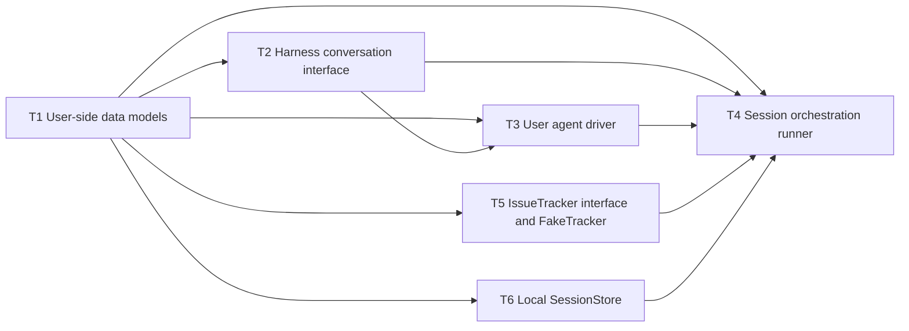

Evolution graph:

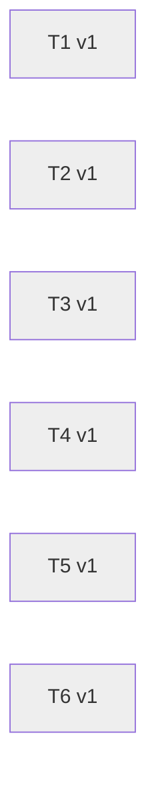

### 0002 Gitea integration and infrastructure(issue #0)

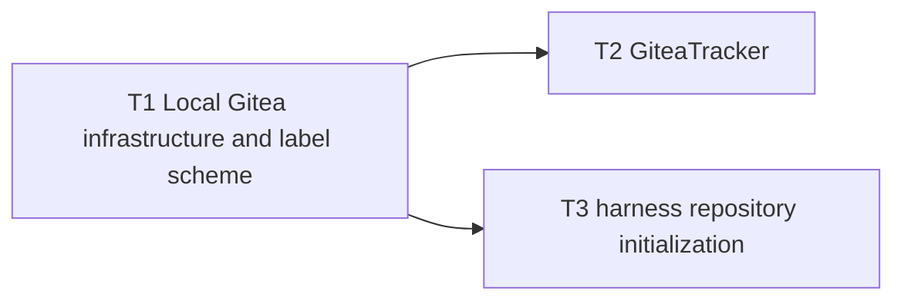

Evolution graph:

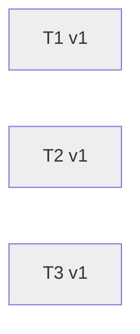

### 0003 Developer side and closed loop(issue #0)

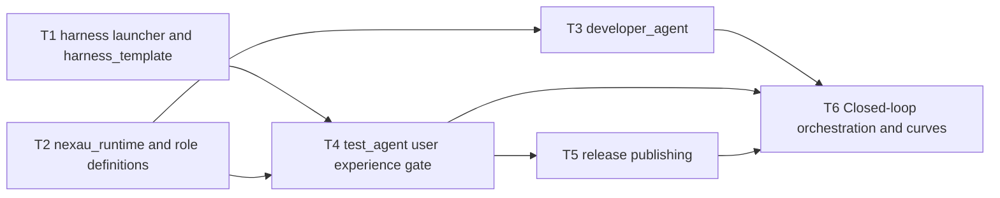

Evolution graph:


### 0004 Harbor run and recoverable checkpoint(issue #0)

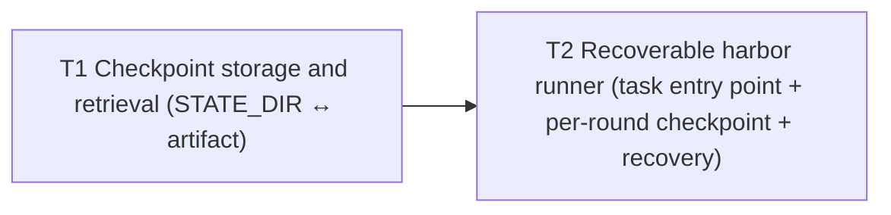

Evolution graph:

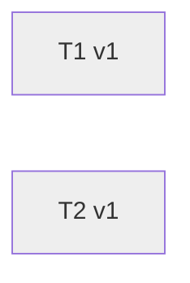

### 0005 Heavyweight user-side implementation: control-envelope simulator and experience scoring(issue #0)

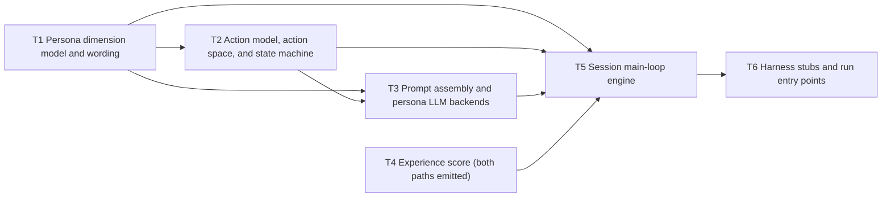

Evolution graph:


### 0006 Persona pipeline: collection (distillation) and injection into sim(issue #0)

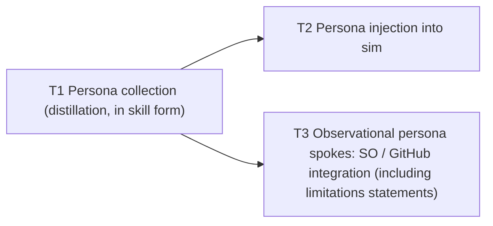

Evolution graph:

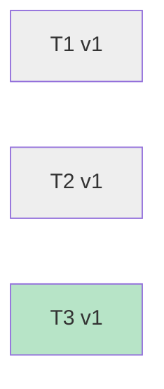

### 0007 Switch the developer side to pure trunk(main) self-evolution(issue #12)

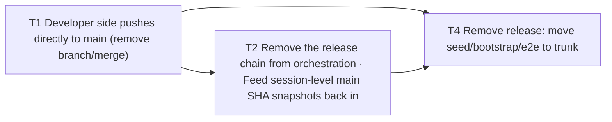

Evolution graph:

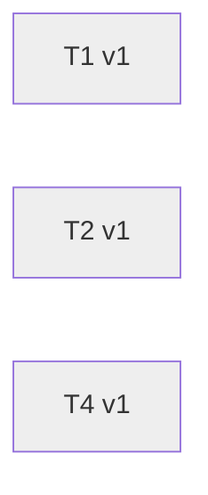

### 0008 User agent inner tool use (verification in its own environment)(issue #8)

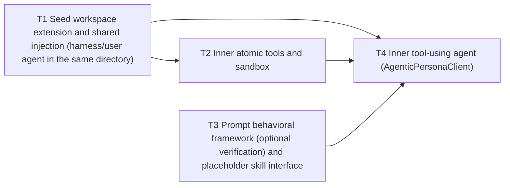

Evolution graph:

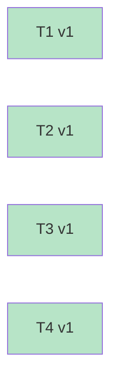

### 0009 Pluggable seed workspace provisioning (SeedSource seam)(issue #9)

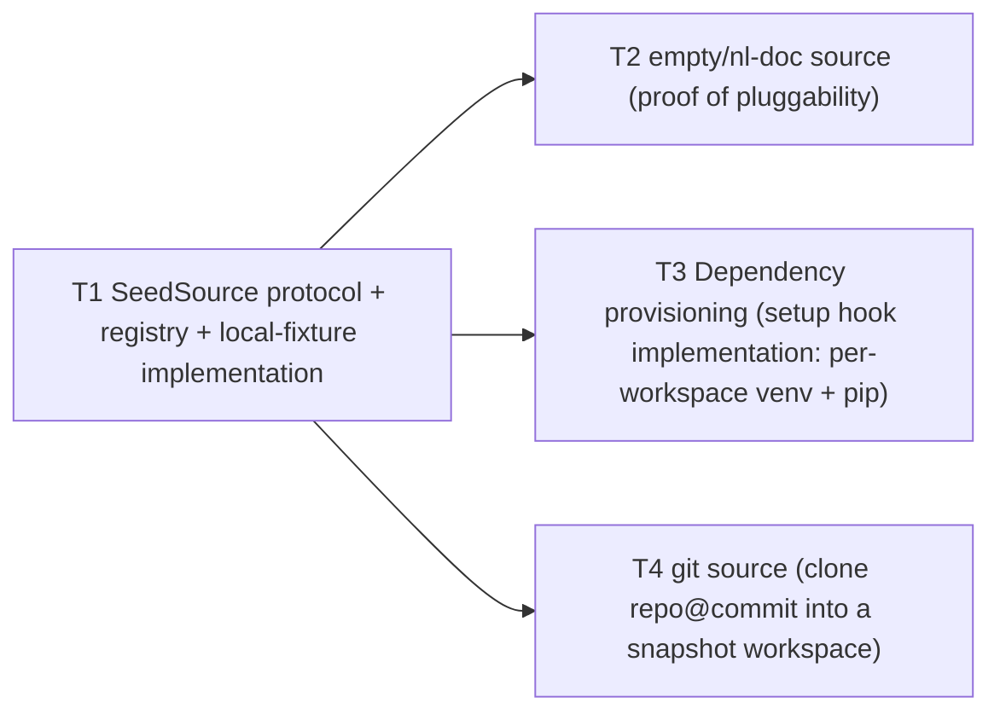

Evolution graph:


### 0010 Seed scenario pipeline: collection (distillation) and injection into SeedSource(issue #10)

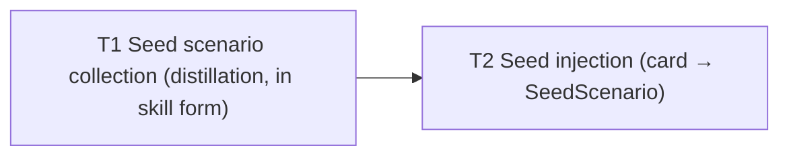

Evolution graph:

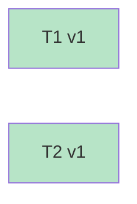

### 0011 AgentBoard: A Cartoon-Style Active Agent Page(issue #19)

```mermaid
graph LR
    nT1["T1 AgentBoard cartoon page + cards + shared utilities, remove the old panel"]
```

Evolution graph:

```mermaid
graph LR
    v_T1_1["T1 v1"]
    classDef st_done fill:#b7e4c7;
    class v_T1_1 st_done;
```

### 0012 Making the user's waiting experience realistic: heartbeat-driven initiative · visible progress · task-dependent patience(issue #0)

```mermaid
graph LR
    nT1["T1 Initiative while waiting: heartbeat wake-ups + visible progress + consistent waiting decay rules"]
    nT2["T2 State patience model: task-load-based initial variation + personality-based decay coefficient"]
```

Evolution graph:

```mermaid
graph LR
    v_T1_1["T1 v1"]
    v_T2_1["T2 v1"]
    classDef st_done fill:#b7e4c7;
    class v_T1_1 st_done;
    class v_T2_1 st_done;
```

### 0013 Harness Presentation and Interaction Protocol: Envelope Unwrapping · Layered Process Streams · Interruption/Heartbeat(issue #0)

```mermaid
graph LR
    nT1["T1 Unwrap complete_task envelopes + layer process streams + begin/poll/control heartbeat protocol"]
    nT2["T2 v0 seed self-test smoke + MANUAL presentation contract"]
```

Evolution graph:

```mermaid
graph LR
    v_T1_1["T1 v1"]
    v_T2_1["T2 v1"]
    classDef st_pending fill:#eeeeee;
    class v_T1_1 st_pending;
    class v_T2_1 st_pending;
```

### 0014 Legacy Built-in Developer Commit Discipline (Retired)(issue #0)

```mermaid
graph LR
    empty[Empty]
```

Evolution graph:

```mermaid
graph LR
```

### 0015 Harness Boundaries and Requirements Tool Access: Commit Denylist, Trace Isolation, and Workspace Checks(issue #0)

```mermaid
graph LR
    nT1["T1 Hard commit-boundary gate for the harness repository (pre-commit hook)"]
    nT2["T2 Nest the sandbox working directory more deeply to physically isolate traces"]
    nT3["T3 WorkspaceJailMiddleware: confine writes to the repository, allow reads of NexAU source and runtime temporary directories"]
```

Evolution graph:

```mermaid
graph LR
    v_T1_1["T1 v1"]
    v_T2_1["T2 v1"]
    v_T3_1["T3 v1"]
    classDef st_pending fill:#eeeeee;
    class v_T1_1 st_pending;
    class v_T2_1 st_pending;
    class v_T3_1 st_pending;
```

### 0016 Architect root-cause signals + code-reading efficiency + runtime aggregation(issue #0)

```mermaid
graph LR
    nT1["T1 Use the experience reason as a root-cause signal for the Architect"]
    nT2["T2 Architect grep + search before reading to reduce code-reading overhead"]
    nT3["T3 Runtime behavior aggregation runtime_agg: feed mechanism-level observation numbers to the Architect"]
    nT1 --> nT3
```

Evolution graph:

```mermaid
graph LR
    v_T1_1["T1 v1"]
    v_T2_1["T2 v1"]
    v_T3_1["T3 v1"]
    classDef st_done fill:#b7e4c7;
    classDef st_pending fill:#eeeeee;
    class v_T1_1 st_pending;
    class v_T2_1 st_pending;
    class v_T3_1 st_done;
```

### 0017 Parallelize multi-user sessions: thread pool for stage a + lock shared state(issue #0)

```mermaid
graph LR
    nT1["T1 Lock storage and observation projections"]
    nT2["T2 One client instance per session (factory injection)"]
    nT3["T3 Parallelize stage a + concurrency knob"]
    nT4["T4 Concurrent end-to-end regression tests"]
    nT5["T5 harness checkout concurrency safety"]
    nT6["T6 tracker HTTP session thread safety"]
    nT1 --> nT3
    nT2 --> nT3
    nT3 --> nT4
```

Evolution graph:

```mermaid
graph LR
    v_T1_1["T1 v1"]
    v_T2_1["T2 v1"]
    v_T3_1["T3 v1"]
    v_T4_1["T4 v1"]
    v_T5_1["T5 v1"]
    v_T6_1["T6 v1"]
    classDef st_done fill:#b7e4c7;
    class v_T1_1 st_done;
    class v_T2_1 st_done;
    class v_T3_1 st_done;
    class v_T4_1 st_done;
    class v_T5_1 st_done;
    class v_T6_1 st_done;
```

### 0018 Unwrap architect proposal envelopes: complete_task deliveries are no longer silently discarded(issue #0)

```mermaid
graph LR
    nT1["T1 Unwrap the complete_task envelope at the _run_agent exit"]
```

Evolution graph:

```mermaid
graph LR
    v_T1_1["T1 v1"]
    classDef st_done fill:#b7e4c7;
    class v_T1_1 st_done;
```

### 0019 Relax launcher non-reply sideband handling (progress, etc.)(issue #0)

```mermaid
graph LR
    nT1["T1 launcher: accept all non-reply sidebands + route control sideband/terminal responses separately"]
```

Evolution graph:

```mermaid
graph LR
    v_T1_1["T1 v1"]
    classDef st_done fill:#b7e4c7;
    class v_T1_1 st_done;
```

### 0020 Implement coverage relationships + developer pickup policy and issue-type budgets(issue #0)

```mermaid
graph LR
    nT1["T1 Architect covers output: proposal field parsing + machine-readable body line + links on covered bugs"]
    nT2["T2 Dev pickup pools + issue-type budgets and retry escalation + result writeback comments"]
    nT3["T3 Orchestration wiring: run.py constructs devs with policies/budgets + configuration knobs"]
    nT4["T4 Web API: /api/issues adds covers/covered_by fields"]
    nT5["T5 Frontend: coverage badges in the issue list and detail view"]
    nT2 --> nT3
    nT1 --> nT4
    nT4 --> nT5
```

Evolution graph:

```mermaid
graph LR
    v_T1_1["T1 v1"]
    v_T2_1["T2 v1"]
    v_T3_1["T3 v1"]
    v_T4_1["T4 v1"]
    v_T5_1["T5 v1"]
    classDef st_done fill:#b7e4c7;
    class v_T1_1 st_done;
    class v_T2_1 st_done;
    class v_T3_1 st_done;
    class v_T4_1 st_done;
    class v_T5_1 st_done;
```

### 0021 Dev agent escape containment: credential isolation + orchestration tripwire + contamination cleanup(issue #0)

```mermaid
graph LR
    nT1["T1 repo_guard module + orchestrator segment b tripwire"]
    nT2["T2 run.py credential isolation + construct and inject the orchestration repo tripwire guard"]
    nT3["T3 Clean up MANUAL.md, an artifact contaminated by a past escape"]
    nT1 --> nT2
```

Evolution graph:

```mermaid
graph LR
    v_T1_1["T1 v1"]
    v_T2_1["T2 v1"]
    v_T3_1["T3 v1"]
    classDef st_done fill:#b7e4c7;
    class v_T1_1 st_done;
    class v_T2_1 st_done;
    class v_T3_1 st_done;
```

### 0022 User↔harness internal and external channels: open intent · mid-session report_issue · slash demonstration(issue #0)

```mermaid
graph LR
    nT1["T1 Internal and external interaction boundaries + waiting menu + emit_message + open intent"]
    nT2["T2 Mid-session report_issue tool (may remain unused) + issue_notes flush"]
    nT3["T3 Initial harness: internal /exit\|/quit slash dispatch + MANUAL"]
```

Evolution graph:

```mermaid
graph LR
    v_T1_1["T1 v1"]
    v_T2_1["T2 v1"]
    v_T3_1["T3 v1"]
    classDef st_done fill:#b7e4c7;
    class v_T1_1 st_done;
    class v_T2_1 st_done;
    class v_T3_1 st_done;
```

### 0023 Finalize the event-driven waiting loop · retire one/two and legacy signals(issue #0)

```mermaid
graph LR
    nT1["T1 loop: retain only three · remove MAIN_GAP/dead constants/stalled"]
    nT2["T2 prompt: remove one/two combined builders · change unit tests to exercise three"]
    nT3["T3 Probes: remove the two arm and the peek-via-control mental model"]
    nT4["T4 launcher.try_reply nonblocking contract (implemented)"]
    nT1 --> nT2
    nT1 --> nT3
```

Evolution graph:

```mermaid
graph LR
    v_T1_1["T1 v1"]
    v_T2_1["T2 v1"]
    v_T3_1["T3 v1"]
    v_T4_1["T4 v1"]
    classDef st_done fill:#b7e4c7;
    class v_T1_1 st_done;
    class v_T2_1 st_done;
    class v_T3_1 st_done;
    class v_T4_1 st_done;
```

### 0024 Persist the user's god-view + on-demand access for the architect(issue #0)

```mermaid
graph LR
    nT1["T1 Persist Session.sim_trace (TurnLog→SimTrace)"]
    nT2["T2 Extend index with issue_numbers + include session_id in user experience curves"]
    nT3["T3 get_session_timeline tool entry point (on-demand evidence retrieval path)"]
    nT4["T4 get_session_timeline usage-event projection (remove the simulation wrapper)"]
    nT5["T5 Architect tool wiring for progressive drill-down (beat/step)"]
    nT6["T6 Request-reply pairing: heard.answers → utterance"]
    nT1 --> nT2
    nT2 --> nT3
    nT3 --> nT4
    nT4 --> nT5
    nT5 --> nT6
```

Evolution graph:

```mermaid
graph LR
    v_T1_1["T1 v1"]
    v_T2_1["T2 v1"]
    v_T3_1["T3 v1"]
    v_T4_1["T4 v1"]
    v_T5_1["T5 v1"]
    v_T6_1["T6 v1"]
    classDef st_done fill:#b7e4c7;
    class v_T1_1 st_done;
    class v_T2_1 st_done;
    class v_T3_1 st_done;
    class v_T4_1 st_done;
    class v_T5_1 st_done;
    class v_T6_1 st_done;
```

### 0025 Issue triage funnel: user submits issue → triage agent classifies and locates the problem → architect agent produces RFC → dev(issue #0)

```mermaid
graph LR
    nT1["T1 Platform-layer issue schema: canonical English keys + display labels + validate/render"]
    nT2["T2 User sim produces structured raw issues: provisional type + needs-triage + round number"]
    nT3["T3 Triage agent (new role): classify + locate + deduplicate + reject/mark needs-info in place"]
    nT4["T4 Architect agent (original architect with narrower scope): structural synthesis across issues → RFC"]
    nT5["T5 Simplify dev: claim triaged/RFC issues up to capacity, carry uncleared backlog forward, tier budgets by kind, remove pool partitioning/retry/stuck"]
    nT6["T6 Orchestration wiring: two agents in phase d, triage→architect + round pass-through + mechanism-derived priority + roster"]
    nT7["T7 web+metrics: attach kind/round/status/priority to issues + curve tracks actionable backlog (including carryover)"]
    nT8["T8 Frontend: issue list by type/status + RFC section + coverage/supersession/backlog display"]
    nT3a["T3a Add `set_labels` to tracker: replace an issue's labels as a complete set."]
    nT1 --> nT2
    nT1 --> nT3
    nT2 --> nT3
    nT3a --> nT3
    nT3 --> nT4
    nT4 --> nT5
    nT5 --> nT6
    nT4 --> nT7
    nT7 --> nT8
    nT1 --> nT3a
```

Evolution graph:

```mermaid
graph LR
    v_T1_1["T1 v1"]
    v_T2_1["T2 v1"]
    v_T3_1["T3 v1"]
    v_T3a_1["T3a v1"]
    v_T4_1["T4 v1"]
    v_T5_1["T5 v1"]
    v_T6_1["T6 v1"]
    v_T7_1["T7 v1"]
    v_T8_1["T8 v1"]
    classDef st_done fill:#b7e4c7;
    class v_T1_1 st_done;
    class v_T2_1 st_done;
    class v_T3_1 st_done;
    class v_T3a_1 st_done;
    class v_T4_1 st_done;
    class v_T5_1 st_done;
    class v_T6_1 st_done;
    class v_T7_1 st_done;
    class v_T8_1 st_done;
```

### 0026 Complete observability dashboard frontend redesign: switchable light/dark themes + visible triager + persona display + design tokens(issue #0)

```mermaid
graph LR
    nT1["T1 Backend: add triager ordering to live + include a persona summary in user agent activity payloads"]
    nT2["T2 Design token layer + light/dark themes (follow the system + persist in localStorage) + global CSS"]
    nT3["T3 Application shell + types (AgentRole triager / Agent.meta) + TopBar (theme toggle) + overview curves"]
    nT4["T4 Role columns + cards: triager room rendering + role accent colors + persona on user cards + standardized issue/commit cards"]
    nT5["T5 Refresh detail panel information architecture (agent/session/issue/commit + sidebar) + persona block"]
    nT2 --> nT3
    nT1 --> nT4
    nT3 --> nT4
    nT2 --> nT5
    nT3 --> nT5
```

Evolution graph:

```mermaid
graph LR
    v_T1_1["T1 v1"]
    v_T2_1["T2 v1"]
    v_T3_1["T3 v1"]
    v_T4_1["T4 v1"]
    v_T5_1["T5 v1"]
    classDef st_done fill:#b7e4c7;
    class v_T1_1 st_done;
    class v_T2_1 st_done;
    class v_T3_1 st_done;
    class v_T4_1 st_done;
    class v_T5_1 st_done;
```

### 0027 Unified structured agent output contract: issue_schema as the single source of truth + native submit-tool validation, removing the second LLM reformatting call and fragmented parsing(issue #0)

```mermaid
graph LR
    nT1["T1 Consolidate issue_schema into the single source of truth for contracts + a contract generation/shared validation module"]
    nT2["T2 Switch triage to native structured output through a submit-tool (remove the second LLM reformatting call and alias normalization)"]
    nT3["T3 Switch architect to native structured output through a submit-tool + unified driver-apply"]
    nT1 --> nT2
    nT1 --> nT3
```

Evolution graph:

```mermaid
graph LR
    v_T1_1["T1 v1"]
    v_T2_1["T2 v1"]
    v_T3_1["T3 v1"]
    classDef st_done fill:#b7e4c7;
    class v_T1_1 st_done;
    class v_T2_1 st_done;
    class v_T3_1 st_done;
```

### 0028 divergent PM + gate: parallel product candidate channel and promotion review(issue #0)

```mermaid
graph LR
    nT1["T1 issue_schema: divergent/gate-dropped labels and executable backlog criteria"]
    nT2["T2 Divergent driver + agent_defs/divergent_pm: persist unclaimable product candidates"]
    nT3["T3 Architect.gate_once: promote/hold/drop semantic promotion"]
    nT4["T4 Orchestration wiring: d2 architect∥divergent → d3 gate; roster/run disabled by default"]
    nT5["T5 Hard-exclude divergent candidates from dev claiming"]
    nT1 --> nT2
    nT1 --> nT3
    nT2 --> nT4
    nT3 --> nT4
    nT1 --> nT5
```

Evolution graph:

```mermaid
graph LR
    v_T1_1["T1 v1"]
    v_T2_1["T2 v1"]
    v_T3_1["T3 v1"]
    v_T4_1["T4 v1"]
    v_T5_1["T5 v1"]
    classDef st_done fill:#b7e4c7;
    class v_T1_1 st_done;
    class v_T2_1 st_done;
    class v_T3_1 st_done;
    class v_T4_1 st_done;
    class v_T5_1 st_done;
```

### 0029 Three-plane issue flow: evidence→proposal→work queue, with a single admission Owner (claimable whitelist, generators freely parallelized, gate special channel removed)(issue #0)

```mermaid
graph LR
    nT1["T1 Consolidate issue_schema three-plane labels: report/proposal/ready whitelist + read-side mapping of legacy labels"]
    nT2["T2 Extract the shared agent_runtime: one implementation for running agents + reading submit"]
    nT3["T3 Change triage into a pure normalization generator: accept→promote in place to proposal, move deduplication responsibility out"]
    nT4["T4 Narrow architect to a pure generator: produce proposal(from-architect), retire gate_once"]
    nT5["T5 Align divergent as a pure generator: produce proposal(from-divergent), retire the dedicated channel"]
    nT6["T6 Owner as the sole admission authority: batch decisions in mechanical + review modes (admit/merge/decline/hold)"]
    nT7["T7 dev whitelist-based claiming: ready-only + priority→age ordering + cascading closure"]
    nT8["T8 Orchestration/roster/run wiring: generation stage fully parallel (triage can be sharded) → Owner → dev + backpressure alerts"]
    nT9["T9 Observability backend adaptation: plane field + ready depth curve + funnel counts"]
    nT10["T10 Frontend adaptation: three-plane grouping + Owner room + funnel and backpressure display"]
    nT1 --> nT3
    nT2 --> nT3
    nT1 --> nT4
    nT2 --> nT4
    nT1 --> nT5
    nT2 --> nT5
    nT1 --> nT6
    nT2 --> nT6
    nT1 --> nT7
    nT3 --> nT8
    nT4 --> nT8
    nT5 --> nT8
    nT6 --> nT8
    nT7 --> nT8
    nT6 --> nT9
    nT7 --> nT9
    nT9 --> nT10
```

Evolution graph:

```mermaid
graph LR
    v_T1_1["T1 v1"]
    v_T10_1["T10 v1"]
    v_T2_1["T2 v1"]
    v_T3_1["T3 v1"]
    v_T4_1["T4 v1"]
    v_T5_1["T5 v1"]
    v_T6_1["T6 v1"]
    v_T7_1["T7 v1"]
    v_T8_1["T8 v1"]
    v_T9_1["T9 v1"]
    classDef st_done fill:#b7e4c7;
    class v_T1_1 st_done;
    class v_T10_1 st_done;
    class v_T2_1 st_done;
    class v_T3_1 st_done;
    class v_T4_1 st_done;
    class v_T5_1 st_done;
    class v_T6_1 st_done;
    class v_T7_1 st_done;
    class v_T8_1 st_done;
    class v_T9_1 st_done;
```

### 0030 harness productization boundary: /help user documentation, platform-side interfaces, and connector adaptation(issue #0)

```mermaid
graph LR
    nT1["T1 Write the 0030 living snapshot"]
    nT2["T2 Streamline harness_template to HELP/RUNTIME/scripts/deps"]
    nT3["T3 /help slash command and template self-tests"]
    nT4["T4 Product commit boundary: reject secrets and runtime state"]
    nT6["T6 connector and stdio-jsonl-v1 protocol adaptation"]
    nT2 --> nT3
    nT2 --> nT4
    nT2 --> nT6
```

Evolution graph:

```mermaid
graph LR
    v_T1_1["T1 v1"]
    v_T2_1["T2 v1"]
    v_T3_1["T3 v1"]
    v_T4_1["T4 v1"]
    v_T6_1["T6 v1"]
    classDef st_done fill:#b7e4c7;
    class v_T1_1 st_done;
    class v_T2_1 st_done;
    class v_T3_1 st_done;
    class v_T4_1 st_done;
    class v_T6_1 st_done;
```

### 0031 Move user simulation stage contracts down: a thin base system and prompts stripped of platform manual content(issue #0)

```mermaid
graph LR
    nT1["T1 Write the 0031 living snapshot"]
    nT2["T2 Split prompts: thin base system and stage-local contracts"]
    nT3["T3 Loop integration regression prevention: the three hops of main/heartbeat expose contracts only according to their stages"]
    nT4["T4 Adapt persona_client and agentic paths to stage contracts"]
    nT1 --> nT2
    nT2 --> nT3
    nT2 --> nT4
```

Evolution graph:

```mermaid
graph LR
    v_T1_1["T1 v1"]
    v_T2_1["T2 v1"]
    v_T3_1["T3 v1"]
    v_T4_1["T4 v1"]
    classDef st_done fill:#b7e4c7;
    class v_T1_1 st_done;
    class v_T2_1 st_done;
    class v_T3_1 st_done;
    class v_T4_1 st_done;
```

### 0032 Switch the developer side to OpenAgents: separate the requirements and delivery planes + adapt the Gitea forge(issue #0)

```mermaid
graph LR
    nT1["T1 OpenAgents repository: forge dispatch layer—alias-import seam + configuration section + merger prompt parameterization"]
    nT2["T2 OpenAgents repository: Gitea REST driver—the same public interface as github.py, targeting Gitea /api/v1"]
    nT3["T3 Admission handoff: Owner switches to applying the openagents discovery label, and plane READY incorporates {ready, openagents}"]
    nT4["T4 Retire the dev side: remove AgenticDeveloper/developer_agent and remove the dev beat from the orchestrator"]
    nT5["T5 Wire up vigil: run.py writes openagents.yml, manages the vigil subprocess lifecycle, and retires vK tags"]
    nT6["T6 Minimal CI for the harness repository: Gitea Actions runner + smoke workflow"]
    nT7["T7 Delivery-plane observability: GiteaTracker PR read path + web API + frontend delivery-plane view"]
    nT8["T8 Documentation wrap-up: CLAUDE.md architecture section and spec artifact regeneration"]
    nT1 --> nT2
    nT3 --> nT4
    nT2 --> nT5
    nT4 --> nT5
    nT5 --> nT6
    nT5 --> nT7
    nT5 --> nT8
```

Evolution graph:

```mermaid
graph LR
    v_T1_1["T1 v1"]
    v_T2_1["T2 v1"]
    v_T3_1["T3 v1"]
    v_T4_1["T4 v1"]
    v_T5_1["T5 v1"]
    v_T6_1["T6 v1"]
    v_T7_1["T7 v1"]
    v_T8_1["T8 v1"]
    classDef st_done fill:#b7e4c7;
    class v_T1_1 st_done;
    class v_T2_1 st_done;
    class v_T3_1 st_done;
    class v_T4_1 st_done;
    class v_T5_1 st_done;
    class v_T6_1 st_done;
    class v_T7_1 st_done;
    class v_T8_1 st_done;
```

### 0033 Delivery-surface container containment: a vigil-specific container (zero host mounts, self-cloning inside the container) + egress proxy allowlist + observation cursor tracking origin/main(issue #0)

```mermaid
graph LR
    nT1["T1 vigil container and network infrastructure: Dockerfile/entrypoint/build + internal network + egress proxy allowlist"]
    nT2["T2 Wire run.py for dual modes: container by default (docker run lifecycle/logs/env injection) + explicit subprocess opt-in"]
    nT3["T3 Change the observation cursor to track origin/main: _resolve_head fetches first (falls back to local when there is no origin)"]
    nT4["T4 Documentation and spec artifacts: close out the containment section in CLAUDE.md + render/graph"]
    nT1 --> nT2
    nT2 --> nT4
```

Evolution graph:

```mermaid
graph LR
    v_T1_1["T1 v1"]
    v_T2_1["T2 v1"]
    v_T3_1["T3 v1"]
    v_T4_1["T4 v1"]
    classDef st_done fill:#b7e4c7;
    class v_T1_1 st_done;
    class v_T2_1 st_done;
    class v_T3_1 st_done;
    class v_T4_1 st_done;
```

### 0034 Frontend Agent Company building view and user mental trace(issue #0)

```mermaid
graph LR
    nT1["T1 Write the 0034 living snapshot"]
    nT2["T2 Integrate the building view: BuildingView + floor workspaces + top bar toggle"]
    nT3["T3 Building styles and role colors: fix divergence/admission readability"]
    nT4["T4 User mental trace: display the three sim_trace stages in SessionDetail"]
    nT1 --> nT2
    nT2 --> nT3
    nT2 --> nT4
    nT3 --> nT4
```

Evolution graph:

```mermaid
graph LR
    v_T1_1["T1 v1"]
    v_T2_1["T2 v1"]
    v_T3_1["T3 v1"]
    v_T4_1["T4 v1"]
    classDef st_done fill:#b7e4c7;
    class v_T1_1 st_done;
    class v_T2_1 st_done;
    class v_T3_1 st_done;
    class v_T4_1 st_done;
```

### 0035 stdout-visible harness state and main-loop waiting/interrupt actions(issue #0)

```mermaid
graph LR
    nT1["T1 Write the 0035 active snapshot"]
    nT2["T2 User main loop: persistent waiting and interrupt actions"]
    nT3["T3 Seam-layer visible events: expand user perception into a stdout event stream"]
    nT4["T4 v0 harness: busy-input queued/status visibility"]
    nT5["T5 User-visible contract observation lens for divergent PM"]
    nT1 --> nT2
    nT1 --> nT3
    nT1 --> nT4
    nT1 --> nT5
```

Evolution graph:

```mermaid
graph LR
    v_T1_1["T1 v1"]
    v_T2_1["T2 v1"]
    v_T3_1["T3 v1"]
    v_T4_1["T4 v1"]
    v_T5_1["T5 v1"]
    classDef st_done fill:#b7e4c7;
    class v_T1_1 st_done;
    class v_T2_1 st_done;
    class v_T3_1 st_done;
    class v_T4_1 st_done;
    class v_T5_1 st_done;
```

### 0036 Unified stdin write entry point in the seam layer: remove the begin/emit split, use reply as a soft wake-up(issue #0)

```mermaid
graph LR
    nT1["T1 Write the 0036 live snapshot"]
    nT2["T2 launcher: unified write entry point + poll independent of write flags"]
    nT3["T3 loop: main/heartbeat message sends use unified writes; keep_waiting→poll"]
    nT4["T4 Align connector and INTERFACE with unified writes"]
    nT1 --> nT2
    nT1 --> nT3
    nT2 --> nT3
    nT2 --> nT4
```

Evolution graph:

```mermaid
graph LR
    v_T1_1["T1 v1"]
    v_T2_1["T2 v1"]
    v_T3_1["T3 v1"]
    v_T4_1["T4 v1"]
    classDef st_done fill:#b7e4c7;
    class v_T1_1 st_done;
    class v_T2_1 st_done;
    class v_T3_1 st_done;
    class v_T4_1 st_done;
```

### 0037 Reframe the human axis: time temperament ⊥ quality failure · process involvement · distillation spoke alignment(issue #0)

```mermaid
graph LR
    nT1["T1 Write the 0037 live snapshot"]
    nT2["T2 sim: tempo-driven patience · process involvement semantics · D6Authz session policy"]
    nT3["T3 hub: add D7 and semantic notes to card-schema"]
    nT4["T4 Injection: card_to_persona reads D7→tempo"]
    nT5["T5 Align distillation spokes with D7 and human-axis semantics"]
    nT6["T6 Probes: orthogonal observability of tempo / process involvement / d43"]
    nT1 --> nT2
    nT1 --> nT3
    nT1 --> nT4
    nT2 --> nT4
    nT3 --> nT4
    nT1 --> nT5
    nT3 --> nT5
    nT2 --> nT6
    nT4 --> nT6
```

Evolution graph:

```mermaid
graph LR
    v_T1_1["T1 v1"]
    v_T2_1["T2 v1"]
    v_T3_1["T3 v1"]
    v_T4_1["T4 v1"]
    v_T5_1["T5 v1"]
    v_T6_1["T6 v1"]
    classDef st_done fill:#b7e4c7;
    class v_T1_1 st_done;
    class v_T2_1 st_done;
    class v_T3_1 st_done;
    class v_T4_1 st_done;
    class v_T5_1 st_done;
    class v_T6_1 st_done;
```

### 0038 OpenAgents standalone delivery page and campus entry point(issue #0)

```mermaid
graph LR
    nT1["T1 Write the 0038 living snapshot"]
    nT2["T2 OpenAgents entry points, URL state, and page assembly"]
    nT3["T3 OpenAgents data aggregation model"]
    nT4["T4 OpenAgents standalone page UI"]
    nT5["T5 Campus factory semantics, status aggregation, and delivery boundary"]
    nT6["T6 Campus scale model, factory entry point, and flight path between two helipads"]
    nT7["T7 OpenAgents aggregation model regression tests"]
    nT1 --> nT2
    nT1 --> nT3
    nT2 --> nT4
    nT3 --> nT4
    nT2 --> nT5
    nT3 --> nT5
    nT4 --> nT6
    nT5 --> nT6
    nT3 --> nT7
    nT5 --> nT7
```

Evolution graph:

```mermaid
graph LR
    v_T1_1["T1 v1"]
    v_T2_1["T2 v1"]
    v_T3_1["T3 v1"]
    v_T4_1["T4 v1"]
    v_T5_1["T5 v1"]
    v_T6_1["T6 v1"]
    v_T7_1["T7 v1"]
    classDef st_done fill:#b7e4c7;
    class v_T1_1 st_done;
    class v_T2_1 st_done;
    class v_T3_1 st_done;
    class v_T4_1 st_done;
    class v_T5_1 st_done;
    class v_T6_1 st_done;
    class v_T7_1 st_done;
```

### 0039 Issue label dimensions and state evolution timeline(issue #0)

```mermaid
graph LR
    nT1["T1 Formalize the specification and cross-repository acceptance boundaries"]
    nT2["T2 Read and fold the Gitea issue timeline"]
    nT3["T3 Extend the issue detail timeline API"]
    nT4["T4 Write round labels to Architect synthesis issues"]
    nT5["T5 Establish frontend label dimensions and a timeline presentation model"]
    nT6["T6 Display issue state evolution and complete cross-repository acceptance"]
    nT1 --> nT2
    nT2 --> nT3
    nT1 --> nT4
    nT3 --> nT5
    nT4 --> nT6
    nT5 --> nT6
```

Evolution graph:

```mermaid
graph LR
    v_T1_1["T1 v1"]
    v_T2_1["T2 v1"]
    v_T3_1["T3 v1"]
    v_T4_1["T4 v1"]
    v_T5_1["T5 v1"]
    v_T6_1["T6 v1"]
    classDef st_done fill:#b7e4c7;
    class v_T1_1 st_done;
    class v_T2_1 st_done;
    class v_T3_1 st_done;
    class v_T4_1 st_done;
    class v_T5_1 st_done;
    class v_T6_1 st_done;
```

### 0040 Enable RFC on the delivery side: drafter writes docs/specs + switch the commit boundary to a denylist(issue #0)

```mermaid
graph LR
    nT1["T1 Finalize stages.rfc=agent + keep vigil alive by default"]
    nT2["T2 Change the commit boundary from an allowlist to a denylist"]
    nT3["T3 Smoke denylist and seed docs/specs location"]
    nT4["T4 Add custom Anthropic gateway domains to the egress allowlist"]
    nT5["T5 OpenAgents mirror: prioritize worktree specs in the first implement round"]
    nT2 --> nT3
    nT1 --> nT5
```

Evolution graph:

```mermaid
graph LR
    v_T1_1["T1 v1"]
    v_T2_1["T2 v1"]
    v_T3_1["T3 v1"]
    v_T4_1["T4 v1"]
    v_T5_1["T5 v1"]
    classDef st_done fill:#b7e4c7;
    class v_T1_1 st_done;
    class v_T2_1 st_done;
    class v_T3_1 st_done;
    class v_T4_1 st_done;
    class v_T5_1 st_done;
```

### 0041 Unified LLM Token Usage Monitoring and End-to-End Attribution(issue #0)

```mermaid
graph LR
    nT1["T1 Unified event model, context, and precise user collection"]
    nT2["T2 Per-call collection and round-level attribution for backend NexAU roles"]
    nT3["T3 Harness tracer emits per-call usage through a side channel"]
    nT4["T4 Harness receiver isolation, per-problem attribution, and persistence"]
    nT5["T5 Hierarchical aggregation API and dashboard"]
    nT6["T6 Developer/vigil precision audit and structured extension interface"]
    nT1 --> nT2
    nT1 --> nT3
    nT1 --> nT4
    nT3 --> nT4
    nT1 --> nT5
    nT2 --> nT5
    nT4 --> nT5
    nT1 --> nT6
```

Evolution graph:

```mermaid
graph LR
    v_T1_1["T1 v1"]
    v_T2_1["T2 v1"]
    v_T3_1["T3 v1"]
    v_T4_1["T4 v1"]
    v_T5_1["T5 v1"]
    v_T6_1["T6 v1"]
    classDef st_done fill:#b7e4c7;
    classDef st_pending fill:#eeeeee;
    class v_T1_1 st_done;
    class v_T2_1 st_done;
    class v_T3_1 st_done;
    class v_T4_1 st_done;
    class v_T5_1 st_pending;
    class v_T6_1 st_done;
```

### 0042 Requirements-side role contract governance: unified terminology, normalized proposal projections, and reliable state transitions(issue #0)

```mermaid
graph LR
    nT1["T1 Authoritative glossary, role responsibility matrix, and current workflow baseline"]
    nT2["T2 Canonical ProposalView and normalized proposal versions"]
    nT3["T3 Reliable Triage normalization transitions and structured failure results"]
    nT4["T4 Owner decision graph validation and reliable batch persistence"]
    nT5["T5 Specialized Prompts for five roles and unified Tool contracts"]
    nT6["T6 Cross-role contract tests, specification index, and historical session replay"]
    nT1 --> nT2
    nT1 --> nT3
    nT2 --> nT3
    nT1 --> nT4
    nT2 --> nT4
    nT1 --> nT5
    nT2 --> nT5
    nT3 --> nT5
    nT4 --> nT5
    nT3 --> nT6
    nT4 --> nT6
    nT5 --> nT6
```

Evolution graph:

```mermaid
graph LR
    v_T1_1["T1 v1"]
    v_T2_1["T2 v1"]
    v_T3_1["T3 v1"]
    v_T4_1["T4 v1"]
    v_T5_1["T5 v1"]
    v_T6_1["T6 v1"]
    classDef st_done fill:#b7e4c7;
    class v_T1_1 st_done;
    class v_T2_1 st_done;
    class v_T3_1 st_done;
    class v_T4_1 st_done;
    class v_T5_1 st_done;
    class v_T6_1 st_done;
```

### 0043 Demand-side role cognitive contracts: role-specific artifact language and behavioral quality gates(issue #0)

```mermaid
graph LR
    nT1["T1 Role artifact models and shared quality gate contracts"]
    nT2["T2 Triage single-report cognitive isolation and factual proposals"]
    nT3["T3 Product PM holistic insight contract"]
    nT4["T4 Architect proposal relationship synthesis contract"]
    nT5["T5 Owner investment judgment and portfolio quality gates"]
    nT6["T6 Cross-role behavioral evaluation and real replay acceptance"]
    nT1 --> nT2
    nT1 --> nT3
    nT1 --> nT4
    nT2 --> nT4
    nT3 --> nT4
    nT1 --> nT5
    nT4 --> nT5
    nT2 --> nT6
    nT3 --> nT6
    nT4 --> nT6
    nT5 --> nT6
```

Evolution graph:

```mermaid
graph LR
    v_T1_1["T1 v1"]
    v_T2_1["T2 v1"]
    v_T3_1["T3 v1"]
    v_T4_1["T4 v1"]
    v_T5_1["T5 v1"]
    v_T6_1["T6 v1"]
    classDef st_done fill:#b7e4c7;
    class v_T1_1 st_done;
    class v_T2_1 st_done;
    class v_T3_1 st_done;
    class v_T4_1 st_done;
    class v_T5_1 st_done;
    class v_T6_1 st_done;
```

### 0044 Reusable SWE-bench Seed Workspace Provisioning(issue #0)

```mermaid
graph LR
    nT1["T1 Manifest and Provisioning Contract"]
    nT2["T2 Isolated Prebuilt Copying and Virtual Environment Relocation"]
    nT3["T3 Storage-only Docker Seed Provisioning"]
    nT4["T4 Resumable Batch Builds and Image Validation"]
    nT5["T5 Closed-loop Task Pool Selection and Stable Instance Attribution"]
    nT1 --> nT2
    nT1 --> nT3
    nT2 --> nT3
    nT1 --> nT4
    nT2 --> nT4
    nT3 --> nT4
    nT1 --> nT5
    nT2 --> nT5
    nT3 --> nT5
```

Evolution graph:

```mermaid
graph LR
    v_T1_1["T1 v1"]
    v_T2_1["T2 v1"]
    v_T3_1["T3 v1"]
    v_T4_1["T4 v1"]
    v_T5_1["T5 v1"]
    classDef st_done fill:#b7e4c7;
    class v_T1_1 st_done;
    class v_T2_1 st_done;
    class v_T3_1 st_done;
    class v_T4_1 st_done;
    class v_T5_1 st_done;
```

### 0045 Vigil Harness-aware Development Toolchain(issue #0)

```mermaid
graph LR
    nT1["T1 Toolchain Boundaries and Dual-Pin Contract"]
    nT2["T2 Dual-Checkout Image and Read-Only NexAU Toolchain"]
    nT3["T3 Explicit Build Package Index, Version, and Proxy Configuration"]
    nT4["T4 Runtime Entry Point Wiring and Configuration Precedence"]
    nT1 --> nT2
    nT2 --> nT3
    nT2 --> nT4
```

Evolution graph:

```mermaid
graph LR
    v_T1_1["T1 v1"]
    v_T2_1["T2 v1"]
    v_T3_1["T3 v1"]
    v_T4_1["T4 v1"]
    classDef st_done fill:#b7e4c7;
    class v_T1_1 st_done;
    class v_T2_1 st_done;
    class v_T3_1 st_done;
    class v_T4_1 st_done;
```

### 0046 Isolated validation handoff of frozen design artifacts to OpenAgents(issue #0)

```mermaid
graph LR
    nT1["T1 Fresh-Target and Immutable Manifest Contract"]
    nT2["T2 Materialize the Frozen Summary as a Validation Repository"]
    nT3["T3 Selective Delivery Copy of a Read-Only Gitea Snapshot"]
    nT4["T4 Isolated Vigil Startup and Gateway Protocol Conversion"]
    nT1 --> nT2
    nT1 --> nT3
    nT1 --> nT4
    nT3 --> nT4
```

Evolution graph:

```mermaid
graph LR
    v_T1_1["T1 v1"]
    v_T2_1["T2 v1"]
    v_T3_1["T3 v1"]
    v_T4_1["T4 v1"]
    classDef st_done fill:#b7e4c7;
    class v_T1_1 st_done;
    class v_T2_1 st_done;
    class v_T3_1 st_done;
    class v_T4_1 st_done;
```

### 0047 Parallel Experiment Runtime and Real-Model Authentication(issue #0)

```mermaid
graph LR
    nT1["T1 Current Experiment Identity and Isolation Contract"]
    nT2["T2 Immutable Manifest and Shared Identity Primitives"]
    nT3["T3 Independent Local Infrastructure per Experiment"]
    nT4["T4 Current v2 Lifecycle and Closed-Loop Wiring"]
    nT1 --> nT2
    nT2 --> nT3
    nT2 --> nT4
    nT3 --> nT4
```

Evolution graph:

```mermaid
graph LR
    v_T1_1["T1 v1"]
    v_T2_1["T2 v1"]
    v_T3_1["T3 v1"]
    v_T4_1["T4 v1"]
    classDef st_done fill:#b7e4c7;
    class v_T1_1 st_done;
    class v_T2_1 st_done;
    class v_T3_1 st_done;
    class v_T4_1 st_done;
```

### 0048 User simulation final-check branch and action protocol failure protection(issue #0)

```mermaid
graph LR
    nT1["T1 Spec and experimental root-cause evidence contract"]
    nT2["T2 PersonaClient stage semantic contracts and tool redispatch"]
    nT3["T3 One-time final-check and mandatory re-judgment state machine"]
    nT4["T4 Fail-closed Action boundary"]
    nT5["T5 Historical action integrity audit and end-to-end certification"]
    nT1 --> nT2
    nT2 --> nT3
    nT4 --> nT3
    nT1 --> nT4
    nT3 --> nT5
```

Evolution graph:

```mermaid
graph LR
    v_T1_1["T1 v1"]
    v_T2_1["T2 v1"]
    v_T3_1["T3 v1"]
    v_T4_1["T4 v1"]
    v_T5_1["T5 v1"]
    classDef st_done fill:#b7e4c7;
    class v_T1_1 st_done;
    class v_T2_1 st_done;
    class v_T3_1 st_done;
    class v_T4_1 st_done;
    class v_T5_1 st_done;
```

### 0049 Role invocation input/output persistence and cross-plane attribution(issue #0)

```mermaid
graph LR
    nT1["T1 Invocation record contract and audit baseline"]
    nT2["T2 InvocationStore, run manifest, and v1 schema"]
    nT3["T3 Persist demand-plane run_agent_def invocations"]
    nT4["T4 Run lifecycle, session migration, vigil export, and jail"]
    nT5["T5 Offline replay of frozen invocations"]
    nT6["T6 Delivery-plane run_agent writes the same schema"]
    nT1 --> nT2
    nT2 --> nT3
    nT2 --> nT4
    nT3 --> nT5
    nT2 --> nT6
    nT4 --> nT6
```

Evolution graph:

```mermaid
graph LR
    v_T1_1["T1 v1"]
    v_T2_1["T2 v1"]
    v_T3_1["T3 v1"]
    v_T4_1["T4 v1"]
    v_T5_1["T5 v1"]
    v_T6_1["T6 v1"]
    classDef st_done fill:#b7e4c7;
    class v_T1_1 st_done;
    class v_T2_1 st_done;
    class v_T3_1 st_done;
    class v_T4_1 st_done;
    class v_T5_1 st_done;
    class v_T6_1 st_done;
```

### 0050 Round delivery closure and benefit attribution(issue #0)

```mermaid
graph LR
    nT1["T1 Round closure contract"]
    nT2["T2 Current-round admission-ticket terminal-state gate"]
    nT3["T3 Orchestration: skip demand and delivery in the final round; close after admission in non-final rounds"]
    nT4["T4 run wiring, dashboard phase, and blocked-state keep-alive"]
    nT5["T5 Architecture notes and closure e2e script"]
    nT1 --> nT2
    nT2 --> nT3
    nT3 --> nT4
    nT3 --> nT5
```

Evolution graph:

```mermaid
graph LR
    v_T1_1["T1 v1"]
    v_T2_1["T2 v1"]
    v_T3_1["T3 v1"]
    v_T4_1["T4 v1"]
    v_T5_1["T5 v1"]
    classDef st_done fill:#b7e4c7;
    class v_T1_1 st_done;
    class v_T2_1 st_done;
    class v_T3_1 st_done;
    class v_T4_1 st_done;
    class v_T5_1 st_done;
```

### 0051 Session Container Isolation and Objective Acceptance Evidence(issue #0)

```mermaid
graph LR
    nT1["T1 Isolation and Acceptance Contract"]
    nT2["T2 Session Runtime and Container Seed"]
    nT3["T3 Harness Container Execution and Forced Termination"]
    nT4["T4 Dual Conclusions, Objective Execution, and False Acceptance"]
    nT5["T5 Runnable Images, Packaged Controllers, and Audit Smoke Checks"]
    nT1 --> nT2
    nT2 --> nT3
    nT3 --> nT4
    nT4 --> nT5
```

Evolution graph:

```mermaid
graph LR
    v_T1_1["T1 v1"]
    v_T2_1["T2 v1"]
    v_T3_1["T3 v1"]
    v_T4_1["T4 v1"]
    v_T5_1["T5 v1"]
    classDef st_done fill:#b7e4c7;
    class v_T1_1 st_done;
    class v_T2_1 st_done;
    class v_T3_1 st_done;
    class v_T4_1 st_done;
    class v_T5_1 st_done;
```

### 0052 Architect Proposal Coverage and Duplicate Consolidation Responsibilities(issue #0)

```mermaid
graph LR
    nT1["T1 Architect covers merge semantics and state transitions"]
    nT2["T2 Return Owner to delivery-only routing"]
    nT3["T3 Coverage merging regression tests and specification verification"]
    nT1 --> nT2
    nT1 --> nT3
    nT2 --> nT3
```

Evolution graph:

```mermaid
graph LR
    v_T1_1["T1 v1"]
    v_T2_1["T2 v1"]
    v_T3_1["T3 v1"]
    classDef st_done fill:#b7e4c7;
    class v_T1_1 st_done;
    class v_T2_1 st_done;
    class v_T3_1 st_done;
```

### 0053 Persona Semantic Action Contracts and an Auditable Termination State Machine(issue #0)

```mermaid
graph LR
    nT1["T1 Define semantic action contracts and a layered result model"]
    nT2["T2 Implement action semantic contracts and phase-local schemas"]
    nT3["T3 Implement protocol parsing repairs and error classification"]
    nT4["T4 Integrate independent result states and a graceful termination state machine"]
    nT5["T5 Complete event-sourcing audits and eight-session regression gates"]
    nT2 --> nT3
    nT2 --> nT4
    nT3 --> nT4
    nT3 --> nT5
    nT4 --> nT5
```

Evolution graph:

```mermaid
graph LR
    v_T1_1["T1 v1"]
    v_T2_1["T2 v1"]
    v_T3_1["T3 v1"]
    v_T4_1["T4 v1"]
    v_T5_1["T5 v1"]
    classDef st_done fill:#b7e4c7;
    classDef st_in_progress fill:#fff3b0;
    classDef st_pending fill:#eeeeee;
    class v_T1_1 st_done;
    class v_T2_1 st_done;
    class v_T3_1 st_in_progress;
    class v_T4_1 st_pending;
    class v_T5_1 st_pending;
```

### 0054 User simulation goal-driven and revisable goal ledger(issue #0)

```mermaid
graph LR
    nT1["T1 Goal ledger and revision event model"]
    nT2["T2 Goal perception and action decisions"]
    nT3["T3 Separate goal outcomes from subjective and objective conclusions"]
    nT4["T4 Timeline projection and complete goal ledger auditing"]
    nT1 --> nT2
    nT1 --> nT3
    nT2 --> nT3
    nT2 --> nT4
    nT3 --> nT4
```

Evolution graph:

```mermaid
graph LR
    v_T1_1["T1 v1"]
    v_T2_1["T2 v1"]
    v_T3_1["T3 v1"]
    v_T4_1["T4 v1"]
    classDef st_done fill:#b7e4c7;
    class v_T1_1 st_done;
    class v_T2_1 st_done;
    class v_T3_1 st_done;
    class v_T4_1 st_done;
```

### 0055 Goal-Aware Demand-Side Evidence Layers and Role Visibility(issue #0)

```mermaid
graph LR
    nT1["T1 Define goal-aware evidence packages and the layered reading contract"]
    nT2["T2 User feedback handoff and single-report input for Triage"]
    nT3["T3 Product PM global experience input and product perspective boundaries"]
    nT4["T4 Architect proposal-relationship input and evidence drill-down constraints"]
    nT5["T5 Role visibility, overfitting, and latency regression evaluation"]
    nT1 --> nT2
    nT1 --> nT3
    nT1 --> nT4
    nT2 --> nT4
    nT3 --> nT4
    nT2 --> nT5
    nT3 --> nT5
    nT4 --> nT5
```

Evolution graph:

```mermaid
graph LR
    v_T1_1["T1 v1"]
    v_T2_1["T2 v1"]
    v_T3_1["T3 v1"]
    v_T4_1["T4 v1"]
    v_T5_1["T5 v1"]
    classDef st_done fill:#b7e4c7;
    class v_T1_1 st_done;
    class v_T2_1 st_done;
    class v_T3_1 st_done;
    class v_T4_1 st_done;
    class v_T5_1 st_done;
```

### 0056 Align terminal acceptance's atomic goal-ledger commit with Persona evidence(issue #0)

```mermaid
graph LR
    nT1["T1 Atomic commit of terminal action and goal ledger"]
    nT2["T2 Align Persona acceptance basis with capability"]
    nT3["T3 Separate visible initial completion conditions from objective results"]
    nT4["T4 Terminal consistency regression"]
    nT1 --> nT4
    nT2 --> nT4
    nT3 --> nT4
```

Evolution graph:

```mermaid
graph LR
    v_T1_1["T1 v1"]
    v_T2_1["T2 v1"]
    v_T3_1["T3 v1"]
    v_T4_1["T4 v1"]
    classDef st_done fill:#b7e4c7;
    class v_T1_1 st_done;
    class v_T2_1 st_done;
    class v_T3_1 st_done;
    class v_T4_1 st_done;
```

### 0057 Voluntary product feedback in parallel with the primary interaction action(issue #0)

```mermaid
graph LR
    nT1["T1 Compatibility between feedback accompanying primary actions and existing issue creation"]
    nT2["T2 Action compatibility and persistence regression"]
    nT1 --> nT2
```

Evolution graph:

```mermaid
graph LR
    v_T1_1["T1 v1"]
    v_T2_1["T2 v1"]
    classDef st_done fill:#b7e4c7;
    class v_T1_1 st_done;
    class v_T2_1 st_done;
```

### 0059 Observation file access and on-demand evidence gathering by design roles(issue #0)

```mermaid
graph LR
    nT1["T1 Read-only access to artifact observation files and access auditing"]
    nT2["T2 On-demand evidence gathering and continuity of evidence references for the independent PM and structural synthesis"]
    nT3["T3 Boundary regression tests and single-path replay with a real model"]
    nT1 --> nT2
    nT1 --> nT3
    nT2 --> nT3
```

Evolution graph:

```mermaid
graph LR
    v_T1_1["T1 v1"]
    v_T2_1["T2 v1"]
    v_T3_1["T3 v1"]
    classDef st_done fill:#b7e4c7;
    class v_T1_1 st_done;
    class v_T2_1 st_done;
    class v_T3_1 st_done;
```

### 0060 Independent PM route and dual-track delivery coordination(issue #0)

```mermaid
graph LR
    nT1["T1 Dual-track role boundaries and coordination contract"]
    nT2["T2 Role and cross-round observation regression tests and experiment auditing"]
    nT1 --> nT2
```

Evolution graph:

```mermaid
graph LR
    v_T1_1["T1 v1"]
    v_T2_1["T2 v1"]
    classDef st_done fill:#b7e4c7;
    class v_T1_1 st_done;
    class v_T2_1 st_done;
```

### 0061 Development-side observation use and the artifact log evolution loop(issue #0)

```mermaid
graph LR
    nT1["T1 Artifact-owned observation packages starting from NexAU"]
    nT2["T2 Session collection, version binding, and historical retention"]
    nT3["T3 Development evidence handoff across containers"]
    nT4["T4 Observation responsibilities in development design, implementation, and review"]
    nT5["T5 Diagnostic observation gap proposals and recoverable submission"]
    nT6["T6 Cross-round and alternative harness verification"]
    nT1 --> nT2
    nT2 --> nT3
    nT3 --> nT4
    nT3 --> nT5
    nT1 --> nT6
    nT2 --> nT6
    nT3 --> nT6
    nT4 --> nT6
    nT5 --> nT6
```

Evolution graph:

```mermaid
graph LR
    v_T1_1["T1 v1"]
    v_T2_1["T2 v1"]
    v_T3_1["T3 v1"]
    v_T4_1["T4 v1"]
    v_T5_1["T5 v1"]
    v_T6_1["T6 v1"]
    classDef st_done fill:#b7e4c7;
    class v_T1_1 st_done;
    class v_T2_1 st_done;
    class v_T3_1 st_done;
    class v_T4_1 st_done;
    class v_T5_1 st_done;
    class v_T6_1 st_done;
```

### 0062 Delivery failure terminal-state protocol compatibility(issue #0)

```mermaid
graph LR
    nT1["T1 Current and historical failure terminal states and closed-loop regression"]
```

Evolution graph:

```mermaid
graph LR
    v_T1_1["T1 v1"]
    classDef st_done fill:#b7e4c7;
    class v_T1_1 st_done;
```

### 0063 Lightweight delivery preflight and soft scheduling(issue #0)

```mermaid
graph LR
    nT1["T1 Requirements-side proposal grouping and parallel Architect execution"]
    nT2["T2 Bounded delivery-side preflight and soft scheduling"]
```

Evolution graph:

```mermaid
graph LR
    v_T1_1["T1 v1"]
    v_T2_1["T2 v1"]
    classDef st_done fill:#b7e4c7;
    class v_T1_1 st_done;
    class v_T2_1 st_done;
```

### 0064 Stage-level resumable experiment execution(issue #0)

```mermaid
graph LR
    nT1["T1 Persisted recovery state and reconciliation primitives"]
    nT2["T2 Staged Orchestrator and delivery recovery"]
    nT3["T3 User-session work-item-level recovery"]
    nT4["T4 Triage and Divergent first-beat recovery"]
    nT5["T5 Persist Architect and Owner outputs before applying them"]
    nT6["T6 Fresh/resume entry points and fault-matrix acceptance"]
    nT1 --> nT2
    nT1 --> nT3
    nT2 --> nT3
    nT1 --> nT4
    nT2 --> nT4
    nT1 --> nT5
    nT2 --> nT5
    nT4 --> nT5
    nT1 --> nT6
    nT2 --> nT6
    nT3 --> nT6
    nT4 --> nT6
    nT5 --> nT6
```

Evolution graph:

```mermaid
graph LR
    v_T1_1["T1 v1"]
    v_T2_1["T2 v1"]
    v_T3_1["T3 v1"]
    v_T4_1["T4 v1"]
    v_T5_1["T5 v1"]
    v_T6_1["T6 v1"]
    classDef st_done fill:#b7e4c7;
    class v_T1_1 st_done;
    class v_T2_1 st_done;
    class v_T3_1 st_done;
    class v_T4_1 st_done;
    class v_T5_1 st_done;
    class v_T6_1 st_done;
```

### 0065 Standardized Harness Evaluation Framework(issue #0)

```mermaid
graph LR
    nT1["T1 Versioned Evaluation Plans and Immutable Manifests"]
    nT2["T2 Pluggable Sandbox Providers and Isolated Lifecycles"]
    nT3["T3 Harness persistent sessions and streaming control protocol"]
    nT4["T4 Direct-output and heartbeat-driven LLM user simulation strategies"]
    nT5["T5 Benchmark plugins, official budgets, and hidden graders"]
    nT6["T6 Resumable orchestration, unified results, and paired reports"]
    nT1 --> nT4
    nT3 --> nT4
    nT1 --> nT5
    nT2 --> nT5
    nT3 --> nT5
    nT1 --> nT6
    nT2 --> nT6
    nT3 --> nT6
    nT4 --> nT6
    nT5 --> nT6
```

Evolution graph:

```mermaid
graph LR
    v_T1_1["T1 v1"]
    v_T2_1["T2 v1"]
    v_T3_1["T3 v1"]
    v_T4_1["T4 v1"]
    v_T5_1["T5 v1"]
    v_T6_1["T6 v1"]
    classDef st_done fill:#b7e4c7;
    class v_T1_1 st_done;
    class v_T2_1 st_done;
    class v_T3_1 st_done;
    class v_T4_1 st_done;
    class v_T5_1 st_done;
    class v_T6_1 st_done;
```

### 0066 Provider latency isolation and official budget timeouts(issue #0)

```mermaid
graph LR
    nT1["T1 Unified time ledger and provider scope"]
    nT2["T2 Timeout classification by role and recoverable cancellation"]
    nT4["T4 Time classification regression acceptance"]
    nT1 --> nT2
    nT1 --> nT4
    nT2 --> nT4
```

Evolution graph:

```mermaid
graph LR
    v_T1_1["T1 v1"]
    v_T2_1["T2 v1"]
    v_T4_1["T4 v1"]
    classDef st_done fill:#b7e4c7;
    class v_T1_1 st_done;
    class v_T2_1 st_done;
    class v_T4_1 st_done;
```

### 0067 Mixed Harness E2B Scaling Runtime(issue #0)

```mermaid
graph LR
    nT2["T2 Underlying direct-session and terminal-review contracts"]
```

Evolution graph:

```mermaid
graph LR
    v_T2_1["T2 v1"]
    classDef st_done fill:#b7e4c7;
    class v_T2_1 st_done;
```

### 0068 Complete Architect Role Rename and Cleanup of Legacy Developer Remnants(issue #0)

```mermaid
graph LR
    nT1["T1 Unification of Requirement Packages, Boundary Checks, and Role Names"]
    nT2["T2 Switch Agent Definitions and Launch Configuration"]
    nT3["T3 Naming of Current Development Tools and Execution Interfaces"]
    nT4["T4 Unification of Dashboard Roles and Display Names"]
    nT5["T5 Update Current Documentation and Spec Index"]
    nT6["T6 Behavioral Regression and Offline Workflow Verification"]
    nT1 --> nT2
    nT2 --> nT3
    nT1 --> nT4
    nT3 --> nT5
    nT4 --> nT5
    nT5 --> nT6
```

Evolution graph:

```mermaid
graph LR
    v_T1_1["T1 v1"]
    v_T2_1["T2 v1"]
    v_T3_1["T3 v1"]
    v_T4_1["T4 v1"]
    v_T5_1["T5 v1"]
    v_T6_1["T6 v1"]
    classDef st_done fill:#b7e4c7;
    class v_T1_1 st_done;
    class v_T2_1 st_done;
    class v_T3_1 st_done;
    class v_T4_1 st_done;
    class v_T5_1 st_done;
    class v_T6_1 st_done;
```

### 0069 Selectable local Docker and E2B experiment startup(issue #0)

```mermaid
graph LR
    nT1["T1 Unified experiment schema and material freezing"]
    nT2["T2 Shared controller context and backend protocol"]
    nT3["T3 Local Docker and localhost Gitea integration"]
    nT4["T4 E2B and Gitea.com execution integration"]
    nT5["T5 Unified CLI and lifecycle management"]
    nT6["T6 Bilingual tutorial and complete acceptance for both paths"]
    nT1 --> nT2
    nT2 --> nT3
    nT2 --> nT4
    nT2 --> nT5
    nT3 --> nT6
    nT4 --> nT6
    nT5 --> nT6
```

Evolution graph:

```mermaid
graph LR
    v_T1_1["T1 v1"]
    v_T2_1["T2 v1"]
    v_T3_1["T3 v1"]
    v_T4_1["T4 v1"]
    v_T5_1["T5 v1"]
    v_T6_1["T6 v1"]
    classDef st_done fill:#b7e4c7;
    class v_T1_1 st_done;
    class v_T2_1 st_done;
    class v_T3_1 st_done;
    class v_T4_1 st_done;
    class v_T5_1 st_done;
    class v_T6_1 st_done;
```

### 0070 Gitea.com-Compatible Evidence Publishing and Joint Preflight(issue #0)

```mermaid
graph LR
    nT1["T1 Attachment Capability Parsing and Restricted Downloads"]
    nT2["T2 Dual-Format Publishing and Frozen Transport Records"]
    nT3["T3 Live Delivery Runtime Capability Preflight"]
    nT4["T4 On-Demand Public Egress and Image Wiring"]
    nT5["T5 Cross-Repository Acceptance and Joint Release"]
    nT1 --> nT2
    nT1 --> nT3
    nT2 --> nT3
    nT3 --> nT4
    nT2 --> nT5
    nT3 --> nT5
    nT4 --> nT5
```

Evolution graph:

```mermaid
graph LR
    v_T1_1["T1 v1"]
    v_T2_1["T2 v1"]
    v_T3_1["T3 v1"]
    v_T4_1["T4 v1"]
    v_T5_1["T5 v1"]
    classDef st_done fill:#b7e4c7;
    class v_T1_1 st_done;
    class v_T2_1 st_done;
    class v_T3_1 st_done;
    class v_T4_1 st_done;
    class v_T5_1 st_done;
```

### 0071 Repository cleanup and historical research archiving after experiment entry point unification(issue #0)

```mermaid
graph LR
    nT1["T1 Separate historical research archives from active scoring dependencies"]
    nT2["T2 Package the controller and manage frozen v2 runs"]
    nT3["T3 Retire the v1 lifecycle and legacy startup configuration"]
    nT4["T4 Consolidate developer tools and require explicit inputs"]
    nT5["T5 Historical snapshot display semantics"]
    nT6["T6 Directory-contract CI, bilingual documentation, and comprehensive acceptance"]
    nT1 --> nT2
    nT2 --> nT3
    nT2 --> nT4
    nT3 --> nT4
    nT1 --> nT6
    nT2 --> nT6
    nT3 --> nT6
    nT4 --> nT6
    nT5 --> nT6
```

Evolution graph:

```mermaid
graph LR
    v_T1_1["T1 v1"]
    v_T2_1["T2 v1"]
    v_T3_1["T3 v1"]
    v_T4_1["T4 v1"]
    v_T5_1["T5 v1"]
    v_T6_1["T6 v1"]
    classDef st_done fill:#b7e4c7;
    class v_T1_1 st_done;
    class v_T2_1 st_done;
    class v_T3_1 st_done;
    class v_T4_1 st_done;
    class v_T5_1 st_done;
    class v_T6_1 st_done;
```

### 0072 Migration of existing capabilities and execution fixes for the unified entrypoint(issue #0)

```mermaid
graph LR
    nT1["T1 Configuration and consumer environments, authentication, and Owner wiring"]
    nT2["T2 Freeze explicit plans and direct interactions"]
    nT3["T3 Backend single-round readiness and non-root delivery execution"]
    nT4["T4 Read-only observation API bound to a run"]
    nT5["T5 Capability matrix, examples, and integration acceptance for both backends"]
    nT1 --> nT5
    nT2 --> nT5
    nT3 --> nT5
    nT4 --> nT5
```

Evolution graph:

```mermaid
graph LR
    v_T1_1["T1 v1"]
    v_T2_1["T2 v1"]
    v_T3_1["T3 v1"]
    v_T4_1["T4 v1"]
    v_T5_1["T5 v1"]
    classDef st_done fill:#b7e4c7;
    class v_T1_1 st_done;
    class v_T2_1 st_done;
    class v_T3_1 st_done;
    class v_T4_1 st_done;
    class v_T5_1 st_done;
```

### 0073 Multi-task and Multi-user Experiments Through the Unified Entry Point(issue #0)

```mermaid
graph LR
    nT1["T1 Unified task catalog and frozen session plans"]
    nT2["T2 Local multi-task images and independent session containers"]
    nT3["T3 E2B multi-task baselines and independent session environments"]
    nT4["T4 Merge controllers and carry logical session identity throughout"]
    nT5["T5 Lifecycle compatibility and multi-task observation"]
    nT6["T6 Public N4 examples and end-to-end acceptance on both backends"]
    nT1 --> nT2
    nT1 --> nT3
    nT1 --> nT4
    nT2 --> nT4
    nT3 --> nT4
    nT4 --> nT5
    nT5 --> nT6
```

Evolution graph:

```mermaid
graph LR
    v_T1_1["T1 v1"]
    v_T2_1["T2 v1"]
    v_T3_1["T3 v1"]
    v_T4_1["T4 v1"]
    v_T5_1["T5 v1"]
    v_T6_1["T6 v1"]
    classDef st_done fill:#b7e4c7;
    class v_T1_1 st_done;
    class v_T2_1 st_done;
    class v_T3_1 st_done;
    class v_T4_1 st_done;
    class v_T5_1 st_done;
    class v_T6_1 st_done;
```

### 0074 Batch experiment management through a unified entry point(issue #0)

```mermaid
graph LR
    nT1["T1 Batch inputs and the frozen-member ledger"]
    nT2["T2 Reuse single-run batch scheduling and recovery"]
    nT3["T3 Unified CLI batch subcommands and repository contract"]
    nT4["T4 Batch examples and bilingual tutorials"]
    nT5["T5 Batch end-to-end failure-recovery acceptance"]
    nT1 --> nT2
    nT1 --> nT3
    nT1 --> nT4
    nT2 --> nT5
    nT3 --> nT5
    nT4 --> nT5
```

Evolution graph:

```mermaid
graph LR
    v_T1_1["T1 v1"]
    v_T2_1["T2 v1"]
    v_T3_1["T3 v1"]
    v_T4_1["T4 v1"]
    v_T5_1["T5 v1"]
    classDef st_done fill:#b7e4c7;
    class v_T1_1 st_done;
    class v_T2_1 st_done;
    class v_T3_1 st_done;
    class v_T4_1 st_done;
    class v_T5_1 st_done;
```

### 0075 Post-experiment official SWE grading through a unified entry point(issue #0)

```mermaid
graph LR
    nT1["T1 Complete session patches and immutable prediction receipts"]
    nT2["T2 Collected input binding and independent official grading"]
    nT4["T4 Bilingual tutorial and historical capability status"]
    nT3["T3 Unified grading CLI and complete production acceptance"]
    nT1 --> nT2
    nT2 --> nT3
    nT4 --> nT3
```

Evolution graph:

```mermaid
graph LR
    v_T1_1["T1 v1"]
    v_T2_1["T2 v1"]
    v_T3_1["T3 v1"]
    v_T4_1["T4 v1"]
    classDef st_done fill:#b7e4c7;
    class v_T1_1 st_done;
    class v_T2_1 st_done;
    class v_T3_1 st_done;
    class v_T4_1 st_done;
```

### 0076 Import legacy seed card libraries and plain-text tasks(issue #0)

```mermaid
graph LR
    nT1["T1 Convert legacy cards and text materials"]
    nT2["T2 Unified task CLI and public command checks"]
    nT3["T3 Bilingual input tutorials and current examples"]
    nT4["T4 Verification from conversion through freezing and real workspaces"]
    nT1 --> nT4
    nT2 --> nT4
    nT3 --> nT4
```

Evolution graph:

```mermaid
graph LR
    v_T1_1["T1 v1"]
    v_T2_1["T2 v1"]
    v_T3_1["T3 v1"]
    v_T4_1["T4 v1"]
    classDef st_done fill:#b7e4c7;
    class v_T1_1 st_done;
    class v_T2_1 st_done;
    class v_T3_1 st_done;
    class v_T4_1 st_done;
```

### 0077 Local engineering CI runner lifecycle(issue #0)

```mermaid
graph LR
    nT1["T1 Configuration materials and environment gating"]
    nT2["T2 Dedicated runner and execution lifecycle"]
    nT3["T3 Bilingual engineering CI documentation"]
    nT4["T4 Engineering status collection and end-to-end evidence"]
    nT1 --> nT4
    nT2 --> nT4
    nT3 --> nT4
```

Evolution graph:

```mermaid
graph LR
    v_T1_1["T1 v1"]
    v_T2_1["T2 v1"]
    v_T3_1["T3 v1"]
    v_T4_1["T4 v1"]
    classDef st_done fill:#b7e4c7;
    class v_T1_1 st_done;
    class v_T2_1 st_done;
    class v_T3_1 st_done;
    class v_T4_1 st_done;
```

### 0079 Current experiment archive inheritance and appended iterations(issue #0)

```mermaid
graph LR
    nT1["T1 Current archive source and contract verification"]
    nT2["T2 Canonical export and parent evidence report projection"]
    nT3["T3 Shared feedback delivery stage"]
    nT4["T4 Freeze inherited configuration and unify execution recovery"]
    nT5["T5 Bilingual experiment continuation tutorial"]
    nT6["T6 Contract and real dual-backend acceptance"]
    nT1 --> nT2
    nT1 --> nT4
    nT2 --> nT4
    nT3 --> nT4
    nT4 --> nT5
    nT4 --> nT6
    nT5 --> nT6
```

Evolution graph:

```mermaid
graph LR
    v_T1_1["T1 v1"]
    v_T2_1["T2 v1"]
    v_T3_1["T3 v1"]
    v_T4_1["T4 v1"]
    v_T5_1["T5 v1"]
    v_T6_1["T6 v1"]
    classDef st_done fill:#b7e4c7;
    class v_T1_1 st_done;
    class v_T2_1 st_done;
    class v_T3_1 st_done;
    class v_T4_1 st_done;
    class v_T5_1 st_done;
    class v_T6_1 st_done;
```

### 0080 Independent Session Orchestration for the Same Persona(issue #0)

```mermaid
graph LR
    nT1["T1 Allow persona reuse in configuration and the pairing compiler"]
    nT2["T2 Independent session execution and partial failure recovery"]
    nT3["T3 Archive and inheritance round trip for repeated pairings"]
    nT4["T4 Documentation and independent session acceptance"]
    nT1 --> nT2
    nT1 --> nT3
    nT2 --> nT3
    nT2 --> nT4
    nT3 --> nT4
```

Evolution graph:

```mermaid
graph LR
    v_T1_1["T1 v1"]
    v_T2_1["T2 v1"]
    v_T3_1["T3 v1"]
    v_T4_1["T4 v1"]
    classDef st_done fill:#b7e4c7;
    class v_T1_1 st_done;
    class v_T2_1 st_done;
    class v_T3_1 st_done;
    class v_T4_1 st_done;
```

### 0081 Migrate research task materials and Docker environments to the unified entry point(issue #0)

```mermaid
graph LR
    nT1["T1 Container task packages and environment capability contract"]
    nT2["T2 Original material export, download, and freezing"]
    nT3["T3 Docker environments, managed services, and workspace runtime"]
    nT4["T4 Unified lifecycle, recovery, and archive integration"]
    nT5["T5 32 tasks' materials and four public six-round examples"]
    nT6["T6 Acceptance of real materials, services, recovery, and the evolution chain"]
    nT1 --> nT2
    nT1 --> nT3
    nT2 --> nT3
    nT2 --> nT4
    nT3 --> nT4
    nT2 --> nT5
    nT4 --> nT5
    nT4 --> nT6
    nT5 --> nT6
```

Evolution graph:

```mermaid
graph LR
    v_T1_1["T1 v1"]
    v_T2_1["T2 v1"]
    v_T3_1["T3 v1"]
    v_T4_1["T4 v1"]
    v_T5_1["T5 v1"]
    v_T6_1["T6 v1"]
    classDef st_done fill:#b7e4c7;
    classDef st_in_progress fill:#fff3b0;
    class v_T1_1 st_done;
    class v_T2_1 st_done;
    class v_T3_1 st_done;
    class v_T4_1 st_done;
    class v_T5_1 st_done;
    class v_T6_1 st_in_progress;
```

### 0082 Consistency of feedback source code, direct evidence, and timeout boundaries(issue #0)

```mermaid
graph LR
    nT1["T1 Requirement role gathers evidence from the trial source snapshot"]
    nT2["T2 Separate product budgets from infrastructure deadlines"]
    nT3["T3 Save the execution record actually received by direct."]
    nT4["T4 Bounded triage finalization and full acceptance verification"]
    nT2 --> nT3
    nT1 --> nT4
    nT2 --> nT4
    nT3 --> nT4
```

Evolution graph:

```mermaid
graph LR
    v_T1_1["T1 v1"]
    v_T2_1["T2 v1"]
    v_T3_1["T3 v1"]
    v_T4_1["T4 v1"]
    classDef st_done fill:#b7e4c7;
    class v_T1_1 st_done;
    class v_T2_1 st_done;
    class v_T3_1 st_done;
    class v_T4_1 st_done;
```

### 0083 Extensible session artifacts and independent objective acceptance verification(issue #0)

```mermaid
graph LR
    nT1["T1 Unified grading contracts, registration, and result semantics"]
    nT2["T2 Task sources, public artifact declarations, and compatible identity"]
    nT3["T3 Shared session collection, archiving, and resume boundaries"]
    nT4["T4 Official and custom grading adapters"]
    nT5["T5 Unified post-hoc grade command and binding to the original session"]
    nT6["T6 Real acceptance verification, migration instructions, and bilingual tutorials"]
    nT1 --> nT2
    nT1 --> nT3
    nT2 --> nT3
    nT1 --> nT4
    nT2 --> nT5
    nT3 --> nT5
    nT4 --> nT5
    nT5 --> nT6
```

Evolution graph:

```mermaid
graph LR
    v_T1_1["T1 v1"]
    v_T2_1["T2 v1"]
    v_T3_1["T3 v1"]
    v_T4_1["T4 v1"]
    v_T5_1["T5 v1"]
    v_T6_1["T6 v1"]
    classDef st_done fill:#b7e4c7;
    classDef st_pending fill:#eeeeee;
    class v_T1_1 st_done;
    class v_T2_1 st_done;
    class v_T3_1 st_pending;
    class v_T4_1 st_pending;
    class v_T5_1 st_done;
    class v_T6_1 st_pending;
```

### 0084 Feedback, Execution Contracts, and Per-Round Acceptance for Autonomous and Interactive Evolution(issue #0)

```mermaid
graph LR
    nT1["T1 Canonical Feedback, Execution Contracts, and Missing-Measurement Read Models"]
    nT2["T2 Dual-Mode Review, Artifact Ownership, and Report Recovery"]
    nT3["T3 Seed Request Contracts, Budgets, and Capacity Boundaries"]
    nT4["T4 Preserve Trustworthy Usage Conditions Across the Requirements and Delivery Chain"]
    nT5["T5 Per-Round Independent Acceptance and External Grading Endpoint"]
    nT6["T6 Joint Acceptance, Configuration Examples, and Bilingual Documentation"]
    nT1 --> nT2
    nT1 --> nT3
    nT1 --> nT4
    nT2 --> nT4
    nT3 --> nT4
    nT1 --> nT5
    nT4 --> nT6
    nT5 --> nT6
```

Evolution graph:

```mermaid
graph LR
    v_T1_1["T1 v1"]
    v_T2_1["T2 v1"]
    v_T3_1["T3 v1"]
    v_T4_1["T4 v1"]
    v_T5_1["T5 v1"]
    v_T6_1["T6 v1"]
    classDef st_done fill:#b7e4c7;
    classDef st_in_progress fill:#fff3b0;
    class v_T1_1 st_done;
    class v_T2_1 st_done;
    class v_T3_1 st_done;
    class v_T4_1 st_done;
    class v_T5_1 st_done;
    class v_T6_1 st_in_progress;
```

### 0085 Pinned AHE Messages evaluation adapter(issue #0)

```mermaid
graph LR
    nT1["T1 Pin and install AHE with an isolated native SDK runtime"]
    nT2["T2 Preserve Messages capture, usage and termination semantics"]
    nT3["T3 Publish bilingual instructions and a validated configuration example"]
    nT1 --> nT2
    nT1 --> nT3
    nT2 --> nT3
```

Evolution graph:

```mermaid
graph LR
    v_T1_1["T1 v1"]
    v_T2_1["T2 v1"]
    v_T3_1["T3 v1"]
    classDef st_done fill:#b7e4c7;
    class v_T1_1 st_done;
    class v_T2_1 st_done;
    class v_T3_1 st_done;
```
