# Spec 总览（OVERVIEW）

> 本文件由 `spec render` 自动生成，请勿手工编辑（Spec-0014/T3）。

## TL;DR（人话速览）

### 0001 用户 agent 使用 harness 的最小链路
本组实现进化闭环的 **a｜用户侧**：让 user agent 扮成真实用户，按 persona + 种子场景多轮使用 harness，产出两类信号——**体感评分**（训练信号）与 **issue**（bug/需求）。本组只搭「最小链路」，且全部用 Fake 后端，不依赖真 Gitea / 真 harness，可独立测；真后端由 0002（Gitea）、0003（harness）补齐。

### 0002 Gitea 接入与基建
本组补齐 **a 段的真实后端与基建**：0001 用 Fake 把接口立了起来，本组把「桩」换成「真」——起一个本地 Gitea（issue 与 harness 仓的家），并实现 0001/T5 `IssueTracker` 接口的真后端 `GiteaTracker`。

### 0003 开发者侧与闭环
本组实现 **b｜开发者侧** 与 **c｜闭环回灌**，把前两组的零件总装成可重复的进化轮次。一轮 = a（用户产 issue + 体感）→ b（开发者改 harness、测试体感门禁、发版）→ c（新版 harness 回到 a）。

### 0004 Harbor 运行与可恢复 checkpoint
本组给闭环加上**可恢复运行时**：所有 agent 在**单沙盒一波跑**（方案 A，整条 run = 1 个 harbor task），用 harbor 的 task→artifact 通道把 checkpoint 吐出沙盒、再喂回实现恢复。它横跨 a/b/c：checkpoint 在**单元边界**维护用户侧状态（已完成 session / 体感）、开发者侧状态（issue 分派、候选分支）与其他编排中间态（轮次 / 阶段 / release_ref / 待合并）。

### 0005 用户侧重型实现：控制信封模拟器与体感评分
本组实现进化闭环 **a｜用户侧** 的重型版：以「控制信封」架构替代 spec-0001/T3 的最小桩，让 user agent 更拟真地多轮使用 harness（能力分叉、追问、绕路、放弃），并补齐 spec-0001 的训练信号 **FeelingScore（1–4 体感分）**。落点 `backend/auto_designer/user/sim/`，与 0001 最小实现**并存、不覆盖**。

### 0006 Persona 管线：采集（蒸馏）与注入 sim
本组实现 persona 管线：把「从真实数据采集 persona」与「把 persona 注入控制信封 sim」串成一条链， 为 0005 的用户侧重型实现供给真实画像。对应 CLAUDE.md「蒸馏模块」，落实约束「persona 来自真实数据、 不依据 benchmark 或轨迹构造」。

### 0007 开发者侧改为纯 trunk(main) 自进化
## Summary

### 0008 用户 agent 内层 tool-using（自有环境核实）
本组把 spec-0005 用户侧的「单次 `respond()` 主观判断」升级为**可在自有环境核实的内层 tool-using agent**： 让模拟用户像真人一样，在起疑时用**自己的工具栈**（读码 / 跑命令 / 写脚本）在自有 sandbox **真执行**， 使 `verdict` grounded 在真实结果而非脑补。**外层控制信封（动作空间 / 状态机 / 体感 / 终止）原样不动**， 唯一接缝是 `PersonaClient.respond(system, user) -> dict`。落点 `backend/auto_designer/user/sim/`，是 0005/T3 的演进。

### 0009 种子工作区供给可插拔（SeedSource 接缝）
本组承接 spec-0008/T1：彼时 `SeedScenario.workspace` 经 `WorkspaceSpec{fixture, setup}` + `materialize()` 落地，供给路径是**唯一且硬编码的本地 copytree**。随着任务源增多（NL2Repo 式空仓起步、未来 SWE-bench / Terminal-Bench 等），**供给侧需可插拔**；而**消费港口**——`SeedScenario.description` 文本 + 一个被 `Sandbox`/`sim_user` 当 cwd 的工作区目录——保持冻结、零改动。

### 0010 种子场景管线：采集(蒸馏)与注入 SeedSource
本组实现种子场景管线：把「从真实数据采集种子场景」与「把种子卡注入 SeedSource 供给」串成一条链， 为 0009 的 SeedSource（工作区供给接缝）与 0005 的用户侧模拟供给真实任务。对应 CLAUDE.md「蒸馏模块」 产出的**种子场景库**这一半（persona 半边是 0006，本组与之对称镜像），落实约束「seed 来自真实数据、 benchmark 全程 held-out」。上游供给给 0009 的 SeedSource，消费侧（models / seed_source / sources / run.py）零改。

### 0011 AgentBoard：卡通形式的活动 agent 页面
本组在观测看板前端新增一个独立页 **AgentBoard**：以卡通形式（emoji 头像 + CSS 动画）实时展示 当前活动的 agent，展示其身份并支持点击，取代此前嵌于每页顶部的朴素折叠面板 `AgentsPanel`。 数据源沿用既有 `/api/agents`（`data/live/agents.json` 的只读投影，2 秒轮询），**零后端改动、 零新依赖**——卡通表现由 emoji + CSS keyframes 实现，符合奥卡姆理念。

### 0012 用户侧等待体感真实化：心跳主动权 · 进度可见 · 任务相关耐心
把用户 agent 面对慢/卡 harness 时的「干等」升级为可感知的真实体感：等待中心跳唤醒后经 judge→intent→act 决策；等待条展示 live progress 与 prior_activity；keep_waiting 仅在无新进度时耗耐心；WAIT_GAP 与 ATTRIBUTION。起始耐心随任务量浮动。等待菜单与内外 IO 语义以 0022 为准（本组不再定义 invoke_control）。

### 0013 Harness 呈现与交互协议：拆信封 · 过程流分层 · 打断/心跳
把 harness 的对用户呈现与内层过程彻底分层，并补齐慢会话的交互协议：拆 complete_task 信封；内层过程经 steps 只吐观测层；进行中可发 mid-flight {'progress':…} 活动条（stdout 可多行旁路，终态仍为一行含 reply）；control:interrupt 回 [interrupted]；launcher begin/poll/control 分片轮询不盲杀。落点 harness_template + harness/launcher。旁路放宽与 peek 续等见 0019。

### 0014 开发者侧提交纪律：增量落地闸 + 收尾硬闸（含接线 AST）
用机制（而非软提示）保证 dev agent 每轮产出「干净的已提交增量」：CommitCheckpointMiddleware 逐级施压逼早落已提交最小片；CompletionGateMiddleware 拦 complete_task——硬闸含工作区干净、可观察行为同步 MANUAL、以及对 entry.py 主路径（main/_run_supervised）的 AST「先用后赋」接线扫描；软闸催回归测试，并对含 heartbeat/进度符号却无短等断言的测试催补进度契约测。配套 systemprompt「一次冒烟即止，且冒烟必须覆盖真实接线/对外契约，禁止只测 helper」。落点 backend/auto_designer/dev/ + agent_defs/developer_agent/。

### 0015 开发者侧过拟合泄漏隔离：提交边界 + trace 物理隔离 + 工作区 jail
堵 dev/designer 把「某个具体任务的产物」焊进通用 harness 的过拟合泄漏，三道机制层防线：① harness 仓 pre-commit 提交边界钩子——暂存区出现 harness 本体之外路径即拒；② sandbox 工作目录下沉到独立父目录，断掉相对路径可达 trace；③ WorkspaceJailMiddleware——写只许 harness 仓；读放行 harness 仓 + NexAU 源码 + NexAU 运行时临时目录（nexau_bash_tool_results / nexau_tool_outputs），trace（sessions/harness_runs）仍一律拒。落点 backend/auto_designer/dev/ + run.py。

### 0016 设计师根因信号 + 读码效率 + 运行时聚合
补上设计师的「为什么差」根因信号、机制层对照数字与读码效率：① 体感 reason 随分数落 index 并喂设计师；② search_file_content + 先搜后读；③ runtime_agg 事后扫最近 N 局 Session 聚合 0 步/超时/打断/错误占比与预算钮，注入 propose_once（只观测不归因）。落点 designer/ + user/session_store.py + agent_defs/designer/。

### 0017 多用户会话并行化：a 段线程池 + 共享状态加锁
把闭环 a 段的用户会话从串行改为 ThreadPoolExecutor 并行：并发单元=整局会话（工作区+harness 子进程+client+run_session 一整包），信封内部时序不动；配套修共享状态（client 每局一实例、工作区供给前移、SessionStore/live 加锁），单会话失败降级不废整轮。d/b 段维持串行（同仓 push + 全局 env 的固有约束）。落点 loop/orchestrator + loop/sim_user + run.py + user/session_store + loop/live。

### 0018 设计师提案拆信封：complete_task 交付不再被静默丢弃
设计师用 complete_task 交回提案时，nexau 把结果套进 tool 信封（{success,status,output:{result:'[...]'}}），而 _parse_proposals 的平衡括号扫描刻意不进字符串内部，扫不到顶层数组 → 静默返回「本轮无提案」。实测 8 轮长跑 6 条结构性提案 0 条进 backlog；且该缺陷非确定性——agent 听话调 complete_task 就被丢，不听话直接吐裸数组反而入库（第 6 轮侥幸入库的 #6/#7/#8 使 dev 立刻去改 entry.py 与 tools/，证明结构性进化通道本身是通的、只是被这里堵死）。落点：designer/_run_agent 出口拆信封 + 单测覆盖两条路径（带信封 / 裸数组）。

### 0019 launcher 非 reply 旁路放宽（progress 等）
放宽 harness stdout 旁路协议（任意非 reply JSON 可收，写入 last_sideband/last_progress）；control() 仍支持旁路 ack 或终态 reply 两种形状（wire 兼容）。用户侧经 control 做 peek/status 的路径已由 0022 取代并 abandon（原 T2）。现行用户等待环见 0022。

### 0020 覆盖关系兑现 + 开发者领取策略与票种预算
补全 designer 覆盖判定的执行链（covers 结构化-挂链-降权-连带关闭-前端徽标），开发者领取改可配置分池（design 优先 + 保留 bug 专属 dev），并按票种给初始迭代预算、同票重试自动升级。

### 0021 dev agent 逃逸围堵：凭证隔离 + 编排绊线 + 污染清理
实测发现 dev agent 经 heredoc 隧道绕过 workspace-jail 的路径扫描，改写编排仓文件并用宿主继承的 GitHub 凭证推送。路径级 jail 关不住能调用解释器的 agent（其 docstring 已自陈），本组不加固扫描，改做纵深：进程级 git 凭证隔离掐断推送落地链、b 段后绊线断言编排仓未被触碰、清理历史逃逸的污染制品。OS 级沙箱留作治本方向。

### 0022 用户↔harness 内外通道：开放 intent · 中途 report_issue · slash 示范
钉死用户与 harness 的内外窗口：内=message（含 in-flight emit、slash 正文内分发），外=interrupt（Ctrl+C）与会话收场；等待菜单改为 keep_waiting/send_message/interrupt/give_up；intent 开放、由 act 收敛并自报 gap；中途 report_issue tool 可闲置；初始 harness 以 /exit\|/quit 示范 slash。取代原 0019 用户侧 peek-via-control 与 0012 的 invoke_control 菜单语义。

### 0023 等待环事件化钉死 · 废弃 one/two 与遗留信号
钉死 AwaitEvent 等待环（主 loop 吃 reply、心跳一次性、动作前 try_reply）；统一 [+Ns] history（已删 wait_cost）；废弃 decide/waiting 的 one\|two 与合并 builder；清死常量与无消费者 MAIN_GAP；探针对齐 0022 菜单。

### 0024 用户 god-view 落盘 + 设计师按需取用
Session.sim_trace 全量落盘上帝视角；设计师按需取证三层——使用事件时间线投影（get_session_timeline，含 utterance↔answers 请求-回复配对）→ 拍级 harness 活动（get_harness_beat）→ 单步展开（get_harness_step）；体感曲线带 session 句柄；jail 仍禁直接读 sessions/。runtime_agg 本组不废弃。

### 0025 issue triage 漏斗：用户提 issue → triage agent 分类定位 → synthesize agent 出 RFC → dev
把 issue 流建成真实软件团队的 triage 漏斗，并把现有单一 designer 拆成两个 agent。用户 sim 产出 raw issue（用户端模板填用户可见字段、按 type 标签、needs-triage、盖轮号）；triage agent 就地分类(确认 type)+定位(读 harness 代码 + get_session_timeline 轨迹)+去重+驳回/needs-info；synthesize agent（原 designer 收窄）只做跨 issue 结构综合、产 RFC（独立标签，凌驾 type，consolidate/supersede 局部 issue、最高 dev 预算）。dev 每轮按容量(N dev)顺序领 triaged issue + RFC，未清空的积压到下一轮（backlog = 上轮 carryover + 本轮新 triaged）。预算按 kind 分档、去 0020 分池/retry/stuck。产品/方向层 = distill persona/seed 卡库（人经 CLI，⓪ 层，不设 agent）；PM 职能 = 优先级由体感+频率机制派生。

### 0026 观测看板前端全面重构：浅/深主题可切换 + 分诊(triager)可见 + persona 展示 + 设计 token 化
观测看板前端从「纯黑底+白字、四栏、只显 SR-001 标识」全面重构为一套有设计系统的界面：① 引入设计 token 层（颜色/间距/字阶/圆角/阴影/层级）+ 浅/深主题可切换（跟随系统、localStorage 持久）；② 看板补齐 triager（分诊）房间——闭环 a→d1(triage)→d2(synthesize)→b 五角色都可见，各角色一致的强调色；③ 用户卡展示 persona（identity + 水平/领域/目标），不只 SR-001；issue/commit 卡在 0025 徽标基础上排版收敛；④ 详情面板信息架构刷新 + persona 块；⑤ 体感/backlog 曲线可视化（消费既有 /api/overview）；⑥ 响应式（页面不横向滚动、宽内容内部滚动）+ 两主题对比度/焦点态。后端仅小改：live 补 triager 排序、用户 agent 活动载荷带 persona 摘要。纯只读观测，不改闭环语义、不引 benchmark。

### 0027 统一 agent 结构化产出契约：issue_schema 单一真源 + submit-tool 原生校验，去掉第二次 LLM 重排与各自为政的解析
现状三个产结构化输出的 agent（用户 sim / triage / designer）用了三套完全不同的严格度，且都是补丁摞补丁——issue_schema 的 USER 段是死代码（用户 sim 走自由文本、prompt 无约束、render/validate(section=user) 生产零调用）；triage 靠「第二次 LLM 调用做 json_schema 重排 + 括号扫描 + 一堆别名归一」三层兜底；designer 只用括号扫描 + 容错映射、不用约束解码。本 spec 统一为：issue_schema 收敛成规范化字段的单一真源（去 USER/TRIAGE 分段，用户 body 保持自由文本 = 真实用户），并生成 submit-tool 的 input_schema；triage / designer 各用一个带 input_schema 的 submit 工具原生吐结构化——nexau 在工具调用层用 jsonschema 强校验（违规抛 ToolValidationError→agent 重试），driver 直接读已校验参数。删掉第二次 LLM 重排、括号扫描、per-agent 别名归一，改为一处共享的「读 submit 参数 + 统一降级」。纯重构编排/agent 产出路径，不改闭环 a→d1→d2→b 语义、不引 benchmark。

### 0028 divergent PM + gate：产品候选并行通道与晋升评审
在 0025 triage 漏斗旁并行一条产品候选通道：divergent PM 与 synthesize 同信号并行落 divergent 不可领候选；Designer.gate_once 做语义晋升（promote→feature+triaged / hold / drop）。默认 N_DIVERGENTS=0 关闭；dev 领取硬排除 divergent。

### 0029 三平面 issue 流：证据→提案→工作队列，唯一准入 Owner（白名单可领、生成器自由并行、去 gate 特殊通道）
现行 issue 流的三大病根：①「谁有权把活放进 dev 队列」有三个写手（triage accept、synthesize 直建 RFC 且能 supersede 别人、gate promote），入场规则不统一——synthesize 产出免审进队、divergent 产出要过 gate，纯历史演化无原则可言；② 标签把「工作项资格 / 流程状态 / 属性」压成一个平面，dev 可领判定是一张随新状态不断增长的黑名单（每加 divergent、gate-dropped 都得记得改 dev 排除集）；③ 去重被塞在想并行的生成侧（triage 边规范化边判重），与并行天然打架——此前 triage 分片讨论卡壳的根因。本 spec 重构为三平面单一准入模型：平面1 证据（用户报告/体感/runtime，输入）→ 平面2 提案（proposal，一律不可领；triage/synthesize/divergent 都只是生成器，产出为非约束性提案，故可自由并行、重复无害；且按证据源双轨分工——synthesize 吃规范化 backlog 找结构根因（delivery 轨），divergent 直吃原始会话行为挖未被提为 issue 的能力缺口（discovery 轨），去重靠构造而非 prompt 嘱咐）→ 唯一准入 Owner（每轮一次批量评审：admit→ready / merge 去重合并 / decline / hold；机械模式对字段齐全的单条修复案零 LLM 自动准入）→ 平面3 工作队列（ready 唯一可领白名单，dev 按 priority→age 拉取、只关自己的票——covers 级联在 Owner 准入时以 merge 完成）。配套：公共 agent 运行时抽出（消 triage/divergent 对 designer 私有符号的依赖）、gate/divergent 特殊通道与 superseded/gate-dropped 中间态退役、proposal/ready 队列深度背压告警（= CLAUDE.md 退化信号落地）。不动纯 trunk/直推 main/benchmark held-out/submit-tool 契约（0027 复用，Owner 仅新增 submit_admission）。

### 0030 harness 产品化边界：/help 用户说明、平台侧接口与 connector 适配
把 harness 收敛为真人可运行产品：harness 模板内只保留 HELP.md 作为 /help 内容源、RUNTIME.md 作为维护说明；README/USER/MANUAL 不再作为模板文档，INTERFACE 归 auto-designer 平台侧；connector 适配 sim-user 到真人接口；launcher/template 支持 stdio-jsonl-v1 并兼容 legacy。

### 0031 用户模拟阶段契约下沉：薄 base system 与 prompt 去平台手册化
把用户模拟的全局 BLOCK_G 拆成薄 base system 与阶段局部 contract：judge/intent 不再继承动作、终止、issue、rating 等平台操作手册；act 只收敛外部动作（send_message + 终止），私有查验属于 judge 内层 agentic 行为；保留用户模型自标注 verdict，不引入后处理分类器。

### 0032 开发者侧换轨 OpenAgents：需求面/交付面二分 + Gitea forge 适配
现行开发者侧是过渡实现（spec-0025/T5 自述）：nexau dev 领 ready 票后直推 main，无分支/PR/评审/CI，坏 commit 只能靠后续多轮迭代回正；且多 dev 因同仓 push 互斥只能串行。OpenAgents（RFC 驱动多 agent 交付框架，独立仓）已把「issue→分支/worktree→spec→PR→CI→评审→合并」的交付闭环打磨成一个 level-triggered 守夜人（vigil），其执行面入口恰好与我方三平面（spec-0029）的终点同名同义——双方都以 `ready` label 为唯一工作队列白名单。本 spec 把接缝切在准入这一刀上：auto-designer 保留需求面（用户模拟→证据→提案→Owner 唯一准入），OpenAgents 接管交付面（ready→PR→合并），两系统仅通过 issue 标签与 main SHA 交互、零代码耦合。职责裁决：OpenAgents 的 triager/admitter 停用（准入职责已归 Owner，`stages.triage=skip`）、curator/drafter/implementer/reviewer/deliver/merger/replier 接管交付面；我方 AgenticDeveloper + developer_agent 整体退役，orchestrator 删 dev 拍（c 步回灌 main SHA 语义不变，天然兼容 PR 合并模型）。平台约束：本仓基建在本地 Gitea（spec-0002），而 OpenAgents 的 utils/github.py 全绑 gh CLI——故 OpenAgents 仓新增 forge 分发层（alias-import 零 call-site 改动）+ Gitea REST driver（checks→commit status、blocked_by→issue dependencies、draft→WIP 前缀、merge/update→Gitea pulls API 等语义映射）。直推 trunk 升级为 PR 门禁不违反 held-out 约束：CI/评审是工程质量闸（harness 仓冒烟，绝不跑 benchmark），体感仍纯观测、benchmark 全程 held-out。vK tag 体系退役，观测锚点=merge commit。

## 全局看板

| 组 | 任务 | 标题 | 状态 | 依赖 | 涉及文件 |
|----|----|----|----|----|----|
| 0001 | 0001/T1 | 用户侧数据模型 | pending | — | backend/auto_designer/models.py<br>backend/tests/test_models.py |
| 0001 | 0001/T2 | Harness 对话接口 | pending | T1 | backend/auto_designer/harness/interface.py<br>backend/tests/harness/test_interface.py |
| 0001 | 0001/T3 | 用户 agent 驱动器 | pending | T1, T2 | backend/auto_designer/user/user_agent.py<br>backend/tests/user/test_user_agent.py |
| 0001 | 0001/T4 | 会话编排 runner | pending | T1, T2, T3, T5, T6 | backend/auto_designer/user/session.py<br>backend/tests/user/test_session.py |
| 0001 | 0001/T5 | IssueTracker 接口与 FakeTracker | pending | T1 | backend/auto_designer/tracker/base.py<br>backend/auto_designer/tracker/fake.py<br>backend/tests/tracker/test_fake.py |
| 0001 | 0001/T6 | 本地 SessionStore | pending | T1 | backend/auto_designer/user/session_store.py<br>backend/tests/user/test_session_store.py |
| 0002 | 0002/T1 | Gitea 本地基建与标签方案 | pending | — | backend/deploy/gitea/docker-compose.yml<br>backend/deploy/gitea/README.md<br>backend/deploy/gitea/bootstrap.sh |
| 0002 | 0002/T2 | GiteaTracker | pending | T1 | backend/auto_designer/tracker/gitea.py<br>backend/tests/tracker/test_gitea.py |
| 0002 | 0002/T3 | harness 仓初始化 | pending | T1 | backend/scripts/bootstrap_harness.py<br>backend/tests/test_bootstrap_harness.py |
| 0003 | 0003/T1 | harness launcher 与 harness_template | pending | 0001/T2 | backend/auto_designer/harness/launcher.py<br>backend/harness_template/entry.py<br>backend/harness_template/params.yaml<br>backend/harness_template/agents/main.md<br>backend/tests/harness/test_launcher.py |
| 0003 | 0003/T2 | nexau_runtime 与角色定义 | pending | — | backend/auto_designer/nexau_runtime.py<br>backend/agent_defs/user_agent/prompt.md<br>backend/tests/test_nexau_runtime.py |
| 0003 | 0003/T3 | developer_agent | pending | T2, 0002/T2 | backend/auto_designer/dev/developer_agent.py<br>backend/agent_defs/developer_agent/prompt.md<br>backend/tests/dev/test_developer_agent.py |
| 0003 | 0003/T4 | test_agent 体感门禁 | pending | T1, T2, 0001/T4 | backend/auto_designer/dev/test_agent.py<br>backend/agent_defs/test_agent/prompt.md<br>backend/tests/dev/test_test_agent.py |
| 0003 | 0003/T5 | release 发版 | pending | T4, 0002/T3 | backend/auto_designer/dev/release.py<br>backend/tests/dev/test_release.py |
| 0003 | 0003/T6 | 闭环编排与曲线 | pending | T3, T4, T5, 0001/T4, 0001/T6 | backend/auto_designer/loop/orchestrator.py<br>backend/auto_designer/loop/metrics.py<br>backend/tests/loop/test_orchestrator.py<br>backend/tests/loop/test_metrics.py |
| 0004 | 0004/T1 | checkpoint 存取（STATE_DIR ↔ artifact） | pending | 0001/T6 | backend/auto_designer/loop/checkpoint.py<br>backend/auto_designer/loop/run_state.py<br>backend/tests/loop/test_checkpoint.py<br>backend/tests/loop/test_run_state.py |
| 0004 | 0004/T2 | 可恢复 harbor runner（任务入口 + 每轮 checkpoint + 恢复） | pending | T1, 0003/T6 | backend/auto_designer/loop/runner.py<br>backend/tests/loop/test_runner.py |
| 0005 | 0005/T1 | Persona 维度模型与文案 | pending | — | backend/auto_designer/user/sim/dimensions.py<br>backend/auto_designer/user/sim/clauses.py<br>backend/tests/user/sim/test_dimensions.py |
| 0005 | 0005/T2 | 动作模型、动作空间与状态机 | pending | T1 | backend/auto_designer/user/sim/actions.py<br>backend/auto_designer/user/sim/action_space.py<br>backend/auto_designer/user/sim/state.py<br>backend/tests/user/sim/test_action_space.py<br>backend/tests/user/sim/test_state.py |
| 0005 | 0005/T3 | 提示装配与 persona LLM 后端 | pending | T1, T2 | backend/auto_designer/user/sim/prompt.py<br>backend/auto_designer/user/sim/persona_client.py<br>backend/tests/user/sim/test_prompt.py |
| 0005 | 0005/T4 | 体感评分（两路并出） | pending | 0001/T1 | backend/auto_designer/user/sim/feeling.py<br>backend/tests/user/sim/test_feeling.py |
| 0005 | 0005/T5 | 会话主循环引擎 | pending | T1, T2, T3, T4 | backend/auto_designer/user/sim/loop.py<br>backend/tests/user/sim/test_loop.py |
| 0005 | 0005/T6 | harness 桩与运行入口 | pending | T5 | backend/auto_designer/user/sim/harness_adapter.py<br>backend/auto_designer/user/sim/scenarios.py<br>backend/auto_designer/user/sim/demo.py<br>backend/auto_designer/user/sim/run_live.py<br>backend/tests/user/sim/test_harness_adapter.py |
| 0006 | 0006/T1 | Persona 采集（蒸馏，skill 形式） | pending | — | tools/persona-distill/card-schema.md<br>tools/persona-distill/extract-selfreport-persona/SKILL.md<br>tools/persona-distill/extract-selfreport-persona/reference.md<br>tools/persona-distill/extract-selfreport-persona/recruitment/seeds.md<br>backend/auto_designer/distill/library.py<br>backend/tests/distill/test_library.py |
| 0006 | 0006/T2 | Persona 注入 sim | pending | T1, 0005/T1 | backend/auto_designer/user/sim/persona_io.py<br>backend/tests/user/sim/test_persona_io.py |
| 0006 | 0006/T3 | 观测型 persona spoke：SO / GitHub 收编（含局限声明） | done | T1 | tools/persona-distill/extract-stackoverflow-persona/SKILL.md<br>tools/persona-distill/extract-stackoverflow-persona/reference.md<br>tools/persona-distill/extract-github-persona/SKILL.md<br>tools/persona-distill/extract-github-persona/reference.md<br>tools/persona-distill/extract-github-persona/recruitment/domains.md<br>tools/persona-distill/extract-github-persona/recruitment/swe-bench.md<br>tools/persona-distill/extract-github-persona/recruitment/terminal-bench.md |
| 0007 | 0007/T1 | 开发者侧直推 main（去 branch/merge） | pending | — | backend/auto_designer/dev/agentic_developer.py<br>backend/agent_defs/developer_agent/systemprompt.md<br>backend/tests/dev/test_agentic_developer.py |
| 0007 | 0007/T2 | 编排去 release 链 · 会话级 main SHA 快照回灌 | pending | T1 | backend/auto_designer/loop/orchestrator.py<br>backend/auto_designer/loop/run_state.py<br>backend/tests/loop/test_orchestrator.py<br>backend/tests/loop/test_run_state.py |
| 0007 | 0007/T3 | 一次性迁移脚本：main ← release + 清理分支 | pending | — | backend/scripts/migrate_trunk_main.py<br>backend/tests/test_migrate_trunk_main.py |
| 0007 | 0007/T4 | 去 release：种子/bootstrap/e2e trunk 化 | pending | T1, T2 | backend/run.py<br>backend/scripts/bootstrap_harness.py<br>backend/tests/test_bootstrap_harness.py |
| 0008 | 0008/T1 | seed 工作区扩展与共享注入（harness/用户 agent 同目录） | done | — | backend/auto_designer/user/sim/workspace.py<br>backend/seed_workspaces/billing-split/project/billing/core.py<br>backend/seed_workspaces/billing-split/manifest.yaml<br>backend/auto_designer/models.py<br>backend/auto_designer/loop/sim_user.py<br>backend/auto_designer/loop/orchestrator.py<br>backend/auto_designer/harness/launcher.py<br>backend/tests/user/sim/test_workspace.py<br>backend/tests/harness/test_launcher.py<br>backend/tests/loop/test_orchestrator.py |
| 0008 | 0008/T2 | 内层原子工具与 sandbox | done | T1 | backend/auto_designer/user/sim/tools.py<br>backend/auto_designer/user/sim/sandbox.py<br>backend/tests/user/sim/test_tools.py |
| 0008 | 0008/T3 | prompt 行为框架（可选核实）与 skill 占位接口 | done | — | backend/auto_designer/user/sim/prompt.py<br>backend/auto_designer/user/sim/clauses.py<br>backend/auto_designer/user/sim/skills.py<br>backend/tests/user/sim/test_inner_prompt.py |
| 0008 | 0008/T4 | 内层 tool-using agent（AgenticPersonaClient） | done | T1, T2, T3 | backend/auto_designer/user/sim/persona_client.py<br>backend/tests/user/sim/test_persona_client_agentic.py |
| 0009 | 0009/T1 | SeedSource 协议 + 注册表 + local-fixture 实现 | done | — | backend/auto_designer/user/sim/seed_source.py<br>backend/auto_designer/user/sim/sources/__init__.py<br>backend/auto_designer/user/sim/sources/local_fixture.py<br>backend/auto_designer/models.py<br>backend/auto_designer/user/sim/workspace.py<br>backend/tests/user/sim/test_seed_source.py<br>backend/tests/user/sim/test_workspace.py |
| 0009 | 0009/T2 | empty/nl-doc 源（可插拔证明） | done | T1 | backend/auto_designer/user/sim/sources/empty.py<br>backend/tests/user/sim/test_seed_source_empty.py |
| 0009 | 0009/T3 | 依赖供给（setup 钩子落地：per-workspace venv + pip） | done | T1 | backend/auto_designer/user/sim/deps.py<br>backend/tests/user/sim/test_deps.py<br>backend/auto_designer/user/sim/sandbox.py<br>backend/auto_designer/loop/orchestrator.py<br>backend/auto_designer/loop/sim_user.py |
| 0009 | 0009/T4 | git 源（clone repo@commit 成快照工作区） | done | T1 | backend/auto_designer/user/sim/sources/git.py<br>backend/tests/user/sim/test_git_source.py |
| 0010 | 0010/T1 | 种子场景采集（蒸馏，skill 形式） | done | — | tools/seed-distill/seed-card-schema.md<br>tools/seed-distill/extract-harness-seed/SKILL.md<br>tools/seed-distill/extract-harness-seed/reference.md<br>backend/auto_designer/distill/seed_library.py<br>backend/tests/distill/test_seed_library.py |
| 0010 | 0010/T2 | 种子注入（card → SeedScenario） | done | T1 | backend/auto_designer/distill/seed_adapter.py<br>backend/tests/distill/test_seed_adapter.py |
| 0011 | 0011/T1 | AgentBoard 卡通页 + 卡片 + 共享工具，摘除旧面板 | done | — | frontend/src/pages/AgentBoard.tsx<br>frontend/src/components/AgentCard.tsx<br>frontend/src/lib/agentHealth.ts<br>frontend/src/lib/avatar.ts<br>frontend/src/main.tsx<br>frontend/src/index.css<br>frontend/src/components/AgentsPanel.tsx |
| 0012 | 0012/T1 | 等待中主动权：心跳唤醒 + 进度可见 + 等待衰减口径统一 | done | — | backend/tests/user/sim/test_loop.py |
| 0012 | 0012/T2 | 状态耐心模型：任务量起始浮动 + 性格衰减系数 | done | — | backend/auto_designer/user/sim/state.py<br>backend/tests/user/sim/test_state.py |
| 0013 | 0013/T1 | 拆 complete_task 信封 + 过程流分层 + begin/poll/control 心跳协议 | pending | — | backend/harness_template/entry.py<br>backend/auto_designer/harness/launcher.py<br>backend/auto_designer/harness/interface.py<br>backend/auto_designer/loop/sim_user.py<br>backend/auto_designer/models.py<br>backend/tests/harness/test_template_entry.py<br>backend/tests/harness/test_launcher.py |
| 0013 | 0013/T2 | v0 种子自测 smoke + MANUAL 呈现契约 | pending | — | backend/harness_template/tests/test_smoke.py<br>backend/harness_template/MANUAL.md |
| 0014 | 0014/T1 | CommitCheckpointMiddleware：逐级施压逼尽早落已提交增量 | pending | — | backend/auto_designer/dev/commit_checkpoint.py<br>backend/tests/dev/test_commit_checkpoint.py |
| 0014 | 0014/T2 | CompletionGateMiddleware：收尾硬闸（含接线 AST）+ 软催测试/进度契约 | pending | — | backend/auto_designer/dev/completion_gate.py<br>backend/tests/dev/test_completion_gate.py |
| 0014 | 0014/T3 | dev agent 配置/提示对齐：迭代预算·硬落地窗口·冒烟须盖接线 | pending | — | backend/agent_defs/developer_agent/agent.yaml<br>backend/agent_defs/developer_agent/systemprompt.md<br>backend/agent_defs/developer_agent/MANUAL.md |
| 0015 | 0015/T1 | harness 仓提交边界硬闸（pre-commit 钩子） | pending | — | backend/auto_designer/dev/harness_boundary.py<br>backend/auto_designer/dev/agentic_developer.py<br>backend/tests/dev/test_harness_boundary.py |
| 0015 | 0015/T2 | sandbox 工作目录下沉，物理隔离 trace | pending | — | backend/run.py<br>backend/tests/test_sandbox_isolation.py |
| 0015 | 0015/T3 | WorkspaceJailMiddleware：写关仓内、读放行 NexAU 源码与运行时临时目录 | pending | — | backend/auto_designer/dev/workspace_jail.py<br>backend/tests/dev/test_workspace_jail.py |
| 0016 | 0016/T1 | 体感 reason 作根因信号喂设计师 | pending | — | backend/auto_designer/designer/designer.py<br>backend/auto_designer/user/session_store.py<br>backend/tests/loop/test_designer.py |
| 0016 | 0016/T2 | 设计师 grep + 先搜后读，降低读码开销 | pending | — | backend/agent_defs/designer/agent.yaml<br>backend/agent_defs/designer/systemprompt.md<br>backend/agent_defs/designer/tools/search_file_content.tool.yaml |
| 0016 | 0016/T3 | 运行时行为聚合 runtime_agg：机制层观测数字喂设计师 | done | T1 | backend/auto_designer/designer/runtime_agg.py<br>backend/tests/loop/test_runtime_agg.py |
| 0017 | 0017/T1 | 存储与观测投影加锁 | done | — | backend/auto_designer/user/session_store.py<br>backend/auto_designer/loop/live.py<br>backend/tests/user/test_session_store.py<br>backend/tests/loop/test_live.py |
| 0017 | 0017/T2 | client 每局一实例（工厂注入） | done | — | backend/auto_designer/loop/sim_user.py<br>backend/tests/loop/test_sim_user.py<br>backend/tests/user/sim/test_workspace.py |
| 0017 | 0017/T3 | a 段并行化 + 并发度旋钮 | done | T1, T2 | backend/auto_designer/loop/orchestrator.py<br>backend/run.py<br>backend/tests/loop/test_orchestrator.py |
| 0017 | 0017/T4 | 并发端到端回归测试 | done | T3 | backend/tests/loop/test_parallel_sessions.py |
| 0017 | 0017/T5 | harness checkout 并发安全 | done | — | backend/auto_designer/harness/launcher.py<br>backend/tests/harness/test_launcher.py |
| 0017 | 0017/T6 | tracker HTTP 会话线程安全 | done | — | backend/auto_designer/tracker/gitea.py<br>backend/tests/tracker/test_gitea.py |
| 0018 | 0018/T1 | _run_agent 出口拆 complete_task 信封 | done | — | backend/auto_designer/designer/designer.py<br>backend/tests/loop/test_designer.py |
| 0019 | 0019/T1 | launcher：非 reply 旁路一律收 + control 旁路/终结分流 | done | — | backend/auto_designer/harness/launcher.py<br>backend/tests/harness/test_launcher.py |
| 0020 | 0020/T1 | designer covers 产出：提案字段解析 + body 机器行 + 被覆盖 bug 挂链 | done | — | backend/auto_designer/designer/designer.py<br>backend/tests/loop/test_designer.py |
| 0020 | 0020/T2 | dev 领取分池 + 票种预算与重试升档 + 结果回写 comment | done | — | backend/auto_designer/dev/agentic_developer.py<br>backend/auto_designer/tracker/fake.py<br>backend/tests/dev/test_agentic_developer.py<br>backend/tests/tracker/test_fake.py |
| 0020 | 0020/T3 | 编排接线：run.py 构造带策略/预算的 dev + 配置旋钮 | done | T2 | backend/run.py<br>backend/auto_designer/loop/roster.py<br>backend/tests/loop/test_roster.py |
| 0020 | 0020/T4 | web API：/api/issues 附 covers/covered_by 字段 | done | T1 | backend/auto_designer/web/api.py<br>backend/tests/web/test_api.py |
| 0020 | 0020/T5 | 前端：issue 列表与详情的覆盖徽标 | done | T4 | frontend/src/components/SidePanel.tsx<br>frontend/src/components/detail/IssueDetail.tsx<br>frontend/src/types.ts<br>frontend/src/api.ts |
| 0021 | 0021/T1 | repo_guard 模块 + orchestrator b 段绊线 | done | — | backend/auto_designer/dev/repo_guard.py<br>backend/auto_designer/loop/orchestrator.py<br>backend/tests/dev/test_repo_guard.py<br>backend/tests/loop/test_orchestrator.py |
| 0021 | 0021/T2 | run.py 凭证隔离 + 构造并注入编排仓绊线 guard | done | T1 | backend/run.py<br>backend/tests/test_run_git_isolation.py |
| 0021 | 0021/T3 | 清理历史逃逸污染制品 MANUAL.md | done | — | backend/agent_defs/developer_agent/MANUAL.md |
| 0022 | 0022/T1 | 内外窗口 + 等待菜单 + emit_message + 开放 intent | done | — | backend/auto_designer/user/sim/loop.py<br>backend/auto_designer/user/sim/prompt.py<br>backend/auto_designer/harness/launcher.py<br>backend/tests/user/sim/test_heartbeat.py<br>backend/tests/harness/test_launcher.py |
| 0022 | 0022/T2 | 中途 report_issue tool（可闲置）+ issue_notes flush | done | — | backend/auto_designer/user/sim/tools.py<br>backend/auto_designer/user/sim/persona_client.py<br>backend/auto_designer/loop/sim_user.py<br>backend/tests/user/sim/test_tools.py<br>backend/tests/user/sim/test_persona_client_agentic.py<br>backend/tests/loop/test_sim_user.py |
| 0022 | 0022/T3 | 初始 harness：/exit\|/quit slash 内部分发 + MANUAL | done | — | backend/harness_template/entry.py<br>backend/harness_template/MANUAL.md<br>backend/harness_template/RUNTIME.md<br>backend/harness_template/tests/test_smoke.py |
| 0023 | 0023/T1 | loop：只留 three · 清 MAIN_GAP/死常量/stalled | done | — | backend/auto_designer/user/sim/loop.py<br>backend/tests/user/sim/test_loop.py<br>backend/tests/user/sim/test_heartbeat.py |
| 0023 | 0023/T2 | prompt：删除 one/two 合并 builder · 单测改打 three | done | T1 | backend/auto_designer/user/sim/prompt.py<br>backend/tests/user/sim/test_prompt.py |
| 0023 | 0023/T3 | 探针：去掉 two 臂与 peek-via-control 心智 | done | T1 | backend/scripts/probe_wait_progress.py<br>backend/scripts/probe_peek_decision_trace.py<br>backend/scripts/probe_persona_wait_matrix.py<br>backend/scripts/probe_ontrack_new_harness.py<br>backend/scripts/probe_wait_signals_to_evolution.py |
| 0023 | 0023/T4 | launcher.try_reply 非阻塞契约（已落地） | done | — | backend/auto_designer/harness/launcher.py |
| 0024 | 0024/T1 | Session.sim_trace 落盘（TurnLog→SimTrace） | done | — | backend/auto_designer/models.py<br>backend/auto_designer/loop/sim_user.py<br>backend/auto_designer/user/sim/loop.py<br>backend/auto_designer/user/sim/persona_client.py<br>backend/tests/test_models.py<br>backend/tests/loop/test_sim_user.py |
| 0024 | 0024/T2 | index 扩 issue_numbers + 体感曲线带 session_id | done | T1 | backend/auto_designer/user/session_store.py<br>backend/tests/loop/test_designer.py<br>backend/tests/user/test_session_store.py |
| 0024 | 0024/T3 | get_session_timeline tool 入口（按需取证通路） | done | T2 | — |
| 0024 | 0024/T4 | get_session_timeline 使用事件投影（去仿真外壳） | done | T3 | backend/auto_designer/designer/session_timeline.py<br>backend/agent_defs/designer/tools/get_session_timeline.tool.yaml<br>backend/tests/designer/test_session_timeline.py |
| 0024 | 0024/T5 | 设计师渐进下钻 tool 接线（beat/step） | done | T4 | backend/agent_defs/designer/tools/get_harness_beat.tool.yaml<br>backend/agent_defs/designer/tools/get_harness_step.tool.yaml<br>backend/agent_defs/designer/agent.yaml<br>backend/agent_defs/designer/systemprompt.md<br>backend/auto_designer/designer/designer.py |
| 0024 | 0024/T6 | 请求-回复配对：heard.answers → utterance | done | T5 | backend/tests/user/sim/test_heartbeat.py |
| 0025 | 0025/T1 | 平台层 issue schema：per-type 字段(用户填/triage填 分区) + RFC + validate/render | done | — | backend/auto_designer/designer/issue_schema.py<br>backend/tests/designer/test_issue_schema.py |
| 0025 | 0025/T2 | 用户 sim 产结构化 raw issue：暂定 type + needs-triage + 轮号 | done | T1 | backend/auto_designer/loop/sim_user.py<br>backend/tests/loop/test_sim_user.py |
| 0025 | 0025/T3 | triage agent（新角色）：就地分类+定位+去重+驳回/needs-info | done | T1, T2, T3a | backend/auto_designer/designer/triage.py<br>backend/tests/designer/test_triage.py |
| 0025 | 0025/T4 | synthesize agent（原 designer 收窄）：跨 issue 结构综合 → RFC | done | T3 | backend/auto_designer/designer/designer.py<br>backend/tests/loop/test_designer.py |
| 0025 | 0025/T5 | dev 简化：按容量领 triaged/RFC、未清空积压，预算按 kind 分档，去分池/retry/stuck | done | T4 | backend/auto_designer/dev/agentic_developer.py<br>backend/tests/dev/test_agentic_developer.py |
| 0025 | 0025/T6 | 编排接线：d 段 triage→synthesize 两 agent + round 透传 + priority 机制派生 + roster | done | T5 | backend/run.py<br>backend/auto_designer/loop/orchestrator.py<br>backend/auto_designer/loop/roster.py<br>backend/tests/loop/test_orchestrator.py<br>backend/tests/loop/test_roster.py |
| 0025 | 0025/T7 | web+metrics：issue 附 kind/round/状态/priority + 曲线盯可执行 backlog(含积压) | done | T4 | backend/auto_designer/web/api.py<br>backend/auto_designer/loop/metrics.py<br>backend/tests/web/test_api.py<br>backend/tests/loop/test_metrics.py |
| 0025 | 0025/T8 | 前端：issue 列表按 type/状态 + RFC 区 + 覆盖/取代/积压展示 | done | T7 | frontend/src/components/SidePanel.tsx<br>frontend/src/components/detail/IssueDetail.tsx<br>frontend/src/lib/issueMeta.ts<br>frontend/src/types.ts<br>frontend/src/api.ts |
| 0025 | 0025/T3a | tracker 补 set_labels：整组替换已有 issue 标签 | done | T1 | backend/auto_designer/tracker/base.py<br>backend/auto_designer/tracker/gitea.py<br>backend/auto_designer/tracker/fake.py<br>backend/tests/tracker/test_fake.py<br>backend/tests/tracker/test_gitea.py |
| 0026 | 0026/T1 | 后端：live 补 triager 排序 + 用户 agent 活动载荷带 persona 摘要 | done | — | backend/auto_designer/loop/live.py<br>backend/run.py<br>backend/tests/loop/test_live.py |
| 0026 | 0026/T2 | 设计 token 层 + 浅/深主题（跟随系统 + localStorage 持久）+ 全局 CSS | done | — | frontend/src/styles.css<br>frontend/src/hooks/useTheme.ts<br>frontend/src/components/ThemeToggle.tsx |
| 0026 | 0026/T3 | 应用外壳 + 类型（AgentRole triager / Agent.meta）+ TopBar（主题开关）+ 概览曲线 | done | T2 | frontend/src/types.ts<br>frontend/src/App.tsx<br>frontend/src/components/TopBar.tsx<br>frontend/src/components/Charts.tsx |
| 0026 | 0026/T4 | 角色列 + 卡片：triager 房间渲染 + 角色强调色 + 用户卡 persona + issue/commit 卡收敛 | done | T1, T3 | frontend/src/components/AgentColumn.tsx<br>frontend/src/components/Card.tsx |
| 0026 | 0026/T5 | 详情面板信息架构刷新（agent/session/issue/commit + 侧栏）+ persona 块 | done | T2, T3 | frontend/src/components/detail/AgentRunDetail.tsx<br>frontend/src/components/detail/SessionDetail.tsx<br>frontend/src/components/detail/IssueDetail.tsx<br>frontend/src/components/detail/CommitDetail.tsx<br>frontend/src/components/SidePanel.tsx |
| 0027 | 0027/T1 | issue_schema 收敛为契约单一真源 + 契约生成/共享校验模块 | done | — | backend/auto_designer/designer/issue_schema.py<br>backend/auto_designer/designer/agent_contract.py<br>backend/tests/designer/test_issue_schema.py<br>backend/tests/designer/test_agent_contract.py |
| 0027 | 0027/T2 | triage 改 submit-tool 原生结构化（去第二次 LLM 重排与别名归一） | done | T1 | backend/auto_designer/designer/triage.py<br>backend/agent_defs/triage_agent/tools/submit_triage.tool.yaml<br>backend/agent_defs/triage_agent/agent.yaml<br>backend/agent_defs/triage_agent/systemprompt.md<br>backend/tests/designer/test_triage.py |
| 0027 | 0027/T3 | designer 改 submit-tool 原生结构化 + 统一 driver-apply | done | T1 | backend/auto_designer/designer/designer.py<br>backend/agent_defs/designer/tools/submit_rfcs.tool.yaml<br>backend/agent_defs/designer/agent.yaml<br>backend/agent_defs/designer/systemprompt.md<br>backend/tests/loop/test_designer.py |
| 0028 | 0028/T1 | issue_schema：divergent/gate-dropped 标签与可执行 backlog 口径 | done | — | backend/auto_designer/designer/issue_schema.py<br>backend/tests/designer/test_issue_schema.py |
| 0028 | 0028/T2 | Divergent 驱动器 + agent_defs/divergent_pm：落不可领产品候选 | done | T1 | backend/auto_designer/designer/divergent.py<br>backend/agent_defs/divergent_pm/<br>backend/scripts/preview_divergent_pm_rounds.py<br>backend/scripts/preview_gate_on_divergent.py<br>backend/tests/designer/test_divergent_gate.py |
| 0028 | 0028/T3 | Designer.gate_once：promote/hold/drop 语义晋升 | done | T1 | backend/auto_designer/designer/designer.py |
| 0028 | 0028/T4 | 编排接线：d2 synthesize∥divergent → d3 gate；roster/run 默认关 | done | T2, T3 | backend/auto_designer/loop/orchestrator.py<br>backend/auto_designer/loop/roster.py<br>backend/auto_designer/loop/live.py<br>backend/run.py<br>backend/scripts/run_swebench_closed_loop.py<br>backend/tests/loop/test_roster.py |
| 0028 | 0028/T5 | dev 领取硬排除 divergent 候选 | done | T1 | backend/auto_designer/dev/agentic_developer.py<br>backend/tests/dev/test_agentic_developer.py |
| 0029 | 0029/T1 | issue_schema 三平面标签收敛：report/proposal/ready 白名单 + 老标签读侧映射 | done | — | backend/auto_designer/designer/issue_schema.py<br>backend/tests/designer/test_issue_schema.py |
| 0029 | 0029/T2 | agent_runtime 公共运行时抽出：跑 agent + 读 submit 一处实现 | done | — | backend/auto_designer/designer/agent_runtime.py<br>backend/tests/designer/test_agent_runtime.py |
| 0029 | 0029/T3 | triage 改纯规范化生成器：accept→就地升 proposal，判重职责移出 | done | T1, T2 | backend/auto_designer/designer/triage.py<br>backend/agent_defs/triage_agent/agent.yaml<br>backend/agent_defs/triage_agent/systemprompt.md<br>backend/agent_defs/triage_agent/tools/submit_triage.tool.yaml<br>backend/tests/designer/test_triage.py |
| 0029 | 0029/T4 | synthesize 收窄为纯生成器：产 proposal(from-synthesize)，gate_once 退役 | done | T1, T2 | backend/auto_designer/designer/designer.py<br>backend/agent_defs/designer/agent.yaml<br>backend/agent_defs/designer/systemprompt.md<br>backend/agent_defs/designer/tools/submit_rfcs.tool.yaml<br>backend/agent_defs/designer/tools/submit_gate.tool.yaml<br>backend/tests/loop/test_designer.py |
| 0029 | 0029/T5 | divergent 对齐纯生成器：产 proposal(from-divergent)，专属通道退役 | done | T1, T2 | backend/auto_designer/designer/divergent.py<br>backend/agent_defs/divergent_pm/agent.yaml<br>backend/agent_defs/divergent_pm/systemprompt.md<br>backend/agent_defs/divergent_pm/tools/submit_divergent.tool.yaml<br>backend/tests/designer/test_divergent_gate.py |
| 0029 | 0029/T6 | Owner 唯一准入：机械+评审双模式批量裁决（admit/merge/decline/hold） | done | T1, T2 | backend/auto_designer/designer/owner.py<br>backend/auto_designer/designer/agent_contract.py<br>backend/auto_designer/designer/submit_tools.py<br>backend/agent_defs/owner/<br>backend/tests/designer/test_owner.py |
| 0029 | 0029/T7 | dev 白名单领取：ready-only + priority→age 排序 + 级联关闭 | done | T1 | backend/auto_designer/dev/agentic_developer.py<br>backend/tests/dev/test_agentic_developer.py |
| 0029 | 0029/T8 | 编排/roster/run 接线：生成段全并行（triage 可分片）→ Owner → dev + 背压告警 | done | T3, T4, T5, T6, T7 | backend/auto_designer/loop/orchestrator.py<br>backend/auto_designer/loop/roster.py<br>backend/run.py<br>backend/tests/loop/test_orchestrator.py<br>backend/tests/loop/test_roster.py |
| 0029 | 0029/T9 | 观测后端适配：plane 字段 + ready 深度曲线 + 漏斗计数 | done | T6, T7 | backend/auto_designer/web/api.py<br>backend/auto_designer/loop/metrics.py<br>backend/tests/web/test_api.py<br>backend/tests/loop/test_metrics.py |
| 0029 | 0029/T10 | 前端适配：三平面分组 + Owner 房间 + 漏斗与背压展示 | done | T9 | frontend/src/types.ts<br>frontend/src/lib/issueMeta.ts<br>frontend/src/components/SidePanel.tsx<br>frontend/src/components/detail/IssueDetail.tsx<br>frontend/src/App.tsx<br>frontend/src/api.ts |
| 0030 | 0030/T1 | 写 0030 活快照 | done | — | docs/specs/0030-harness-product-interface.md |
| 0030 | 0030/T2 | harness_template 精简为 HELP/RUNTIME/scripts/deps | done | — | backend/harness_template/HELP.md<br>backend/harness_template/RUNTIME.md<br>backend/harness_template/.env.example<br>backend/harness_template/requirements.txt<br>backend/harness_template/scripts/run.sh<br>backend/harness_template/scripts/smoke.sh<br>backend/harness_template/scripts/check.sh |
| 0030 | 0030/T3 | /help slash 与模板自测 | done | T2 | backend/harness_template/entry.py<br>backend/harness_template/agents/main.md<br>backend/harness_template/tests/test_smoke.py |
| 0030 | 0030/T4 | 边界白名单改为产品区域而非历史文件名 | done | T2 | backend/auto_designer/dev/harness_boundary.py<br>backend/tests/dev/test_harness_boundary.py |
| 0030 | 0030/T5 | 平台读取 HELP.md 与收尾闸门同步 | done | T2 | backend/auto_designer/dev/completion_gate.py<br>backend/tests/dev/test_completion_gate.py<br>backend/agent_defs/developer_agent/systemprompt.md<br>backend/agent_defs/developer_agent/agent.yaml |
| 0030 | 0030/T6 | connector 与 stdio-jsonl-v1 协议适配 | done | T5 | backend/auto_designer/harness/connector.py<br>backend/tests/harness/test_connector.py<br>backend/auto_designer/loop/sim_user.py<br>backend/tests/loop/test_sim_user.py<br>backend/auto_designer/user/sim/loop.py<br>backend/tests/user/sim/test_heartbeat.py<br>backend/auto_designer/harness/launcher.py<br>backend/tests/harness/test_launcher.py<br>backend/harness_template/params.yaml<br>backend/auto_designer/harness/INTERFACE.md |
| 0031 | 0031/T1 | 写 0031 活快照 | done | — | docs/specs/0031-user-sim-stage-contracts.md |
| 0031 | 0031/T2 | 拆 prompt：薄 base system 与阶段局部 contract | done | T1 | backend/auto_designer/user/sim/prompt.py<br>backend/tests/user/sim/test_prompt.py<br>backend/tests/user/sim/test_inner_prompt.py |
| 0031 | 0031/T3 | loop 集成防回归：主/心跳三跳只按阶段暴露契约 | done | T2 | backend/auto_designer/user/sim/loop.py<br>backend/tests/user/sim/test_loop.py<br>backend/tests/user/sim/test_heartbeat.py |
| 0031 | 0031/T4 | persona_client 与 agentic 路径适配阶段契约 | done | T2 | backend/auto_designer/user/sim/persona_client.py<br>backend/tests/user/sim/test_persona_client_agentic.py |
| 0032 | 0032/T1 | OpenAgents 仓：forge 分发层——alias-import 接缝 + 配置段 + merger 提示词参数化 | pending | — | OpenAgents/openagents/utils/forge.py<br>OpenAgents/openagents/utils/agent_config.py<br>OpenAgents/openagents/recipes/vigil.py<br>OpenAgents/openagents/recipes/stages.py<br>OpenAgents/openagents/recipes/backfill.py<br>OpenAgents/openagents/runtime/gates.py<br>OpenAgents/openagents/runtime/context.py<br>OpenAgents/openagents/utils/identity.py<br>OpenAgents/openagents/utils/release.py<br>OpenAgents/openagents/cli.py<br>OpenAgents/openagents/agents/merger.py<br>OpenAgents/tests/test_forge.py |
| 0032 | 0032/T2 | OpenAgents 仓：Gitea REST driver——github.py 同名公共面对 Gitea /api/v1 | pending | T1 | OpenAgents/openagents/utils/gitea.py<br>OpenAgents/tests/test_gitea_driver.py |
| 0032 | 0032/T3 | 准入交接：Owner 改打 openagents 发现标签，plane READY 收编 {ready, openagents} | pending | — | backend/auto_designer/designer/issue_schema.py<br>backend/auto_designer/designer/owner.py<br>backend/tests/designer/test_issue_schema.py<br>backend/tests/designer/test_owner.py |
| 0032 | 0032/T4 | dev 侧退役：AgenticDeveloper/developer_agent 删除，orchestrator 去 dev 拍 | pending | T3 | backend/auto_designer/dev/agentic_developer.py<br>backend/agent_defs/developer_agent/agent.yaml<br>backend/agent_defs/developer_agent/systemprompt.md<br>backend/auto_designer/loop/orchestrator.py<br>backend/auto_designer/loop/roster.py<br>backend/tests/dev/test_agentic_developer.py<br>backend/tests/loop/test_orchestrator.py<br>backend/tests/loop/test_roster.py |
| 0032 | 0032/T5 | vigil 接线：run.py 写 openagents.yml、管 vigil 子进程生命周期、vK tag 退役 | pending | T2, T4 | backend/run.py<br>backend/tests/test_run_vigil.py |
| 0032 | 0032/T6 | harness 仓最小 CI：Gitea Actions runner + 冒烟 workflow | pending | T5 | backend/deploy/gitea/docker-compose.yml<br>backend/deploy/gitea/bootstrap.sh<br>backend/harness_template/.gitea/workflows/smoke.yml |
| 0032 | 0032/T7 | 交付面观测：GiteaTracker PR 读路径 + web API + 前端交付面视图 | pending | T5 | backend/auto_designer/tracker/gitea.py<br>backend/auto_designer/web/api.py<br>backend/tests/web/test_api.py<br>frontend/src/types.ts<br>frontend/src/App.tsx<br>frontend/src/components/SidePanel.tsx<br>frontend/src/components/DeliveryPanel.tsx |
| 0032 | 0032/T8 | 文档收尾：CLAUDE.md 架构段与 spec 制品再生成 | pending | T5 | CLAUDE.md |

## 跨 feature 关系图

```mermaid
graph LR
    subgraph G0001[0001 user-agent-harness-usage]
        n0001_T1["T1 用户侧数据模型"]
        n0001_T2["T2 Harness 对话接口"]
        n0001_T3["T3 用户 agent 驱动器"]
        n0001_T4["T4 会话编排 runner"]
        n0001_T5["T5 IssueTracker 接口与 FakeTracker"]
        n0001_T6["T6 本地 SessionStore"]
    end
    subgraph G0002[0002 gitea-tracker-and-infra]
        n0002_T1["T1 Gitea 本地基建与标签方案"]
        n0002_T2["T2 GiteaTracker"]
        n0002_T3["T3 harness 仓初始化"]
    end
    subgraph G0003[0003 dev-side-and-loop]
        n0003_T1["T1 harness launcher 与 harness_template"]
        n0003_T2["T2 nexau_runtime 与角色定义"]
        n0003_T3["T3 developer_agent"]
        n0003_T4["T4 test_agent 体感门禁"]
        n0003_T5["T5 release 发版"]
        n0003_T6["T6 闭环编排与曲线"]
    end
    subgraph G0004[0004 harbor-run-and-checkpoint]
        n0004_T1["T1 checkpoint 存取（STATE_DIR ↔ artifact）"]
        n0004_T2["T2 可恢复 harbor runner（任务入口 + 每轮 checkpoint + 恢复）"]
    end
    subgraph G0005[0005 user-sim-and-feeling]
        n0005_T1["T1 Persona 维度模型与文案"]
        n0005_T2["T2 动作模型、动作空间与状态机"]
        n0005_T3["T3 提示装配与 persona LLM 后端"]
        n0005_T4["T4 体感评分（两路并出）"]
        n0005_T5["T5 会话主循环引擎"]
        n0005_T6["T6 harness 桩与运行入口"]
    end
    subgraph G0006[0006 persona-pipeline]
        n0006_T1["T1 Persona 采集（蒸馏，skill 形式）"]
        n0006_T2["T2 Persona 注入 sim"]
        n0006_T3["T3 观测型 persona spoke：SO / GitHub 收编（含局限声明）"]
    end
    subgraph G0007[0007 dev-trunk-main]
        n0007_T1["T1 开发者侧直推 main（去 branch/merge）"]
        n0007_T2["T2 编排去 release 链 · 会话级 main SHA 快照回灌"]
        n0007_T3["T3 一次性迁移脚本：main ← release + 清理分支"]
        n0007_T4["T4 去 release：种子/bootstrap/e2e trunk 化"]
    end
    subgraph G0008[0008 user-agent-inner-tooluse]
        n0008_T1["T1 seed 工作区扩展与共享注入（harness/用户 agent 同目录）"]
        n0008_T2["T2 内层原子工具与 sandbox"]
        n0008_T3["T3 prompt 行为框架（可选核实）与 skill 占位接口"]
        n0008_T4["T4 内层 tool-using agent（AgenticPersonaClient）"]
    end
    subgraph G0009[0009 seed-source-pluggable]
        n0009_T1["T1 SeedSource 协议 + 注册表 + local-fixture 实现"]
        n0009_T2["T2 empty/nl-doc 源（可插拔证明）"]
        n0009_T3["T3 依赖供给（setup 钩子落地：per-workspace venv + pip）"]
        n0009_T4["T4 git 源（clone repo@commit 成快照工作区）"]
    end
    subgraph G0010[0010 seed-scenario-pipeline]
        n0010_T1["T1 种子场景采集（蒸馏，skill 形式）"]
        n0010_T2["T2 种子注入（card → SeedScenario）"]
    end
    subgraph G0011[0011 agentboard-cartoon-page]
        n0011_T1["T1 AgentBoard 卡通页 + 卡片 + 共享工具，摘除旧面板"]
    end
    subgraph G0012[0012 user-wait-realism]
        n0012_T1["T1 等待中主动权：心跳唤醒 + 进度可见 + 等待衰减口径统一"]
        n0012_T2["T2 状态耐心模型：任务量起始浮动 + 性格衰减系数"]
    end
    subgraph G0013[0013 harness-present-protocol]
        n0013_T1["T1 拆 complete_task 信封 + 过程流分层 + begin/poll/control 心跳协议"]
        n0013_T2["T2 v0 种子自测 smoke + MANUAL 呈现契约"]
    end
    subgraph G0014[0014 dev-commit-discipline]
        n0014_T1["T1 CommitCheckpointMiddleware：逐级施压逼尽早落已提交增量"]
        n0014_T2["T2 CompletionGateMiddleware：收尾硬闸（含接线 AST）+ 软催测试/进度契约"]
        n0014_T3["T3 dev agent 配置/提示对齐：迭代预算·硬落地窗口·冒烟须盖接线"]
    end
    subgraph G0015[0015 dev-overfit-isolation]
        n0015_T1["T1 harness 仓提交边界硬闸（pre-commit 钩子）"]
        n0015_T2["T2 sandbox 工作目录下沉，物理隔离 trace"]
        n0015_T3["T3 WorkspaceJailMiddleware：写关仓内、读放行 NexAU 源码与运行时临时目录"]
    end
    subgraph G0016[0016 designer-rootcause-signal]
        n0016_T1["T1 体感 reason 作根因信号喂设计师"]
        n0016_T2["T2 设计师 grep + 先搜后读，降低读码开销"]
        n0016_T3["T3 运行时行为聚合 runtime_agg：机制层观测数字喂设计师"]
    end
    subgraph G0017[0017 user-parallel-sessions]
        n0017_T1["T1 存储与观测投影加锁"]
        n0017_T2["T2 client 每局一实例（工厂注入）"]
        n0017_T3["T3 a 段并行化 + 并发度旋钮"]
        n0017_T4["T4 并发端到端回归测试"]
        n0017_T5["T5 harness checkout 并发安全"]
        n0017_T6["T6 tracker HTTP 会话线程安全"]
    end
    subgraph G0018[0018 designer-proposal-envelope]
        n0018_T1["T1 _run_agent 出口拆 complete_task 信封"]
    end
    subgraph G0019[0019 control-sideband-peek-wait]
        n0019_T1["T1 launcher：非 reply 旁路一律收 + control 旁路/终结分流"]
    end
    subgraph G0020[0020 issue-covers-dispatch-budget]
        n0020_T1["T1 designer covers 产出：提案字段解析 + body 机器行 + 被覆盖 bug 挂链"]
        n0020_T2["T2 dev 领取分池 + 票种预算与重试升档 + 结果回写 comment"]
        n0020_T3["T3 编排接线：run.py 构造带策略/预算的 dev + 配置旋钮"]
        n0020_T4["T4 web API：/api/issues 附 covers/covered_by 字段"]
        n0020_T5["T5 前端：issue 列表与详情的覆盖徽标"]
    end
    subgraph G0021[0021 dev-escape-containment]
        n0021_T1["T1 repo_guard 模块 + orchestrator b 段绊线"]
        n0021_T2["T2 run.py 凭证隔离 + 构造并注入编排仓绊线 guard"]
        n0021_T3["T3 清理历史逃逸污染制品 MANUAL.md"]
    end
    subgraph G0022[0022 user-harness-io-boundary]
        n0022_T1["T1 内外窗口 + 等待菜单 + emit_message + 开放 intent"]
        n0022_T2["T2 中途 report_issue tool（可闲置）+ issue_notes flush"]
        n0022_T3["T3 初始 harness：/exit\|/quit slash 内部分发 + MANUAL"]
    end
    subgraph G0023[0023 event-driven-wait-cleanup]
        n0023_T1["T1 loop：只留 three · 清 MAIN_GAP/死常量/stalled"]
        n0023_T2["T2 prompt：删除 one/two 合并 builder · 单测改打 three"]
        n0023_T3["T3 探针：去掉 two 臂与 peek-via-control 心智"]
        n0023_T4["T4 launcher.try_reply 非阻塞契约（已落地）"]
    end
    subgraph G0024[0024 designer-godview-timeline-tool]
        n0024_T1["T1 Session.sim_trace 落盘（TurnLog→SimTrace）"]
        n0024_T2["T2 index 扩 issue_numbers + 体感曲线带 session_id"]
        n0024_T3["T3 get_session_timeline tool 入口（按需取证通路）"]
        n0024_T4["T4 get_session_timeline 使用事件投影（去仿真外壳）"]
        n0024_T5["T5 设计师渐进下钻 tool 接线（beat/step）"]
        n0024_T6["T6 请求-回复配对：heard.answers → utterance"]
    end
    subgraph G0025[0025 issue-triage-funnel]
        n0025_T1["T1 平台层 issue schema：per-type 字段(用户填/triage填 分区) + RFC + validate/render"]
        n0025_T2["T2 用户 sim 产结构化 raw issue：暂定 type + needs-triage + 轮号"]
        n0025_T3["T3 triage agent（新角色）：就地分类+定位+去重+驳回/needs-info"]
        n0025_T4["T4 synthesize agent（原 designer 收窄）：跨 issue 结构综合 → RFC"]
        n0025_T5["T5 dev 简化：按容量领 triaged/RFC、未清空积压，预算按 kind 分档，去分池/retry/stuck"]
        n0025_T6["T6 编排接线：d 段 triage→synthesize 两 agent + round 透传 + priority 机制派生 + roster"]
        n0025_T7["T7 web+metrics：issue 附 kind/round/状态/priority + 曲线盯可执行 backlog(含积压)"]
        n0025_T8["T8 前端：issue 列表按 type/状态 + RFC 区 + 覆盖/取代/积压展示"]
        n0025_T3a["T3a tracker 补 set_labels：整组替换已有 issue 标签"]
    end
    subgraph G0026[0026 frontend-observability-redesign]
        n0026_T1["T1 后端：live 补 triager 排序 + 用户 agent 活动载荷带 persona 摘要"]
        n0026_T2["T2 设计 token 层 + 浅/深主题（跟随系统 + localStorage 持久）+ 全局 CSS"]
        n0026_T3["T3 应用外壳 + 类型（AgentRole triager / Agent.meta）+ TopBar（主题开关）+ 概览曲线"]
        n0026_T4["T4 角色列 + 卡片：triager 房间渲染 + 角色强调色 + 用户卡 persona + issue/commit 卡收敛"]
        n0026_T5["T5 详情面板信息架构刷新（agent/session/issue/commit + 侧栏）+ persona 块"]
    end
    subgraph G0027[0027 unified-agent-output-contract]
        n0027_T1["T1 issue_schema 收敛为契约单一真源 + 契约生成/共享校验模块"]
        n0027_T2["T2 triage 改 submit-tool 原生结构化（去第二次 LLM 重排与别名归一）"]
        n0027_T3["T3 designer 改 submit-tool 原生结构化 + 统一 driver-apply"]
    end
    subgraph G0028[0028 divergent-pm-gate]
        n0028_T1["T1 issue_schema：divergent/gate-dropped 标签与可执行 backlog 口径"]
        n0028_T2["T2 Divergent 驱动器 + agent_defs/divergent_pm：落不可领产品候选"]
        n0028_T3["T3 Designer.gate_once：promote/hold/drop 语义晋升"]
        n0028_T4["T4 编排接线：d2 synthesize∥divergent → d3 gate；roster/run 默认关"]
        n0028_T5["T5 dev 领取硬排除 divergent 候选"]
    end
    subgraph G0029[0029 three-plane-issue-flow]
        n0029_T1["T1 issue_schema 三平面标签收敛：report/proposal/ready 白名单 + 老标签读侧映射"]
        n0029_T2["T2 agent_runtime 公共运行时抽出：跑 agent + 读 submit 一处实现"]
        n0029_T3["T3 triage 改纯规范化生成器：accept→就地升 proposal，判重职责移出"]
        n0029_T4["T4 synthesize 收窄为纯生成器：产 proposal(from-synthesize)，gate_once 退役"]
        n0029_T5["T5 divergent 对齐纯生成器：产 proposal(from-divergent)，专属通道退役"]
        n0029_T6["T6 Owner 唯一准入：机械+评审双模式批量裁决（admit/merge/decline/hold）"]
        n0029_T7["T7 dev 白名单领取：ready-only + priority→age 排序 + 级联关闭"]
        n0029_T8["T8 编排/roster/run 接线：生成段全并行（triage 可分片）→ Owner → dev + 背压告警"]
        n0029_T9["T9 观测后端适配：plane 字段 + ready 深度曲线 + 漏斗计数"]
        n0029_T10["T10 前端适配：三平面分组 + Owner 房间 + 漏斗与背压展示"]
    end
    subgraph G0030[0030 harness-product-interface]
        n0030_T1["T1 写 0030 活快照"]
        n0030_T2["T2 harness_template 精简为 HELP/RUNTIME/scripts/deps"]
        n0030_T3["T3 /help slash 与模板自测"]
        n0030_T4["T4 边界白名单改为产品区域而非历史文件名"]
        n0030_T5["T5 平台读取 HELP.md 与收尾闸门同步"]
        n0030_T6["T6 connector 与 stdio-jsonl-v1 协议适配"]
    end
    subgraph G0031[0031 user-sim-stage-contracts]
        n0031_T1["T1 写 0031 活快照"]
        n0031_T2["T2 拆 prompt：薄 base system 与阶段局部 contract"]
        n0031_T3["T3 loop 集成防回归：主/心跳三跳只按阶段暴露契约"]
        n0031_T4["T4 persona_client 与 agentic 路径适配阶段契约"]
    end
    subgraph G0032[0032 openagents-gitea-dev-plane]
        n0032_T1["T1 OpenAgents 仓：forge 分发层——alias-import 接缝 + 配置段 + merger 提示词参数化"]
        n0032_T2["T2 OpenAgents 仓：Gitea REST driver——github.py 同名公共面对 Gitea /api/v1"]
        n0032_T3["T3 准入交接：Owner 改打 openagents 发现标签，plane READY 收编 {ready, openagents}"]
        n0032_T4["T4 dev 侧退役：AgenticDeveloper/developer_agent 删除，orchestrator 去 dev 拍"]
        n0032_T5["T5 vigil 接线：run.py 写 openagents.yml、管 vigil 子进程生命周期、vK tag 退役"]
        n0032_T6["T6 harness 仓最小 CI：Gitea Actions runner + 冒烟 workflow"]
        n0032_T7["T7 交付面观测：GiteaTracker PR 读路径 + web API + 前端交付面视图"]
        n0032_T8["T8 文档收尾：CLAUDE.md 架构段与 spec 制品再生成"]
    end
    n0001_T2 --> n0001_T1
    n0001_T3 --> n0001_T1
    n0001_T3 --> n0001_T2
    n0001_T4 --> n0001_T1
    n0001_T4 --> n0001_T2
    n0001_T4 --> n0001_T3
    n0001_T4 --> n0001_T5
    n0001_T4 --> n0001_T6
    n0001_T5 --> n0001_T1
    n0001_T6 --> n0001_T1
    n0002_T2 --> n0002_T1
    n0002_T3 --> n0002_T1
    n0003_T1 --> n0001_T2
    n0003_T3 --> n0003_T2
    n0003_T3 --> n0002_T2
    n0003_T4 --> n0003_T1
    n0003_T4 --> n0003_T2
    n0003_T4 --> n0001_T4
    n0003_T5 --> n0003_T4
    n0003_T5 --> n0002_T3
    n0003_T6 --> n0003_T3
    n0003_T6 --> n0003_T4
    n0003_T6 --> n0003_T5
    n0003_T6 --> n0001_T4
    n0003_T6 --> n0001_T6
    n0004_T1 --> n0001_T6
    n0004_T2 --> n0004_T1
    n0004_T2 --> n0003_T6
    n0005_T2 --> n0005_T1
    n0005_T3 --> n0005_T1
    n0005_T3 --> n0005_T2
    n0005_T4 --> n0001_T1
    n0005_T5 --> n0005_T1
    n0005_T5 --> n0005_T2
    n0005_T5 --> n0005_T3
    n0005_T5 --> n0005_T4
    n0005_T6 --> n0005_T5
    n0006_T2 --> n0006_T1
    n0006_T2 --> n0005_T1
    n0006_T3 --> n0006_T1
    n0007_T2 --> n0007_T1
    n0007_T4 --> n0007_T1
    n0007_T4 --> n0007_T2
    n0008_T2 --> n0008_T1
    n0008_T4 --> n0008_T1
    n0008_T4 --> n0008_T2
    n0008_T4 --> n0008_T3
    n0009_T2 --> n0009_T1
    n0009_T3 --> n0009_T1
    n0009_T4 --> n0009_T1
    n0010_T2 --> n0010_T1
    n0016_T3 --> n0016_T1
    n0017_T3 --> n0017_T1
    n0017_T3 --> n0017_T2
    n0017_T4 --> n0017_T3
    n0020_T3 --> n0020_T2
    n0020_T4 --> n0020_T1
    n0020_T5 --> n0020_T4
    n0021_T2 --> n0021_T1
    n0023_T2 --> n0023_T1
    n0023_T3 --> n0023_T1
    n0024_T2 --> n0024_T1
    n0024_T3 --> n0024_T2
    n0024_T4 --> n0024_T3
    n0024_T5 --> n0024_T4
    n0024_T6 --> n0024_T5
    n0025_T2 --> n0025_T1
    n0025_T3 --> n0025_T1
    n0025_T3 --> n0025_T2
    n0025_T3 --> n0025_T3a
    n0025_T4 --> n0025_T3
    n0025_T5 --> n0025_T4
    n0025_T6 --> n0025_T5
    n0025_T7 --> n0025_T4
    n0025_T8 --> n0025_T7
    n0025_T3a --> n0025_T1
    n0026_T3 --> n0026_T2
    n0026_T4 --> n0026_T1
    n0026_T4 --> n0026_T3
    n0026_T5 --> n0026_T2
    n0026_T5 --> n0026_T3
    n0027_T2 --> n0027_T1
    n0027_T3 --> n0027_T1
    n0028_T2 --> n0028_T1
    n0028_T3 --> n0028_T1
    n0028_T4 --> n0028_T2
    n0028_T4 --> n0028_T3
    n0028_T5 --> n0028_T1
    n0029_T3 --> n0029_T1
    n0029_T3 --> n0029_T2
    n0029_T4 --> n0029_T1
    n0029_T4 --> n0029_T2
    n0029_T5 --> n0029_T1
    n0029_T5 --> n0029_T2
    n0029_T6 --> n0029_T1
    n0029_T6 --> n0029_T2
    n0029_T7 --> n0029_T1
    n0029_T8 --> n0029_T3
    n0029_T8 --> n0029_T4
    n0029_T8 --> n0029_T5
    n0029_T8 --> n0029_T6
    n0029_T8 --> n0029_T7
    n0029_T9 --> n0029_T6
    n0029_T9 --> n0029_T7
    n0029_T10 --> n0029_T9
    n0030_T3 --> n0030_T2
    n0030_T4 --> n0030_T2
    n0030_T5 --> n0030_T2
    n0030_T6 --> n0030_T5
    n0031_T2 --> n0031_T1
    n0031_T3 --> n0031_T2
    n0031_T4 --> n0031_T2
    n0032_T2 --> n0032_T1
    n0032_T4 --> n0032_T3
    n0032_T5 --> n0032_T2
    n0032_T5 --> n0032_T4
    n0032_T6 --> n0032_T5
    n0032_T7 --> n0032_T5
    n0032_T8 --> n0032_T5
    n0005_T1 -.extends.-> n0001_T1
    n0005_T4 -.extends.-> n0001_T1
    n0005_T4 -.note.-> n0001_T3
    n0005_T5 -.extends.-> n0001_T3
    n0005_T5 -.note.-> n0001_T2
    n0006_T1 -.note.-> n0005_T1
    n0006_T2 -.extends.-> n0005_T1
    n0006_T2 -.note.-> n0005_T5
    n0006_T3 -.note.-> n0006_T2
    n0008_T1 -.extends.-> n0001_T1
    n0008_T1 -.note.-> n0005_T5
    n0008_T1 -.note.-> n0003_T1
    n0008_T1 -.note.-> n0007_T2
    n0008_T2 -.extends.-> n0005_T2
    n0008_T3 -.extends.-> n0005_T3
    n0008_T3 -.extends.-> n0005_T1
    n0008_T3 -.note.-> n0006_T1
    n0008_T4 -.extends.-> n0005_T3
    n0008_T4 -.note.-> n0005_T5
    n0009_T1 -.extends.-> n0008_T1
    n0009_T3 -.note.-> n0008_T1
    n0009_T3 -.note.-> n0008_T2
    n0009_T4 -.note.-> n0008_T1
    n0009_T4 -.note.-> n0009_T3
    n0010_T1 -.note.-> n0006_T1
    n0010_T1 -.note.-> n0009_T1
    n0010_T2 -.note.-> n0006_T2
    n0010_T2 -.note.-> n0009_T1
    n0010_T2 -.note.-> n0009_T4
    n0010_T2 -.note.-> n0009_T3
    n0011_T1 -.note.-> n0007_T4
    n0012_T1 -.note.-> n0022_T1
    n0019_T1 -.note.-> n0022_T1
    n0022_T1 -.note.-> n0012_T1
    n0022_T1 -.extends.-> n0013_T1
    n0022_T1 -.note.-> n0019_T1
    n0022_T2 -.extends.-> n0008_T2
    n0022_T3 -.extends.-> n0013_T1
    n0023_T1 -.extends.-> n0022_T1
    n0023_T1 -.note.-> n0012_T1
    n0023_T2 -.note.-> n0022_T1
    n0023_T3 -.note.-> n0022_T1
    n0023_T4 -.extends.-> n0022_T1
    n0023_T4 -.note.-> n0019_T1
```

## 文件冲突报告

| 文件 | 涉及组 |
|----|----|
| backend/agent_defs/designer/agent.yaml | 0016, 0024, 0027, 0029 |
| backend/agent_defs/designer/systemprompt.md | 0016, 0024, 0027, 0029 |
| backend/agent_defs/designer/tools/submit_rfcs.tool.yaml | 0027, 0029 |
| backend/agent_defs/developer_agent/MANUAL.md | 0014, 0021 |
| backend/agent_defs/developer_agent/agent.yaml | 0014, 0030, 0032 |
| backend/agent_defs/developer_agent/systemprompt.md | 0007, 0014, 0030, 0032 |
| backend/agent_defs/triage_agent/agent.yaml | 0027, 0029 |
| backend/agent_defs/triage_agent/systemprompt.md | 0027, 0029 |
| backend/agent_defs/triage_agent/tools/submit_triage.tool.yaml | 0027, 0029 |
| backend/auto_designer/designer/agent_contract.py | 0027, 0029 |
| backend/auto_designer/designer/designer.py | 0016, 0018, 0020, 0024, 0025, 0027, 0028, 0029 |
| backend/auto_designer/designer/divergent.py | 0028, 0029 |
| backend/auto_designer/designer/issue_schema.py | 0025, 0027, 0028, 0029, 0032 |
| backend/auto_designer/designer/owner.py | 0029, 0032 |
| backend/auto_designer/designer/triage.py | 0025, 0027, 0029 |
| backend/auto_designer/dev/agentic_developer.py | 0007, 0015, 0020, 0025, 0028, 0029, 0032 |
| backend/auto_designer/dev/completion_gate.py | 0014, 0030 |
| backend/auto_designer/dev/harness_boundary.py | 0015, 0030 |
| backend/auto_designer/harness/interface.py | 0001, 0013 |
| backend/auto_designer/harness/launcher.py | 0003, 0008, 0013, 0017, 0019, 0022, 0023, 0030 |
| backend/auto_designer/loop/live.py | 0017, 0026, 0028 |
| backend/auto_designer/loop/metrics.py | 0003, 0025, 0029 |
| backend/auto_designer/loop/orchestrator.py | 0003, 0007, 0008, 0009, 0017, 0021, 0025, 0028, 0029, 0032 |
| backend/auto_designer/loop/roster.py | 0020, 0025, 0028, 0029, 0032 |
| backend/auto_designer/loop/run_state.py | 0004, 0007 |
| backend/auto_designer/loop/sim_user.py | 0008, 0009, 0013, 0017, 0022, 0024, 0025, 0030 |
| backend/auto_designer/models.py | 0001, 0008, 0009, 0013, 0024 |
| backend/auto_designer/tracker/base.py | 0001, 0025 |
| backend/auto_designer/tracker/fake.py | 0001, 0020, 0025 |
| backend/auto_designer/tracker/gitea.py | 0002, 0017, 0025, 0032 |
| backend/auto_designer/user/session_store.py | 0001, 0016, 0017, 0024 |
| backend/auto_designer/user/sim/clauses.py | 0005, 0008 |
| backend/auto_designer/user/sim/loop.py | 0005, 0022, 0023, 0024, 0030, 0031 |
| backend/auto_designer/user/sim/persona_client.py | 0005, 0008, 0022, 0024, 0031 |
| backend/auto_designer/user/sim/prompt.py | 0005, 0008, 0022, 0023, 0031 |
| backend/auto_designer/user/sim/sandbox.py | 0008, 0009 |
| backend/auto_designer/user/sim/state.py | 0005, 0012 |
| backend/auto_designer/user/sim/tools.py | 0008, 0022 |
| backend/auto_designer/user/sim/workspace.py | 0008, 0009 |
| backend/auto_designer/web/api.py | 0020, 0025, 0029, 0032 |
| backend/deploy/gitea/bootstrap.sh | 0002, 0032 |
| backend/deploy/gitea/docker-compose.yml | 0002, 0032 |
| backend/harness_template/MANUAL.md | 0013, 0022 |
| backend/harness_template/RUNTIME.md | 0022, 0030 |
| backend/harness_template/agents/main.md | 0003, 0030 |
| backend/harness_template/entry.py | 0003, 0013, 0022, 0030 |
| backend/harness_template/params.yaml | 0003, 0030 |
| backend/harness_template/tests/test_smoke.py | 0013, 0022, 0030 |
| backend/run.py | 0007, 0015, 0017, 0020, 0021, 0025, 0026, 0028, 0029, 0032 |
| backend/scripts/bootstrap_harness.py | 0002, 0007 |
| backend/tests/designer/test_divergent_gate.py | 0028, 0029 |
| backend/tests/designer/test_issue_schema.py | 0025, 0027, 0028, 0029, 0032 |
| backend/tests/designer/test_owner.py | 0029, 0032 |
| backend/tests/designer/test_triage.py | 0025, 0027, 0029 |
| backend/tests/dev/test_agentic_developer.py | 0007, 0020, 0025, 0028, 0029, 0032 |
| backend/tests/dev/test_completion_gate.py | 0014, 0030 |
| backend/tests/dev/test_harness_boundary.py | 0015, 0030 |
| backend/tests/harness/test_launcher.py | 0003, 0008, 0013, 0017, 0019, 0022, 0030 |
| backend/tests/loop/test_designer.py | 0016, 0018, 0020, 0024, 0025, 0027, 0029 |
| backend/tests/loop/test_live.py | 0017, 0026 |
| backend/tests/loop/test_metrics.py | 0003, 0025, 0029 |
| backend/tests/loop/test_orchestrator.py | 0003, 0007, 0008, 0017, 0021, 0025, 0029, 0032 |
| backend/tests/loop/test_roster.py | 0020, 0025, 0028, 0029, 0032 |
| backend/tests/loop/test_run_state.py | 0004, 0007 |
| backend/tests/loop/test_sim_user.py | 0017, 0022, 0024, 0025, 0030 |
| backend/tests/test_bootstrap_harness.py | 0002, 0007 |
| backend/tests/test_models.py | 0001, 0024 |
| backend/tests/tracker/test_fake.py | 0001, 0020, 0025 |
| backend/tests/tracker/test_gitea.py | 0002, 0017, 0025 |
| backend/tests/user/sim/test_heartbeat.py | 0022, 0023, 0024, 0030, 0031 |
| backend/tests/user/sim/test_inner_prompt.py | 0008, 0031 |
| backend/tests/user/sim/test_loop.py | 0005, 0012, 0023, 0031 |
| backend/tests/user/sim/test_persona_client_agentic.py | 0008, 0022, 0031 |
| backend/tests/user/sim/test_prompt.py | 0005, 0023, 0031 |
| backend/tests/user/sim/test_state.py | 0005, 0012 |
| backend/tests/user/sim/test_tools.py | 0008, 0022 |
| backend/tests/user/sim/test_workspace.py | 0008, 0009, 0017 |
| backend/tests/user/test_session_store.py | 0001, 0017, 0024 |
| backend/tests/web/test_api.py | 0020, 0025, 0029, 0032 |
| frontend/src/App.tsx | 0026, 0029, 0032 |
| frontend/src/api.ts | 0020, 0025, 0029 |
| frontend/src/components/SidePanel.tsx | 0020, 0025, 0026, 0029, 0032 |
| frontend/src/components/detail/IssueDetail.tsx | 0020, 0025, 0026, 0029 |
| frontend/src/lib/issueMeta.ts | 0025, 0029 |
| frontend/src/types.ts | 0020, 0025, 0026, 0029, 0032 |

## 各 feature 详情

### 0001 用户 agent 使用 harness 的最小链路（issue #0）

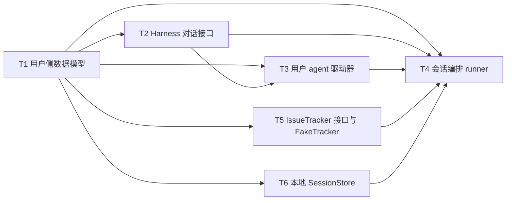

演化图：

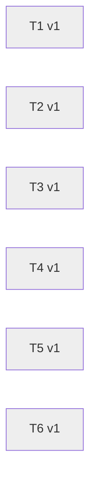

### 0002 Gitea 接入与基建（issue #0）

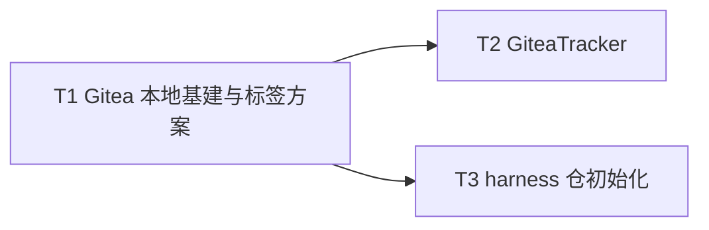

演化图：

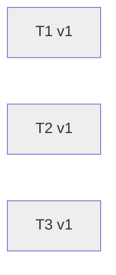

### 0003 开发者侧与闭环（issue #0）

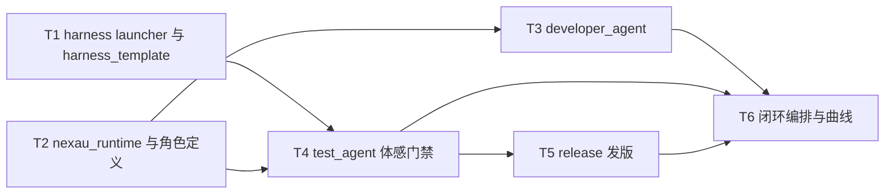

演化图：


### 0004 Harbor 运行与可恢复 checkpoint（issue #0）

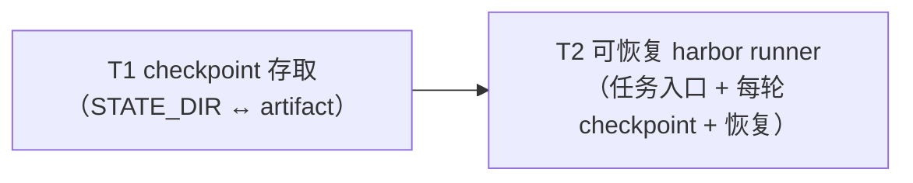

演化图：

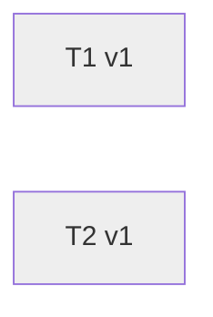

### 0005 用户侧重型实现：控制信封模拟器与体感评分（issue #0）

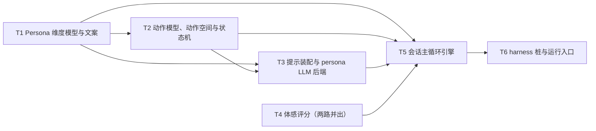

演化图：


### 0006 Persona 管线：采集（蒸馏）与注入 sim（issue #0）

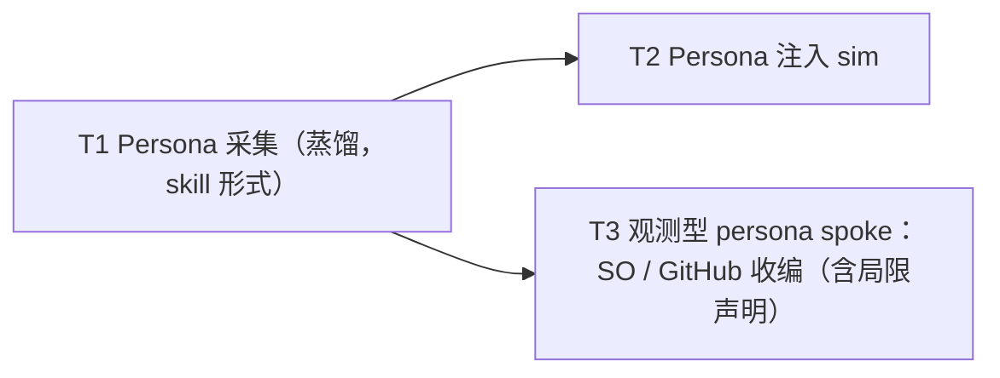

演化图：

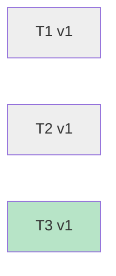

### 0007 开发者侧改为纯 trunk(main) 自进化（issue #12）

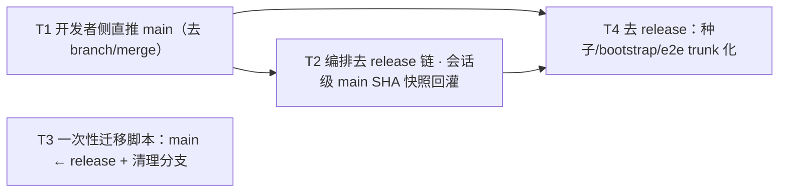

演化图：

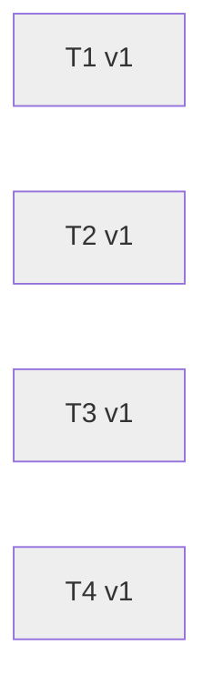

### 0008 用户 agent 内层 tool-using（自有环境核实）（issue #8）

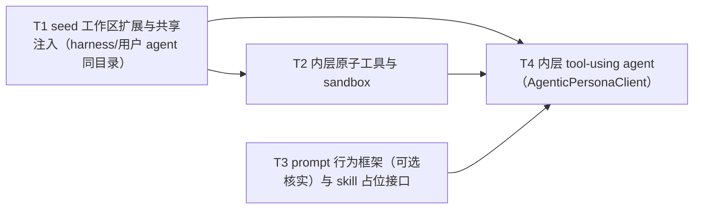

演化图：

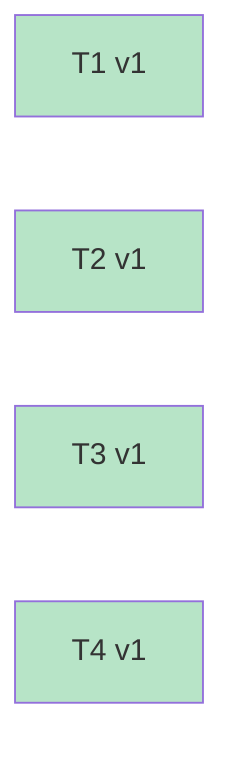

### 0009 种子工作区供给可插拔（SeedSource 接缝）（issue #9）

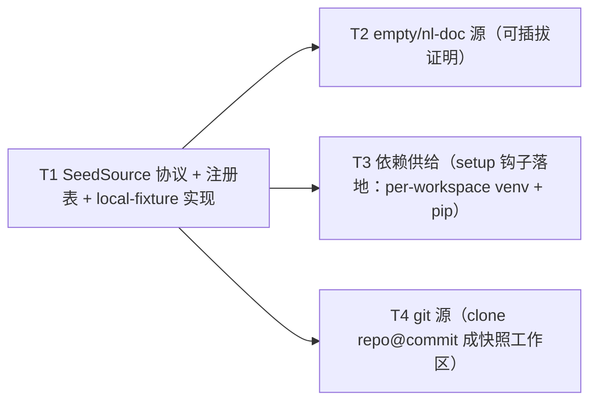

演化图：


### 0010 种子场景管线：采集(蒸馏)与注入 SeedSource（issue #10）

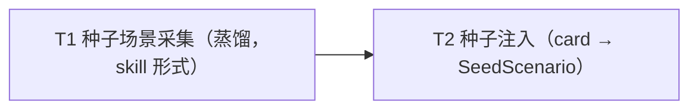

演化图：

```mermaid
graph LR
    v_T1_1["T1 v1"]
    v_T2_1["T2 v1"]
    classDef st_done fill:#b7e4c7;
    class v_T1_1 st_done;
    class v_T2_1 st_done;
```

### 0011 AgentBoard：卡通形式的活动 agent 页面（issue #19）

```mermaid
graph LR
    nT1["T1 AgentBoard 卡通页 + 卡片 + 共享工具，摘除旧面板"]
```

演化图：

```mermaid
graph LR
    v_T1_1["T1 v1"]
    classDef st_done fill:#b7e4c7;
    class v_T1_1 st_done;
```

### 0012 用户侧等待体感真实化：心跳主动权 · 进度可见 · 任务相关耐心（issue #0）

```mermaid
graph LR
    nT1["T1 等待中主动权：心跳唤醒 + 进度可见 + 等待衰减口径统一"]
    nT2["T2 状态耐心模型：任务量起始浮动 + 性格衰减系数"]
```

演化图：

```mermaid
graph LR
    v_T1_1["T1 v1"]
    v_T2_1["T2 v1"]
    classDef st_done fill:#b7e4c7;
    class v_T1_1 st_done;
    class v_T2_1 st_done;
```

### 0013 Harness 呈现与交互协议：拆信封 · 过程流分层 · 打断/心跳（issue #0）

```mermaid
graph LR
    nT1["T1 拆 complete_task 信封 + 过程流分层 + begin/poll/control 心跳协议"]
    nT2["T2 v0 种子自测 smoke + MANUAL 呈现契约"]
```

演化图：

```mermaid
graph LR
    v_T1_1["T1 v1"]
    v_T2_1["T2 v1"]
    classDef st_pending fill:#eeeeee;
    class v_T1_1 st_pending;
    class v_T2_1 st_pending;
```

### 0014 开发者侧提交纪律：增量落地闸 + 收尾硬闸（含接线 AST）（issue #0）

```mermaid
graph LR
    nT1["T1 CommitCheckpointMiddleware：逐级施压逼尽早落已提交增量"]
    nT2["T2 CompletionGateMiddleware：收尾硬闸（含接线 AST）+ 软催测试/进度契约"]
    nT3["T3 dev agent 配置/提示对齐：迭代预算·硬落地窗口·冒烟须盖接线"]
```

演化图：

```mermaid
graph LR
    v_T1_1["T1 v1"]
    v_T2_1["T2 v1"]
    v_T3_1["T3 v1"]
    classDef st_pending fill:#eeeeee;
    class v_T1_1 st_pending;
    class v_T2_1 st_pending;
    class v_T3_1 st_pending;
```

### 0015 开发者侧过拟合泄漏隔离：提交边界 + trace 物理隔离 + 工作区 jail（issue #0）

```mermaid
graph LR
    nT1["T1 harness 仓提交边界硬闸（pre-commit 钩子）"]
    nT2["T2 sandbox 工作目录下沉，物理隔离 trace"]
    nT3["T3 WorkspaceJailMiddleware：写关仓内、读放行 NexAU 源码与运行时临时目录"]
```

演化图：

```mermaid
graph LR
    v_T1_1["T1 v1"]
    v_T2_1["T2 v1"]
    v_T3_1["T3 v1"]
    classDef st_pending fill:#eeeeee;
    class v_T1_1 st_pending;
    class v_T2_1 st_pending;
    class v_T3_1 st_pending;
```

### 0016 设计师根因信号 + 读码效率 + 运行时聚合（issue #0）

```mermaid
graph LR
    nT1["T1 体感 reason 作根因信号喂设计师"]
    nT2["T2 设计师 grep + 先搜后读，降低读码开销"]
    nT3["T3 运行时行为聚合 runtime_agg：机制层观测数字喂设计师"]
    nT1 --> nT3
```

演化图：

```mermaid
graph LR
    v_T1_1["T1 v1"]
    v_T2_1["T2 v1"]
    v_T3_1["T3 v1"]
    classDef st_done fill:#b7e4c7;
    classDef st_pending fill:#eeeeee;
    class v_T1_1 st_pending;
    class v_T2_1 st_pending;
    class v_T3_1 st_done;
```

### 0017 多用户会话并行化：a 段线程池 + 共享状态加锁（issue #0）

```mermaid
graph LR
    nT1["T1 存储与观测投影加锁"]
    nT2["T2 client 每局一实例（工厂注入）"]
    nT3["T3 a 段并行化 + 并发度旋钮"]
    nT4["T4 并发端到端回归测试"]
    nT5["T5 harness checkout 并发安全"]
    nT6["T6 tracker HTTP 会话线程安全"]
    nT1 --> nT3
    nT2 --> nT3
    nT3 --> nT4
```

演化图：

```mermaid
graph LR
    v_T1_1["T1 v1"]
    v_T2_1["T2 v1"]
    v_T3_1["T3 v1"]
    v_T4_1["T4 v1"]
    v_T5_1["T5 v1"]
    v_T6_1["T6 v1"]
    classDef st_done fill:#b7e4c7;
    class v_T1_1 st_done;
    class v_T2_1 st_done;
    class v_T3_1 st_done;
    class v_T4_1 st_done;
    class v_T5_1 st_done;
    class v_T6_1 st_done;
```

### 0018 设计师提案拆信封：complete_task 交付不再被静默丢弃（issue #0）

```mermaid
graph LR
    nT1["T1 _run_agent 出口拆 complete_task 信封"]
```

演化图：

```mermaid
graph LR
    v_T1_1["T1 v1"]
    classDef st_done fill:#b7e4c7;
    class v_T1_1 st_done;
```

### 0019 launcher 非 reply 旁路放宽（progress 等）（issue #0）

```mermaid
graph LR
    nT1["T1 launcher：非 reply 旁路一律收 + control 旁路/终结分流"]
```

演化图：

```mermaid
graph LR
    v_T1_1["T1 v1"]
    classDef st_done fill:#b7e4c7;
    class v_T1_1 st_done;
```

### 0020 覆盖关系兑现 + 开发者领取策略与票种预算（issue #0）

```mermaid
graph LR
    nT1["T1 designer covers 产出：提案字段解析 + body 机器行 + 被覆盖 bug 挂链"]
    nT2["T2 dev 领取分池 + 票种预算与重试升档 + 结果回写 comment"]
    nT3["T3 编排接线：run.py 构造带策略/预算的 dev + 配置旋钮"]
    nT4["T4 web API：/api/issues 附 covers/covered_by 字段"]
    nT5["T5 前端：issue 列表与详情的覆盖徽标"]
    nT2 --> nT3
    nT1 --> nT4
    nT4 --> nT5
```

演化图：

```mermaid
graph LR
    v_T1_1["T1 v1"]
    v_T2_1["T2 v1"]
    v_T3_1["T3 v1"]
    v_T4_1["T4 v1"]
    v_T5_1["T5 v1"]
    classDef st_done fill:#b7e4c7;
    class v_T1_1 st_done;
    class v_T2_1 st_done;
    class v_T3_1 st_done;
    class v_T4_1 st_done;
    class v_T5_1 st_done;
```

### 0021 dev agent 逃逸围堵：凭证隔离 + 编排绊线 + 污染清理（issue #0）

```mermaid
graph LR
    nT1["T1 repo_guard 模块 + orchestrator b 段绊线"]
    nT2["T2 run.py 凭证隔离 + 构造并注入编排仓绊线 guard"]
    nT3["T3 清理历史逃逸污染制品 MANUAL.md"]
    nT1 --> nT2
```

演化图：

```mermaid
graph LR
    v_T1_1["T1 v1"]
    v_T2_1["T2 v1"]
    v_T3_1["T3 v1"]
    classDef st_done fill:#b7e4c7;
    class v_T1_1 st_done;
    class v_T2_1 st_done;
    class v_T3_1 st_done;
```

### 0022 用户↔harness 内外通道：开放 intent · 中途 report_issue · slash 示范（issue #0）

```mermaid
graph LR
    nT1["T1 内外窗口 + 等待菜单 + emit_message + 开放 intent"]
    nT2["T2 中途 report_issue tool（可闲置）+ issue_notes flush"]
    nT3["T3 初始 harness：/exit\|/quit slash 内部分发 + MANUAL"]
```

演化图：

```mermaid
graph LR
    v_T1_1["T1 v1"]
    v_T2_1["T2 v1"]
    v_T3_1["T3 v1"]
    classDef st_done fill:#b7e4c7;
    class v_T1_1 st_done;
    class v_T2_1 st_done;
    class v_T3_1 st_done;
```

### 0023 等待环事件化钉死 · 废弃 one/two 与遗留信号（issue #0）

```mermaid
graph LR
    nT1["T1 loop：只留 three · 清 MAIN_GAP/死常量/stalled"]
    nT2["T2 prompt：删除 one/two 合并 builder · 单测改打 three"]
    nT3["T3 探针：去掉 two 臂与 peek-via-control 心智"]
    nT4["T4 launcher.try_reply 非阻塞契约（已落地）"]
    nT1 --> nT2
    nT1 --> nT3
```

演化图：

```mermaid
graph LR
    v_T1_1["T1 v1"]
    v_T2_1["T2 v1"]
    v_T3_1["T3 v1"]
    v_T4_1["T4 v1"]
    classDef st_done fill:#b7e4c7;
    class v_T1_1 st_done;
    class v_T2_1 st_done;
    class v_T3_1 st_done;
    class v_T4_1 st_done;
```

### 0024 用户 god-view 落盘 + 设计师按需取用（issue #0）

```mermaid
graph LR
    nT1["T1 Session.sim_trace 落盘（TurnLog→SimTrace）"]
    nT2["T2 index 扩 issue_numbers + 体感曲线带 session_id"]
    nT3["T3 get_session_timeline tool 入口（按需取证通路）"]
    nT4["T4 get_session_timeline 使用事件投影（去仿真外壳）"]
    nT5["T5 设计师渐进下钻 tool 接线（beat/step）"]
    nT6["T6 请求-回复配对：heard.answers → utterance"]
    nT1 --> nT2
    nT2 --> nT3
    nT3 --> nT4
    nT4 --> nT5
    nT5 --> nT6
```

演化图：

```mermaid
graph LR
    v_T1_1["T1 v1"]
    v_T2_1["T2 v1"]
    v_T3_1["T3 v1"]
    v_T4_1["T4 v1"]
    v_T5_1["T5 v1"]
    v_T6_1["T6 v1"]
    classDef st_done fill:#b7e4c7;
    class v_T1_1 st_done;
    class v_T2_1 st_done;
    class v_T3_1 st_done;
    class v_T4_1 st_done;
    class v_T5_1 st_done;
    class v_T6_1 st_done;
```

### 0025 issue triage 漏斗：用户提 issue → triage agent 分类定位 → synthesize agent 出 RFC → dev（issue #0）

```mermaid
graph LR
    nT1["T1 平台层 issue schema：per-type 字段(用户填/triage填 分区) + RFC + validate/render"]
    nT2["T2 用户 sim 产结构化 raw issue：暂定 type + needs-triage + 轮号"]
    nT3["T3 triage agent（新角色）：就地分类+定位+去重+驳回/needs-info"]
    nT4["T4 synthesize agent（原 designer 收窄）：跨 issue 结构综合 → RFC"]
    nT5["T5 dev 简化：按容量领 triaged/RFC、未清空积压，预算按 kind 分档，去分池/retry/stuck"]
    nT6["T6 编排接线：d 段 triage→synthesize 两 agent + round 透传 + priority 机制派生 + roster"]
    nT7["T7 web+metrics：issue 附 kind/round/状态/priority + 曲线盯可执行 backlog(含积压)"]
    nT8["T8 前端：issue 列表按 type/状态 + RFC 区 + 覆盖/取代/积压展示"]
    nT3a["T3a tracker 补 set_labels：整组替换已有 issue 标签"]
    nT1 --> nT2
    nT1 --> nT3
    nT2 --> nT3
    nT3a --> nT3
    nT3 --> nT4
    nT4 --> nT5
    nT5 --> nT6
    nT4 --> nT7
    nT7 --> nT8
    nT1 --> nT3a
```

演化图：

```mermaid
graph LR
    v_T1_1["T1 v1"]
    v_T2_1["T2 v1"]
    v_T3_1["T3 v1"]
    v_T3a_1["T3a v1"]
    v_T4_1["T4 v1"]
    v_T5_1["T5 v1"]
    v_T6_1["T6 v1"]
    v_T7_1["T7 v1"]
    v_T8_1["T8 v1"]
    classDef st_done fill:#b7e4c7;
    class v_T1_1 st_done;
    class v_T2_1 st_done;
    class v_T3_1 st_done;
    class v_T3a_1 st_done;
    class v_T4_1 st_done;
    class v_T5_1 st_done;
    class v_T6_1 st_done;
    class v_T7_1 st_done;
    class v_T8_1 st_done;
```

### 0026 观测看板前端全面重构：浅/深主题可切换 + 分诊(triager)可见 + persona 展示 + 设计 token 化（issue #0）

```mermaid
graph LR
    nT1["T1 后端：live 补 triager 排序 + 用户 agent 活动载荷带 persona 摘要"]
    nT2["T2 设计 token 层 + 浅/深主题（跟随系统 + localStorage 持久）+ 全局 CSS"]
    nT3["T3 应用外壳 + 类型（AgentRole triager / Agent.meta）+ TopBar（主题开关）+ 概览曲线"]
    nT4["T4 角色列 + 卡片：triager 房间渲染 + 角色强调色 + 用户卡 persona + issue/commit 卡收敛"]
    nT5["T5 详情面板信息架构刷新（agent/session/issue/commit + 侧栏）+ persona 块"]
    nT2 --> nT3
    nT1 --> nT4
    nT3 --> nT4
    nT2 --> nT5
    nT3 --> nT5
```

演化图：

```mermaid
graph LR
    v_T1_1["T1 v1"]
    v_T2_1["T2 v1"]
    v_T3_1["T3 v1"]
    v_T4_1["T4 v1"]
    v_T5_1["T5 v1"]
    classDef st_done fill:#b7e4c7;
    class v_T1_1 st_done;
    class v_T2_1 st_done;
    class v_T3_1 st_done;
    class v_T4_1 st_done;
    class v_T5_1 st_done;
```

### 0027 统一 agent 结构化产出契约：issue_schema 单一真源 + submit-tool 原生校验，去掉第二次 LLM 重排与各自为政的解析（issue #0）

```mermaid
graph LR
    nT1["T1 issue_schema 收敛为契约单一真源 + 契约生成/共享校验模块"]
    nT2["T2 triage 改 submit-tool 原生结构化（去第二次 LLM 重排与别名归一）"]
    nT3["T3 designer 改 submit-tool 原生结构化 + 统一 driver-apply"]
    nT1 --> nT2
    nT1 --> nT3
```

演化图：

```mermaid
graph LR
    v_T1_1["T1 v1"]
    v_T2_1["T2 v1"]
    v_T3_1["T3 v1"]
    classDef st_done fill:#b7e4c7;
    class v_T1_1 st_done;
    class v_T2_1 st_done;
    class v_T3_1 st_done;
```

### 0028 divergent PM + gate：产品候选并行通道与晋升评审（issue #0）

```mermaid
graph LR
    nT1["T1 issue_schema：divergent/gate-dropped 标签与可执行 backlog 口径"]
    nT2["T2 Divergent 驱动器 + agent_defs/divergent_pm：落不可领产品候选"]
    nT3["T3 Designer.gate_once：promote/hold/drop 语义晋升"]
    nT4["T4 编排接线：d2 synthesize∥divergent → d3 gate；roster/run 默认关"]
    nT5["T5 dev 领取硬排除 divergent 候选"]
    nT1 --> nT2
    nT1 --> nT3
    nT2 --> nT4
    nT3 --> nT4
    nT1 --> nT5
```

演化图：

```mermaid
graph LR
    v_T1_1["T1 v1"]
    v_T2_1["T2 v1"]
    v_T3_1["T3 v1"]
    v_T4_1["T4 v1"]
    v_T5_1["T5 v1"]
    classDef st_done fill:#b7e4c7;
    class v_T1_1 st_done;
    class v_T2_1 st_done;
    class v_T3_1 st_done;
    class v_T4_1 st_done;
    class v_T5_1 st_done;
```

### 0029 三平面 issue 流：证据→提案→工作队列，唯一准入 Owner（白名单可领、生成器自由并行、去 gate 特殊通道）（issue #0）

```mermaid
graph LR
    nT1["T1 issue_schema 三平面标签收敛：report/proposal/ready 白名单 + 老标签读侧映射"]
    nT2["T2 agent_runtime 公共运行时抽出：跑 agent + 读 submit 一处实现"]
    nT3["T3 triage 改纯规范化生成器：accept→就地升 proposal，判重职责移出"]
    nT4["T4 synthesize 收窄为纯生成器：产 proposal(from-synthesize)，gate_once 退役"]
    nT5["T5 divergent 对齐纯生成器：产 proposal(from-divergent)，专属通道退役"]
    nT6["T6 Owner 唯一准入：机械+评审双模式批量裁决（admit/merge/decline/hold）"]
    nT7["T7 dev 白名单领取：ready-only + priority→age 排序 + 级联关闭"]
    nT8["T8 编排/roster/run 接线：生成段全并行（triage 可分片）→ Owner → dev + 背压告警"]
    nT9["T9 观测后端适配：plane 字段 + ready 深度曲线 + 漏斗计数"]
    nT10["T10 前端适配：三平面分组 + Owner 房间 + 漏斗与背压展示"]
    nT1 --> nT3
    nT2 --> nT3
    nT1 --> nT4
    nT2 --> nT4
    nT1 --> nT5
    nT2 --> nT5
    nT1 --> nT6
    nT2 --> nT6
    nT1 --> nT7
    nT3 --> nT8
    nT4 --> nT8
    nT5 --> nT8
    nT6 --> nT8
    nT7 --> nT8
    nT6 --> nT9
    nT7 --> nT9
    nT9 --> nT10
```

演化图：

```mermaid
graph LR
    v_T1_1["T1 v1"]
    v_T10_1["T10 v1"]
    v_T2_1["T2 v1"]
    v_T3_1["T3 v1"]
    v_T4_1["T4 v1"]
    v_T5_1["T5 v1"]
    v_T6_1["T6 v1"]
    v_T7_1["T7 v1"]
    v_T8_1["T8 v1"]
    v_T9_1["T9 v1"]
    classDef st_done fill:#b7e4c7;
    class v_T1_1 st_done;
    class v_T10_1 st_done;
    class v_T2_1 st_done;
    class v_T3_1 st_done;
    class v_T4_1 st_done;
    class v_T5_1 st_done;
    class v_T6_1 st_done;
    class v_T7_1 st_done;
    class v_T8_1 st_done;
    class v_T9_1 st_done;
```

### 0030 harness 产品化边界：/help 用户说明、平台侧接口与 connector 适配（issue #0）

```mermaid
graph LR
    nT1["T1 写 0030 活快照"]
    nT2["T2 harness_template 精简为 HELP/RUNTIME/scripts/deps"]
    nT3["T3 /help slash 与模板自测"]
    nT4["T4 边界白名单改为产品区域而非历史文件名"]
    nT5["T5 平台读取 HELP.md 与收尾闸门同步"]
    nT6["T6 connector 与 stdio-jsonl-v1 协议适配"]
    nT2 --> nT3
    nT2 --> nT4
    nT2 --> nT5
    nT5 --> nT6
```

演化图：

```mermaid
graph LR
    v_T1_1["T1 v1"]
    v_T2_1["T2 v1"]
    v_T3_1["T3 v1"]
    v_T4_1["T4 v1"]
    v_T5_1["T5 v1"]
    v_T6_1["T6 v1"]
    classDef st_done fill:#b7e4c7;
    class v_T1_1 st_done;
    class v_T2_1 st_done;
    class v_T3_1 st_done;
    class v_T4_1 st_done;
    class v_T5_1 st_done;
    class v_T6_1 st_done;
```

### 0031 用户模拟阶段契约下沉：薄 base system 与 prompt 去平台手册化（issue #0）

```mermaid
graph LR
    nT1["T1 写 0031 活快照"]
    nT2["T2 拆 prompt：薄 base system 与阶段局部 contract"]
    nT3["T3 loop 集成防回归：主/心跳三跳只按阶段暴露契约"]
    nT4["T4 persona_client 与 agentic 路径适配阶段契约"]
    nT1 --> nT2
    nT2 --> nT3
    nT2 --> nT4
```

演化图：

```mermaid
graph LR
    v_T1_1["T1 v1"]
    v_T2_1["T2 v1"]
    v_T3_1["T3 v1"]
    v_T4_1["T4 v1"]
    classDef st_done fill:#b7e4c7;
    class v_T1_1 st_done;
    class v_T2_1 st_done;
    class v_T3_1 st_done;
    class v_T4_1 st_done;
```

### 0032 开发者侧换轨 OpenAgents：需求面/交付面二分 + Gitea forge 适配（issue #0）

```mermaid
graph LR
    nT1["T1 OpenAgents 仓：forge 分发层——alias-import 接缝 + 配置段 + merger 提示词参数化"]
    nT2["T2 OpenAgents 仓：Gitea REST driver——github.py 同名公共面对 Gitea /api/v1"]
    nT3["T3 准入交接：Owner 改打 openagents 发现标签，plane READY 收编 {ready, openagents}"]
    nT4["T4 dev 侧退役：AgenticDeveloper/developer_agent 删除，orchestrator 去 dev 拍"]
    nT5["T5 vigil 接线：run.py 写 openagents.yml、管 vigil 子进程生命周期、vK tag 退役"]
    nT6["T6 harness 仓最小 CI：Gitea Actions runner + 冒烟 workflow"]
    nT7["T7 交付面观测：GiteaTracker PR 读路径 + web API + 前端交付面视图"]
    nT8["T8 文档收尾：CLAUDE.md 架构段与 spec 制品再生成"]
    nT1 --> nT2
    nT3 --> nT4
    nT2 --> nT5
    nT4 --> nT5
    nT5 --> nT6
    nT5 --> nT7
    nT5 --> nT8
```

演化图：

```mermaid
graph LR
    v_T1_1["T1 v1"]
    v_T2_1["T2 v1"]
    v_T3_1["T3 v1"]
    v_T4_1["T4 v1"]
    v_T5_1["T5 v1"]
    v_T6_1["T6 v1"]
    v_T7_1["T7 v1"]
    v_T8_1["T8 v1"]
    classDef st_pending fill:#eeeeee;
    class v_T1_1 st_pending;
    class v_T2_1 st_pending;
    class v_T3_1 st_pending;
    class v_T4_1 st_pending;
    class v_T5_1 st_pending;
    class v_T6_1 st_pending;
    class v_T7_1 st_pending;
    class v_T8_1 st_pending;
```
