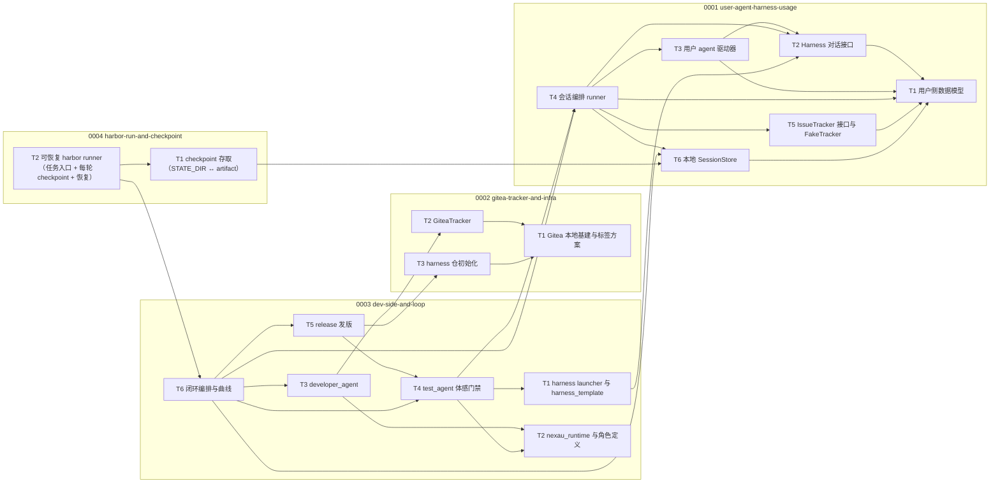
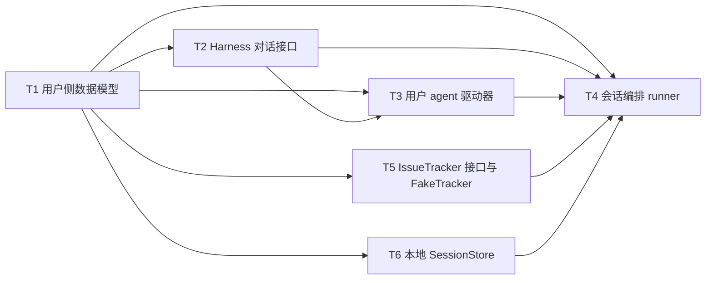
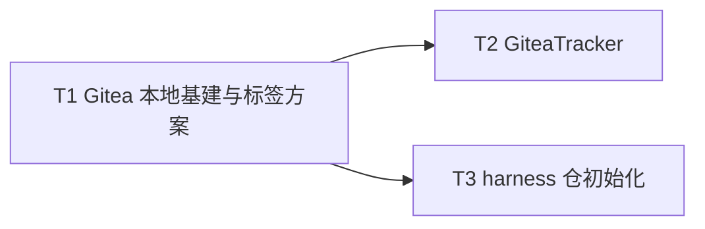
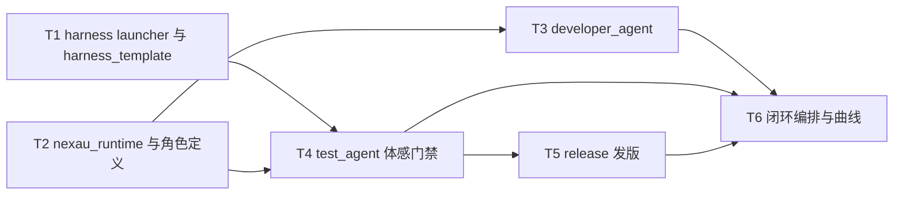
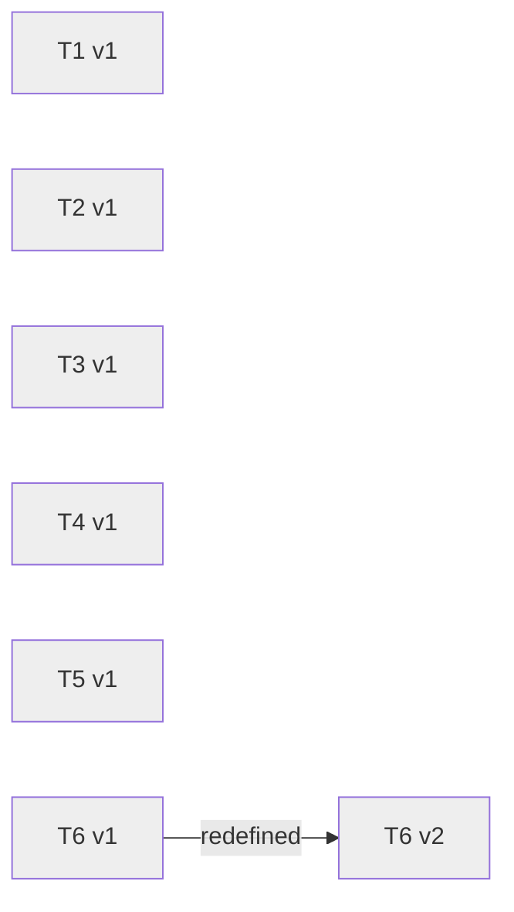
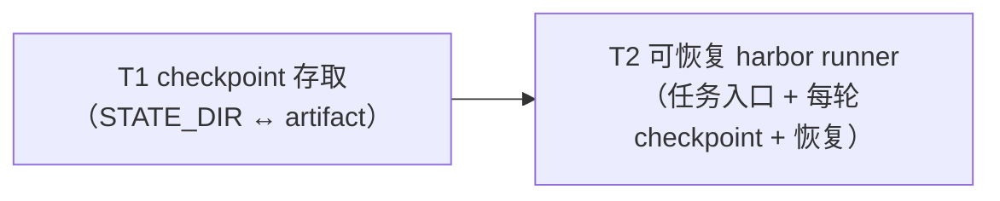

# Spec 总览（OVERVIEW）

> 本文件由 `spec render` 自动生成，请勿手工编辑（Spec-0014/T3）。

## 总览

本仓在做 **harness 自进化**。直接对轨迹做自进化，会把轨迹特征带进 harness、以 benchmark 分数为优化目标而过拟合，只能针对具体问题局部打补丁，难有结构性改进。本仓的根本做法是**训练信号与测试分离**：训练信号取「模拟真实使用」分布上的**用户体感**，benchmark 全程 **held-out**，只在事后验证体感驱动的进化是否带来真实能力提升——不进训练、不进发版门禁。

为此模拟一条「**用户使用 → 开发者迭代**」的闭环：**a｜用户侧** user agent 按 persona + 种子场景多轮使用 harness，产出体感评分（训练信号）与 issue（bug/需求）；**b｜开发者侧** 开发者 agent 领 issue 改 harness（bug 走 release 快修、大 feature 走独立分支孵化），测试 agent 做体感门禁，过门禁才合并发版；**c｜回灌** 发版后的新 harness 回到用户侧，循环。

被进化对象 harness 不是单个 agent，而是「可启动程序 + 黑盒对话契约」，内部 1 个或 N 个 nexau 的编排由其自带 entry 决定，源码独立托管于 Gitea，开发者 agent 走真实分支与合并。观测上记录 issue 数量随时间的曲线：长期不降说明 harness 在退化，过早归零说明 persona 多样性不足、探索停止。

下面按编号递进给出每组定位，串起整条脉络；依赖与衔接见后续「跨 feature 关系图」，单组完整方案见各组 `summary.md`。

- **0001 用户 agent 使用 harness 的最小链路** — 本组实现进化闭环的 **a｜用户侧**：让 user agent 扮成真实用户，按 persona + 种子场景多轮使用 harness，产出两类信号——**体感评分**（训练信号）与 **issue**（bug/需求）。本组只搭「最小链路」，且全部用 Fake 后端，不依赖真 Gitea / 真 harness，可独立测；真后端由 0002（Gitea）、0003（harness）补齐。

  读图即读任务：**T1** 定全部数据结构（地基，被其余任务共用）；**T2** 定与 harness 的对话契约；**T3** 是训练信号的产生点（扮得像不像真人决定信号真不真）；**T5** 定 issue 的去向；**T6** 定体感落地；**T4** 把它们编排成「跑一局」的唯一入口 `run_session`。下游：0003 的闭环直接复用 `run_session`。
- **0002 Gitea 接入与基建** — 本组补齐 **a 段的真实后端与基建**：0001 用 Fake 把接口立了起来，本组把「桩」换成「真」——起一个本地 Gitea（issue 与 harness 仓的家），并实现 0001/T5 `IssueTracker` 接口的真后端 `GiteaTracker`。

  **T1** 是一切前置（没有 Gitea 就没有 issue 去向、也没有 harness 仓）；**T2** 让用户 agent 产的 issue 真正进 Gitea；**T3** 把 v0 种子变成可演化的 harness 仓。本组完成后，a 段即可脱离 Fake 真跑。
- **0003 开发者侧与闭环** — 本组实现 **b｜开发者侧** 与 **c｜闭环回灌**，把前两组的零件总装成可重复的进化轮次。一轮 = a（用户产 issue + 体感）→ b（开发者改 harness、测试体感门禁、发版）→ c（新版 harness 回到 a）。

  支撑件：**T1** launcher 把「某版 harness 程序」接成 0001 的 `HarnessInterface`（粘合层），并给出 v0 种子 `harness_template`；**T2** 是 user/developer/test 三角色共用的 nexau 适配层。本组核心约束：**门禁只用体感，benchmark 全程 held-out**（只事后观测、不参与发版判定）。
- **0004 Harbor 运行与可恢复 checkpoint** — 本组给闭环加上**可恢复运行时**：所有 agent 在**单沙盒一波跑**（方案 A，整条 run = 1 个 harbor task），用 harbor 的 task→artifact 通道把 checkpoint 吐出沙盒、再喂回实现恢复。它横跨 a/b/c：checkpoint 在**单元边界**维护用户侧状态（已完成 session / 体感）、开发者侧状态（issue 分派、候选分支）与其他编排中间态（轮次 / 阶段 / release_ref / 待合并）。

  分层是本组关键，且与 spec-0001/T2「逐轮对话另立协议」一致：harbor 只包**外层 rollout 生命周期**；**内层**用户↔harness 的逐轮真人对话仍走 spec-0001 自立协议，不碰 harbor 批式 episode 接口。

  支撑件：**T1** 定义 checkpoint 存取与自包含 STATE_DIR（gitea + sessions + metrics + run_state）；**T2** 可恢复 harbor runner，在 orchestrator 外层加恢复与每轮 checkpoint。本组约束：**恢复按单元边界幂等重跑**（整会话重跑、开发者从分支 head 续作、release 见 tag 跳过），不快照 agent 进程内存。

## 如何读这份文档

本文件是所有 spec 的**全局看板**，由各组 `tasks/T*.yaml` 自动汇总，偏索引视角。想读某一组的完整方案，请点进该组的 `summary.md`（每个 feature 段开头有链接）。

阅读顺序建议：不熟术语先看**名词解释** → 看**全局看板**掌握全部任务与状态 → 看**跨 feature 关系图**了解依赖 → 看**设计文件结构**掌握落盘布局与文件归属 → 在**各 feature 详情**里逐组读导语与任务一览。

## 名词解释

> 本仓共享术语表，英文优先；本块来源 `glossary.yaml`（手工维护），改名词解释改该文件后 re-render。

### 底座与运行时

- **harbor** — rollout 底座，承载整条自进化闭环的运行。
- **nexau** — agent 运行时实现，MVP 唯一接入的运行时；三角色（user/developer/test）均为「同一 nexau 运行时 + 不同 agent 定义（prompt+工具）」。
- **harness** — 被进化对象，建模为「可启动程序 + 黑盒对话契约」而非单个 agent；内部 1 个或 N 个 nexau 的编排由其自带 entry 决定，源码为独立 git 仓托管于 Gitea。
- **benchmark** — held-out 测试集，全程不参与训练、不进发版门禁，仅事后验证体感驱动的进化是否带来真实能力提升。

### 三角色（agent 定义）

- **user agent** — 扮演真实用户，按 Persona + SeedScenario 多轮使用 harness，产出体感评分（训练信号）与 issue。
- **developer agent** — 从 Gitea 领取 open issue，按 label 分流到对应分支策略，用 nexau 修改 harness bundle 并提交。
- **test agent** — 用候选 harness ref 跑固定集的 N 局用户会话，算平均体感与 release 基线比较，做体感回归门禁。

### 用户侧数据结构（spec-0001/T1）

- **Persona** — 用户画像（身份/水平/领域/目标/说话风格），蒸馏自真实数据，不依据 benchmark 或轨迹构造。
- **SeedScenario** — 种子场景，一局会话的初始诉求/任务描述（给定输入，非测试用例）。
- **Transcript** — 有序 (role, content) 多轮对话记录，role ∈ {user, harness}。
- **FeelingScore** — 1–4 体感评分 + 理由，一局一个、会话末产出，作为训练信号。
- **IssueDraft** — 用户 agent 产出的问题草稿（title/body/labels），一局 0..n 条。
- **IssueRef** — issue 提交至 Gitea 后的回执（number/url/state）；本地只持回执，权威源在 Gitea。
- **Session** — 一局会话的完整封装，聚合 persona/scenario/transcript/feeling/issue_refs。

### 接口与组件

- **HarnessInterface** — 用户侧与 harness 的黑盒多轮对话契约（send/reset/close），使用户侧不感知 harness 内部结构。
- **IssueTracker** — issue 提交去向的抽象接口，使用户侧不绑定具体 tracker 后端。
- **FakeTracker** — IssueTracker 的内存桩实现，供用户侧独立测试（不依赖真 Gitea）。
- **GiteaTracker** — IssueTracker 的 Gitea 真后端，一个打 Gitea /api/v1 的薄 REST 客户端。
- **run_session** — 用户侧唯一入口，单一无状态函数把 Persona/SeedScenario/HarnessInterface/UserAgent 编排为一局 Session。
- **SessionStore** — 把一局 Session 持久化到本地 data/sessions/（全量文件 + 总索引），作为体感曲线与回归基线的数据源。
- **launcher** — 按 git ref 取出某版 harness、启动其自带 entry、按黑盒逐轮协议适配为 HarnessInterface 的粘合层。
- **nexau_runtime** — 单一 nexau 适配层，把一份角色定义（prompt+工具）加载成可调用的 agent，供三角色共用。
- **orchestrator** — 把用户侧(a)、开发者侧(b)、回灌(c) 串成可重复进化轮次的闭环编排。
- **metrics** — 从 Gitea 与本地 session 统计 issue 数量随时间的曲线与体感趋势的观测组件。

### 基建与流程

- **Gitea** — 自托管 git 服务（docker + sqlite），issue 与 harness 仓的家；负责发号/状态/标签/comment。
- **release 分支** — harness 仓的稳定分支，bug 修复走此分支快速迭代；体感门禁通过的候选合入于此。
- **feature 分支** — harness 仓的特性分支，大 feature 在此完成后再合入 release。
- **tag** — harness 仓的发布版本标记，即用户侧下一轮 pin 的 harness 版本。
- **体感门禁** — 唯一发版门禁，只检查体感是否回归（benchmark 不参与）；候选与 release 基线比较，不退化则放行。
- **distill（蒸馏模块）** — 从真实使用数据（CC/codex/nexau 日志、issue tracker、社区反馈）蒸馏出 persona 库与种子场景库。
- **harness_template** — v0 harness 种子（entry + agents + params），用于初始化 Gitea 上的 harness 独立仓。

### 运行时与恢复（spec-0004）

- **harbor runner** — orchestrator 外层的可恢复运行入口，作为一个 harbor task（方案 A，整条 run = 1 task）在单沙盒内驱动逐轮编排，每轮 save_checkpoint 并经 harbor artifact 通道吐出沙盒；逐轮真人对话仍走 spec-0001 自立协议，harbor 只包外层 rollout 生命周期。
- **checkpoint** — harbor task 每轮边界吐出的自包含状态快照（STATE_DIR 的打包 artifact），供沙盒易失后恢复；是 Gitea/SessionStore 等权威源的整体快照，非第二权威。
- **STATE_DIR** — 收敛全部可恢复状态的单一自包含目录（Gitea data + sessions/ + metrics.jsonl + run_state.json），checkpoint 的打包对象。
- **run_state** — 编排游标（轮次/阶段/current_release_ref）与三侧中间态标记（用户侧已完成 session、开发者侧 issue 分派与候选分支、待合并/发版）；能从产物推断的优先推断，run_state 兜底。

## 全局看板

| 组 | 任务 | 标题 | 状态 | 依赖 |
|----|----|----|----|----|
| 0001 | 0001/T1 | 用户侧数据模型 | pending | — |
| 0001 | 0001/T2 | Harness 对话接口 | pending | T1 |
| 0001 | 0001/T3 | 用户 agent 驱动器 | pending | T1, T2 |
| 0001 | 0001/T4 | 会话编排 runner | pending | T1, T2, T3, T5, T6 |
| 0001 | 0001/T5 | IssueTracker 接口与 FakeTracker | pending | T1 |
| 0001 | 0001/T6 | 本地 SessionStore | pending | T1 |
| 0002 | 0002/T1 | Gitea 本地基建与标签方案 | pending | — |
| 0002 | 0002/T2 | GiteaTracker | pending | T1 |
| 0002 | 0002/T3 | harness 仓初始化 | pending | T1 |
| 0003 | 0003/T1 | harness launcher 与 harness_template | pending | 0001/T2 |
| 0003 | 0003/T2 | nexau_runtime 与角色定义 | pending | — |
| 0003 | 0003/T3 | developer_agent | pending | T2, 0002/T2 |
| 0003 | 0003/T4 | test_agent 体感门禁 | pending | T1, T2, 0001/T4 |
| 0003 | 0003/T5 | release 发版 | pending | T4, 0002/T3 |
| 0003 | 0003/T6 | 闭环编排与曲线 | pending | T3, T4, T5, 0001/T4, 0001/T6 |
| 0004 | 0004/T1 | checkpoint 存取（STATE_DIR ↔ artifact） | pending | 0001/T6 |
| 0004 | 0004/T2 | 可恢复 harbor runner（任务入口 + 每轮 checkpoint + 恢复） | pending | T1, 0003/T6 |

## 跨 feature 关系图

> 图例：实线箭头 `A --> B` 表示 A **依赖** B；虚线箭头 `A -.type.-> B` 表示 A 与 B **关联**（type 为关联类型）。



## 文件冲突报告

无跨组文件冲突。

## 设计文件结构

> 下列结构由各 Task 的 `files` 声明并集自动汇总；`←` 后为归属 Task（多占即冲突）。

```text
agent_defs/
  developer_agent/
    prompt.md                ← 0003/T3
  test_agent/
    prompt.md                ← 0003/T4
  user_agent/
    prompt.md                ← 0003/T2
auto_designer/
  dev/
    developer_agent.py       ← 0003/T3
    release.py               ← 0003/T5
    test_agent.py            ← 0003/T4
  harness/
    interface.py             ← 0001/T2
    launcher.py              ← 0003/T1
  loop/
    checkpoint.py            ← 0004/T1
    metrics.py               ← 0003/T6
    orchestrator.py          ← 0003/T6
    run_state.py             ← 0004/T1
    runner.py                ← 0004/T2
  tracker/
    base.py                  ← 0001/T5
    fake.py                  ← 0001/T5
    gitea.py                 ← 0002/T2
  user/
    session.py               ← 0001/T4
    session_store.py         ← 0001/T6
    user_agent.py            ← 0001/T3
  models.py                  ← 0001/T1
  nexau_runtime.py           ← 0003/T2
deploy/
  gitea/
    README.md                ← 0002/T1
    bootstrap.sh             ← 0002/T1
    docker-compose.yml       ← 0002/T1
harness_template/
  agents/
    main.md                  ← 0003/T1
  entry.py                   ← 0003/T1
  params.yaml                ← 0003/T1
scripts/
  bootstrap_harness.py       ← 0002/T3
tests/
  dev/
    test_developer_agent.py  ← 0003/T3
    test_release.py          ← 0003/T5
    test_test_agent.py       ← 0003/T4
  harness/
    test_interface.py        ← 0001/T2
    test_launcher.py         ← 0003/T1
  loop/
    test_checkpoint.py       ← 0004/T1
    test_metrics.py          ← 0003/T6
    test_orchestrator.py     ← 0003/T6
    test_run_state.py        ← 0004/T1
    test_runner.py           ← 0004/T2
  tracker/
    test_fake.py             ← 0001/T5
    test_gitea.py            ← 0002/T2
  user/
    test_session.py          ← 0001/T4
    test_session_store.py    ← 0001/T6
    test_user_agent.py       ← 0001/T3
  test_bootstrap_harness.py  ← 0002/T3
  test_models.py             ← 0001/T1
  test_nexau_runtime.py      ← 0003/T2
```

## 各 feature 详情

### 0001 用户 agent 使用 harness 的最小链路（issue #0）

> 人读方案见 [`0001-user-agent-harness-usage/summary.md`](./0001-user-agent-harness-usage/summary.md)。

本组实现进化闭环的 **a｜用户侧**：让 user agent 扮成真实用户，按 persona + 种子场景多轮使用 harness，产出两类信号——**体感评分**（训练信号）与 **issue**（bug/需求）。本组只搭「最小链路」，且全部用 Fake 后端，不依赖真 Gitea / 真 harness，可独立测；真后端由 0002（Gitea）、0003（harness）补齐。

数据流脊柱（贯穿 T1…T6，后面每个任务都挂在这条线上）：

```
Persona / SeedScenario ─► UserAgent(T3) ⇄ HarnessInterface(T2) ─► Transcript
                                  │
                                  ├─► FeelingScore 1–4(+理由) ─► SessionStore(T6) 落本地
                                  └─► IssueDraft 0..n ─[IssueTracker(T5)]► Gitea ─► IssueRef
        run_session(T4) 收集上述 ─► Session（结构由 T1 定义）
```

读图即读任务：**T1** 定全部数据结构（地基，被其余任务共用）；**T2** 定与 harness 的对话契约；**T3** 是训练信号的产生点（扮得像不像真人决定信号真不真）；**T5** 定 issue 的去向；**T6** 定体感落地；**T4** 把它们编排成「跑一局」的唯一入口 `run_session`。下游：0003 的闭环直接复用 `run_session`。

**任务一览**

- **T1 用户侧数据模型**（pending） — 定义用户侧最小链路的公共数据结构，被 T2/T3/T4 共用。
- **T2 Harness 对话接口**（pending） — 将被使用的 harness 抽象为统一的多轮对话协议（HarnessInterface），使用户侧与具体 agent 实现解耦。
- **T3 用户 agent 驱动器**（pending） — 模拟真实用户：依据 Persona 与 SeedScenario 驱动与 harness 的多轮对话，由 agent 自主判定对话终止时机， 并在会话结束时产出体感评分（FeelingScore，1–4 及理由）。
- **T4 会话编排 runner**（pending） — 用户侧的最小可用入口：单一无状态函数将 Persona、SeedScenario、HarnessInterface 与 UserAgent 编排为一局会话，收集 Transcript、FeelingScore 与 IssueDraft，返回结构化的 Session。
- **T5 IssueTracker 接口与 FakeTracker**（pending） — 将 issue 的提交去向抽象为 IssueTracker 接口，使用户侧不绑定具体 tracker 后端。
- **T6 本地 SessionStore**（pending） — 将一局 Session 持久化到本地：全量文件 + 一个总索引。



### 0002 Gitea 接入与基建（issue #0）

> 人读方案见 [`0002-gitea-tracker-and-infra/summary.md`](./0002-gitea-tracker-and-infra/summary.md)。

本组补齐 **a 段的真实后端与基建**：0001 用 Fake 把接口立了起来，本组把「桩」换成「真」——起一个本地 Gitea（issue 与 harness 仓的家），并实现 0001/T5 `IssueTracker` 接口的真后端 `GiteaTracker`。

与 0001 的接力关系：

```
0001：IssueTracker 接口 + FakeTracker（桩，仅供测试）
        └─► 0002/T2 GiteaTracker（真后端，运行时注入 run_session）
0002/T1 本地 Gitea（docker + sqlite，bootstrap 产出 URL/owner/repo/token）
        ├─► T2 GiteaTracker 读连接信息，打 /api/v1
        └─► T3 把 harness_template 推成独立 harness 仓（供 0003 开发者 agent 走真实分支/合并）
```

**T1** 是一切前置（没有 Gitea 就没有 issue 去向、也没有 harness 仓）；**T2** 让用户 agent 产的 issue 真正进 Gitea；**T3** 把 v0 种子变成可演化的 harness 仓。本组完成后，a 段即可脱离 Fake 真跑。

**任务一览**

- **T1 Gitea 本地基建与标签方案**（pending） — 提供本地 Gitea 服务的基建与一键初始化：docker-compose(Gitea + sqlite) 起服务，bootstrap 脚本建 admin、生成 access token、建工作仓与标签方案。
- **T2 GiteaTracker**（pending） — GiteaTracker 是 spec-0001/T5 IssueTracker 接口的真实后端：一个打 Gitea /api/v1 的薄 REST 客户端。
- **T3 harness 仓初始化**（pending） — 把 harness_template/ 作为 v0 推送到 Gitea，建立 harness 独立仓，供 dev 侧开发者 agent 走真实分支与合并。



### 0003 开发者侧与闭环（issue #0）

> 人读方案见 [`0003-dev-side-and-loop/summary.md`](./0003-dev-side-and-loop/summary.md)。

本组实现 **b｜开发者侧** 与 **c｜闭环回灌**，把前两组的零件总装成可重复的进化轮次。一轮 = a（用户产 issue + 体感）→ b（开发者改 harness、测试体感门禁、发版）→ c（新版 harness 回到 a）。

一轮闭环（节点后标负责任务）：

```
a  用户会话(0001 run_session, harness=launch(release)) ─产→ issue(Gitea) + 体感(SessionStore)
        │
b       ├ developer_agent(T3)  取 issue → 按 label 分流 → 改 harness 分支
        ├ test_agent(T4)       候选 ref 跑 N 局算平均体感，与 release 基线比 → 体感门禁
        └ release(T5)          过门禁则合入 release 分支 + 打 tag（= 新版本）
        │
c  orchestrator(T6) 把新 tag 作为下一轮 a 的 harness，循环；metrics(T6) 记 issue 数~时间曲线
```

支撑件：**T1** launcher 把「某版 harness 程序」接成 0001 的 `HarnessInterface`（粘合层），并给出 v0 种子 `harness_template`；**T2** 是 user/developer/test 三角色共用的 nexau 适配层。本组核心约束：**门禁只用体感，benchmark 全程 held-out**（只事后观测、不参与发版判定）。

**任务一览**

- **T1 harness launcher 与 harness_template**（pending） — 把「被进化的 harness」接成 spec-0001 的 HarnessInterface：launcher 按 git ref 取出某版 harness、 启动其自带 entry、按黑盒逐轮协议适配为 send/reset/close。
- **T2 nexau_runtime 与角色定义**（pending） — 单一 nexau 适配层：把一份角色定义(prompt+工具)加载成可调用的 agent，供 user/developer/test 三角色共用。
- **T3 developer_agent**（pending） — 开发者 agent：从 Gitea 取一条 open issue，按 label 分流到对应分支策略，用 nexau 修改 harness bundle 并提交。
- **T4 test_agent 体感门禁**（pending） — 测试 agent：用候选 harness ref 跑固定集的 N 局用户会话，算平均体感并与当前 release 基线比较， 不退化则放行。
- **T5 release 发版**（pending） — 发版：体感门禁通过的候选分支合入 harness 仓 release 分支并打 tag；tag 即用户侧下一轮 pin 的版本。
- **T6 闭环编排与曲线**（pending） — orchestrator 把用户侧(a)、开发者侧(b)、回灌(c) 串成可重复的进化轮次；metrics 从 Gitea 与本地 session 统计 issue 数量随时间的曲线与体感趋势。



演化图：



### 0004 Harbor 运行与可恢复 checkpoint（issue #0）

> 人读方案见 [`0004-harbor-run-and-checkpoint/summary.md`](./0004-harbor-run-and-checkpoint/summary.md)。

本组给闭环加上**可恢复运行时**：所有 agent 在**单沙盒一波跑**（方案 A，整条 run = 1 个 harbor task），用 harbor 的 task→artifact 通道把 checkpoint 吐出沙盒、再喂回实现恢复。它横跨 a/b/c：checkpoint 在**单元边界**维护用户侧状态（已完成 session / 体感）、开发者侧状态（issue 分派、候选分支）与其他编排中间态（轮次 / 阶段 / release_ref / 待合并）。

分层是本组关键，且与 spec-0001/T2「逐轮对话另立协议」一致：harbor 只包**外层 rollout 生命周期**；**内层**用户↔harness 的逐轮真人对话仍走 spec-0001 自立协议，不碰 harbor 批式 episode 接口。

```
harbor task（方案A：整条 run = 1 task）────────────────────────
 输入: pinned harness 版本 + persona/场景集 + 上次 checkpoint artifact
 沙盒内: restore(checkpoint) → orchestrator 逐轮(0003/T6)
         每轮末 save_checkpoint → 经 harbor artifact 吐出沙盒
 输出: 每轮增量 checkpoint artifact（最新者供下次恢复）
 内层 user↔harness 逐轮对话: spec-0001 自立协议（非 harbor 批接口）
```

支撑件：**T1** 定义 checkpoint 存取与自包含 STATE_DIR（gitea + sessions + metrics + run_state）；**T2** 可恢复 harbor runner，在 orchestrator 外层加恢复与每轮 checkpoint。本组约束：**恢复按单元边界幂等重跑**（整会话重跑、开发者从分支 head 续作、release 见 tag 跳过），不快照 agent 进程内存。

**任务一览**

- **T1 checkpoint 存取（STATE_DIR ↔ artifact）**（pending） — 把一轮闭环所需的全部可恢复状态收敛为单一自包含 STATE_DIR，连同 run_state 游标一起 dump/load，作为 harbor task 的 checkpoint artifact 内容。
- **T2 可恢复 harbor runner（任务入口 + 每轮 checkpoint + 恢复）**（pending） — 可恢复的 harbor 运行入口：作为一个 harbor task（方案 A，整条 run = 1 task）在沙盒内驱动 orchestrator 逐轮跑； 每轮边界吐一个增量 checkpoint artifact；新 task 喂最新 checkpoint 即从断点幂等续跑。


